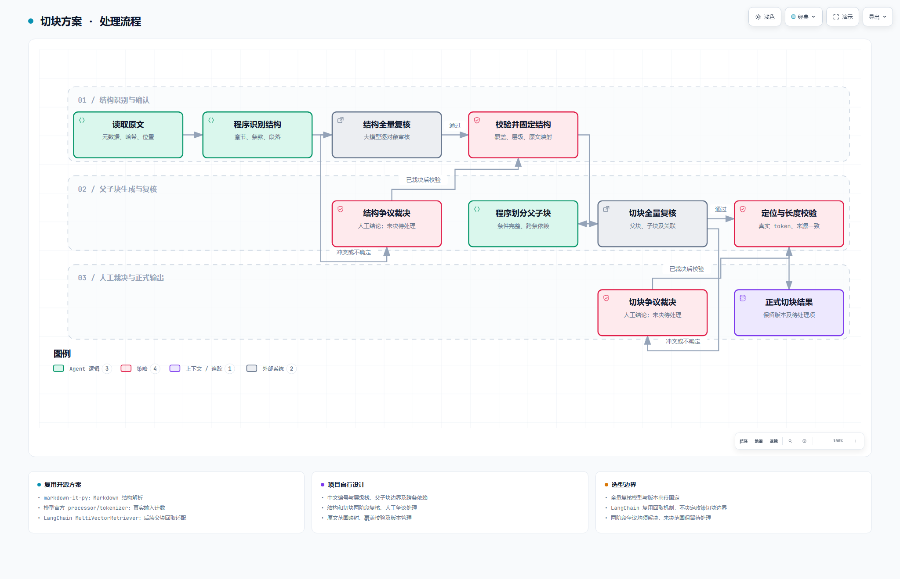
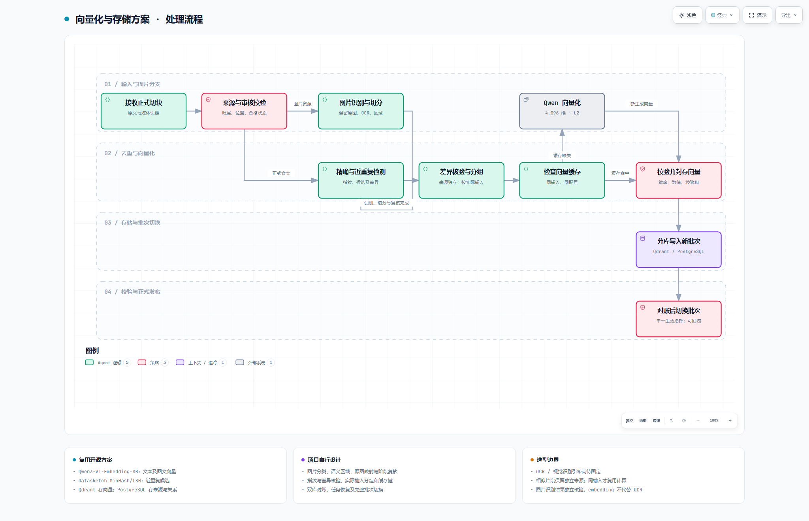
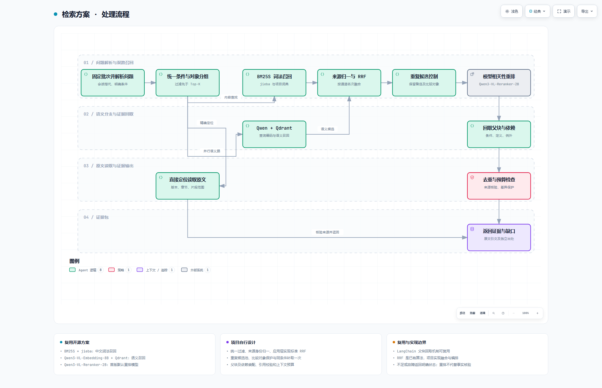

# RAG 库技术方案概要

## 一、切块方案

- **开源复用**：markdown-it-py 解析 Markdown；模型官方 processor/tokenizer 计算真实输入长度；LangChain 的 MultiVectorRetriever 适配后续父块回取。
- **自行设计实现**：中文编号与层级识别、父子块边界、跨条依赖、结构与切块两阶段全量复核、人工争议处理、原文定位及覆盖校验。
- **待选型**：执行全量复核的大模型及版本。

[打开切块交互流程图](RAG方案流程图/01-切块流程.html)

## 二、向量化与存储方案

- **开源复用**：Qwen/Qwen3-VL-Embedding-8B 生成文本及图文向量；datasketch 的 MinHash/LSH 发现近重复候选；Qdrant 存向量，PostgreSQL 存来源和关系。
- **自行设计实现**：图片分类与语义切分、原图区域映射及复核、指纹与关键差异核验、实际输入分组与缓存、双库对账、任务恢复和批次切换。
- **待选型**：OCR／视觉内容识别引擎。Embedding 负责向量化，图片文字识别由独立模块完成。

[打开向量化与存储交互流程图](RAG方案流程图/02-向量化与存储流程.html)

## 三、检索方案

- **开源复用**：BM25S＋jieba 做中文词法召回；Qwen/Qwen3-VL-Embedding-8B＋Qdrant 做语义召回；首版默认采用 Qwen/Qwen3-VL-Reranker-2B 重排；LangChain 父块回取机制可复用。
- **自行设计实现**：统一过滤与对象分组、来源身份归一、应用层融合、重复候选池、比较对象保护、同条件补取、父块与依赖装配、引用核验及上下文预算。
- **算法说明**：RRF、Jaccard 等属于已有算法；“自行设计实现”指项目的规则、适配和流程编排。

[打开检索交互流程图](RAG方案流程图/03-检索流程.html)
