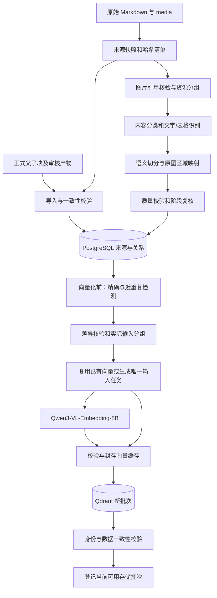

# 政策语料向量化与存储设计方案

版本：v1.2.0

编制日期：2026-10-21

项目：管策智研——政策研究与智能辅助决策智能体

状态：用户已确定采用 **Qdrant + PostgreSQL**，向量化模型为 **Qwen/Qwen3-VL-Embedding-8B**；本文确定实现设计，不代表程序、模型服务、数据库或效果评测已经运行。

范围：本阶段设计正式文本切块后的去重处理、图片内容识别与语义切分、向量化、数据存储、批次一致性与恢复。图片采用“保留原图＋识别内容＋按内容切块＋关联存储”；识别引擎尚待实施时固定。关键词/BM25、查询向量化、融合、召回、重排、查询时折叠和在线问答另行设计；本方案不以未来检索处理代替本阶段的数据处理。

上游依据：[切块方案 v1.0.3](切块方案.md)、[项目技术方案](../../../project-context/技术方案.md)、[项目背景](../../../project-context/项目背景.md)。本文承接正式文本切块产物，并补充图片分支的输入和存储约定。图片识别与切分产物同样需要原图映射、全量质量校验和阶段复核；结构/切块争议按既定冲突处理流程记录及裁决，不能以生成图片向量代替审核。

## 一、目标与已确定的技术路线

在正式切块结果上先进行内容指纹、近重复识别及实际输入分组，再生成 Qwen 向量并存入 Qdrant；PostgreSQL 保存各政策的独立来源、父子关系、位置、去重判定和批次清单。原文、来源及必要上下文分别保留。

| 项目 | 设计决定 |
|---|---|
| 正文主源 | `语料库/Agent标准引用库` 中 corpus、edge_cases 的 Markdown 及其资源关联 |
| 证据与关系主库 | PostgreSQL：原文版本、父子块、位置、审核依据、重复关系及发布清单 |
| 向量存储 | Qdrant：每个已选定的来源表示一个 point；可为文本块、原图、图像区域或必要的图文组合 |
| 向量模型 | `Qwen/Qwen3-VL-Embedding-8B`，默认保留完整 4,096 维 |
| 距离与格式 | L2 归一化；Cosine；首版保存 float32 向量，不默认量化或降维 |
| 去重路线 | 向量化前识别/归类重复片段；实际输入完全相同者共享输入记录与向量计算；有实质差异或不确定者独立保留 |
| 图片与表格路线 | 原图保存，正文/表格图片识别后按语义生成派生块；图表与公式保留完整单元，关联原图位置 |
| 更新路线 | 差量解析与向量复用，构建新的完整索引批次；校验后切换生效批次 |
| 首版部署 | 单节点 Qdrant、单实例 PostgreSQL、Python 服务与任务进程；模型服务单独适配 |

首版不要求 Redis、Kafka、Elasticsearch、pgvector 或分布式集群。后续扩展以全库实测为依据。

## 二、输入边界与正式入库条件

### 2.1 输入与状态

当前目录实查包含 506 篇 Markdown；实际语料清单、文件哈希和文档状态在每次构建时重新统计。此前探查的空正文、仅标题和重复段落数量是样本检查结果，不作为程序固定常量。

上游输入至少包括 `documents.jsonl`、`parents.jsonl`、`chunks.jsonl`、`relations.jsonl`，以及对应结构、审核、冲突和校验产物。沿用 `planid`、`parent_id`、`chunk_id`、`source_hash`、`structure_version`、`source_spans`、`retrieval_text` 等约定。

图片分支另读原文的资源引用和实际 media 文件，生成资源、出现位置、区域及识别结果清单。2026-10-21 盘点为 969 个图片文件、按字节 SHA-256 区分的 490 份内容；解析到 285 处引用目标缺失，490 个现存文件未被 Markdown 内联图片语法关联。这些是当前输入状态，不是固定配额或已经完成的处理结果，每批重新统计。

训练集问题可用于自测；参考答案、答案要点、期望回答和模型生成的政策解释不进入证据索引。项目背景仅作为要求依据，不与政策正文混合索引。

### 2.2 发布门槛

1. 子块及其所用结构版本满足《切块方案》的正式输出条件，相关复核记录完整；有争议时具备该方案要求的明确处理结论。
2. 来源版本、父子归属、依赖关系和原文位置可核验；实际 embedding 输入没有超限或静默截断。
3. `empty_body`、`metadata_only` 是文本正文状态，排除对应正文证据向量，但不因此丢弃 media。图片分支独立核对真实归属、内容及原图位置，合格对象可单独纳入；`needs_review`、资源缺失或未确认归属的对象保留状态和原因。
4. 合格子块可以入库；近重复关系尚不能判定时保留全部成员，不将它们标为已合并，也不因此假造审核通过。

每批保存完整输入清单、合格对象清单、未入索引对象及原因。上游缺少正式产物时，构建任务返回具体缺项，不能直接以原始 Markdown 绕过已确认的切块流程。

## 三、总体架构与存储职责



| 存储 | 保存内容 | 权威范围 |
|---|---|---|
| 来源文件快照 | 原始字节、媒体文件、文件清单与哈希 | 引用时的原文依据；不得被检索增强文本替换 |
| PostgreSQL | 文档版本、父块、子块、依赖、输入配置、去重关系、任务和发布清单 | 证据关系、数据状态和当前生效版本的唯一判定依据 |
| 向量与去重产物目录 | 缓存向量分片、输入清单、重复判定、验证报告 | 可核验、可重建的派生产物；路径和哈希在 PostgreSQL 登记 |
| Qdrant | 向量、point 身份和来源元数据 | 可重建的向量存储副本；来源、父子关系和审核状态以 PostgreSQL 为准 |

PostgreSQL 不再安装向量扩展；完整向量保存在有哈希的产物分片和 Qdrant。缓存索引在 PostgreSQL 中记录所在分片、行号、维度、格式和校验和，避免大量向量转成 JSON 后重复存储。

## 四、身份、来源快照与位置约定

### 4.1 身份分离

| 身份 | 规则 |
|---|---|
| `planid` | 原政策编号，字符串保存；不因去重修改，不从标题重新生成 |
| `document_version_id` | 固定命名空间下，依据 `planid + source_hash` 确定性生成；对应不可变来源版本 |
| `parent_id`、`chunk_id` | 沿用上游正式结果；同一 ID 内容或来源发生变化视为冲突，不能覆盖旧对象 |
| `representation_id` | 根据来源对象类型/ID、document_version_id、图片适用的 occurrence_id、表示类型、实际输入和 embedding profile 确定性生成；资源相同但来源不同仍有独立身份 |
| `point_id` | 将 `representation_id` 确定性映射为 UUID，规则与命名空间写入配置；不同批次可复用相同 point ID |
| `embedding_profile_id` | 模型、权重、processor、模板、精度、维度及归一化等配置的规范化哈希 |
| `input_hash` | 实际送入模型的输入内容哈希，区别于正文哈希和来源哈希 |
| `generation_id` | 一次候选索引发布的身份；持久化后重试沿用，不每次重试新建 |

Qdrant point ID 采用 UUID，避免直接使用任意格式的业务子块字符串。其同 ID 覆盖能力用于重试；这不承担文字或语义去重。[Qdrant points](https://qdrant.tech/documentation/manage-data/points/)

内容与配置指纹统一使用 SHA-256。来源哈希针对原始字节；复合身份、配置和输入描述采用字段明确、键排序且编码固定的规范化序列化，再计算哈希，避免直接拼接字符串产生歧义。向量缓存复用还需核对实际输入描述及分片校验和。

### 4.2 来源快照

构建前将实际引用的原始字节按 `source_hash` 保存为不可变快照，保持编码、换行和全文内容；登记原始相对路径与快照路径。媒体按内容哈希登记，保留其原文引用位置。原输入目录保持原样。

发布清单冻结每个文档的来源版本与元数据快照。后续修正地区等派生元数据时发布新批次，不能就地改变旧批次的过滤含义。

原文范围采用完整原文件严格解码后的 Unicode 码点下标，0 起点、右端不包含；范围可为有序列表，统一记录 `offset_unit=unicode_codepoint`。不使用清洗后正文下标，不通过字符串第一次匹配确定位置。API 展示层负责转换到所用前端下标体系。

图像区域使用原始图片像素坐标，记录 `bbox=[x0,y0,x1,y1)`、原图尺寸及坐标单位。裁剪/缩放后的坐标需要映射回原图。Markdown 字符位置、图片内部像素位置和派生识别文本的字符位置分别存储，不能把 OCR 文字伪装成原 Markdown 中的字符范围。没有依据的章节、页码或出现位置保留未知值。

引用校验同时核对文件字节哈希、解码规则、范围合法性和切片文本。快照缺失或不一致时，该证据返回不可用状态，不能回退到另一个相似文件冒充出处。

## 五、PostgreSQL 逻辑数据结构

以下为实现所需的逻辑表；字段类型、复合外键和迁移脚本在实现中落实，不能省略表中说明的约束能力。

| 表 | 主要字段 | 约束与用途 |
|---|---|---|
| `document_versions` | document_version_id、planid、source_hash、原路径、快照路径、编码、正文状态、元数据 | 唯一 `(planid, source_hash)`；来源内容不可变 |
| `parents` | parent_id、document_version_id、section_path、source_spans、structure_version、切块版本、审核依据 | 主键 parent_id；归属文档版本明确 |
| `chunks` | chunk_id、parent_id、document_version_id、source_spans、raw_content_hash、normalized_content_hash、结构/切块版本、token_count、状态 | 主键 chunk_id；复合关联保证父块与子块属于同一文档版本 |
| `relations` | relation_id、来源对象、目标对象、关系类型、依据、审核状态、版本 | 外键有效；跨文档或跨版本关系显式标明，不能误作同文档依赖 |
| `media_assets` | asset_id、SHA-256、真实编码、尺寸、快照路径、可读状态 | 按原始字节共享资源；保留原始文件身份与编码信息 |
| `media_occurrences` | occurrence_id、asset_id、document_version_id、原路径、Markdown 锚点、图题/章节、关联状态 | 内容相同也保留每次来源；missing_asset 允许 asset_id 暂缺，未知位置不补造 |
| `visual_regions` | region_id、asset_id、父区域、bbox、原图尺寸、类型、裁剪配置和产物哈希 | 区域必须在原图内；完整图也是一个区域，不将裁剪图当新原件 |
| `visual_extractions` | extraction_id、region_id、识别引擎/profile、实际输入哈希、原始输出、结构化文字/表格/公式、核验状态 | 派生产物有版本和原图映射；识别调用使用的上下文计入输入与缓存身份 |
| `visual_chunks` | visual_chunk_id、extraction_id、occurrence_id、派生父块/子块关系、文字或表格行组、原图区域、审核依据 | 与原 Markdown 文本块分开命名；同一图片的多个来源不丢失各自上下文 |
| `embedding_profiles` | profile_id、model_id、revision、processor/tokenizer 版本、模板/指令、runtime 配置、维度、dtype、归一化、距离 | 配置不可变；变更生成新 profile |
| `embedding_inputs` | input_hash、实际文本/输入描述、模态、媒体哈希列表、预处理配置哈希 | 输入内容共享存储；命中哈希时核对输入描述，不丢失来源关联 |
| `embedding_records` | representation_id、source_type、来源对象 ID、document_version_id、occurrence_id（图片适用）、profile_id、representation_type、input_hash、token_count | 来源类型为 text_chunk/image_occurrence/image_region/visual_chunk；表示类型为 text/image/image_text，类型与外键匹配，恰有一个主来源对象；图片出现身份与文档归属一致 |
| `embedding_cache` | profile_id、input_hash、状态、向量分片路径/行号、维度、dtype、norm、checksum、错误 | 唯一 `(profile_id, input_hash)`；仅 ready 的可校验产物允许复用 |
| `dedup_pairs` | 成对子块/单元 ID、方法、规则版本、相似度、关键差异、上下文检查、判定状态 | 固定左右 ID 顺序去重；记录 rejected、candidate 或 verified，避免把候选当等价 |
| `dedup_groups` | generation_id、group_id、类型、代表成员、规则版本、成员关系 | 按批次冻结；成员必须能追溯核验依据，代表成员不是唯一引用来源 |
| `index_releases` | generation_id、物理 collection 名、profile_id、去重规则/产物哈希、上游清单哈希、状态、计数、报告路径 | 每个 collection 唯一；冻结本批所有配置及发布范围 |
| `release_documents` | generation_id、planid、document_version_id、metadata_snapshot、是否纳入、排除原因 | 唯一 `(generation_id, planid)`，复合外键核对来源版本归属；包含无正文等降级文档 |
| `release_representations` | generation_id、representation_id、point_id、payload_hash、向量校验状态 | 唯一 `(generation_id, representation_id)` 与 `(generation_id, point_id)`；均关联本批来源对象和文档版本 |
| `index_tasks` | generation_id、任务键、任务类型、状态、尝试次数、租约、下次重试、错误 | 同批同任务唯一；与待索引数据在同一事务落库，作为持久任务队列 |
| `rag_runtime` | knowledge_base_id、active_generation_id、revision、updated_at | 每个知识库一行；登记当前通过校验的存储批次 |

`units`、`structures`、模型审核和冲突记录沿用上游产物，登记其版本、路径、哈希及对象对应关系；必要的证据依赖同步入 `relations`，不以仅存路径代替可执行的引用检查。

必要索引：来源唯一键、parent_id 与 document_version_id 外键列、内容哈希、缓存唯一键、任务状态/下次重试、发布成员关联，以及本批地区/时期筛选字段。JSONB 只保存变化较多的结构；主身份、状态、外键和常用条件使用明确列。唯一约束与外键依据 [PostgreSQL constraints](https://www.postgresql.org/docs/current/ddl-constraints.html) 实现。

## 六、Qdrant collection 与 payload

### 6.1 Collection 配置

每个候选批次建立一个物理 collection，例如 `guance_chunks_g_<批次标识>`。整个批次使用同一 embedding profile，去重规则与产物随清单固定。

设计配置示意（不是已执行的建库请求）：

```json
{
  "vectors": {
    "dense": {"size": 4096, "distance": "Cosine", "on_disk": true}
  },
  "on_disk_payload": true
}
```

首版以磁盘保存原始向量及 payload；HNSW 索引内存/磁盘配置按实测设置，不能将 `on_disk=true` 解释为无需内存。先保留 float32 精度；量化和降维另行验证，不在本阶段引入 sparse。[Collections](https://qdrant.tech/documentation/manage-data/collections/)、[Vectors](https://qdrant.tech/documentation/manage-data/vectors/)

### 6.2 Point 内容

一个 point 对应一个实际来源表示，包含 dense 及下列 payload。文本块默认一个 text 表示；图片按第7.3节选择完整图、必要区域及派生文本表示，不机械地为所有可能组合生成向量。相同实际输入可以共用一份计算结果，各来源 point 仍分别保存：

| 字段 | 类型与说明 |
|---|---|
| generation_id、representation_id、source_type、representation_type、document_version_id、planid | keyword；均与 PostgreSQL 清单一致 |
| chunk_id、parent_id | 原生文本块适用；图片不编造 Markdown 子块身份 |
| asset_id、occurrence_id、region_id、visual_chunk_id、extraction_id | 按来源类型提供适用的字段，明确区分原图、区域与识别文字 |
| source_hash、embedding_profile_id | keyword；用于对账与配置匹配 |
| area_code、area_name、ancestor_area_codes、admin_level | 地区条件；ancestor 列表来自真实行政层级，未知时不补造 |
| period_key、document_type、report_year | 规划期/文种/报告年份分列；year 为整数且允许缺失 |
| period_start、period_end | 只有来源可确认时提供，不能把规划期自动当政策效力期 |
| title、section_path | 便于诊断和展示；引用仍从主库/来源快照取得 |
| normalized_content_hash、dedup_group_ids | 去重辅助，不替代来源筛选与上下文核验 |

只纳入合格证据表示的 point，因此不靠批量修改 payload 的 published 标记完成发布。待审核对象不生成正式证据 point；无正文文档不生成原生正文 point，但经独立核验的媒体或识别产物可按其真实来源类型纳入。

为常用 keyword/整数条件建立 payload 索引，优先覆盖 planid、地区编码/祖先编码、period_key、document_type、report_year；其他字段保留元数据，后续检索方案再确定使用方式。本阶段核对 payload 与本批来源成员完全对应。[Qdrant indexing](https://qdrant.tech/documentation/manage-data/indexing/)

## 七、Qwen3-VL-Embedding-8B 调用设计

### 7.1 固定配置

使用完整模型 ID `Qwen/Qwen3-VL-Embedding-8B`，默认输出 4,096 维；模型官方窗口为 32K，支持文本、图片等输入及可变维度。首版 text 表示采用完整维度，不混入其他模型向量。[官方模型卡](https://huggingface.co/Qwen/Qwen3-VL-Embedding-8B)

实施时固定模型 revision、推理实现 commit、依赖、权重精度、processor/tokenizer、聊天模板、文本模板和指令、输入硬上限、输出维度、归一化及距离度量。它们共同构成 embedding profile；禁止未声明的供应商替代、自动降维或切换模型。

文档侧指令候选为“Represent the policy passage for retrieval.”，实施时固定并记录版本；这是项目的待验证配置，不是官方效果保证。查询侧的指令和接口留待检索方案确定。

实际文档输入沿用上游已确定的 `retrieval_text`，可含标题、章节和已确认必要上下文；不得在入库阶段再次自动摘要或改写原文。若新增实际输入内容，重新计数并验证，对实质上下文变化沿用上游受影响范围复查规则。

### 7.2 调用与校验

1. 用实际 processor 与聊天模板构造完整输入；纯文本也计入指令和特殊 token。
2. 先检查完整 token 数，再提交模型。模型、服务和运行配置的有效硬上限取可用限制；上游 768 token 仍只是可调整目标。
3. 官方包装器存在默认 `max_length=8192` 和自动截断路径；接入层不得把 32K 标称窗口当成实际配置，也不能用截断后 token 数证明未超限。[官方实现](https://github.com/QwenLM/Qwen3-VL-Embedding/blob/main/src/models/qwen3_vl_embedding.py)
4. 输入按内容哈希与 profile 查询缓存。缺失者分批调用，失败按对象登记；批次大小按 GPU/服务限制实测，不预设固定吞吐。
5. 校验输出条数和输入一一对应；每条恰为 4,096 维、数值有限且非零，按既定配置进行或核对 L2 归一化。
6. 先完整写向量分片及校验和，再以原子文件替换方式封存，最后将缓存登记为 ready。崩溃留下的临时文件不能视为可复用结果。

模型端点未选定时，适配器保留本地推理与服务调用接口，但只有端点/模型身份可核验后才进入构建。8B 权重精度、激活和 batch 共同决定显存需求，不能仅按权重体积宣称某显卡可运行。

### 7.3 图片、表格与识别结果的完整处理流程

采用 **保留原图 → 资源与引用核验 → 去重复用 → 内容识别和分类 → 按内容切块 → 原图映射及质量复核 → 生成向量 → 关联存储**。当前已完成图片盘点及少量实物抽看，以下全量处理尚未运行。

#### 7.3.1 资源身份、重复与异常

先登记每个文件的字节哈希、真实编码、尺寸和可读状态。文件后缀不直接当作编码；保留原件，必要的格式转换另存为有哈希、可追溯的派生产物。

用 asset_id 表示图片内容，用 occurrence_id 表示它在特定来源中的出现。相同内容共享资源及符合条件的识别/向量缓存，每个路径和来源仍分别记录，不删除原语料。

引用目标不存在时记 missing_asset；有文件但没有可靠锚点时记 unlinked_asset/pending_association。只有文件归属已核验、仅缺章节或 Markdown 锚点时，才可按 document_only 保存文档级来源；不能猜测具体段落或页码。缺失/未确认项不冒充已处理图片。

对异常重复需核对导出或原件。例如 38501 目录当前 49 个图片文件字节相同，只能确认它们对应同一份文件内容，不能认定为 49 页独立正文；即使 OCR 成功也不能宣称全文已恢复。

#### 7.3.2 分类与内容识别

图片按实际内容分类，全量保存分类依据与不确定项。拟处理类型包括正文页、图片内表格、统计图/地图/流程图、公式、装饰或低信息资源。

正文和表格内容交由独立的 OCR/视觉识别模块产生文字、阅读顺序、区域或表格结构；具体引擎、模型、版本和参数在实施时固定。Qwen3-VL-Embedding-8B 在本流程负责输出向量，不以 embedding 成功宣称文字或表格已被准确识别。

识别输出保留原始版与经核验版，记录引擎/profile、实际上下文、输入哈希、区域映射、核验状态和错误。原生 Markdown 与识别文字分开保存；现有正文已经包含图片内容时先比对并记录关联，不盲目重复录入。

#### 7.3.3 特殊切分规则

| 类型 | 父级与子级处理 |
|---|---|
| 正文页/扫描页 | 保留整页原图；识别标题、自然段及阅读顺序，派生文本沿完整语义单元切分。跨页句子/段落保存连续关系，每个文本块映射到相应原图区域。 |
| 表格截图 | 保留整表图像，识别表题、表头、逻辑行、单位、表注与合并单元格；子块沿逻辑行组划分，并附带共同约束。跨页续表须核验，表头或单位缺失时标记 needs_context，不补造字段。 |
| 统计图、地图、流程图 | 优先保留完整语义图，将图题、图例、坐标轴、单位及必要说明建立关联。内容过密时增加有明确含义的局部区域，并保留与整图和全局约束的联系。 |
| 公式 | 保持公式完整，与符号定义、单位及适用上下文关联；如转写 LaTeX，另存派生版本及原图范围，核验符号和上下标。 |
| 装饰/低信息图片 | 保留原件及分类依据，明确是否纳入向量库；不因尺寸小或缺少文字就自动删除。 |

不按固定网格统一切图，也不把文本 token 目标当作像素裁剪规则。图像区域使用原图 bbox；完整图像和语义区域的选择结果、排除原因与裁剪配置均入清单。识别出的文本沿用既有父子块的语义完整性、长度与依赖规则，但采用 visual_chunk_id 和派生文本位置，不伪造 Markdown source_spans。

#### 7.3.4 原图与派生文本的质量门槛

结构识别、切分边界、表格与区域关联分别保留程序/识别初始结果，并纳入对应阶段的全量质量校验和模型复核；无法判断或存在争议时沿用既定冲突清单与人工裁决方式，不能默认为通过。

重点检查金额、年份、百分比、单位、正负号、公式符号、表格行列与合并约束，以及图例和区域归属。可用证据需有可靠原图及位置；识别失败可保留原图与失败状态，未核验文字不作为已确认的政策原句。

#### 7.3.5 向量表示与视觉输入预算

- 原图或完整语义区域作为实际 image 输入，生成图像向量；保留原图文件和来源关系。Markdown 链接字符串不会自动载入图片。
- 经核验的 OCR 正文、表格行组或公式文字生成 text 表示；每个块仍关联其 visual_chunk_id、原图区域和核验版本。
- 需要图题或相关原文才能表达上下文时，选择 image_text 表示。记录选择理由，避免给每张图片机械生成全部组合。
- 全部表示使用已确定的 Qwen 模型空间及 4,096 维输出配置，按实际 processor 计入视觉 token、指令和附加文本。大图可保留全图视图并增加必要细节区域；不得用缩放后已不可读的小图替代细节证据。

向量数按实际选定表示统计，不直接用 969 个图片文件或 490 份字节内容充当最终向量数。原图和识别块通过关系关联，生成多种表示不表示新增了多份独立政策证据。

#### 7.3.6 缓存键与关联存储

图像/图文缓存键覆盖模型 profile、原图或区域内容哈希、bbox、输入顺序、缩放/裁剪/预处理、视觉预算及实际附加文本。同图不同图题或上下文不能直接共用图文向量；识别模块若使用上下文，其缓存同样覆盖实际上下文和识别 profile。视觉相似只作候选关系，不因图形接近就删除可能仅差一个数字的图片。

原图及裁剪等派生文件保存在文件目录；PostgreSQL 保存媒体、出现位置、区域、识别结果、派生块及 embedding_records；Qdrant 以 representation_id 对应的 point 保存向量与来源字段。point ID 包含表示身份，不继续只从 chunk_id 生成，以防同一来源的图像和文本记录互相覆盖。

每批另输出媒体文件与引用清单、重复资源组、区域清单、识别初始/核验结果、图片切分与表示清单、待处理原因及覆盖报告。检索如何使用各表示仍留到后续方案。

## 八、去重时点与本阶段的处理结果

**主要去重在正式切块之后、向量化之前执行。** 本阶段不要求先全量向量化，再靠向量相似度识别所有重复。

处理顺序：正式块与来源校验 → 片段内容指纹 → 近重复候选与差异核验 → 判定并保存来源关系 → 构造实际输入并分组 → 同配置同输入只计算一次向量 → 按来源写入存储并对账。

向量化后只进行向量格式、来源映射、幂等和批次一致性校验；本版不另外安排基于向量的语义去重。以后如需增加该步骤，应独立验证并记录。

必须区分以下结果：

| 判定 | 本阶段动作 | 向量处理 |
|---|---|---|
| 实际输入完全相同 | 多个 chunk 关联同一 embedding_inputs 记录，保留各自来源与位置 | 同 profile 计算一次或复用缓存；向量结果供各来源 point 使用 |
| 正文完全相同，标题/地区/必要上下文不同 | 保存相同正文关系，保留不同输入 | 分别向量化，不伪称缓存命中 |
| 排版差异或文字高度相似 | 保存近重复组、差异及核验结果 | 实际输入不同则分别计算；不因归组自动共用向量 |
| 金额、时期、条件等有实质差异 | 标为 substantive_difference，并保留差异依据 | 分别保留和向量化 |
| 无法判断是否可互相替代 | 标为 uncertain/candidate，保留原文与上下文 | 分别保留和向量化，不默认为重复删除 |

本阶段交付的是**完全相同输入的计算去重，以及近重复片段的识别、分组和差异记录**。它不等于将所有近重复片段压缩成一条向量，也不以之后的查询折叠宣称当前已经完成语义合并。

## 九、片段级精确去重与近重复识别

### 9.1 以片段为单位，不删除整篇相似政策

区县规划模板化、上级规划在下位文件中出现相同表述，首先处理其中的段落/条款，而非整篇删除。每份文件的 planid、父块、子块、章节、来源版本和原文范围分别保留。

例如甲县和乙县规划都包含相同的“完善公共文化服务设施”段落：记录相同正文或近重复关系；两个来源仍分别存在。若一份另有本县建设数量、年度目标或适用条件，则这些内容属于独立证据，不随公共段落一起合并。文字相同也不能据此自动推断上下级文件的授权、引用或效力关系。

### 9.2 指纹与保守规范化

source_hash 对原始字节计算，负责来源版本；raw_content_hash 对实际原文片段计算；normalized_content_hash 对有版本的保守比较视图计算；input_hash 对实际送入模型的输入计算。这些哈希不能互相替代。

原始文本不改写。派生比较视图只统一确认属于格式噪声的换行/空白，保留数字、单位、编号、标点、词语和顺序。表格保留表头、单元格和行列约束。规范化后相同只说明比较视图一致，不自动证明父上下文一致，也不允许将不同输入的向量缓存互换。

命中内容哈希时核验文本；命中缓存时核验 embedding profile 和实际输入。不得为了提高去重率，将地区、年份、金额、否定或必要条件从向量输入中删除。

### 9.3 近重复候选与核验

在向量化前，使用中文字符 n-gram 与 datasketch MinHash/LSH 缩小比较范围；字符 5-gram、128 permutations 仅为调试起点，参数须用本库样本校准。短块、表格和片段包含关系另设处理；候选发现可使用上游已经确定的基本单元，避免装配边界不同遮蔽重复。

对候选重新计算实际 shingles 的 Jaccard，保留原文差异，并核对：地区、时期、适用对象、金额、比例、单位、期限、责任主体、否定词、条件、例外，以及父块和必要依赖的约束。任一实质差异都记录，不能因总体相似度高而删除。

LSH 存在误报、漏报，只提供候选；本版不使用未经校准的单一阈值自动删除片段。规则无法确定的对象保持 candidate/uncertain；这类不确定性不妨碍已满足上游发布条件的来源块独立入库。[datasketch 官方 LSH 文档](https://github.com/ekzhu/datasketch/blob/master/docs/lsh.rst)

同一组的成员必须各自具有成对核验依据；不由 A≈B、B≈C 推出 A≈C。分组代表仅用于数据组织，不成为唯一证据出处，也不用于覆盖其他成员的父块或实际输入。

### 9.4 共享内容、计算与独立来源

PostgreSQL 的 embedding_inputs/embedding_cache 对相同实际输入和相同 profile 共享内容及向量计算，embedding_records 保存各来源表示与输入的映射。Qdrant 按各来源表示分别保存 point；原生文本保留 chunk_id/parent_id，图片和识别块保留相应媒体、区域及派生块身份，均指向自身的 document_version_id。

因此需要分别报告：识别出的相同正文组、近重复候选/已核验组、原始文件与媒体出现数、独立来源数、唯一实际输入数、按表示类型统计的向量/缓存命中数和 Qdrant point 数。近重复分组数不能直接当成减少的向量数；缓存节约不能直接当成数据库空间节约。

去重若建议改变正式块边界、实质上下文或原文内容，回到《切块方案》的受影响范围校验和复核；不在本模块中直接重切或改写。检索阶段如何使用这些重复关系由后续检索方案单独设计。

## 十、离线入库、更新与发布

### 10.1 构建顺序

1. 冻结输入清单、来源快照、上游版本、模型及去重配置，创建 generation；同一构建重试沿用该 generation。
2. 导入文档、父子块、依赖和审核依据；图片执行资源核验、分类、识别、语义切分、位置映射及对应复核，区分合格与待处理。核对正式门槛，在 PostgreSQL 事务中登记发布成员及任务。
3. 计算内容/媒体指纹、维护重复关系，选择并记录文本/图像/图文表示，形成实际 embedding 输入与缓存键。
4. 复用 ready 缓存，仅对缺失输入调用 Qwen；封存向量产物并逐对象登记成功或失败。
5. 创建独立 Qdrant collection、配置向量与 payload 索引；按确定性 point_id 分批 upsert，等待写入完成。
6. 对账 representation 与 point 身份集合、payload、向量、来源、重复关系与缓存；分别核验字符范围/图像 bbox、识别状态和存储一致性。
7. 校验完成后将 generation 标为 ready；在 PostgreSQL 短事务内核对当前 revision 并更新 active_generation_id。

新批次写入期间，当前可用批次保持不变。不能把 upsert 接口接收成功当成全部发布成功，也不能仅核对总数而不检查身份集合。

### 10.2 两库一致性的具体办法

**生效入口只设在 PostgreSQL，不要求跨两个数据库实现一个事务。** `index_releases` 固定对应的物理 collection、模型 profile、去重版本和来源成员；`rag_runtime` 指向已 ready 的 release。

当前批次以一个完整 release 描述，绑定物理 collection、模型配置、来源和去重关系。首版不靠 Qdrant alias 与 PostgreSQL 各自切换来发布，避免两个指针之间的时间差。旧 release 在引用保留和回滚策略允许清理前保持可读；后续使用方应固定同一批次读取，具体查询流程另行设计。

任务进程可以用 PostgreSQL `FOR UPDATE SKIP LOCKED` 认领队列，保存租约与心跳；租约超时后可重领。任务键唯一、操作可重试；模型调用失败或写入未知状态先检查既有结果再重试。断电发生在模型成功但缓存尚未登记时，仍可能重复调用，不能承诺跨外部服务的 exactly-once。[PostgreSQL SELECT](https://www.postgresql.org/docs/current/sql-select.html)

任务写入仅允许在该 generation 的 building 状态进行，任务携带租约版本；过期 worker 不能把旧任务状态提交为成功。全部必要任务完成且无未收敛写入后进入 validating，验证通过再置为 ready；失败状态保留明细。ready 后清单和 collection 业务内容冻结，不在其上继续增量改写。服务重启后重新读取 active release；若相关 collection 或产物缺失，返回明确降级/不可用状态，不静默混用另一批。

### 10.3 增量语义

| 变化 | 需要重做的部分 |
|---|---|
| 原文未变、正式块和配置未变 | 复用正式对象和 dense 缓存；新批仍按清单写入 collection |
| 新增或修改文档 | 重做受影响的切块与上游复核，生成新来源版本及输入；其余 dense 复用 |
| 图片、区域、识别或图文上下文改变 | 重新核验受影响来源、识别/派生块及表示；仅在资源、识别输入和 embedding 配置均匹配时复用对应缓存 |
| 正文相同但元数据/标题影响 retrieval_text | 按真实新输入重新计算；不能仅因 source 文本相同跳过 |
| 地区等过滤元数据修正 | 新批冻结修正后的 metadata/payload；若实际模型输入变化则重算 dense |
| Qwen 权重、模板、维度或推理 profile 改变 | 使用新 profile 重新判断缓存与生成向量；不能沿用不兼容缓存 |
| 去重规则或比较视图改变 | 重新生成受影响的判定与关系；若实际模型输入未变，可复用 dense 缓存 |
| 文件移出默认知识库 | 新发布清单排除；历史版本与既有引用仍可追溯 |

首版“增量”指差量处理与向量计算复用；为简化一致性，每次生成完整新 collection，并非只写变更 point。当前样本适合先验证此路线，全库需测量重建时间及双批磁盘开销后再评估更细粒度发布。不能用新增块 upsert 代替旧块失效处理。

### 10.4 失败与回滚

| 失败 | 行为 |
|---|---|
| 单条模型调用或输出异常 | 对象保持失败/待重试，批次不能假报完整；如选择排除，必须在范围和报告中明确 |
| PostgreSQL 已提交、Qdrant 尚未写入 | 保留任务和旧 active release，恢复后重试 |
| Qdrant 已写入、任务状态尚未提交 | 用相同 point_id 对账并重试，不生成新身份 |
| 验证不通过 | 新批进入 failed/blocked，不切换当前批次；保留具体失败证据 |
| 发布事务竞争 | 使用行锁或 revision 条件更新，失败者重新核对，避免旧构建覆盖较新决定 |
| 新批可用后发现数据回归 | 校验旧批可读后，在一个 PostgreSQL 事务中回指旧 generation；记录原因 |

这些是业务状态，不代表已获得人工批准；只有上游既有争议要求人工结论时才遵循相应流程。

## 十一、本阶段产物与后续衔接

| 接口或产物 | 输入 | 结果 |
|---|---|---|
| `build_index` | 正式切块产物、来源清单、模型与去重配置 | generation_id、任务统计、未完成项 |
| `validate_release` | generation_id | 身份、向量、来源位置、去重与缓存一致性报告 |
| `activate_release` | ready generation_id、期望 runtime revision | 当前可用批次；冲突/失败明确返回 |
| `get_document_status` | planid、generation_id | 是否收录、正文状态、未提供向量的原因 |
| `dedup_report` | generation_id | 判定明细、来源映射、重复组、实质差异/不确定项及真实节约统计 |
| `media_processing_report` | generation_id | 文件/出现/区域/识别块/表示的去向、图片重复复用、缺失/未关联项和核验覆盖 |
| 批次清单与存储数据 | generation_id | collection、模型 profile、向量与来源对应关系，供后续方案读取 |

去重明细至少保存原文/比较片段、成对 ID、各自 planid/parent_id/版本/范围、方法和参数、相似度、关键差异、上下文核验及判定。各来源位置与依赖关系能够从 PostgreSQL 还原，不能只保留代表片段。

本阶段不定义 retrieve API、Top-K、查询模板、BM25、融合/重排、上下文装配或查询时折叠。后续检索设计可以使用本阶段保存的数据，但其效果不能预先计入当前验收。

## 十二、部署、持久化与恢复

### 12.1 进程与目录

首版服务部署可采用 Linux 或 Windows WSL2/Docker；模型推理按实际 GPU/服务环境安排，不先假定 Windows 原生 GPU 依赖可用。数据库、模型与应用都锁定实际版本或镜像 digest，配置中禁止 `latest`。

规划目录如下，仅表示后续实现产物的位置约定，不表示目录已经生成：

```text
rag库/
  设计方案/向量化与存储设计方案.md
  处理产物/<切块版本>/...          # 上游正式结果与复核依据
  索引产物/<generation_id>/
    manifest.json                # 来源、成员、配置和各产物哈希
    vectors/                     # 向量分片或其受管缓存引用
    dedup/                       # 成对判定、分组与规则配置
    media/                       # 资源/出现/区域/识别/表示清单与审核记录
    validation_report.md
运行数据目录（由部署配置指定，置于源码版本控制之外）/
  sources/<source_hash>/...      # 来源与媒体不可变快照
  embedding-cache/...           # 可复用向量分片
  postgres/                     # PostgreSQL 持久卷
  qdrant/                       # Qdrant 持久卷
  backups/                      # 协调备份与校验清单
```

Python 数据管理接口与任务进程可以来自同一代码包。首版一个构建 worker 即可验证恢复机制；向量调用与写入并发按实际资源配置。Qdrant/PostgreSQL 仅供应用和维护通道访问，连接凭证通过环境配置提供，不写入文档或仓库。

新增运行产物时按仓库现有约定补 `.gitignore`：模型权重、数据库卷、向量分片、临时文件、凭证和备份不推送到源码仓库；设计、迁移、配置示例、清单格式和验证方法可以版本管理。

### 12.2 备份与恢复顺序

备份记录 active generation、不可变来源快照、PostgreSQL 备份、相应 Qdrant collection 快照、向量缓存、去重产物及配置文件。构建中的半成品另记，不冒充一致备份。协调备份时暂停发布切换，记录匹配的版本与校验和。

恢复先还原 PostgreSQL 与来源/派生产物，再恢复对应 collection；核对清单、point 集合和引用后开放该 release。Qdrant 索引不可用时可按同一冻结配置、缓存和正式来源清单重建；缺少必要产物时不能宣称已恢复。单独复制一个数据目录不等于验证成功，恢复演练要实际核对向量、成员映射和原文范围还原。

## 十三、容量与可观测性

按完整 4,096 维 float32，纯 dense 数组每条约 16,384 字节：

| 假设向量条数 | 纯 dense 体积，十进制 | 说明 |
|---|---|---|
| 1 万 | 163.84 MB | 未加索引、payload 或副本 |
| 10 万 | 1.6384 GB | 非当前实测切块数 |
| 100 万 | 16.384 GB | 不等同于内存需求 |

另计 HNSW、payload、PostgreSQL、来源与媒体、向量缓存、WAL、临时写入、备份以及至少新旧两批同时存在的空间。历史批次清理按引用保留和回滚策略另行执行，首版不自动删除来源历史。全库字数不能直接换算成模型 token 或实际子块数。

构建记录：文档状态分布、正式/排除块数、输入与缓存命中数、模型失败/超限、重复候选与核验结果、向量写入和对账数量、构建时间、磁盘及峰值内存。

本阶段另记录 generation/profile、重复判定与输入缓存的使用情况、各阶段耗时和异常。敏感凭证不得进入日志；原文日志按实际项目数据权限保存，不向外发布。查询日志和在线效果指标留待检索方案定义。

## 十四、验证与交付判据

以下为实施时应取得的证据，本文没有将未运行项目标记为通过。

| 验证对象 | 可观察通过条件 |
|---|---|
| 上游与覆盖 | 所有输入文档有状态；纳入/排除及原因可对账；没有以未审核原文绕过切块要求 |
| 引用完整性 | 来源哈希、Unicode 码点范围、父子与必要依赖校验通过；相同文字多次出现时定位仍正确 |
| 模型输入 | 真实 processor 全量计数；指令/模板等均计入；超限明确处理，输出与输入一一对应 |
| 向量 | 4,096 维、非零、有限、符合归一化配置；模型/profile 不混用 |
| 幂等与缓存 | 同任务重跑不增加对象或 point；正常 ready 缓存不重复调用；故障窗口重复调用如实统计 |
| 两库对账 | PostgreSQL 发布表示成员与 Qdrant point ID 集合一致；payload、dense 向量可核验，来源块数与表示数分别统计 |
| 图片覆盖与归属 | 每个文件和出现位置有去向；缺失、未关联与文档级关联分别记录，不猜测页码或丢弃无正文文档的 media |
| 图像切分与识别 | 原图/区域 bbox 可核验；表头、单位、行组、图例和公式上下文完整，识别文字与原生原文分开，阶段复核与未完成项可对账 |
| 多模态输入与身份 | 图片确实作为图像输入且实际视觉预算合规；同图不同上下文不误命中缓存；不同表示不互相覆盖 point |
| 去重边界 | 跨区同正文保留各自来源；金额/年份/否定/父条件差异不误合并；候选不自动当已核验组；相同输入和不同输入的向量计算统计真实 |
| 任务恢复 | 在缓存写入、Qdrant 写入和发布前后模拟中断，重试恢复且数据不混批 |
| 增量与回滚 | 新批成员不混入旧默认块；历史来源位置可还原；回滚后数据清单与配置共同回到旧 release |
| 备份恢复 | 备份恢复到相符批次，实际核对向量与成员映射并还原原文范围，而非只验证备份文件存在 |

本阶段报告精确去重与近重复识别的误判/漏判抽查结果、独立来源覆盖、唯一实际输入数和真实缓存复用，不报告尚未运行的检索或问答效果。项目的命中率、回答一致率、引用正确率和在线并发/响应指标在后续对应方案中验证。

## 十五、实施顺序与尚待固定的运行参数

1. 完成上游正式文本切块产物及校验；按第7.3节验证图片分类、识别、语义切分、原图映射与复核，再纳入正式表示清单。
2. 在向量化前完成内容指纹、近重复候选与差异核验，保存去重明细和实际输入分组。
3. 固定 Qwen 推理端、revision/profile 和 processor，验证真实输入、长度和输出格式。
4. 实现 PostgreSQL 结构、共享输入/缓存、来源快照和任务重试；对唯一缺失输入生成向量。
5. 按来源写入 Qdrant，核对独立成员、向量复用、payload、原文范围和批次一致性。
6. 验证新批登记、增量构建、中断恢复、回滚与备份恢复，再执行当前样本全量处理。
7. 全库阶段重新测量去重判定成本、向量化时间、存储容量和重建开销；检索另行设计。

模型、4,096 维及 Qdrant + PostgreSQL 已确定。实施中需固定模型端点与硬件、OCR/视觉识别引擎及版本、图片分类与区域规则、各阶段复核配置、软件版本、数据目录、processor 文本/视觉输入上限、batch/并发、去重参数、向量索引配置以及备份保留策略。依据实际证据选择运行参数，不要求重复确认已选技术路线。

本次交付范围为设计文档。后续源码、数据库迁移、运行配置、正式索引和验证报告各自记录生成与执行状态。
