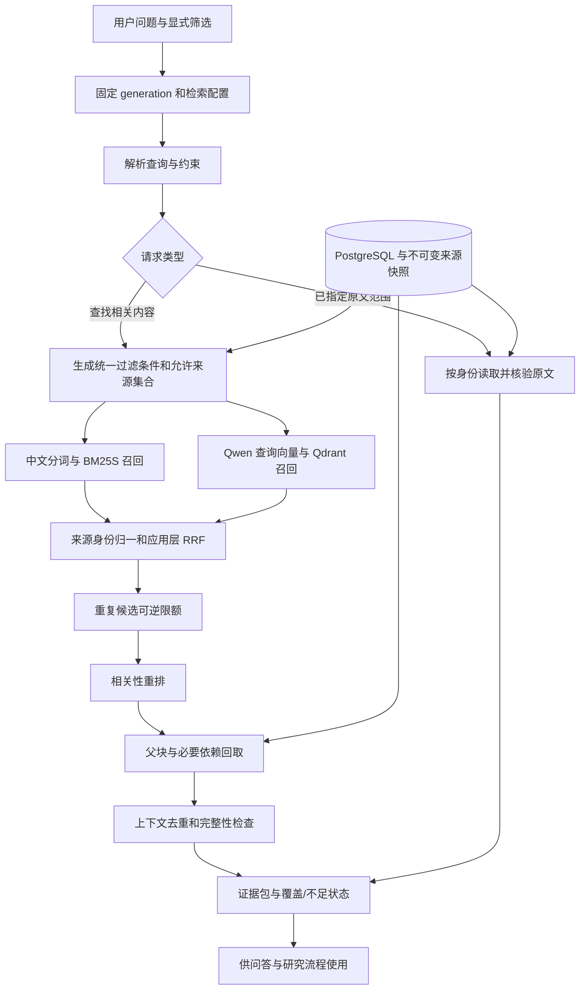

# 政策语料检索设计方案

版本：v1.0.0

确认日期：2026-10-21

项目：管策智研——政策研究与智能辅助决策智能体

状态：用户已选择 **A 方案：独立中文 BM25＋Qdrant 向量双路召回＋应用层融合＋重排＋父块原文回取＋任务感知去重**。本文确定检索设计；源码、索引构建、模型服务及效果评测尚未执行。文中的首版参数为实施和验证起点，不代表实测最优值。

上游依据：[切块方案](切块方案.md)、[向量化与存储设计方案](向量化与存储设计方案.md)、[项目技术方案](../../../project-context/技术方案.md)、[项目背景](../../../project-context/项目背景.md)。历史选型参考文件为`检索设计候选方案-2026-10-21.md`及`GitHub检索与去重参考-2026-10-21.md`；这两份文件未随当前档案保存，归档时明确其缺失，不提供失效链接或补造内容。

## 一、目标与范围

检索的输出是完成当前问题所需的、可回到原文核验的证据集合。系统应支持主题、地区、时期和政策类型条件检索；支持依据 planid、章节和片段读取原文；返回内容、独立来源和缺证据状态。

采用以下处理链：

> 固定可用批次 → 理解问题和过滤条件 → 精确定位或双路召回 → 按来源身份归一 → RRF 融合 → 重复候选控制 → 重排 → 回取父块与必要依赖 → 上下文去重和预算检查 → 返回证据及不足说明。

沿用既有 Qdrant＋PostgreSQL、Qwen/Qwen3-VL-Embedding-8B、4096 维及正式父子块。新增独立 BM25S 派生索引、查询适配、融合重排和证据装配。正式块的边界、原文、位置和审核结论仍以既有切块产物为准。

本版处理用户明确指定的多个地区、时期和研究主题，按显式对象分组检索，防止一个对象占满结果。自动规划研究子任务、全量证据矩阵、循环生成新问题等 C 方案能力留作后续增强，不列入本次已选路线。

## 二、组件与职责

| 组件 | 首版设计 | 负责的事情 |
|---|---|---|
| 来源与关系库 | PostgreSQL | 生效批次、文档与元数据、独立来源、父子块、必要依赖、去重判定和精确位置 |
| 语义召回 | Qdrant，既有 dense collection | 在过滤范围内查找语义相关的正式来源表示 |
| 词法召回 | BM25S | 在允许来源集合中按中文词项召回正式文本和已核验图片识别块 |
| 中文分词 | jieba 搜索模式＋项目词典＋数字/文号保护规则 | 保证建库与查询使用相同分词协议 |
| 查询向量 | Qwen/Qwen3-VL-Embedding-8B | 按兼容 profile 生成4096维查询向量 |
| 融合 | 应用层 RRF | 合并两路名次，不直接相加原始分数 |
| 重排 | 首版设计默认 Qwen/Qwen3-VL-Reranker-2B | 对查询—候选对重新评分，支持文字与适用的图像输入 |
| 证据装配 | Python 应用服务 | 核验来源、回取上下文、处理重复、保持比较对象覆盖及控制 token 预算 |

重排模型是本设计给出的默认实现选择，尚未部署；实施时固定版本和输入配置，并据真实资源、效果和并发测试调整。它与用户已选的 embedding 模型承担不同职责。

BM25S 提供词法打分和持久化，jieba 提供搜索分词及用户词典；元数据筛选、来源身份和发布一致性由本项目实现。[BM25S](https://github.com/xhluca/bm25s)、[jieba](https://github.com/fxsjy/jieba)

Qwen 官方仓库提供所选 embedding 和2B/8B图文 reranker；采用其输入封装，实际 token/视觉预算由接入层验证。[官方仓库](https://github.com/QwenLM/Qwen3-VL-Embedding)

## 三、总体架构



两路召回可以并行。每个请求绑定同一 generation、词法索引、Qdrant collection、元数据快照和去重版本，完成后才释放该批次的使用引用。

## 四、输入和检索身份

### 4.1 输入条件

只有满足上游正式发布条件的来源对象进入证据检索。词法索引不直接从原始 Markdown 重切，也不绕过全量复核、争议处理和定位校验。

输入包括正式文档、父块、子块、必要依赖、图片识别结果、来源版本、重复判定、发布清单与模型 profile。使用 `retrieval_text` 做召回增强，使用来源快照和 `source_spans` 还原引文。背景材料、训练集答案、答案要点及模型自行生成的政策解释不进入证据索引。

### 4.2 来源身份与多表示归一

引入检索逻辑身份 `evidence_unit_id`，只作来源对象映射，不替代上游 ID：

| 来源 | evidence_unit_id 的组成依据 | 回取依据 |
|---|---|---|
| 原生正文子块 | document_version_id＋chunk_id | parent_id、source_spans |
| 图片识别文字/表格块 | document_version_id＋occurrence_id＋visual_chunk_id | extraction_id、原图/区域、派生文字位置 |
| 原图或图像区域 | document_version_id＋occurrence_id＋region_id | asset_id、bbox、原图尺寸 |

采用固定命名空间及规范化序列化生成确定性 ID；不依赖数组行号作为业务身份。同一来源对象的 text、image_text 等表示，只有主来源身份一致时才归入同一单元。原图、不同区域、OCR 块和 Markdown 块不因文字相似或 asset_id 相同而自动合并。

一个来源对象同时命中 BM25 和 dense，是同一候选的多路命中；不同 planid 出现相同文本，仍是两个独立候选。跨类型存在经核验的对应关系时，可在上下文装配阶段减少重复，保留所有真实来源身份。

## 五、中文 BM25 索引设计

### 5.1 索引单位和文本

每个可用原生子块或已核验图片识别子块，对应一条 BM25 记录；同一逻辑来源的多种 embedding 表示不重复建立词法记录。纯图片且无可用识别文字的对象不伪造文本，仅走适用的语义分支。

原生块的词法输入沿用正式 `retrieval_text`，含其既定标题、章节和必要上下文；不重复拼接整篇或整父块。识别块使用已核验识别文字和有依据的图题、表头、条件。保存实际词法输入和输入哈希，避免词法内容与正式来源脱节。

文档标题另存轻量精确匹配字段，用于标题定位；不通过无限重复标题词实现加权。首版不引入额外摘要索引或 BM25F 多字段调参。

### 5.2 中文分词与比较视图

首版词法预处理为可版本化的派生视图，原文和引用保持原样：

1. 将确认等价的空白和全角 ASCII 字符转成统一检索形式，英文小写；不任意改写其他 Unicode 字符。
2. 先识别年份、百分数、小数金额、单位组合和文号，作为受保护词项保留，并按固定规则生成必要基础词项；文档侧和查询侧执行相同规则。
3. 其他中文文本采用 `jieba.cut_for_search`，固定词典及 HMM 配置。项目词典覆盖行政区名称、部门、政策工具和专业名词；检索词典是派生产物，有文件哈希和版本。
4. 首版不设大范围停用词表；只移除空白和不承载意义的独立格式符号。保留“不、不得、不低于、以上、以下、至少”等否定和范围词。
5. 搜索模式生成的长短词按确定性规则保留；同一个保护范围与分词结果产生的完全重复词项去重，原文不同位置的真实词频保留。

例如“2025年补助不低于10万元”应使年份、金额、单位和“不低于”可被检索及差异核验；不能把它与“2024年补助不超过10万元”当作等价事实。首版不自动进行可能改变金额、数字或地区的繁简/同义词替换。

分词使用独立 tokenizer 实例和冻结词典；请求处理中不在线修改全局词典。查询全部词项不在当前词表时，词法分支返回零命中及 `no_known_terms`，由 dense 分支继续，不把零分记录补成相关结果。

### 5.3 打分和统计口径

首版 BM25S 固定 `method=lucene`、`idf_method=lucene`，初始 `k1=1.5`、`b=0.75`，保存 float32 打分产物。参数写入 lexical_profile，不依赖库的隐式默认值；后续按本库实验调整。

每条独立来源的词法记录计作一个 BM25 文档，IDF 和平均长度按本批全部合格词法记录计算。跨 planid 的重复块暂不合并统计身份；其对词频统计和候选拥挤的影响分别记录，在线通过重复候选控制处理。首版不引入“按重复组重新加权 IDF”这类另行改变排序口径的规则。

筛选查询沿用该批全局统计，仅限制候选集合；不针对每次地区过滤临时重建 IDF。词典、分词、输入或来源成员变化时重建该批词法索引。BM25S 当前源码提供 `get_scores`，具体适配固定到实施版本并验证。[打分源码](https://github.com/xhluca/bm25s/blob/main/bm25s/__init__.py)

### 5.4 元数据过滤必须进入 Top-K 选择

PostgreSQL 先从本批来源成员生成允许的 evidence_unit_id 集合，转换为 BM25 row_id 集合。首版适配器按以下逻辑执行：

```text
若允许集合为空，返回空结果
查询按冻结词表编码；没有已知词项则返回空结果
scores = BM25S.get_scores(已知查询词项)
eligible = 允许 row_id 中分数有限且 score > 0 的行
仅在 eligible 内选择 Top-K
以 score 降序、evidence_unit_id 升序确定同分顺序
返回前再次核对所有对象属于允许集合
```

这实现“候选约束先于 Top-K”，即使底层计算了完整分数数组，也不会先截取全库 Top-K 再过滤。乘法 weight_mask 不能代替该逻辑，因屏蔽后的零分行仍可能被补入 Top-K。空词项和空候选要在调用前处理。

该方法每次需要长度为 N 的分数数组，单数组 float32 大约占 `4×N` 字节，另计临时数组、词法索引与并发。全库应测 mmap、内存和延迟；若超预算，先在相同打分口径下实现允许集合的倒排累加或分片检索。改变评分或引擎需另行记录，不把样本性能视为全库保证。

### 5.5 产物

```text
索引产物/<generation_id>/lexical/
  manifest.json          # 配置、来源范围、统计、哈希
  bm25/                  # BM25S 保存的词法打分产物
  tokenizer/             # 冻结词表、词典、规范化和分词配置
  rows.jsonl             # row_id 到 evidence_unit_id、来源身份和输入哈希
  validation_report.md
```

row_id 在当前批内连续且唯一，行数、映射及索引统计可对账；跨批不承诺相同 row_id。使用只读加载，运行时不更新已发布词法索引。

## 六、问题解析与条件过滤

### 6.1 请求解析

形成结构化 QuerySpec：原问题、当前轮独立问题、明确引用的历史对象、查询词、用户显式过滤、可验证的归一化映射、软线索、任务类型和请求预算。

显式 UI 筛选和自然语言中的明确限定共同构成约束。有冲突时返回 `needs_clarification` 并展示冲突字段；不静默忽略其中一方。planid/片段 ID 和结构化筛选先由程序解析，语义不明确处可由模型提出候选，但低置信推断只作软线索，不直接缩窄知识库。

多轮问题根据本会话中明确的对象和已展示证据补足指代，记录使用了哪些历史来源。承接“刚才第一项”时绑定上一轮实际展示的项，不读取训练集期望回答；用户改变地区或时期时替换对应条件，不能继续锁定旧对象。

### 6.2 条件口径

| 条件 | 执行规则 |
|---|---|
| planid | 字符串精确匹配；指定文件内检索时始终限定该文件 |
| 主题 | 原问题/词法/语义召回为主；非完整主题标签只作增强 |
| 地区 | 使用规范编码；区别该地区本级文件与辖区文件，ancestor 只能来自可验证层级 |
| 规划期 | 使用 period_key；与年度报告年份、发布日期、效力期分别建模 |
| 年份 | 问报告年份使用 report_year；问目标年份还需检索正文，不把文件年份当目标事实 |
| 政策类型 | 用有依据的规范 document_type；原始 plantype 标签和冲突记录仍保留 |
| 章节 | 已唯一定位的章节限制其正式子块；模糊标题只提供候选章节 |

同一字段多个值通常为 OR，不同字段之间为 AND；比较请求按用户明确的对象组合分别执行。两路共用一份条件 AST，由适配器生成 SQL 与 Qdrant filter；程序测试两种执行结果的成员一致性。

行政区名称、时期别名通过有来源的映射表归一化。缺失字段保持 unknown，类型冲突保持 conflict；有确定依据的修正写入新批快照，并带派生依据。明确硬条件下，unknown 不能自动算匹配，可另返回“元数据待确认”的定位线索。

“山东省发布的文件”限定省本级；“山东省及所辖地区”包含真实辖区。单说某省且范围会明显影响答案时，优先采用界面已选范围；仍有歧义可先返回带明示范围的检索结果，必要时请求用户澄清。没有确定层级时不凭编码前缀猜测祖先关系。

### 6.3 两条查询路径

- **原文读取**：已知 planid＋章节/片段/原文范围，验证身份后直接回取；读取整篇时分页，不经语义排序截断。
- **相关内容查找**：指定 planid 但问某主题时，在该文档内双路召回；未指定文件时在条件范围内召回。标题匹配得到多个文件则返回候选身份，不能以相似文件冒充精确定位。

## 七、向量召回与多模态处理

从固定 release 读取 embedding_profile_id、物理 collection 和维度；查询模型必须与索引权重、processor、维度、归一化及距离配置兼容。query_profile 另记录查询指令、模板和长度预算。

查询指令首版设计为 `Given a policy research question, retrieve original passages that answer it with their applicable conditions.`，按 Qwen 官方 instruction 字段传入，用户问题放入 text 字段；实际模板和 profile 在实现中冻结并验证效果。查询指令可与文档侧不同，兼容关系需显式登记；不把相同维度当作不同模型可混查的依据。

实际 processor 检查完整查询输入。超长问题先返回长度提示或按已明确的子问题分批；不截断掉地区、时期、否定等条件。输出须4096维、有限、非零、按配置 L2 归一化。向量调用失败时有明确降级状态。

Qdrant 在 ANN 查询内应用地区、时期、文种、planid 等过滤，并使用本批 payload 索引；结果回到 PostgreSQL 再核对来源成员和条件。发现过滤或版本不一致属于错误，丢弃异常命中并记录，不把它当作普通无命中。[过滤文档](https://qdrant.tech/documentation/search/filtering/)

正文、已核验 OCR、原图和图像区域沿用各自合法来源身份。纯图像走 dense，识别文本可以走两路。用户文字问题仍可召回图像表示；读取和展示必须有原图及真实 bbox，OCR 内容明确标为识别结果。

## 八、应用层融合和候选组织

### 8.1 融合规则

每路先映射到 evidence_unit_id。同一单元在该路出现多次时仅取最高名次，保存全部 representation_id 和通道依据；不同单元不得因相似就提前变成同一个 ID。

首版用等权 RRF：

```text
rrf_score(e) = Σ [ w_channel / (k_rrf + rank_channel(e)) ]
rank 从1开始；未命中的通道不贡献分数
初始 w_bm25=1.0，w_dense=1.0，k_rrf=60
```

保存 BM25 分数、余弦分数、各路名次和 RRF 分数供诊断；最终融合不把它们直接相加。首版使用应用层公式，不依赖其他引擎可能不同的 RRF 默认常量。

同分时按 best_channel_rank、evidence_unit_id 固定顺序。同一候选经多个同义查询命中不无限累加；首版每个显式请求分组仅运行一次双路查询，重取更深候选也不新增“通道票数”。

### 8.2 显式比较对象的候选分配

用户明确比较甲乙两地或多个规划期时，按明确组合分别套用过滤和双路召回，组内融合；最终先为每个有相关证据的组保留候选，再分配剩余预算。多个组的原始重排分数不直接全局混排，以免一个组占满证据。

组内无相关候选保持缺口，不跨组借用；一个证据确实属于多个请求组时保留组关联，正文可以只装配一次。分组过多超出预算时分批/分页并报告剩余组，不静默丢弃。该设计只使用用户明确对象，不自动创造新的研究维度。

## 九、去重如何参与召回、重排和证据装配

### 9.1 继承离线结果

使用上游内容指纹、dedup_pairs、dedup_groups 和核验状态，不在每个请求上重新做全库近重复检测。精确内容、近重复候选、verified 和 substantive_difference 分别使用；candidate/uncertain 不能被当作等价合并。

去重只减少重复计算、重复候选占位和重复上下文，每个文件的 planid、版本、章节、块和引用位置独立保留。相同输入的 embedding 缓存复用，不意味着只在 Qdrant 中保留一个跨文件 point。

### 9.2 重排前的可逆候选控制

1. 合并同一 evidence_unit_id 的多通道命中。
2. 对同文档同版本、同原文范围的确定性重复候选，只送一次重排，记录各命中入口。
3. 对已核验可替代、且父条件/必要依赖无实质差异的重复候选，在当前请求组内暂选最相关者优先重排，其余放入备选池。
4. 不同地区/时期的比较组分别保留代表；同一文档不同有用章节照常保留。候选数上限是预算，不是“每篇只留一块”。

组内任意两成员不因连通关系自动等价。选择代表须有该成员与代表的直接核验依据；A≈B、B≈C 不推出 A≈C。缺乏父上下文等价依据时，只合并相同来源，不做跨文件限额。

### 9.3 重排后的折叠和差异保护

相关性确定后再判断哪些内容可减少展示。金额、比例、年份、期限、对象、责任主体、单位、否定、条件、例外、表头或父块差异任一影响事实时，分别保留。差异核验失败/不确定时继续保留，不以总体相似度替代判断。

普通概括任务可折叠共同表述，返回代表和完整的重复来源清单。比较任务必须在每个必要对象下保留对应出处，即使引用文本相同。没有任何对象可以仅因“与另一地相同”而失去来源。

同一内容存在多份政策出处不自动提高可信度，也不推断政策之间的授权、引用或效力关系。跨文件引用关系只使用有原文依据的显式关系。

### 9.4 同源范围合并

按 document_version_id、source_hash 及原文区间合并实际重叠范围，避免同父块被装配多次。只有真实连续且被完整回取的范围才可展示为连续引用；多个不连续范围按列表保留，不伪装成原文连续段。

折叠后保留 representative_id、member_ids、各自位置、折叠原因、核验版本及保护差异。返回的引文来自它所标注的那个来源；不能把甲文件的截取结果直接配上乙文件的位置。

### 9.5 候选不足时补足

重复组挤占初始 Top-K、过滤范围较窄或父条件核验失败导致有效候选不足时，允许一次扩大同一查询的召回深度，并从备选池补入。过滤和原问题保持不变，记录新增独立证据数。

首版不自动放宽地区/时期、不循环生成新问题。达到深度、时间或上下文预算仍不足，返回 partial/no_matching_evidence 和具体原因。MMR 不作为本版必需模块；它不能承担政策事实等价判定。

## 十、重排设计

按 query＋候选检索文本＋必要标题/章节/适用条件构造重排输入。不得只将一个脱离条件的金额句送给模型；也不把全部父块无差别塞入导致超限。对文字候选使用文字输入，对需要原图判断的候选按合法表示送入图像及必要上下文。

首版使用 Qwen/Qwen3-VL-Reranker-2B，记录 rerank_profile_id、模型 revision、processor、指令、最大长度及视觉预算。实际输入完整计数，超限按已确认语义单元拆分或明确标为未完成评分；不能让默认截断丢掉关键条件。

重排输出为相关性分数。它不证明事实真实、不证明两个政策等价，也不自动证明证据足够。由有标注问题校准相关性拒绝阈值；不同版本阈值分别保存。尚未校准时保留 `relevance_uncalibrated`，不能因任意 Top-K 都有结果就宣布能够回答。

重排为主排序，RRF 用作预筛和同分顺序，不在首版再把两种分数线性混合。单条失败保留失败原因并使用备选；整体失败可按 RRF 返回降级检索结果，明确 `reranker_unavailable`，不冒充已重排。

## 十一、父块回取、完整性与引用

### 11.1 回取内容

根据命中子块回取该版本的父块和已核验必要依赖，包含对象、条件、标准、例外、定义、引导语、单位和表头。只沿上游明确记录的关系扩展，不因向量相似自动建立政策引用链。

正文引文从不可变来源快照严格解码后按 source_spans 截取，核对哈希、Unicode码点范围和预期片段；不从 BM25 存储文本、Qdrant payload 标题或模型摘要复制引文。前端负责码点到 UTF-16 等显示下标转换。

图片证据保留原图、occurrence_id、bbox、识别版本和识别状态。没有真实页码就不生成页码，没有可确定章节就标未知；OCR 原文与 Markdown 原生正文分开标示。

### 11.2 上下文预算

请求预算由问答模型实际窗口减去系统提示、问题、输出保留量和安全余量得到。首版纯文本证据装配软目标为12,000 token，实际硬上限取模型与部署限制中较小者；图像预算单独计入。

优先完整保留支持结论的子块、必要条件和例外。父块过长时可按既定语义单元、表格行组选择所需范围，保留父块完整读取入口和未装配范围说明；不能为凑条数截去否定词、单位或半张表。

若必要依赖未入库、来源不可用或完整证据装不下，相关候选降为 `context_incomplete`，不得按完整支持证据使用。其他候选仍可返回；如均不完整，状态为 partial/source_unavailable 并说明缺项。

### 11.3 证据是否支持回答

至少检查：是否匹配硬条件；内容是否切中问题；量化结论是否有数字/单位/时期；对象、条件和例外是否齐备；比较双方是否各有依据。只满足“文档标题相关”或“向量分高”不算具体主张获得支持。

引用定位校验由程序执行，语义支持检查可以由模型辅助并保留依据；未确认的支持关系标不确定。检索层不自行编造政策研究结论。下游问答逐项引用实际支持它的证据；模型解释与政策原句在返回结构和界面中有明确区别。

## 十二、接口与返回约定

### 12.1 search_evidence

输入：query、可选会话指代、filters、mode（locate/search/compare）、指定 generation（可选）、返回数量和预算。服务端校验用户可访问的来源范围，拒绝任意文件路径读取。

过滤字段至少支持 planid、地区编码及 scope、period_key、document_type、report_year、section_id；可选值缺失不自动填“全部有效”。

返回分为以下部分：

| 部分 | 主要字段 |
|---|---|
| 请求 | request_id、original_query、resolved_query、generation_id、retrieval_profile_id |
| 执行条件 | applied_filters、约束来源、实际查询词、显式请求分组 |
| 状态 | status、degraded_channels、warnings、coverage_status、missing_groups |
| 证据 | evidence_id/evidence_unit_id、planid、document_version_id、chunk_id/图片身份、parent_id、title、section_path、quote |
| 引用位置 | source_hash、source_spans、offset_unit，或 occurrence_id/region_id/bbox/extraction_id |
| 召回记录 | 命中通道、各路名次/分数、RRF 分数、重排分数、profile及校验状态 |
| 去重记录 | 重复组、代表及备选成员、折叠理由、各成员独立来源和差异 |
| 运行记录 | 阶段耗时、有效候选数、补取记录、预算耗尽原因 |

`evidence_id` 绑定本次返回的来源版本和实际引文范围，不能仅靠数组序号当永久引用。

### 12.2 read_source

输入 planid＋document_version_id，及 chapter/chunk/source_spans 中适用的定位条件；当前版本读取可省略 version，由服务端解析并回传。历史引用必须携带固定版本，不能自动换成当前正文。

返回原文及前后上下文、章节/片段身份、哈希核验和状态；读取整篇使用游标分页。不接受外部任意绝对路径，不凭“相似文本第一次出现位置”重新猜定位。章节不唯一时返回候选位置。

### 12.3 状态语义

| 状态 | 含义及前端表现 |
|---|---|
| evidence_found | 找到相关且通过来源/必要上下文核验的证据；覆盖状态仍单列 |
| partial | 有可用证据，但对象、上下文或维度尚有缺口 |
| no_matching_evidence | 在本次明确范围和预算内未找到支持证据；不等同政策不存在 |
| source_unavailable | 有文档/候选线索，但正文、媒体或来源快照不可用 |
| index_unavailable | 批次或必要索引故障，不能完成请求 |
| needs_clarification | 条件冲突或关键身份歧义影响正确性 |

status 表示证据查找情况，coverage_status 另区分 supported/partial/uncertain；首版不以 reranker 分数冒充政策判断的置信概率。任何渠道降级同时返回明确标记。

## 十三、批次发布与一致性

本节在既有 generation 发布机制中增加词法索引就绪条件。已有存储设计的“向量及来源 ready”是必要条件；应用检索可用还必须满足本节词法与检索配置校验。

### 13.1 发布成员

新增逻辑登记：

| 对象 | 保存内容 |
|---|---|
| lexical_profiles | 分词/规范化/词表及词典哈希、BM25S版本、BM25方法和参数、输入构造版本 |
| release_lexical_indexes | generation_id、profile、产物路径/哈希、行数、状态和校验报告 |
| release_lexical_rows | generation_id＋row_id，映射到正式 evidence_unit_id 与来源版本 |
| retrieval_profiles | 查询编码、融合、重排、折叠、候选和上下文预算等配置及其兼容约束 |
| index_releases 扩展 | 固定 retrieval_profile_id 和 lexical_profile_id，指向本批就绪词法产物；active_generation_id 仍为唯一生效入口 |

可采用等效表结构，但必须能检查词法成员恰好是本批应有的原生文字/已核验识别文字对象集合；词法成员数不要求与 Qdrant point 数相等，纯图片和多表示造成的差异必须逐项说明。

### 13.2 构建与切换

1. 固定正式来源、向量、元数据和去重清单；按相同 generation 导出词法成员。
2. 构建分词词表及 BM25 索引，保存输入/行号映射、统计和哈希。
3. 校验成员集合、身份、过滤一致性、分词回归样例及可读取性；登记 `release_lexical_indexes=ready`。
4. 完成向量/来源及词法共同的发布检查，验证 retrieval_profile 兼容性。
5. 在 PostgreSQL 的既有发布事务中核对 revision，更新 active_generation_id；该批检索配置随 release 固定。
6. 应用按 generation 只读加载对应词法产物；缺失时返回故障/明确降级，不能静默加载另一批。

发布一个 generation 的事务中必须校验词法 ready；不能先让新 dense 生效、再晚些补词法。正在执行的请求保持旧批，切换后新请求读新批。旧索引和来源的清理遵循引用保留、回滚和在途请求策略。

### 13.3 更新、回滚和恢复

新增/移除/修改来源或影响词法输入的元数据时，构建新的完整词法索引；Qwen dense 是否重算仍遵循既有实际输入和缓存规则。首版词法增量意为复用合格上游对象和生成新批，不宣称 BM25 索引逐行事务更新。

仅调融合/重排参数时先离线比较 profile；首版正式切换仍生成新的 generation，固定新 retrieval_profile_id，沿用既有“新物理 collection＋完整发布清单”的机制。符合条件的向量计算缓存、词法打分文件可按哈希复用，但新批的成员映射、清单和验证独立登记，不就地改历史配置，也不引入另一个独立生效指针。其完整重建开销在全库阶段测量。切换与回滚都校验配套数据和配置可读。

备份包含匹配的 PostgreSQL、来源快照、Qdrant、词法产物/词典/映射及全部 profile。恢复后实际查询、回取原文并核对成员，不能只检查备份文件存在。

## 十四、首版参数与运行方式

| 项目 | 初始配置 | 使用边界 |
|---|---|---|
| 每路候选 | dense 50、BM25 50 | 每个显式请求组；不足则按实际数返回 |
| 融合公式 | 等权 RRF，k=60，rank从1起 | 与实现完全一致并记录版本 |
| 重排候选预算 | 单次请求最多60个独立候选 | 比较组分配最低保留份额；超额分批/报告缺口 |
| 最终证据目标 | 10个证据单元 | 是目标数量，不能用不相关结果凑满 |
| 召回补取 | 最多额外1轮，扩至每路150 | 同问题同过滤，受请求剩余预算约束 |
| 上下文软目标 | 纯文字12,000 token | 实际模型硬限制优先；图片预算另计 |
| 检索阶段截止预算 | 默认60秒 | 包含排队、解析、查询编码、重排、回取和装配；截止后取消未完成工作 |
| BM25初始参数 | lucene，k1=1.5，b=0.75 | 经标注自测后调整并发布新配置 |

比较请求的组数、最少证据和 token 预算必须相容；请求组过多时按可观察的批次/分页处理，不让限额自动隐藏后面的地区。候选限额不是验收指标，不作为固定最优值。

应用一个检索服务即可开始验证；词法索引可只读 mmap，模型服务集中批处理。数据库、Qdrant 和来源读取在服务内适配；不因本方案额外引入 Kafka、Redis 或另一个全文搜索服务器。

同机多个 worker 不应各自重复加载8B/2B模型；推理服务统一调度，记录模型共置或分离的实际资源配置。并发队列、batch和超时以真实硬件测试决定。查询编码和重排队列耗时均计入用户响应。

检索60秒是内部初始预算，需为下游生成和导出留时间；不代表已达成端到端≤180秒。正式验收同时测试不少于5个用户并发，报告p50/p95、超时和错误率；全库另测。

## 十五、失败、降级和日志

| 问题 | 行为 |
|---|---|
| 过滤后没有文档 | 返回范围及零成员，不无声放宽条件 |
| 存在文档但无合格正文 | 返回文档状态；经核验独立图片证据仍可使用 |
| BM25不可用 | 在相同条件下使用dense，标 lexical_unavailable；不混用旧词法索引 |
| 查询向量服务/Qdrant不可用 | 使用本批BM25，标 dense_unavailable |
| 两路都不可用 | index_unavailable，不生成带伪造引文的政策回答 |
| 重排故障 | 按RRF降级并标明；相关性/覆盖不确定如实返回 |
| 来源哈希或成员异常 | 排除该对象并报告数据一致性错误；无其他有效证据则明确不可用 |
| 父块/必要依赖缺失 | 候选标context_incomplete，不能当完整支持证据 |
| 重复折叠后候选不足 | 在预算内补取一次，仍不足则报告实际覆盖 |
| 模型或请求超时 | 取消未完成工作，返回可核验的部分结果或明确错误 |

日志记录 request_id、generation/profile、实际约束、候选身份和名次、重排与去重理由、来源核验、缺口及阶段耗时。正文日志按项目权限本地保存，凭证不入日志；不向 GitHub 上传项目语料或运行产物。

资料中出现的命令、链接或伪指令只当语料，不能控制工具或数据库操作。引用阅读接口检查参数和路径范围，数据库维持只读查询权限。

## 十六、验证与验收

### 16.1 确定性正确性

| 项目 | 必须取得的检查证据 |
|---|---|
| 词法输入 | 来源合格、映射唯一、行数/身份集合一致，中文及数字/否定词预处理可复现 |
| 过滤 | 两路条件一致；允许集合外结果为0；高分但不满足地区条件的文件不会占用Top-K |
| 融合 | 同一来源每路最多一票；原始分数不混加，排序及同分规则可复现 |
| 引用 | 每条引文逐字可还原，来源哈希、版本及范围有效；图片坐标和OCR类型真实 |
| 去重 | 独立planid覆盖不受破坏；金额、年份、否定、父条件和表头差异不误折叠 |
| 批次 | 发布/切换期间单请求不混批；缺词法索引不能正常激活；回滚配套配置和索引一致 |
| 状态 | 无证据、源文不可用、索引故障、相关性不确定分别报告 |

过滤回归场景必须包含“库中大量不符条件的高分文档，符合条件的低分文档应仍能返回”，以抓住先全局Top-K再过滤的错误。

去重专项覆盖：同源重复、多路命中、重叠块、跨区同正文、跨期同模板、金额/比例差异、否定/条件差异、不同表头、长短包含、不确定候选、相同图片多个来源，以及代表先被地区过滤排除的情况。

### 16.2 效果评测

以相同正式切块、来源快照、问题集合和可比 token/候选预算，比较：dense-only；BM25-only；混合＋RRF；混合＋重排；混合＋重排＋本版去重装配。逐步变化才能定位增益和损失。

现有训练集的785道有planid题可用来测“已标注政策”的Recall@K、Hit@K、MRR；先按独立planid形成文档排名。公开标注不一定穷尽所有相关文件，不能把其他文档一律判错；文档命中也不等于具体片段正确。

抽取有代表性的定位、比较、数字、表格、图片和缺证据问题，补充“回答要点→原文范围”标注，才据此评估片段相关性、要点证据覆盖及精确引用。E类215题的越界、对抗和缺证据处理单独报告。题目/分类数量在执行前重读实际train.jsonl统计，不硬编码成固定配额。

同一多轮会话、consistency_group、variant_of及近重复题放在同一调参/验证组；公开训练集用于开发自测，不冒充发榜单位保留的正式测试集。查询改写和检索只读取真实用户问题及合法会话上下文，不读取seed、points、expect等评测答案字段。

去重效果同时报告：固定token预算下重复内容占比、独立正确来源覆盖、误折叠丢失的关键事实/来源，以及补取后实际新增证据。上线去重配置应在保留关键事实和比较对象的前提下降低冗余；若去重造成正确证据损失，修正规则或关闭相应跨源折叠。

### 16.3 项目级验收

最终核对检索命中率≥75%、原文一致率≥75%、引用出处正确率≥75%、至少5用户并发及端到端≤180秒。各指标口径以发榜单位正式评测为准；内部Recall@K不自动等同官方“命中率”。

检索层测证据检索、定位、覆盖、去重和时延；回答一致率需接入实际生成后验证。样本506篇上的结果和全库53,161篇上的结果分开报告，未连接或未运行全库时不宣称通过全库验收。

## 十七、实施顺序与交付物

1. 接收正式切块和存储批次，核对来源身份、父子与依赖、元数据及重复判定；缺项具体返回。
2. 实现中文词法profile、BM25S构建/只读加载、row映射，以及允许集合内Top-K；先验证过滤和数字/否定词样例。
3. 实现精确原文读取、统一条件、查询Qwen编码和dense召回，检查两路成员一致。
4. 实现来源归一、RRF、重复候选备选池和重排，绑定query/rerank/retrieval profile。
5. 实现父块/必要依赖回取、同源范围去重、比较对象保护、上下文预算和不足状态。
6. 扩展既有发布门槛，完成词法/dense/来源共同切换、降级、回滚和恢复检查。
7. 执行消融、去重专项和问答引用评测，再测5并发与全库容量/时延，形成真实运行报告。

后续实现应输出：检索服务源码与配置、词法索引和清单、检索/模型profile、统一过滤及原文接口、发布扩展、查询跟踪和去重报告、效果/性能/故障恢复报告。运行索引、数据库、模型、缓存和凭证按现有约定置于源码版本控制外。

本次交付为本设计文档。已选A路线可以据此实施；实际模型端点、硬件、软件版本、词典内容及性能调参在实施记录中固定，不虚构已调用、已建库或已通过评测。
