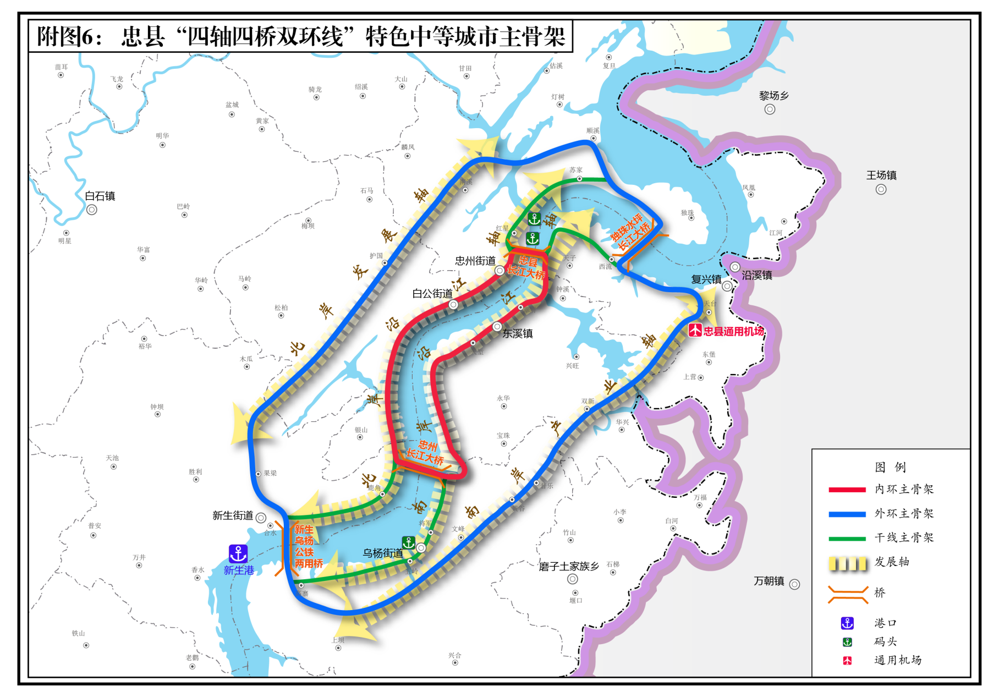

重庆市忠县综合交通运输“十四五”发展规划

（2021-2025年）

为深入落实习近平总书记关于交通运输工作重要指示精神，全面贯彻《交通强国建设纲要》《国家综合立体交通网规划纲要》和《成渝地区双城经济圈建设规划纲要》，围绕交通强市建设发展目标，坚持全县“双特”发展思路，高水平打造“三峡库心·长江盆景”，加快建设“一地一城三区”，有力支撑成渝地区双城经济圈建设和重庆国际性综合交通枢纽城市打造，根据《重庆市综合立体交通网规划纲要（2021—2035年）》《重庆市综合交通运输“十四五”规划（2021—2025年）》《忠县国民经济和社会发展第十四个五年规划和二〇三五年远景目标纲要》，制定本规划，规划期为2021—2025年，展望至2035年。

# 一、发展环境

## （一）发展现状

“十三五”时期，全县交通以习近平新时代中国特色社会主义思想为指导，深入贯彻习近平总书记对重庆提出的“两点”定位、“两地”“两高”目标和“四个扎实”要求，发挥“三个作用”，和推动成渝地区双城经济圈建设等重要指示要求，充分发挥交通运输“先行官”作用，打赢新冠肺炎疫情交通阻击战，交通建设三年行动计划圆满收官，全县累计投入交通基础设施建设123.6亿元，比“十二五”增加13亿元，成为支撑全县经济平稳快速增长、脱贫攻坚取得重大历史性成就的重要推动力，为实施“十项行动方案”提供了有力支撑。截止2020年底，我县区划面积路网密度达到2.9公里/平方公里，除主城九区外位居全市第四。

对外运输通道提升助推综合交通骨架网络初步形成。渝万高铁2020年11月9日启动建设，实现铁路“零的突破”，黔万高铁过境忠县基本锁定，广垫忠黔、梁忠铁路、沿江货运等铁路前期工作加快推进，融入全国铁路网指日可待。高速公路通车里程109公里，“大”字形骨架网基本形成，规划梁忠石高速、沿江北线高速加快推进。交通运输部批复的长江上游首个万吨级“江海直达”最佳节点、重庆打造长江上游航运中心重要组成部分的新生港，一期已正式开港运营，年通过能力达720万吨。忠县通用机场完成项目选址评审并取得民航西南地区管理局的选址意见批复和军方空域审查。空中、水上、陆上立体交通格局即将形成。

县域路网优化提质促进公路通畅水平加快提升。国省干线公路全面升级改造，基本形成覆盖全县29个乡镇（街道）快速骨干通道。县域内国道二级公路以上占比达到90.2%，省道三级公路以上占比达到76.4%，较“十二五”末分别提高9.3个百分点和46.6个百分点。农村公路“三通”兜底性任务全面完成，实现了有条件的行政村通达率、行政村通畅率、行政村通客率3个100%，有效解决了农村群众便捷出行难题。“石宝寨”“田园综合体”“橘乡荷海”“金色杨柳”等旅游路、产业路的建成，为全县打赢脱贫攻坚战提供了有力保障。

运输服务能力不断提升推动客货运输服务水平迈上新台阶。公共客运服务保障能力稳步提升，客运线网和运力不断优化完善。“十三五”期间，日均客运班车发班460余辆次，日均班车载客量6800人次，日均公交车、出租汽车（包括巡游和网约）载客量均超过45000人次，巡游出租汽车CNG覆盖率100%。网络预约出租汽车从无到有迅速发展，网约车辆达293辆，占出租汽车车辆总数比例提高至57.1%，省际涉外旅客运输船舶2艘（749客位)。水路交通运力增至18.09万载重吨，较“十二五”末增加5.1万载重吨，增长38.7%，船舶平均运力达到3230载重吨，单船最大运力达到8000多吨，居全市领先水平。现代物流服务能力不断增强，2020年货运量逆势上升，同比增长4.2%；邮政及快递业务量明显增长，其中邮政业务总量突破1.5亿元，年增长率超过2.5%。物流企业加速成长，市场主体持续壮大，全县共有交通运输主体2612家。

智能生态交通创新发展促进交通保障能力逐步增强。“十三五”时期，全县加快建立交通信息指挥中心，对全县重要桥梁、主要路段、重要路口、港口、码头实施24小时监控，并重点建成“两客一危”、公交客车视频智能监控、客运联网售票等系统，智慧交通发展迈上新台阶。全县强化交通运输节能减排，加大新能源和清洁能源运输装备的投入，新能源公交车从无到有，“十三五”新增32台新能源公交车辆，配套建成CNG加站。

体制机制完善保障交通安全和行业治理能力持续巩固。“十三五”时期，全县交通以法规制度体系、安全责任体系、防控体系、保障体系为核心，着力强化安全生产、监管和维稳，行业安全发展形势总体上平稳向好。水上应急救援队、道路抢险保通队、道路运输保障队以及公路抢险保通应急物资储备库（县级）建立完成。忠县率先在全市完成机构改革，全面厘清职能交叉，抓好职能调整，行政管理工作机制逐步健全。全县“十三五”累计投入养护资金2.3亿元，基本形成权责清晰、齐抓共管的农村公路管理养护体制机制。

## （二）机遇与挑战

机遇时机恰逢。新时代西部大开发、“一带一路”、长江经济带、西部陆海新通道、成渝地区双城经济圈等重大战略叠加，为全县经济社会和综合交通高质量发展带来了新机遇。“十四五”时期是重庆加快建设交通强市和国际性综合交通枢纽城市的重要起步期，是忠县作为“双核”之“重庆核”北翼重要节点城市，建设“双特”城市、加速打造“三峡库心·长江盆景”的关键期。站在新的历史起点上，服务构建新发展格局，要求以综合运输大通道和现代综合交通枢纽为重点，进一步发挥新生港和长江黄金水道作用，着力构建“外畅内联”的综合交通基础设施网络；支撑新型城镇化和乡村振兴战略，要求推动优质客货运输服务向全域、向纵深发展，优化区域间、城乡间等不同层次服务网络，提升旅客换乘及货物换装效率，加强公共服务均等化；深入践行新发展理念，要求坚持创新驱动，落实“碳达峰”要求，把绿色发展理念贯彻落实到行业发展的各领域和全过程，并加快新技术、新业态、新模式在交通领域的应用；全面深化改革，要求完善行业治理体系，建立健全综合交通基础设施一体化规划、建设和管护机制，激发市场活力，营造行业良好法治环境。

挑战仍待突破。与适应经济社会高质量发展和满足人民群众美好出行期盼的更高要求相比，全县综合交通运输发展还存在一些差距与短板。基础设施方面，全县对外立体化综合交通体系尚未形成，公路网结构有待进一步优化，重要县乡道技术等级普遍偏低，水运、航空设施建设短板较为明显，缺乏现代化综合客运枢纽，为新生港配套的物流园区及集疏运铁路建设滞后。运输服务方面，全县缺乏引导公共客运发展的龙头企业，已开通的农村客运班线便捷性和舒适性不强；现代物流服务设施供给不足，难以适应多式联运、干支衔接及城乡配送需求。高质量发展与治理方面，交通信息化发展基础较薄弱，大数据、人工智能等新技术应用不足；安全绿色发展水平还需要进一步提高，交通安全应急保障能力尚显不足；农村公路管理养护考核机制不健全。“十四五”时期，要抢抓战略机遇，构建大通道、大路网、大体系，发展大交通，交通大发展，推动忠县充分融入国家发展战略，步入发展“快车道”。

二、总体要求

（一）指导思想

以习近平新时代中国特色社会主义思想为指导，全面贯彻党的十九大和十九届二中、三中、四中、五中、六中全会精神，认真落实习近平总书记对重庆提出的坚持“两点”定位、“两地”“两高”目标、“四个扎实”要求、发挥“三个作用”和推动成渝地区双城经济圈建设等重要指示要求，贯彻落实市委、市政府的重要部署及重大决策，立足新发展阶段，完整、准确、全面贯彻新发展理念，积极融入新发展格局。以深化供给侧结构性改革为主线，以改革创新为根本动力，以支撑重庆交通强市和“一地一城三区”建设为统领。

## （二）规划原则

服务大局，先行支撑。坚持从全局谋划一域、以一域服务全局，突出全县在国家和区域发展战略、交通强市及“一区两群”协调发展中的重要地位，充分发挥交通在经济社会发展中的基础性作用。

区域联动，融合发展。以成渝地区双城经济圈建设、“一区两群”协调发展为导向，促进区域设施、服务、管理的协同发展，强化与周边地区全方位的互联互通，打造多层次综合交通网络。合理配置综合交通运输资源，统筹各种交通方式融合发展，加快综合运输通道和综合交通枢纽一体化发展。

以人为本，人民满意。坚持以人民为中心的发展思想，适应新业态、新模式发展要求和个性化、多元化出行需求，全面提升客货运输组织水平，提供品质更优、效率更高、安全可靠的运输服务和人性化的行业管理服务，增强人民群众的获得感、幸福感、安全感。

创新驱动，智慧升级。坚持创新在交通发展全局中的核心地位，统筹传统基础设施和新型基础设施建设，推动交通由依靠传统要素驱动向更加注重创新驱动转变。推动新一代信息技术与交通行业深度融合，通过科技创新、运输组织模式创新，推动全县交通更高质量发展。

生态优先，绿色发展。牢固树立“绿水青山就是金山银山”的理念，坚持走生态优先、绿色发展新路，集约利用资源，加快推进交通领域减排降碳。加强生态保护，着重保护好长江母亲河和三峡库区，筑牢长江上游重要生态屏障，促进人与自然和谐共生。

## （三）发展目标

“十四五”期间，以综合运输大通道为骨干，综合交通枢纽体系为牵引，统筹铁路、公路、水运、航空、邮政资源合理配置和高效衔接，形成东挽长三角，西融成渝地区双城经济圈，南连21世纪海上丝绸之路，北接渝（蓉）新欧和丝绸之路经济带的东南西北“四向”陆海联动新格局。实现“1小时重庆、2小时成都、6小时北上广”的交通“126”通勤目标。

建设“铁公水空”多式融合交通枢纽体系，构建“两纵三横一联线”高速公路网、“四轴四桥双环线”城市主骨架、“两国道七省道多联线”干线公路网、“四好农村路”微循环的“三网一示范”互联互通公路网，努力形成“铁路零的突破、港口集群化、高速双通道、民航新发展、镇城多路径、镇镇连高速、村村双车道”的交通发展格局。实现毗邻乡镇通勤20分钟、乡镇上高速30分钟、乡镇至县城40分钟、周边区县60分钟的“2346”目标。

## 表1 忠县“十四五”综合交通运输发展主要指标

| 类型 | 指标 | 2020年 | 2025年 | 备注 |
|---|---|---|---|---|
| 铁路 | 总里程（公里） | 0 | ≥96 | 预期性 |
| 高速铁路里程（公里） | 0 | ≥58 | 预期性 |
| 公路 | 高速公路通车里程（公里） | 109 | ≥135 | 预期性 |
| 国道二级及以上公路比例 | 90% | 100% | 约束性 |
| 省道三级及以上公路比例 | 76.4% | 85% | 约束性 |
| 普通干线公路优良路率（%） | 90 | 95 | 约束性 |
| 水运 | 五级及以上航道里程（公里） | 18.26 | 45.26 | 预期性 |
| 港口泊位个数（个） | 26 | 31 | 预期性 |
| 货运运力（万吨） | 18.09 | 45 | 预期性 |
| 航空 | 通用航空机场个数（个） | 0 | 1 | 预期性 |
| 客货运输 | 综合客运枢纽个数（个） | 0 | 1 | 预期性 |
| 乡镇运输服务站（点）个数 | 0 | 72 | 预期性 |
| 省级旅客运输船舶（约650客位/艘）艘数（艘） | 2 | 4 | 预期性 |
| 智慧绿色安全 | 交通营运车辆主动式预警监测安装率（%） | 70 | 95 | 预期性 |
| 绿色能源公交车辆占比（%） | 80 | 100 | 预期性 |
| 公路应急救援响应时间（分钟） | — | <15 | 预期性 |
| 重要客流区水上应急救援响应时间（分钟） | — | ≤10 | 预期性 |
| 养护管理 | 普通国省道预防性养护里程比重（%） | 80 | 100 | 预期性 |
| 普通国省道路面使用性能指数（PQI） | 80 | 90 | 预期性 |

# 三、构建外畅内联的综合立体交通网

## （一）构建“四向”综合运输大通道

东向——忠鄂苏沪通道（沿江通道）。按照国家综合立体交通网主骨架和重庆“3轴6廊”国内综合运输大通道建设要求，全力推进渝万高铁建设，衔接郑万高铁和兴山至宜昌支线高铁，形成全线时速350公里的沿江高铁大通道，打通与万州、武汉、上海等沿江经济节点（中心）的联系通道。积极推动沿江货运铁路前期工作，力争开工沿江高速北线，提升通道运输能力，促进东部地区产业向成渝地区双城经济圈转移，建设沿江产业集群。加大长江航道综合治理，提升长江黄金水道服务能力，支撑建设长江经济带综合立体交通走廊。

西向——忠渝蓉新通道。按照“共建成渝地区双城经济圈交通一体化融合发展先行示范区行动方案”，加快推进广忠黔铁路前期工作，打通与重庆、广安、成都等经济节点的联系通道，实现西向连通重庆主城都市区、成都平原经济区、川东北经济区，强化成渝地区双城经济圈通道能力。沟通中欧班列（成渝）兰渝铁路，融入丝绸之路经济带，强化连接新亚欧大陆桥的通道能力。规划研究G50沪渝高速复线项目，实现与重庆主城区域物流运输双通道。

北向——忠陕豫京通道。加快打通与梁平、达州、西安呼和浩特、郑州、北京等经济节点的北向通道，实现连通关中城市群、京津冀城市群，强化与东北部的通道能力。开工建设梁忠疏港铁路和梁忠石高速，联通襄渝铁路，渝万高铁联通渝西高铁东线，直达北方陆上出境通道。衔接郑万高铁，实现北上京津冀快速通道。积极研究论证大竹经梁平至新生港快速通道项目，建设公铁多方式运输通道。

南向——忠湘粤桂通道。积极推进黔忠万高铁、广忠黔铁路等前期工作，打通与石柱、黔江、怀化、长沙、广州、南宁等经济节点的联系通道，实现南向连通渝东南武陵山区城镇群、北部湾、粤港澳大湾区。充分融入西部陆海新通道东通道，西南向至东南亚出海口，连接黔张常铁路，东南向畅通至海峡西岸城市群。

| 专栏1 “十四五”期间大通道重点建设项目 |
|---|
| 铁路：建成渝万高铁，开工梁忠疏港铁路，加快推进广忠黔铁路、黔忠万高铁、沿江货运铁路等项目前期工作，规划研究机场支线铁路。全面形成“大”字型铁路网。高速公路：开工梁忠石高速公路，加快推进沿江高速北线、G50沪渝高速复线等项目前期工作。快速通道：积极研究大竹经梁平至新生港快速通道项目。 |

## （二）构建“铁公水空”多式融合交通枢纽

1. 铁路枢纽

规划构建“一主四辅”铁路客运系统。近期依托渝万高铁建设忠县站，远期依托黔忠万、广忠黔铁路、机场铁路支线规划建设忠县西站、乌杨站、新立（拔山）站、机场站。规划构建“一主三辅”货运系统。近期依托梁忠疏港铁路，打造新生港铁公水多式联运中心和黄金站，远期依托广忠黔铁路、沿江货运铁路规划建设乌杨站、新立（拔山）站货运集散点。打造集合铁路、公路、城市公交、出租、社会车辆于一体的忠县高铁综合客运枢纽，促进各种运输方式统一规划、统一设计、同步建设、协同管理，适度拓展旅游集散、包车租车等综合服务功能。推动忠县高铁综合客运枢纽实现立体换乘、无缝衔接，打造全天候、无风雨的换乘环境，加强换乘设施建设，推动中转换乘信息互联共享和交通导向标识标准化。

2. 水运枢纽

围绕区域干支岸线布局，以重庆港忠县港区新生作业区为核心，乌杨公用码头、海螺专用码头两个货运头以及大美红星、万港红星、万港石宝三大客运码头，龙滩河、秀水溪、沿溪河等支流公用码头为支点，构建“一核心两货运三客运三支流公用码头”的干支联动水运体系。建成西北、川东北、渝东北重要通江达海节点。

3. 公路枢纽

构建“1+2+N”的公路枢纽体系，以忠县汽车总站客运枢纽为核心、新立拔山2个乡镇客运站、乡镇服务站为补充的多层级客运枢纽体系。优化普通公路客运站布局，因地制宜选择建站模式，合理确定建站规模与等级，形成以县城为中心，重要乡镇为节点，连接城镇、辐射农村，支撑服务周边地区及乡镇、联通重庆主城的公路客运站场体系。推进客运站改造工程、乡镇客运站、乡镇运输服务站（点）建设，拓展客运服务范围和深度，提升客运集约化组织与服务能力，促进基本公共客运服务均等化。

4. 通航机场

打造“一核六点”忠县通航布局体系，建设以忠县通用航空机场为核心，拔山、新立、官坝、汝溪、善广、石子具备起降点的通用航空模式，实现忠县交通运输方式和运输网络的有效补充。建设忠县通用机场地面集疏运体系，实现城区与通航机场20分钟通达。展望远期，规划研究黔忠万铁路机场支线到忠县通用航空机场，建立忠县“铁公空”立体交通枢纽。建立空中走廊，开拓市场腹地，加强与重庆江北、万州、武隆、巫山运输机场和市内及周边省市通用机场之间的联动合作，构建旅游环飞航线，促进“航空+旅游”的融合发展。研究开展通航机场货运功能，引入专业化航空物流企业设立区域中心基地。依托通用机场开展空中巡查、电力巡线、防林护林等作业飞行，积极拓展应急救援、商务公务、防灾救灾、旅游观光等民生功能。

## （三）构建“三网一示范”互联互通公路网

按照“补短板、提质量、促融合”总体思路，紧紧围绕“一 地一城三区”总布局，实现与周边区县高速“双通道”，乡镇至县城“多路径”，镇镇连高速，村村双车道。

构建“两纵三横一联线”高速公路网。开工建设梁忠石高速和沿江高速北线，积极融入全市“三环十八射多连线”高速路网，提升与重庆主城、周边区域的快速通达能力，建设“高速外联双通道”。新增规划研究G50沪渝高速复线，织密高速公路网络，与既有G50沪渝高速、G69银白高速、G5515张南高速和规划实施梁忠石高速、沿江北线高速，构成“两纵三横一联线”高速网。合理增加设置高速出口，适时启动建设汝溪、野鹤、石宝、涂井、三汇、善广、金声、官坝、石黄、黄金等乡镇高速互通连接线。基本实现周边区县“1小时通勤圈”，乡镇30分钟连高速全域覆盖，形成绕城高速公路环线。

建设“四轴四桥双环线”特色中等城市主骨架。按照“50万人，50平方公里”城市规模和“一江两岸四片区”空间格局，拉开城市扩展交通骨架，充分发挥交通引领城市格局的先导作用，支撑产城布局，促进高质量发展。双环指通过忠州长江大桥—银山大道—忠州大道—忠县长江大桥—复兴东溪乌杨沿江大道—忠州长江大桥形成城市内环，通过新生乌杨公铁两用桥—高营铺—护国—高铁站场—忠县长江三桥（独珠—水坪长江大桥）—通用机场—乌杨新区—新生乌杨公铁两用桥形成城市外环。四轴指北岸沿江轴（银山大道—忠州大道—顺溪）、北岸发展轴（高营铺—护国—高铁站场）、南岸沿江轴（复兴东溪乌杨沿江大道）、南岸产业轴（通用机场—乌杨新区）。四桥指规划研究独珠水坪长江大桥、乌杨新生公铁两用桥，与忠县长江大桥、忠州长江大桥形成联通南北主轴的联络线，推动独珠至水坪、新生至乌杨、石宝至西沱、复旦至鸡公咀过江通道纳入国家规划。

畅通“两国道七省道多联线”干线公路网。提速提质交通网，依托干线公路网，增强忠县镇乡辐射作用，强化区域要素吸附，促进区域经济发展。启动国道G350、G348改线升级，实施干线路面改造保畅，实现国道二级及以上公路占比达100%。逐步打通毗邻地区省道S204、S509、S511、S512、S513等断头路，统一标准、统一时序，完善干线网络连接，实现省道三级及以上占85%。实施乡镇通三级公路改造工程，力争实现具备条件的建制镇乡通三级比例达到96%。改造通而不畅路段，规划研究县域乡镇绕镇路，因地制宜提高部分路段建设标准，全面提升路网通行能力和服务水平，缓解过境交通拥堵。实现重要景区、园区通三级级以上公路，提升交通出行体验感。规划研究拔山至汝溪大通道和石黄经官坝至县城大通道，补充路网联络线，串联版图重大经济区域，实现联动发展。到2025年，形成“两国道七省道多联线”的连贯东西、畅通南北的干线公路网。

争创“四好农村路”全国示范县。围绕乡村振兴和交通强市，按照“镇镇三级路、村村双车道、组组通畅路”的高质量发展目标，着力畅通县内“微循环”。逐步实施县乡重要连接道项目，形成覆盖空间大、通畅程度深、惠及面广的农村公路网络。强化道路的基础网络保障功能，有序推进建制村通双车道公路改造、窄路面公路拓宽改造或错车道建设，强化镇村公路衔接，不断提升镇村互通路网服务品质，打造最美乡村公路，争创“四好农村路”示范县。“十四五”期间，村民小组通畅率均达到100%，建制村通双车道达到95%。

| 专栏3 “十四五”期公路重点建设项目 |
|---|
| 高速公路：规划建设梁忠石高速石宝至西沱长江大桥，规划建设G50沪渝高速复线复旦至鸡公咀长江大桥。研究推进汝溪、野鹤、石宝、涂井、三汇、善广、金声、黄金等乡镇高速互通连接线。城市主骨架：规划研究“北岸发展轴”高营铺至独珠半岛大通道、“北岸沿江轴”银山至新生大通道、“南岸产业轴”复兴至乌杨新区大通道、“南岸沿江轴”东溪至乌杨大通道。规划研究独珠水坪长江大桥、新生乌杨公铁两用桥。国道：建成G348县城至涂井、G348顺溪至果梁村委、G350县城至白石、G350王院子垭口至西流安置房改线升级项目。省道：建成S204东溪至普乐、S204金竹铺至石子、S511涂井至石宝、S512白石至两河等项目。力争开工S204凉山坝至堰家村、S204石子至洋渡、S509石宝至松林（万州界）、S512两河至善广（丰都界）、S513金鸡至宝河桥（梁平界）、S513长岭至垫江界等项目。重要连接道：规划研究拔山至汝溪大通道。建成磨子乡村振兴路网、独珠江村路网、金鸡至泰来改建、黄金至大岭、里仁至黄金等改建项目。实施马灌、花桥、兴峰、任家、永丰、双桂等300公里县乡重要连接道项目。农村公路：实施建制村“双车道”公路工程 100公里，实施村民小组通畅工程 500公里。 |

# 四、打造高品质的客货运输服务体系

## （一）构建便捷舒适的客运服务体系

优化道路客运布局。积极促进“互联网+道路客运”深度融合发展，大力发展定制客运、旅游包车等特色运输模式。创新城际客运运营模式，优化长途客运线网资源配置，实现与高铁错位互补发展的新格局，提高城际客运服务体系接驳效率。推动“道路客运+旅游”融合发展，鼓励有条件的客运站拓展旅游集散等服务功能，支持客运班线、旅游专线延伸到旅游景区和乡村旅游点。开通以高铁站、综合客运枢纽为起点，串联石宝寨、新立田园综合体、三峡橘海、烽烟三国等旅游景区的“旅游直通车”和旅游观光巴士。完善农村客运网络体系。紧紧围绕乡村振兴战略，创新农客经营模式，大力推广预约响应式农村客运模式，实现建制村通客率100%。统筹推进城乡客运一体化，建立新开通城乡公交线路的班线客车市场退出和维稳机制，对县城至乌杨、东溪、复兴、黄金等周边乡镇（街道）的客运线路实施公交化改造，提升公共服务均等化水平。

推进公交优先发展。持续优化城市公交线网体系。根据城区空间规划布局和功能分区，持续优化城市公交线网结构布局，探索开通综合客运枢纽公交接驳专线、定制公交等新业态新模式，重点考虑旅游景区、工业园区、周边镇街城镇化进程与实际需求，新增优化县城至乌杨工业园区、县城至电竞产业学院等重点线路10条。科学配置公交运力，提升中心城区公交服务水平，持续增加公交运力，扩大公交覆盖面，大力发展新能源公交，增投新能源公交车50辆以上，实现新能源公交城区全覆盖。完善公共交通设施，加快建设公交站场，结合城市发展需要，在现有地块建成6600平方米公交停车场1个，公交维保场1个，公交首末站5个。提升公交管理水平，加大非现金支付宣传力度，进一步提高IC卡、移动支付使用率，推动群众出行便捷化。加强公交安全服务质量考核，提高公共交通服务质量，建立健全城市公交长效监管和财政补贴工作机制。

推进出租汽车健康发展。围绕解决“打车难”问题，科学投放出租车运力，着力提升出租汽车行业服务品质，加大网络预约出租汽车发展力度，“十四五”期间网络预约出租汽车占比提高至70%。积极促进出租汽车新老业态深度融合，统筹推动巡游出租汽车转型升级和网络预约出租汽车规范发展，提高行业适老化服务水平，提升乘客出行体验。

促进水路客运转型升级。提档升级石宝旅游码头、大美码头、万港红星客运码头，抓住“鄂渝两地携手共促长江三峡旅游打造世界内河游轮旅游最佳目的地”机遇，鼓励大美公司整合资源，运用好二级市场融资渠道，筹资4亿元建造长江豪华游轮2艘，大力发展游轮经济；鼓励现有客渡船舶进行抗风等级能力提升，与万州区、石柱县开展区域联动，开行“水上巴士”，打造“库心游”，满足群众多元化出行需求。

推进旅客联程运输有序发展。积极发展公铁、公水等旅客联程运输服务，培育旅客联程运输经营主体，探索旅客联程运输电子客票，打造“一票到家”的全程出行链服务，鼓励不同运输方式企业依托互联网等信息化手段，加强深度合作，积极发展游客联程联运服务产品，提升公众出行服务体验。

## （二）构建集约高效的货运物流体系

创新货运物流服务模式。鼓励货运企业规模化、联盟化发展，引导公路货车向大型化、专业化方向发展，改善行业“小散乱”现状，促进交商融合发展。引进网络货运平台企业，促进网络货运行业化发展。积极推动交邮融合发展，进一步拓展乡镇客运站（服务站）邮政快递中转及收投服务功能，大力推广农村客运车辆代运邮件快件模式。加强基础设施建设，结合城市空间规划布局与行业需求，建设3个货运车辆停车场，服务货运企业发展。

推动多式联运快速发展。依托新生港及后方综合货运枢纽，推动铁水、公铁等多式联运发展，围绕基础设施、装备技术、运输组织、信息化等方面的技术标准和服务规范及管理运营模式等重点领域开展多式联运服务体系设计。发挥新生港区位及内陆腹地优势，创建长江“鱼刺型”物流节点最佳发展模式。研究对接渝新欧，服务川东北、渝东北和渝东南广大经济腹地的铁路班列。加快应用多式联运电子化统一单证，推进多式联运“一单制”。优化集装箱、大宗物资多式联运系统，培育多式联运经营主体。

构建三级物流服务集散网络。构建以新生港物流园区为中心，乡镇级物流综合服务站为纽带，村级物流便民服务点为基础的三级节点。加快新生港综合货运枢纽货物集散交易、冷链物流仓储、综合配套服务设施建设，引入船务公司、货代公司、大型物流企业，积极争取新生港设立开放口岸和保税港区。拓展乡镇客运站服务功能，新建72个乡镇综合运输服务站，统筹利用多方资源，鼓励与邮政、快递企业共建共享末端设施。

提升邮政快递服务水平。依托交通物流枢纽设施，完善装卸、接驳、仓储等功能区建设，优化城市配送模式，推动城市、城乡配送网络向末端延伸，实现城乡干支线运输与末端服务网点有效衔接。健全县乡村三级农村寄递物流配送体系，鼓励交邮交快合作、邮快合作、快快合作等进村模式。大力推进城乡绿色货运配送发展，支持建设共同配送中心，优化末端取、寄快件环节，推进无接触寄递。鼓励和支持集中配送、夜间配送、分时配送等先进组织方式发展。完善物流通道网络体系，构建以物流分拨中心、城乡共同配送中心、专业配送中心为支撑的城乡物流体系，推动城乡配送网络向末端延伸，加快实现城乡配送服务标准化、一体化。

推进专业化多元化物流发展。围绕柑橘、笋竹、生猪等一批产值亿元级农产品加工产业集群，增强综合货运枢纽的冷链物流功能，加强特色优势农产品生产基地及田头市场仓储保鲜冷链设施建设，推动冷链物流全链条融合发展。完善“冷藏、运输、加工、销售”一体化冷链物流体系，推进“生鲜电商+冷链宅配”、“中央厨房+食材冷链配送”等冷链物流新模式发展。推动以农产品、建材、家居等专业市场与专业物流融合发展，促进物流与商流、制造流、资金流、信息流联动发展。

# 五、建成长江上游航运中心重要支撑节点

## （一）构建“1+2+X”港口布局体系

到2025年，增加港口泊位约15个，基本建成分工协作、结构合理、功能完善的“1+2+X”港口功能布局体系。高效运营管理新生港一期工程，建立健全新生港运营管理机制，提高营运效益。推进乌杨公用码头二期建设，实施既有码头（包括海螺专用码头）技改；建设沥青和LNG加注站危化泊位，推动长江船舶汽化改造。推进邓家沱油库码头建设。加快推进水上加油站建设，完成周家溪水上救援基地建设，着力探索水上服务区建设。建设水上“公共锚地”。规划建设支流龙滩河、沿溪河、秀水溪公用码头。

## （%1） 加快畅通“一干五支”航道骨架

充分发挥黄金水道功能，提升航运基础设施能级，推动沿溪河、㽏井河航道整治，整治后达到五级航道通航标准。建成以长江干线为主通道、重要支流为骨架的航道网络，加强水运通道内部联通水平。结合“三峡库心·长江盆景”跨区域发展规划，全面提升“一干五支”航道网通行能力，通航支流航道总里程达到45.26公里。

## （三）打造“新生港+产业园+物流园”临港经济

以临港新城为空间，完善新生港物流产业园规划，打造以大宗货物集散为主导、商贸物流和临港加工为支撑、仓储物流等为基础的产业发展体系。大力发展建材、农副产品加工、大宗粮油、汽摩、电子、环保、新材料、纺织服饰、能源化工等商贸物流及临港加工产业，与乌杨组团、忠州老城等互动协调发展。围绕港区产业布局，加强招商引资推介，重点招引石材、木材、钢材、建材、能源等大宗货物运输企业，形成物流、仓储、加工齐备的产业链条。积极引入船务公司、货代公司、大型物流企业，积极争取新生港设立开放口岸和保税港区。以新生港为枢纽节点，充分发挥梁忠疏港铁路、广垫忠黔铁路大通道与长江上游黄金水道的交汇点区位优势，延伸港口腹地，拓展航运辐射范围，打通多式联运“最后一公里”，推动建设“北煤南运”煤炭中转仓储基地。

## （四）建设长江上游滚装运输中心

融入渝川黔滇陕五省市港航联盟，推进设施枢纽化、港口现代化、船舶标准化、江海陆联动发展，推进长江流域重要节点城市间建立稳定、高效、互利、共赢的港口物流发展合作机制，助推长江上游地区航运高质量发展，共建成渝地区双城经济圈交通一体化先行发展示范区。引进县外规模运输企业入籍忠县，着力发展滚装船舶运输，力争每年载重汽车滚装运输进出港车辆达10万辆。充分发挥铁水联运通道节点作用，深挖载重汽车滚装运输潜力，开发商品汽车滚装运输市场，打造长江上游滚装运输中心。到2025年力争实现水上运力达45万载重吨，客货运周转总量达100亿吨公里。

# 六、推动综合交通运输高质量发展

## （一）推动智慧交通发展

推动新型交通基础设施建设。推动交通基础设施智能化升级，实现由单点信息化向场景智能化、全面智慧化转变，推进智慧公路、智慧港口、智慧枢纽建设。推动交通感知网络等信息化设施设备与交通基础设施同步规划、一体化建设。构建载运工具、交通基础设施、通行环境互联的交通控制网基础云平台。

打造忠县交通大数据管理平台。全面建成交通运输行业数据资源中心，整合接入的海源异构数据，完善信息资源目录体系，加强大数据安全保障，完善综合交通数据资源标准化体系，规范数据采集、共享、使用、开放，提升行业治理数字化、网络化、智能化水平。

建设和完善行业管理系统。围绕智慧交通一体化发展，完善交通行业安全监管系统，建设智慧执法平台，建设公众出行服务系统，建设新生港智慧港口信息平台等。整合行业管理系统，打通数据纵向贯通、横向联通，推动行业信息化智能化发展。

## （二）推进绿色集约发展

构建绿色生态交通体系。将“绿水青山就是金山银山”绿色发展理念，始终贯穿交通设施规划、设计、建设、运营和养护全过程。大力开展交通运输领域碳达峰、碳中和与大气污染排放、碳排放协同治理机制研究，推动营运车船效能提升，引导和鼓励交通运输企业参加温室气体自愿减排交易。加快推进绿色基础设施建设，促进公路、铁路、航道等交通基础设施与生态空间协调发展，最大限度保护重要生态功能区、避让生态环境敏感区，构建生态化交通网络，持续推动建设“绿色公路”、“绿色航运”，切实发挥全县在三峡库区生态保护、“江城”特色城镇化发展、生态产业体系建设上的示范作用，推动长江黄金水道高质量发展。

全面开展环境污染综合防治。完善辖区港口码头、船舶环保设施设备，完善船舶污染物“船－港－城”“收集－接收－转运－处置”的有机衔接和协作，强化船舶污染物接收、转运、处置全过程信息化管理。推广使用电力、天然气等新能源、清洁能源船舶，淘汰辖区内非标和老旧船舶34艘，鼓励企业建造大吨位三峡船型。推进国III及以下排放标准营运柴油货车淘汰更新。加强对普通干线公路及农村公路保洁及扬尘污染控制。规划建设胥家垭口汽车维修园，完成环城西路汽车维修业户整体搬迁工作，严格规范维修作业废气、废液、固废和危险废物处理处置。

推进运输装备及交通设施绿色发展。加快港口岸电设施改造，实现港口岸电设施覆盖率100%，对辖区43艘货运船舶受电设施进行改造，着力提高标准型岸电设施使用率。推进乌杨LNG加注站等绿色服务基础设施规划建设。加强航道整治新技术、新结构研发应用，推广使用高降解、低污染、植生型等新型材料，全面实施地方通航支流防治船舶及其有关作业活动污染水域环境应急能力建设规划。在公共交通领域全面推广新能源汽车。规划建设县城、拔山、新立、官坝、汝溪、石宝、乌杨、磨子、三汇等乡镇街道公共充电站。

促进资源集约节约利用。综合提升各种交通运输方式的基础设施网络效率，促进集约高效低碳客货运输方式发展。大力推进铁公水多式联运，科学确定各种运输方式的线位走向和技术标准，减少对土地、通道等不可再生资源的利用率。发挥各种运输方式的比较优势和综合运输的整体效率，推动大宗货物向水运、铁路转移，降低能源消耗强度。推动能源低碳、清洁、高效利用，广泛推行绿色交通、绿色物流、绿色出行，倡导低碳型交通消费和出行方式。

## （三）推动交旅融合发展

畅通旅游交通网络。聚焦独珠江村、石宝寨、三峡港湾旅游度假区、㽏井沟风景区、天池国家森林公园、皇华城考古遗址公园、三峡橘海等重点旅游项目的交通瓶颈问题，推动建设一批旅游公路、游客集散连接道、下河公路、游船码头基础设项目；论证开通一批景区互通车、观光巴士、公交、 游船线路，全方位构建高效便捷的旅游交通网络。

## 提升乡村旅游体验。围绕新立田园综合体、独珠“江村”、拔山金色杨柳、八斗台避暑休闲旅游、黄金美丽乡村、磨子民俗风情旅游、马灌油菜花海等特色乡村旅游景点，推动建设环湖亲水公路、马拉松跑道、休闲慢道等项目，协同打造慢游服务体系，提升乡村休闲旅游体验。

打造交通景观廊道。提升国省干线的旅游服务能力，持续推进交通干线与景区“串珠成链”，建设精品旅游线路，打造快进慢游服务体系。高铁站按“站城景”建设，规划建设㽏井沟环湖路，联动打造㽏井沟旅游风景名胜区。依托国道G348、G350及县城至石宝沿江旅游公路、忠信大道等路段，实施公路美化绿化，建设“美丽公路”，打造三峡库区最美公路景观走廊。实施沿溪河、㽏井河航道整治，依托“一干五支”航道体系，规划建设美丽渡口，研究开展水上巴士旅游产品，畅游美丽江河。

## （四）提升安全保障能力

构建更加严密的安全责任体系。深化落实《党政领导干部安全生产责任制实施细则》，完善安全生产与自然灾害防治工作“党政同责、一岗双责”责任体系，强化主要负责人第一责任人责任和分管负责人直接领导责任。进一步明确事务中心、执法机构安全职责，严格落实“管行业必须管安全，管业务必须管安全，管生产经营必须管安全”，依法履行安全生产与自然灾害防治职责。督促企业严格落实主要负责人安全生产法定职责，落实一线岗位从业人员安全生产责任制，确保企业实现安全责任、安全投入、安全培训、安全管理、应急救援“五到位”。

构建更加科学的风险防范体系。强化安全标准化建设,完善安全生产风险研判机制，健全安全风险“一图一表一库”，制定落实针对性管控措施，全面构建预防控制体系。健全重大风险清单管理模式，实施重大风险全过程动态科学管控。督促企业严格落实“日周月”隐患排查制度，形成闭环管理。严格重大隐患挂牌督办制度，推动重大隐患清零，一般隐患“减增量、去存量”。积极推广小微企业安全技术托管先进模式。

构建更加坚实的基础保障体系。提升交通基础设施安全防护能力，持续推进生命安全防护工程500公里、危桥改造10座、地灾整治5处。开展港口码头靠泊能力评估，逐渐提升靠泊能力，确保船舶靠泊安全。提高“两客一危”运输车辆安全技术性能，全面安装智能视频监控报警和安全运行监管技术装备，提高客运车辆安全性能。加强自然灾害防范应对，推进公路水路承灾体普查工作。

构建水陆综合应急救援体系。加快建设“一中心、一基地、六站所”水陆应急救援体系，完成地方水上应急救援基地建设，建造应急趸船1艘，完善公路应急抢险物资储备中心功能，布局六所功能完善的公路水路应急救援暨养护站所。加强道路运输、水路、公路应急救援队伍建设，开展实战演练，打造全区域覆盖、全天候运行、快速响应的现代化应急救援体系，实现公路救援半小时到达，地方水域救援10公里内20分钟、20公里内40分钟、30公里内60分钟到达。完善交通运行监测与应急调度平台功能，增强交通调度中心与各行业分中心的协同能力，建立数据流动共享机制。

| 专栏4 “十四五”期行业信息化及支持保障重点项目 |
|---|
| 依托重庆交通运行管理平台为基础，建立忠县交通大数据管理平台，配套建立交通行业应急调度指挥系统、客运车辆安全监管系统、公路监测设施感知网络，建成应急指挥中心、综合行业数据资源中心和综合交通运行监测与应急指挥中心大厅。建设智慧执法平台（综合执法、非现场执法、源头治超），建设公众出行服务系统（交旅融合、智慧公交），实现日常办公、远程监督、智能化检测管理等。建设新生港智慧港口信息平台，将港口网络监控、码头、堆场、港机、集装箱等信息集成，实现港口整体的生产运营可视化管理和业务集中化运营。新能源公交车逐步增投至100辆，配套建立35套充电系统。建设水上应急救援基地（冲锋舟、趸船、拖带作业船舶等），向应急救援船加装起重、抽水、供电、卷扬机、消防炮等设备，组建水上交通专职应急救援队伍，强化日常训练和应急演练，提升水上应急救援能力。 |

# 七、提升综合交通治理能力

## （一）深化交通管理体制改革

健全综合交通运输发展协调机制，扎实推进“放管服”改革，完善政府权责清单，持续推进简政放权，形成权责统一、权威高效、监管有力、服务优质的交通运输综合行政管理体制。全面加快“最多跑一次”改革步伐，进一步健全综合交通运输运行协调机制。

## （二）完善公路养护治理体系

试点推行农村公路养护总承包模式，积极扩大公路预防性养护范围，加强国省县乡村道日常养护，在拔山汝溪等国省干线服务区统筹规划建设基层交通综合执法大队、片区综合养护站、油电气综合补给站。到2025年，基本形成数字化的设施体系，专业化的养护体系，现代化的管理体系，高效化的运行体系和优质化的服务体系。普通公路重要节点视频监测设施覆盖率达到90%；全面推进农村公路“路长制”，基本建立权责清晰、齐抓共管的农村公路管理养护体制机制。强化农村公路管理养护资金保障，市、县二级公共财政资金用于农村公路日常养护的总额不得低于县道每年每公里10000 元，乡道每年每公里5000元，村道每年每公里3000元，并建立与养护成本变化等因素相关联的动态调整机制。加快推进国省道专业化机械化作业，做到普通国道优良路率达到85%以上，普通省道优良路率达到75%及以上，农村公路优良中路率达到75%及以上，以及国省道一、二类桥梁占比90%及以上，四、五类桥梁处置率100%。

## （三）健全依法行政的治理体系

深入推进法治政府建设，健全重大行政决策工作机制。自觉接受各类监督，推动完善内部层级监督和专门监督，坚持全面政务公开，健全信访工作机制，依法有效化解行政争议和矛盾纠纷。加强事中事后监管，完善“互联网+监管”工作机制，规范交通运输市场“双随机、一公开”监管方式。持续推进政务服务审批流程优化再造，缩减办理时限和材料，提高当场办结率、网上办结率，切实推动交通运输政务服务事项“一网通办”“川渝通办”和“跨省通办”。

## （四）推进信用体系建设

健全市场体系信用体系，完善守信联合激励及失信联合惩戒制度，完善市场准入和退出机制，推动全面实施市场准入负面清单制度，加强重点领域、重点环节信用监管和信用监督，依法深入推进行政许可告知承诺制，积极开展分级分类监管和信用修复。

## （五）加强交通文明建设

着力打造具有交通运输特色的文化示范单位和形象品牌，做好行业示范推广和社会形象展示。深化交通文明宣传教育、舆论引导，让交通文明深入人心，形成文明交通人人参与、全民共建、社会共治的良好环境。加强从业者素质建设，提升“窗口”形象，构建交通文明系统体系。努力提升执法水平，维护交通畅通高效秩序。

八、保障措施

（一）坚持党的领导

坚持和加强党的全面领导，增强“四个意识”、坚定“四个自信”、做到“两个维护”，始终把党的领导贯穿到加快建设交通强国、交通强市全过程，充分发挥各级党组织在推动忠县交通运输高质量发展中的领导作用和战斗堡垒作用。突出党对新兴业态和非公有制企业的引领作用。积极调动交通运输行业党员干部干事创业的积极性、自觉性和创造性，切实增强凝聚力和战斗力。

## （二）积极争取政策支持

争取相关政策对忠县交通运输发展的支持力度。紧密关注国家有关部门关于铁路、民航、综合交通枢纽、多式联运、智慧交通、公交都市和交通扶贫等方面的政策，全力争取将广垫忠黔铁路、黔忠万铁路、梁忠疏港铁路等纳入国家上位规划。

## （三）增强人才队伍保障

## 强化高素质专业化交通运输人才保障。全面落实“人才强交”战略，大力实施英才计划、高校定向选调、人才回引、公招遴选等人才引进机制，加强优秀人才、紧缺人才、科技创新人才队伍建设。加强交通运输技能人才队伍建设，弘扬交通运输劳模精神和工匠精神。完善以德为先、任人唯贤、人事相宜的选拔任用体系，完善激励机制和容错纠错机制，着力营造“近悦远来”人才生态。完善交通运输干部人才监督管理和服务保障机制，促进干部正确履职尽责，着力建设信念坚定、为民服务、勤政务实、敢于担当、清正廉洁的高素质专业化交通运输干部人才队伍。

## （四）加强资金保障

## 多渠道筹措资金，积极将重点项目纳入国家和市级规划争取上级补助资金，及时足额落实配套资金，保障交通“十四五”规划各项目得以有效实施。加强资金监管，落实专项资金监管责任，确保专款专用，项目实施依法、规范、高效，发挥最大效益。同时，要加大项目策划和招商引资工作力度，包装储备一批中长期交通项目，有目的、有计划、有准备地开展招商引资工作，吸引更多有实力的投资者参与忠县交通建设发展。

## （五）强化项目安排

形成项目滚动机制，建立“建成一批、开工一批、储备一批”项目库。对在建项目要加快建设进度，尽快投入运营，发挥社会效益；拟开工的，加快前期工作进度，及早开工，形成投资量，支撑全县经济增长；储备的要稳步开展规划设计工作，达到争取上级支持及补助深度。

## （六）强化组织实施

## 建立健全协调联动体制机制，推动交通设施互联互通、公共服务共建共享，交通建设项目全面纳入国土空间规划。成立由县领导牵头，发改、财政、自然资源、环保、交通、住建等相关部门共同参与的规划实施协调机构，定期召开规划推进协调会，及时协调解决规划实施过程中的重大问题。制定交通项目建设具体实施目标和考核办法，通过量化评分方式对各乡镇任务完成情况进行检查考核，确保规划期内交通基础设施项目按照建设目标完成。针对综合运输服务的重点任务，制定行动计划，加强实施效果的动态跟踪和阶段性评估。

名 词 解 释

## “四向”综合运输大通道：东向—忠鄂苏沪通道（沿江通道）、西向—忠渝蓉新通道、北向—忠陕豫京通道、南向—忠湘粤桂通道。

## “三网一示范”互联互通公路网：“两纵三横一联线”高速公路网、“四轴四桥双环线”特色中等城市主骨架、“两国道七省道多联线”干线公路网、“四好农村路”全国示范县。

## 两纵三横一联线高速公路网：两纵：G69银白高速、沿江高速北线；三横：G50沪渝高速、梁忠石高速、G50沪渝高速复线；一联：G5515张南高速。

## 高速外联双通道：忠县至周边区县两条高速通道。

## “四轴四桥双环线”特色中等城市主骨架：四轴：北岸沿江轴（银山大道—忠州大道—顺溪）、北岸发展轴（高营铺—护国—高铁站场）、南岸沿江轴（复兴东溪乌杨沿江大道）、南岸产业轴（通用机场—乌杨新区）。四桥：规划独珠水坪长江大桥、规划乌杨新生公铁两用桥、忠县长江大桥、忠州长江大桥。双环线：通过忠州长江大桥—银山大道—忠州大道—忠县长江大桥—复兴东溪乌杨沿江大道—忠州长江大桥形成城市内环，通过新生乌杨公铁两用桥—高营铺—护国—高铁站场—忠县长江三桥（独珠—水坪长江大桥）—通用机场—乌杨新区—新生乌杨公铁两用桥形成城市外环。

“一主四辅”铁路客运系统：忠县站为主，忠县西站、乌杨站、新立（拔山）站、机场站为辅。

“一主三辅”货运系统：新生港铁公水多式联运中心为主，乌杨站、新立（拔山）、黄金站货运集散点为辅。

## 一核心两货运三客运三支流公用码头：一核心是重庆港忠县港区新生作业区，两个货运头是乌杨公用码头、海螺专用码头，三大客运码头是大美红星、万港红星、万港石宝，支流公用码头是龙滩河、秀水溪、沿溪河等。

## “一核六点”忠县通航布局体系：以忠县通用航空机场为核心，拔山、新立、官坝、汝溪、善广、石子六个起降点。

## “1+2+X”港口布局体系：“1”即新生港多用途公用码头，“2”是乌杨公用码头、海螺专用码头，“X”是客运码头、旅游码头、支持保障码头、危化码头、支流散货码头等。

## 一干五支：“一干”指长江，“五支”指㽏井河、龙滩河、东溪河、秀水溪、沿溪河。

## “三通”：行政村通硬化路、通客车、通邮。

## 两客一危：从事旅游的包车、三类以上班线客车和运输危险化学品 、烟花爆竹、民用爆炸物品的道路专用车辆。

## “1+2+N”的公路枢纽体系：以忠县汽车总站客运枢纽为核心、新立拔山2个乡镇客运站、多个乡镇服务站为补充的多层级客运枢纽体系。

“一图一表一库”：风险空间分布图，风险隐患统计表，风险动态数据库。

“一中心、一基地、六站所”水陆应急救援体系：公路应急抢险救援中心；地方水上应急救援基地；忠州应急机具站，拔山公路养护站，汝溪公路养护站，白石公路养护站，碾盘公路养护站，太集公路养护站。

附图

