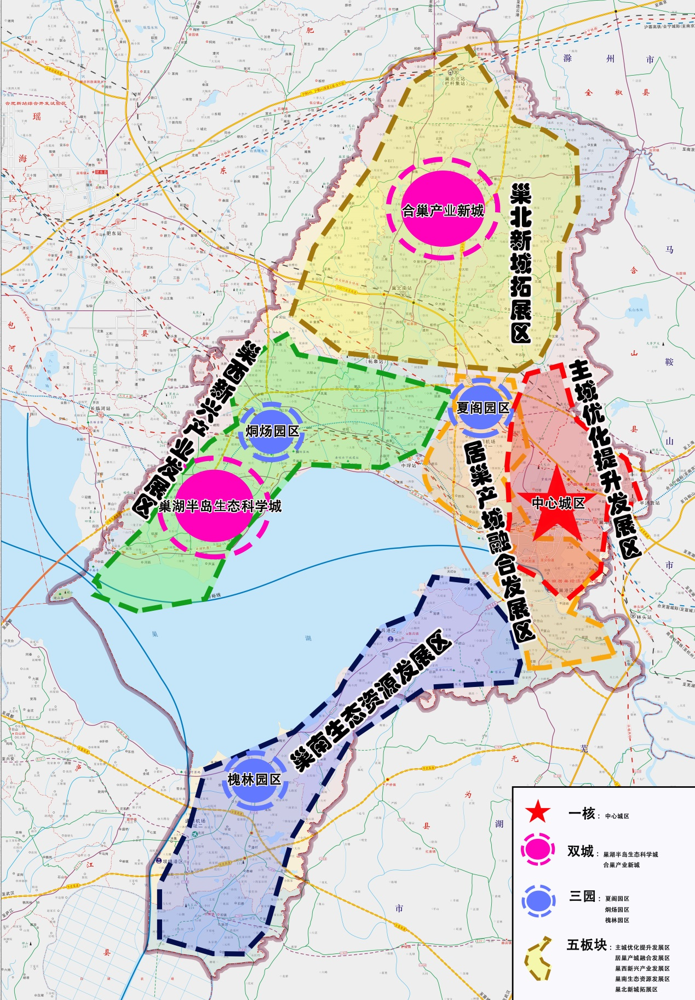

巢湖市国民经济和社会发展

第十四个五年规划和2035年

远景目标纲要

巢湖市人民政府

2021年5月

“十四五”时期是我国全面建成小康社会、实现第一个百年奋斗目标之后，乘势而上开启全面建设社会主义现代化国家新征程、向第二个百年奋斗目标进军的第一个五年，也是新时代全面建设经济强市、美丽巢湖，率先打造优质优良宜居宜业生态高地的关键五年。《巢湖市国民经济和社会发展第十四个五年规划和二〇三五年远景目标纲要》主要阐明“十四五”时期巢湖经济社会发展指导思想、基本原则、发展目标，展望到二〇三五年基本实现社会主义现代化远景目标，谋划重大战略，部署重大任务，确定政府工作重点，引导市场主体行为，是未来五年到十五年我市经济社会发展的战略蓝图和全市人民共同的行动纲领。

## 第一章 全面小康基本实现，现代化征程步上新起点

### 第一节 全面建成小康社会取得决定性成就

“十三五”时期是巢湖市在困难考验中承压奋进、砥砺前行的特殊时期。面对错综复杂的国际形势、艰巨繁重的改革发展稳定任务，特别是新冠肺炎疫情和百年未遇洪水灾害的严重冲击，市委市政府不忘初心、牢记使命，团结带领全市广大党员干部群众坚持以习近平新时代中国特色社会主义思想为指导，牢固树立并践行新发展理念，深入实施五大发展行动计划，统筹做好稳增长、促改革、调结构、惠民生、防风险、保稳定各项工作，聚焦“安徽争五强、全国进百强”目标，解放思想、拉高标杆，开拓创新、真抓实干，开创了经济社会发展新局面，中国共产党领导和我国社会主义制度优势进一步彰显。

经济实力实现较大进步。经济保持较快速度增长，“十三五”时期地区生产总值、财政收入、固定资产投资、社会消费品零售总额、农村居民可支配收入分别实现年均增长8.0%、6.5%、10%、10.5%、9.2%，三次产业结构由11.7:52.7:35.6优化为9.6:36.8:53.6。先后获评全国绿色发展百强县（市）、全国投资潜力百强县（市），位列2019年度安徽县域经济高质量发展考核B类第七位、安徽县域经济综合竞争力排名（2020）第四位。

创新发展实现较大进步。加快实施创新驱动战略，拥有创新平台国家级4个、省级22个，其中，企业技术中心9家，博士后工作站4家，工程技术研究中心3家，科技企业孵化器和众创空间2家。国家高新技术企业数实现三倍增长，由17家增加到57家。研究与试验发展经费支出达3.4亿元，年均增长10.22%。成功入列首批国家创新型县（市）建设名单，先后蝉联全国创新创业（双创）百强县（市）。

协调发展实现较大进步。空间布局持续优化，实施“双城带动”战略，合巢产业新城、半岛生态科学城、居巢经开区联动发展。持续推进新型城镇化和城乡融合发展进程加快，常住人口城镇化率达到62.5%，中心城市建成区面积48平方公里、人口36万人，特色小镇加快建设。实施城市大建设项目347项，累计完成投资130.7亿元，完成改造老旧小区209个，建成各类口袋公园26个，建成精品道路10条，改造新建城区公厕121座。乡村振兴战略稳步推进，粮食产量达41.06万吨，全力推进115个美丽乡村中心村规划建设。实现城乡公交一体化，成功创建省级“四好农村路”示范县。先后荣获全国文明城市、中国人居环境示范城市、全省美丽乡村建设先进县（市）称号，农村人居环境整治工作获国务院表扬激励、省政府通报表彰。

绿色发展实现较大进步。全面落实河湖长制、林长制和路长制，大力实施巢湖综合治理，全市空气质量优良率达85%以上，森林覆盖率达17.48%，主要入湖河流水质稳定达标，资源产出率提高为96%，单位国内生产总值能源消耗降低6.44%。先后荣获国家园林城市、全国宜居生态示范城市、全国农村生活污水治理示范县（市）、全国农村生活垃圾分类处理和资源化利用示范县（市）称号。

开放发展实现较大进步。顺利被纳入国家长三角一体化发展战略实施范围中心区、省规划“一圈五区”中的合肥都市圈和皖江城市带承接产业转移示范区，在长三角一体化进程中由“全面参与”转向“深度融合”，与安巢经开区深度融合发展，共建合巢产业新城。外贸进出口和实际利用外资稳步提升，累计实现实际利用外资5.46亿美元，累计实现进出口总额19.08亿美元，获评全国中小城市投资潜力百强县（市）。

共享发展实现较大进步。实现现行标准下建档立卡贫困人口全部脱贫、16个贫困村全部出列，如期全面完成脱贫攻坚目标任务。城镇、农村常住居民人均可支配收入分别达39023元、23896元。就业形势保持稳定，累计实现城镇新增就业72138人，城镇登记失业率始终控制在4.05%以下。教育质量明显提升，学前三年毛入园率94%，义务教育阶段入学率100%，城区义务教育学校午餐配送服务有序推进，一二四联招稳步推进，职业教育、特殊教育发展加快。社会保障更加完善，城镇职工基本养老保险和城乡居民社会养老保险参保人数分别达11.85万人、47.85万人，城乡居民医疗保险参保率达99.2%。社会救助体系、养老服务、社会福利、医疗卫生、安全生产、消防安全等取得新成效，疫情防控、防汛救灾、扫黑除恶取得阶段性胜利，全市社会大局保持和谐稳定。

全面深化改革实现较大进步。建成全省首个社会治理指挥调度中心，大力推进政府机构和国资国企改革，稳步实施街道体制改革，完成30家市属国有企业改制重组，组建乡村振兴投资公司。全面推行政府“五项清单”制度，深化“一网一门一次”改革，推进工程项目审批“一窗受理”，推行动产抵押、股权质押“零见面”模式，不动产登记（交易）中心获评“全国百佳不动产登记便民利民示范窗口”。商事制度改革、外贸外资获省政府通报表彰，“三变”改革、集体资产股份合作制改革等一系列重大领域改革取得新突破，治理体系和治理能力不断提升。

民主法治建设实现较大进步。人大及其常委会立法主导作用充分彰显，人民政协作为专门协商机构作用有效发挥，爱国统一战线巩固发展，工会、共青团、妇联等群团组织桥梁纽带作用进一步发挥，法治巢湖建设、诚信体系建设取得新进展，国防动员、军民融合和后备力量建设持续加强。

全面从严治党实现较大进步。党风廉政建设和反腐败工作取得积极成效，“两学一做”学习教育、“不忘初心、牢记使命”主题教育、“讲严立”“讲重作”等一批教育实践活动取得丰硕成果，干部作风建设持续好转，推深做实党内政治监督谈话，省委巡视、合肥市委巡察反馈问题整改全面完成，群众身边腐败和作风问题及形式主义、官僚主义突出问题得到有效遏制，不敢腐、不能腐、不想腐有效机制初步形成，风清气正的良好政治生态不断完善。

“十三五”规划目标任务即将完成，全面建成小康社会胜利在望。这些成绩的取得，是习近平新时代中国特色社会主义思想科学指引的结果，是省委、合肥市委对巢湖关心支持的结果，是全市广大党员干部群众努力拼搏奋斗的结果，为开启新征程、实现新跨越，率先打造优质优良宜居宜业的生态高地奠定坚实基础。

专栏1 “十三五”时期经济社会发展规划目标完成情况

| 指标名称 | “十三五”规划目标 | “十三五”预计完成 | “十三五”年均增速 | 指标类型 |
|---|---|---|---|---|
| 经济总量（7项） |
| 地区生产总值（亿元） | 430 | 455 | 8.0 | 预期性 |
| 规模以上工业增加值（亿元） | 160 | 63.5 | / | 预期性 |
| 人均地区生产总值（元） | 51000 | 61850 | 12.5 | 预期性 |
| 财政收入总额（亿元） | 48 | 38.5 | 6.5 | 预期性 |
| 地方财政收入（亿元） | 29 | 23.2 | 5.4 | 预期性 |
| 社会消费品零售总额（亿元） | 112 | 192.2 | 10.5 | 预期性 |
| 全社会固定资产投资（亿元） | 500（1900） | 164.9（1066） | / | 预期性 |
| 创新发展（3项） |
| R&D经费支出占GDP比重（%） | 1.5 | 0.7 | 8.4 | 预期性 |
| 战略性新兴产业产值（亿元） | 45 | 51.7 | 15.1 | 预期性 |
| 国家级高新技术企业数（个） | 40 | 57 | / | 预期性 |
| 协调发展（2项） |
| 一、二、三次产业比 | 8:54:38 | 9.6:36.8:53.6 | / | 预期性 |
| 常住人口城镇化率（%） | 60 | 62.5 | / | 预期性 |
| 指标名称 | “十三五”规划目标 | “十三五”预计完成 | “十三五”年均增速 | 指标类型 |
| 绿色发展（6项） |
| 万元生产总值能耗（吨标煤） | 达省控目标 | 下降6.44% | / | 约束性 |
| 化学需氧量排放总量较少（万吨） | 达省控目标 | 县区不再设置总量控制目标 | / | 约束性 |
| 氨氮排放总量减少（万吨） | 达省控目标 | / | 约束性 |
| 工业固体废弃物综合利用率（%） | 达省控目标 | 完成目标 | / | 约束性 |
| 空气环境质量优良天数比例（%） | 80 | 85以上 | / | 约束性 |
| 森林覆盖率（%） | 16.88 | 17.48 | / | 约束性 |
| 开放发展（3项） |
| 外贸进出口总额（亿美元） | 3.4 | 5.2 | 17.0 | 预期性 |
| 实际利用外资（亿美元） | 1.32 | 1 | / | 预期性 |
| 招商引资总量（亿元） | 400 | 158 | / | 预期性 |
| 共享发展（6项） |
| 城镇登记失业率（%） | <4.5 | 2.85 | / | 预期性 |
| 城镇职工基本养老保险人数（万人） | 11.8 | 11.85 | / | 约束性 |
| 城乡居民社会养老保险参保人数（万人） | 应保尽保 | 47.85 | / | 约束性 |
| 城乡居民医疗保险参保率（%） | 98 | 99.2 | / | 约束性 |
| 城镇常住居民人均可支配收入（元） | 39700 | 39023 | 8.5 | 预期性 |
| 农村常住居民人均可支配收入（元） | 25000 | 23896 | 9.2 | 预期性 |

### 第二节 现代化美好巢湖建设进入新发展阶段

从国际看，当前世界正经历百年未有之大变局，政治经济格局发生深刻变化，不稳定性不确定性明显增强，新一轮科技革命和产业变革加速演变，尤其是新冠肺炎疫情给全球生产和需求带来全面冲击，国际金融、贸易、产业链和供应链将产生重大变化。在保护主义上升、世界经济低迷、全球市场萎缩等外部环境下，国内经济顶压前行势必影响县域经济，必须做好应对一系列风险挑战的准备。从国内看，以高质量发展为主题推动“十四五”时期经济社会发展，全面实施生态文明建设、乡村振兴、创新驱动、长江经济带、长三角一体化等国家战略，加快推进以“新基建”为重点的现代化进程，进一步构建以国内大循环为主体、国内国际双循环相互促进新发展格局，进一步应对新冠疫情后续影响的关键期。我国即将迈入全面建设社会主义现代化国家的新发展阶段，制度优势显著，治理效能提升，经济长期向好，物质基础雄厚，人力资源丰富，市场空间广阔，发展韧性强劲，社会大局稳定，继续发展具有多方面优势和条件。从省内看，习近平总书记视察安徽时赋予安徽“在构建以国内大循环为主体、国内国际双循环相互促进的新发展格局中实现更大作为，在加快建设美好安徽上取得新的更大进展”的新目标新定位。“十四五”时期将是我省深度融入“一带一路”战略、加快建设安徽自由贸易试验区，进一步强化“一圈五区”发展格局，全省域全方位融入长三角一体化进程的关键期。全省发展面临服务全国构建新发展格局、重大战略叠加效应集中释放、新一轮科技革命和产业变革深入发展、全球产业链供应链调整重构、制度优势和治理效能持续彰显的新机遇，将在构建以国内大循环为主体、国内国际双循环相互促进的新发展格局中实现更大作为。从合肥市看，已处于工业化、城镇化后期新阶段，制造业优势进一步增强，新兴产业引领产业结构全面升级，长三角世界级城市群副中心、国家综合性科学中心、合肥滨湖科学城的加快建设，为经济高质量发展创造了良好的外部环境；“大湖名城、创新高地”的区域品牌影响力进一步提升，合肥都市圈深度融合发展，深入参与长三角更高质量一体化发展，开放发展步入快车道；合肥企业与区域创新能力进一步增强，创新生态体系建设取得新进展，在科技创新和若干战略性新兴产业发展方面已进入国内第一方阵，将迎来难得的发展机遇。

综合判断，我市“十四五”期间仍然处于重要战略机遇期。一是政策叠加效应推动经济跨越发展。“十四五”期间，“一带一路”、长江经济带、长三角区域一体化、安徽自贸区和皖江城市带承接产业转移示范区等国家战略深入实施，合肥长三角城市群副中心、国家综合性科学中心、滨湖科学城加快建设，多项区域经济发展政策相互叠加，有利于我市依托自身特色资源和区域优势，更加深度参与长三角一体化发展战略，以“双城”建设、产业合作为抓手打造开放新高地，推动全市经济跨越发展。二是交通互联互通加快经济协同发展。京福、商合杭高铁正式开通运营，我市进入“双高铁”时代。巢马城际铁路、明巢高速、岳武高速、G329、G312、方兴大道东延、S105快速化改造等项目加快推进，合巢市域线、巢庐城际等谋划推进，加速我市与合芜马快速联通，全面推进与周边城市融合发展，充分发挥带动、辐射效应，提升经济社会发展外向度。三是高端产业集群发展激发经济高效发展。“十四五”期间，随着产业平台建设全速推进，集聚发展承载能力逐步提升，新材料、电子信息、高端装备制造、渔网具、绿色食品、生物医药和大健康等主导产业加快集聚发展，逐步强化供应链、价值链、产业链与长三角、合肥长三角副中心协同融合，有利于打造具有更高端、更大规模和更强竞争力的产业集群。四是生态文旅融合促进经济优质发展。以打造优质优良宜居宜业生态高地及创建国家全域旅游示范区、姥山岛5A景区为契机，加快推进生态建设与文旅融合发展，依托良好生态环境、文化遗产、自然风光等资源，紧抓旅游消费升级契机，完善全域旅游发展体制机制，在环湖旅游度假胜地、乡村民宿、古镇保护开放利用、休闲观光体验等新型消费方面寻求突破，构建全域旅游一体化发展新格局。

同时，我市发展也存在诸多困难和挑战，产业转型压力较大，传统产业拉动不足、新兴产业支撑不强，体量不大、结构不优、发展不快依然是现实短板；资源环境约束趋紧、环保整改任务艰巨、营商环境尚需改善，转型发展中的“阵痛”一定时期内依然存在，实现与区位优势相匹配、与经济基础相对等、与上级要求相适应的高质量发展还有很大差距。“十四五”期间我市经济社会发展站上了新起点、迈上新阶段，只要坚定信心、坚持发展第一要务，锚定战略目标不动摇，善于在危机中育新机、于变局中开新局，努力走出一条质量更高、效益更好、结构更优、竞争力更强的发展新路，奋力开创巢湖高质量发展新局面。

## 第二章 聚焦县域竞争力提升，描绘新阶段新时代新蓝图

### 第一节 指导思想

高举习近平新时代中国特色社会主义伟大旗帜，深入贯彻党的十九大和十九届二中、三中、四中、五中全会精神，坚持以马克思列宁主义、毛泽东思想、邓小平理论、“三个代表”重要思想、科学发展观、习近平新时代中国特色社会主义思想为指导，认真贯彻落实习近平总书记考察安徽重要讲话指示精神，全面贯彻党的基本理论、基本路线、基本方略，统筹推进“五位一体”总体布局，协调推进“四个全面”战略布局，科学把握新发展阶段，坚决贯彻新发展理念，服务构建新发展格局，坚持稳中求进工作总基调，以推动高质量发展为主题，以深化供给侧结构性改革为主线，以绿色发展为支撑，以改革创新为动力，以满足人民日益增长的美好生活需要为根本目的，统筹发展和安全，持续深入实施五大发展行动，深度融入长三角一体化发展，加快构建现代化经济体系，加快推进治理体系和治理能力现代化，推动经济行稳致远、社会安定和谐、城乡文明进步，不断增强人民群众获得感、幸福感、安全感，率先打造优质优良宜居宜业的生态高地，努力实现与巢湖区位优势相匹配、与巢湖经济基础相对等、与上级要求相适应的高质量发展，在社会主义现代化新征程中乘势腾飞，在加快建设美好安徽和合肥打造“五高地一示范”新征程实现更大作为、在奋力谱写新时代巢湖高质量发展中取得更大进展。

### 第二节 基本原则

——坚持党的全面领导。坚持和完善党领导经济社会发展的体制机制，坚决维护党中央权威和集中统一领导，始终同以习近平同志为核心的党中央保持高度一致，不断提高贯彻新发展理念、构建新发展格局的能力和水平，确保党中央、省委和合肥市委决策部署不折不扣贯彻落实，为实现高质量发展提供根本保证。

——坚持以人民为中心。坚持人民主体地位，坚持共同富裕方向，始终做到发展为了人民、发展依靠人民、发展成果由人民共享，巩固脱贫成果，深入推进乡村振兴，加快推动城乡融合，不断增进民生福祉，顺应人民对美好生活的向往。

——坚持新发展理念。把新发展理念贯彻发展全过程和各领域，积极融入新发展格局，坚持生态优先，严守生态红线，严格环保整改，加快推动发展方式绿色转型，推动质量变革、效率变革、动力变革，实现更高质量、更有效率、更加公平、更可持续、更为安全的发展。

——坚持改革开放。坚定不移以深化改革激发新发展活力，破除影响高质量发展、高品质生活的体制机制障碍；以高水平对外开放打造合作和竞争新优势，坚持招商引资、招才引智、招大引强并重，承接产业转移与承接要素转移相结合，进一步做大做强开发园区，深度融入长三角、合肥都市圈发展,推进治理体系和治理能力现代化，持续增强发展动力和活力。

——坚持系统观念。加强前瞻性思考、全局性谋划、战略性布局、整体性推进，发挥各方面积极性，着力固根基、扬优势、补短板、强弱项，注重防范化解重大风险挑战，实现发展质量、结构、规模、速度、效益、安全相统一。

### 第三节 发展战略

——工业立市战略。聚焦高质量发展，实施双城带动，聚力打好产业基础高级化和产业链现代化攻坚战，大力实施产业集群“群长制”，全力打造新材料、电子信息、高端装备制造、生物医药医疗等战略性新兴产业，着力推进渔网具、绿色食品等传统产业改造升级，加快推进现代服务业与先进制造业融合发展，深度推进一二三产融合发展，不断催生新产业、新业态、新模式，打造巢湖产业新地标，建成创新开放的产业新城。

——生态兴市战略。以优化生态环境、推进绿色发展为主线，以长江经济带大保护为抓手，积极创建国家生态园林城市与生态文明示范县（市），推进环巢湖综合治理，打造环巢湖生态示范区，着力建设合肥都市圈大花园，率先打造优质优良宜居宜业的生态高地，实现三产融合、“三生”协调的绿色发展新格局，成为长三角区域重要的生态功能区和全国绿色发展示范样板，让巢湖成为合肥最好的名片。

——创新驱动战略。把创新作为引领高质量发展的第一动力，以国家级创新型县（市）建设为抓手，坚持科技创新和制度创新“双轮驱动”，优化科技创新资源布局，提升科技创新平台，持续激发企业主体创新活力，改善科技创新生态，构建高质量科技创新产业体系，实现国家级科技企业孵化器、省级技术创新中心、省级农业科技园区和省级高新技术产业园区新突破。

——开放带动战略。立足区位、交通优势，积极参与“一带一路”建设，全面融入长三角区域一体化发展，主动参与安徽自贸区建设，深度参与合肥都市圈发展协作和产业合作，参与推进合滁、合芜马产业发展带，推动合巢经济走廊建设，在产业协同、信息共享、互联互通、人才引进和文化融合等方面开展多渠道沟通、宽领域合作，精准招商、借力发展，拓展经济社会发展的空间和领域，奋力打造全面开放新高地。

——城乡融合战略。推进新型城镇化与乡村全面振兴协调发展。建立健全城乡要素配置、基础设施、公共服务、产业发展、社会治理融合体制机制，合理优化城乡发展空间，构建“一核、双城、三园、五板块”空间布局，强化城市和中心镇的集聚和辐射作用，实施乡村振兴，全力构建中心城区、产业新城、小城镇、美丽乡村协调发展的城乡融合发展新格局，不断提高城乡一体化程度，打造宜居宜业宜游的现代化山水名城。

### 第四节 发展目标

到二〇三五年基本实现社会主义现代化远景目标。按照党的十九大对实现第二个百年奋斗目标作出分两个阶段推进的战略安排，按照省委、合肥市委决策部署，结合我市实际，展望二〇三五年，全市将与全国全省以及合肥市同步基本实现社会主义现代化，全面建成新时代经济强市、美丽巢湖。全面构建新发展格局，深度融入“一带一路”、长三角一体化发展，全方位参与合肥都市圈和合滁、合芜马产业发展带建设。全市经济实力、科技实力、综合实力大幅跃升，县域综合实力稳居长三角县域第一方阵；基本形成以先进制造业和现代服务业为主导，都市现代农业为重要补充的现代产业体系；对外开放水平明显提高，开放型经济新优势显著增强；生态环境根本好转，广泛形成绿色生产生活方式，美丽巢湖目标基本实现；基本实现社会治理体系和治理能力现代化，人民平等参与、平等发展权利得到充分保障；基本公共服务实现均等化，城乡区域发展差距和居民生活水平差距显著缩小，城乡居民人均收入迈上新台阶，精神文明建设实现新提升，人民生活更加美好，人的全面发展、全体人民共同富裕取得更为明显的实质性进展。

锚定二○三五年远景目标，认真贯彻落实习近平总书记考察安徽提出的强化“两个坚持”、实现“两个更大”的目标要求，坚定不移以新发展理念加速发展，努力打造区域协调发展新样板、谱写全面绿色转型新篇章、构筑改革开放新高地、绘就山水人城和谐相融新画卷，坚定地朝着经济强、百姓富、生态美的新阶段现代化美好巢湖进军，实现“增速居前、人均争先”发展，实现更高质量、更有效率、更加公平、更可持续、更为安全的发展，为2035年基本实现现代化奠定坚实基础。“十四五”时期我市经济社会发展要努力实现以下主要目标。

——聚焦实力巢湖建设，推进高质量发展实现更大跃升。在质量效益明显提升基础上实现经济持续健康较快发展，实现GDP总量达到700亿元、年均增长8.5%以上；人均地区生产总值超过全省平均水平；力争完成工业总产值1000亿元；全社会固定资产投资累计实现1200亿元；增长潜力得到充分发挥，县域经济综合实力在长三角区域、全省位次明显提升。

——聚焦创新巢湖建设，推进产业层次实现更大提升。经济结构更加优化，产业链现代化水平显著提升，现代产业体系建设取得重大进展，三次产业结构调整为6：51：43。工业竞争力显著增强、质量效率明显提高，主导产业链更长、集聚程度更高，规模以上工业企业超200家；先进制造业增加值和数字经济增加值占地区生产总值均明显上升；企业创新能力明显提升，战略性新兴产业、高新技术产业产值增速保持较快增长，国家级高新技术企业超100家；现代服务业新业态、新模式更加丰富;农业比重稳中提质，农业产业化发展提速，农业经济和品牌效益显著提升。

——聚焦大美巢湖建设，推进城乡建设实现更大优化。城镇化与工业化协调推进，新型城镇化进程加快，打造以大湖、温泉、湿地、古镇为特色的城湖共生、生态宜居典范。力争常住人口城镇化率达70%左右，建成形态现代、业态高端、生态优美有机统一的现代宜居城市，城乡一体化发展格局初步形成。

——聚焦活力巢湖建设，推进改革开放实现更大突破。重点领域改革取得突破性进展，要素市场化配置更加优化，公平竞争制度更加健全，营商环境持续改善，市场活力、社会活力充分激发；开放发展取得新突破，区域合作领域更宽，融合发展程度更深，招商引资再上新台阶，高水平开放型经济新体制基本形成；体制机制改革、重大平台打造、创新主体培育、创新型人才队伍建设等取得重大突破，创新动力活力持续增强。

——聚焦生态巢湖建设，推进环境质量实现更大改善。国土空间开发保护格局得到持续优化，生产生活方式绿色转型成效显著，能源资源配置更加合理、利用效率大幅提高，绿水青山就是金山银山转化通道进一步拓宽，主要污染物排放总量持续减少，生态环境持续改善，生态安全屏障更加牢固，城乡人居环境更加优美，生态绿色成为巢湖高质量发展最美底色。

——聚焦幸福巢湖建设，推进民生福祉实现更大增进。实现更加充分更高质量就业，居民收入增长高于经济增长幅度，基本公共服务均等化水平明显提高，全民受教育程度不断提升，卫生健康服务体系更加完善，多层次养老等保障体系更加健全，文化自信充分彰显、文化形象更加鲜明、文明程度显著提升，乡村振兴战略全面推进，人民群众的获得感、幸福感、满意度明显提升。

——聚焦平安巢湖建设，推进社会治理实现更大进步。党的全面领导落实到各领域各方面的高效执行体系基本形成，政治生态更加优化，社会主义民主法治更加健全，社会公平正义进一步彰显，各领域法治化水平全面提升，党建统领的自治、法治、德治、智治融合基层治理体系基本形成，社会治理体系更加健全，基层治理水平明显提高，重大风险防范化解能力、突发公共事件应急能力、防灾减灾救灾能力显著增强，平安建设体系更加完善，发展安全保障更加有力，加快建设智慧巢湖。

专栏2 “十四五”时期经济社会发展的主要目标

| 指标名称 | 2020年预计 | 2025年目标 | 年均增长 | 指标属性 |
|---|---|---|---|---|
| 经济发展（9项） |
| 地区生产总值（亿元） | 455 | 700 | 8.5以上 | 预期性 |
| 人均地区生产总值（元） | 61850 | 93000 | 8.5以上 | 预期性 |
| 全员劳动生产率（万元/人） | 8.5 | 11 | / | 预期性 |
| 制造业增加值占GDP比重（%） | 21 | 30左右 | / | 预期性 |
| 常住人口城镇化率（%） | 62.5 | 70左右 | / | 预期性 |
| 固定资产投资（亿元） | 164.9 | 300 | 12.5 | 预期性 |
| 进出口总额（亿美元） | 5.2 | / | 高于全国增幅 | 预期性 |
| 一般公共预算收入（亿元） | 23.2 | 40 | 11.5 | 预期性 |
| 社会消费品零售总额 | 190 | 293 | 9.0 | 预期性 |
| 创新驱动（5项） |
| 研究与试验发展经费投入增长（%） | — | — | 10 | 预期性 |
| 战略性新兴产业产值占规模以上工业产值比重（%） | 20 | 35 | / | 预期性 |
| 每万人口发明专利拥有量（件） | 4.8 | 5.6 | 3 | 预期性 |
| 数字经济增加值占GDP比重（%） | 25 | 45 | / | 预期性 |
| 高新技术企业数（个） | 57 | 100以上 | / | 预期性 |
| 民生福祉（8项） |
| 城镇常住居民人均可支配收入（元） | 38895 | 58485 | 8.5 |  |
| 农村常住居民人均可支配收入（元） | 23653 | 35566 | 8.5 | 预期性 |
| 城镇登记失业率（%） | 2.85 | 4.5 | / | 预期性 |
| 劳动年龄人口平均受教育年限（%） | 9.5 | 11 | / | 约束性 |
| 每千常住人口拥有执业（助理）医师数（个） | 2.57 | 3 | / | 预期性 |
| 基本养老保险参保率（%） | 应保尽保 | 应保尽保 | / | 预期性 |
| 每千名老人拥有养老床位数（张） | 45 | 50 | / | 预期性 |
| 人均预期寿命（岁） | 77 | 79 | / | 预期性 |
| 绿色生态（5项） |
| 单位国内生产总值能源消耗降低（%） | 达省控目标 | 达省控目标 | / | 约束性 |
| 单位GDP二氧化碳排放降低（%） | 达省控目标 | 达省控目标 | / | 约束性 |
| 空气环境质量优良天数比例（%） | 85以上 | 87以上 | / | 约束性 |
| 地表水达到或好于Ш类水体比例（%） | 达省控目标 | 达省控目标 | / | 约束性 |
| 森林覆盖率（%） | 17.48 | 18.28 | / | 约束性 |
| 安全保障（2项） |
| 粮食综合生产能力（万吨） | 41.06 | 43.5 | / | 约束性 |
| 能源综合生产能力（万吨标准煤） | 65.3 | 达省控目标 | / | 约束性 |

## 第三章 促进产业规模集聚，倾力构筑现代产业新体系

把发展经济着力点放在实体经济上，把扩大内需战略同深化供给侧结构性改革有机结合起来，坚持“工业立市”，培育壮大战略性新兴产业、改造提升传统产业、大力发展现代服务业，推进产业向数字化、网络化、智能化、绿色化发展，持续打造高端产业承载平台，提高产业链供应链创新链稳定性和现代化水平，提高经济质量效益和核心竞争力。

### 第一节 培育壮大战略性新兴产业

提升战新产业综合实力。大力实施战新产业“引爆计划”，坚持高端化、数据化、规模化发展，抢抓“三重一创”政策机遇，聚焦新材料、电子信息、高端装备制造、新能源等四大产业，全力支持在技术研发、主导产品、重点项目、龙头企业、产业集群（基地）建设上实现新突破，开展“百家”战新企业培育行动，力争打造电子信息三百亿、新材料百亿和高端装备制造、新能源五十亿产业集群，力争创建1个省级战新基地、1个合肥市级战新基地。

打造巢湖战新产业地标。推动互联网、大数据、人工智能等同各产业深度融合，主要依托欧菲光光学光电产业园实施建链强链，引进上下游企业，加快形成产业集聚，打造电子信息战新产业集群（基地）。主要依托云海镁业、皖维高新等新建、扩建项目实施延链强链，推动镁基新材料、新型功能性材料等产业集聚，打造新材料战新产业集群（基地），着力打造新材料、电子信息产业地标。

| 专栏3  战略性新兴产业项目 |
|---|
| 新材料产业：巢湖市镁基新材料产业园项目、云海镁业镁基轻合金新材料项目、偏光片项目、聚乙烯醇缩丁醛(PVB)胶片项目、聚乙烯醇光学薄膜项目、差别化PET聚酯切片项目、VAE乳液项目、膜用聚乙烯醇树脂项目、硅酸盐玻陶原料项目、环保型脱硫粉剂、脱硫水剂生产线项目、新型洁净材料产业园项目、隔热新材料项目、益龙金属新材料（软磁粉及合金粉）项目。电子信息产业：欧菲光光学光电产业园、电器用高端磁性元件项目、智能装备及工业机器人项目、智能音圈马达项目。高端装备制造产业：宝钢金属大交通轻量化项目、方向盘骨架及汽车精密铸件项目、新能源汽车零部件项目、宜安云海轻合金精密压铸件二期项目、竹田汽配制造有限公司新能源汽车零部件项目、晨鑫维克非标真空装备项目、科幂理化科研精密反应和分离仪器制造项目、工布制造钢结构协同制造系统项目、孚尔电力绿色纤维熔体管道装备制造基地建设项目、年产150万台套高精齿轮传动成套设备项目、尚德轨道交通项目、安凯特医用不锈钢直饮水及高端家装用波纹管项目、慧软科技医学影像和放射治疗智能化软件设备项目、心之声医疗科技心电检测项目、开放式精准智能CT研发生产项目、年产5万台新能源智能叉车项目。新能源产业：城市生活垃圾焚烧发电项目、生物质颗粒燃料项目、渔光互补光伏发电项目、农光互补光伏电站项目。其他产业：巢湖今辰医药产业园项目、博润药业中药饮片加工项目。 |

### 第二节 改造提升传统产业

加快传统产业技术革新。突出创新驱动、“两化融合”和数据赋能，大力实施传统产业“振兴计划”，持续推进企业技术改造，加快“数字车间”“智能工厂”建设，广泛运用高新技术，先进适用技术和科学生产模式改造升级现有产业，抢抓育动能促转型及民营企业高质量发展等政策机遇，补齐产业链短板。围绕产业集群化、特色化、生态化发展，聚焦渔网具、绿色食品、新型建材、钢构制造等四大产业，立足现有产业基础和优势，推进科技创新、数据+与传统产业深度结合和融入，推动传统产业链优化升级，推动传统产业更具竞争力、更高附加值、更强影响力。

推进传统产业集聚发展。聚焦县域特色产业集群（基地）、省级特色小镇建设，加快推进渔网具产业转型升级，完善渔网渔具上下游全产业链，形成“渔网+渔具+渔网具生产设备制造”产业新格局，建成渔网具五十亿产业集群，打造传统产业地标。依托中粮粮油、中粮米业、中化农业、光明槐祥、富煌三珍、三杨食品、巧侬食品、侬安康食品等龙头企业，坚持品牌引领、绿色发展，构建质量安全、绿色环保、竞争力强、有巢湖特色的绿色食品产业，建成绿色食品百亿产业集群。新型建材、钢构制造产业坚持走智能化、高端化，向装配式建筑、绿色建筑、节能环保等方面转型发展，打造成2个五十亿产业集群。支持建筑业企业做大做强做精，构建以施工总承包为主导、专业承包和劳务分包相配套的结构体系，进一步推广装配式建筑，培育一批具有品牌优势的专业承包企业，到2025年，建筑业总产值达150亿元。

| 专栏4   传统产业提升项目 |
|---|
| 渔网具产业：高端科技型渔网精加工项目、新型渔网渔具产业配套升级项目、渔线轮及渔具配件项目、生产尼龙渔网项目、生产渔网具项目、聚乙烯浮球渔具配套高端生产项目、传统和远洋用网产业基地（加工中心）、巢湖渔网渔具特色产业基地配套项目。绿色食品产业：安徽光明槐祥粮食科技产业基地、亿弘食品休闲肉类食品加工项目、速冻食品深加工项目、年产3000吨可可类产品二期项目、金豪食品二期项目、环巢湖优质绿色粮种全产业链项目。新型建材产业：安徽中材、富煌集团装配式建筑示范基地项目。钢构制造产业：巢能钢结构项目、高性能管道及智慧城市技术应用配套项目、银环锚链生产制造项目。 |

### 第三节 大力发展现代服务业

加快发展生产性服务业。推动生产性服务业向专业化和价值链高端延伸，推进服务业标准化、品牌化建设，提升服务业集聚水平，重点发展商贸物流、电子商务、信息技术服务等产业。依托韵达智慧物流等项目，推动物流业与制造、商贸等联动发展，建设高效便捷、通达顺畅、绿色安全的现代物流服务体系。推动智能化快递中心、智能化快运中心、供应链中心、大数据支持中心建设，发挥资源、交通优势，完善现代物流产业，壮大商贸流通业。深化电子商务顶层设计，提升现代金融业发展水平，重点引进云计算、大数据、移动互联网、物联网等平台，加快发展信息技术服务业。力争到2025年，限上商贸服务业企业达160家。

提档升级生活性服务业。深度开发人民群众从衣食住行到身心健康、从出生到终老各个阶段各个环节的生活性服务，适应消费结构升级新需要，优化服务供给，增加短缺服务，进一步拓展网络消费领域，加快线上线下融合，培育新型服务消费，重点发展文化旅游、健康养老、体育休闲等产业，加快发展育幼、家政、物业等产业，加强公益性、基础性服务业供给，推动生活性服务业便利化、精细化、品质化发展。

培育发展特色服务业。以云计算、大数据、5G物联网等网络信息技术支撑，有效应对疫情防控常态化，积极培育科技服务、检验检测、人力资源服务等特色服务业。重点发展大健康产业，加强与长三角知名健康养生养老企业的合作，大力发展“健康养老+产业”复合型健康养老产业。培育发展“旅游+”“智慧+”“互联网+”等服务业新技术新模式新业态，力争到2025年，形成一批具有鲜明地方特色的优势服务产业。

| 专栏5  现代服务业项目 |
|---|
| 生产性服务业：韵达智慧物流巢湖产业园、丰树巢湖市现代综合产业园、时尚创意产业基地项目、冷链物流产业园、巢湖市城东物流中转场建设项目。生活性服务业：万达文旅城项目、中铁佰和佰乐康养项目、旗鼓悦生态文化旅游项目、巢湖姥山岛5A级景区创建工程、银屏山、紫微洞等传统景区提升工程、浮槎山旅游开发项目、巢湖市城区农贸市场改造升级工程、巢湖市旅游集散中心及智慧文旅工程、有巢氏文博园项目、旗山亚父文化公园、三将军故居红色旅游基地打造、巢湖商城、东庵森林公园项目、银屏山民宿聚集区项目、东黄山康养度假项目、散兵矿山修复文旅项目、源里时光福地商业街项目。 |

### 第四节 打造高端产业承载平台

高标准规划园区。大力实施“双城带动”战略，推动园区错位发展、集群发展、特色发展。全力推进合巢产业新城、半岛生态科学城、居巢经济开发区纳入合肥市空间规划，合法合规推进三平台规划建设。协同推进合巢产业新城高质量发展，推动巢湖半岛生态科学城融入合肥滨湖科学城一体化规划建设体系。深化居巢经济开发区产业发展新高地建设，积极打造总部经济聚集区，积极推进园区北扩合规化，加快推进夏阁园区向西扩展，纳入省级开发区目录。

高规格建设园区。加强园区道路、污水、供水、供电、供气、供暖、信息化公共服务等设施建设和园区生态环境打造，加速园区物流体系建设，创新多元化投资体系机制，优化提升产业配套设施。完善园区管理模式，推动形成园区融合发展、特色发展新格局。优化园区产业布局，打造亚父园区产城融合主阵地、夏阁园区镁基新材料产业基地，高起点、高标准推进与合肥产业发展一体化。抢抓合肥滨湖科学城建设之机，依托半岛生态科学城、合巢产业新城，大力实施创新驱动发展战略，布局一批具有影响力的产业类项目，高规格培强园区主导产业。

### 第五节 加快发展数字经济

完善数字基础设施建设。加快推进巢湖市大数据中心、云计算中心和智慧城市运营中心建设，积极加入“数字合肥”网络体系，推进与合肥“数字城市”一体化建设。全面推动5G网络规模化部署，加快IPv6应用升级改造，加强城市基础设施智能化改造升级，推进交通、道路、地下管线、水务、电力、社会治安等重点领域城市物联感知体系建设。强化全市信息化项目管理，促进各部门数据及业务应用融合汇聚、集中共享、互联互通。

提升数字产业化实力。充分发挥中科智城产业孵化培育功能，聚力发展医疗、交通等领域大数据产业，加强智能制造、教育、文旅、康养、医疗、交通、社会治理等领域智慧城市应用场景开发。推动建设医疗、交通等领域行业大数据库，满足企业人工智能算法深度学习的数据需求。推进5G产业布局，鼓励通信运营商与企业协作，加快5G技术在智慧城市、数字政府、智能制造、医疗康养等领域应用，推动全市数字经济高质量发展。

加快产业数字化融合。推动大数据、云计算、人工智能、区块链等新技术与实体经济深度融合。加快新材料、电子信息、高端装备制造、渔网具等产业领域数字化进程。鼓励行业龙头企业建设面向产业链协同研发、制造、物流、供应链管理等方面的行业级工业互联网平台。推进智慧文旅、智慧康养等领域产品和服务升级，加快农产品电子商务发展。深入实施“互联网+”行动计划，培育一批“线上经济”创新型企业。

| 专栏6 数字经济项目 |
|---|
| “数字巢湖”平台、巢湖市智慧城市运营中心建设、云计算中心建设、大数据中心、宽带乡村工程、5G基站规模化建设、IPv6网络规模化建设、智慧旅游服务平台建设项目、安德利电商产业园、安徽春潮电商文创园、智慧校园建设示范推广项目、巢湖市医共体优化提升工程、智慧生态文化街区塑造工程、光学光电智慧产业园、工业互联网平台建设和应用工程、信息安全防护提升工程。 |

### 第六节 实施扩大内需新战略

有效融入国内大市场。坚持扩大内需战略基点，以供给侧结构性改革引领和创造新需求，注重需求侧管理，积极探索有利于畅通国内大循环的有效途径。破除生产要素和商品服务流通障碍，降低生产、分配、流通、消费各环节交易成本，推动经济良性循环。充分发挥区位优势，推动农业、制造业、服务业、能源资源等产业融入省内外大循环，推动金融、房地产同实体经济均衡发展，提升供给体系对国内需求的适配性。积极促进内需和外需、进口和出口、引进外资和对外投资协调发展。

推进消费扩容提质。实施“增品种、提品质、创品牌”战略和品牌发展提升工程。顺应居民消费升级趋势，提升传统消费，培育新型消费，适当增加公共消费，增强消费对经济发展的基础性作用。促进住房消费健康发展。完善新消费基础设施建设，深化拓展网络消费，促进线上线下消费融合发展，推动消费向绿色、健康、安全发展，培育旅游、教育、文体、康养、家政等消费热点。放宽服务消费领域市场准入，严格落实带薪休假制度，扩大节假日消费。引导大型商贸企业、餐饮企业和特色街区发展夜经济。推进商贸物流、休闲旅游、健康养老设施建设。扩大电商进农村覆盖面，开拓城乡消费市场。优化消费环境，保护消费者权益。力争到2025年，建设省级夜间文旅消费集聚区。

精准扩大有效投资。优化投资结构，保持投资合理增长，发挥投资对优化供给结构的关键作用。加快补齐基础设施、市政工程、农业农村、公共安全、生态环保、公共卫生、物资储备、防灾减灾、民生保障等领域短板，推动企业设备更新和技术改造，扩大战略性新兴产业投资。激发民间投资活力，引导民间投资投向促进产业转型升级和自主创新领域，投向国家鼓励和支持产业领域。健全项目推进机制，完善项目储备制度，聚焦“两新一重”、产业升级、科技创新、生态环保、区域合作、平台建设、交通体系、公共服务、物流体系、能源基地、城市安全等领域，谋划、推进一批牵动性强、影响力大的重大项目，力争总投资超过1200亿元。

## 第四章 提升科技创新能力，全力培育跨越发展新动能

以国家创新型县（市）建设为引领，着力构建以科技创新为核心、多领域互动、多要素联动的综合创新生态体系，进一步释放科技创新潜能，增加高质量科技供给，加快推进居巢经开区创新型园区及半岛生态科学城建设，为构建现代化经济体系、实现高质量发展提供强有力的科技支撑。

### 第一节 打造协同创新重要平台

围绕产业链部署创新链。紧抓合肥滨湖科学城、合肥综合性国家科学中心、G60科创走廊建设机遇，支持科技型企业与中科大、合工大等院校合作，加快推进中科智城、智能智造产业园等重大项目建设，争创一批企业技术中心、工程设计中心、博士后工作站等各类产业公共研发平台。整合产业链上下游创新资源，支持皖维、宝玛克、云海镁业、欧菲光、富煌、今辰药业、菲力克斯等集团和行业龙头骨干企业，积极争创一批技术创新中心、制造业创新中心等重大产业创新平台。加强对各类创新平台资金支持与政策支持，建设多层次、多样化的创新产业体系。

实施产业链关键技术攻坚行动。加强“硬科技”联合攻关，瞄准国际国内产业技术高端环节和关键节点，鼓励创新型领军企业积极承担实施国家、省科技计划项目，重点突破“卡脖子”等关键技术，搞出更多独门绝技。紧扣战略性新兴产业培育发展和传统产业改造提升，在镁基轻量化、新材料、电子信息、绿色食品、智能制造、渔网具、大健康等领域，争取申报一批省、市级科技重大专项，掌握一批关键核心技术，开发一批高新技术产品，提升产业核心竞争力。到2025年，发明专利授权达到450件以上，每万人发明专利超过5.6件，规模以上工业企业研发机构覆盖率达到80%以上。

### 第二节 强化企业创新主体地位

培育创新型领军企业。大力弘扬企业家精神，实施国家高新技术企业三年倍增行动，加大对高新技术企业培育力度。依托国企、央企及民企等龙头企业，壮大培育创新型领军企业。依托高成长企业，培育一支拥有自主知识产权、创新能力强的“科技小巨人、瞪羚企业、独角兽企业、单打冠军和隐性冠军”企业队伍。力争到2025年，高新技术企业数达100家以上，科技型中小企业入库备案数达150家，高新技术产业产值年均递增10%。

加大企业创新支持力度。促进各类创新要素向企业集聚，深入开展“三比一增”活动，支持企业开展组织创新、技术创新、管理创新和战略创新，鼓励和支持企业加大研发投入，提高全社会研发支出占生产总值比重。推动有条件的企业开展关键核心技术科技攻关，支持企业牵头组建创新联合体。发挥大企业引领支撑作用，支持创新型中小微企业成长为创新重要发源地。发挥天使投资基金的引领作用，支持科创型、成长型企业加速发展。到2025年，实现发明专利申请和授权量年平均增长8%。

加强质量品牌建设。以培育名企、品牌为抓手，加大政府扶持力度，培育和遴选一批竞争力强的自主品牌企业。推动企业建立品牌管理体系，提高自主品牌影响力和美誉度，提高巢湖品牌市场占有率。支持企业积极争创国家地理标志保护产品和国内国际品牌。力争到2025年，新增省级以上品牌50个。

加强知识产权保护。抢抓中国（合肥）知识产权保护中心建设重大机遇，加强知识产业政策支持和市场监管，提升知识产权创造、运用、保护、管理和服务能力，营造公平公正、开放透明的知识产权法治环境和市场环境。强化对知识产权保护力度，深化对创新人才、创新成果的激励机制，形成完善的企业知识产权保护体系。

### 第三节 推进创新创业要素聚集

推进“双创”平台建设。优化创新创业生态，完善创新创业服务体系，强化孵化器“筑巢、引凤、助凤腾飞”功能。以中科智城和巢荟众创空间等现有“双创平台”为基础，强化“双创”氛围营造，积极组织参加和开展各类创新创业赛事活动。加强新产业新业态培育，引导并支持建设一批众创空间、科技企业孵化器，逐步形成“众创空间+孵化器+加速器+园区”的全链条孵化体系，推动实体经济转型升级。力争到2025年，新增各类众创空间、科技企业孵化器5家以上。

推动科技成果转移转化。强化产学研协同创新，加快科研成果应用转化，推动更多核心技术突破和可持续迭代。立足合肥国家科学中心，主动面向“长三角”大院大所，继续深化与中科大、复旦大学、重庆大学等高校院所合作，深入挖掘具有潜质的科研成果，打造技术交易平台，构筑良好畅通的科技成果转化通道，围绕全市主导产业，推进产学研用精准对接，建立长期战略合作关系，建立健全军民融合创新体系。力争到2025年，科技成果登记500项以上，技术市场交易额累计达10亿元。

持续加强高端人才引进培育。聚焦全市重点产业，紧盯前沿科技，引进培育一批有技术、有成果、有项目、有资金的高层次科技人才团队创新创业。大力支持长期在巢湖创新创业、服务主导产业、做出突出贡献且具有较大发展潜力的优秀人才，深入实施巢湖市专业技术拔尖人才、巢湖市“优秀企业家”“巢湖英才”和巢湖市产业创新团队等重点人才工程，充分发挥人才公寓吸引集聚人才作用。力争到2025年，引进培育各类高层次人才100名，高层次人才团队5个，市级创新型企业家30名。

### 第四节 完善科技创新体制机制

深化新一轮全面创新改革试验。完善创新驱动的体制机制，协调推进技术创新、管理创新、组织创新、商业模式创新等领域创新，推动重点领域项目、基地、人才、资金一体化配置，积极探索“市场出题、政府立题、企业担题、协同破题”的创新机制，出台推动优化创新资源、创新环境、创新服务的政策，改进科技项目组织管理方式，实行“揭榜挂帅”等制度，不断提高创新绩效，充分激发全社会创新活力。

着力增强开发区创新动能。坚持走“科创+产业”道路，大力实施创新能力提升行动。高水平建设半岛生态科学城，加速融入合肥滨湖科学城建设和G60科创走廊建设，把半岛生态科学城打造成为生产、生活、生态融合发展，赋有绿色、智慧、活力的创新领航板块。积极开展创新型乡镇建设，提升区域综合竞争力。充分发挥居巢经开区创新平台作用，激发居巢经开区创新动能。

持续深入开展科技特派员工作。积极发挥省、市农业科技特派员工作站作用，适时启动省级农业科技园区建设，把园区建设成为一二三产融合发展、农业农村创新驱动发展的先行区和示范区。力争“十四五”期间创建省、市科技特派员工作站20家，农业科技专家大院10个，省级农业科技园区1个，市级农业科技园区2个。

| 专栏7  创新平台载体项目 |
|---|
| 居巢经开区中科大创新创业基地、中科智城国家级科技企业孵化器、皖维集团科技研发中心、皖维PVA新材料联合实验室、巢湖智能智造产业园、渔网具产业研发中心、省级农业科技园区建设项目、高层次科技人才公寓建设项目。 |

## 第五章 践行绿色发展理念，率先打造优质优良

# 宜居宜业生态新高地

坚持绿水青山就是金山银山理念，不断提升生态文明建设水平，统筹生产、生活、生态布局，形成绿色化、低碳化、循环化生产生活方式，打造美丽巢湖样板，深入实施可持续发展战略，完善生态文明领域统筹协调机制，全面推进生态环境综合治理，创建国家生态文明建设示范县（市），奋力将巢湖打造成合肥最好的名片。

### 第一节 加快推动绿色低碳发展

培育绿色低碳新产业。以绿色生态为导向，建立健全正向激励、反向约束的绿色发展新机制，基本形成三产融合、“三生”协调的绿色发展新格局。加快工业布局优化和结构调整，全面推进绿色制造，采用节能低碳环保技术改造传统产业，构建市场导向的绿色技术创新体系。全面加强节能降耗，降低碳排放强度，强化资源节约利用，积极倡导低碳生活，推广新能源技术应用，培育新能源企业。加快完成资源型城市转型，全面推进工业绿色发展，大力培育高新技术、新型能源、商贸流通、生物医药医疗、现代农业等高质高端的绿色低碳型新兴产业。

着力打造绿色经济样板。大力发展绿色金融，建立和完善绿色发展项目库，充分发挥市场配置资源作用，吸引长三角社会资本加大生态保护和绿色产业投入，鼓励社会资本设立各类绿色发展产业基金，拓宽绿色投融资渠道，着力提高经济发展的“含金量”和“含绿量”。促进“绿色生态+”多产业融合发展模式，鼓励引导育幼、康养、文化教育、智慧物流等行业发展。倡导简约适度、绿色低碳的生活方式，开展绿色家庭、绿色学校、绿色社区和绿色出行等行动。

推进园区低碳循环发展。积极创建绿色园区、绿色工厂，设计开发绿色产品，实现园区节能、环保、安全和清洁生产全覆盖，持续推进整厂智能化改造，加快构建“绿色产品-绿色工厂-绿色供应链-绿色园区”等绿色制造体系。加强重点领域低碳发展,督促重点工业企业依规配套建设废气处理设施，鼓励企业转型升级。倡导低碳生产方式，严格执行环境影响及安全评价制度，建立节能减排考核制度，构建循环经济产业链。

### 第二节 持续改善环境质量

推进生态环境综合治理。全力推进环巢湖生态保护与修复工程三至六期项目建设，深入打好污染防治攻坚战。强化河湖长制，推进水污染防治，全面实施河道专项整治和创建示范河流行动，全力推进兆河流域综合治理、柘皋河流域综合治理和双桥河抱书河小流域综合治理工程。加大城乡污水治理，全力推进岗岭污水处理厂三期扩建工程、半岛污水处理厂及配套管网工程、柘皋镇污水处理厂扩建工程、双桥河区域初期雨水调蓄工程等建设，加快推进城市黑臭水体治理。大力实施“蓝天行动”，加快推进秸秆禁烧、扬尘治理、工业企业排放等综合治理。到2025年，实现PM2.5、PM10年均浓度常态化“双下降”，空气质量优良天数达87%以上。加大土壤污染防治，加强对重点企业监管，对重点地块的污染调查，切实做好污染地块防治工作。

强化生态环境整治体制机制。对全域产业和项目布局实行最严格的规划管控，严守生态功能保障基线、环境质量安全底线、自然资源利用上线三大红线，严格落实自然保护地体系建设。持续开展“三大一强”专项攻坚行动，开展生态系统保护成效监测评估。认真抓好长江经济带生态环境警示片、中央及省生态环保督察、“绿盾”行动等反馈问题整改落实，加强巢湖保护治理，严格实施巢湖“十年禁渔”，加强巢湖蓝藻日常处理，完善蓝藻水华防控应急处置预案。持续推进“三线三边”和城乡环境整治，促进城镇垃圾处理全覆盖，推进农业生产化肥农药减量化，推进巢湖流域农业面源污染综合治理。

### 第三节 提升生态系统质量和稳定性

构建美丽宜人自然生态系统。坚持山水林田湖草协同治理，实施生态系统修复工程，构建优质生态系统。以创建林长制改革示范区为抓手，实施天然林保护工程，推进“五绿”工程，积极创建生态产品价值实现机制试点，大力提升生态系统质量和稳定性。到2025年，新增和巩固造林成果3.5万亩，完成森林抚育10万亩，森林覆盖率达18.28%。城市绿地率达39.5%。

打造特色生态空间。全面推进实施生态治理、生态修复、污染防治和环境保护工程,构筑与城市空间有机契合的绿色生态格局，构建分布均衡、结构合理、环境优美的城镇绿地、绿廊、绿楔、绿网系统。主动参与环巢湖生态示范区建设，推动全域废弃矿山生态修复工程全面开工建设。高水平推进半岛国家湿地公园、槐林湿地公园和柘皋河湿地公园建设，优化环湖地区空间布局，湿地保护率达69.8%以上。

| 专栏8  生态高地建设项目 |
|---|
| 巢湖市废弃矿山生态修复工程、柘皋河流域综合治理项目、抱书河和双桥河生态清洁小流域建设污水综合整治工程、兆河生态清洁小流域建设工程、双桥河区域初期雨水调蓄工程、巢湖市城市建成区黑臭水体等水系综合治理工程（二期）、半岛污水处理厂及配套管网工程、岗岭污水处理厂三期扩建工程、巢湖市半岛湿地工程（花塘河-鸡裕河五个河口）、柘皋河湿地建设工程、槐林湿地建设工程、凤凰湾湿地建设工程、巢湖市乡镇污水处理厂及管网维修、乡镇污水处理厂提标扩容、书香河生态环境综合治理、吴家河生态环境综合治理、巢湖市固废处置中心项目、天然林保护工程、巢湖流域综合治理关键技术研发和应用示范工程、巢湖生物资源调查及生态修复示范工程。 |

## 第六章 优先发展农业农村，奋力谱写乡村全面振兴新篇章

坚持农业农村优先发展，把解决好“三农”问题作为重中之重，大力实施乡村振兴战略。统筹特色小镇与美丽乡村建设，深入推动城乡产业、文化、要素等全面融合，推动形成工农互促、城乡互补、协调发展、共同繁荣的新型工农城乡关系，加快农业农村现代化，加快推进乡村全面振兴，巩固脱贫攻坚成果，做好与乡村振兴的有效衔接。乡村振兴达到全国平均水平，力争到2025年，农业农村现代化体系初步建立，乡村振兴取得阶段性成果。

### 第1节 提高农业质量效益和竞争力

保障粮食和重要副食品安全。严格落实粮食安全责任，坚持最严格的耕地保护制度，深入实施藏粮于地、藏粮于技战略，坚决抓好粮食生产，稳政策、稳面积、稳产量，实施高标准农田改造提升工程，加强种质资源保护和利用，加强种子库建设，提高良种覆盖率，实施好重要农产品保障战略，完善粮食储备体系，持续推进优质粮食工程和“菜篮子”工程。做好生猪稳产保供，加快构建现代养殖体系。开展农产品质量安全专项整治，构建科学合理、安全高效的重要农产品供给保障体系。到2025年，确保粮食及主要农产品有效供给，粮食总产量稳定在年产43.5万吨左右。

调整优化农业产业结构。推进农业产业链现代化，做大做强农产品加工业。深化农业供给侧结构性改革，推动粮经饲统筹、农牧渔结合、种养加一体、一二三产业融合发展，重点发展设施农业、特色种养业和设施渔业，推广“稻田+”综合种养模式，壮大农产品精深加工，重点发展粮油、茶叶、水产、蔬菜、畜禽、中药材（瓜蒌子）等农产品加工，依托现代农业园区等平台载体，高水平、高标准建设长三角绿色农产品生产加工供应基地。

推进现代农业发展。推进“数字皖农”工程建设，推动数字技术与农业产业体系、生产体系、经营体系深度融合。重点发展都市农业、休闲观光农业、循环农业，积极发展休闲农业、农村电商等新产业、新业态，实施科技兴农战略，建设智慧农业，强化数字农业发展，着力打造优质水稻、高效蔬菜、优质茶果、双低油菜、优质棉花、健康畜禽、特色养殖等优势特色产品，加大中垾番茄、都督翠茗茶叶、巢湖虾稻米、富煌三珍水产、黄麓葡萄等优质农产品扶持力度，加快农业产业化经营。力争到2025年，培育市（县）级以上农业产业化龙头企业120家，农产品加工产值达到100亿元，实现农业产值年均增长5.48%。

健全现代农业经营体系。巩固完善农村基本经营制度，推进土地流转和规模经营，大力培育专业大户、家庭农场、合作农场、农民专业合作社等现代农业经营主体，培育新型职业农民，统筹兼顾培育新型农业经营主体和扶持小农户，采取有针对性的措施，把小农生产引入现代农业发展轨道。积极开发农业多种功能，对多元化的农业经营主体进行分类指导和典型示范，壮大新型集体经济，培育农村现代经营管理和技术人才。完善农业社会化服务体系，推动现代绿色农业生产经营体系建设。力争到2025年，农民专业合作社发展到1000家、家庭农场发展到2000家。

创新农产品流通方式和质量监管。巩固发展农村电商，推动农产品仓储保鲜冷链设施建设，推广“电商企业+”的订单式农业生产模式，严格执行农兽药残留限定标准，推进蔬菜茶果示范园、畜禽水产养殖标准化示范创建和安全优质农产品标准化生产基地建设，推进电商与实体流通相结合、网络平台与农业生产管理相结合。加强农产品质量监管，加大农产品质量安全执法力度，强化生产投入品监管和农产品安全工作，健全从农田到餐桌的农产品质量安全全过程监管体系。

| 专栏9 现代农业项目 |
|---|
| 休闲观光农业项目：尖山湖逸趣园田园综合体、原乡厵田园综合体、银山田园综合体、烔炀玫瑰园生态农康综合体项目、南湖方村、汪桥村特色民俗村项目，打造“渔”文化民俗村落、柘皋古镇、烔炀古镇等乡村振兴项目。生态农业产业化项目：环巢湖农产品集中加工区、省市现代农业产业园项目、牧原生猪养殖项目、蔬菜生产基地项目、农产品冷链物流项目、农业物联网项目、高标准农田建设、动植物保护工程。 |

### 第2节 实施乡村建设行动

加强美丽乡村建设。按照合肥市县域村庄规划布局，结合乡镇规划和村庄布点规划调整，编制多规合一的村庄规划，分类推进城郊、环湖等区域乡村发展布局调整和优化，统筹推进美丽乡村示范乡镇、中心村建设和改造升级，积极创建省级美丽乡村示范村、重点示范村，打牢乡村振兴的基础，推动美丽乡村由建设向管护转变。以补齐基础设施短板为关键，因地制宜，有序推进农村畅通道路、公共配套、农村危房改造和敬老院消防达标、高标准农田水利、农村饮水安全巩固提升等工程，积极推广以工代赈方式。全面提升乡村建设风貌，建设有特色或有风土人情味的农村。农村人居环境由全域整治转向全域提升，引导群众开展村庄清洁行动。统筹农村绿色产业与农村人居环境整治“三大革命”“三大行动”，深入开展以“改厕所、收垃圾、治污水、清沟渠、保整洁、控违建、多种树”为主要内容的农村环境整治工程，体现生态、山水底色。

推进城乡建设一体化。统筹城乡规划编制、项目谋划、政策制定和资金动力，启动实施村庄基础设施建设工程，推动城乡基础设施、公共服务、社会治理一体谋划、一体建设，深化农村公共基础设施管护体制改革，促进农村稳产保供、农业产业链延伸、农村环境整治、田园综合体建设、村级集体经济壮大，加快实现乡村振兴。推进电子商务进农村，推进快递向自然村延伸，健全城乡商贸物流体系，强化乡村产业基础支撑。

| 专栏10 乡村建设项目 |
|---|
| 巢湖市村庄公共基础设施建设项目、巢湖市人居环境综合整治提升工程、美丽乡村建设项目、巢湖市农排线路改造项目、巢湖市农村电网工程。 |

### 第3节 深化农村改革

推动农业农村重大改革。推进农村土地“三权分置”改革，稳慎推进农村宅基地制度改革，依法维护土地集体所有权人对集体土地依法享有占有、使用、收益和处分的权利，维护承包农户使用、流转、抵押、退出承包地等各项权能，维护经营主体从事农业生产所需的各项权利。推进农村产权制度改革，加强农村集体资产管理，推进农村产权交易市场规范化建设，全面推广农村集体产权制度改革，探索土地经营、盘活集体资产、开发集体资源、实体兴村等模式，开展集体资产股份抵押、贷款试点，继续推进农村“三变”改革，探索农村集体经济有效实现形式。探索赋予农民更多财产权利，激活农村各类生产要素潜能，促进资产保值增值，建立符合市场经济要求的农村集体经济运营新机制。

引导要素向乡村合理配置。协调推进农业转移人口市民化与“能人回家”“市民下乡”，引导城市智力、资本、技术、管理下乡，促进城乡之间要素充分流动与合理配置，健全乡村多元投入保障机制。充分调动干部与群众积极性、主动性和创新性，打造高素质“三农”人才队伍，强化乡村振兴的人才支撑。引导城市文化走进农村，挖掘发展乡村民俗文化、饮食文化等都市农村特色文化，促进城乡文化融合，形成乡村振兴的根与基。

### 第4节 实现巩固拓展脱贫攻坚成果同乡村振兴有效衔接

率先建立解决相对贫困长效机制。按照摘帽不摘责任、摘帽不摘帮扶、摘帽不摘政策、摘帽不摘监管的“四个不摘”要求，在高质量打赢脱贫攻坚战的基础上，构建防止返贫、应对相对贫困的长效机制。因地制宜、因人制宜推进产业扶贫、就业扶贫等，建立健全自然灾害、疫情风险和应急救助措施。建立针对脱贫不稳定户、边缘易致贫户等农村低收入人口的防止返贫监测和帮扶机制，持续加强防范返贫致贫监测预警工作，变事后帮扶为事前预防与事后帮扶相结合，实现动态清零，持续巩固拓展脱贫攻坚成果。

加快全面脱贫与乡村振兴有效衔接。立足巢湖实际，有效推动衔接机制创新，深度挖掘乡村发展潜力，瞄准乡村振兴战略“产业兴旺、生态宜居、乡风文明、治理有效、生活富裕”的总方针，加快形成有机衔接的统一认识和总体设计思路，实现脱贫巩固与乡村振兴融合互促。坚持新发展理念，保持财政扶贫资金投入力度总体稳定，继续加大产业扶贫实施力度，加强扶贫项目资金资产管理和监督，推进产业扶贫和乡村振兴有机衔接，着力做好“一镇一品”“一村一业”的特色产业发展路径，有效改善产业发展基础设施条件，着力解决产业基础薄弱问题，延续产业发展增收势头，实现产业兴旺。引导发展休闲农业、乡村旅游等产业，接续实施农村人居环境整治等项目，着力打造生态宜居的乡村服务体系。持续提高农民科技文化素质，继续实施科技扶贫、技能培训等，推动乡村人才振兴，促进文明乡风的形成。坚持“一抓双促”，强化组织和人员保证，充分发挥基层党组织的战斗堡垒作用，不断提升乡村治理水平。继续扶持壮大村级集体经济，坚持以人民为中心，发挥人民群众主体作用，激发农村低收入人口发展的内生动力，实现共同富裕。

## 第七章 深度推进新型城镇化，拓展区域协调发展新空间

坚持集约发展，大力推进新型城镇化进程，以促进人的城镇化为核心，构建中心城区、产业新城、特色城镇、美丽乡村协调发展的城镇体系，加快推进城镇特色化发展，提升基础设施承载能力，走城乡融合发展道路，逐步形成城市化地区、农产品主产区、生态功能区三大空间格局。

### 第一节 优化生产力空间布局

坚持城镇化带动和产城协同发展战略，基于不同区域的资源环境承载能力，完善区域功能区划，构建“一核、双城、三园、五板块”的生产力空间布局。

一核：以中心城区为核心，实施“城市双修”工程，持续推进城市有机更新，同步完善基础设施建设，因地制宜激活城市动力，打造核心商贸中心。完善城区交通、住宿、信息服务等综合功能，拓展城区发展空间，加快推进旗山新区高质量发展。

双城：以巢湖半岛生态科学城、合巢产业新城为“双城带动”战略主体，加快推进基础设施建设和“生态圈”建设。

——巢湖半岛生态科学城。区域范围包括黄麓镇、烔炀镇、中庙街道，积极呼应合肥滨湖科学城建设，重点形成科技创新、生命健康、文化旅游三大产业板块，打造城市化、工业化、文旅化和生态化的生态科学新城。

——合巢产业新城。区域范围包括柘皋镇、庙岗乡，打造“创新智造高地绿色田园之城”，紧盯长三角西翼一体化发展的战略平台、合芜经济走廊的战略核心，合肥综合性国家科学中心的东部战略组团、巢湖市创新发展的新增长极战略定位，加快构建以高端装备制造、新材料、新能源汽车为三大主导产业、以生物医药医疗、节能环保、智能家电为培育产业的产业体系。

三园：以夏阁园区、烔炀园区、槐林园区为重要园区。

——夏阁园区。加快夏阁园区交通、基础设施及标准化厂房建设，加快建设镁基合金新材料产业基地，重点发展镁基材料深加工、镁合金精密压铸件制造、通用零部件等，促进新材料产业向汽车大交通、航空航天、消费电子等高端领域延伸。突出“体量”，聚力发展镁基新材料产业，做好镁合金产业链“延链、补链、强链”文章，精心打造大交通轻量化产业基地，争创省级战略性新兴产业集聚基地，建设具有全国影响力的镁基材料产业集群，打造“中国镁业”。

——烔炀园区。全面提升园区基础设施及配套设施建设水平，不断完善园区生态圈，优化园区产业空间布局，重点发展智能制造、智慧物流、健康科技、绿色食品等特色产业，增强园区的辐射带动能力，加快龙头项目向园区集聚，将园区建设成为具有重要影响力和独特竞争优势的产业创新园区，成为支撑巢湖转型升级的重要力量和承接合肥市产业转移的前沿阵地。

——槐林园区。抢抓省级特色产业集群、省级外贸转型基地、省级特色小镇等规划建设机遇，加快渔网具产业整合，加大技术创新，推进产业升级。加快开发应用新型高分子材料等渔网具材料，不断改进传统工艺和产品结构，走高端化发展路线。引导企业延伸上下游产业链，培育外贸公共服务平台，鼓励、引导企业发展连锁销售、现代物流、电子商务等新型商业模式。策划国际性展会赛会及交流会议，创建产业品牌和区域品牌，打造集渔网具生产、展销、集散和交易为一体世界知名的“中国渔网城”。

五板块：以主城优化提升发展区、居巢产城融合发展区、巢西新兴产业发展区、巢南生态资源发展区、巢北新城拓展区等五大功能区为重要发展板块。

——主城优化提升发展区。区域范围为城市建成区,以等高对接合肥市主城区为方向，按核心区、拓展区、外围区三个层次优化发展。核心城区突出商业功能，依托人民路商业街、耳街、曼哈顿、江南风情街等打造城市商圈,提升城市热度；核心拓展区突出宜居功能，依托商业综合体及房产、城市公园等打造城市休闲区，提升城市品质；外围区承载部分商业、交通、宜居功能，有序拓展中心区，打造内外联动、商业发展及教育文化卫生等,提升城市服务能力和水平。

——居巢产城融合发展区。区域范围包括居巢经开区（亚父园区、夏阁园区），推进南北融入城区一体化发展，依托旗山新区规划建设，推进居巢经开区（亚父园区）融入南部城区一体化发展，着重发展商务、房产、研发、物流等产业，推进居巢经开区（夏阁园区）融入北部城区一体化发展，着重打造新材料战新产业集群基地。到2025年，力争居巢经开区进入省级开发区30强。

——巢西新兴产业发展区。区域范围包括中庙街道、黄麓镇、烔炀镇全域和中垾镇部分地区,依托优质的临湖、科教和绿色农产品资源，将信息、科教、生态与旅游有机融合，重点发展电子信息、文化旅游、健康养生和教育产业，构建环巢湖新兴产业发展的先行区、样板区。

——巢南生态资源发展区。区域范围包括槐林镇、散兵镇、坝镇全域和银屏镇部分地区，积极引导人口与产业集聚,强化水土保持，构建环湖生态廊道，打造银屏山风景区，因地制宜地发展生态农业、休闲旅游等特色产业，加快渔网具、休闲旅游、生态农业等发展。

——巢北新城拓展区。区域范围包括柘皋镇、栏杆集镇、苏湾镇、庙岗乡全域和夏阁、中垾镇部分地区，依托合滁经济走廊，借助明巢高速出入口等便捷交通优势，积极打造道口经济，布局医药医疗产业园、农业生态科技园，打造承接长三角及合肥市产业发展的“北极星”。调整优化农业产业结构，发展现代畜禽养殖产业，建设长三角农产品种植及加工示范区，打造现代农业发展高地。

图1 空间布局图

### 第二节 推进以人为本的新型城镇化

完善城乡布局规划。健全城乡融合发展机制，推动城乡要素平等交换、双向流动，增强农业农村发展活力。统筹推进新型城镇化和美丽乡村建设，着力形成城乡一体、区域联动的发展新格局。注重保护耕地、维护农民合法权益和生态环境保护，扎实推进编制土地征收成片开发方案，促进当地经济社会可持续发展。推进乡村规划工作，完善乡村规划体系，以市为单位完善乡村建设规划、村庄布局规划。结合农民生产生活半径，合理确定县域村庄布局和规模。

优化城市发展空间。强化顶层设计，科学划定生态保护红线、永久基本农田、城镇开发边界三条控制线，逐步形成巢湖市国土空间开发保护“一张图”。实施城市更新行动，系统推进城市生态修复、功能完善、品质提升，统筹城市规划、建设、管理，合理确定城市规模、人口密度、空间结构。高标准规划建设旗山新区和半岛生态科学城，促进城市空间扩容、有机更新，打造合肥东向协同发展示范区。

推进区域错位发展。高质量编制《国土空间总体规划（2020-2035）》，完善乡镇空间规划、村庄规划，合理布局和引导城市空间错位发展。精准落实主体功能区战略定位，优化市域差异化协同发展格局，按照产城一体、全域统筹、融合发展的思路，构建以中心城区为核心、合巢产业新城和半岛生态科学城“双城”带动、居巢经开区“一区三园”协同发展的多点支撑格局，推进“五大板块”联动发展、错位发展、特色发展。合理管控城镇结构和人口规模，推动产业布局、生态保护、环境治理等协调联动，优化城镇功能布局和空间形态。

加快农业转移人口市民化。发挥合肥市新型城镇化示范区优势，持续深化户籍制度等改革，落实财政转移支付和城镇新增建设用地规模与农业转移人口市民化挂钩政策，引导有能力在城镇稳定就业和生活的农业转移人口在城镇落户，统筹职住平衡、基础配套、公共服务，加快农业转移人口市民化进程，稳步提高户籍人口城镇化率，带动投资和消费需求，拓展发展新空间。深化农村集体产权制度改革，引导进城落户农民依法自愿有偿转让土地承包权、宅基地使用权、集体收益分配权。

### 第三节 提升城市形象和城市品位

加强城市建设。加强城市全域化设计，统筹推动城市建设与历史文化保护、城市风貌分层构建，实施活水、靓城、显山、增绿工程，加快建设一批精品道路、精品公园、特色街区，争创国字号城市品牌，提升城市美誉度。优化市政交通设施，加快与合肥市区等高对接、快速衔接，全面打通“城市关节”，畅通微循环，构建“内联成环、外联成网”的快速交通体系。完善市政管网设施，高水平建设水电路气、污水处理、道路绿化等市政基础设施，推动实施亮点工程、精品工程、民心工程。更新改造城中村、老旧小区，注重维护城市传统特色风貌，精准推进征迁安置，消除城中村乱象。

完善城市功能。高标准完善教育、文化、卫生、体育、养老等公共设施，高质量提升商贸、居住、生态等配套功能，打造夜景景观体系，打造各片区功能完备的半小时生活圈。建设滨湖生态园林城市，提升城市水系、绿地内涝消减能力，有效防治城市内涝。实施城区雨污混接整治、水环境综合治理、双桥河沿线村庄截污、贾塘圩初期雨水调蓄工程，落实固体废物源头管控和网格化监管。有序推进环湖周边区域、城区小街小巷整治和积涝点治理，缓解城市内涝，持续推进“三线三边”和城乡环境整治，促进城镇垃圾处理全覆盖，倡导垃圾分类生活新时尚。

提升城市管理。深化综合行政执法、环卫、住建系统执法等体制改革，健全城市管理绣花功夫的体制保障，构建“大城管”城市综合管理体系，强化常态长效城市管理，提升城市管理现代化水平。全面推动数字城管顺畅运行，完善与合肥同步的“智慧环卫”的联动升级，推进城市管理的提速提效提品提质，提升“智慧考核”系统现代化水平，构建“智慧考核”网络共享机制。

### 第四节 全力推动乡镇特色化发展

推动乡镇分类发展。基于发展基础、区位条件、资源禀赋等因素，探索实施乡镇分类指导、分类考核。持续推进新型城镇化建设发展，充分发挥乡镇作为城乡一体化发展的重要载体作用。重点强化城区与毗邻乡镇的协同发展，共享城区公共设施配套和交通设施，着力推进经济强镇基础设施和配套服务功能的现代化，加快发展先进制造业和现代服务业，加快推动具有特色产业乡镇培育发展新兴产业，打造一批产业突出的经济强镇。积极支持资源丰富乡镇发展旅游度假、康体娱乐、都市观光农业等产业，打造一批突出生态休闲和民族风情的文旅和商贸乡镇。

打造特色小镇。规划建设高质量发展的特色小镇，把特色小镇打造成稳增长调结构的新亮点、体制机制改革的新阵地，立足本地产业特点，培育建设一批产业特色鲜明、生态环境优美、体制机制灵活、人文气息浓厚、宜业宜居宜游的特色小镇，形成“一镇一特色”的良好布局。重点打造槐林渔网小镇、镁业小镇、旗山中科精密智造小镇、黄麓建筑科创小镇等，积极发展中庙文旅康养小镇、庙岗尖山湖农旅休闲小镇等特色文旅小镇建设，加快发展现代农业示范园区、田园综合体等特色生态农业小镇。

| 专栏11  新型城镇化建设项目 |
|---|
| 城市品位提升：巢湖市城区供热项目、城区雨污混接整治、水环境综合治理、双桥河初期雨水调蓄工程、伍贾圩及老鹤窝初期雨水调蓄工程、伍贾圩连通丁岗河补水工程、城市道路改造、巢湖市再生资源集散交易市场项目、环巢湖高压天然气管线工程、巢湖至芜湖LNG接收站天然气干线。特色小镇：槐林渔网特色小镇、巢湖镁业小镇、黄麓建筑科创小镇、旗山中科精密智造小镇、庙岗尖山湖农旅休闲小镇、中庙文旅康养小镇。 |

### 第五节 持续提升基础设施承载力

加快推进基础设施补短板。聚焦全面加强基础设施，加快推进基础设施现代化、布局网络化和建设人性化，全面提升城市基础设施承载力与要素资源活力，构建系统完备、高效实用、智能绿色、安全可靠的现代化基础设施体系。完善合巢产业新城、半岛生态科学城骨干路网，服务保障巢湖境内重大公路、铁路交通基础设施建设，畅通对外开放大通道，提升交通和区位优势。补齐交通、水利等“老基建”重点领域短板，强化重大基础设施和新型基础设施建设，加快布局和建设数字转型、智能升级、融合创新等“新基建”，形成“老基建”托底、“新基建”赋能的良好局面。

构建现代化综合立体交通网络。贯彻落实《交通强国建设纲要》，推动交通发展方式转变，全方位促进基础设施联网优化、运输服务提质升级、各种交通运输形式融合发展，加快构建现代化综合交通体系。协同安巢经开区，加快推进巢湖通用机场建设。大力发展高铁和城际轨道交通，加快建设以高铁和高速公路为主骨干的一体化综合交通运输网络。推动合宁高铁和合巢芜、巢马城际轨道交通建设。大力推动G329、G312、方兴大道东延、S104、S105、S218、S328、S330等国省干线公路改扩建工程建设，推动明巢高速、岳武高速、明合高速、宣商高速、合杭二通道等高速公路建设，构建完善顺畅的干线网。实施农村公路新改建、养护大中修和生命安全防护工程，加大公路网密度，提升道路等级，全面推进“四好农村路”建设，持续提升农村公路“建管养运”协调可持续发展水平，开展农村公路品质示范路创建活动。加快推进二级及以上等级公路向产业园区、集镇建成区、旅游景区、历史文化名村、美丽乡村、农家乐示范村等重要节点延伸，服务乡村振兴战略实施，构建广泛便捷的基础网。加强公路与城市道路衔接，完善城市交通运输体系，统筹城乡交通网络建设，打通道路微循环，提升交通运输管理服务水平。加强物流网络体系和邮政快递服务等基础设施建设。加快推进引江济淮工程，建设兆河一级航道，加快推进巢湖港二期建设，推进滁河航道提升工程，积极提升巢湖水运航道运输能力。

推进水利基础设施建设。提升水资源优化配置和水旱灾害防御能力，开展新一轮“一规四补”水利工程建设，完善防洪保安体系建设，全面提升城防、镇防和圩防的防洪保安能力，加快推进巢湖、裕溪河、兆河、柘皋河、烔炀河、滁河等重要河道治理，推进圩区治理、丘陵整治、灌区改造、泵站技改、河道治理、小型农田水利及基层水利服务体系等建设，实施供水管网改造工程，建设地下综合管廊，推进城乡一体化和区域规模化为主体的农村供水体系，大力实施农村饮水安全提质增效工程，提升农村水利建设水平。扎实推进“三达标一美丽”工程建设。

| 专栏12  基础设施提升项目 |
|---|
| 综合交通工程：巢湖通用机场项目、巢湖市市域轨道交通项目、明巢高速、岳武高速东延、宣商高速及坝镇互通连接线、明合高速、合杭二通道、沪蓉高速复线等高速公路工程建设，G329庙岗段、柘皋段、夏阁段以及夏阁至含山段改建工程、方兴大道东延工程、G312柘皋至滁州段改建工程、G346巢二路至半汤段新建工程(东外环)、S105快速化改造工程（巢湖段）、S218巢无连接线工程，S328夏阁至仙踪改建工程、S330盛无路改建工程、农村公路新改建工程、公交首末站及乡镇综合服务站、合裕线巢湖等一线船闸改造工程、兆河一级航道建设、碾盘山路、西沿河路、夏阁河路以西片区道路网建设，亚父园区十条道路改造。水利工程：巢湖市长江供水工程、巢湖市城乡供水一体化工程、合巢产业新城供水工程、“一规四补”水利建设工程、巢湖、裕溪河、兆河、柘皋河、烔炀河、滁河等重要河道治理项目、供水管网改造工程、农村饮水安全提质增效工程、圩口及河道堤防水毁修复、城区泵站修复、城防工程东桥二站、夏阁镇北部区域调配水工程、居巢经济开发区水系整治及排涝、居巢经济开发区防汛能力提升项目、巢湖市城市防洪工程、巢湖市重点乡镇镇防工程、巢湖市“三达标一美丽”项目。其他工程：巢湖半岛生态科学城基础设施建设项目、巢湖市城乡融合发展示范园区项目、烔炀镇、黄麓镇、银屏镇、坝镇、中垾镇、栏杆集镇、庙岗乡、夏阁镇、槐林镇、苏湾镇、中庙街道及城区安置小区项目、夏阁园区租赁厂房建设。 |

## 第八章 推动更深层次改革，全面激发内生发展新活力

全面深化改革，积极探索更多符合巢湖实际的“微改革”，扎实推进行政管理、财税金融等重点领域改革，用深化改革的办法优化营商环境，破除制约民营经济发展的体制障碍，持续增强高质量发展的内在动力和活力。

### 第一节 激发各类市场主体活力

强化市场主体制度保障。毫不动摇巩固和发展公有制经济，毫不动摇鼓励、支持、引导非公有制经济发展。推进民营经济高质量发展，全面落实放宽民营企业市场准入的政策措施，依法平等保护民营企业产权和企业家权益，坚决破除各类显性和隐性壁垒。深化国资国企改革，做强做优做大国有资本和国有企业。加快国有经济布局优化和结构调整，发挥国有经济战略支撑作用。完善促进中小微企业和个体工商户发展的法规规章和政策体系，打造惠企政策“直通车”，促进非公有制经济健康发展和非公有制经济人士健康成长。

完善公平竞争市场体系。落实民法典和相关法律法规，健全以公平为原则的产权保护制度，实施高标准市场体系建设行动，形成高效规范、公平竞争的统一市场。健全市场准入负面清单制度和市场主体退出机制，健全公平竞争审查机制，加强反垄断和反不正当竞争执法司法，在要素获取、准入许可、经营运行、政府采购和招投标等方面对各类所有制企业平等对待。深化土地、劳动力、资本、技术、数据等要素市场化改革，完善交易规则和服务体系，促进商品和要素自由流动、平等交换。

### 第二节 打造一流营商环境

实施新一轮营商环境提升行动。全面贯彻落实国家营商环境条例，等高对接长三角区域营商环境，坚持问题导向和目标导向，聚焦办事创业的痛点、难点、堵点，推行“马上办、一次办”“一网通办”的政务环境，稳步推进实施企业登记全程电子化管理。严格落实政府权力清单和投资准入负面清单，精简行政许可事项，分类推进投资审批制度改革。深化工程建设项目审批制度改革，实现消防、人防、技防等技术审查联合审图、联合验收，持续推进“多证合一”“证照分离”“照后减证”。加快转变政府职能，建设职责明确、依法行政的政府治理体系，深化简政放权，全面推进行政审批“两集中”“两到位”，加强三级便民服务中心建设，进一步提高政府效能。

纵深开展“四送一服”。深入开展“四送一服”专项行动和常态化活动，持续优化“四最营商环境”，推进政务服务标准化、规范化、便利化。落实市级负责人常态化联系重点企业、联系推进重点工业项目机制，利用省“四送一服”综合服务平台搭建完善“政企直通车”，切实做好问题办理反馈，常态长效帮助解决企业困难，激发企业发展新动能，积极构建亲清政商关系。

强化营商环境评估与监管。加强重大政策事前评估和事后评价，畅通参与政策制定渠道，提高科学决策、民主决策、依法决策水平。深化政务服务“一网一门一次”改革，推进各个层级政府之间、政府部门之间、部门内部之间数据互联互通，完善7×24小时不打烊“随时办”服务机制，全面推行“双随机一公开”，加强事中事后监管，对新产业新业态实行包容审慎监管。推动营商环境第三方评估机制，动态监测、定期公布营商环境指数。逐步建立健全信用制度和标准规范体系，强化信用信息归集和使用，分行业分领域推进信用评价和分级分类监管，依法依规开展联合奖惩，构建以信用为基础的新型监管机制。优化市场监管环境，全面合力共治，加强区域市场监管联动，大力推进“互联网+监管”，对侵权假冒商品的生产、流通、销售形成全链条打击。

### 第三节 推进重点领域改革

深化财税金融投融资改革。加强财政资源统筹，深化预算管理制度改革，推进财政支出标准化，强化预算约束和绩效管理，不断促进事权与支出责任高度统一。深化投融资体制改革，整合资产资金资源，大力发展普惠金融，做大做强市属国有企业，构建金融有效支持实体经济体制机制。完善现代金融监管体系，有效防范和化解金融风险。全面推进生产经营性事业单位改革。健全落实国家财政政策和货币政策的有效机制，提高经济治理能力。深化政府采购制度改革，推进非税收入收缴电子化和财政电子票据管理改革，提高预算管理一体化试点建设水平。

推进要素市场化配置改革。推动土地要素市场化配置，健全要素市场运行机制。深化土地管理制度改革，建立健全城乡统一的建设用地市场，积极探索实施农村集体经营性建设用地入市制度，探索宅基地所有权、资格权、使用权分置实现形式。建立土地征收公共利益用地认定机制，全面推开农村土地征收制度改革，全面建立“亩产效益”综合评价机制和投资项目“标准地”体制机制，扩大国有土地有偿使用范围，鼓励盘活存量建设用地。畅通人力资源流通渠道，深化户籍制度改革和人力资源市场改革，完善城乡劳动就业制度，适时建立与长三角地区协调衔接的劳动力、人才流动政策体系和交流合作机制，完善技术技能评价制度，促进人力资源有序流动和有效配置。加快发展资源技术要素市场，健全自然资源资产产权制度和法律法规，加强自然资源调查评价监测和确权登记，建立生态产品价值实现机制，完善市场化、多元化生态补偿。扩大煤炭、电力、碳交易市场化规模，降低能源要素获得成本。完善知识产权保护工作体系，深化知识产权权益分配改革，健全知识产权激励机制，支持技术要素与资本要素融合发展。

## 第九章 加快融入长三角一体化发展，推动对外开放

# 再上新台阶

坚持开放发展，深入落实“一带一路”、长三角一体化发展、中部崛起等国家重大战略，主动对接全面开放新格局，充分利用国内国际两个市场、两种资源，高水平深化“双向”开放合作，建设更高水平开放型经济新体制，全面提升全球配置资源和运用市场能力，全力激发对外开放新活力。

### 第一节 构建对外开放新格局

全面提高对外开放水平。在更高层次、更高水平上开放开发，在更大范围、更广领域、更深层次参与国内外经济竞争与合作。强化开放思维，着力做强开放园区，持续提升开放功能，加大政策扶持力度，更大力度优化发展环境，拓展对外开放的广度和深度。坚持内源与外源互动，构筑对外开放新格局，树立开明大气、兼容并蓄理念，强化开放与合作精神，以更加积极主动的姿态融入全球化。加大在农业、科技、能源、文化、教育等领域广泛交流合作，加快走出去步伐，提升知名度和美誉度。

坚持借力借智借势发展。抢抓长三角一体化发展、中部崛起和安徽自贸区建设机遇，积极融入合肥都市圈、南京都市圈和合芜、合滁经济走廊，构建“大交通”“大枢纽”“大物流”发展格局，建设对外开放新高地。聚焦特色产业，积极参与进博会、世界制造业大会和国际徽商大会，推动科技与产业创新体系向外深度融合，大力招引生态工业。进一步依靠国内外先进科技力量，加快创新驱动，进一步推动制造业尤其是主导产业融入国内外产业分工体系，增强本地产品竞争力，占领市场制高点。

持续做好招商引资。建立招商引资协同联动机制，构建好上下决策机制、横向合作机制和政企服务机制，实现跨部门、跨地区之间的协同合作。加强与省、合肥市数据资源共享，扩大“一网通办”“一站服务”覆盖面，提高项目落实效率。围绕产业链补链强链延链，力争在引进“顶天立地”项目上取得较大突破，推进产业链招商、以商招商、商会招商、基金招商、政策招商、平台招商和委托招商等招商途径，对标长三角、珠三角等地区先进做法，围绕创新驱动、城乡建设、生态环境、贸易流通、民生事业等领域，加大规则、规制、管理、标准等制度型开放力度。

### 第二节 全面参与长三角一体化发展

全力推动重点领域一体化。深化园区合作、企业合作，积极打造产业联盟、共建园区等合作平台，打造更高附加值和更强竞争力的产业链，协同推进重大基础和新型基础设施互联互通，推进规划政策协调协同、市场要素共促共融。积极参与长三角一体化发展和区域分工，加快建立与长三角一体化相适应的管理体制和运行机制，推进“负面清单”管理改革。科学承接产业转移，留住产业链环节，重点承接先进制造业和高新技术产业。进一步强化与长三角城市群资金、技术、信息、人才等全方位的交流合作，实现市场相接、产业联动、要素互通。

深入参与G60科创走廊建设。依托半岛生态科学城，引导和支持企业、高校和科研机构加强科技研发和成果转化，促进创业空间、创新资源、金融服务等资源要素共享，加快推进G60产业合作园区建设。充分发挥政策引导作用，持续推进各街镇、经开区加大产业园区环境改善工作力度，积极推动各产业园区不断完善园区软硬件配套设施，为优化营商环境、推进G60科创走廊建设夯实基础。

加强与长江中游城市群合作。深入落实合作事项，深化交流合作，强化示范引领，在流域保护、产业合作、公共服务等方面寻求一体化推进，协调协同建设“水清岸绿产业优”环巢湖生态示范区。参与区域内交通、水利、环境治理等重大项目建设，加强经济区内技术、信息和人才合作，推动要素资源互通共享。

### 第三节 主动对接安徽自贸区建设

加快外贸转型升级。以安徽自贸区建设为契机，以迈进自贸区合肥片区为目标，继续深化对外贸易方式转变。积极应对国际贸易形势变化，推动槐林外贸转型升级基地建设，确保外贸同比增长不低于全国平均增幅。积极引导外贸企业调整产能结构，扩大国内市场业务，并帮助外贸企业化解外需萎缩风险。力争到2025年，外贸进出口总额年均增速超过全国平均水平，外贸企业培育增强，培育1-2家超亿美元、5家超千万美元外贸进出口企业。

强化稳外贸稳外资。完善与“一带一路”和长江经济带相连接的物流大通道，打造高效便捷的物流体系，降低对外贸易成本。全力支持服务外资外贸企业，进一步促进贸易和投资自由化便利化，扎实推动外资外贸企业高质量发展。优化进出口结构，促进“优进优出”战略的实施，加快培育一批外贸型龙头型企业，促进对外贸易优化发展。做强跨境电商示范企业，做优外资出口企业。切实保障外贸产业链和供应链畅通运转，有效扩大商品出口份额。扩大先进技术设备、关键零部件和原材料进口，促进进口与产业深度融合、高效联动，更好服务实体经济发展需要。

优化利用外资结构。积极吸引外商投资，拓宽利用外资领域，引导外资向高端制造业、高新技术产业、现代服务业、新能源和节能环保等战略性新兴产业集聚，参与传统产业改造升级。依托县域特色和地理位置等优势，全力引进一批促进结构转型升级、绿色崛起的优质外资项目，促进利用外资持续健康发展，进一步提高外资对全市经济增长和产业结构改善的促进作用，同时创新利用外资方式，鼓励外资并购和增资扩股，鼓励外商创业投资和股权投资。

### 第四节 全方位参与合肥都市圈建设

深入推进重点领域一体化。以基础设施和公共服务一体化为着力点，推进“一小时通勤圈”建设，促进基本公共服务便利共享，持续深化科技创新、产业发展、生态文明、城乡统筹、市场体系等领域一体化建设。积极参与合肥开放合作平台建设，把巢湖市建设成为合肥内陆开放合作高地的重要节点。完善巢－合综合交通设施，依托合肥综合交通枢纽优势，推进合肥综合交通枢纽副中心建设，提高巢湖对外开放的互联互通水平。

深度推进产业发展一体化。推动半岛生态科学城与合肥滨湖科学城一体共建，积极与合肥三大开发区合作发展“飞地经济”，有效承接产业外溢。立足镁合金、新材料等产业优势，积极参与合肥“芯屏器合”“集终生智”等新兴产业上下游配套发展，在产业互补、信息共享、互联互通、人才引进等领域加强沟通对接。发挥生态环境、文化旅游等资源优势，推动资源集聚、力量集中，加快推动自行调节和相互促进，协调适配的良好产业生态，助力推进新兴产业实现加速发展。

参与市际合作发展大平台。依托合芜、合滁经济走廊建设，着力构建要素集聚轴、产业集中区、城镇密集带，推动市域经济布局优化调整，打造经济走廊新的增长极。进一步深化外联合作，在产业互补、信息共享、互联互通、人才引进和社会文化融合等方面加强政策对接、产业对接、项目对接，实现多渠道沟通、宽领域合作。依托合芜蚌自主创新示范区，重点发展新材料、电子信息、高端装备制造、生物医药医疗、绿色食品等产业园区。

## 第十章 改善人民生活品质，建设幸福巢湖新家园

坚持把实现好、维护好、发展好最广大人民根本利益作为一切工作的出发点和落脚点，尽力而为、量力而行，健全基本公共服务体系，积极办好民生实事，扎实推动共同富裕，使改革发展成果更多更公平惠及广大人民群众。

### 第一节 提高人民收入水平

深化收入分配制度改革。坚持按劳分配为主体、多种分配方式并存，健全工资合理增长机制，提高劳动报酬在初次分配中的比重。实现居民收入增长高于经济增长、劳动报酬增长和劳动生产率提高同步。健全以税收、社保、转移支付等为主要手段的再分配调节机制，合理调节过高收入，清理规范工资外收入，严格规范非税收入，打击和取缔非法收入。拓宽居民劳动收入渠道，增加劳动者特别是一线劳动者劳动报酬，为经济社会发展提供持久动力。

多渠道增加居民收入。健全企业职工工资正常增长机制，机关事业单位工作人员工资正常调整机制。落实资本、知识、技术、管理等生产要素由市场决定的报酬机制，探索通过要素使用权、收益权增加中低收入群体要素收入。构建农民持续增收长效机制，努力增加工资性、经营性、财产性、转移性收入等多渠道收入，拓宽居民财产保值增值方式。多渠道增加农民收入，持续缩小城乡收入差距，切实增加低收入者收入，实施中等收入群体倍增计划。

### 第二节 全面提高就业质量

搭建就业服务平台。实施就业优先政策，全面打造巢湖就业服务新模式，完善公共就业服务体系，推动农民返乡创业示范园、电子商务创业园等平台载体建设，扶持中小微企业和新就业业态。积极实施“互联网+就业”行动计划，深化乡镇（街道）就业服务平台建设，充分发挥安徽省阳光就业网上服务大厅的服务作用，推进人力资源市场体系建设。支持和规范发展新就业形态，引导平台经济、共享经济等创新模式发展。

加强就业技能培训。继续抓好技工大省技能培训民生工程，抓好免费技能培训、企业员工转岗培训、创业培训等各类培训工作，着力提升培训的针对性有效性，努力提升参训人员的职业技能和就业竞争力，帮助劳动者提高就业创业能力。积极探索职业培训新模式，完善终身职业技能培训制度，加快推进建设技能、就业等培训基地建设。到2025年，全市高、中、初级专业技术人才比例达到11:40:49。

完善就业保障体系。完善劳动关系协调机制，健全高校毕业生、退役军人、农民工和城镇困难人员等重点群体就业支持体系。扩大公益性岗位，帮扶残疾人、零就业家庭成员就业。完善促进创业带动就业、多渠道灵活就业的保障制度。健全失业监测预警机制，对就业困难人员实行就业援助和托底安置。

### 第三节 推进更加优质现代教育

完善教育体系。全面贯彻党的教育方针，坚持社会主义办学方向，遵循教育规律，积极构建学校、家庭、社会“三位一体”教育模式，落实“五育并举”，培养德智体美劳全面发展的社会主义建设者和接班人，办好人民满意的教育。深化教育领域综合改革，推动各类教育协调发展。继续加大公（民）办幼儿园建设，全面提升学前教育发展水平。全面落实全市义务教育设施（设备）、教师队伍、班级、课程标准化建设，持续改善义务教育办学水平，推进优质均衡发展。统筹推进普通高中新课程改革和高考综合改革，深化思政课改革创新内容，推动高中教育多样化特色发展，不断提升普通高中教育质量和育人水平。优化调整职业教育专业设置，以市场需求为导向，建立适应经济社会发展的现代职业教育体系，深化职普融通、产教融合、校企合作，探索中国特色学徒制，大力培养技术技能人才，推动现代职业教育加快发展。支持和规范民办教育发展，促进民办教育健康可持续发展。到2025年，力争学前教育公办率达60%，普惠率达85%。

强化教育保障。落实教育经费“三个增长”，持续增加教育投入，全面改善中小学办学条件，加强信息化基础建设，提高教育信息化水平。全面加强师德师风建设，健全师德建设长效机制。健全教师培养培训体系，抓好新任教师岗前培训、在职教师岗位培训、骨干教师研修培训、管理队伍能力等培训，继续实施“国培计划”“省培计划”“青蓝工程”，建立健全新任教师入职跟岗培训制度，促进教师终身学习和专业发展。推进金牌教师工作室建设，积极开展名师、名班主任、骨干教师、学科带头人等培育，加强新时代乡村教师队伍建设，提升教师能力素质。

促进教育公平。坚持教育公益性原则，深化教育改革，促进教育公平，推动义务教育均衡发展和城乡一体化，完善普惠性学前教育和特殊教育、专门教育保障机制，加强城镇小区配套幼儿园建设管理，深化高中阶段教育普及攻坚，完善职业与社区教育体系，创建全国义务教育发展优质均衡县（市、区）。科学合理优化教育资源布局，推进巢湖二中迁建工程及部分小学新建和改扩建工程。健全师德监督、考核长效机制，健全公共教育普惠机制，切实做好进城务工人员子女、随迁子女、引进人才子女、军人子女等群体享受公平教育权利。到2025年，残疾儿童少年义务教育入学率达到98%以上。

### 第四节 繁荣发展文化事业产业

提升文化公共服务水平。优化城乡文化资源配置，推进城乡公共文化服务体系一体化建设，创新实施文化惠民工程，广泛开展群众性文化活动，推动公共文化数字化建设。完善“书香巢湖”体系与基层文化服务中心建设，实施文艺作品质量提升工程，加强现实题材创作生产，不断推出反映时代新气象、讴歌人民新创造的文艺精品。推进媒体深度融合，实施全媒体传播工程，做强新型主流媒体，建强用好县级融媒体中心，建设省级文旅强市（县）。

繁荣发展文化事业。全面繁荣新闻出版、广播影视、文学艺术、哲学社会科学事业，加强城市文化品牌建设，打造中国民间文化艺术之乡。加强文物保护与非遗传承，加强古镇古村古遗迹保护利用，加强传统文化挖掘保护开发，保护传承红色文化，发展地方特色地域文化，实施传统文化乡镇保护和利用工程，组织开展基层题材文艺创作生产，推出具有浓郁巢湖特色、深受欢迎的巢湖题材文艺作品。广泛开展群众性文化活动，不断提升人民群众思想觉悟、文明素养和全社会文明程度。推进乡镇综合性文化服务中心、农民文化乐园、社区文化活动中心建设，完善公共文化服务设施，推进基层公共文化设施社会化运营。

大力发展文化产业。依托文化产业优化升级工程，深入开展习近平新时代中国特色社会主义思想学习教育、引领社会文明风尚。优化文化旅游产业空间布局，加快发展新型文化企业、文化业态、文化消费模式，积极发展信息文化产业，培育发展创意文化产业。推进优秀传统文化、红色文化等文化传承创新示范区建设，加大文化产业培育力度。用好巢湖特色红色文化资源，传承红色基因，打造红色文化实景课堂。培育农村文化产业，发展适合农村的演艺文化市场。力争到2025年，文化产业产值达到20亿元。

创建国家级全域旅游示范区。依托自然生态资源优势、 “中国厵村”、尖山湖逸趣园、万达文旅城等文旅项目，大力发展绿色健康食品、修心养生民宿、农耕风情田园、最美自驾风景道、户外运动基地等多种绿色经济业态，倾力打造全域文化旅游发展核心区，深挖人文资源，推进旅游资源整合，促进文化与旅游创新，完善旅游发展空间布局。积极发挥巢湖半岛文化和旅游产业集聚核及城区文化和旅游产业集聚核的产业带动作用，依托其他重点旅游景区点，通过一体化整合，培育大型旅游集聚区，构建全市旅游发展的重点板块。推进“文化+”“旅游+”战略，扎实推进文化和旅游公共服务机构功能融合，提升旅游景区文化内涵，推进阅读推广、文化演艺、非遗展示等文化服务功能进景区，推进全域旅游发展。持续推进国家级全域旅游示范区、国家A级旅游景区、旅游度假区、文化旅游消费街区、特色旅游村和休闲旅游示范点等国家级旅游品牌创建，省百佳农家乐、百家民宿、百家示范村等特色品牌创建，省全域旅游“四级联建”工作，着力打造长三角特色休闲旅游目的地。力争到2025年，旅游业总收入达60亿元以上，旅游业主要经济指标增长10%左右。

### 第五节 健全多层次社会保障体系

深化社会保障制度改革。坚持应保尽保原则，构建覆盖全民、统筹城乡、公平统一、可持续的多层次社会保障体系。完善城乡居民养老保险基础养老金正常调整机制，健全机关事业单位养老保险政策和职业年金运行制度。落实基本医疗保险、失业保险、工伤保险省级统筹，积极发展商业医疗保险。落实医保目录动态调整机制，健全重大疾病医疗保险和救助制度。落实异地就医结算，探索建立长期护理保险制度。健全灵活就业人员社保制度。健全退役军人工作体系和保障制度。坚持和完善社会统筹与个人账户相结合的制度模式，巩固和拓宽个人缴费、集体补助、政府补贴相结合的资金筹集渠道。

完善社会救助政策。健全分层分类的社会救助体系，形成“资金+实物+服务”社会救助模式，持续完善社会救助、法律援助、社会福利、慈善事业、优抚安置、住房保障等制度。整合优化社会心理服务资源，完善社会心理服务体系建设，提升服务能力。健全城乡困境儿童和妇女、老年人、残疾人关爱服务体系，完善帮扶残疾人、孤儿等社会福利制度。推进社会救助制度城乡统筹，加大农村社会救助投入，加快实现城乡救助服务均等化。加强城乡低保管理，扩大覆盖范围，提高保障标准，切实保障没有劳动能力生活困难人口基本生活。

加强社会养老保障。大力发展巢湖特色的居家社区机构相协调、医养康养相结合的养老服务体系，推动养老事业和养老产业联动发展。鼓励街道、社区医疗资源、小区物业公司参与助医、助餐、助乐、助浴、助洁等居家养老服务，推进城区街道居家社区嵌入式养老综合体建设。加大公办养老机构基础设施提升改造和社会化融合参与力度，补齐农村养老服务短板，创新发展符合农村需求的互助养老新模式。健全养老服务保障体系，发展多层次、多支柱养老保险体系，加快推进养老保险更高层次、更高质量统筹，进一步延伸农村社会养老保险的管理服务网络。到2025年，全面建立覆盖城乡的基本养老保险体系。

### 第六节 实施健康巢湖行动

提升公共卫生服务水平。深入实施健康巢湖行动，为人民提供全方位全周期健康服务。推动智慧医疗建设，以互联网等技术手段统筹医疗服务资源，建设医疗信息共享平台，全面改善居民就医效率。提升健康教育、慢病管理和残疾康复服务质量，重视精神卫生和心理健康。推进居民健康档案、健康教育、儿童孕产妇老人健康管理、健康素养促进等基本公共卫生服务项目，促进基本公共卫生服务标准化、均等化、法定化。加强公共卫生机构专业人才培养和队伍建设，全面提升基本公共卫生服务水平。深入开展爱国卫生运动，加快发展健康产业，促进全市人民养成文明健康生活方式，积极争创省级卫生城市。

强化医疗卫生优质供给。加大公共卫生领域投入力度，持续加强基层医疗卫生机构基础设施建设，实施提升乡“院”村“室”标准化水平，推进基层医疗机构“智医助理”全覆盖建设。建立健全公共卫生应急管理体系，完善不明原因疾病和异常健康事件预警机制，强化应急物资战略储备，提高局部聚集性疫情应急处置能力。深化医药卫生体制综合改革，加快优质医疗资源扩容和区域均衡布局，推进医药、医保、医院“三医”联动发展，推进紧密型县域医共体建设，组建两个覆盖全市18个乡镇卫生院、街道社区卫生服务中心及其所属161全村卫生室（社区服务站）的紧密型医疗共同体，有序推进医共体规范化组建、高效率运行。坚持中西医并重，大力发展中医药事业，加强中医药专业人才培养。培养一批精医学、爱岗位、能奉献的医护人员。

积极应对人口老龄化。制定人口长期发展战略，推动人口结构优化和素质提升。全面落实积极应对人口老龄化国家战略，加快推进医养结合体建设，着力发展普惠性养老服务和互助性养老服务，积极发展医养型、护养型、疗养型、居家型等养老模式。完善医保监管措施，将符合条件的医养结合机构纳入医保定点单位，探索医养融合发展新模式。打造一批健康养老示范项目、示范基地，积极发展银发经济。

大力发展体育事业。落实全民健身战略，推进实施新一轮全民健身计划，加强全民健身公共服务体系建设，抓好全民健身“六个身边”工程建设。促进体育新消费，推动健身休闲等体育产业发展。完善覆盖城乡、规范有序、富有活力的全民健身组织网络，引导带动各级各类单项体育组织开展全民健身活动。促进公共体育设施和体育场所向社会开放,广泛开展群众性体育活动和各类体育竞赛，增强城乡人民身体素质。

| 专栏13  社会事业项目 |
|---|
| 教育事业：合肥市工程技术学校新校区建设、巢湖市黄麓镇中小学新校区建设工程、合肥理工大学（安徽大学江淮学院）新校区建设工程、安徽省社会主义学院。文化事业产业：巢湖市乡镇影院工程、巢湖市文化馆、巢湖市博物馆（二期）、柘皋古镇、烔炀古镇修缮保护项目和景观业态及特色打造工程、巢湖民歌振兴工程。社会保障：巢湖市城乡农贸市场改造升级工程、巢湖市应急管理物资储备库项目、巢湖市公墓建设工程、乡镇区域性养老服务中心、县级兜底对象集中供养服务设施（社会福利中心）项目。医疗卫生：半岛医院项目（巢湖市中医院）、巢湖市医疗卫生服务能力提升工程、宋庆龄爱心医院扩建工程项目、巢湖市医疗卫生服务能力提升工程、安医大附属巢湖医院内科住院楼新建项目、安医大附属巢湖医院医养中心、合肥市骨科医院门急诊综合楼、合肥市八院门急诊综合楼项目。体育健身：巢湖市游泳馆建设项目、乡镇群众健身场所建设项目、城市体育公园项目。 |

## 第十一章 建立现代治理体系，塑造平安巢湖新形象

全面落实依法治国方略，把安全发展贯穿经济社会发展各领域全过程，转变社会治理理念，创新社会治理模式，增强公共安全保障，完善党委领导、政府负责、民主协商、社会协同、公众参与、法治保障、科技支撑的社会治理体系，推进市域社会治理现代化。

### 第一节 筑牢社会安全发展基础

提高重大风险防范能力。加强经济安全风险预警、防控机制和能力建设，实现重要产业、基础设施、战略资源、重大科技等关键领域安全可控。实施产业竞争力调查和评价工程，增强产业体系抗冲击能力。维护水利、电力、供水等重要基础设施安全，确保粮食安全、能源安全和战略性矿产资源安全。积极推进水资源消耗总量和强度双控行动，不断完善最严格水资源管理体系，提高水资源集约安全利用水平。完善地方金融监管规则和机制，强化反垄断和防止资本无序扩张，建立健全市场化、法治化的金融风险处置机制，对违法违规行为零容忍，守住不发生系统性风险底线。

加大公共安全保障力度。健全党委领导、政府负责、社会协同、公众参与的公共安全保障，加强公共安全保障机制、体制、能力建设。建立公共安全隐患排查和防控体系，进一步完善公共安全、安全生产、食品药品体系，推进应急管理体系和能力现代化，夯实应急保障基础。提高食品安全监管水平，强化食品安全风险分级监管，加强食品安全知识科普宣传，保护人民群众舌尖上的安全。完善和落实安全生产责任制，加强安全生产监管执法，有效遏制危险化学品、矿山、建筑施工、交通、森林火灾等重特大安全事故。严格落实安全生产风险管控“六项机制”，加强重点行业、重点领域安全生产专项整治，推进安全监管常态化、实效化。全面落实企业安全生产主体责任，加强重点行业和领域安全隐患排查治理，有效遏制重特大安全事故发生。

有效预防和化解社会矛盾。坚持发展新时代“枫桥经验”，畅通和规范群众诉求表达、利益协调、权益保障通道，完善社会矛盾隐患大排查大化解体系，完善基层民主协商制度，实现政府治理同社会调节，居民自治良性互动，建设人人有责、人人尽责、人人享有的社会治理共同体。加快建设在线矛盾纠纷化解平台，全面加强“诉源治理”，抓实“无案村（社区）创建”。加强阳光信访、责任信访、法治信访建设，构建矛盾纠纷多元化解体系。完善人民调解、行政调解、司法调解联动工作体系，拓宽第三方参与矛盾调解的制度化渠道。加强社会会心理服务和危机干预，严防发生个人极端案事件，提升社会风险预测预警预防能力。

提升防灾减灾救灾能力。加强洪灾、涝灾、旱灾、地震、地质等自然灾害预测预警和消防设施建设，健全自然灾害、灾难事故、公共卫生事件、社会安全事件的预防预警和应急处置体系。全面提升气象预报预测预警、公共气象服务、气候资源开发利用、人工影响天气、乡村振兴气象服务和生态气象保障能力。完善应急管理体系，加强应急物资保障体系建设，实施抢险救援能力提升工程，加强应急专业队伍、综合性消防救援队伍建设，发展巨灾保险，提高防灾、减灾、抗灾、救灾能力。

### 第二节 深入推进法治巢湖建设

全面落实依法治国方略。坚定不移发展社会主义民主政治，巩固和发展最广泛的爱国统一战线。协同推进法治城市、法治政府、法治社会一体建设，营造公平正义安全和谐的城市发展环境。持续开展法治宣传教育,制定“八五”普法规划，进一步完善法治宣传教育工作机制，有效落实“谁执法谁普法”工作机制，切实增强全民法治观念，养成全民知法守法、依法办事的习惯。

持续完善民主决策机制。依法优化政府职能，完善重大行政决策公众参与、风险评估等依法科学民主决策机制。健全矛盾纠纷多元化解机制，及时解决群众合理诉求，依法规范信访行为，努力保持信访工作先进位次。

扎实推进公正司法。积极稳妥推进司法改革，推进司法公开，保障人民群众参与司法。整合法律服务资源，加快建设覆盖全业务全时空的法律服务网格，形成覆盖城乡、便捷高效、普惠均等的现代公共法律服务体系。深化行政执法体制改革，严格规范公正文明执法，建立完善执法协作联动机制，推动跨部门、跨领域综合执法体制改革，推动执法重心下沉，常态化开展关系群众切身利益重点领域执法监管。

### 第三节 加强社会安全体系和能力建设

完善社会治安防控体系。加大网络安全监管力度，推动社会稳定风险评估提标扩面。加快构建源头治理、动态治理和应急处置相结合的治安防控机制，推动社会治理和服务重心向乡镇（街道）、村（社区）下移，深化街道体制与城市管理体制改革，构建农村基层社会治理新格局，加强农村基层党组织建设，夯实农村基层政权。依托社会治理指挥调度平台，建立完善“市-镇-社区”三级“网络+网格”，将社会治理向基层基础延伸。加强基层网格化服务管理中心建设，健全社区管理和服务机制。持续推进“雪亮工程”、公安检查站建设，构建立体化、现代化社会治安防控体系。

创造安全稳定社会环境。完善风险管控和隐患排查双预防机制，健全风险防范化解工作。坚决防范和打击暴力恐怖、黑恶势力、新型网络犯罪和跨国犯罪，保持社会和谐稳定。健全社会心理服务体系和危机干预机制。

提升保障安全发展能力。加强社情民意掌握，加强新媒体运用能力，树立新理念、运用新技术、建立新机制，提高驾驭风险和应对突发事件的处置能力，提升社会治理体系和治理能力现代化水平，切实履行好新时代使命任务。

| 专栏14    社会治理项目 |
|---|
| 巢湖市雪亮工程暨视频监控系统（二期）建设项目、智慧社区建设项目、病虫害智能测报系统、巢湖消防站点建设项目、巢湖市公安派出所建设项目、巢湖应急广播系统建设。 |

## 第十二章 完善各类保障措施，确保规划实施达到新高度

实现“十四五”规划和二〇三五年远景目标，必须把党的全面领导贯穿始终，充分调动一切积极因素，广泛团结一切可以团结的力量，凝聚形成推动发展的强大合力，建立健全规划实施机制，强化统筹协调和制度保障，充分调动全市人民积极性、主动性和创造性，确保规划的主要目标和战略任务顺利实现。

### 第一节 坚持和加强党的全面领导

贯彻新时代党的建设总要求，强化党把方向、谋大局、定政策、促改革的能力和定力，把党的领导贯彻到经济社会发展全过程各方面。健全全面从严治党制度，落实党委（党组）主体责任、党委（党组）书记第一责任人责任、纪委监委监督责任和班子成员一岗双责。把党的领导落实到“十四五”规划实施的各领域和全过程，把加强顶层设计和坚持问计于民统一起来，提高科学民主决策的能力，完善党委研究社会发展战略、定期分析经济社会形势、研究重大方针政策的工作机制，健全决策咨询机制。加强纪委监委专责监督，紧盯重大项目、重大工程和大事要事。

### 第二节 凝聚发展合力

以更大的政治勇气和智慧、更有力的措施和办法推动改革开放，进一步解放思想、增强社会创造活力。健全激励导向的绩效评价考核机制和尽职免责机制，提升干部履职能力，激发广大干部干事创业的积极性。面向社会深入宣传规划的发展思路、总体目标及重要任务，着力推进规划实施的信息公开，汇聚社会各方面力量和智慧，形成群策群力、共建共享的生动局面。

### 第三节 健全规划制定和政策支持

以发展规划为引领，以国土空间规划为基础，以专项规划为支撑，形成定位准确、边界清晰、功能互补、统一衔接的县域规划体系。坚持规划定方向、财政金融做保障、其他政策相协调，构建发展规划、财政、金融、产业等政策协调和工作协同机制，加强财政预算、政府性投资计划与发展规划实施的衔接协调，财政性资金优先投入发展规划确定的重大战略任务，更好发挥地方政府专项债券作用，引导金融要素资源配置方向和结构。

### 第四节 严格落实工作机制和监督评估

完善规划实施监督制度，完善政府向人大、政协报告和沟通机制，发挥社会各界对规划实施情况的监督作用。完善动态调整和考核机制，加强规划任务落实和评估考核，提升规划实施监测和评估能力，在规划实施中组织开展中期评估和总结评估，确保党中央、省委、合肥市委和市委关于“十四五”发展的决策部署落到实处。
