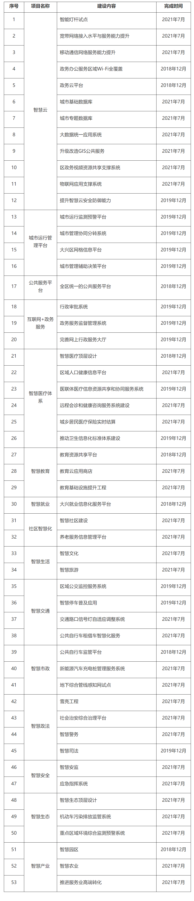

大兴区新型智慧城市总体规划（修订版）

# 一、建设背景

## （一）背景概述

《大兴区新型智慧城市总体规划》（以下简称《总体规划》）从大兴区发展定位和规划出发，以习近平新时代中国特色社会主义思想为指引,全面衔接北京市智慧城市建设规划和实施要求，充分借鉴国内外最优秀的智慧城市发展模式，始终立足于满足市民、企业和政府的智慧化需求，深入分析大兴区智慧城市发展现状和存在问题的基础上，提出大兴区新型智慧城市建设总体目标、总体框架、主要任务和切实可行的实施路径，指导全区各单位、各部门、各企业开展新型智慧城市建设，运用新技术手段助力城市治理，全面推进城市治理体系和治理能力现代化，不断提升群众生活幸福感、满意度。

## （二）发展基础

目前，全区在民生服务、城市治理、产业经济、生态宜居、信息基础设施建设等方面取得了明显成效。

1.公共服务建设初见成效。建设大兴区综合行政服务中心、工商税务分中心等四个分中心服务大厅，以及镇（街道）服务中心和村（社区）服务站，初步形成三级行政服务体系；建成大兴区政务办公云平台、移动政务办公管理系统、行政电子监察平台，有效推动了政务办公的便捷化，提高了政务服务效率；建成一批中小学数字校园，搭建大兴区教育私有云、教育资源商店等，提高了教育管理服务能力；建立了居民电子健康档案、社区卫生服务综合管理信息系统、大兴区影像信息平台，实现了基层与区级医院电子健康档案、影像资源的整合共享。

2.城市治理能力不断增强。依托大兴区公安视频专网，建成北京市首个统一规划、统一建设、分类应用的区域视频图像平台，已实现部分视频资源在区委政法委、区城市管理指挥中心、区应急局等部门之间共享；整合网格化城市管理服务系统、社会服务管理系统、安全监管系统、村庄社区化系统、非紧急救助服务案件办理系统、大兴区网格化综合决策支持系统等，建设"N+1"网格化综合管理信息平台，实现由被动管理向主动服务模式转变；对已建成的安全生产监管信息平台、动态安全监管和预警预报系统、危险化学品图像监控平台，进行优化升级；建成应急值守系统与应急政务移动信息平台，实现了对城市应急事件随时随地处置；实施动物卫生监督重点环节实时监控与溯源追查，有效地提升了食品安全和环境安全的防御效能。

3.生态宜居环境不断改善。空气质量进一步改善，空气质量监测系统运行良好，恶劣空气质量做到准确预报预警。水环境治理大有成效，全区全面落实"河长制"，完成新凤河、大龙河等河道治理任务，完成8条河段27.07公里的黑臭水体治理，水质实时监测系统覆盖全区主要河流。园林绿化取得积极进展，全区完成2.03万亩生态林建设任务，打造集中连片、成带连网的大尺度森林景观，建成森林防火预警系统。噪声污染有所缓解，声环境监测系统有效运行，实现建成区环境噪声分贝不断下降，城市宜居水平得到有效提升。

4.产业经济创新发展不断进步。电子商务产业蒸蒸日上，大兴区成为国家首批电子商务示范基地，集聚小笨鸟等一系列电商平台。科技创新快速增强，高新技术产业蓬勃发展，全区高新技术企业数量激增。文化创意产业持续壮大，双创基地、国家级众创空间、国家级孵化器不断增多，已打造出完整的"众创空间孵化器+加速器+产业园"科技创业孵化链条。智慧园区建设初见成效，已建成生物医药产业基地、国家新媒体产业基地智慧园区试点以及大兴西甜瓜基地、鲜切花生产基地、兽药产品二维码追溯管理等智慧农业试点，物联网技术在智慧产业中的作用更加凸显。

5.基础设施建设不断完善。交通基础设施更加便利，公共交通系统四通八达，建成成熟的公共电汽车、轨道交通运营体系，大力推广投放新能源出租车、接驳车。公共自行车系统更加完善，优化布局公共自行车站点，投放公共自行车近2万辆，方便居民短途交通出行。交通疏堵工程初见成效，全面铺开有条件的路段实施路口渠化工程，缓解了路口拥堵现状，提升了通行能力。城市停车系统日益便利，基本实现停车诱导系统全覆盖，极大提升了停车便捷程度，有效缓解了城市停车紧张程度。

6.信息基础设施量质齐升。光纤宽带和移动网络基本全面覆盖。党政机关计算机网络（电子政务外网、内网、视频专网）覆盖区、镇（街道）、村（社区）三级，实现移动政务、政务办公、政务会商高效便捷。区级政务资源共享交换平台逐步完善，已与城市部件库、社会管理信息库、经济运行库、人口库和全区法人数据库实现了实时同步。人口、法人、空间地理信息和宏观经济基础信息库初步建立，为全区业务系统提供了数据支撑。物联感知网络建设逐渐起步，公共安全视频监控基本覆盖重点公共区域，有效支撑了公安、交通、人防、城管、园林绿化、水务等领域监测业务。

## （三）差距分析

1.公共服务领域。

优质均等的教育服务尚未实现。公众对优质均等的教育资源有较大需求，当前优质教育资源总量不足，需以现代信息化技术减轻公共教育服务压力，网络教育、在线教育、社区教育等新兴教育服务模式亟待培育和发展。

优越健全的医疗服务依然紧缺。医疗资源分布不均、优质医疗资源短缺问题依然严峻，急需推进远程医疗、家庭医生等医疗模式全面发展，分级分类推进医疗服务、降低公立医疗机构压力需持续努力。

多元化社区服务体系尚未形成。社区生活便捷度、智能度、智慧度、安全环境有待提高，目前已有社区服务尚无法满足社区居民医疗、养老、教育、公共服务、就业辅导、技能培训、社会福利等群众全方位需求，社区居民生活幸福感有待提升。

2.城市治理领域。

城市运行秩序有待加强。利用大数据技术、物联网技术破解车辆违停、流动商贩等问题能力需进一步加强；城市网格化事件入口不统一、业务系统不联动，无法实现事件全面自动分拨，需进一步依靠信息系统为城市急办、难办事件等问题提供应急处置支撑。

城市综合治理能力仍需提升。全区缺乏全面掌握城市日常运行状态的统一平台，未实现对全区安全生产、危化品管理、违法建筑、城市内涝等全面监测，无法对城市各类危险事件进行综合研判。当发生突发事件时，应急部门无法依据当前事态信息作出快速指挥处置。

城市治理领域业务协同程度不高。城市大部分数据仍属各机构垂直管理，尚未实现信息全面汇聚，数据更新的时效性参差不齐，共享交换力度不足，阻碍了城市业务系统的协同联动；社会数据和政府数据未形成城市大数据资源,各部门、各单位无法利用数据资源进行分析、挖掘、应用，未全面铺开基于大数据的城市管理新模式。

3.生态宜居领域。

城市生态环境仍需改善。污水排放、饮用水安全实时监测尚不能满足城市生态宜居需求；城市空气质量、环境污染监控与预警需进一步加强，应充分利用物联网等监测手段，加强污染源实时监测与风险预警；部分村庄环境问题依然突出，需改进整治措施和提高整治力度；公众监督上报渠道不够畅通，城市环境治理公众参与度需提高。

城市绿色便捷程度有待提升。部分区域仍存在交通拥堵频发等问题，交通出行信息服务支撑不足；新能源充电桩被占用情况严重，未得到充分有效利用，影响新能源汽车使用率；公共自行车存在调度不足等问题，公共自行车管理和服务水平需进一步提升；城市绿地实时监测水平不高，绿地资源管理急需增强。

4.产业经济领域。

产业发展环境不够优越。产业发展体制机制还不够完善，产业发展基础设施有待健全；产业信息服务平台仍需优化，企业了解政府政策、优惠措施、创业辅导等信息渠道不够畅通；智慧园区建设应进一步加强，企业信息应用有待提升，企业服务精准化、个性化能力不够。

全方位创新创业支撑服务需加强。政府公共数据对企业开放程度明显不足，现有开放数据难以满足企业创新应用需求；服务创新创业能力需提升，"高精尖"科技企业精准服务能力存在较大差距，金融融资、评估认证、知识产权等专业性服务水平不高。

5.基础设施领域。

城市智能基础设施覆盖不足。城市视频监控覆盖度不足，部分区域存在监控缺漏问题；基础设施智能化水平不高，智能灯杆和电子公交站牌等智慧基础设施未全面覆盖，交通、环境、地下管网等物联网监测设施缺口较大；基础设施建设城乡差距明显存在，镇、村摄像头和公共Wi-Fi建设水平与城区存在较大差距。

信息孤岛现象依然突出。城市数据体系建设明显不足，基础数据库使用率相对较低，各业务系统联通困难，现有数据共享程度对数据分析挖掘支撑不够，急需打破各类部门信息"壁垒"。

网络安全存在较大隐患。各层级人员网络安全防护意识亟需增强，各类关键基础设施保护有待巩固；各类数据资源信息泄露防护机制和能力有待加强，对相关隐私数据的保护力度需进一步加大。

# 二、指导思想、基本原则和建设目标

## （一）指导思想

严格落实北京市智慧城市建设规划和实施要求，以体制机制创新为驱动，勇担使命，真抓实干，树立新标杆，加快建成"一体化、高端化、国际化、宜居宜业和谐"的智慧大兴。

## （二）基本原则

1.以人为本，优质均衡。以满足市民多样化需求和增强市民智慧体验感为导向，围绕当前广泛关注和亟待解决的民生、环境、治理等问题，强化资源整合、模式创新，使人民享受到安全、高效、便捷、绿色、普惠的城市生活，提升群众获得感和幸福感。

2.服务大众，精准治理。加快"互联网+政务"建设，实现"让群众少跑腿、信息多跑路"政务服务新模式；深化现代城市治理精细化、智慧化、标准化，倡导"公众参与、共建共治"，逐步形成大数据时代城市治理方式的创新格局。

3.创新驱动，高端聚集。努力建设具有全球影响力的科技创新引领区，形成开放高效创新生态体系，聚集一批高端优质企业、尖端核心技术和高层次人才，为可持续发展提供重要引擎。

4.深度融合，突出特色。以提升城市运行管理能力为抓手，整合基层网格化队伍，优化和丰富数据采集模式，加强数据融合共享和大数据应用，实现以开放式网格为基础，"精准感知、自动预警、迅速处置"一体化运行的城市治理新模式。

5.政府引导，多方参与。强化政府主导作用，通过总体设计、统筹规划，实现全区新型智慧城市有序建设。引入市场机制，逐步推行市场化运作模式，创新商业模式，构建政府、企业、市民等社会多方共同参与、共建共享发展格局。

## （三）建设目标

到2021年，逐步打造全程全时便捷多元的公共服务体验之城、平急结合精细共治的城市治理之城、绿色低碳环保的高品质宜居之城、智慧引领的高端制造与产业服务之城、绿色集约安全智能的感知之城。

1.打造全程全时便捷多元的公共服务体验之城。依托已建成的区、镇（街道）、村（社区）三级政务服务中心和服务站，深化行政审批制度改革和事项梳理优化，打造"一窗办理"服务新模式。推广"北京大兴"APP，提供政府门户网站、手机端、自助机等多渠道信息公开和政务服务渠道；整合生活缴费、出行、医疗、教育等公共服务，完善医疗卫生信息化共享水平，逐步完善医联体医疗信息资源共享和协同服务，到2021年实现居民电子健康档案规范化建档率超过80%；大力推进智慧社区建设，建立多元化社区服务体系，实现智慧社区建成率70%以上。

2.打造平急结合精细共治的城市治理之城。综合感知设备自动监测、网格员采集和市民主动参与治理等方式，打造城市运行管理平台和综合治理平台，逐步实现对城市运行态势全面感知、自动预测、高效处置，使问题隐患"第一时间发现、最短时间响应、最快时间处置、第一时间反馈"，确保"平时"能够满足各部门日常事件管理工作需要；"急时"能够满足应急管理工作需要，实现应急事件事前、事中和事后全流程管理，切实提高社会综合治理能力。

3.打造绿色低碳环保的高品质宜居之城。促进"智慧+绿色"提升，加快建设绿色生态城市。到2021年，空气质量、水环境、噪声等在线监控实现重点区域全覆盖，水、大气、噪声污染发现能力显著增强。

4.打造智慧引领的高端制造与产业服务之城。到2021年，着力构建高精尖产业体系，将智慧园区打造成全区产业发展新名片，实现全区产业向优质、高端、个性方向发展。

5.打造绿色集约安全智能的感知之城。构建大数据储存、共享、利用、开放平台和安全信任机制，增强全区大数据中心安全韧性，建立统一共性支撑平台，各部门业务系统按需纳入全区统一平台进行管理运维。到2021年，实现全区光纤网络全覆盖、重点公共区域、重点场所高速Wi-Fi全覆盖。

# 三、主要任务

## （一）推进精准服务，铸就高端品质民生

按照"便民、利民、惠民"原则，以实现全程全时全方位服务、增强市民获得感为主线，以提升公共服务水平为抓手，综合利用移动互联网、物联网、大数据、云计算等新一代信息技术，加快整合民生领域服务内容，不断提升民生服务水平。

1.建立公共服务新模式。衔接北京市公共服务平台，推进区、镇（街道）、村（社区）三级公共服务体系建设，建立权责分明、定位清晰的组织体系、服务规范和考核标准。衔接北京市电子证照库建设，建立区电子证照分发中心，实现群众办事"一号"申办，避免群众办事重复提交材料、证明和文件；按照北京市统一部署,实现与北京市网上政务服务大厅无缝对接，推进行政审批事项梳理及标准化，梳理完善行政审批与服务事项，实现各类事项标准化办理，完善网上办事事项流程；实现主题化办事服务，缩短办事周期、提高整体办事效率；完善审批平台电子监察模块建设，实现行政审批事项从受理到办结全过程信息实时采集、监督。推进网上办事向手机客户端、自助终端延伸，加快向便民服务中心、便民服务代办点推广应用，逐步实现群众足不出户即可办理相关审批和服务项目；利用人脸识别技术迅速实现人证合一的有效核验，提升政务服务便利化水平；探索多元化服务模式，全面推广"北京大兴"APP，融合全社会服务资源和市民身边各种便捷服务渠道，为市民提供政务服务、公共服务等多元服务内容，实现便民服务掌上办。

2.构建医疗服务新体系。建设人口健康信息平台，建立以全员人口信息、电子健康档案和电子病历三大数据库为基础的医疗大数据，推进公共卫生、医疗服务、医疗保障、药品管理、综合管理等业务应用。加快人口健康信息共享，实现健康档案、病历、医学影像等信息跨区域、跨医院共享利用，促进区域卫生业务协作，建立居民全生命周期数字化、网络化、便利化卫生服务与管理模式；推动分级诊疗模式发展，建立基层首诊、双向转诊、急慢分治、上下联动医疗模式，破除大医院人满为患、基层医院资源利用不足等问题；探索建立区域医疗协调联动机制，建立公共卫生联防联控机制、跨域卫生监督机制，推进人才技术交流、信息资源共享和重大疫情与突发公共卫生事件联防联控；增强公共卫生应急综合能力，加强对传染性疾病监控力度，运用大数据分析技术，综合疾病爆发周期、人口流动数据、气象数据等信息，建立疾病监测、预警、预报和防护体系。

3.完善智慧教育体系。加快智慧教育信息基础设施建设，对智慧教育数据中心和教育云进行加固和升级改造，建立统一运维保障体系，建设教育网网络安全威胁感知预警监控系统，保证教育网安全。整合全区教育信息资源，构建全区智慧教育资源共享平台，实现优质资源有效推荐、统一开放；建立教学与教育管理服务平台，利用信息化手段实现对学生学籍管理、学习质量测评、教师档案管理、教师教育水平管理的集成管理，提升管理效率；建设新高考综合信息化服务平台，及时反馈全区新高考工作动态，提升各学校教学管理工作效能；推动"互联网+教育"高速发展，把区内优秀教育资源推向社会，同时推动社会参与智慧教育应用开发，开发个性化智慧教学创新服务。

4.建立智慧社区服务体系。继续推进智慧社区建设，完善智慧社区网络基础设施、便民服务终端等建设，促进社区服务集成化、社区管理智能化、居民生活现代化和医养结合普遍化；推动社区医养一体化建设，建立社区养老助残服务平台，为老年人、残疾人等群体提供办证、领取补助等公共服务，提供移动医疗、养老信息管理、生命体征监测等服务，有效解决老年人、残疾人就医及养老问题。

## （二）深化精细治理，推动城市多元共治

以构建现代化治理体系，提高城市治理能力为出发点，建立城市日常运转与应急体系一体化运作机制，以科技创新和体制机制变革双轮驱动，推进"互联网+"政府扁平化管理，推动多元主体参与社会治理，加强大数据应用与开放，全面支撑政府宏观决策。

1.提升城市运行管理能力。构建全区统一城市运行管理平台，建设城市治理业务数据库，汇集全区人口、法人、地理空间、宏观经济等基础数据以及视频、网格、社会、安全生产数据；建设城市综合运行监测平台，利用舆情监测、流动人口、密集人群、安全生产、食品药品安全、经济运行等数据模型和各类实时数据，实现对全区运行态势实时在线监测；建设决策支持平台，利用对城市各类治理数据分析挖掘，为全区各业务部门和基层工作人员提供全面、科学数据服务支撑；建设网格案件统一分拨平台，升级大兴区"N+1"网格信息系统，建立由城市管理指挥中心、城管、公安、市场监管等与城市管理密切相关部门共同参与联动机制，实现城市各类事件统一受理、处置与分转；建立案事件统一入口，整合政府门户网站、官方微信平台、"北京大兴"APP、市民热线、网格员采集系统等平台，建立统一的案件、事件上报系统，强化主动发现能力；建设全区统一的网格员管理与绩效评价系统，将全区各部门网格员纳入系统进行统一管理，对网格员工作轨迹和工作任务进行全方位管控，打造一支"物理分散、管控统一"网格化队伍，进一步提升网格化工作能力；提升案件监控与发现能力，通过卫星遥感、高清摄像头、各类环境传感器等创新手段，提高案件发现技术水平。

2.提升城市应急管理与决策能力。升级全区应急指挥调度系统，强化大数据分析在城市应急管理应用，综合运用公安、应急、交通、气象等领域数据，增强突发事件预测能力，实现应急、常态一体化管理，切实提升全区应对突发事件能力和应急管理水平；进一步完善应急预案，明确突发事件权责划分，梳理应急事件处置流程；整合全区应急管理数据与应急救援队伍，健全应急物资储备和管理机制，完善应急避难场所、人民防空场所使用和管理制度；积极推进"智慧消防"系统建设，提升消防应急处置能力，逐步实现火灾防控自动化、灭火救援指挥智能化、日常执法工作系统化、队伍管理精细化，建立起"智慧防控、智慧作战、智慧执法、智慧管理"一体化智慧消防运行机制；通过大数据，展示全区易涝、易塌陷点分布情况和治理情况，有效提升城市风险灾害防治管控能力。

3.提升公共安全管理能力。建设全区视频监控共享平台，整合政法、公安、城管等领域视频资源，实现视频资源统筹管理，按权限、业务需求等进行视频数据共享；强化视频监控分析应用，对重点监控区域非高清摄像头进行升级改造，结合GIS数据、人脸识别、视频数据结构化、人群聚集统计分析等技术，为城市管理提供数据决策支撑；提升公共安全智慧化分析能力，通过GPS定位、人脸识别、大数据分析等智慧化手段，对城市公共安全事件进行智能监控与精准打击；完善安全生产信息化平台，加强对危化品生产企业等重点监控企业、重点监控区域、安全隐患点布设监控设备等，对城市内生产安全状态进行实时监测；加强国家行业安全生产标准在安全生产动态监管和预警预报系统中的应用，加强系统预警监控能力，充分利用大数据和视频智能分析，为城市安全运行和突发事件应急处置，提供统一、安全、及时的信息传输通道，为智慧城市运行、管理、指挥提供有效支撑。

4.推动绿色便捷交通能力。加快交通基础设施建设，加强交通运行指数发布与分析能力，改善城市交通环境；推进电子公交站牌设立和应用，推动公共交通移动支付系统建设，提升交通出行便捷度；探索建立自适应城市绿波带，整合城市视频平台数据及交通流量数据，减少城市上下班高峰期拥堵现象。升级交通诱导系统，建立综合自适应诱导信息发布系统，实现路况、停车场等各类信息综合发布。推进智能停车项目建设，整合全区停车位资源，进行全方位感知，实时动态采集停车车位信息，优化停车服务效能；完善电动汽车充电桩管理服务，利用视频监控、电动汽车车载信息系统等实时监控充电桩与电动车辆分布，加强对充电位有效监管，实现智能分配与调度；加强公共自行车停放监管，开发公共自行车监管平台，利用先进物联网技术，对公共自行车违规停放进行监管。

5.提高市政基础设施监管水平。加强地下管线信息管理，按照相关保密要求,建立全方位多维度地下管网综合感知系统，对排水、电力、燃气、通信等地下管线进行全方位监控；结合全区空间地理信息公共服务平台，建立地下管线综合管理系统，对地下管线隐患排查、安全管理等进行精准监控；探索NB-IoT等新技术应用，实现水电燃气热等远程智能抄表、实时数据采集；结合居民工作出行习惯等大数据分析，探索市政资源智能调节等运营工作。

6.加强信用监管与信息服务建设。优先从医疗卫生、食品药品、危化品生产、环境保护、劳动用工等重点领域入手，建立信用管理制度和评价标准规范，逐步形成全区统一的信用管理制度体系；加强市场信用监管，加强对市场主体信用评价，建立守信激励、失信惩戒等信用管理机制；与北京市信用信息系统对接，建立大兴区企业、个人、非企业法人等市场主体信用基础数据库，形成完善的区级信用信息资源；建设全区统一的公共信用信息服务平台，加快信用信息记录、归集、公开、共享交换，推进政府部门间公共信用信息共享交换，依法提供企业和个人信用报告查询服务。

## （三）加强新技术应用，打造生态宜居大兴

坚持绿色生产、绿色生态发展、绿色生活，以建设"生态大兴"为目标，强化信息技术应用，提高生态资源监测保护能力、环境监测治理能力、低碳循环发展能力、水资源高效利用能力等，建立政府、企业、公众共治共管生态发展体系，推动建成和谐宜居美丽生态城市。

1.推进智慧生态大兴建设。积极探索大兴智慧生态实施路径，持续加强生态环境精细化管控能力，建立生态环境协同模式，有效推动大兴区生态环境精准治理和科学决策。提升城市水资源监测与利用能力，推进生态环境应急体系建立，加强环境监测预警能力，完善城市内涝监测预警防护体系；完善大气环境综合管理，强化机动车尾气、餐饮油烟、工地降尘在线监管，切实改善空气质量；加强气象与地震灾害预测预警防治，保护城市生态安全；加强生物多样性监测与保护，构建动态生物多样性监测体系。

2.完善环境治理监测水平。科学部署物联感知终端与感知网络，建立覆盖辖区范围内大气、水、土壤、噪声、辐射、污染源等各项生态环境要素的监测网络，实现感知信息数据实时传输；强化污染源在线监控，依托物联网、云计算和大数据等技术,加快完善污染源在线监测、环境质量预警预报、环境质量预测建模、环境事件应急处置等，提升企事业单位环境信息公开率、城市环境问题处置率；推进全区水质智能监测，利用传感器等技术，建立全区水质实时动态监控系统，完善管网改造，提升我区主要河道水环境品质，提供水质变化应急决策支持；推进垃圾分类全流程运行和监管体系建设，对辖区内生活垃圾收运进行分类减量管理，探索"从源头到去向全程量化监控"物联网管理模式，防止垃圾收运过程中二次污染。

3.力推低碳环保发展模式。推进覆盖园区、重点企业、大型公共建筑等场所能源监测网络建设，加强能源利用和监管，提升能源利用率；倡导低碳生活方式，加强能源与碳排放管理和低碳生活方式宣传推广；大力推进绿色建筑建设，提高城市绿色建筑覆盖率，推进BIM技术在新建建筑中应用，严格执行设计阶段和施工阶段节能强制性标准。

4.加快海绵城市监测试点建设。积极推进海绵城市建设，推行海绵城市建设理念，强化城市绿地、道路、水系等对雨水吸纳、蓄渗和缓释作用，控制和治理城市径流污染；加快雨洪利用设施建设，结合雨洪水资源利用与防洪达标的思路，降低城市内涝风险，基本消灭辖区内涝；加强雨洪信息与设施监测，提高城市雨水自然积存、净化监测和水资源监测能力，全面推进海绵城市全过程监管水平和决策分析能力；应用水资源大数据综合统筹自然降水、地表水和地下水系统性,协调整合水循环利用。

## （四）强化创新引领，加快产业创新发展

积极推进全区产业向优质、特色方向发展，强化新一代信息技术产业发展中的创新应用，加快信息技术高地、商贸物流服务高地、创新创业高地建设，全力推动产业高端化发展。

1.打造更具活力的发展模式。优化创新创业环境，利用现有双创园区，提升创新创业服务水平，链接成熟孵化资源，嵌入互联网金融服务平台提供灵活的资金支持，促进优秀创新创业项目的孵化；发挥大数据在精准招商和企业服务方面能力，有针对性地推进金融机构、大数据分析公司参与招商咨询与落地过程，精准识别招商对象、精准提供资金支持；建立企业信息库和企业服务应用系统，对企业发展状态进行分析，为企业提供"全方位、一站式、智慧化、精准化、时效强"服务，助力企业成长。

2.打造数字经济新的增长点。积极发展跨境电商产业，深度结合北京大兴国际机场临空经济区发展规划，建设跨境电商和智慧物流产业基地，探索建立跨境电子商务智慧化体验店和免税店，推动跨境电商龙头企业聚集发展。

3.提升经济运行监测预警能力。升级产业服务数字化平台，汇集土地数据、产业和企业运行指标体系，实现对全区经济运行态势全面感知，描绘大兴区产业图谱，全面、清晰、客观展示区域产业发展情况；完善平台的分析和预测预警能力，提升对经济发展的辅助决策能力，为完善产业发展生态、加速产业聚集和创新发展提供决策支撑；建设人才信息管理平台，整合政府、企业和社会资源，实现人才信息采集整合、信息存储和集中管理功能，开展信息共享推送、人才发展状态分析、人才统计评优、优化创业培训等人才资源信息服务，提升人才服务精准度。

4.推进智慧园区建设。大力推进生物医药基地、新媒体基地智慧园区建设，整合园区安防、门禁、停车引导、环境监测等感知网络，打造创新园区服务和高效运营管理模式，提升园区精细化管理和智慧化服务水平，形成智慧园区的建设运营模式，并在全区复制推广。

## （五）加强统筹规划，打牢网络信息基础

加强统筹规划，建设泛在感知的物联基础设施、集约共享的计算存储设施、高速互联的信息传输网络、可管可控的网络信息安全体系和共享开放的数据资源体系，提升城市基础设施智能监测水平，提高基础设施复用效率和网络传输速率，实现"数据归心"，全面支撑大兴区新型智慧城市建设。

1.升级和优化网络基础设施。加快高速宽带网络建设，深入推进宽带网络光纤化改造；积极部署5G示范区域建设，逐步实现"千兆到户、万兆到楼"的城市光网发展目标；提高城市Wi-Fi覆盖率，推进政务办公服务区域Wi-Fi全覆盖；提升党政机关网络基础设施水平和安全防护能力，网络安全防护能力进一步提升；启动智能灯杆示范工程，在主要园区、商圈和社区开展智能灯杆建设，加大旧有路灯改造升级力度，打造集照明控制、Wi-Fi热点、天线基站、视频监控管理、城市环境实时监测、紧急呼叫、水位监测、充电桩和井盖监测等功能于一体的智能路灯试点。

2.完善物联网感知基础设施。根据全区综合规划，升级重点监控点视频探头，探索应用视频数据前置处理技术，推动公共安全视频监控联网整合；推进物联网在公共治安、城市管理、道路交通、生态环境等领域部署，持续完善大型公建、路政设施等城市部件智能感知监测体系；推进物联感知网络和感知设备统一接入和管理、感知数据标准化处理、感知网络安全管理等；支持企业在社区、公共场所、办公楼宇等区域部署智能服务终端。

3.升级改造区数据中心。完善信息基础设施，构建统一高效、弹性扩展、安全可靠、按需服务的城市大数据中心，推动政府业务系统向大数据中心云平台迁移；完善数据标准体系，完善基础数据、主题数据和历史数据等数据库建库标准、共享目录、服务发布标准和数据访问标准等；完善数据可视化功能，基于地理信息平台，以表格、柱状图、关系图等形式展示数据，支持可视化分析；提供基础数据更新情况可视化服务，数据来源单位数据资源情况、共性编目统计等可视化服务。

4.建设集约化共性基础软件。提供核心服务支撑能力，建设面向不同业务应用系统的通用功能支撑模块，丰富开源共性基础软件库，提供更加灵活的组件化服务支撑；建设区级移动办公平台，推进机关智慧办公应用，更好地服务全区政务工作。

5.推动数据开放及应用创新。编制《大兴政务信息资源目录》，建立"一数一源"政务数据资源体系，明确全区各单位、各部门可共享的政务数据目录，按照"谁主管，谁提供，谁负责"原则，加强共享数据维护和更新，保障数据完整性、准确性、时效性和可用性；建立统一的政务数据开放平台，优先推动经济、环境、交通、信用、医疗、卫生、养老、就业、社保、文化、教育、市场监管、食品药品安全等领域政务数据统一汇聚和集中开放；探索大数据创新应用，以"提升民生服务、激发社会活力"为重点，推动社会治理精细化、经济运行科学化、民生服务智能化。

6.打造可管可控的安全体系。加强关键信息基础设施安全防护，加快推进网络设备和软硬件平台自主可控替代；提升网络空间治理能力，全天候、全方位感知网络安全态势，主动收集网络中各类信息，加强舆情监管。推进针对社会征信、网络违法和不良信息举报等活动网络综合治理平台建设；夯实数据应用安全基础，完善数据安全保护体系和安全风险评估机制，实现对数据资源的监管、运营和配置功能，数据加密检索和对敏感隐私数据的智能保护，防止数据通过互联网等途径泄露；完善安全管理相关制度，建设、落实全区网络和信息安全的管理制度，包括用户安全、数据安全、设备和资产管理、信息发布保密审核等，对涉及敏感信息工作人员加强管理和培训。

# 四、实施路径

## （一）总体框架

围绕大兴区建设目标和建设需求，构建符合大兴区建设特色的"1云+2平台+N应用"新型智慧城市总体框架。"1云"即大兴区智慧云，实现数据采集、传输、计算存储、分析和应用服务，主要包括传感、网络、计算存储资源、数据资源和共性应用支撑云服务；"2平台"分别指面向公众服务的公共服务平台和面向政府管理的城市运行管理平台；"N应用"涵盖智慧医疗、智慧教育、智慧交通等行业领域。

图1 大兴区新型智慧城市总体框架

## （二）技术架构

新型智慧城市按照"打牢共用、整合通用、开放应用"的思路开展建设。结合大兴区信息化建设现状，构建大兴区新型智慧城市系统架构。

图2 大兴区新型智慧城市系统架构

1.共用基础设施由物联感知设施、通信传输设施、计算存储设施构成。物联感知设施实现对城市鲜活数据采集。通信传输设施包括互联网、移动通信网络、广播电视网、政务网络、视频专网、物联专网等。计算存储设施包括硬件设备、支撑软件和资源虚拟化管理。

2.通用功能平台由数据资源平台、共性服务平台和视频共享平台构成，实现全区数据统一整合、处理、分发，为管理层分析决策、城市各类业务应用提供精准数据支撑，为跨部门、跨区域、跨层级的业务协同、政务服务与社会服务提供统一的平台支撑和安全数据共享开放。

3.业务应用以鼓励社会企业共同参与的方式，在民生服务、城市治理、低碳绿色和产业经济等业务领域构建各具特色的智慧应用，推动城市治理体系和治理能力现代化，增强民众获得感。

4.网络空间安全体系包括关键信息基础设施安全防护、网络空间治理、综合应用安全支撑和安全管理制度规范，实现网络空间"安全清朗"目标。

5.标准规范体系包括系统之间互操作技术标准、保障项目实施落地的管理体制机制以及衡量项目实施成效的评价指标，规范大兴区新型智慧城市建设内容和核心要素。

## （三）推进思路

大兴区新型智慧城市建设将充分发挥全区各单位、各部门在数据建设和应用中的主观能动性，实现从独立作战向统筹全局转变，工作重心由抓局部项目建设向抓整体规划实施转变，主抓"1云+2平台+N应用"，以打造1个智慧云、2个跨领域跨行业跨层级的平台，12类智慧应用为目标，分3年进行实施，明确责任和时限，全面推进大兴区新型智慧城市建设工作。

# 五、保障机制

## （一）加强组织保障

成立大兴区新型智慧城市建设工作领导小组。组长由区长担任，常务副组长由常务副区长担任，副组长由主管副区长担任，领导小组成员由区委政法委、区发展改革委、区经济和信息化局、区民政局、区政务服务局、区应急局、区城市管理指挥中心、区政府机关后勤中心、兴投公司等部门有关负责人组成；领导小组下设办公室，办公室设在区经济和信息化局，办公室主任由主管副区长兼任，办公室常务副主任由区经济和信息化局主要领导担任，副主任由区经济和信息化局、兴投公司、中电科智慧院等单位有关负责同志担任，成员由领导小组成员单位主管领导组成。领导小组办公室下设统筹协调、项目推进、社会化建设、网络和信息安全、宣传等5个组，负责统筹推进全区新型智慧城市建设工作，承担统筹协调、总体规划、标准制定、项目管理等职能，为大兴区新型智慧城市建设各项任务推进落实提供组织保障。

## （二）加强机制保障

1.严格遵守《总体规划》要求。各单位、各部门要按照全区统一部署，认真落实《总体规划》要求，正在进行设计的项目应主动与《总体规划》对标，已经完成方案设计的项目应与《总体规划》进行方案对接，正在建设的项目要按照总体设计要求预留接口。建立《总体规划》滚动实施机制，将目标分解到具体工作任务。

2.加强管理制度建设。抓紧制定城市数据资源共享开放政策制度，出台大数据管理规章制度。同步规划信息安全保障，进一步加强信息安全测评认证体系、网络信任体系、信息安全监控体系及容灾备份体系建设，建立网络和信息安全监控预警、应急响应联动机制。

3.加强评估评价。各牵头部门和责任部门，要细化工作举措，突出重点，统筹安排，分步实施。对大兴区新型智慧城市建设开展评估评价工作，编制年度评估报告。

## （三）加强资金保障

加强对全区新型智慧城市建设资金管理统筹安排、专项监管，优先安排涉及民生、公共服务等领域的财政支出和项目投入，集中财力保证投资重大项目资金需求。加大对基础性、全局性、公共性、协同性、创新型项目支持力度。明确资金使用计划，加强对资金使用过程动态监控和审计，实现资金管理全程、动态、闭环管理。

## （四）加强人才保障

将大兴区新型智慧城市建设培训内容列入区委党校培训课程和区、镇（街道）两级中心组学习内容，提升大兴区新型智慧城市建设的组织领导和执行落实能力。充分调动全区党政机关、企事业单位信息化人才积极性，逐步形成专业新型智慧城市建设队伍。引入智慧城市相关技术、应用研发机构和技术团队，推进政府与国内外知名高校、科研院所的合作互动，形成人才共建、定向培养、定期脱岗培训相结合的人才培养机制，实现科技人才交流、科研成果共享。

## （五）加强宣传保障

加强对新型智慧城市相关知识、建设效果的宣传推广与普及，利用各种活动形式让市民进一步了解新型智慧城市的知识和理念，直观地体验和感受新型智慧城市建设效果，增强社会民众对新型智慧城市的认知度、认可度，激发市民参与新型智慧城市建设积极性，提高市民对新型智慧城市建设实际效果的满意度。

附件：

大兴区新型智慧城市建设内容与计划

