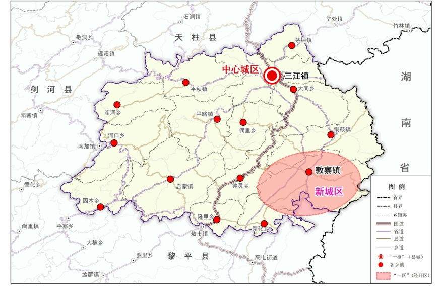

锦屏县国民经济和社会发展第十四个五年规划

和二〇三五年远景目标纲要

（2021年3月8日县第十七届人大六次会议通过）

# 前  言

锦屏县国民经济和社会发展第十四个五年规划和二〇三五年远景目标纲要，是以习近平新时代中国特色社会主义思想为指导，全面贯彻国家、省、州的重大战略和决策部署，深入落实党的十九届五中全会、省委十二届八次全会和州委十届十次 全会的重要精神，根据中共锦屏县委《关于制定锦屏县国民经济和社会发展第十四个五年规划和二〇三五年远景目标的建议》编制的，主要阐明了锦屏县“十四五”时期经济社会发展的指导思想、基本原则、发展定位、发展目标、重点任务和保障措施，集中体现了县委、县政府的施政方针和战略部署，描绘了未来五年全县发展的宏伟蓝图，擘画了二〇三五年的远景目标，既是全县各级各部门履行经济发展、社会管理、公共服务、环境保护等职责的重要依据，也是全县人民共同开启社会主义现代化建设新征程、进军第二个百年奋斗目标的行动纲领。

## 第一章  站在历史新起点，全面开启现代化建设新征程

“十四五”时期（2021-2025年），是我国由全面建设小康社会向基本实现社会主义现代化迈进的起步奋起期、“两个一百年”奋斗目标的历史交汇期、全面推进现 代化强国建设的重要机遇期。对于锦屏县来说，站上新的历史起点，既是补齐短板、加快追赶的攻坚时期，也是深化改革、扩大开放的关键时期，还是推动经济社会高质量发展的重要时期，我们必须立足基本县情，认真总结成就经验，深入分析发展环境，全面把握国家、省、州的政策导向，深入践行新发展理念，以高质量发展为主题，奋力开启社会主义现代化建设新征程，携手共建幸福美丽新锦屏。

### 第一节  全面小康同步实现

“十三五”时期，是锦屏县发展历史上砥砺奋进、极不平凡的五年，是夺取全面建成小康社会完胜的五年。五年来，面对错综复杂的内外部发展环境形势和艰巨繁重的经济社会改革发展任务，全县上下认真贯彻落实党中央国务院、省委省政府、州委州政府的重大决策部署，沉着应对前所未有的压力和挑战，坚持以脱贫攻坚为统揽，聚焦打好三大攻坚战，协同推进“六稳”“六保”，顽强拼搏、开拓创新、锐意进取，全县经济社会发展呈现出“经济稳定增长、民生持续改善、环境更加优美、社会和谐稳定”的良好态势，全面完成了“十三五”规划确定的各项目标任务，为乘势而上开启现代化建设新征程奠定了坚实基础。

——脱贫攻坚实现全胜，彻底撕掉绝对贫困标签。坚持以脱贫攻坚统揽经济社会发展全局，紧扣“一达标两不愁三保障”的总要求，着力发展扶贫产业，全面构建扶贫产业利益联结机制，尽锐出战向“绝对贫困”发起总攻，全面完成1.79万人易地扶贫搬迁安置，实现饮水安全全覆盖、30户以上组组通公路全覆盖，实施农村危房改造6340户，透风漏雨房屋整治1516户，完成“三改”40318个。对口帮扶、定点帮扶、东西帮扶协作取得重大成果。2019年底，全县112个贫困村全部实现国家标准脱贫出列，累计减少贫困人口17501户74902人，贫困发生率下降至1.47%；2020年3月，锦屏县正式退出贫困县序列；2020年10月，所有贫困人口全部脱贫，综合贫困发生率降至0，全县农村贫困人口全部脱贫、贫困村全部出列、整县脱贫退出的目标如期实现。

——经济实力稳步提升，全面小康社会基础持续夯实。全县经济总量不断增长，发展质量持续向好。到“十三五”期末,全县地区生产总值从34.76亿元增长到59.73亿元，年均增长8.1%；一、二、三产年均分别增长6.4%、4.6%、3.1%，实现了速度与质量双提升；人均生产总值达到3.8万元，年均增长7.8%；500万元以上固定资产投资完成17.22亿元；社会消费品零售总额完成23.70亿元；城镇居民、农村居民人均可支配收入分别达到3.32万元、1.03万元，年均分别增长8%、10.1%，全面建成小康社会各项指标如期完成，巩固拓展脱贫成果不断夯实。

——产业发展蓬勃兴旺，产业体系构建实现历史性突破。产业结构不断优化，三次产业结构比从18∶33∶49调整为18.1:38.7:43.2。以“一种一养”（石斛种植、生态鹅养殖）为代表的特色农业大踏步前进，林下养鹅规模及活树近野生种植石斛规模位居全省第一，被授予“中国近野生铁皮石斛之乡”，是全国首家、中国唯一称号。农业产业革命深入推进，粮经比调整为30∶70。工业经济提质增效，累计完成企业技改42户，建成经开区路网11公里，标准厂房23.43万平方米，规上工业增加值实现年均增长7.9%。工业集聚发展能力不断提升，中国500强企业亚狮龙集团等一批优质企业入驻园区发展，初步建成全世界最大的羽毛球加工厂，生态鹅和石斛精深加工全产业链初步形成。新能源、装备制造、电子信息等新兴产业蓬勃发展。服务经济活力不断呈现，以全域旅游为重点的第三产业快速发展，隆里古城成功创建国家4A级旅游景区，龙池多彩田园、文斗苗寨、茅坪木商古镇、平鳌景区成功创建国家3A级旅游景区，乡村旅游发展典型圭叶“众筹”模式、隆里古城“农业+文化+旅游+扶贫”模式、雷屯“N+旅游”模式获得全州学习推广，旅游总收入突破50亿元。物流、金融、电商、培训等其他服务业同步稳定发展。全县产业发展走出了一条“三次产业高效联动、农文旅深度融合、生态环境持续向好、脱贫成果持续巩固、民生福祉全面增进”的高质量协调发展之路。

——人居环境显著改善，城乡面貌发生翻天覆地变化。新型城镇化稳步推进，中心城区辐射能力进一步增强，城镇综合承载能力不断提升。三江老城、敦寨新城、隆里古城等特色小镇建设成效日益凸显，创新实施“大花园”“大果园”“苗木代培”等项目，统筹推进公路沿线绿化、亮化、景观化。“四在农家·美丽乡村”加快建设，创新探索“三齐三净三美”模式，农村人居环境明显改善，水、电、路、讯、房、寨等基础设施水平全面提升。城乡一体化建设步伐加快，农业转移人口市民化加快推进，常住人口城镇化率从36.8%提高到46%，县城绿化覆盖率达35.85%，全面协调融合的新型城乡关系正逐步形成。

——基础设施更趋完善，发展支撑保障能力全面增强。全面推行县、乡、村三级“路长制”，全县通车里程达到2132公里，新增高速公路45公里、国道57公里、省道209公里，实现了“村村通油路、通客运”和“组组通硬化路”，“四好农村路”省级示范县创建顺利通过省级验收。扎实推进清水江航电站枢纽工程。水利基础设施建设不断加强，建成水库水电站31座，在建水库6座，重点水库和输水配套设施建设不断完善，解决了全县20.7万农村人口饮水安全问题。能源基础设施进一步完善，电网改造升级工程全面完成，信息基础设施加快建设，全县通信光缆达1.4万公里，4G网络建设全面完成，县城区域开通5G基站23个，宽带接入用户达3.38万户，行政村网络覆盖率达到100%，“广电云”用户接入达3.52万户。

——污染防治有力有效，生态文明建设质量稳定提高。加快建设国家生态文明先行示范县，全县森林覆盖率达到72.18%，长江上游区域性生态屏障不断筑牢。全面推行“河长”制，环境保护治理成效显著，亮江、小江以及清水江流域锦屏库区生态环境整治常态化，全县河流出境断面水质达标率100%、集中式饮用水源地水质达标率100%；大气污染防治不断推进，县城区空气质量优良天数比例达到98%以上；土壤污染防治、耕地质量保护、垃圾分类处理、危险固废处置等综合治理成果显著，全县山好、水好、空气好的生态格局全面构建。

——改革开放纵深推进，经济社会发展动力持续激发。供给侧结构性改革持续发力，“放管服”改革深入实施。新一轮机构改革全面有序完成。农村集体产权制度改革扎实开展，成为贵州唯一入选“全国33个集体林业综合改革试验区”试点县。水务一体化改革不断深入，按照“供排一体化、城乡一体化、信息自动化、投资建设运营一体化、绿色生态一体化”的标准，全面推进水务一体化工作，集中供水不断向农村延伸。医疗改革有序推进，创新“1+4”医共体建设模式，成立中国锦屏院士工作站和医共体互联网医院，医疗服务水平达到新高度。对外开放水平不断提高，营商环境不断优化，锦屏营商环境评估排名由2017年全省第69位、全州第11位，跃升到2020年的全省第3位、全州第2位。

——社会事业加快发展，民生保障和社会治理成效明显。全面推进教育教学高质量发展，统筹推进教育基础设施建设，城关四小实现开班入学，教育教学质量稳居州内前列。医疗卫生服务能力不断提升，县、乡（镇）、村三级医疗基础设施不断完善，被推荐为全省公立医院综合改革真抓实干取得明显成效地区，全县每千人拥有床位数达6.12张。文体事业加快发展，县级文化馆、图书馆、博物馆、村级综合文化服务中心及乡镇综合文化站全面建成，实现了乡镇、行政村农民体育健身工程全覆盖。社会保障水平不断提升，城乡居民养老保险、基本医疗保险实现应保尽保。就业水平稳步提升，全县城镇登记失业率下降到3.09%。社会综合治理水平不断提高，基层民主管理不断进步，社会治安稳定有序，成功创建全国民族团结进步示范县，荣获国家信访工作“三无县”称号和第二届全国“法治信访进步奖”，社会主义核心价值观深入人心，社会文明程度大幅提升，成功战胜新冠肺炎疫情，人民群众安全感和满意度稳步提高。

——全面从严治党管党，持续营造风清气正政治生态。全县上下深入贯彻落实习近平新时代中国特色社会主义思想和习近平总书记重要讲话、指示批示精神，贯彻落实中央和省委、州委相关会议精神，深入开展“不忘初心、牢记使命”主题教育，持续深入推进全面从严治党。全面完成省委、州委巡视巡察提出的整改事项，整改效果明显。全县各级党组织认真履行管党治党的政治责任，坚定不移推进正风肃纪和反腐败斗争，形成了风清气正、干事创业的良好政治生态，为锦屏县经济社会发展提供了坚强有力的政治保障。

“十三五”时期的发展实践证明，县委、县政府深刻把握全县发展的阶段性特征，统一发展思路，创新实施各项决策部署和政策举措，积累了宝贵经验。一是始终坚持党的坚强领导，锦屏县“十三五”期间取得历史性成就，最根本的一条就是坚持以习近平新时代中国特色社会主义思想为指导，坚定自觉向习近平总书记看齐，向党中央看齐，增强“四个意识”，坚定“四个自信”，做到“两个维护”，不折不扣落实中央、省委、州委各项决策部署，大力践行“一线工作法”，奋力推动经济社会高质量发展。二是始终坚持“做大总量、转型跨越、追赶发展”，正确处理好“赶”与“转”的关系，在追赶中促转型，在转型中促发展。紧扣全县经济社会发展的主要矛盾和关键环节，加快补齐发展短板，着力推动工业化、城镇化水平全面提升，加快推进农业现代化和旅游产业化，带动全县经济社会加快发展。三是始终坚持深化市场化改革和扩大高水平开放，依靠改革优化营商环境，发展壮大民营经济，全力培育市场主体，狠抓产业招商引资，积极引进外部发展要素，不断拓展锦屏发展新空间，加快构建全面开放新格局。四是始终坚守发展、生态、安全三条底线，把发展作为解决一切问题的关键，正确处理好发展和生态环境保护的关系，把生态文明建设融入经济社会发展各领域各环节，全面防范经济发展进程中的债务风险，着力推动经济社会持续健康发展。五是始终坚持以人民为中心的发展思想，发展的目的是惠及人民群众，要加快社会民生事业发展，着力提升基本公共服务水平，巩固和拓展脱贫成果，不断提高人民群众的获得感。这些弥足珍贵的经验和做法，必须在“十四五”发展过程中予以坚持和发扬。

### 第二节  开启新的历史征程

“十四五”时期，锦屏县将与全国、全省、全州同步迈进现代化建设新征程，经济社会发展形势都发生了深刻变化，全县发展既迎来重大战略机遇，也面临着严峻风险挑战，我们要深入分析和准确把握发展中的不确定性因素，深刻认识错综复杂的新形势，增强机遇意识和风险意识，准确识变、科学应变、主动求变，善于转危为机，全面稳妥开启新的历史发展征程。

——从国际形势看，当今世界正经历百年未有之大变局,国际力量对比深刻调整，新冠肺炎疫情对全球经济的影响将难以在短期内消化，世界形势的不确定性、不稳定性明显增多，外部环境呈现复杂剧烈局面，但合作共赢、共同发展仍是大势所趋，和平与发展仍是世界主题。在经济社会发展领域，新一轮科技革命和产业变革深入发展，5G、大数据、物联网、人工智能、生物科技、先进材料、区块链等前沿技术正应用到经济社会各领域，推动全球产业链、供应链、价值链和创新链加快重构，引领产业变革方向，将深刻改变人类生产和生活方式，改变全球创新发展与竞争格局。

——从国家层面看，我国发展仍然处于重要战略机遇期，机遇和挑战都有了新的变化，经济长期向好的趋势没有改变，持续发展具有多方面的优势和条件。国家着力构建国际国内“双循环”发展格局,大力推进“一带一路”建设、长江经济带发展、粤港澳大湾区建设、成渝地区双城经济圈建设等国家战略，将不断促进我国经济结构调整和产业布局优化。加大“两新一重”投入，增加财政赤字规模、抗疫特别国债两个“一万亿”，支持东南沿海产业向内陆转移，将为锦屏加快谱写新时代追赶超越新篇章提供重要契机。

——从省州层面看，全省交通、水利、教育等制约瓶颈逐步破解，三大国家级试验区建设深入推进，特别是全省深入实施十大千亿级工业产业、十二大特色优势农业和十大服务业创新工程，将为我县加快产业转型升级、提质增效提供了重要机遇。同时，随着全省“六网会战”和“两新一重”建设深入推进，将为我县加快完善基础设施提供有利机遇。黔东南州脱贫攻坚取得历史性成就，补短板、强弱项持续发力，发展综合实力不断增强，加之全州地处西部与东部、中部区域协调发展的中间腹地，在新一轮高水平对内对外开放的推动下，发展区位优势将不断凸显，有利于实现高端嫁接，打响“民族原生态·锦绣黔东南”和“文化之州、民族之州、康养之州”的靓丽名片，不断提升知名度，推进全州经济社会实现高质量发展。

——从自身条件看，“十三五”期间，我县综合实力显著增强，经济社会各领域都取得了突出的发展成绩，瓶颈短板不断破解，基本民生全面进步，市场活力不断呈现，生态环境不断改善，社会环境安定和谐，特别是全县脱贫攻坚精彩摘帽出列，这些都将为锦屏县“十四五”时期经济社会高质量发展提供良好的条件和基础。

在取得诸多可喜成绩的同时，我们也要清醒地看到，我县发展仍然存在不少短板。一是农业基础设施薄弱，农业机械化程度较低，生产技术水平不高，农特产品开发仍处于初级原材料供应阶段，附加值较低；林业资源生态价值转化能力仍然较弱，全县农业经济正处于劳动力向机械化、小农经济向规模化转型的过渡阶段。二是全县工业缺少大型龙头企业带动，工业发展基础及园区设施薄弱，主导产业主要以农产品加工、木材石材加工等初级产品为主，产业层次偏低、产品附加值不高，缺乏高端化、智能化、信息化的高技术型产业，工业经济占比在30%以下，处于工业化的初级阶段。三是旅游与文化产业配套体系跟不上社会发展需求，文化和旅游产品挖掘程度不深，对外知名度不高，处于初创阶段向产业化发展的转变阶段。生活性服务业基本满足日常需求，但总体水平偏低，开发和培育力度任重道远。四是县城配套设施不够完善，区域竞争能力较弱，特色小镇建设规模较小，城乡要素流动不畅，城乡二元结构矛盾仍然突出，城乡一体化进程还有待加速推进。

总体来看，“十四五”时期对于锦屏县来说，加快“追赶”“转型”“补短”依然是主要任务，发展机遇与挑战并存，但机遇大于挑战，只要我们立足县情，准确把握所处的发展阶段特征，深刻认识新形势、新任务、新要求，把握新机遇，应对新挑战，坚持行之有效的战略决策和部署，切实把握好发展目标、发展定位和重大任务，勇于担当，苦干实干，就一定能实现经济社会发展的新跨越。

### 第三节  指导思想

高举中国特色社会主义伟大旗帜，全面贯彻党的十九大和十九届二中、三中、四中、五中全会以及习近平总书记视察贵州重要指示精神，坚持以习近平新时代中国特色社会主义思想为指导，增强“四个意识”、坚定“四个自信”、做到“两个维护”，统筹推进“五位一体”总体布局，协同推进“四个全面”战略布局，坚持稳中求进工作总基调，立足新发展阶段、贯彻新发展理念、构建新发展格局，坚持以高质量发展统揽全局，守好发展和生态两条底线，统筹发展和安全工作，努力克服新冠肺炎疫情带来的不利影响，在新时代西部大开发上闯新路，在乡村振兴上开新局，在实施数字经济战略上抢新机，在生态文明建设上出新绩，按照全面开启社会主义现代化建设新征程的总体要求，紧扣省委“一二三四”发展思路，以建设贯彻新发展理念示范区为统领，围绕“杉木之乡·有机锦屏”的战略定位，深入实施乡村振兴、大数据、大生态“三大”战略行动，大力推进新型工业化、新型城镇化、农业现代化、旅游产业化“四轮”驱动，坚持“五个沉下心来”，全面落实“567”工程，扎实做好“六稳”“六保”工作，努力把锦屏县打造成中国山地有机农产品生产基地和国内外木商文化旅游目的地，力争在提升县域综合影响力和竞争力上实现重大突破，推动锦屏实现百姓富、生态美、产业强，经济、社会、生态相互协调发展，奋力开创新时代“生态锦屏”新局面，为与全国、全省、全州同步实现现代化奠定坚实基础。

### 第四节  基本原则

——坚持党的全面领导。坚决维护党中央权威，始终以习近平同志为核心的党中央保持高度一致，加强县委对全县经济社会发展的集中统一领导，全面提高全县各级党委（党组）系统贯彻新发展理念和领导经济社会发展的能力和水平，确保党中央、省委、州委、县委的决策部署在锦屏县落地见效，为锦屏县全面推进现代化建设、实现高质量发展提供根本的组织保证。

——坚持以人民为中心。坚持以人民为中心的思想，坚持共同富裕方向，维护人民群众根本利益，把满足人民群众日益增长的对美好生活需要作为发展的出发点和落脚点，不断增进人民福祉，促进社会公平，保障人民平等参与、公平发展的权利，让全县人民共享改革和发展的红利，切实增强人民在共建共享发展中的获得感、幸福感和安全感。

——坚持新发展理念。把新发展理念贯穿发展全过程和各领域，全面融入新发展格局，切实转变发展方式，推动质量变革、效率变革、动力变革，努力解决好发展不平衡的问题，促进人与自然和谐共生，全面提升开放合作平台建设品质，推动发果共享，实现更高质量、更有效率、更加公平、更可持续、更为安全的发展，将锦屏县建设成全省贯彻新发展理念示范区。

——坚持“四轮”驱动发展。紧扣新型工业化、新型城镇化、农业现代化、旅游产业化“四轮”驱动，充分发挥产业化、城镇化发展的引擎作用，扬长补短、提质转型、加快追赶，强化固定资产投资和产业投资对经济社会发展的拉动效应，努力构建与现代化经济体系相适应的新动能、新业态、新基础、新模式，打造产业融合和产城融合发展“升级版”。

——坚持改革开放创新。坚持发挥市场在资源配置中的决定性作用，持续深化重点领域和关键环节改革，着力破除制约高质量发展的体制机制障碍。坚持开放带动、平台引领，全力建好产业园区、经济开发区、旅游景区等重点发展平台，推进招商引资绿色通道建设，以高水平开放推动高质量发展。坚持创新驱动发展，全面推进大众创业、万众创新，充分激发全社会创新活力。

——坚持生态优先绿色发展。深入贯彻“两山”理论，突出生态经济理念，坚持“生态优先、绿色发展”和“生态产业化、产业生态化”发展路径。厚植生态资源优势，因地制宜发展生态农业、生态工业和生态服务业，坚定绿色低碳循环发展道路，建设资源节约型、环境友好型社会，形成人与自然和谐发展新格局。

### 第五节  发展定位

围绕锦屏县发展基础和条件，着眼长远，展望未来，以建设全省“贯彻新发展理念示范区”为统领，紧扣“杉木之乡·有机锦屏”战略定位，厚植资源优势，突出发展核心和重点，着力打造“一区两地”，全面提升锦屏县的对外知名度和影响力。

——贵州贯彻新发展理念示范区。建设贯彻新发展理念示范区，必须强力实施乡村振兴、大数据、大生态“三大”战略行动，这是锦屏县新时期贯彻新发展理念的战略选择，既符合党中央、国务院推动西部大开发形成大保护、大开放、高质量发展新格局的战略部署，又符合贵州省三大国家级试验区建设目标，还符合锦屏县作为生态、民族、欠发达地区和革命老区的发展实际，体现了坚持并完善发展思路的要求，有利于锦屏县在创新、协调、绿色、开放、共享发展上形成全省乃至全国的典型示范，不断增强县域经济发展的综合竞争力。

——中国山地有机农产品生产基地。依托锦屏县生态资源优势，做大做强“有机锦屏”公用品牌，坚持走品牌化、规模化、集约化发展道路，重点打造石斛、贵锦鹅、油茶、山核桃、生态鱼等无公害绿色有机农产品和绿色食品，大力建设有机示范园区、示范企业、知名品牌，深入抓好农产品质量安全监管，扎实开展作物标准园和畜牧渔业标准化创建，加快把锦屏打造成为面向华中地区、珠三角及周边区域的绿色有机农产品生产基地及中国山地有机生活体验第一县。

——国内外木商文化旅游目的地。立足锦屏木商文化特色，兼顾多彩的汉文化、民族文化、军屯文化、红色文化以及丰富的生态资源和中医药资源，大力培植“文化+旅游、运动、休闲、养生、保健”等新业态，着力塑造“文化锦屏、有机锦屏、康养锦屏、运动锦屏”形象，加快推进具有自身独特优势的“农业、林业、文化、旅游、体育、康养”产业体系建设，用好生态、民族、文化三大资源，全力把锦屏打造成国内外知名木商文化旅游目的地。

### 第六节  “十四五”发展目标

围绕全面建设社会主义现代化的总体要求，综合考虑锦屏县的发展基础条件和未来发展趋势，坚持目标导向和问题导向相结合，坚持追赶发展和转型发展相统一，今后五年全县经济社会发展要努力实现以下主要目标。

——综合经济实力实现新跨越。全面推动发展速度、质量和效益同步提升，经济总量不断增加。到2025年，全县地区生产总值达97亿元左右，力争突破100亿大关，年均增长10%以上。实现人均地区生产总值5.6万元，年均增长8%以上。实现第一产业增加值15亿元以上，力争达到16亿元，年均增长6.5%以上；第二产业增加值38亿元以上，力争实现39亿元，年均增长10%以上；第三产业增加值44亿元以上，力争实现45亿元，年均增长11%以上。产业结构更加优化，三次产业结构比优化为16∶38∶46。

——城乡协调发展呈现新格局。大力实施城乡建设整体提升工程，完善交通、能源、水利、通信、市政等基础设施，支撑和保障经济社会发展的能力明显提升，城乡协同发展更趋完备，形成城乡经济社会一体化发展新格局。到2025年，城镇常住人口人口达10万人，常住人口城镇化率达50%，中心城区建成区面积达10平方公里、城区绿化覆盖率达到40%以上，行政村客运班线通达率达100%，村庄环境整治达标率达100%，城乡一体化均衡发展机制基本建立。

——人民生活水平达到新高度。实现更加充分高质量就业，就业渠道不断拓宽，居民收入增长和经济增长基本同步，到2025年，全县城镇、农村常住居民人均可支配收入分别达52228元、16998元，城镇登记失业率控制在5%以内；基本公共服务均等化水平稳步提升，教育、医疗卫生、文化体育、社会保障、住房等公共服务体系更加健全，义务教育巩固率保持99%以上，千人医疗机构床位数达到6.5张，城乡居民基本养老保险和医疗保险实现应保尽保。

——生态文明建设迈上新台阶。生态、生产、生活“三生”空间全面优化，三条空间控制线得到全面落实。长江中上游区域生态屏障不断筑牢，生产方式和生活方式转向绿色低碳，节能减排降碳和生态环境质量等主要指标处于全省领先水平，建成全省生态文明示范县，生态文明建设水平全省领先。到2025年，全县森林覆盖率稳定在73%左右，主要水功能区水质100%达标。城乡生活垃圾无害化处理率80%以上，县城空气优良天数比例98%以上，单位GDP能耗、水耗、碳排放量等各项指标居全省平均水平以下。

——社会文明程度达到新高度。社会主义核心价值观深入人心，人民思想道德素质、科学文化素质和身心健康素质明显提高。红色文化、民族文化、木商文化、军屯文化等不断传承发展，社会文明程度达到新高度，公共文化服务体系和文化产业体系更加健全,人民精神文化生活日益丰富，“诚信和谐、创新奋进”的新时代锦屏精神不断弘扬和发展。

——改革开放创新激发新活力。通过改革创新全面激活体制机制活力，加快推进行政管理、市场体系、生态文明、财税金融等重点改革，重要领域和关键环节改革取得决定性成果。创新发展氛围不断营造，形成系统完备、科学规范、运行有效的创新体制机制，科技进步和自主创新的优势更加突出。着力拓展对外开放，加强产业、商贸、人文等交流合作，构建更加完善的全方位开放格局。到2025年，实现招商引资累计到位资金达130亿元以上，年均增长10%以上；民营经济比重达60%以上；引进国内优强企业30家以上。

——社会治理效能得到新提升。党的建设制度化水平显著提高，人民民主不断扩大，社会公平正义进一步彰显，服务型政府基本建成，行政效率显著提升。社会治理特别是基层治理水平明显提高，防范化解重大风险体制机制不断健全，突发公共事件应急能力显著增强，自然灾害防御水平明显提升，发展与安全统筹保障更加有力。司法公信力明显提高，法治锦屏、平安锦屏、诚信锦屏建设持久深入。

| 表1：锦屏县“十四五”国民经济和社会发展主要指标表 |
|---|
| 类别 | 指标名称 | 2020年 | 2025年 | 年均增速(%) | 属性 |
| 经济增长 | 1.地区生产总值(亿元) | 59.73 | 97 | 10 | 预期性 |
| #第一产业(亿元) | 10.82 | 15 | 6.5 | 预期性 |
| 第二产业(亿元) | 23.10 | 38 | 10 | 预期性 |
| 第三产业(亿元) | 25.81 | 44 | 11 | 预期性 |
| 2.人均地区生产总值(元) | 38000 | 56000 | 8 | 预期性 |
| 3.2000万元规模以上工业增加值（亿元） | 11.42 | 21 | 13 | 预期性 |
| 4.一般公共预算收入（亿元） | 2.13 | 2.35 | 2 | 预期性 |
| 5.500万元以上固定资产投资（亿元） | 17.22 | 30 | 12 | 预期性 |
| 6.社会消费品零售总额（亿元） | 23.24 | 35 | 8.5 | 预期性 |
| 7.招商到位引资资金（亿元）（产业类） | 23 | [130] | — | 预期性 |
| 8.进出口总额（万美元） | 448 | 900 | 15 | 预期性 |
| 转型升级 | 9.三次产业结构比 | 18∶40∶42 | 16：38：46 | — | 预期性 |
| 10.粮经比 | 30:70 | 28:72 | — | 预期性 |
| 11.常住人口城镇化率（%） | 46 | 50 | 1.7 | 预期性 |
| 基础设施 | 12.农田有效灌溉面积（亩） | 123400 | 130000 | 1 | 预期性 |
| 13.电商网点（数量） | 141 | 190 | 6 | 预期性 |
| 14.5G基站（数量） | 28 | [300] | — | 预期性 |
| 15.城镇集中充电桩（数量） | 10 | [500] | — | 预期性 |
| 科技创新 | 16.科技进步贡献率（%） | 50 | 51 | — | 预期性 |
| 17.人才资源总量(人) | 22200 | 30000 |  | 预期性 |
| 绿色生态 | 18.森林覆盖率(%) | 72.18 | 73 | — | 预期性 |
| 19.单位GDP能源消耗降幅(%) | 在省州下达的控制范围内 | — | 约束性 |
| 20.单位GDP二氧化碳排放降幅(%) | 在省州下达的控制范围内 | — | 约束性 |
| 21.单位GDP用水降幅(%) | 在省州下达的控制范围内 | — | 约束性 |
| 22.城市空气质量优良天数比率(%) | 98 | ≥98 | — | 预期性 |
| 23.城乡生活垃圾无害化处理率（%） | 50 | 80 | — | 预期性 |
| 24.城镇污水处理率（%） | 87.2 | 100 | — | 预期性 |
| 25.城区绿化覆盖率（%） | 35.85 | 40 | — | 预期性 |
| 民生建设 | 26.城镇居民人均可支配收入（元） | 33745 | 52228 | 9.5 | 预期性 |
| 27.农村居民人均可支配收入（元） | 10318 | 16998 | 10.5 | 预期性 |
| 28.城镇新增就业人数（人） | 3155 | 4000 | 5 | 预期性 |
| 29.城镇登记失业率(%) | 3.09 | ≤5 | — | 约束性 |
| 30.人均预期寿命(人) | 73.6 | 75 | — | 预期性 |
| 31.人口自然增长率（‰） | ≤6.5 | ≤7 | — | 约束性 |
| 32.学前教育毛入园率（%） | 90 | 92 | — | 预期性 |
| 33.九年义务教育巩固率(%) | 98.87 | 99 | — | 预期性 |
| 34.高中阶段毛入学率（%） | 93.1 | 93.5 | — | 预期性 |
| 35.基本养老保险参保率（%） | 99.7 | 100 | — | 预期性 |
| 36.每千人口卫生机构床位数（张/千人） | 6.12 | 6.5 | — | 预期性 |
| 37.每千人口拥有执业(助理)医师数(人/千人) | 2.52 | 3 | — | 预期性 |
| 安全保障 | 38.粮食总产量（万吨） | 6 | 6.5 | — | 预期性 |
| 39.亿元生产总值安全事故死亡率（%） | 在省州下达的控制范围内 | — | 约束性 |
| 40.银行业金融机构不良贷款率（%） | 控制在银行业监管指标范围内 | — | 约束性 |

注：[  ]为五年累计数。

### 第七节  二〇三五年远景目标

按照党的十九大对实现第二个百年奋斗目标分两个阶段推进的战略安排，展望2035年，我县将建成经济更加发达、环境更加优美、文化更加繁荣、社会更加和谐、人民更加幸福的现代化生态锦屏。

到2035年，锦屏县经济社会发展的远景目标为：经济总量迈上新的大台阶，地区生产总值突破230亿元大关；基本实现新型工业化、新型城镇化、农业现代化、旅游产业化，建成现代化经济体系；国民素质和社会文明程度达到新高度，公共文化体育服务水平进一步提升，非物质文化遗产保护和传承更加广泛，文化软实力显著增强；广泛形成绿色低碳生产生活方式，生态文明建设达到更高水平，美丽乡村实现全覆盖，“生态锦屏”建设目标基本达成；基本实现治理体系和治理能力现代化，人民平等参与、平等发展权利得到充分保障，基本建成法治政府、法治社会，“平安锦屏”建设更加深化；改革开放水平大幅提升，基本公共服务、基础设施通达程度达到东部地区平均水平，参与区域合作与竞争优势明显增强；人民群众生活更加美好，中等收入群体显著扩大，基本公共服务实现均等化，城乡区域发展差距和居民生活水平差距显著缩小，人的全面发展、人民共同富裕取得更为明显的实质性进展。

## 第二章  加快工业转型升级，构建现代化工业发展体系

深入实施“工业强县”战略，推动产业转型升级并朝高端化、绿色化、集约化发展，推进产业链、创新链、资本链耦合，加快发展新型工业和生态工业，逐步形成富有地方特色的工业体系，实现锦屏工业经济高质量发展。

### 第一节  着力优化工业发展布局

构建“一区九园”协调发展的工业产业布局，按照“一园一主导”“一园一特色”的要求，形成优势产业集群园区，实现优势产业集聚发展。

一区：即锦屏县经济开发区。以经济开发区为中心、产业园区为载体，突出地方特色，做好园区顶层设计，明确主导产业，错位发展首位产业、首位产品。聚焦产业特色，做优产业生态，形成产业竞争力，强化与从江、黎平、榕江的园区联动，打造贵州东南部承接产业转移示范区和省级工业示范园区。

九园：即新型建材产业园、果蔬储存加工产业园、亚狮龙体育装备制造园、环保科技产业园、鹅加工产业园、石斛精深加工园、电子轻工产业园、油茶精深加工产业园和体育赛事产业园等九个产业园，重点打造100亿级鹅产业园、100亿级石斛产业园、100亿级建材产业园，着力培育省级一类工业园区。

| 专栏1：锦屏县“十四五”园区建设发展方向 |
|---|
| 1.打造亚狮龙体育装备制造园、鹅加工产业园和体育赛事产业园立足现有“一种一养”资源优势，全力推进“鹅”产业全产业链,重点发展以亚狮龙集团为主导集孵化、养殖、屠宰、分割、饲料加工、冷链物流、羽毛球加工、羽绒服饰品加工、消费、体育赛事及休闲康养活动等“1+N”鹅全产业链体系。2.打造石斛精深加工园重点发展石斛产业全产业链，围绕“石斛森林、仙草养生”发展定位，加快石斛精深加工产业、石斛啤酒、石斛饮料等项目建设，同时，充分发挥锦屏独特的中药材资源优势，引导、支持企业加大研发力度，推出一批保健功能稳定、深受群众喜爱、具有特色的产品，实现中药材种植产业向深加工产业延伸。3.打造果蔬储存加工产业园和油茶精深加工产业园重点发展油茶、果蔬，围绕锦屏县产业发展定位，依托丰彩油茶和冷链物流仓储中心，全力推动油茶、果蔬产业。4.打造新型建材产业园重点发展新型建材产业，依托全县的青石材、杉木材资源，扎实推进木材、石材产业园项目建设，全力推动木材、石材加工企业集群发展，不断优化产品结构，做精现有主打品种，逐步提高新产品、新材料的比重。鼓励水泥、预拌混凝土、石材、木材、工程管材等重点领域延伸服务。5.打造电子轻工产业园重点发展优势轻工产业，贵州亚博银电子科技有限公司，加快打造集成电路板、电子元器件及智能终端等电子产业集聚，依托福建国本实业有限公司系列项目，紧密结合亚狮龙产业链，持续推动羽绒服装、球头、球拍、运动服饰、球包、球线等轻工产业项目落户锦屏，不断延长轻工产业链条。6.打造环保科技产业园依托“含油污泥热解析”项目建设，扩大石化废弃资源的循环利用，重点推进塑料、松香、松节油、活性炭等产业实施技术升级改造，提高生产、能耗、工艺、质量、安全等环节的现代化水平，实现提质增效。7.打造贵州东南部承接产业转移示范区积极与东部地区合作共建产业转移园区、飞地园区，有序承接产业转移，促进产业集聚，着力打造主导产业突出、特色鲜明、优势互补、环境优良的产业集聚区，创建贵州南部承接产业转移示范区。 |

### 第二节  推动传统产业转型升级

紧扣经开区新型建材产业园，积极做好两材入园工作，规范管理生产，推动两材产业提质提标，增加两材产品附加值。结合锦屏农产品和民族工艺，强化保障产业发展要素需求，鼓励企业加大科技创新投入。

提质发展木材加工业。充分发挥我县森林资源优势，深入推动木屋、家具、装饰板等林产品向高端化发展。以资源有效利用、节能环保为导向，加强对废弃木质材料资源的回收利用，推动木材加工业集约化、绿色化发展。加强天下、胜利、锦鸿等木材企业升级改造，着力打造贵州林工产业龙头企业。大力吸纳周边林区及进口木材等资源，积极打造西南地区乃至国内外的木材加工集散贸易中心，全面提升锦屏木材产业规模及品牌效应。到2025年，规模以上木材企业实现生产总值达3亿元以上。

提质发展石材加工业。充分利用锦屏青石材资源，深入实施“锦石保护与利用”工程，积极引导石材加工业向工艺品方向发展，提升锦屏石材竞争力。持续对点金、闽鑫、冠达等石材企业进行技能改造，推动企业向“精、特、优”转型，提升石材工业精深加工水平。着力推进石材加工企业集聚化发展，以青石加工业为核心，重点推进石材产业入园聚集发展，实现产品互联互补。到2025年，规模以上石材企业实现生产总值达2亿元以上。

提质发展农产品加工业。依托我县特色农产品资源，着力推进绿色食品加工业转型升级，不断延伸和拓宽产业链，提升农副产品价值。支持锦屏风鹅、贵州绿色农产品、佳味源食品等企业改造升级，发展农特产品精深加工、萃取植物精华产品和开发药食同源产品，强化在种植、生产、品质、仓储、物流、市场等方面进行资源整合、提质增效。强化畜禽全产业链发展，打造独特美食、有机康养及生态旅居产业，带动农特食品县内外消费。充分利用大数据、电子商务等信息技术平台，提高锦屏生态特色优质食品市场占有率，助力“锦货”出山，促进农特产品工业绿色化发展。到2025年，农产品加工企业实现生产总值达2亿元以上。

提升发展特色轻工业。加快开发设计民族元素突出、地域特色明显的工艺产品，大力发展刺绣、蜡染、雕刻、编织等工艺产品和苗侗民族服饰、手工制品、文书纪念品等非物质文化遗产衍生产品，塑造锦屏当地民族文化产业品牌，提高产品附加值。鼓励和支持以锦屏亚狮龙体育用品公司为龙头，发展文体娱乐用品及配套产业，形成“1+N”全产业链体系。到2025年，轻工业实现生产总值达2亿元以上。

| 专栏2：锦屏县“十四五”传统产业发展重点 |
|---|
| 1.木材、石材“两材”产业（1）加大“招商引智”力度。依托锦屏木材石材资源的优势，在现有加工业基础上，通过招商引资，引进优质木材石材加工企业、专业技术人才、国际国内先进设备、技术和管理经验，加大技术改造和创新力度，促进产品升级换代。（2）发挥龙头企业带动作用。以龙头带动与集群发展相结合，以市场需求大、附加值高、绿色环保为导向，支持企业发展木材石材精深加工业，延长产业链，提高附加值，推动形成木材石材加工产业集群。引进和培育高端建筑板、生态板、装饰板、细木工板、定向刨花板、家具定制等精深加工领域龙头企业，构建木材加工全产业链条。引进石材精深加工企业，利用新技术、新工艺，改变传统石材的使用范围和特性，全力推动“锦石”向超薄、超轻、环保、易应用等方向转型升级和高质量发展。（3）增强品牌影响力。坚持走高端化、品牌化、绿色化发展路线，加强品牌塑造，鼓励企业采用国际国内标准生产，引导重点企业及行业协会制定新产品行业标准，提高行业企业产品质量和效益水平。大力支持企业开展优质产品生态原产地认证、绿色产品认证等，积极搭建产品贸易经销、市场网络信息等平台，打造名牌产品、提高市场竞争力。2.其他资源优势主导产业深入推进“一种一养”产业发展，实现“鹅”全产业链、“石斛”两大主导产业链全面发展，推动轻工产业提质增效。 |

### 第三节  大力推进新兴产业发展

积极推进新能源使用、新基建建设，探索区块链、物联网等新兴产业发展，充分利用贵州大数据优势，助推全县工业经济实现高质量发展。

有序发展新能源。结合国家能源革命战略，科学有序开发利用太阳能和风能资源。依托水能资源优势，合理开发清水江、小江、亮江等水电资源。积极引进新能源企业，巩固发展现有新能源企业，鼓励使用新能源或清洁能源汽车，构建绿色、高效、安全的清洁能源发展体系，全力培育新的经济增长极，打造清水江可再生能源开发基地。

加快发展新材料产业。按照绿色经济发展要求，采取清洁生产方式（CDM），加快引进高端新材料企业，发展节能环保材料、光伏发电材料、金属复合材料、超导材料等新材料产业，推动锦屏新型材料产业集聚发展。加强新型材料研发和工业化设计能力建设，提高自主研发水平。

加快发展特色医药。依托锦屏独特的生物资源和民族医药特色优势，大力发展中药材精深加工，巩固提升民族医药，培育发展生物医药，推进生物资源产品和药物新品种研发及产业化。加快中药材基地规模化、标准化建设，完善中药材生产技术标准体系，培育全省乃至全国有较大优势的石斛优良品种。加深与浙江铁枫堂生物科技股份有限公司等生物医药企业合作，加快锦屏县中药产业转型发展，推动形成集种植、加工、研发、销售于一体的现代化医药产业格局。培育锦屏中药材品牌，积极向市场推广中药材应用，逐步扩大生产规模，全力保障锦屏药材的质量与安全。

积极发展新一代电子信息技术产业。紧扣我省建设国家大数据综合试验区契机，积极支持5G、互联网、大数据、人工智能、区块链等新技术产业应用和发展。健全电子信息制造产业链条，加快发展IC、玩具、声光等电子线路板的装配产业链。加快推进亚芯微电子芯片及一、二极管生产、LED大功率光敏半导体等项目建设，积极引进高端电子信息技术企业入园发展，打造现代新型产业园区。到2025年，力争电子信息制造业产值达4000万元以上，软件和信息服务业主营业务收入实现1000万元以上。

推动大数据与实体经济深度融合发展。力争在实施数字经济战略上抢新机，大力推动数字产业化、产业数字化、数字化治理，深入实施“万企融合”大行动，推动数字化改造，加快工业园区数字化管理，推动工业向智能化生产、网络化协同、个性化定制、服务化延伸融合升级。大力发展智慧农业，加快农业向生产管理精准化、市场销售网络化融合升级，推动特色优势产业与大数据深度融合发展。大力发展智慧教育、智慧医疗、智慧物流等数字化新业态，推动服务业向平台型、智慧型、共享型融合升级。创新数字治理模式，健全“12345+N应用”体系，深入实施“数字政府”建设行动。推进“互联网+”“大数据+”“区块链+”在民生领域普及应用，不断提升社会治理现代化水平。到2025年，培育大数据实体企业5家。

| 专栏3：锦屏县“十四五”新兴产业发展重点 |
|---|
| 1.新能源（1）优先发展水力发电。扎实推进小水电整改，对具备条件的小水电实施增效扩容改造和绿色改造。依托水能资源优势，积极争取国家对清水江、亮江等水电开发项目的支持，推进配套送出线路规划建设。（2）有序发展风力发电。做实做细风能资源勘测，合理布局建设风能发电场，促进风能资源开发利用。发挥风电与水电的季节性、时段性互补特性，开展风电与水电等可再生能源综合互补利用示范，探索风水互补消纳方式，实现风水互补协调运行。（3）加快发展光伏发电。重点在产业园区、大型公共设施等建筑屋顶相对集中区域建设分布式光伏发电项目，在适宜乡镇建设一批并网光伏电站；加快光伏基地建设，配套建设相关输出设施；完善光伏发电应用的政策体系、技术标准体系、市场服务体系、智能电网体系等。（4）探索发展生物能源。依托锦屏丰富农林资源，加快发展生物天然气、生物质发电和生物液体燃料等生物能源。在秸秆、畜禽养殖废弃物资源比较丰富的乡镇，因地制宜推进沼气发电项目建设；加快推进垃圾焚烧发电发展；整县推进建设生物天然气循环经济示范区；稳步推进建设燃料乙醇项目，扩大燃料乙醇生产和消费，推进先进生物液体燃料技术进步和产业化发展。2.特色医药产业厚植锦屏丰富中药材资源，引进一批知名药企进驻园区，积极谋划实施一批中医药重大工程、重大项目。打造一批中医药文化品牌，推动更多中药材注册地理标志、中药产品走出国门，构建中医药发展新格局。3.电子信息技术产业培育引进电子元器件、电子材料、集成电路、人工智能、智能终端等电子信息产品制造企业入驻园区，培育新技术、新产品、新业态、新模式。 |

### 第四节  提升园区发展支撑能力

坚持工业园区以产业发展为核心，加快推进园区基础设施建设，完善园区内道路、水电气、排污管网等配套设施，为引进企业创造良好的生产条件，全面提升园区综合竞争力。

完善园区基础设施建设。持续完善园区道路、供水、供电、供气、绿化、固废处理、污水处理、消防设施等基础和配套设施，力争实现园区“新九通一平”，提高园区产业发展配套功能。围绕园区生产、流通、分配、消费等全过程生产经营活动，结合园区主导产业，集聚资金、信息、物流、人才等要素资源，积极发展现代物流、电子商务、科技外包、服务外包等服务业。加快敦寨东西两侧快速通道建设，完善返乡创业园、茅坪移民创业园等园区道路建设，确保园区入驻企业顺利投产。加快推进产业工人万人社区、标准厂房、廉租房和居民安置区建设，加快幼儿教育、养老托养、医疗卫生、商业中心、农贸市场及社区服务中心等项目建设，不断增强工业园区承载力和集聚力。完善经济开发区信息服务平台建设，推进通信网络升级，积极推动“工业互联网+智能化”发展，促进产业园区转型升级。

壮大园区工业产业集聚规模。全力推进建材精深加工企业和农特产品精深加工企业集聚入园发展，建成木材、石材精深加工产业园。着力培育以电子轻工、羽毛球体育装备制造及配套为主的产业集群，依托现有的亚狮龙体育文化发展有限公司，全力打造“商品体育+运动装备制造+旅游”发展模式。依托石斛种植基地，加快石斛精深加工园建设，全力补强产业链条。积极引进电子信息企业落户开发区，打造锦屏电子信息集聚区，积极承接长江三角洲地区产业转移。

创新园区运营模式。坚持把做精做优园区作为推进新型工业化的重要抓手，深化园区管理体制改革，推广“管委会+公司”模式，开发区不再承担社会事务管理职能，专心抓产业发展和企业服务；全面建立授权清单制度，建立园区与部门直通车制度，对不能授权事项实行承诺制、容缺受理制，确保经开区全面实现“一站式”审批服务；创新开展合作共建，利用对口帮扶城市、帮扶单位优势资源，加强与发达地区共建共管，探索“飞地园区”税收分成、土地指标共享、优势资源互补的发展新模式。

| 专栏4：锦屏县“十四五”新型工业化重点项目 |
|---|
| 1.产业园建设项目锦屏县石材交易园项目、木材交易中心项目、电子信息产业园项目。2.产品深加工项目锦屏县鹅全产业链项目、10万头生猪深加工项目、500万吨生态鱼深加工项目、铁皮石斛精加工生产项目、中药饮片加工生产项目、果蔬精加工生产项目。3.绿色工业项目锦屏县经开区中石化燃料再利用环保科技项目、日产1万张生态板生产加工项目和引进家具生产、木质房生产项目。 |

## 第三章  推进新型城镇化，构建高质量发展城镇体系

坚持以人为核心，实施新型城镇化建设提升行动，科学布局城镇、农村、生态三大空间，建立健全城乡融合发展体制机制,加快发展山地特色新型城镇化，形成城乡融合互补的区域经济发展新格局。

### 第一节  统筹优化城镇空间布局

围绕锦屏县“一区两地”发展定位，强化中心城区和城镇产业协作协同发展，将锦屏打造成贵州“东进”重要节点城市，优化“一城两区、三心、五组团”的新型城镇化空间布局。

一城两区：即锦屏县城、经济开发区、隆里古城区。

三心：即隆里、启蒙、平秋三个中心镇，分别打造成锦屏县南部、西南部和西北部的区域中心城镇。

五组团：即以县城为主体，辐射周边茅坪、大同、平略、偶里四个乡镇的组团；以敦寨为主体，辐射铜鼓、新化的组团；以隆里为主体，辐射钟灵的组团；以启蒙为主体，辐射固本、河口两乡的组团；以平秋为主体，辐射彦洞的组团。

图1 锦屏县城镇空间布局图

### 第二节  着力提升城镇功能品质

坚持城镇功能布局“特色化、人性化、便捷化、智慧化”，立足长远、科学规划，持续改善城镇面貌，紧扣城镇发展品牌、品位、品质，全面提升城镇配套功能，不断优化城镇人居和发展环境，让锦屏县更加宜居、宜业、宜游。

加快完善城镇功能。围绕交通、文体、卫生、环境、公共设施等重点，聚焦强弱项、补短板，不断强化城镇综合配套功能建设，着力提升城镇综合承载能力。大力推进城镇“8+X”工程项目建设，启动汽车南站市政道路扩建、豪赖物流园、“三馆”、燃气管网等城镇基础设施建设项目，全面夯实城镇发展基础支撑能力。

全面提升中心城区品质。完善中心城区基础设施和服务配套建设，提升中心城区的城市功能，高标准、高质量抓好江滨生态园林老县城建设。积极推进城市新区开发，全面实施“三江六岸”旧城改造工作，推动排洞上寨、药材公司、信合家园二期、长远食堂、老农贸市场、工艺公司二期等城市棚户区改造项目建设，加快消化存量棚改任务，深入推进城镇老旧小区改造，实施农业局宿舍、变电站宿舍、林业局宿舍、木材公司宿舍、县委宿舍、安居工程、老财政局片区、步行街片区、政府宿舍片区、民中至人行片区、老检察院宿舍楼片区、六街片区等老旧小区改造。加强高速公路出口、文化旅游区、城市综合体等建设，加快推进“智慧城市”“韧性城市”“海绵城市”建设，加快完善城市功能配套。

加快打造“安养休闲小城”。围绕生态园林城市建设理念，着力将锦屏县城打造成“全省安养休闲小城”，不断拓展锦屏“慢生活”业态，促进休闲产业发展。深入推进王寨老街及隆里古城旅游服务区开发，打造居住、旅游、购物、养生、餐饮等融为一体的“生活慢节奏”城市综合体。结合新区开发，加快完善步行街、河滨公园等公共休闲空间，打造生态林园休闲城市。

着力彰显城镇特色。以隆里古城为中心，在现有民族民俗、红色文化和古建筑基础上，完善文化创意设施，着力打造历史文化民俗中心。大力实施“茂林清水”工程，严格控制城区建筑的体量、层高和密度，禁止在古城保护区范围内修建高层建筑。加强历史文化遗产保护，将锦屏历史、舞龙、古建、民俗文化等历史人文风情融入城市开发建设中，充分展示“魅力锦屏”风采。

| 专栏5：锦屏县15个乡镇发展定位与产业引导 |
|---|
| 序号 | 乡镇 | 发展定位 | 产业引导 | 备注 |
| 1 | 三江镇 | 锦绣画屏·水墨三江 | 商贸流通、现代物流、特色旅游、加工业、五大产业等 | 县城 |
| 2 | 敦寨镇 | 工业新城·城市新区 | 商贸流通、现代物流、加工业、体育旅游、绿色农业、五大产业、鹅全产业链等 | 经开区 |
| 3 | 铜鼓镇 | 卫城铜鼓·石斛之乡 | 林业、生态农业、文化旅游等 |  |
| 4 | 茅坪镇 | 千家木商·神奇茅坪 | 特色旅游、生态农业、生态养殖、食品加工业、建材产业等 |  |
| 5 | 启蒙镇 | 天籁嘎溜·林海启蒙 | 商贸流通、林业、生态农业、食品加工业、康养旅游等 | 中心镇 |
| 6 | 平秋镇 | 山水平秋·避暑胜地 | 生态农业、生态养殖、文化旅游等 | 中心镇 |
| 7 | 平略镇 | 水上天堂·渔产之乡 | 生态农业、生态养殖、林业、康养旅游等 |  |
| 8 | 大同乡 | 休闲之乡·生态大同 | 林业、生态养殖、康养旅游等 |  |
| 9 | 偶里乡 | 生态偶里·醉美茶乡 | 生态农业、生态养殖等 |  |
| 10 | 隆里乡 | 唐风明韵·寻梦隆里 | 生态农业、生态渔业、文化旅游等 | 古城区中心镇 |
| 11 | 钟灵乡 | 毓秀钟灵·生态田园 | 生态农业、康养旅游等 |  |
| 12 | 新化乡 | 府城新化·果蔬之乡 | 商贸流通、生态农业、生态养殖、林业、文化旅游、现代物流等 |  |
| 13 | 彦洞乡 | 冷凉彦洞·锥栗之乡 | 生态农业、林业、文化旅游等 |  |
| 14 | 河口乡 | 红色之乡·山水河口 | 生态渔业、红色文化旅游等 |  |
| 15 | 固本乡 | 中药之乡·康养胜地 | 中药材产业、康养旅游等 |  |

### 第三节  统筹推进城乡融合发展

统筹城乡规划建设，建立健全城乡融合发展体制机制和政策体系，推动人才、资本等要素在城乡有序流动和平等交换，推进城乡基本公共服务普惠共享，统筹城乡基础设施一体化规划建设管护，推动城乡产业融合发展，形成工农互促、城乡互补、全面融合、共同繁荣的新型城乡关系。

推进城乡要素有序流动。健全城乡融合发展体制机制，破除妨碍城乡要素自由流动和平等交换的体制机制壁垒，深化户籍制度改革，全面取消城镇落户限制。建立城市人才入乡激励机制，吸引各类城市人才下乡创业，推进城市教科文卫体等工作人员定期服务乡村，推动职称评定、工资待遇等向乡村教师、医生倾斜。允许农户将土地经营权入股从事农业产业化经营，鼓励农村集体经济组织及其成员盘活利用闲置宅基地和闲置房屋，审慎稳妥推进农村集体经营性建设用地入市。调整土地出让收入使用范围，提高农业农村投入比例。完善乡村金融服务体系，依法合规开展农村集体经营性建设用地使用权、农民房屋财产权、集体林权抵押融资，以及承包地经营权、集体资产股权等担保融资。加强城镇保障性安居工程项目谋划和建设，加快实现基本公共服务常住人口全覆盖。

促进城乡基础设施一体化发展。统筹规划布局城乡道路、供水、供电、信息、防洪、垃圾污水处理、邮政等基础设施，推动乡村基础设施提档升级。健全分级分类城乡基础设施一体化投入建设机制，加大政府对乡村道路、水利、公交等公益性强的设施投入，加大社会资本对乡村垃圾污水处理、农贸市场等有一定经济收益的设施投入，加大企业对乡村供电、电信和物流等经营性为主的设施投入。建立城乡基础设施一体化管护机制，根据基础设施产权归属落实管护责任，以政府购买服务等方式引入专业化企业，采用市场化方式开展经营性设施建后管护，完善使用者付费和产品定价机制。强化城中村、城乡接合部的基础设施建设管护力度。

促进城乡基本公共服务普惠共享。强化城乡基本公共服务标准统一、制度并轨。推进城乡义务教育学校标准化建设，多渠道增加乡村普惠性学前教育资源，完善乡村教师补充机制。促进优质医疗资源下沉，支持将覆盖人口多、距离城区远的中心乡镇卫生院建设成为县级医院分院，健全城乡远程医疗服务体系，提升乡镇医疗服务水平。统筹城乡公共文化设施布局和服务供给，重点推动文化资源向乡村倾斜，建立文化结对帮扶机制。加快医保、养老保险、低保等制度城乡统筹步伐，健全农村留守儿童、妇女和老弱病残等特殊群体关爱服务体系。

推进城乡产业融合发展。搭建城乡产业协同发展平台，优化提升特色小镇、农业园区等城乡产业载体，打造集聚特色产业的创新创业生态圈，优化提升各类农业园区，提升平台承接城市要素的能力。推进农村一二三产业融合发展，推广农产品个性化定制服务、会展农业和农业众筹等新模式，构建以现代农业为基础、新产业新业态为补充的多元化乡村经济。实施一批城乡产业融合示范项目，形成示范带动效应。

### 第四节  打造山地精品特色小镇

打好民族文化和生态环境两张牌，着力提升中心集镇承载能力，展现乡镇特色，加快推进特色小镇建设，提升特色小镇发展质量，完善特色小镇基础设施，推动各展所长、错位发展。

打造多元特色小镇。强力推进“工业新城、城市新区”建设，促进产城互动、人气聚集。多渠道、多举措筹集资金，精心培育一批有特色、有亮点的特色小镇，重点打造茅坪木商文化小镇、敦寨羽毛球小镇和石斛小镇、启蒙者蒙（河口瑶光）红色文化小镇和平秋北侗刺绣小镇。着力推进河口、固本、平秋、彦洞等偏远西部乡镇建设，形成各具特色、生机勃发的城镇发展局面。

促进产城人文融合发展。大力开展各乡镇和三江流域环境综合整治，提升特色小镇品质品位。大力发展特色农产品精深加工、商贸物流、乡村旅游、休闲农业、民宿经济等产业，推进特色小镇多元功能聚合，打造宜业宜居宜游的新型发展空间，探索生态、生产、生活协调发展的新型产城人文融合模式。

| 专栏6：锦屏县“十四五”新型城镇化重点项目 |
|---|
| 1.特色小镇建设项目茅坪木商文化小镇，启蒙者蒙（河口瑶光）红色文化小镇、特色旅游小镇，平秋北侗刺绣小镇，敦寨工业新区特色小镇、电商特色小镇、羽毛球小镇、石斛小镇，隆里新媒体艺术小镇、旅游小镇，锦屏青石小镇，锦屏樱花小镇。2.城市老旧小区改造工程包括农业局宿舍片区、变电站宿舍片区、林业局营盘坡宿舍片区、木材公司宿舍片区、老林业局宿舍楼上片区、县委宿舍楼片区、安居工程片区、老财政局片区、步行街片区、政府宿舍片区、锦屏民中片区改造工程。3.传统村落保护项目瓮寨、新化寨、茅坪历史文化名镇保护与发展建设项目，进行古建筑、古遗迹、古井、修缮保护，文化博物馆建设项目。4.城镇基础设施建设项目锦屏县县城至茅坪城市管廊项目、县城区人行道改建工程、经开发区产业园基础设施（配套）建设项目、县城排水防涝设施建设项目、管道燃气工程、县城污水处理三期工程。5.城镇景观建设项目锦屏县隆里古镇新城综合服务景区建设工程、回龙山生态体育公园项目、文化体育产业发展中心建设项目。6.智慧城市建设项目人脸识别天网大数据智能信息网络工程、数字锦屏建设项目、数字停车场建设项目。 |

## 第四章  坚持农业农村优先发展，全面推进乡村振兴

坚持把乡村全面振兴作为“三农”工作的总抓手，全面实施乡村振兴战略，按照“产业兴旺、生态宜居、乡风文明、治理有效、生活富裕”的总要求，系统做好新时代“三农”工作，深化农业供给侧结构性改革，加快发展绿色农业，着力做精坝区、做活林区、做优水区，推进一二三产业融合发展，建立健全城乡融合发展体制机制和政策体系，力争率先实现农业农村现代化。

### 第一节  深入实施乡村振兴战略

统筹推进乡村产业、人才、文化、生态和组织振兴，探索形成具有锦屏特色的乡村振兴发展新路径，推动锦屏县农业全面升级、农村全面进步、农民全面发展，实现在乡村振兴上开新局。

推进巩固拓展脱贫攻坚成果同乡村振兴有效衔接。设立5年过渡期，保持帮扶政策总体稳定，做好产业帮扶政策、财政投入政策、金融服务政策、土地支持政策、人才智力支持政策等有效衔接。打好产业发展提质战，巩固提升“三区”经济和“185”工程。深入实施“四在农家·美丽乡村”小康行动计划，加强农村人居环境整治，促进乡村更加宜居宜业。按照“四个不摘”要求，继续保持帮扶干部与贫困群众结对关系，加强脱贫人口后期扶持；着力发展扶贫产业，深入实施脱贫农民就业技能培训，稳定脱贫人口就业，持续增强内生发展动力；强化教育、医疗扶贫，有效防范因灾、因病、因学等返贫致贫；建立健全防止返贫长效机制，突出关注城区边缘贫困群体，加大临时救助力度，做好社会保障兜底，打造全省巩固拓展脱贫成果的锦屏样板。

建设美丽宜居幸福乡村。加快乡村振兴建设示范县创建和申报步伐。完善乡村水、电、路、气、通信、广播电视、物流、停车场、广场等基础设施，提升农房建设质量，推动基本公共服务向乡村延伸。全面推进乡村建设行动，实施生态宜居（地质灾害避险）移民工程、农村人居环境整治工程，广泛开展村寨清洁和绿化行动，完善农村垃圾收运处置体系，梯次推进农村生活污水处理，深化“厕所革命”，切实改善农村人居环境。加快创建森林城镇、森林村寨、森林人家，加快建设文斗、瑶白、平敖等一批美好和谐村庄、文化特色村寨、新农村建设示范带，全面改善农村生产生活条件。深入推进农村移风易俗，加强社会主义精神文明建设，引导村民转变落后观念，革除陈规陋习，倡导新时代文明新风，将乡村建设成“五味一体”的现代生活新农村。

强化传统村落保护与发展。统筹乡镇和村庄规划建设，加强传统村落和乡村风貌保护。坚持保护和发展原则，改善消防设施，提高传统村落木质木房消防等级。改善厨卫条件，开展厨卫基础设施整体性改造。加大生活垃圾和污水处理，把传统村落民风民俗优势转化为旅游经济发展优势，加快发展民宿旅游业。做好传统村落古宅、古井、古街、古城墙、古宗祠等历史古迹的挖掘、修缮、开发和保护，提升整体村容村貌。强化传统民族文化村落、非物质文化遗产的传承和保护工作，加大隆里所村、瓮寨村、文斗村、茅坪村、新化寨村等传统村落保护发展力度。围绕传统村落生产生活器具、民族服饰、手工艺品，建设完善民族博物馆，加大传统文化保护传承。

| 专栏7：锦屏县“十四五”乡村振兴重点项目 |
|---|
| 1.乡村振兴绿化美化工程创建森林城市2个，森林乡镇2个，森林村寨10个，森林人家50户，新建省级森林康养基地1个。2.乡村振兴农村基础设施项目锦屏县100个美丽乡村项目、30个新农村集中建房示范点项目。主要包括广场、排水排污、停车场、旅游接待中心等基础设施建设。3.乡村振兴防返贫项目锦屏县移民园建设项目、易地移民县城安置点生态产业项目、易地移民敦寨新城社区生态农业项目、易地移民清水江旅游项目、易地搬迁扶贫车间发展项目、易地移民生态艾草产业园项目4.生态文化村建设结合乡村振兴战略以及扶贫攻坚规划，全县建设生态文化村20个。5.木商文化园建设建设集清水江“木商文化”科普展示、锦屏文书展示、历史文化保护、生态文化挖掘、生态园林、休闲旅游、民俗传承、艺术展示的综合性生态文化主题园区。 |

### 第二节  优化调整农业产业结构

加快转变农业发展方式，积极稳妥推进农业结构调优调精调深，推进龙头企业集聚发展，促进三产融合互动，调整优化坝区产业结构布局，适度规模种植优质高效经济作物，努力开创锦屏农业发展新局面。

优化农业供给侧结构。持续推进12个特色产业和“一种一养”、五大产业发展，增加酸系食品原料、蓝莓、花卉、中药材种植面积。充分发挥龙池高效生态农业、新化欧阳油茶、三板溪健康渔业等农业园区示范带动作用，加强以禽畜、中药材、油茶、精品果蔬、生态养殖等为主的产业基地建设，加快打造集农业产业、观光体验、康体健身为一体的现代综合性园区。到2025年，全县农村产业结构深度优化，现代山地特色高效农业产业体系基本建立，经济作物种植面积占比达75%以上，畜牧业产值占比达40%以上。

大力推进坝区产业革命。围绕“一坝一策”，深入推进全县16个200亩以上坝区农业产业结构调整，加快高标准农田改造。以优质稻为主导产业，稳定粮食生产，配套发展收益高见效快的经济作物，提高坝区产业综合效益。抓好偶里寨霞、钟灵高寨、敦新、钟隆、敦寨山洞、铜鼓岔路及花桥等7个500亩以上坝区秋冬季农作物种植。着力建立农业发展长效机制，加快土地流转，促进坝区土地集中连片开发，完善坝区农田水利、生产便道、机耕道、排灌设施等基础设施建设。

延长农业产业链。坚持以“一种一养”特色产业为中心，以生态鹅全产业链为引领，完善上游养鹅，中游羽毛球加工，下游举办羽毛球赛事、康养活动等农文体旅一体化的一二三产全产业链融合发展模式，实现鹅产业链升级转型，形成“1+N”产业链条。加快推动形成以铁皮石斛为重点的中药材和以猪牛羊鸡为重点的畜禽养殖及其他农产品生产、精深加工的全产业链，进一步增加农产品附加值，力争建成面向贵州乃至西南地区的产业振兴与升级的创新引领区、农业全产业链发展技术集成示范区。

打造优势农业田园综合体。按照“优产业、强龙头、建基地、重特色、创品牌”的总体思路，立足资源优势和气候条件，大力发展现代山地特色高效农业。以发展绿色生态高效农业、拓展农业多种功能为主线，积极申报农业产业强镇项目。依托龙池多彩田园、隆里盛丰产业园辐射带动，选择新型农业经营主体带动作用强、农村特色优势产业基础较好、区位和生态资源环境条件优越的园区，连片建设集食用菌种植、观光采摘、餐饮、休闲、游乐和乡村情调于一体的体验农业与观光农业相结合的特色旅游的多功能休闲园区。到2025年，培育5个以上模式多样、定位准确、特色鲜明、宜居宜业、惠及各方的田园综合体。

### 第三节  打造现代林业经济强县

充分利用锦屏县丰富的林业资源，以“加强森林资源保护、加大森林资源培育、大力发展林业产业”为抓手，着力把资源优势转化为产业优势、经济优势，全面推进全县国土绿化和林业产业快速发展，打造现代林业经济强县。

加强森林资源培育和保护。深入推进锦屏集体林业综合改革试验区工作，加强锦屏国家储备林建设。推进幼林抚育和低质低效林改造，加快大径级杉木培育步伐。严格执行林业生态保护工程，实施天然林保护和生物物种资源保护，对县境内人文古树进行保护和复壮工作，确保全县森林资源安全。加强林区道路、供水、垃圾及污水处理等基础设施建设，强化森林防火及有害生物防治，加快森林防火阻隔系统建设和智慧林业建设。到2025年，全县森林面积达172万亩以上，森林覆盖率稳定在73%左右，林木蓄量积达1400万立方米以上，林业有害生物成灾率控制在2‰以下，无公害防治率达90%以上。

推动林业经济多元发展。紧扣“杉乡锦屏”地理标志，加快“林业+产业”融合发展，支持林果、林禽、林畜、林菌、林药、林蜂、林菜等林下产业发展。借“林”发力，打造林业立体化发展格局，推动林业产业转型升级，形成林上活树种植石斛，林下种植中药材，林中养蜂，林内石斛花采摘及森林康养，林外种植花卉苗木及林产品精深加工的“五林”经济新型发展模式。围绕春蕾省级森林公园、天龙山至蚂蟥山原始森林等生态旅游区，大力发展森林探险、旅游、康养等绿色新业态，加快锦屏县特色森林康养户外运动中心建设，积极筹建森林博物馆、林业科技中心等林业产学研基地。

推进林业富民增效。积极采取“公司+基地+专业合作社+农户”等多种模式，大力发展油茶、核桃等优良经济林产业，打造集育苗、管理、加工、销售为一体的完整产业链，进一步推进林业发展，让林业变成“摇钱树”。加快完善林权流转管理制度，着力创新林权抵质押贷款和林权收储担保融资方式、森林经营管理制度，推进“三变”改革，助力绿水青山变成金山银山。

| 专栏8：锦屏县“十四五”林业重点项目 |
|---|
| 1.林业基地建设项目油茶高产示范基地、苗木花卉基地、特色中药材基地、森林康养基地、万亩铁皮石斛综合产业配套基础设施建设项目。2.苗木培育项目全县各乡镇实施杉木大径级材培育20万亩，新建以桂花为主的蜜源林1万亩。3.林下生态养殖项目采取林禽、林畜、林蜂模式，利用林地发展林下养殖面积10万亩。4.林业生态保护工程生物物种资源保护工程建设项目、天然林保护工程建设项目（第三期）、重点区域绿化建设项目、水系生态廊道建设项目、重点林区防火隔离带（防火线路）抚育项目、智能电子森林警察机建设项目、林火视频监控系统建设项目、林业有害生物监测防治体系建设项目。5.林业科技推广应用体系建设开展本土树种油茶、湖南山核桃、青钱柳、君迁子（俗称茶柿、黑枣）树种资源调查和进行人工栽培技术研究。引进油茶、核桃等优良经济林树种进行试种观察；创建乡土经济林树种人工驯化栽培试验基地400亩，经济林新品种母本园600亩等林种资源培育、保护及开发利用建设项目。实施乡土珍贵名木造林500亩等珍贵名木种植基地建设项目等项目建设。6.黔东南州智慧林业建设项目以全面实现锦屏县林业信息化为目标，完善信息技术在林业资源监测、评价、规划、管理、保护与合理利用的各个环节的应用。 |

### 第四节  做大做强五大主导产业

在稳步推进粮油等传统农业发展的基础上，深化“三区”经济建设，着力发展壮大中药材、油茶、果蔬、畜禽、水产养殖“五大产业”为主的现代山地特色农业，不断打响“有机锦屏”生态农业公共品牌，推动农产品高品质发展。

大力发展中药材产业。重点发展以铁皮石斛、黄精、茯苓、钩藤、金银花为主的地道药材品种，同步发展白芨、钩藤、七叶一枝花及其他草本等中药材种植。积极选育本土良种，采取林药结合、果药结合、食药结合等发展模式，打造特色中药材种植基地。大力培育中药材种植龙头企业，推进铁皮石斛食药物质试点生产企业申报及相关工作。加强与中药材综合交易市场对接沟通，积极举办促销活动，加大锦屏中药材宣传力度。推进中药材产业、现代山地特色高效农业和大健康新医药产业融合发展。

精细化发展油茶产业。落实“三个三”工作机制，抓实做大油茶产业，让油茶树变“致富树”。注重优良油茶树选育种植，努力把偶里打造成“有机油茶之乡”，积极助推新化万亩油茶产业示范基地建设，完善“一县一业”万亩油茶基地基础设施建设。加大油茶加工企业招商引资力度，加强与发达地区协作力度，深化与农业科技公司合作，做细、做精油茶产业，打造全省高品质油茶基地。

高品质发展果蔬产业。大力实施精品水果工程，巩固提升龙池多彩田园精品水果示范区、锦屏县百香果示范园区、隆里盛丰产业园等园区基地建设品质，加快各乡镇蔬菜基地的规模化、标准化和专业化建设。以高速公路、国省道路沿线区域为重点，发展夏秋喜凉蔬菜、冬春喜温蔬菜和辣椒、西兰花、四季豆、食用菌、山野菜等优势特色蔬菜。加强科技支撑体系和质量标准体系建设，将锦屏打造成为黔东南州的中、高档蔬菜供应基地和原料基地。

提升发展畜禽产业。全产业链发展壮大以养鹅为主、林下养鸡等山地生态畜牧业，稳定发展生猪，有序发展牛羊。健全畜禽良种繁育、饲草饲料生产供应和动物疫病防控体系。以“羽”为轴辐射带动鹅全产业链发展，采取“龙头企业+合作社+农户”的运营模式，发展规模养殖示范带动，结合散养、代养的养殖模式，实现年养殖出栏200万羽目标，打造全省重要的鹅类供应基地，努力建设全省重要的现代生态养殖基地。

积极培育水产养殖业。积极开展免费送鱼苗活动，适度扩大养殖面积，重点发展稻花鱼、龙虾、鳖、螺、鳝等特色渔业，建成全州重要的特色渔业基地。加强生态渔业发展形势、稻渔综合种养技术、坝区流水养鱼技术、品种选择及鱼病防治技术等相关知识讲解培训，增强渔民养殖技术。在保护和改善水域生态环境前提下，在县境内三板溪库区水域，发展以投放净水类鲢鳙鱼为主的水产养殖。抓好加工、流通和市场开拓，在河口乡裕和村大力发展“锦屏腌鱼”产业，完善鱼产品加工、冷链物流配套，推进腌鱼标准化、规模化、市场化生产。

| 专栏9：锦屏县“十四五”农业种植养殖重点项目 |
|---|
| 1.农业种植项目锦屏县油茶高产示范基地建设项目、中药材种植项目、标准化蔬菜生产基地建设项目二期、食用菌培育基地及原种繁育场建设项目。2.畜禽养殖项目锦屏县生态渔业发展项目、鹅产业全产业链建设项目（二期）、生猪养殖项目。 |

### 第五节  全力推进农业接二连三

积极发展农产品精深加工，深入谋划“林农文旅体融合、一二三产联动”全产业发展思路，充分发挥龙头企业、农村经纪人队伍、农村电商销售带动作用，创新融合发展模式，建立农企利益联结机制，全力打造高质量发展、产业融合发展引领区。

推动农业与二三产业深度融合。支持锦屏“五大产业”主产区打造涵盖生产、加工、流通、科技、服务等一体的产业集群，支持发展农产品仓储保鲜、烘干、分级、包装等初加工，引导龙头企业发展农产品精深加工。着力将锦屏经济开发区建成全县农产品加工业的核心区和聚集区，带动创建一批特色农产品加工强镇。积极推进农业和文化、教育、旅游、康养、体育等产业融合发展，以隆里盛丰农业园、龙池多彩田园等园区为主导，加快推进体验型生态旅游项目开发，发展农业采摘、农事体验等旅游产品业态。

创新融合发展模式。挖掘民族文化，推进农业与旅游、教育、文化、康养等产业深度融合，打造以铜鼓工区、多彩田园、隆里盛丰等为核心的农文旅、康旅等为一体化园区，形成“康养之都、运动之城”。聚焦产业发展，以鹅产业为引领，全面推行我县羽毛球产业与体育产业等的先进经验做法，促进一二三产融合发展。大力推进互联网技术、物联网技术应用，进一步提升全县一二三产融合发展的深度和广度。

完善利益联结机制。通过拓展功能链、延长产业链、提升价值链、重组供应链，积极发展企农契约型、利益分红型、股份合作型合作模式，引导融合主体通过“保底收益+按股分红”“固定租金+企业就业”“土地租金+务工工资+返利分红”等多种方式建立紧密利益联结机制，将产业链打造成为利益共享、命运与共的产业融合共同体，让农民分享更多产业链增值收益。到2025年，参与新型农业经营主体利益联结机制的农户达60%以上。

### 第六节  构建新型农业经营体系

围绕农产品市场需求变化，积极发展壮大农村集体经济，培育新型农业主体，创新农业经营管理方式，加快品种品质品牌建设，加强开展农产品产销对接活动，提升农产品流通效率，全面构建新型农业经营体系。

全面提升产销对接能力。推进“联产品、联公司、联数据、联市场”的农商互联统筹发展新路径，积极推广农商互联集配销中心建设和运营模式。加快促进传统种植养殖业向生产、加工、销售一体化发展转变，积极组织订单农业、产销对接、网络推介等活动。瞄准长三角、珠三角等区域绿色农产品的强大需求市场，大力发展农村电子商务，构建农产品产销稳定衔接长效机制。完善乡村快递物流体系，充分利用行政村电商服务站点，扩大农副产品购销服务，让“锦货山珍”走出杉乡，风行天下。

发展壮大农村集体经济。以市场为导向，按照“宜工则工、宜农则农”的原则，大胆探索、因地制宜发展村级集体经济。推广强弱统筹和村企统筹两种发展模式，鼓励农业生产企业发挥产业、项目、资金、信息等优势，带动村集体收入2万元以下村发展壮大村集体经济，通过产业带动、项目共建、劳务合作等方式建立利益联结机制，促进村集体经济发展。

着力培育新型农业经营主体。大力落实政策扶持，加强推广“龙头企业+合作社+农户”的产业发展模式，加强服务引导，培育专业大户、家庭农场、农民专业合作社等新型农业经营主体。通过集中办班、现场实训、线上培训等方式，全面提高新型职业农民及小农户技能水平与管理水平。到2025年，培育新型农业经营主体200家以上，农民专业合作社示范社150家，家庭农场500家。

大力引进培育龙头企业力度。推进锦屏县县级以上重点龙头企业产业项目建设，在全县15个乡镇培育相关产业龙头企业，优化生产、加工、销售等环节，建设主要原料生产基地，打造农产品品牌、增加贷款贴息。积极支持农业龙头企业发展壮大，深入推进东西部协作，引导一批有实力的农业产业化龙头企业在锦屏共建农产品生产基地，发挥示范带动作用。到2025年，重点培育县级龙头企业10家以上、州级龙头企业5家以上、省级龙头企业3家以上，带动100家以上小微企业发展。

打响“有机锦屏”靓丽名片。深入推进锦屏农产品“泉涌”工程，加大农业绿色、有机农产品及地理标志认证及监管力度，提高农业标准化、规模化、品牌化水平。着力建立农产品质量安全承诺制、黑名单制度，完善农产品质量追溯和召回等制度。加强锦屏有机农产品区域公用品牌建设，加强商标注册、培育、保护等工作，积极发展壮大铁皮石斛、贵锦鹅、启蒙酸菜、裕和腌鱼、锦屏野桂花蜜、锦屏油茶等重点农业产业品牌。到2025年，全县农产品产地认定面积达28万亩以上，认证证书达80张以上，州级农产品名优品牌达8个以上，省级农产品名优品牌达5个以上，国家级农产品名优品牌达2个以上。

| 专栏10：锦屏县“十四五”农业经营主体培育项目 |
|---|
| 1.县级以上示范社规范化建设项目在15个乡镇重点支持30家以上示范社，对成员进行政策法规、农业生产实用技术、经营管理、市场营销等培训。引进优良品种，推广实用技术。进行无公害农产品、绿色农产品、有机农产品、原产地标志、农产品质量安全标准等认证，注册商标，建设标准化生产基地。购置农产品整理加工、储藏保鲜、运输及质量检测等相关设备仪器。开展农产品市场营销，推介产品，建设营销网络等。2.县级以上重点龙头企业培育工程针对全县15个乡镇相关龙头企业，在生产、加工、销售等环节，采取建设原料生产基地、打造农产品品牌、市场建设、技术改造、贷款贴息等政策支持。 |

### 第七节  提升农业农村发展支撑

以粮食生产功能区和现代农业园区、坝区为重点，全力加快高标准农田建设，加强农业综合开发，完善水、电、路、沟、渠等农业综合配套设施，加快推广专业化、智能化等先进农业生产设备应用，不断完善农村产业经营服务体系，提升农业农村发展支撑能力。

加快农业农村基础设施建设。持续完善农业农村基础设施建设，补齐农业农村发展短板，完善各地农田基础设施。重点做好农业灾害防御工作，加强宣传培训，增强农民防灾抗灾意识。进一步丰富完善农村生产生活要素，深入实施“改圈、改厕、改厨”行动。加强山塘水库除险加固，增强排涝抗旱、抵御自然灾害能力。加快推进亮江河中型灌区、多彩田园山区现代水利节水灌溉等项目建设，加强200亩、500亩以上高标准农田项目建设，大力推进排灌沟渠和大棚设施建设。实施农田土壤质量提升工程，加强农资农药市场监管和土壤环境质量监测。大力支持喷滴灌、畜禽标准化圈舍、水肥一体化灌溉、生态渔业设施及物联网等农业生产设施设备建设。完善初级农产品分级、加工、包装、冷链物流等设施建设，完善县乡村三级物流配送体系，加快“锦货出山”步伐。

着力提升农业科技水平。加强生态种养技术推广，加大新品种、新技术的引进和示范推广。扩大农机报废更新补贴实施范围，鼓励淘汰能耗高、污染重的老旧机械，推广使用深松整地、高效施肥、秸秆还田离田、残膜回收等绿色高效农机。引导农机销售企业提升售后服务水平，培训农民操作农机技能，推广农机作业和新型实用技术应用。着力组建锦屏县农机社会化服务主体，统筹推进全县农机社会化服务新发展，提高农机社会化、规模化服务水平。积极推进智能化、自动化成套装备技术集成应用，促进农机技术和农艺技术有机结合。强化在全县16个200亩以上农业坝区及小于20度坡耕地推广应用机耕、机播、机收等农机设备。

积极培育新型职业农民。构建完善的教育培训、规范管理、政策扶持、跟踪服务“四位一体”培育制度[]，采取集中办班、外出培训、“1+1”帮扶等措施，开展高素质农业经营管理人才、多技能实用新型人才和高标准新型职业农民培训。选择一批有学历、有技术、爱农业、爱农村、愿意带动村民共同发展的青年农民，列入培养计划，打造生产技术型、职业服务型、产品营销型等多类别的农业精英人才。

大力普及智慧农业应用。提高农业科技应用服务技术水平，健全农业技术推广服务体系，及时发布预测信息，引导农民选种抗逆性强的农作物，努力将农业灾害损失减至最低。不断完善动物、农作物疫病防控体系建设，大力实施统防统治和绿色防控技术。强化提升农村通信服务能力，大力发展智慧气象、数字农业、智慧农林业，提高农村信息化整体发展水平。加快农技推广服务信息化工作步伐，加强与广大农技人员、专家教授等合作，利用App、微信群、钉钉、直播平台等网络媒介在线开展问题解答、咨询指导、互动交流、技术普及等服务。

| 专栏11：锦屏县“十四五”农业基础设施建设重点项目 |
|---|
| 1.农业基础设施及配套项目锦屏县高标准农田建设项目、兽医防疫检测体系项目、一坝一策项目、产业路建设项目、农村污染治理基础设施建设、耕地地力提升项目、全国农作物病虫草鼠疫疫情区域综合监测站及农作物病虫绿色防控示范区建设、农产品质量安全检测体系建设、2万亩坝区农业综合开发建设项目。2.农业科技项目锦屏县科教展示中心建设项目、农产品加工项目3.智慧农业项目锦屏县智慧农业建设项目、大数据智慧农业信息化项目。 |

## 第五章  加速发展全域旅游，推进文化旅游高质量发展

充分发挥锦屏多元文化及生态环境优势，整合“民族、民俗、绿色”三大特色元素，做靓三张旅游品牌，构建“全境域体验、全产业融合、全过程消费、全方位开放、全社会参与”文化旅游产业化发展格局。

### 第一节  优化旅游产业发展布局

依托锦屏山水湖泊、自然风光、多元文化和生态环境优势，着力构建形成“一心三带、二城五区”旅游产业发展布局。

一心：指以县城为旅游集散服务中心。

三带：指清水江木商和红色文化旅游带、亮江农业观光康养休闲旅游带和小江休闲度假旅游带。

二城：指打造县城滨江园林城市和隆里古城。

五区：指清水江自然风光游览区、三板溪湖度假区、原始森林登山探险运动区、亮江流域生态农业观光休闲区和九寨北侗风情休憩区。

图2 锦屏县旅游产业发展布局图

### 第二节  深入实施旅游强县战略

充分发挥木商文化、民族文化、军屯文化、红色文化等文化禀赋优势，优化全域旅游空间布局，提升旅游景点品质，增强基础设施建设和旅游服务能力，打造全域旅游新篇章。

加快推进智慧旅游建设。依托“一码游贵州”“云上贵州·智慧旅游云”等平台，大力推进“智慧旅游”系统工程建设，构建锦屏文化旅游云服务平台。积极发展“互联网+旅游”，积极开发“智游锦屏”旅游App和小程序，打造“旅游资讯一览无余、旅游交易一键敲定”的“零距离”服务。运用智能化、数字化等科技新场景，创新旅游体验新模式。着力推进旅游一卡通、智慧景区、智慧酒店、智慧旅行社建设，加快数字博物馆、美术馆建设，为游客提供更加便利化、智能化、个性化服务。

提升旅游服务品质。按照精细、精致、精美的要求，加快布局建设5G网络、充电桩、智慧停车场等新型基础设施建设,完善旅游公路、绿化景观、公厕、停车场、游客引导系统等景区基础设施建设，提高旅游公共服务水平。建设一批观光火车、人行栈道、车览通道、观景台，推进旅游与山地融合发展。建设一批高端酒店、苗侗民族文化主题酒店、精品民宿、森林山庄及特色商品街区，积极培育发展锦屏“有机”特色餐饮，提升住宿餐饮整体服务水平。完善游客中心、交通节点等旅游接待设施，加快提升功能配套设施档次。加强旅游从业人员培训，着重培育旅游管理、技术技能、导游、乡村旅游等各类领军人才，不断提升旅游服务质量和管理水平。加快推进文化广场、非遗传习所等建设，丰富旅游体验内容。

建立健全旅游管理体制机制。健全文化旅游应急管理体系，完善应急处置机制，增强应急处置能力，做好地灾、交通、治安、疫情等突发应急预案，建立多元化旅游应急救援队伍。健全旅游投诉处理和服务质量监督机制，强化市场监管，建立旅游市场“黑名单”制度。加强舆情监管，切实提高负面舆情的预判预警和应变处置能力。

### 第三节  推动旅游产业创新融合

坚持全域旅游发展理念，深入实施“旅游+”行动战略，全力推进旅游供给侧结构性改革，强化旅游与文化、生态、产业创新融合，盘活存量、做大增量、补齐短板，推动旅游产业发展成为脱贫致富的生力军和社会投资的新热点。

大力推动农旅融合发展。依托全县重点景区和旅游环线公路，大力开发农业旅游资源。着力打造以隆里盛丰农业园、龙池多彩田园、帮寨综合区、映寨荷田、阳艾农业种植基地、野生油茶基地等为主导的体验型生态旅游项目，加快发展农业采摘、农事体验等特色项目。着力发展八一梯田、东庄梯田、裕和民俗等山地精品乡村旅游带。推进乡村旅游标准化建设，加强引导敦寨、河口、隆里、茅坪、平秋、三江等乡镇的民宿客栈、农家乐规范发展，提升“四在农家·美丽乡村”锦屏品牌，着力打造国家级现代生态农业示范基地、山地生态农业博览园和多彩贵州农文旅游样板区。

着力促进文旅融合发展。结合“木商文化、民族文化、红色文化、军屯文化”文化资源，着力把锦屏打造为中西部文化旅游目的地。传承保护民族文化，推进苗侗银饰、侗族刺绣、苗侗农家千层底布鞋和隆里花脸龙等民族文化发展。传承保护锦屏文书文化，着力发展启蒙嘎溜、九寨嘎花、河边腔苗歌、十二诗腔、新化水龙、舞狮等文化项目。加快打造以木商文化和家祠文化为代表的清水江百里田园文化长廊。充分深挖红色历史文化资源，以省级革命老区为依托，加快推进国家长征文化公园建设和革命老区“一园两线三大桥”[]基础设施建设，做好红军河口铜鼓战斗遗址、龙大道烈士故居、毛泽东行居等红色文化遗产保护和利用，全面构建红色旅游新业态。

大力推进康养、体育与旅游融合发展。依托锦屏丰富森林资源，加快推进春蕾及大溪森林公园、黄哨山竹林、天龙山原始森林和森林康养等旅游项目开发。大力推进“森林+”旅游模式，加快发展林区马拉松、徒步穿越、极限运动、空中滑索、山体运动、户外探险、云上秋千、生态露营、山地自行车等运动项目，深入打造一批森林小镇、森林村寨、森林人家，着力打造全国林业生态旅游目的地。加强三板溪“水天堂”民俗度假区、青山界避暑露营度假基地、契约文化研究中心、文斗苗歌展演中心、传统手工技艺家庭示范作坊建设，加快康养、体育与旅游产业的融合发展，构建大健康产业体系。着力以锦屏县城、隆里古城、龙池多彩田园、敦寨羽毛球小镇为中心，将康养、体育与旅游巧妙融合，打造“运动之城、康养之都”，树立城市旅游新形象。

推进旅游与工商业融合。大力扶持黔东南民族文化传承、黔东南佳味源食品等企业建立研发机构，开发民族特色工艺品、保健品食品及音像制品等旅游商品。重点支持在苗侗村寨建立旅游商品生产加工基地，配套建设旅游商品企业孵化中心，大力举办锦屏旅游商品展销会，推动旅游商品依托“云商锦屏”电商平台走向市场。

### 第四节  加大旅游品牌宣传力度

加强旅游品牌形象宣传，扩大锦屏旅游知名度和影响力，打造一批既展现木商文化元素、多彩民族风情和优美自然风光，又满足游客个性化需求的旅游精品，加快把锦屏旅游品牌推向世界。

健全旅游产品体系。发挥好“民族、民俗、绿色”三大特色元素，重点打响锦屏文书、隆里古城、三江国家水利风景区三张品牌。大力开发黄哨山、阳溪、宰大溪、九寨侗族等全域旅游景点和旅游线路，依托锦屏山水湖泊、自然风光、多元文化和生态环境资源禀赋，积极推动清水江、小江、三板溪等水上旅游体验项目开发，加快打造一批乡村旅游精品线路，着力推进隆里盛丰农业园、龙池多彩田园等为主导的体验性生态旅游项目开发，加快发展农业采摘、农事体验等特色项目产品。实施一批风雨廊桥、鼓楼等地标性特色文化建筑项目，打造锦屏文书文化节等一批国际性文化节庆品牌。加强旅游品牌宣传，扩大锦屏旅游知名度和影响力，打造一批既展现木商文化元素、多彩民族风情和优美自然风光，又满足游客个性化需求的旅游精品，加快把锦屏旅游品牌推向世界。到2025年，力争创建国家5A级旅游景区1家，建成国家4A级旅游景区2家，游客到境人数达到800万人次以上，实现旅游综合收入72亿元以上。

创新旅游营销推介方式。理顺旅游管理体制，强化宣传营销力度，加快培育“文书胜地、山水画廊”旅游品牌，建强网红打卡地、民俗集聚地、美食美景、文创等旅游景区景点。把握5G时代机遇，积极进行整合营销和精准营销，重点结合移动互联网开展文化旅游品牌传播。充分利用新媒体传播，用好“两微一抖”等平台，结合短视频发展趋势做好锦屏旅游的宣传推广，从线上线下共塑锦屏县文化旅游新形象。主攻北上广等重点市场，抓好对自驾游客的宣传，做好和旅行社、俱乐部对接，通过多渠道吸引游客。积极参加省州组织的系列文化旅游专场推介会，依托西博会、旅交会等重大活动推进专项营销，提升锦屏县文化旅游的知名度和影响力。运用直播带货等方式带动特色手工艺品、中药材、油茶等优势特产销售，推动旅游产业化发展。

| 专栏12：锦屏县“十四五”旅游产业发展重点项目 |
|---|
| 1.体育文化公园建设项目建设县城生态体育公园、赤溪坪森林公园等一批重点体育运动场所；在茅坪建设以“龙舟培训”为特色的城镇公园。建设瑶光长征国家文化公园。2.旅游精品线路提升项目打造“九寨”侗族特色旅游线路。打造令冲-亮江、菜园-龙啦-小江美丽乡村线路。打造隆里古城-八受水天堂-丁达乡村旅游-隆里古城乡村旅游精品线路。打造彦洞乡境内黄门-彦洞-瑶白-九勺、彦洞-救民的“T”字形彦洞特色民族文化旅游线路。打造平秋鞍瓦节-高坝七·二〇赶歌节-九勺古树节-瑶白摆古节-彦洞七·二〇民歌节-救民侗年-采芹薏仁米节-黄门尝新节-石引桃源节的“O”形北侗特色民族文化旅游线路。3.景区开发与提升项目开发茅坪黄哨山旅游景区、阳溪民族旅游景区、宰大溪旅游景区、敦寨色界旅游景区、平略甘乌旅游景区。在全县创建1个国家5A级旅游景区，2个国家4A级旅游景区。申报瑶白村为国家3A级旅游景区。完善雷屯3A级景区基础设施条件。培育三星级以上宾馆酒店5家，星级宾馆酒店床位数1000张以上。旅游特色餐馆100家以上，星级农家乐50家以上，乡村精品客栈50家以上，覆盖全县所有乡村旅游景区景点。4.其他重点项目锦屏县三板溪湖景区生态旅游建设项目、隆里古镇新城综合服务景区建设项目、千家木商历史名镇创4A景区提升项目、春蕾林场景区一期建设工程。 |

## 第六章  推进服务经济多元化，构建现代服务业体系

深入推进现代服务业“十百千”工程，大力发展生产性和生活性服务业，优化服务业结构，加快构建特色鲜明、优质高效、开放包容、富有竞争力的现代服务产业体系，使生产性和生活性服务业协同并进，推动服务业集聚发展，加快形成具有我县民族和生态特色的服务业发展体系，为经济社会持续健康发展打造新引擎。到2025年，除旅游业以外的第三产业增加值到达18亿元以上，规模以上服务业企业达到10家以上。

### 第一节  优化服务业发展布局

紧扣特色优势主导产业发展和布局，以县城为核心，以旅游为龙头统筹服务业发展，全面推进康养旅游、商贸物流、金融保险、电子商务等服务业集聚融合发展，构建均衡协调的服务业产业发展体系。

推动形成“一核一区多点”服务业发展布局。“一核”指县城，是推动服务业发展的核心战场，重点发展旅游康养、商贸物流、文化娱乐、休闲购物、电子商务和餐饮住宿等服务业，形成与中心城区人口分布相适应的服务业发展新格局。“一区”指经开区，是推动服务业全面发展的重要支撑，重点发展现代物流、电子商务、生产性服务等服务业。“多点”指各乡镇，是推动服务业全面发展的重要基础，重点发展商贸物流、健康养生、休闲娱乐、观光旅游、电子商务、农业服务等服务业态。

图3 锦屏县服务业发展布局图

推动城市服务业互补发展。结合资源禀赋、发展基础和比较优势，按照优化布局、集聚发展、做大总量、做强品牌、提升品质的发展思路，大力推进锦屏县与黎平县、天柱县、剑河县以及湖南省靖州县等邻县服务业错位互补协调发展，形成错位互补、分工合理、布局科学、重点集聚、功能完善的区域服务业产业链。重点围绕建设“旅游康养集聚区”“文化中心”“商贸物流中心”做大做强相关服务业，推进中心城区与隆里古镇、三江国家级水利风景区、三板溪水天堂景区、茅坪木商古镇、龙池多彩田园景区五大景区建设，发展康养度假、文化旅游、商贸物流等服务业。

### 第二节  加快发展现代物流业

围绕城乡经济发展需要，大力提升交通基础设施建设水平，打造物流业集聚平台和企业，推动商贸物流业深度融合，完善县、乡、村三级物流配送体系，加快“锦货出山”步伐。

加快推进物流园区建设。围绕经济中心和工业聚集区，依托松从高速公路进出口通道，着力建设与外部交通设施实现“无缝对接”、集仓储、包装、运输、配送、信息服务于一体的现代物流园区。重点推进锦屏县物流产业园，锦屏县豪赖物流园，三江、敦寨、新化物流园，三江、敦寨物流配送中心，锦屏县农产品供应链工程等项目建设。

着力加快冷链物流建设。围绕锦屏打造绿色有机农产品集散中心的定位，着力推进锦屏县冷链物流仓储中心、乡村冷链物流工程、蔬菜冷链物流分拣中心、鹅产业冷链物流园等项目建设。健全冷链物流配送体系，完善冷链物流设施建设，鼓励商场、超市等零售终端网点配备冷链设备，推广使用冷藏箱等便利化、标准化冷链运输设备。

培育壮大物流企业。积极培育大型规模的现代物流企业，大力发展第三方物流服务，推进物流干线多式联运发展。积极引进知名物流企业在我县建立分支机构，并鼓励通过合资、入股等形式，带动本地物流企业发展，鼓励和支持大型企业将物流业务剥离成立专业化物流公司。积极发展与湘桂粤、贵阳、凯里及周边县（市）的贸易交往，推动社会物流资源整合，全面提高物流专业化和信息化水平。

### 第三节  积极做实现代金融业

加快发展现代金融,深入实施“引金入锦”工程,加快推进“三引三建”工程，即引进机构、引进人才、引进资金，建基金、建担保、建平台。大力发展绿色金融、普惠金融、科技金融，进一步提升金融业活跃度、开放度和市场化水平，初步建成与锦屏经济社会发展相适应，市场化水较高的金融体系。

大力实施“引金入锦”工程。积极引进银行、证券、保险、基金管理等金融保险机构，支持绿色金融、普惠金融、科技金融等企业在锦屏设立分支机构或业务网点，推进锦屏农信社改制组建农商行，推进林业金融防返贫工作，提升服务水平。着力发展私募股权、融资租赁等新型金融业态，培育金融服务集聚区。鼓励依托本地特色产业积极组建民营企业银行、基金公司等金融机构，支持县内企业到多层次资本市场上市融资。

大力推进地方金融体系建设。围绕企业营销管理、银行信贷知识、财务管理等方面开展，金融知识培训，全面提高企业管理水平，增强企业干部队伍综合素质和金融专业化水平。加强农村金融体系建设，鼓励各类银行、金融组织和保险机构向农村服务延伸，推进农村合作金融项目建设。大力发展绿色金融，盘活县域绿色资产，完善金融基础设施建设，形成政策性金融、商业性金融和合作性金融协调配合、共同参与的金融业发展格局。

加强金融风险防控。推进防范化解金融风险和服务实体经济有机结合，大力开展打击非法集资、互联网金融专项整治行动，加强社会信用体系建设，为现代金融支持实体经济和转型升级营造良好环境。

### 第四节  积极发展商贸服务业

依托传统商贸区、城市新区和产业园区，大力发展现代电子商务、商贸流通业，引导传统商贸企业利用电商平台拓展销售渠道，促进线上、线下融合发展，全面提升锦屏商务商贸服务功能及品质。

着力提升商贸流通业发展水平。深入实施“十百千”“农超对接”“家电下乡”“汽车下乡”等市场工程，优化城乡商业网点结构和布局。建设一批专业批发市场和百货超市，提高专业批发市场的区域辐射能力，重点建设三江江滨特色商业街、新化农产品综合市场、新化和启蒙旅游商品专业市场、开发区林产品专业交易市场、敦寨果品专业批发市场及一批城镇综合市场和百货超市。结合城镇建设和新农村建设，完善城乡商贸现代流通网络建设，推动连锁经营、物流配送等现代流通方式向乡村延伸，改造传统商贸业态。

加快发展电子商务产业。围绕锦屏产业结构转型升级和经济增长方式转变目标，加快电子商务应用，以锦屏农特产品和文化旅游商品为先导，促进传统产业、特色产业进一步与电子商务融合发展，形成以网上交易活动为核心，技术、物流、支付等服务健全的电子商务服务体系。借助“互联网+”东风，加快电商平台建设，有序拓展农村电子商务市场，在淘宝、京东、苏宁易购、拼多多等知名电商平台开通锦屏特色馆，让锦屏县的绿色产品更多更直接远销全国各地，摆上国内外消费者的餐桌。深入推进锦屏国家电子商务进农村综合示范项目建设，以商贸物流业的融合发展为支撑，积极开展电商知识培训，培育农村电商带头人，大力发展“旅游电子商务”和“农村电子商务”。以“智慧锦屏”建设为载体，建设电子商务服务平台，将锦屏打造成全国电子商务产业示范县。

### 第五节  全面发展其他服务业

积极适应社会转型和消费升级的趋势，大力发展夜间经济、假日经济、地摊经济等业态，加快培植本土小店、特色小店“两店经济”，带动扩大消费，加强政策引导扶持，营造良好市场环境，推动其他服务业加快发展。

大力推进家政、培训、养老、物业管理服务业发展。大力发展家政社会服务业，建立完善家庭服务业公共平台、完善社区服务网点，加快建立供给充分、服务便捷、管理规范、惠及城乡的家政服务体系。积极发展教育培训服务，推进继续教育、职业教育、老年教育、社区教育、校外教育等发展，创新发展技能培训、兴趣培训。大力推进养老服务业发展，加快建成锦屏县老年养护院，建立以企业和机构为主体、社区为纽带的养老服务网络。

大力推进餐饮、住宿、房地产、人力资源服务业发展。大力发展住宿餐饮业，加快建设高标准的城区星级酒店、景区旅游酒店、乡村民宿客栈，积极引进知名餐饮企业，培育本土特色餐饮品牌，提升餐饮服务质量，引导腌鱼、鹅肉等各类小吃店向特色美食城集聚，加快创建鹅肉特色饮食一条街。加快推进房地产业转型升级，优化住房供需结构，引导房地产向旅游、养老、医疗、文化等行业跨界发展，着力规范装修装饰、物业管理等房地产配套服务业，推进房地产业持续健康有序发展。依托现有服务业，整合劳务服务公司，做好人才引进和服务。

大力推进专业中介服务机构发展。大力培育与引进广告策划、创意设计、信息传播、招商引资、法律服务、司法公证、信用担保、融资租赁、资产评估、工程咨询、会计审计等各类专业中介服务机构，加快建立锦屏中介服务信息发布与交易平台，大力推行政府购买中介服务。大力发展家庭用品配送、维修、社区综合服务等其他生活性服务业，不断丰富服务业新业态，促进生活性服务业繁荣发展。

| 专栏13：锦屏县“十四五”现代服务业发展重点项目 |
|---|
| 1.物流园区建设项目锦屏县县级大型综合物流园、乡镇物流园区建设项目、物流配送中心建设项目、冷链物流园建设项目。2.电子商务提升工程打造1个省级农村电子商务示范基地、2-3个州、县级电商示范乡镇；建设县域农村电商运营中心；提升国家级电子商务进农村综合示范县项目建设的应用和推广；推进锦屏国家电子商务进农村综合示范项目建设；完善淘宝、京东、苏宁易购等电商平台的锦屏特色馆建设；打造农业电商特色小镇和淘宝村；建设一个以上有互联网影响力的农产品区域公共品牌；开展农产品电商供应链建设；推动山核桃、山茶油等特色产品线上交易平台建设。3.大数据产业提升工程培育大数据与实体经济融合标杆项目2个，大数据与实体经济融合示范项目3个，大数据与实体经济融合企业8户，大数据实体企业5家。建立经开区企业大数据调度中心，将园区企业纳入大数据信息管理。4.金融业发展项目锦屏县农村合作金融项目、金融扶贫工作项目等项目。5.培训服务业项目锦屏县农村电商人才培训项目、新型职业农民培训项目、基层农技人员培训项目、少数民族群众培训项目、其他培训项目（包括旅游从业人员培训、体育咨询培训、刺绣等手工技艺培训等）。6.商贸流通业项目建设一批专业批发市场和百货超市，重点建设三江江滨特色商业街、新化农产品综合市场、新化和启蒙旅游商品专业市场、开发区林产品专业交易市场、敦寨果品专业批发市场及一批城镇综合市场和百货超市。7.生活性服务业项目规范发展夜间经济、假日经济、地摊经济。培植本土小店、特色小店“两店经济”等业态。培育发展家政社会服务业。 |

## 第七章  提升生态环境质量，推动绿色循环低碳发展

牢固树立“绿水青山就是金山银山”理念，深入实施“大生态”战略，坚持生态优先、绿色发展，强化低碳、绿色、循环发展路径，促进资源高效利用，提高生态系统质量和环境承载能力，推进在生态文明建设上出新绩，全面开创锦屏生态文明建设新局面。

### 第一节  着力优化国土空间布局

以资源环境承载能力评价和国土空间开发适宜性评价为基础，加快“三线一单”机制建立，科学布局生产空间、生活空间、生态空间，以空间治理和空间结构优化为主要内容，严格管控实施“三区三线”，建立匹配高质量发展要求的国土空间体系和支撑体系，推进全县形成人口、经济和资源环境相协调的国土空间开发保护“一张图”。

统筹利用生产空间。科学调整产业发展结构，优化一产、提升二产、扩大三产，推动产业发展高端化、绿色化、集约化，持续提高占地面积少、附加值高的产业比重，提升生产空间产出效率。合理利用农业生产空间，科学划定粮食生产功能区、重要农产品生产保护区和特色农产品优势区，合理划定养殖业适养、限养、禁养区域，分片发展乡村旅游，全面振兴乡村经济。科学划定工业生产空间，综合城镇发展需求，适度调整工商业用地，引导工业企业向园区集聚。

合理布局生活空间。以生态宜居为标准，打造舒适宜居、生态美好的县城生活空间。着力建设安全、便捷、舒适、绿色的城乡生活服务圈，坚持节约集约用地，科学划定空间管控边界，明确用地规模和管控要求，以街区、镇区、景区、园区为中心，织密城乡公共服务网络，加快完善市政、道路、学校、医院、文化服务等配套基础设施，改善城乡居住环境，提高生活品质，构建城乡“半小时”经济圈。充分维护原生态城乡面貌，保留乡村景观特色，注重融入时代感、现代性，突出空间利用人性化、多样化，打造空间尺度适宜、布局协调、功能齐全、生态宜居的生活空间。

严格保护生态空间。根据我县资源禀赋、生态敏感性、环境承载力，以及经济社会发展状况等因素，合理划分不同的生态功能区。加快推进生态红线划定，制定生态红线管理办法，限制不合理开发建设活动，严格控制污染物排放总量，优化产业结构，做到增产不增污。着力构建生态安全体系，严守生态保护红线，到2025年，生态空间占全县国土面积比重不低于40%。

### 第二节  筑牢绿色发展生态屏障

坚持人与自然和谐共生，保护自然就是保护人类，坚定不移走生态优先、绿色发展新道路，深入推进生态文明建设，形成人与自然和谐发展的现代化建设新格局，还自然以宁静、和谐、美丽。

大力推进生态林业建设。着力提高生态林业补偿标准，充分调动农民退耕还林还草的积极性，鼓励引导失地农民积极参与林木养护、发展林下经济，推动生态林业建设提质增效。持续实施封山育林政策，重点推进清水江流域及山塘库区周围天然林保护工程，促进森林由单一种类向多树种、多林种转变，全面增强涵养水源、保持水土生态功能，全力推进国家储备林建设。深入推进智慧林业建设项目，全力开展森林防火综合治理及有害生物防控体系建设，提高森林发展质量。全面加强生态廊道、植树造林和森林抚育，强力实施植树造林、森林抚育、低产低效林改造等重点工程，加强森林管护，着力建设高质量森林。

加强生态环境系统性保护修复。着力推进生态建设，深入实施以碳汇林和绿色矿山建设、天然林和湿地保护、水土流失和石漠化治理为重点的生态系统保护和修复工程，构建三江乃至长江生态安全屏障。着力构建生态安全体系，严守生态保护红线，加强对自然保护区、森林公园、湿地公园、地质公园等保护区的保护力度，切实履行对生态保护红线内森林、河流、湖泊、湿地等自然生态系统的保护管理责任。

### 第三节  持续稳定提升环境质量

全面实施“绿水、青山、蓝天、净土”四大保卫行动，深入实施“双十”“双源”工程，统筹推进生态建设、污染治理和环境监督，全面解决生态环境保护突出问题，持续提升环境质量水平，更好满足人民群众日益增长的优美生态环境需求。

着力实施“绿水”保卫行动。深入开展水污染防治行动计划，实施水功能区保护和重点行业水污染专项治理。加快推进农村生活污水处理全覆盖，实施30户及以上农户集中聚居地区农村生活配套污水治理工程，就地处理消纳生活污水。强化“河长制”巡查体系，深入推进亮江、龙溪河、八洋河、清水江、小江等江河及流域内库区综合治理工程，落实长江流域“十年禁渔”计划。加强响水坝水库、归老洋（孟佰）水库等水源工程建设和集中式饮用水水源地保护，深入实施农村饮用水安全巩固提升工程，提高城乡生产生活供水质量。到2025年，确保出境断面水质达标率稳定在100%，集中式饮用水源水质达标率达到100%，城乡污水处理率达90%以上。

着力实施“青山”保卫行动。加快推进公益林、天然林资源保护、封山育林、植树造林、退耕还林还草等重点林业生态工程，全面推行林长制，重点打造清水江、小江、亮江生态带和生态廊道，筑牢“锦绣画屏”绿色屏障。着力实施全域绿化，推进交通通道、城镇街道、景区景点、传统村落等区域绿化美化工程建设，打造一步一景、移步移景。强化开展对锦屏八河、圭格自然保护区内砍伐、烧荒、开垦、开矿、挖沙、采石等活动的专项整治。着力开展地质环境治理恢复、生物多样性保护、生态保护修复试点示范，加强对矿产资源开发造成的损毁山体进行修复。加强野生动植物栖息环境保护及古大珍稀树种、濒危物种保护，建立一批特殊生态系统保护区、保护点，坚决打击滥采乱挖、非法捕杀野生动物等违法犯罪活动。

着力实施“蓝天”保卫行动。加强对县城及周边重点大气污染源企业监管力度，实行拉网式排查和清单式、台账式、网格化管理，督促企业完善污染防治设施建设。加快淘汰高排放、高污染的老旧车辆，全面推进电动、混合动力等新能源汽车发展。开展挥发性有机物、餐饮油烟整治，加大对燃煤锅炉管理力度。积极开展对建筑工地、道路扬尘、工业企业扬尘、砖瓦厂等专项整治，完善全县区域大气污染防控联合机制。到2025年，县城环境空气质量优良天数比例达98%以上，确保PM10、PM2.5空气质量指数等各项约束性指标得到有效落实。

着力实施“净土”保卫行动。深入实施土壤污染防治、耕地保护，大力推进轮作休耕试点，合理使用农药、化肥、农膜，推动农业绿色化生产，严格控制农业面源污染。依托“大数据、大生态”战略发展，逐步完善土壤污染档案和数据库系统，全面做好全域土壤环境质量动态监测。加强固体废弃物和重金属废渣污染防治，推进工业固体废弃物和重金属废渣安全处置和综合利用。加快推进垃圾分类处理，加强城乡生活垃圾、建筑垃圾、危险废物、医疗废物的收运、处理、监管体系建设。加快推进敦寨新城区垃圾治理等工程项目建设，完善城区垃圾无害化处理基础设施。到2025年，确保城乡垃圾无害化处理率达80%以上。

### 第四节  推进绿色循环低碳发展

围绕“良好生态环境是最普惠的民生福祉”的要求，坚持和贯彻绿色发展理念，平衡和处理好发展与保护的关系，推动形成绿色发展方式与生活方式，坚定不移走生产发展、生活富裕、生态良好的文明发展道路。

推进生态经济发展。深入挖掘锦屏县生态资源优势，紧紧围绕生态农业、生态工业、生态旅游、高品质服务业等绿色产业，深入实施绿色经济倍增计划，加快培育“绿色+”“生态+”“旅游+”等新业态，大力发展绿色农业、绿色制造业、绿色服务业、绿色金融业。强化实施绿色农产品“泉涌”工程，大力发展中药材、油茶等山上经济，加快发展林下养殖、森林康养等林下经济。大力发展低碳型和节能环保型产业，实施一批绿色循环低碳示范项目，着力打造绿色发展示范区，延长绿色循环产业链。到2025年，力争绿色经济占全县地区生产总值的比重达80%以上，实现林业增加值增长12%以上，做好碳汇交易。

推进绿色低碳循环发展。推进传统发展模式转型升级，倡导绿色低碳循环发展，加快推进现有水泥、木材加工等传统企业和园区清洁化、循环化、绿色化改造。大力发展绿色种养殖，推进农林牧渔业循环共生发展，提高资源综合利用率，推动农业绿色化生产。加快发展新能源产业，推广太阳能发电、风力发电、垃圾发电、生物质发电及供气等新能源技术，推进青山界风电规模化发展。积极创建国家生态产品价值实现机制试点，着力创建国家“绿水青山就是金山银山”实践基地，探索建立生态产品价值实现机制，全面提升生态产品附加值。

### 第五节  健全生态文明体制机制

深入推进锦屏生态文明制度体系建设，积极培育生态环保文化，大力推行绿色消费、绿色生活、绿色餐饮、绿色出行、绿色生产等方式。

强化生态文明制度建设。深入开展生态环境保护和生态文明建设试点示范，建立健全生态补偿机制。积极搭建治理平台，鼓励社会资本参与生态修复，促进生态环境的良性发展。全面深入推进锦屏生态产品和市场化制度体系建设，加快完善生态环境使用权交易制度。建立健全生态文明建设目标责任制和行政问责制，强化生态文明建设综合考评、领导干部自然资源资产离任审计、环境保护督察等考评体系贯彻落实。

建立健全环境监管机制。实施最严格的环境保护制度，加强环境污染执法联防制度建设，完善环境风险应急体系，建立环境风险预警机制。强化构建环境风险预防和处置体系，加强对重点环境风险源的动态监测与风险控制。持续开展落实“六个一律”[]环保利剑和“守护多彩贵州、严打环境违法”专项行动，进一步推进环境污染治理，加强生态环境的监管和保护。全面做好突发灾害性天气和汛期地质灾害防范工作，深入开展地质灾害隐患点的大排查、大排除的专项行动。深入推进地质灾害治理项目申报工作，加快建立信息共享平台，强化各部门协调沟通，加强地质灾害防治知识的宣传教育，不断增强生态环境保护理念。

着力培育生态文化意识。加快培育生态文化意识，加强锦屏绿色发展的宣传，加大在电视台、杉乡锦屏报、锦屏门户网站上开设生态文明栏目，挖掘、整理、培育锦屏原生态环保文化。积极支持社会各界力量广泛参与环保行动，为志愿者组织参与生态建设、国际合作搭建平台。大力开展文明县城、生态乡镇、卫生村寨、绿色单位等绿色创建活动，组织开展最美森林、最美河流、最美古树名树等绿色评选活动，让其成为吸纳公众积极参与生态文明建设的重要平台和载体。深入推进政府低碳办公模式，建设节约型、绿色化公共机构，树立文明、节约、绿色、低碳消费理念。

| 专栏14：锦屏县“十四五”生态环境保护重点建设工程 |
|---|
| 1.垃圾处理项目锦屏县垃圾填埋场渗滤液处理工程、餐厨垃圾就地处理设备及配套设施工程、农村村级生活垃圾收运系统项目、建筑垃圾处置和资源化利用设施建设项目。2.污水处理项目锦屏县县城污水处理三期工程建设项目、敦寨污水收集支管网二期工程、农村污水收集处理工程。3.农村环境整治项目锦屏县农村环境综合治理、流域沿线村寨综合治理等项目。4.天然林保护工程锦屏县生态防护林建设项目、自然保护地基础设施建设项目、林业有害生物防治项目、重点区域森林防火建设项目。5.生态修复锦屏县饮用水源地、易地扶贫搬迁地、历史遗留矿山生态修复。6.监测站建设锦屏县园区空气自动监测站建设、长江经济带清水江锦屏段出入境断面水质自动监测站和空气自动监测站建设。 |

## 第八章  加强基础设施建设，构建现代化基础设施体系

加强基础设施领域“补短板、强弱项”，加大新基建设施建设力度，全面构建“安全、便捷、高效、绿色、经济”的综合交通运输体系，提升现代水利保障能力，调整优化能源发展结构，进一步增强基础设施对锦屏经济社会发展的支撑能力。

### 第一节  构建现代交通运输体系

围绕省、州重大交通战略布局，加快推进公路、水运、铁路、机场相关重大项目建设，推动交通运输基础设施与信息基础设施一体化建设，构建通达、快捷、经济、安全的现代化交通运输体系。

提升交通外网通达能力。加快构建对外通达的交通路网体系，着力推进重点项目开工建设，依托全省高速公路网与铁路网建设，加强对外沟通协调，形成“五横六纵”主骨架公路干线网，努力实现所有乡镇30分钟内上高速。积极做好剑黎高速（锦屏段）项目建设，争取早日落实玉屏至从江城际铁路（锦屏段）、重庆至广州铁路（锦屏段）、天柱至锦屏至会同高速（锦屏段）、锦屏到湖南靖州高速公路、锦屏通用机场等重大工程，将黎平至锦屏公路纳入一级收费公路建设。畅通水运出海通道，持续推进清水江航电枢纽工程建设，提高清水江通航能力。着力推进清水江航道等级提升工程、文斗码头、河口码头、锦屏港口等项目建设，积极融入长江和珠江“黄金水道”联运格局。

提升交通内网通达能力。进一步提升交通内部网络，争取实现30户及以下村民组通硬化路，努力创建国家级“四好农村路”和全国“美丽乡村路”。进一步加强对拟开工建设项目前期工作的调度，协调推进锦屏-平秋、平秋-彦洞等新增县乡道路面改善提升工程，加快实施三秋至铜鼓段公路改建工程。推动实施三板溪电站库区党中至锦中、瑶光至塘东两座大桥建设，全面解决库区两岸群众出行难问题。深入推进锦屏县公交停保场项目、汽车客运北站、村级停车场及村级招呼站等交通枢纽场站建设，加快锦屏各园区、农业基地的交通联络网建设。

着力打造“智慧交通”。依托“数字锦屏”建设，将信息化、智能化发展贯穿于交通建设、运行、服务、监管等各环节，积极推进智慧公路和智慧水运建设。建设新农村交通综合信息服务平台，整合交通、邮政客运等各类资源，形成以“交通运输＋农村新生活”为特色的新农村交通综合服务开放生态平台。推动“互联网+”便捷交通发展，鼓励和规范发展定制公交、网络预约出租车、互联网租赁自行车、小微型客车分时租赁等出行服务新业态，提高公众出行便捷服务水平。打造锦屏“智慧交通”体系，提升交通运输智能化水平与管理能力。

| 专栏15：锦屏县“十四五”交通基础设施建设重点项目 |
|---|
| 1.重大基础设施建设工程铁路干线:玉屏至洛香城际高速铁路（锦屏段）；重庆至广州（锦屏段）。高速公路:榕江至会同（锦屏段）；贵州省黔东南州锦屏至黎平快速通道。国省干线:贵锦屏至敦寨城际快速通道；县城环城道路项目；经济开发区市政道路建设。农村公路:通村公路路面提等工程。旅游公路:三板溪环湖旅游公路建设；锦屏县城至三板溪旅游开发大道项目；文斗至韶霭、彦洞十溪公路、敦寨至蚂蟥山、铜鼓至天龙山、茅坪至黄哨山、春雷林场至密寨6条乡村旅游公路建设。公路大桥:瑶光至塘东跨江大桥；党中至锦中跨江大桥；大同至平阳亮江大桥；锦屏县茅坪大桥；锦屏县危桥改造17座。水运航道:清水江航道等级提升工程。航运码头：文斗码头；锦屏港口；卦治大坝船闸。机场：锦屏县Ⅱ类通用机场。2.道路改扩建工程省道：改扩建S311（远口至代化）、S312（锦屏至麻尾）、S502（远口至平秋）、S505（款场至敖市）。县道：改造X836平秋-太拥（平秋至彦洞段）、X8H1三锹-卦治(八客至卦治段、龙矮至花桥段)、X8H7平秋-铺口（平略至地娄段、高坪至敦寨段、敦寨至云亮段）、X8H8河口至敖市（启蒙至八瓢段）、X8H5（八河至敦寨段）等10条县道。乡道：Y001铜鼓-小塘、Y003彦洞-新寨、Y005卦治电站-三板溪、Y007大同-岔路、Y008乌坡-宰大溪、Y009岩寨-皎洞、Y010启蒙-阳艾、Y011归朝-高座、Y014腊洞-偶里、Y015亮司-雷屯、Y017钟灵-华寨、Y018排洞-高碳、Y019龙啦-桥问、Y021马颈坳-固本、Y022皇封-摆洞、Y023八克-云照、Y024启蒙-高贤、Y025彦洞-岑本、Y002三板溪-锦中等19条乡道。 |

### 第二节  强化水利基础设施建设

以统筹解决生产生活生态用水及防洪减灾为重点，加强水利工程建设，保障城乡居民安全用水，增强防洪抗旱能力，提升水资源利用效率和效益，提高水利对经济社会发展的支撑保障能力。

加快骨干水源工程建设。加快推进锦屏县老虎跳水库、老洞水库、代冲溪水库、兴隆水库、五里冲水库、青山水库、捌佰水库、洞龙水库、规或水库、罗冲溪水库等骨干水源工程项目建设，确保全面实现“乡乡有稳定水源”目标，着力解决工程性缺水等突出问题。规范水资源开发行为，协调生产、生活、生态用水，全面评估工程项目对流域和区域生态环境的影响。

推进民生水利工程建设。加强农田水利工程和灌区配套设施建设,推进灌区设施节水改造及山区现代水利项目建设，加快启蒙边沙村高昂山塘等各乡镇山塘工程项目建设，提升旱地农业生产水平。深入推进亮江河等县城供水改扩建工程及乡镇供水工程，全面提高供水能力，加强水源保护和水质检测，提高水质达标率，确保饮水安全。加强长距离输水管道建设，形成全县供水管网一体化。

提升防汛抗旱应急能力。加强流域综合治理，提高综合防洪抗旱能力。深入实施中小流域综合治理工程，加强堤防、谷坊等基础设施建设，建立完善防洪减灾体系，增强防汛抗旱能力。加大等中小流域治理，推进三江镇、新化乡、隆里乡等乡镇防洪堤工程建设，深入推进八洋河、花桥河、钟灵河等河流山洪沟治理。完善防汛预警预报系统和山洪地质灾害监测系统，继续加强水文资源水环境监测站网和能力建设。依托水利设施建设，全面提升防洪抗旱减灾能力。

构建水利安全监管体系。着力加强水利法治建设，建立健全用水总量、效率、防污染的管控机制。深化细化河长制管理，推进河道“两违”“三乱”专项整治向乡、村级河道延伸，强化河湖空间管控，维护河湖生态空间和生态健康。着力创建水生态大数据管控中心，加强水利工程精细化管理，推进工程维修养护和安全运行管理，进一步规范工程建设规章程序，促进工程有序管理、发挥效益。严格执行生产建设项目水土保持“三同时”制度，加强水土保持生态建设，推进重点区域水土流失综合治理，治理面积65平方公里以上。

| 专栏16：锦屏县“十四五”水利基础设施建设重点工程 |
|---|
| 1.小型水库建设工程包括老虎跳水库、老洞水库、代冲溪水库、兴隆水库、五里冲水库、青山水库、捌佰水库、洞龙水库、规或水库、罗冲溪水库建设工程项目。2.防洪治理建设工程锦屏县山洪沟治理项目、三江镇皇封溪防洪堤工程、新化乡防洪堤续建工程、新化乡亮江河治理项目（新化所村至映寨村）、敦寨镇邦寨山洪沟治理工程、大同乡防洪堤续建工程、锦屏县亮江河平金段治理、锦屏县亮江河龙婑河段、锦屏县八洋河巨寨河段治理、隆里乡龙溪河跑马坪左岸防洪堤工程。3.农业灌溉建设工程锦屏县山塘工程项目、多彩田园山区现代水利设施建设项目、响水坝水库灌溉工程、锦屏县永诚牧业山塘建设项目、亮江河中型灌区节水配套改造项目。4.河道治理工程县域内亮江河、八洋河、钟灵河、花桥河、巨寨河、六洞河等河道治理项目；敦寨集镇亮江综合治理工程、隆里乡龙溪河综合治理工程、锦屏县新化江河治理项目；雷屯村小流域治理项目、瑶白村清洁小流域治理项目、铜鼓河段清洁小流域治理项目。5.供水水源建设工程锦屏县农村供水巩固提升工程；锦屏县乡镇千人以下饮用水源保护项目；锦屏县产业供水、山区现代水利项目。6.节水型社会创建工程锦屏县域节水型社会建设项目、锦屏县节水型单位创建项目、锦屏县节水型企业创建项目、锦屏县节水型学校创建项目。7.山塘工程项目新建救民、九修、洞皇、平翁、石引、成双溪、龙塘脚、归应冲、高比、海马朝天、高良冲山塘11座。8.亮江综合治理工程村寨治理：敦寨呈寨村亮司泵站至满乜污水处理厂，治理长度5.1千米；新化所村至映寨村河道综合治理长度12.5千米，设计保护人口5200人，保护农田3500亩；解放村治理河道4公里，保护耕地0.05万亩；雷屯村治理水土流失面积5千米。河段治理：龙婑河段治理工程综合治理长度1千米，设计保护人口1000人，保护农田200亩；平金段治理新建堤防、护岸2.5千米。 |

### 第三节  加强能源基础设施建设

全面扩大能源基础设施覆盖面，加快完善天然气、电力等基础设施建设，着力优化能源消费结构，提高能源利用效率，构建清洁低碳、安全高效的现代能源体系。

强化能源基础设施建设。加快推进城区管道燃气工程建设，提升天然气普及利用率，统筹推进全县瓶装液化气供应站统一布局，规范经营，逐步推进乡镇燃气工程建设。继续推进农村电网改造升级工程，加快实施220千伏锦屏变电站建设及城区10千伏线路智能化改造。以城镇、农村及产业供电设施建设为重点，优化骨干输变电网，统筹推进配电线路、城区电网入地、农村低压电网改造建设，形成安全可靠的智能配电网络。

积极发展高效清洁能源。积极引进能源企业，推进水电、风电、光伏发电、生物质发电项目建设。强化提升三板溪水电站、挂治水电站、白市水电站装机容量，提高水能资源综合利用率。在风力资源丰富的区域规划建设项目区，提高风能利用效率。大力发展光伏产业，加快推进与光伏项目相适应的电网设施建设和技术改造。深入推进农村沼气工程建设，有效保护生态环境。充分利用秸秆、稻壳、果壳、林业三剩物等原料，积极谋划生物质气化发电多联产项目。推进风电合作，大力发展风电储能产业，构建清洁低碳、安全高效的现代能源体系。

强化综合能源利用监管。强化能源消费总量和强度“双控”，优化节能预警调控方案，强化跟踪监测、评估城区、乡镇、开发区用能指标，及时采取相关措施。加强节能日常监督检查，强化督查考核，联合统计部门对节能形势严峻的板块进行调研督查，帮助辅导各板块查摆问题、找准症结、对症下药。严格固定资产投资项目节能审查制度，积极开展节能交易。

| 专栏17：锦屏县“十四五”能源基础设施建设重点项目 |
|---|
| 1.地热资源开发项目对全县地热资源进行勘察，选择优质资源地，开发2-3个地热矿权，围绕地热资源发展温泉旅游及相关配套设置。2.电网改造升级项目锦屏县220千伏变电站建设项目、220千伏锦屏变输变电新建工程；220千伏锦屏变-110千伏梨子坪变110千伏、锦屏变110千伏、三板溪变110千伏线路配套送出工程；110千伏挂治变电站2号主变扩建工程；110千伏三板溪变电站2号主变扩建工程；35千伏彦洞变输变电新建工程；35千伏八客变输变电新建工程；锦屏县中低压农网改造升级项目。3.管道燃气工程新建县城区燃气站一座、新建敦寨新城区燃气站一座。4.液化石油气储配站建设项目锦屏县敦寨液化石油气储配站建设项目、贵州锦隆燃气有限公司液化石油气储配充装站建设项目。5.风力资源开发项目锦屏县固本乡青山界风电场（二期）、彦洞乡黄门等7个风电场项目。 |

### 第四节  前瞻布局新型基础设施

紧扣全省“大数据”战略发展机遇，加快推进5G商用步伐和IPv6（互联网协议第6版）规模部署，加强人工智能、区块链、物联网等新型基础设施建设，广泛带动各行业信息化、网络化、智能化融合应用。

加快推进新型基础设施建设。合理建设新能源汽车加气站、充电桩。全面推进5G基站建设，确保中心县城、乡镇及中心村实现5G网络全覆盖，合理引导和布局物联网、区块链、大数据等信息网络基础设施，以及共享网点等公共信息设施建设。重点推进“宽带锦屏”“无线城市网络建设”“数字电视双向改造”“重点区域、重点景区网络全覆盖”“城区免费WIFI覆盖”工程、旅游景区信息化建设工程等项目建设。到2025年，力争全县中心城区及所有乡镇、187个行政村全部完成5G网络建设。

加快“数字锦屏”建设。深入实施大数据发展战略，按照“小县城、大体系、新思维、大融合”的发展思路，强化推进锦屏“智慧城市”建设，着力建设全县统一数据中心、县级城区公共信息云平台，实现与“云上贵州”省级枢纽平台互联互通。积极培育大数据实体企业5家，推广“数字锦屏”运用市场，积极打造省级“数字城市”示范县。

推进大数据与产业融合发展。聚焦“百企引领”“万企融合”，实施大数据产业培育行动，推进数字产业化、产业数字化，着力夯实大数据产业发展基础，打造大数据产业链条，逐步扩大大数据应用范围，推动大数据与传统产业、特色产业深度融合发展。

| 专栏18：锦屏县“十四五”新型基础设施建设重点项目 |
|---|
| 1.通信5G工程建设项目在全县187个行政村实施5G网络建设工程，提高群众的通讯便利。2.融媒体中心标准化建设项目在媒体机构融合的基础上，将传播媒介产品的不同形态在内容上进行聚力再造，以“互联网+”为依托，建设自主可控平台，让互联网成为主流媒体的主要传播渠道。3.充电桩建设项目建设充电桩及配套设施建设。 |

## 第九章  加大民生保障力度，着力改善群众生活品质

坚持以人民为中心，筑牢民生发展底线，构建更加公平更可持续的社会保障体系，提高基本公共服务保障能力和均等化水平，切实解决好教育、就业、医疗卫生、社保、文化服务等关系人民群众切身利益的问题，增强人民群众获得感、幸福感，促进经济发展与民生改善良性循环。

### 第一节  着力增强就业创业能力

坚持就业是民生之本，实施积极就业政策，创造更多就业岗位。着力提供覆盖全民、贯穿全程、辐射全域、便捷高效的全方位公共就业服务，深入打造就业创业平台，促进高校毕业生等青年群体、农民工多渠道就业创业，构筑和谐劳动关系。

推进城乡人口就业创业。千方百计稳定和扩大就业，坚持经济发展就业导向，积极发展现有产业，推进以产业解决就业。深入实施“大众创业、万众创新”行动计划，推进大学生、退役军人、农民等创新创业行动计划，加强创业孵化基地、创业园建设，鼓励发展新产业新业态，更好发挥创业创新创造对扩大就业的支撑作用。加强对农业转移人口就业创业培训和服务，落实好进城务工农民就业扶持政策。持续推进现有服饰、电子等劳动密集型企业带动就业，大力引进劳动密集型企业到锦屏办厂，带动群众就业，促进群众增收。到2025年，力争创建省级就业创业示范县，动态消除零就业家庭，实现城镇新增就业岗位1.6万人以上，城乡居民收入比缩小到3以内。

增强就业创业服务能力。结合全县现有产业发展、生态建设、社会治理、基础设施建设等领域，着力创造和扩大就业岗位，以就业困难人员、零就业家庭、城镇失业人员、高校毕业生为重点，加大就业扶持力度。加大“就业援助月”“春风行动”“民营企业招聘周”“高校毕业生就业服务月”等公共就业服务专项活动组织力度，加强就业创业服务中心和就业实训基地建设，建立健全政府投资和重大项目建设带动的就业机制。大力开展职业技能培训，加强农民、失业人员等再就业培训，提供即时岗位信息和即时就业服务，增强培训实效性，完善重点群体就业支持体系。支持和规范发展新就业形态，健全就业需求调查和失业监测预警机制。精准开展创业就业扶持，积极做好创业担保贷款，促进更多创业者创业就业，千方百计解决本地企业用工难题。建立促进创业带动就业、多渠道灵活就业机制，对就业困难人员实行托底帮扶。

深入构筑和谐劳动关系。建立健全人力资源市场管理制度和规范，完善政府宏观调控、市场公平竞争、单位自主用人、个人自主择业、机构诚信服务的人力资源流动配置机制，破除妨碍劳动力、人才社会流动性的体制机制障碍，实行城乡平等的就业服务、用工准入制度。健全就业公共服务体系、劳动保障政策体系、劳动关系协调机制，完善劳动合同制度，稳妥推进集体协商集体合同制度，强化劳动权益保障。依法加强劳动人事争议调解仲裁工作，建设“互联网+劳动人事争议协调仲裁”服务平台，强化劳动人事争议仲裁委员会等制度机制功能作用，切实保障当事人合法权益。着力解决拖欠农民工工资问题。优化提升劳务就业大数据平台，大力发展“互联网+”就业服务，提高就业管理信息化水平。健全就业需求调查和失业监测预警机制。持续优化人力资源市场环境，严厉打击查处“黑中介”等人力资源市场的违法犯罪行为，促进劳动关系和谐稳定。

### 第二节  全面建设高质量教育体系

坚持把教育事业放在优先位置，以立德树人为根本，以办好人民满意教育为目的，深入推进“四制一体化”教育改革，合理布局和配置教育公共服务资源，统筹各类教育协调发展，切实加快教育信息化“智慧校园”建设步伐，不断提高教育教学质量，促进青少年全面发展，打造锦屏教育品牌。

加快发展学前教育。加快整合全县学前教育资源，优化城乡公办幼儿园规划布局，推广小幼连贯办学模式，加快普惠性幼儿园建设步伐，构建公办及普惠性民办幼儿园相互支撑的教育体系，全面解决“入园难”问题。加快完善集团化办园和学前教育教研指导责任区管理制度，规范幼儿园办园行为，提升幼儿园教育质量。落实《锦屏县公办幼儿园生均公用经费财政拨款制度》，着力将学前教育财政支出重点向农村倾斜，完善学校基础设施建设，加快推进三江镇、新化乡、敦寨镇、启蒙镇、钟灵乡等乡镇的幼儿园综合楼及配套设施建设。到2025年，确保全县学前三年毛入园率达92%以上。

提高义务教育质量水平。加快城乡义务教育一体化发展，优化城乡校点规划布局，推进义务教育学校标准化建设。加快新建锦屏第五中学、城关六小等学校，迁建亮司小学、彦洞小学，改扩建锦屏县民族中学、敦寨中学、城关一小、城关三小、城关五小等中小学。着力夯实教学基础，完善图书、教学仪器、体育运动场所和设备等配套设施。推动“智慧校园”建设，促进信息技术与教育教学融合应用，推进“互联网+教育”，建立覆盖义务教育各年级各学科的在线教育资源体系。着力推进教育服务体系改革，加快完善义务教育质量监管体制，深入整合义务教育资源，积极创建一批省、州级示范性学校。到2025年，义务教育巩固率达99％以上。

加快普及高中教育。全力实施高中教育突破工程，加大高中教育投入力度，落实《锦屏县普通高中生均公用经费财政拨款制度》。着力构建高中义务教育发展体制机制，推进小、初、高15年义务教育普及发展。着力围绕新高考改革，积极探索分类分层教学模式，推动普通高中多样化发展。加快推进锦屏中学、三江中学改扩建工程，完善校园内新高考综合大楼、宿舍楼、图书馆、体育场等各项基础配套设施，锦屏中学力争实现省级示范性高中升类办学。到2025年，确保高中阶段毛入学率达93.5%以上。

强化职业教育与特殊教育。着力构建政府主导、社会力量和企业参与的多元化、全方位的职教发展体制，加深“校企、校政、校校”合作，推进“产业园区＋标准厂房＋职业教育”办学模式。加快推进锦屏县中等职业学校产教实训大楼、室内体育馆、足球场、培训住宿楼的改扩建工程，全面满足职业教学需求。紧扣我州实施国家特殊教育改革实验区契机，全面推进特殊教育提升工程，扩大普通学校随班就读规模。加快推进锦屏特殊教育学校的项目建设，完善特殊教育基础设施，落实特殊教育学校生均公用经费、教师津贴、学生生活费补助，保障特殊群体受教育权利，推进教育公平。

着力强化教师队伍建设。加强师德师风建设，建设政治素质过硬、业务能力精湛、育人水平高超的高素质教师队伍。继续实施中小学百千万人才培养计划和未来校长培养计划，加强乡村教师队伍建设，加大乡村教师培训力度，着力建设锦屏“名校长”“名教师”“名班主任”工作室。落实地方政府保障教师工资主体责任，切实保障中小学教师平均工资收入水平不低于当地公务员平均工资收入水平。落实乡村教师生活补助政策，切实提高乡村教师待遇水平。

深入推进教育改革。深入推进“四制一体化”教育改革，建立优质带薄弱、中心带边远的集团化办学新机制，不断提高教育教学质量，促进学生全面发展。强化教育行政管理部门权责清单、行政权力动态调整和公开机制。统筹建立健全以政府投入为主、多渠道筹集教育经费、保障教育投入稳定增长的体制机制。完善对留守儿童、农民工子女、残疾儿童、问题学生的关爱和管护机制，保障教育民生。加快推进“普及普惠”学前教育改革，大力实施“义务教育薄弱环节改善与能力提升”项目工程，加深与发达地区院校合作关系，探索“教共体”办学路径，加大智慧教育普及力度，加快推进全县小、中、高智慧校园平台项目，解决乡村教育资源发展不均衡难题，促进城乡教育协同发展。坚持民办教育公益导向，支持和规范社会力量兴办教育，规范校外培训机构。健全学校家庭社会协同育人机制，重视青少年身体素质和心理健康教育。深化招生考试制度改革，探索分类考试与综合评价相结合的多元录取招生模式，完善初中学生学业水平考试制度。

| 专栏19：锦屏县“十四五”教育事业发展重点项目 |
|---|
| 1.学前教育提升工程三江镇：第五、六、七中心幼儿园、示范幼儿园、潘寨村第二幼儿园、龙塘幼儿园、平金村幼儿园综合教学楼及配套设施建设项目。敦寨镇：亮司村、琴荡幼儿园、经济开发区幼儿园教学综合楼及配套设施建设项目。启蒙镇：第二中心幼儿园、地茶村幼儿园教学综合楼及配套设施建设项目。新化乡：新化乡第二中学幼儿园教学综合楼及配套设施建设项目。钟灵乡：地娄村幼儿园综合教学楼及配套设施建设项目。2.小学提升工程新建:城关六小，建设内容包括教学楼综合楼、运动场、学生食堂、学生公厕、水电管网、绿化等基础设施。迁建:敦寨镇亮司小学和彦洞小学迁建项目，建设内容包括教学楼综合楼、运动场、学生食堂、学生公厕、水电管网、绿化等基础设施。改扩建:锦屏县城关一小、三小、四小、五小改扩建项目，改扩建内容包括教学楼综合楼、运动场、室内体育馆、学生食堂、学生公厕等。敦寨小学、龙池小学、新民小学、启蒙小学、茅坪小学、新化小学、偶里小学、普西小学、石引小学、高坝小学等小学综合教学楼改扩建，以及配套设施建设项目。3.初级中学提升工程锦屏县第五中学新建项目、中学改扩建项目、高级中学提升工程。4.其他教育事业建设项目锦屏县中等职业学校、特殊教育学校建设项目、教师培训中心项目、教师周转房工程、智慧教育建设工程。 |

### 第三节  健全多层次社会保障体系

坚持以人民为中心的发展思想，推动社会保险、社会救助、社会福利、慈善事业相互衔接，加快完善覆盖城乡居民的社会保障体系，全面提高社会保障水平，不断增强群众获得感、幸福感。

全面扩大社会保障覆盖面。坚持“全覆盖、保基本、多层次、可持续”的基本方针，加快完善社会保险、社会救助、社会福利、慈善事业相衔接的覆盖城乡居民的社会保障体系，全面提高社会保障水平。健全医疗、失业、工伤、生育、城镇职工基本养老等保险制度，鼓励推进公平统一的城乡居民养老保险制度，扩大基本养老保险覆盖面，支持发展养老产业，鼓励引导民间投资参与养老设施建设。巩固和完善城乡医疗保险制度，积极发展商业医疗保险。加快推动实现企业、机关、事业单位各项社会保险制度有效衔接，加快完善管理服务制度体系。

建设完善社会救助体系。以增强社会救助及时性、有效性为目标，加快构建以基本生活救助、专项社会救助、急难社会救助为主体，社会力量参与为补充的多层次救助体系。完善最低生活保障、特困人员救助供养等基本生活救助制度，健全完善社会救助标准合理动态调整机制，精准认定救助对象，逐步拓展救助内容，切实保障孤儿、事实无人抚养儿童和城乡困难群众基本生活。实施困难残疾人法律救助工程和残疾人康复工程。积极发展服务类社会救助，形成“物资+服务”的救助方式。加强社会救助服务设施建设，充分运用现代信息技术推进社会救助管理，提高社会救助基层经办能力和水平。加大对流浪乞讨人员救助管理机构提质改造力度，实现救助管理服务功能全覆盖。推行城乡医疗救助制度，全面开展城乡居民重特大疾病救助工作。

大力发展社会福利事业。健全社会福利制度，支持发展慈善事业，做好优抚安置工作。加快发展以扶老、助残、救孤、济困为重点的社会福利事业，持续做好留守儿童等特殊群体的关爱服务工作。积极鼓励社会力量兴办福利机构，建立老有所养的社会福利制度。着力推进锦屏县养老产业园、锦屏县社会福利院和其他8个敬老院等养老基础设施建设，加快推进县森林康养基地、县光荣院、县优抚医院、县中医院康复养老中心等康养项目建设。加快构建退役军人服务保障体系，落实退役士兵、军休人员的优抚政策，着力推进县退役军人服务中心项目建设，确保退役军人生活、工作有保障。持续推进城镇保障性住房建设和新一轮农村危房改造，扩大住房保障覆盖面，构建城乡一体化保障性住房供应体系。

深入推进绿色殡葬改革。全面提升火化区域殡葬服务保障能力，积极推行惠民殡葬政策，逐步引导群众殡葬思想转变，鼓励和支持社会力量参与殡葬事业建设，有序推进殡葬服务制度改革。加快推进农村公益性公墓、殡仪馆及骨灰堂、退役军人公墓等项目建设。到2025年，基本实现乡镇火化设施和殡仪服务全覆盖。

| 专栏20：锦屏县“十四五”社会民生保障重点项目 |
|---|
| 1.社会保障救助重点项目187个农村互助幸福院建设项目、196个留守儿童之家建设项目。2.养生养老服务设施建设项目锦屏县养老产业园项目、森林康养基地建设项目。3.退役军人服务设施建设项目退役军人服务中心建设项目，包括服务大厅、会议室、档案室、配套设施等。退役军人光荣院建设项目，包括生活用房、医疗康复用房、娱乐用房、辅助用房及其配套设施等。优抚医院建设项目。4.殡葬改革重点项目锦屏县公墓建设项目、公墓骨灰堂建设项目、14个乡镇殡仪馆建设项目、14个乡镇公墓骨灰堂。 |

### 第四节  高质量建设“健康锦屏”

坚持以人民健康为中心，着力提升医疗卫生服务水平，深化医疗卫生体制改革，积极构建健康社会，让广大人民群众享有公平可及、系统连续的健康服务，全力推进健康锦屏建设。

积极构建大健康产业体系。依托我县丰富森林资源、旅游资源和苗侗民族文化，大力发展特色药食、民族医药、养老养生、康养休闲等大健康产业。延长升级中药材产业链，深度开发医药疗养、药膳美食、传统中医等可体验、可消费的养生保健产品，形成具有锦屏特色药食品牌。建立医养结合养老机构，提升居家健康养老服务水平，发展新型社区健康养老服务，打造游养结合品牌，着力构建以“养”为支撑的健康养老养生产业。积极打造山地户外运动训练健身基地和北侗风情休闲养生带、清水江自然风光带、龙池森林康养带，促进大健康产业与文体旅融合发展。全面构建“医、养、健、管、游、食”一体化的大健康产业服务体系，培育经济发展新引擎。

着力提升医疗卫生服务水平。加大医疗基础设施投入力度，深入推进县人民医院、县中医医院、县妇幼保健院的软硬件升级，推进县人民医院整体搬迁和分院建设。着力补齐卫生医疗基础设施短板，推动县医疗废物处理中心、传染病医院、精神病医院、疾病预防控制中心、体检中心等项目建设，积极推进乡镇、社区、村寨等各类医疗机构建设，完善县、镇、村三级医疗服务网络，实现医疗资源全覆盖，解决群众看病难问题。着力推进县苗医侗药研究中心、县医技实训中心等项目建设，加强培训医疗卫生队伍，提升医疗服务水平。到2025年，全县千人卫生床位数达到6.5张以上，千人拥有执业（助理）医师达到3人。

着力打造数字医疗。深入推进“远程医疗”和“智慧医疗”建设，加快锦屏县医疗卫生信息云平台建设，完善人口健康信息专有网络和数据中心、健康档案数据库、县级医院电子病历数据库等项目建设。创建锦屏县互联网医院，推广家庭医生签约系统应用，开展网上预约挂号、在线问诊、远程医疗服务。着力推进医疗信息惠民工程，解决传统医疗模式下医疗服务体验差，医患矛盾突出的问题。进一步加强医保扶贫保障对象信息共享和数据比对，会同扶贫部门摸实贫困人口底数，做好身份标识，建立专项台账，抓实抓好参保工作，确保动态“应保尽保”。

深化医疗卫生体制改革。深入整合县、乡医疗机构信息系统，建立完善分级诊疗制度，全面推进县、乡、村“医共体”建设，构建以县人民医院为核心，敦寨、启蒙和平秋中心医院为骨架，其他乡镇医疗机构为羽翼的分级诊疗体系。开展公立医院试点绩效考核，建立符合行业特点的薪酬制度，规范公立医院诊疗行为及服务收费，促进医院收入结构合理。着力巩固和完善城乡医疗保险制度，扩大全县城乡居民医疗保障覆盖面，确保参保率达100%以上。

着力加强公共卫生管理。健全公共卫生防疫体系和应急机制，完善医疗机构未知新发传染病监测预警机制，将疾控系统的监测功能延伸至医疗机构，将定点医疗机构的预防保健科、感染科、公共卫生科等部门有关人员定位为公共卫生专员，探索建立从社区（村寨）预防、疾病控制到医院治疗三位一体的分级应对疫情体系。坚决保障食品药品安全，全面推动“医防融合”慢性病综合防控示范区创建工作，加强食品药品安全风险监测，推进食源性疾病监测覆盖15个乡镇医疗机构，并向村级延伸。继续推进健康教育和健康宣传工作，全面提升群众的健康意识。积极开展应对人口老龄化的健康养老行动，大力提高人口素质，促进人口健康发展。

| 专栏21：锦屏县“十四五”医疗卫生建设重点项目 |
|---|
| 1.卫生服务中心与医院建设项目锦屏县人民医院整体搬迁项目、锦屏县人民医院分院建设项目、锦屏县人民医院启蒙分院住院大楼建设、锦屏县传染病医院建设、锦屏县精神病医院建设、锦屏县社区卫生服务中心建设项目。2.卫生服务中心与医院提升项目锦屏县人民医院创三乙项目、锦屏县级综合医院提升项目、锦屏县疾病预防控制中心标准化建设项目、行政村卫生室规范化建设项目。3.医疗基础设施建设项目锦屏县医疗卫生机构保障性住房建设、医疗废物处理中心建设项目、锦屏县医疗卫生信息云平台建设项目。4.“四个中心”建设项目锦屏县苗医侗药研究中心建设项目、中医院康复养老中心建设、医技实训中心建设、体检中心建设项目。 |

### 第五节  繁荣发展民族文体事业

优化城乡文化资源配置，统筹公共文化设施布局和共建共享，尤其重视流动文化和数字文化的服务力度，加快推进公共文化服务标准化、均等化、一体化建设；广泛开展群众性精神文明创建活动、全民健身活动，加强文物保护利用和非物质文化遗产传承，不断推动文化体育事业繁荣发展。

推进文体资源优化配置。实施文化体育创新工程，加大公共文化建设投入，加强文化阵地建设。推进数字图书馆、数字文化馆、数字博物馆、数字档案馆等新建或改扩建馆站修缮，创新公共数字文化服务方式，完善公共数字文化数据资源库。加快推进非物质文化产品创意开发项目，积极争取锦屏文书申报世界记忆工程。大力繁荣发展社会主义文艺事业，大力实施文艺精品创作工程，不断推出讴歌党、讴歌祖国、讴歌人民、讴歌英雄的精品力作。深入实施文化惠民工程，建成小江文化街区，加快建设县文化体育产业发展中心。大力发展体育事业，积极开展民族体育、文艺演出等赛事文体活动。继续开展锦屏县“百姓舞台·开心广场”文艺展演活动，办好农民（市民）讲习所、“飞山讲堂”，引导群众开展积极向上的文体活动。开展“送文化服务”，推进流动图书车下乡村、进校园、进企业。加强易地扶贫搬迁安置点文化营造，丰富完善移民夜校、文艺队、图书室、乡愁馆等建设内容。

弘扬传承红色文化教育。站在党的百年历史新起点，坚持中国共产党全心全意为人民服务的宗旨，扎实学好党史这门必修课，广泛开展党史、新中国史、改革开放史、社会主义发展史学习教育，在党史中汲取前进的智慧、奋进的力量，做到学史明理、学史增信、学史崇德、学史力行，学党史、悟思想、办实事、开新局，不断提振干部群众精气神，教育引导党员干部一切以人民为中心、一切为人民打算，着力做好巩固拓展脱贫攻坚成果同乡村振兴有效衔接，推动改革发展成果更多更公平惠及全县人民，引领全县人民共同奋力开启全面建设社会主义现代化新征程。

强化传统文化保护发展。做好贵州省贫困地区、民族地区、革命老区（三区）人才支持计划文化工作者工作。加强文物保护修复，做好传统民族文化村落、非物质文化遗产的传承和保护工作。加强对隆里古城、茅坪木商古镇等景区田园风光和历史文化等资源的保护力度，严格规划建设管控，保持传统村镇原有肌理，延续传统空间格局。加强对各级文物保护单位的维修和保护，加快推进非物质文化遗产数据库和网络平台建设，建立完善非物质文化遗产保护机制和措施，积极申报锦屏文书等一批国家级、省级文化遗产保护项目。提升群众文化服务质量和水平，丰富铁皮石斛花节、中国农民丰收节和民歌大赛等节庆活动。

建立健全现代文化产业体系。加快推进公共文化服务主体多元化、特色化发展，增强公共文化产品供给能力。鼓励社会各类文体设施、传统民俗文化活动场所向公众免费或优惠开放。加快推进文体信息数字化建设，着力向社会提供文体信息共享服务。创新公共文化服务投入方式，采取政府购买、项目补贴、定向资助、贷款贴息等政策措施，积极鼓励引导社会力量共同参与公共文化事业建设。

实施文体创新工程。大力构建区域性特色新型文化产业群，丰富文化旅游产品体系，推进城市体育公园、篮球馆、羽毛球馆、健身步道建设。以建设敦寨羽毛球小镇、隆里新媒体艺术小镇为引擎，大力发展体育装备制造、民族文化旅游商品开发、节会会展等传统文化产业，加快发展文化创意、体育运动、体验娱乐、影视制作、演艺等新兴文化产业。

| 专栏22：锦屏县“十四五”文化体育事业重点项目 |
|---|
| 1.文化保护传承项目锦屏县长征文化公园、非物质文化遗产展示馆建设项目、博物馆建设项目、瑶光红军长征遗迹修缮项目、锦屏县龙大道故居改陈提升及附属设施配套工程、锦屏文书申报世界文化遗产记忆工程、非物质文化产品创意开发项目。2.体育事业发展项目黔东南州锦屏羽毛球运动培训基地赛事基地项目、少数民族龙舟训练基地项目。3.文化体育产业发展项目锦屏县文化体育产业发展中心：建设内容包括体育展示中心、文化展示中心、足球场、乒乓球场、羽毛球场、网球场、篮球场、排球场、老年活动中心、儿童游乐场、斗牛场、玻璃桥等。 |

## 第十章  健全社会治理体系，全面推进治理能力现代化

强化创新社会治理模式，推动政府治理、社会自我调节和居民自治的良性互动，运用法治思维和法治方式推动发展，把经济社会发展纳入法治轨道，提高社会治理能力和治理水平现代化，全面提升“依法治县”能力，着力打造“平安锦屏”。

### 第一节  创新提升社会治理能力

牢固树立安全与发展并重的理念，自觉把社会综合治理融入经济社会发展全过程，把防控风险贯彻到规划、决策、监管各领域环节，确保在推动经济持续健康发展的同时，更好地解决社会问题，营造和谐稳定社会环境。

深入推进社会治安防控。加强“六张网”“天网工程”“雪亮工程”等建设，构建社会治安防控体系。充分利用大数据技术提升社会防控和应急体系能力，强化提升情报信息、防范控制和快速处置能力，增强公共安全和社会治安保障能力，提高技术防范打击犯罪的能力。深入实施网格化布警，加强刑事犯罪预警工作，严密防范、依法打击各种违法犯罪活动，切实保障人民生命财产安全。推进锦屏县公安局和钟灵、平秋等乡镇派出所基础用房及配套设施建设。完善县城区域、新农贸市场、新车站、敦寨经济开发区、各乡镇等区域视频监控网络和智能报警点建设，在全县出入境主要交通路口补全“天网”卡点，推进新型视频图像综合应用平台建设。

提升城市综合治理水平。依托新一代信息技术创新应用，着力打造锦屏“智慧城市”，完善城区视频监控系统，建成城市管理数字化共享平台。加快构建“大城管”综合执法机制，落实城管目标责任制和联合审批机制，提高城市综合治理水平。完善社会治理体系，深入推进立体化社会治安防控，健全党组织领导的自治、法治、德治相结合的城乡基层治理体系，完善基层民主协商制度，实现政府治理同社会调节、居民自治良性互动，建设人人有责、人人尽责、人人享有的社会治理共同体。

大力弘扬社会主义新风尚。深入推进锦屏省级文明县城、国家卫生县城创建工作，强化宣传，广泛动员，攻坚克难，深入推进新时代文明实践中心（站、所）建设。积极开展志愿服务、文明劝导等活动，引导全社会自觉践行社会主义核心价值观，为锦屏社会经济的发展营造“文明和谐、整洁有序、宜居创业”的良好环境。鼓励完善村规民约，提倡婚事新办、丧事简办、其他喜庆事宜不办，持续抓好气球拱门、鞭炮燃放等管控，推动移风易俗，引导全体居民形成身心健康、人际和谐、文明环保的良好社会风尚。加强新闻舆论阵地建设，弘扬锦屏文化，讲好锦屏故事，传播锦屏好声音。

提升社会群体组织社会治理能力。畅通和规范市场主体、新社会阶层、社会工作者和志愿者等参与社会治理的途径，推动社会治理重心下移，向基层放权赋能，减轻基层特别是村级组织负担，加强基层社会治理队伍建设。创新未来社区治理模式，构建城乡社区治理和服务现代化体系，全面维护社会稳定。畅通和规范群众诉求表达、利益协调、权益保障通道，完善信访制度和各类调解联动工作体系，构建源头防控、排查梳理、纠纷化解、应急处置的社会矛盾综合治理机制。发扬新时代“枫桥经验”，积极借鉴华寨合约管理经验，促进物质文明、政治文明、精神文明、生态文明协调发展。

| 专栏23：锦屏县“十四五”社会治理重点项目 |
|---|
| 1.乡镇司法所独立办公楼建设项目新建固本、河口、平略、偶里、钟灵、大同、茅坪、铜鼓等8个乡镇司法所独立办公楼项目。2.公安系统建设项目县城：新建公安局业务用房；新建人武部办公楼、公寓楼、民兵训练楼、食堂；拘留所办案用房建设；公安局智能执法办案中心询讯问室、物品保管室、信息采集室及其配套用房建设；公安局强制隔离戒毒所建设；戒毒回归体验中心新厂房及其他配套设施建设；警务技能训练基地训练场、管理站房、器材室、室内靶场及配套设施建设；特巡警营房业务用房、食堂及配套设施建设；警犬训练基地业务用房、犬舍、训练场及配套设施建设。经济开发区：经开区分局业务技术用房建设。其他乡镇：钟灵派出所、平秋派出所、茅坪派出所、彦洞派出所4个乡镇派出所办公用房、业务技术用房、辅助用房及配套设施建设，交警中队业务办公用房建设，中队办案用房及配套设施建设。 |

### 第二节  稳步推进平安锦屏建设

坚持总体国家安全观，将安全发展贯穿于锦屏县经济社会发展的各领域和全过程，深入推进“平安锦屏”建设，持续开展“民主法治示范村”“十有十无”平安法治村（社区）创建活动，不断提高社会治理水平。

强力打造安全生产体系。提高安全生产水平，坚持人民至上、生命至上，着力构建安全生产责任落实体系，加强道路交通、消防、建筑施工、旅游、危险化学品、烟花爆竹、人员密集场所等重点领域安全监管和隐患排查整治，促进全县安全生产形势持续稳定好转。做实做细风险分级管控和隐患排查治理，筑牢生产安全管控的双重防火墙。建立社会商业保险机构参与安全监管的机制，不断推进安全生产责任保险。持续完善基层安全监管部门体制机制，在编制、装备和经费上予以保障。

落实食品药品安全体系。着力加强食品药品行政监管体系建设，强化普查和登记备案，全面取缔无证经营。科学制定食品安全战略实施规划，实现农田到餐桌的全过程监管和可追溯，严厉打击违法经营、滥用药物、环境污染等原因造成的食品安全风险行为。着力深化药品审评审批制度改革，全面推进仿制药质量和疗效一致性评价工作，促进药品、医疗器械产业创新转型升级，健全药品供应保障制度，保证群众用药安全有效。

健全安全应急体系。构建统一指挥、结构合理、反应迅速、保障有力、运转高效的突发事件应急体系，提高危机管理和风险管理能力。加强应急物资储备，统筹安排实物储备和能力储备，完善特大灾害互助救援机制。完善社会治安防控体系，增强公共安全和社会治安保障能力。纵深推进“扫黑除恶”“禁毒”专项斗争工作，大力推进“平安锦屏”建设。推进15个乡镇综治办社会管理信息统一平台建设，加快“雪亮工程”视频监控系统建设。深化开展基层平安创建和宣传活动，提高群众安全感满意度，维护社会和谐稳定大局。加强气象、地质、动物疫病等灾害监测预警体系建设，着力提升防灾减灾救灾能力。

### 第三节  加快推进诚信锦屏建设

加强政务诚信、商务诚信、社会诚信和司法公信建设，全面提升全社会诚信意识和诚信水平，充分发挥诚信建设在社会治理中的重要作用，构建社会信用综合治理体系。

健全社会信用体系。完善法人和非法人组织统一社会信用代码制度，以统一社会信用代码为标识，整合形成完整的市场主体信用记录。强化落实企业信息公示、经营异常名录、严重违法企业名单等制度，强化信用约束、信用监管，严厉惩戒失信行为。探索建立信用修复机制，着力通过整改、培训、核查、承诺、提交信用报告、参加公益慈善活动等方式开展信用修复。

完善市场诚信体系。加强商场信用监管，建立流通领域公共服务平台，完善市场信用信息系统，以信用促进流通、扩大消费。对失信市场主体的法定代表人、主要负责人、实际控制人进行失信惩戒，记入其个人信用记录。着力将县、乡各政府部门、事业单位、工作人员的失信行为记入信用记录，实施联合惩戒、追究责任、惩戒到人。

加强信用管理力度。加强信用手段进行社会治理的管理，构建由政府部门、金融机构、投资公司、管理公司、信用公司、评估机构、财务机构和其他社会经济组织组成的信用经济管理平台，形成“政府主导、市场运作、信用监理、法律护航”四位一体信用经济运行模式，实施社会主体遵从社会规则和契约承诺的信用监理，创造真信真懂真干的工作环境。

### 第四节  全面推进民主法治建设

加强社会主义民主法治建设，坚持依法治县，提高各领域的法治化水平，促进社会公平正义，加强社会民主监督，推进法治锦屏建设，维护社会和谐稳定。

健全协商民主制度。坚持和完善人民代表大会制度、中国共产党领导的多党合作和政治协商制度。着力围绕经济社会发展重大问题和涉及群众切身利益的实际问题，开展政党协商、人大协商、政府协商、政协协商、人民团体协商、基层协商、社会组织协商等工作。着力推进新型智库和决策咨询制度建设。强化发挥统一战线在协商民主中的重要作用。

完善基层民主制度。强化创新城乡、社区治理，着力构建以群众会议、议事协商、民主听证为主要形式的民主决策机制，以自我管理、自我教育、自我服务为主要目的的民主治理机制，以村务公开、居务公开、民主评议为主要内容的民主监督机制。全面推进群众自治制度化、规范化、程序化，充分发挥群众在基层社会治理中的主体作用。

推进法治政府建设。持续完善法治政府建设和依法治县考核体系，落实全县各级党政、部门主要负责人推进法治建设第一责任人机制，抓好规范性文件管理、政府合同审查、行政复议、应诉案件办理等工作。着力推动依法行政，完善政府权力、负面、责任清单制度，严格限制自由裁量权，避免执法随意性。健全依法行政决策机制，完善重大决策终身责任追究及责任倒查制度，全面落实行政执法责任制。完善行政执法部门执法程序，实行执法报批制度，整合监管力量，推进综合执法，切实解决多头监管、重复监管问题。

推进法治社会建设。深入开展多层次、多形式法治创建活动，增强群众法治意识。健全普法宣传教育机制，加大媒体公益普法力度，推进全县各级各部门法治宣传教育，提高普法实效。强化法治宣传教育，利用“理论+案例”的方式，以身边事，警醒身边人，充分调动群众积极性，增强群众学法、守法、用法意识。持续开展普法骨干培训，对行政管理人员进行培训，提高依法治县、治镇、治村能力。不断打造法治文化广场等法治文化阵地，推动法治文化与普法宣传有机融合。

推进司法公正建设。建立健全司法人员履行法定职责保护机制，严格落实公开审判、举证质证、法庭辩论等诉讼制度，建立办案时限跟踪制和预警制。优化司法职权运行机制，建立领导干部干预司法活动、插手具体案件处理的记录、通报和责任追究制度，加强司法机关内部监督制约。加强人权司法保障，依法保障胜诉当事人及时实现权益。完善司法救助体系，明确特定案件当事人司法救助的条件、标准和范围，将救助资金纳入财政预算，对精准扶贫户、未成年人、老年人、残疾人等特殊人群提供各类法律援助。着力推进法院案件受理制度改革，变立案审查制为立案登记制，做到有案必立、有诉必理，保障当事人诉权。

### 第五节  统筹推进社会事业发展

着力统筹推进人口、国防、民族团结等各项社会事业发展，构建科学有效的社会事业保障体系，共筑“幸福锦屏”，切实提升民众的幸福指数。

促进人口均衡发展与关爱弱势群体。坚持计划生育基本国策，积极实施“二孩政策”政策，加强孕前优生健康检查和新生儿出生缺陷干预力度，综合治理出生人口性别比，促进人口均衡发展。加强维护保障妇女儿童合法权益，严厉打击暴力侵害和拐卖妇女、儿童、弃婴等违法犯罪行为。积极开展应对人口老龄化的健康养老行动，加快发展老龄事业和产业。加强未成年人保护，关爱青少年健康成长，改善优化青少年成长环境。支持残疾人事业发展，提高残疾人服务保障水平。做好困难群体福利保障工作，进一步落实经济困难高龄、失能老年人养老服务补贴制度，健全农村留守儿童关爱保护机制和农村留守老年人关爱服务工作机制，继续全面落实特困人员救助供养政策。

坚持国防建设与经济建设协调发展。强化推进军民深度融合发展，深入推进国防设施建设，完善国防动员体系，加强人防战备和国防后备力量建设，推动民兵建设与全县军民融合发展，支持驻县人民解放军和武装警察部队革命化、现代化、正规化建设，巩固和发展军政军民团结。深化全民国防教育，加快推进锦屏县革命烈士陵园、散葬烈士墓、红军纪念亭等革命纪念基地修缮与建设。

深入推进民族团结事业。加强宣传引导，提升中华民族共同体意识和民族团结思想，不断增强少数民族群众对伟大祖国、中华民族、中华文化、中国共产党、中国特色社会主义道路的“五大认同”。加强民族节庆活动的开展，促进各民族交流、交融；进一步巩固社会主义民族关系，着力提高民族事务治理现代化水平，逐步建立相互嵌入式的社会结构和社区环境；加强民族宗教事务管理，深入推进民族团结进步示范创建，促进各民族和睦相处、和衷共济、和谐发展。统筹抓好消防、统战、共青团等各项社会事业，确保经济社会稳步发展。

## 第十一章  以创新驱动为引领，全面提升改革开放水平

坚持把改革贯穿经济社会发展各领域，把创新作为引领发展的第一动力，走开放带动、创新驱动、集约发展的新路，持续优化发展环境，加快构建有利于市场经济、开放经济、服务经济和创新经济的发展体制机制，注重改革先行先试，准确把握中央顶层设计目标要求，主动争取国家、省、州层面改革试点，激发锦屏高质量发展的动力活力。

### 第一节  大力提高创新发展能力

坚定实施“创新驱动”发展战略，充分发挥科技创新引领产业转型、支撑经济发展的第一动力作用，强化在创新中求发展、在发展中促创新，推动我县科技创新工作不断迈上新台阶。

加快提升科技创新能力。紧扣“科技助推工业强县、科技助推现代农业、民生科技改善民生”三大重点，推动建立以企业为主体、市场为导向、产学研相结合的协同创新体系。积极引导企业进行技术合同备案和登记，鼓励和引导企业、合作社开展技术转让、技术开发、技术咨询和技术服务。加强科技支撑、科技成果转化工作，促进科技示范试点建设。围绕产业发展需要，充分利用省科技厅的“科技创新券”补助政策，增强与省内外具有学科优势的高校、科研院所开展产学研合作和技术攻关的能力。到2025年，围绕我县“五大产业”、“一种一养”及其他地方特色产业建立产业科技示范点6个以上，促进我县企业与高校或科研院所建立产学研合作关系4个以上，培育高新技术企业2家以上，引进符合我县发展的新成果或新品种20个以上，综合科技进步水平指数达51%以上。

推进大众创业万众创新。支持双创示范基地、专业化众创空间等孵化载体建设，以创业带动就业。加强星创天地、众创空间、农业科技示范园区等各类科技、创业基础平台建设，鼓励引导科技人员、大学生、农民工等开展创业创新。围绕园区、产业、企业引进一批高层次科技人才，大力实施“领军型创新创业人才工程”“产学研人才工程”“高层次文化人才工程”“高层次教育人才工程”等专项工程，扩大人才队伍培养规模，提高人才创新能力。完善创业扶持政策和激励机制，鼓励发展各类特色小店，积极挖掘吸纳就业潜力。

强化农业生产领域科技创新。加快科技创新和科技成果普及推广，不断强化农机农艺融合，提高生产过程的机械化、自动化和智能化水平，深入挖掘现代农业的生产潜能。重点围绕中药材、油茶、果蔬、畜禽、水产“五大”产业为重点的科技需求，组织实施一批农业科技项目，力争在石斛、生态鹅、油茶等精深加工领域取得新成效。在龙池多彩田园建设集研发中心、培训中心、信息服务中心、生产加工中心于一体的农业科技成果综合型孵化平台。

强化重点工业领域科技创新。加大食品加工、循环经济、清洁能源、节能环保等产业科技创新力度，支持企业建设技术中心、研发中心，推动工业互联网应用，进一步提升锦屏县科创产业的集聚度和产品竞争力。加强与省、州科研机构、省内外高等院校共建创新平台。聚集各类人才到园区创办、领办企业，引导科研人员、大学生、返乡农民工等到园区创新创业。

强化现代服务业科技创新。重点发展科技服务、信息服务、健康服务、物流服务等智慧型服务关键技术，推动现代服务业加快发展。针对现代服务业的重大领域与行业应用，结合市场需求以及实施的可行性，在电子商务、现代物流、数字媒体、数字教育、数字医疗、数字社区、数字旅游、电子金融等应用领域开展创新示范工程建设与应用推广。

强化民生导向科技创新。重点围绕人口健康、公共安全、绿色建筑、疫病预防等人民群众最关心的重大民生科技问题，研究探索集成适合不同层次人们需求的民生改善技术解决方案，强化技术成果的示范和推广，把科技成果转化到与民众生活紧密相关的活动之中，达到降低成本、提高效益、改善人民生活质量的目的。

### 第二节  着力提升对外开放水平

主动融入国家、省、州开放战略，借势西部陆海新通道，着力将锦屏县打造成黔东南州开放发展的新支点，不断提高对外开放水平，推动形成全面开放新格局。

全面拓展开放发展空间。主动融入“一带一路”、“长江经济带”、粤桂黔高铁经济带、粤港澳大湾区和珠江-西江经济带等国家区域发展战略，推进“开放锦屏”大通道建设。加强与沿海经济发达地区、湖南地区、成渝地区、杭州富阳区等地区在经贸、文化、旅游、投资领域的交流与合作。

加快对外开放平台建设。构筑多层次开放平台，巩固提升产业园区、民族文化、政府投资公司等现有重要开放开发平台，进一步做实做优工业园区、农业园区、旅游景区、服务业集聚区，积极参与各类重大节会，扩大锦屏县的对外知名度和影响力。充分利用贵州省建设内陆开放型示范区的契机，打造文化对外交流融合发展基地，充分释放改革开放红利，增强发展动力活力。强力推进“引进来”与“走出去”相结合，着力将现有产业园区打造成承接区域产业转移、深化区域合作、推动对外开放的重要平台，打造层次更高、领域更广、辐射更强的开放型经济新高地，形成全方位高水平开放新格局。

着力优化营商环境。全面落实《优化营商环境条例》，建设统一开放市场体系，加快建设市场化、法治化、国际化营商环境，形成服务和效率高于周边、成本和负担低于周边的营商环境“新高地”。放宽和规范市场准入，按照引资、引智、引技、引业并重的原则，修改和完善《营商环境八条》，制定出台最宽松、最优惠的招商引资政策。创新招商引资方式，扩大专业招商队伍，提高招商引资能力，建立社会化招商考核激励机制，构建“大招商”格局。建立全产业链招商体系，以新型建材、农产品加工、旅游等产业为重点，加大招商引资项目储备，深入开展“百强引进”招商、党政领导带头招商、对口帮扶招商、产业链招商。牢牢锁定亚狮龙羽毛球、“五大产业”等重点产业链条，支持南京亚狮龙、浙江铁枫堂、福建永城、贵州兴农、黔晟中药材等优强企业，强化产业项目建链、补链、强链，加快形成新的增长动能，打造“1+N”全产业集群体系。到2025年，力争引进国内优强企业30家以上，实现招商引资到位资金130亿元。

### 第三节  全面深化体制机制改革

深入贯彻落实习近平总书记全面深化改革重要论述，聚焦社会稳定和长治久安总目标，着力争取国家、省、州层面改革试点，全面落实上级各项改革举措，持续深化重点领域和关键环节改革，进一步激发改革创新的动力活力。

深化经济体制改革。深入推进供给侧结构性改革，加大审批中介改革，健全中介服务目录管理和公平准入制度。深化财税体制改革，建立政府性债务风险预警和控制机制，健全定价成本信息公开制度。深入推动“放管服”改革，加快推进“多证合一、一照一码”改革，加快“双随机、一公开”监管全覆盖。深化农村综合体制改革，着力破除城乡二元结构体制障碍，落实第二轮土地承包到期后再延长三十年政策，推动实施农村“三变”改革、农村集体资产确权和股份合作制改革、农村土地征收、集体经营性建设用地入市、宅基地制度等改革试点。深化国资国企改革，持续实施混合所有制改革，着力推进员工持股试点，强化政企分开，推进国有企业及国有平台转型升级。强化推进“政金企”合作，引导金融产品创新，拓宽民企融资途径，着力建立中小企业孵化中心。实施市场主体培育发展计划，大力扶持中小企业成长，加快打造龙头骨干企业。

深化行政体制改革。科学界定政府与市场、社会的职能边界，着力提高行政效能，推动政府治理体系和治理能力现代化，推进政府职能转变。加强县级标准化政务大厅服务水平，推进政务服务向乡镇、村居延伸，精简审批服务事项流程，推进“互联网+政务服务、大数据+营商环境”建设，动态调整全县“权力清单、责任清单、负面清单”管理，不断优化营商环境。强化基层管理队伍建设，加强党政和机关事业人才培养力度，鼓励干部提升学历和考评职称、职业技能资格，推进作风建设制度创新，坚决反对特权思想和特权现象。

深化社会体制改革。完善档案体制改革，建立区域性档案馆数据库大格局，进一步完善档案资源体系，不断提高档案服务社会水平。加快城市管理体制改革，构建权责明晰、服务为先、执法规范的城市管理新格局，整合部门资源、执法力量组建联勤、联合执法队伍，加强对城市管理顽症的有效处置。推进社会治理体制改革，加强社区治理体系建设，不断提高社会综合治理能力和水平。

## 第十二章  强化规划实施保障，绘就高质量发展新蓝图

要在党的坚强领导下，强化本规划对锦屏经济社会发展的引领作用，更好履行政府职责，有效配置公共资源，强化项目落地实施，举全县之力，集全民之智，确保规划各项目标任务顺利完成。

### 第一节  强化党的领导核心

坚定党的坚强领导，加强县委对全县经济社会发展的领导核心作用，强化各镇（乡）和部门党委（党组）、各村党支部的核心力量，提高党领导经济社会发展的能力和水平，不断增强党的创造力、凝聚力、战斗力。发挥各级党委（党组）领导作用，加强领导班子和干部队伍建设，切实加强基层基础工作，完善政绩考核评价体系和奖惩机制，调动各级干部干事创业积极性、主动性、创造性。坚持完善党和国家监督体系，形成决策科学、执行坚决、监督有力的权力运行机制，深入推进党风廉政建设和反腐败工作，严明党的政治纪律和政治规矩，严肃查处违纪违法行为，构建不敢腐、不能腐、不想腐的有效机制，营造风清气正的政治生态和发展环境，进一步完善上下贯通、执行有力的组织体系，确保习近平总书记的指示精神和党中央、省委、州委、县委的决策部署落地见效，为高质量实现锦屏县“十四五”规划和二〇三五年远景目标提供坚强政治保障。

### 第二节  广泛凝聚各方合力

全面落实社会主义大统战建设的要求，巩固和发展最广泛的爱国统一战线，调动一切积极因素，团结一切社会力量，广泛凝聚全县人民团结奋进的磅礴力量；鼓励和支持民主党派、工商联、无党派人士、党外知识分子、出国归国留学人员、新的社会阶层人士发挥作用；全面贯彻党的民族政策和宗教工作基本方针，做好民族工作，引导宗教与社会主义社会相适应；充分发挥工会、共青团、妇联、残联、红十字会等群团组织桥梁纽带作用，凝聚全社会、各方面齐心协力推动锦屏县经济社会高质量发展的磅礴力量。

### 第三节  突出工程项目建设

坚持“以项目支撑规划、以项目落实规划、以项目实现规划”，把重大工程项目建设作为推动规划落地实施的关键，推动形成全县各部门、各镇（乡）和全社会千方百计抓项目、集中力量谋发展的良好氛围。积极开展项目前期工作，着力加强与国家、省、州的对接，力争将规划的各项重大工程项目纳入上级政府每年度安排的盘子。同时，强力推进工程项目落地建设，加强重大项目要素保障，完善要素供给机制，推动土地、资金、人才、政策等要素向重大项目倾斜。

### 第四节  加强财力资金保障

财政主管部门要加强县级财政预算与规划实施的衔接协调力度，制定规划实施县级财政年度预算方案，合理安排支出规模和结构。各部门、各镇（乡）要做实生态环保、公共服务、社会民生等重大工程项目前期工作，着力争取中央、省、州财政的转移支付。要全力推出优质规划项目，强化招商引资力度，充分调动社会各界资金参与规划项目建设的积极性。要坚决防范化解政府债务风险，积极争取上级化解资金支持，确保规划稳定实施。

### 第五节  强化规划实施评估

全面发挥政府机构实施规划的基础作用，强化县政府对全县经济社会发展的综合协调、行政管理和政策引导作用，建立和实行规划目标责任制，明确政府各部门的职责分工，将规划目标和任务纳入政府绩效考核，形成科学合理的职责分工体系。建立健全监督评估机制，主动接受县人民代表大会及其常务委员会权力监督，自觉接受县政治协商会议的民主监督和社会各界的社会监督，规划主管部门要对约束性指标和主要预期性指标完成情况开展组织评估工作，引进第三方评估，并形成评估报告。

本规划是今后五年乃至十五年锦屏县国民经济和社会发展的纲领性文件，是全县实现跨越发展和全面开启社会主义现代化建设新征程的行动指南，是政府部门进行宏观调控、改革创新、社会治理、生态建设和公共服务的重要依据。本规划经过县人民代表大会审议批准，具有法律效力，是实现未来发展的宏伟蓝图，全县各族人民要统一思想、坚定信心、团结奋进，举全县之力、集全县之智、聚全县之能，为全面实现国民经济和社会发展第十四个五年规划和二〇三五年基本实现社会主义现代化而努力奋斗!
