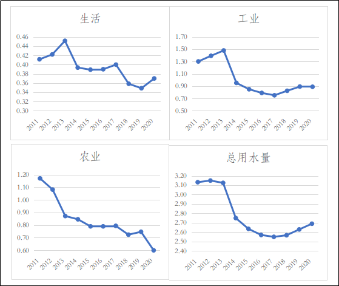

## 乌海市“十四五”水安全保障规划

## 一、现状基础与形势挑战

## （一）“十三五”期间水安全保障取得的成就

“十三五”期间，我市以习近平新时代中国特色社会主义思想为指导，积极践行“节水优先、空间均衡、系统治理、两手发力”的新时代水利工作方针，以水利工程补短板、水利行业强监管的总基调，攻坚奋进破难题，提档升级谋发展，强基固本守底线，改革创新增活力，加快推进水利治理体系和治理能力现代化。累计投入6.16亿元推进水利工程建设，不断提升我市水安全保障能力。

1.水旱灾害防御能力持续提升

（1）加大重大水利工程建设力度，提升大江大河防洪保障能力

立足于防大汛、抗大旱、抢大险、救大灾，全面落实以防汛抗旱行政首长负责制为核心的各项责任制。抓紧修复各类水毁灾损水利设施，加强水文气象预报和监测预警，及时修订完善应急预案和调度方案，提早充实防汛抗旱救灾物资。突出抓好重要堤防、水库和在建工程安全度汛，强化汛前检查、监测预警、指挥调度、人员转移和抢险救灾等关键环节。着力防范中小河流洪涝灾害和山洪灾害，切实做好黄河防凌工作，确保人民群众生命财产安全。

为加快推进水利基础设施建设，“十三五”期间，我市以自治区重大水利工程项目推进实施方案为依托，推动重大项目建设。2019年1月22日，黄河海勃湾水利枢纽工程竣工验收，正式投入运行，有效配合上游的龙羊峡、刘家峡水库黄河防凌防汛调度，黄河内蒙古段防凌调度系统逐步完善。共完成黄河干流河道整治长度12.2公里，其中干流9.4公里，堤防防洪标准达到20年一遇。随着重大水利工程的推进，我市大江大河防洪体系日趋完善，大大提高了洪水调控能力，防洪标准大幅提高。

（2）加强防汛抗旱薄弱环节，城市防洪体系逐步完善

“十三五”期间，列入《全国中小河流治理和病险水库除险加固、山洪地质灾害防御和综合治理总体规划》的千里沟、摩尔沟、哈不其干沟3条中小河流，完成了治理任务，已治理山洪河道长度约31.1公里。根据山洪沟治理项目建设规划，建立了山洪灾害防治非工程措施，包括短信预警平台和无线预警广播系统，完成了乌尔特沟上、中游治理工程，防汛抗旱薄弱环节得到加强，城市防洪体系逐步完善。

针对近年来防汛抗旱暴露的突出问题，集中抓好灾后水利薄弱环节建设，提高中小河流重点河段防洪标准，消除病险水库安全隐患，完成农区牧区基层防汛抢险救灾预警体系，提升流域区域防洪排涝抗旱减灾能力。

2.水资源节约集约利用水平不断提高

根据《乌海市水资源综合利用规划》及《乌海市水利网建设规划》确定的目标，我市开展了一系列工作，完善了水资源配置体系，实施包括引黄供水改造工程、低碳产业园区供水工程、巴音陶亥中型灌区续建配套与节水改造工程以及安全饮水巩固提升工程等项目，提高了城市供水保障能力及水资源利用效率。

（1）全面落实最严格水资源管理制度

认真贯彻落实党的二十大精神和习近平总书记“节水优先、空间均衡、系统治理、两手发力”的新时期水利工作方针，全面落实最严格水资源管理制度，严格落实水资源开发利用控制、用水效率控制和水功能区限制纳污控制“三条红线”管控，逐步完成各年度考核目标，用水总量控制方面，全市总用水量由2015年的2.425亿立方米（不含再生水），到2020年控制在2.15亿立方米（不含再生水）；用水效率控制方面，2020年万元GDP用水量较2015年下降26.94%，万元工业增加值用水量较2015年下降39.8%，农业灌溉水利用系数由2015年的0.57提高至0.6；水功能区限制纳污方面，2015年以来列入考核的水功能区水质达标率均为100%。最严格水资源管理制度框架体系日趋完善，最严格水资源管理进一步强化。

（2）落实用水强度控制措施

一是明确全市用水总量和强度控制指标，并纳入各区党政实绩考核，落实双控措施。二是针对全市纳入取水许可管理和公共供水管网覆盖范围内年用水量5000立方米以上的用水户，市、区两级水行政主管部门按权限从严核定计划水量并进行考核。三是实施老旧供水管网改造，2020年城市公共供水漏损率较2019年下降1.46个百分点。四是提高非常规水利用率。加快推进非常规水回用工程建设、污水处理厂提标改造建设、疏干水利用工程建设和用水企业深度处理建设，提高再生水、疏干水利用比例。2020年全市再生水、疏干水等非常规水源使用量达到2989万立方米，再生水重复使用率达90%以上。

（3）严格地下水管理和保护

通过关井压采，严控地下水开采，建设替代水源工程，提高非常规水资源利用率等措施，进一步保护了地下水资源，基本形成优水优用的科学配置体系，地下水超采区实现《乌海市“十三五”水资源消耗总量和强度双控实施方案》（乌水字〔2017〕34号）目标要求。“十三五”期间，关闭机电井227眼。2016年以来，我市实施了地下水超采区综合治理，逐步建成水资源在线监控平台，持续开展地下水水位埋深及开采量统测工作，下大力气封闭地下水源井，实现重点工业企业用水监控全覆盖。通过一系列治理措施，有效压减地下水开采量，地下水超采区水量水位得到控制，海勃湾区、乌达区两个地下水超采区经过治理，已满足采补平衡要求。2019年海勃湾区政府委托专业机构对超采区地下水资源现状进行了评估，编制了《乌海市海勃湾区中型孔隙浅层地下水超采区治理效果评估报告》，2019年12月16日通过水利厅审查，经自治区人民政府同意，正式予以销号。2018年乌达区政府委托专业机构对超采区地下水资源现状进行了评估，编制了《乌海市乌达区小型孔隙浅层地下水超采区治理效果评估报告》，2018年11月2日通过水利厅审查，经自治区人民政府同意，正式予以销号。已销号的超采区持续开展监测工作，巩固治理成果。

（4）积极跟进自治区水权转换工作

自治区政府于2013年底启动跨盟市水权转让试点工作，实施期限为2013年—2016年，计划试点期转让指标3.6亿立方米（拟分配我市7000万立方米）分3期实施，每期转让水量为1.2亿立方米。截至2020年底，我市已获得3944万立方米/年黄河取水指标。

（5）节约用水管理全面加强

不断完善节约用水相关法规制度和规划体系，制定《乌海市节约用水管理办法》（乌海政办发〔2015〕24号）和《乌海市水资源管理办法》（乌海政办发〔2015〕23号），编制《乌海市水资源综合利用规划》，印发《关于开展深度节水控水行动建设节水型社会的实施意见》（乌党发〔2021〕27号）。抓好农业节水工作。投资1210万元实施节水增效项目1万亩，预计年可节约水量530万立方米。完善灌溉用水计量，具备条件的安装计量设施，不具备条件的按要求以电价折水计量。积极开展县域节水型社会和节水型企业、机关、学校等节水载体建设，营造良好社会氛围。

（6）农区水利设施加快完善，农区水利基础不断夯实

“十三五”期间，我市全力推进规模化供水工程建设，利用已建水厂实现农区集中连片供水，通过清洗改造水源井、更换机电设备、老旧输配水管，进一步提高了农区群众饮水质标准及供水保证率。通过实施一系列饮水工程建设，截至2020年底，我市共建成农区供水工程35处，覆盖人口19.84万人。其中，万人供水工程6处，覆盖人口13.88万人，占总供水人口的69.96%；千人小型集中供水工程8处，覆盖人口4.81万人，占总供水人口的24.24%；千人以下小型集中供水工程21处，覆盖人口1.15万人，占总供水人口的5.8%。我市农区供水工程供水水源全部为地下水，供水方式以规模化供水工程为主，水源地水量能满足用水需求，各供水工程供水保证率均达到95%以上，规模化供水工程基本符合《生活饮用水卫生标准》（GB5749-2006）要求，农区供水工程基本实现供水到户，规模化供水工程可实现24小时不间断供水，用水方便程度较高。我市农区供水工程集中供水率达到100%，自来水普及率达到90%，规模化工程供水人口覆盖比例达到90%，千人以上工程水源保护区（范围）划定率达到100%。按照现行标准，农区饮水安全问题已基本得到解决。

我市农业属于典型城郊型农业，以发展葡萄、蔬菜、瓜果等优势产业为主。“十三五”期末，我市农田有效灌溉面积为12.92万亩，已完成节水灌溉面积5.07万亩，农田灌溉有效水利用系数达到0.594。

“十三五”期间，我市本着因地制宜、节水优先、技术可行、经济合理、环境改善、全面规划、统筹兼顾的原则。结合我市社会经济发展，合理整合现有各种水利工程，推进灌溉泵站更新改造，加大节水改造工程建设力度，沿黄农田全部采用压力管道输水，滴灌为主的灌溉方式，灌区节水改造工程基本完成后，水资源的利用效率及节水效果得到显著提高，为我市可持续发展提供了有力的水资源保障。

3.水生态保护与修复取得新突破

2013年7月，我市被水利部列为全国首批水生态文明城市建设试点，2014年2月《乌海市水生态文明城市试点建设实施方案》通过水利部审查。2014年7月，自治区人民政府正式批复该实施方案。

按照水生态文明城市建设思路，近年来我市大力开展水土保持、节水、生态环境建设；防沙治沙取得了显著成果，沙尘暴发生次数显著下降，森林覆盖率提升了14%以上。龙游湾湿地成为国家级湿地公园试点，乌海湖2016年入选为国家级水利风景区。为水生态文明试点建设打下了良好基础。我市被授予“国家级园林城市”“全国绿化模范城市”。

通过水生态文明城市试点建设，我市实施了各项污染防治措施，环境质量在原有的基础上得到明显改善。提高了城市污水处理率、再生水利用率和疏干水利用率；加强了污染控制和入河排污口监管；减少了污染物排放，集中式城市饮用水水源地水质全部达标，自然生态系统承载能力不断提高。

随着乌海湖水利风景区、龙游湾湿地公园、绿化造林、防护林带、京津风沙源治理、小流域综合整治、水污染防治等绿色生态工程的建设，我市水土流失面积逐渐减少；地下水超采量大幅下降，地下水水环境有效改善，地下水资源得到涵养；人均公园绿地面积显著提高，水保防护林不断增加，初步形成了我市周边的绿色防护体系和生态屏障，有效地阻挡了乌兰布和沙漠风沙的东侵南移，改善了我市生态环境。初步建立了安全、合理的水景观生态格局，提升了我市生态系统的水源涵养、土壤保持、生物多样性保护等服务功能。

黄河干流是我市唯一的常年地表水流，其他25条中小河流及山洪沟均为季节性河流，在汛期有季节性水流。我市确定了黄河河道生态流量，目前能够保证。其他河流生态流量确定工作还未开展。黄河海勃湾水利枢纽事业发展中心严格按照水利部黄河水利委员会、自治区水利厅调度指令运行，执行生态下泄方案，维护水利枢纽下游河道水生态系统稳定。

我市水土流失面积为892平方公里。水力侵蚀区主要分布在桌子山甘德尔山山区，水力侵蚀面积为231平方公里，侵蚀以中度为主。风力侵蚀区主要分布在沿黄的平原沙区一带，风力侵蚀面积661平方公里，侵蚀以中度为主。近年来，我市水土流失治理力度开始加大，在“十三五”期间，依托京津风沙源等国家重点治理工程，加强部门协调，积极整合项目，各项工作扎实推进。截至2020年底，水土保持综合治理面积达到134.25平方公里。

“十三五”期间，我市严格执行《内蒙古自治区水功能区管理办法》（内政办发〔2015〕37号），水功能区监督管理全面增强，水功能区分级分类监督管理体系逐步建立，入河湖排污总量得到严格控制。水污染防治行动计划得到全面落实，水功能区管理和入河排污口监督不断强化，涉水领域各类开发、利用、保护行为逐步规范。同时严控污染物入河量，加强水功能区和入河排污口监测，逐步建立联动协调机制，进一步加强了河湖保护、地下水保护工作。

4.涉水事务管理体系建设不断完善

我市境内河流均属黄河流域，黄河乌海段全长97.5公里（右岸海勃湾区47公里、海南区50.5公里；左岸乌达区23.5公里），黄河支流共有25条，其中一级支流19条、二级支流5条、三级支流1条，流域面积1754平方公里，无天然湖泊。

（1）完善制度、健全机制，保障河长制顺利实施

制定了《乌海市全面推行河长制工作方案》（乌党办字〔2017〕36号），明确了河长制实施范围、总体目标、阶段目标、组织体系和责任单位，保证职清责明、履职到位。市、区河长制办公室均制定了河长会议制度、信息报送制度、信息共享制度、工作督察制度、考核问责和激励制度、验收制度。

（2）各级河长履职尽责，落实强监管

全市26条河流共设立市、区、镇（街道）、村（社区）四级河长147人，其中市级河长3人、区级河长23人、镇（街道）级河长65人、村（社区）级河长56人。落实市级责任单位18个，区级责任单位66个，成立市级河长制办公室1个，区级河长制办公室3个。“十三五”期间，市河长制办公室成了对六项制度执行情况、一河一档建立情况、河长巡河情况、河湖执法专项行动开展情况等工作督导检查。

（3）编制一河一策实施方案，建立一河一档

编制26条河流2017—2020年管理保护实施方案，建立河流基础信息数据库、河长信息、水资源、水功能区、取排水口、水源地、水域岸线信息等河湖档案。

（4）高度重视，积极推进河湖管理范围划定工作

完成自治区级河长黄河乌海段管理范围划定工作以及都斯图河乌海段管理范围划定工作，已划定管理范围河流长度135公里，划定管理范围长度159.18公里，管理范围面积98.31平方公里。

（5）强化责任，扎实开展河道采砂管理工作

2016年海勃湾区，海南区完成河道采砂规划编制工作，并通过区政府批准实施。制定了《乌海市河湖执法工作方案（2018—2020年）》（乌水字〔2018〕142号），成立了乌海市河湖综合整治工作小组。确保河湖采砂管理秩序依法有序可控。

（6）积极组织、开展岸线保护与利用规划编制工作

按照《自治区总河湖长令》（2018年第1号）和《内蒙古自治区河长制办公室关于做好“五河三湖”岸线利用管理保护规划编制工作的通知》（内河长办〔2018〕15号）要求，我市积极统筹协调三区，组织编制全市24条河流岸线利用管理保护规划。根据《内蒙古自治区水利厅关于做好河湖岸线保护与利用规划编制工作的通知》（内河湖〔2019〕19号）要求，自治区负责编制的黄河岸线保护与利用规划，2022年底前提出规划初步成果。

（7）信息化建设

“十三五”期间实施了乌海市防汛抗旱信息化建设工程，实现了区—市—自治区三级联通，提高了防汛会商和远程办公的可视化水平和工作效率。建成雨量、土壤墒情自动检测站点79个，覆盖全市3个区20个镇（街道）83个行政村（社区），提高了水情、雨情、墒情信息的时效性、可靠性。

## （二）形势与挑战

习近平总书记在黄河流域生态保护与高质量发展座谈会上的重要讲话，深刻阐述了事关黄河流域生态保护和高质量发展的一系列根本性、方向性、全局性重大问题，发出了“让黄河成为造福人民的幸福河”的伟大号召。今后水利工作中要以习近平生态文明思想，习近平总书记关于黄河流域生态保护和高质量发展重要讲话精神为指引，统筹考虑解决水资源节约集约利用、水旱灾害防治、水生态保护、水土保持和涉水事务管理问题。本规划从水资源承载能力与供水安全保障、防洪安全保障、水生态安全保障及涉水事务管理几个角度入手，分析“十四五”期间主要面临的形势。

1.水资源承载能力与供水安全保障要求

伴随着经济高速增长和城镇化快速发展，水资源短缺、水生态损害、水环境污染等新问题越来越突出，成为制约我市经济社会持续健康发展的严重因素，也对我市水利改革发展提出了新的要求。贯彻落实习近平总书记关于把水资源作为最大的刚性约束的重要要求，通过水资源节约集约利用等措施，推动我市高质量发展。

（1）水资源承载能力评价

根据《乌海市水资源综合利用规划》和《乌海市地下水资源调查评价报告》成果数据，结合自治区水权配置和我市实际开采情况计算，全市水资源可利用量2.38亿立方米，其中，地下水可开采量1.17亿立方米、黄河初始水权指标5000万立方米、跨盟市水权转让指标3944.45万立方米、再生水2210万立方米、疏干水779万立方米（其中跨盟市水权转让指标、再生水和疏干水量为2020年数据，3228万立方米分洪指标未计入可利用量）。

根据《2020年乌海市水资源公报》统计，全市用水总量2.69亿立方米，按供水水源分类，地下水供水7672万立方米、地表水16300万立方米、再生水2210万立方米、疏干水779万立方米。反映出我市通过落实治理措施，持续巩固地下水超采区综合治理成果，完成部分不合规地下水取水井的封闭任务，目前地下水开采量控制在区域地下水可承载能力范围内，但同时我市地表水取用水量，已经超出全市地表水可用水量的承载能力范围，下一步需加强地表水资源用水管理。

（2）供水安全保障存在的问题

资源性缺水，水资源供需矛盾突出。我市属于干旱、半干旱地区，降水量少，蒸发量大，自产水资源量少且难以利用。我市各领域用水对黄河地表水权高度依赖，近年来，为全面贯彻习近平总书记对内蒙古重要讲话重要指示批示精神，全力以赴筑牢祖国北方生态安全屏障，我市大力实施生态保护工程，全市林草地灌溉年平均生态用水量约为6000万立方米。2020年农业和生态合计使用黄河水1.23亿立方米，扣除3228万立方米的生态补水指标后，仍然超出初始水权约4000万立方米。亟需协调自治区水利厅在调整“八七”分水方案指标和下达生态应急补水指标时，为我市适当增加农业、生态取用黄河水权指标。适量调配工业用水指标，经统计，我市规划年工业需水量缺口约为10700万立方米，目前全市地下水、再生水、疏干水等水源可利用量已基本配置完毕，可利用水资源量十分有限，亟需协调自治区水利厅在跨盟市水权转让二期指标分配时予以适当倾斜，有效解决我市工业缺水问题，保障经济社会可持续发展。

水资源承载能力刚性约束需进一步加强。农业节水手段较为落后。一是农田分布不集中。农田碎片化较为普遍，项目实施难度大，亩均造价高，地方配套资金难以落实。二是灌区信息化程度偏低。灌区现有信息采集、灌溉管理水平和信息化程度滞后，已不适应节水灌溉农业的需求。三是耕地畦块现状与现代节水灌溉方式不配套。农业耕地主要为沿黄灌溉，并依据地形开垦；长期以来以乡、村、户为主体，农民为了灌溉方便目测灌够灌足，灌溉定额控制较差，不利于统一管理。

节约用水工程投入不足。一是在科技专项资金上投入不足，在节水防治技术方面的科技资金投入较少。二是非常规水回用工程不足，集中式污水处理厂水质不稳定，污水收集和回用管网不配套，企业非常规水回用困难。三是农业灌溉设施建设年代较早，泵站及管网设施陈旧，运行效率低，运行成本高，相关设施急需更新改造。四是工业取用水管网老化漏损严重，造成水资源浪费。

用水效率不够先进。2020年我市万元工业增加值用水量为28.36立方米/万元，较2015年下降39.92%，但与自治区万元工业增加值用水量相比仍有较大差距。主要原因是我市火电、焦化等高耗水行业较多，且多采取传统水冷循环和湿法熄焦等用水工艺，空冷和干法熄焦等先进节水工艺使用不够广泛，导致用水效率不高。

（3）新形势下供水安全保障需求

建设造福人民的幸福河，就要统筹生活、生产、生态用水需求，兼顾上下游、左右岸、干支流，通过强化节水、严格管控、优化配置、科学调度，为经济社会高质量发展提供优质的水资源保障。

“量水而行”发展理念的需求。依据水资源承载能力，合理配置水资源。坚持“以水定城，以水定地，以水定人，以水定产”原则，调整优化产业结构，立足本市实际，推动改造生态治理及城区绿化供水工程。

“十三五”期间，我市通过落实治理措施，持续巩固地下水超采区综合治理成果，海勃湾区、乌达区两个地下水超采区已经实现治理目标并完成销号，但目前我市黄河取水还需进一步加强，加大管理力度，有效规范地表水取用行为，完成黄河取水口复核统计，要将水权指标分配到各黄河取水口，同时积极督促取水口管理单位，完成取水许可手续办理。

“十四五”期间，按照总量控制和地下水采补平衡的原则，充分考虑地表水和地下水的空间分布，统一考虑地表水和浅层地下水资源的配置，在地下水尚有潜力的地区，适当考虑增加地下水的开发利用，在具备非常规水源利用的地区合理规划、统一配置、高效利用。

推进农区饮水安全保障的需求。我市农区供水保障程度达到了较高的水平。对照《水利部办公厅关于做好“十四五”农村供水保障规划编制工作的通知》（办农水〔2020〕31号）要求，我市农区供水工程在水量、供水保证率、规模化供水工程的用水方便程度、水源地保护区及保护范围划定等方面均能满足新标准要求。但水质超标反复、管网老化严重、机电设备陈旧、水质处理和消毒设施配套短缺、管理滞后、水费收缴水平偏低等问题，仍然制约着我市农区饮水工作高质量发展的步伐。对标新的农村供水标准，需进一步优化农区供水工程格局，才能提升农区饮水安全保障水平。

加强水资源综合管理的需求。进一步强化水资源刚性约束，实行总量控制和定额管理制度，强化计划用水管理；加强取用水监管，严格取水许可管理；加大农区供水工程日常巡查力度，开展水质检测，全力保障农区牧区居民饮水安全；鼓励、倡导利用非常规水资源；持续开展节水宣传；对现有产业结构进行优化调整，推动自治区经济社会绿色高质量发展。

2.防洪安全保障要求

我市地处黄河与桌子山、甘德尔山等山脉之间，市域重点地段均面临黄河洪水与山洪的双重威胁。通过长期建设，我市防洪工程体系得到了逐步的完善，由黄河防洪体系、海勃湾区防洪体系、乌达区防洪体系、海南区防洪体系组成。我市黄河防洪功能（凌汛和伏汛）由黄河海勃湾水利枢纽负担。

近年来，洪水灾害突发性、反常性、不确定性等特点越来越突出，防洪体系不断暴露出短板和薄弱环节。“十三五”期间，我市13个乡镇屡次遭受洪涝灾害，受灾人口3.59万人，共造成直接经济损失5.47亿元。尤其在2018年，我市普降大到暴雨，各山洪沟发生了较大洪水，洪灾较严重，直接经济损失约1.4亿元。黄河防洪工程水毁两处，水毁损失120万元；甘德尔河道水利工程水毁30处，水毁损失1440万元；海勃湾区两轮强降雨导致8处水利设施受到水毁，直接经济损失5532.8万元；乌达区两轮强降雨导致3处水利设施受到水毁，直接经济损失3300万元；海南区两轮强降雨导致8处水利设施受到水毁，直接经济损失3620万元。极端气候的频现，中小河流防洪压力加大，成为防洪薄弱环节，对完善全市防洪体系提出了更高的要求。

同时沿河居民及企业缺乏防洪意识和经验，河道内乱掘、乱挖情况频繁发生，造成堤基冲刷严重，随意倾倒建筑生活垃圾，导致河道淤塞严重、河床抬高、行洪不畅，部分规划实施的治理工程往往会受到资金不足、重视程度不够等因素限制，不能如期实施。水利主管部门受到管理经费有限，缺少基层专职管理人员，缺少足够的监测设备和先进的预报预警系统等因素影响，未能构建起完善的防汛管理体制。同时，各相关部门缺乏信息共享和有效地协调沟通，在城市规划和项目审批中对防汛工作考虑不足，导致一些建设项目破坏了原有水系，或者挤占河道管理范围，甚至将建筑物建设在主河道内，极大地影响了行洪。

当前和今后一个时期，城市的快速发展对城市防洪基础设施也在不断提出新形势、新要求，在坚持以习近平总书记关于治水工作的重要论述，指导我市治水实践在通过补短板治河理水、调整自然关系的同时，把工作重心转移到强监管纠偏扶正、调整社会关系上来。加快实施防汛抗旱水利提升工程，完善防洪减灾工程体系，提高河洪水的科学调控水平。

3.水生态安全保障要求

建设生态文明 是中华民族永续发展的千年大计。党的二十大报告将“促进人与自然和谐共生”作为新时代坚持和发展中国特色社会主义的基本方略之一，将生态建设提升到新的高度，为未来中国的生态文明建设和绿色发展指明了方向，规划了路线。水作为生态系统的重要控制要素，是生态建设的重要内容。站在新的历史起点上，积极践行人与自然和谐共生理念，不断强化水生态文明建设，必将成为今后水利工作的重中之重。

黄河是流经我市的唯一河流，全市19条黄河一级支流均属季节性河流，我市水生态建设对于黄河全域的治理与保护起着关键作用。习近平总书记在2019年9月18日的黄河流域生态保护和高质量发展座谈会上讲话指出：“治理黄河，重在保护，要在治理。要坚持山水林田湖草综合治理、系统治理、源头治理，统筹推进各项工作，加强协同配合，推动黄河流域高质量发展。”

2019年3月5日，习近平总书记在参加十三届全国人大二次会议内蒙古代表团审议时强调，保持加强生态文明建设的战略定力，探索以生态优先、绿色发展为导向的高质量发展新路子，加大生态系统保护力度，打好污染防治攻坚战，守护好祖国北疆这道亮丽风景线。响应习近平总书记号召，促进黄河流域生态保护和高质量发展，建设造福人民的幸福河，健康水生态、宜居水环境、先进水文化一个都不能少。把河流生态系统作为一个有机整体，坚持山水林田湖草沙综合治理、系统治理、源头治理，坚持因地制宜、分类施策，统筹做好水源涵养、水土保持等工作，做到还水于河，促进河流生态系统健康。

结合实际，对地下水资源承载能力进行动态监测。建立地下水监测预警机制，将地下水开采总量和地下水水位“双控”目标作为区域水资源开发利用的主要依据，对超载区域或承载能力等级升高区域严格执行相关管控措施。严守“三线一单”，强化河湖长制管理制度健全与落实见效。河湖长制是统筹山水林田湖草系统治理，实现水生态系统保护的重要抓手，“十四五”期间，继续全面大力推行河长制湖长制。同时，通过林业、农牧、生态环境等多部门的联防联控、共保共治，进一步加大对江河湖泊的监管力度，努力实现河畅、水清、岸绿、景美，建设美丽河湖，打造美好家园。要宣传展示我市黄河文化，深入挖掘水文化内涵及其时代价值，营造全社会爱水节水惜水的良好氛围，进一步坚定文化自信。

4.涉水事务管理方面的要求

水权、水价、水利投融资、河长制、水利工程管理体制改革等事项，涉及部门多、领域广，为充分发挥水利改革的综合功效，还需加强整体谋划，特别是牵头部门与参加部门的沟通协调。但目前对相关政策仍研究地不够、把握地不准，部门之间存在信息共享不畅、执法难度大等问题。

我市水利信息化建设与智慧水利、智慧社会等工作与国家要求相比，尚存在着很大差距。尤其受项目投资来源不足、建设管理各异、运行维护分散和专业技术人员缺乏等因素制约，信息化前期建设整体优势和规模效益难以发挥，不足以支撑现代水治理和水管理能力的提升。

“十四五”期间，要从根本上扭转水利行业重工程建设轻法规制度、重建设轻管理的问题，推动实现“制度治水”“制度管水”。针对管理标准化、规范化程度低，监管权责和程序不明确，监督力度薄弱，监测体系不健全，监管手段落后、体制机制不健全等涉水事务监管方面的薄弱环节，以及涉水制度不完善，水价改革、节水激励、水利工程产权制度、信息化、人才队伍建设、新技术推广等水治理体系方面的问题，提出提升涉水事务监管能力和水平，增强水利发展活力，加快推进水治理体系和治理能力现代化的要求。根据水利厅智慧水利相关要求，积极推进我市水利信息化建设，充分运用云计算、大数据、物联网、移动互联等技术，推进遥感监测、视频监控智能应用，建立信息资源协同共享与更新机制，推动信息技术与水利业务深度融合。

## 二、总体思路

## （一）指导思想

以习近平新时代中国特色社会主义思想为指导，深入贯彻黄河流域生态保护和高质量发展战略，落实国家节水行动，坚持量水而行、节水为重，把水资源作为最大的刚性约束，以生态优先、绿色发展为导向，以解决水资源短缺矛盾为核心，降低水资源开发利用强度，因地制宜细化实化以水定城、以水定地、以水定人、以水定产举措，优化生产、生活、生态空间布局，加快形成与水资源相适应的产业发展格局。

进一步转变治水思路和方式，加快补齐水利工程短板，不断强化水利行业监管，加快推进水利现代化进程，全面提升水安全保障能力，不断推进水治理体系和治理能力现代化，为“建设我国北方重要的生态安全屏障”“在祖国北疆构筑起万里绿色长城”提供水利支撑、贡献水利智慧，让黄河成为造福人民的幸福河。

## （二）基本原则

坚持以人为本、造福人民。牢固树立以人民为中心的发展思想，顺应人民群众对美好生活的向往，把增进人民福祉、促进人的全面发展作为水安全保障工作的出发点和落脚点，让黄河成为造福人民的幸福河。

坚持节水优先、高效利用。把节水作为解决我市水资源短缺问题的根本性措施，贯穿于经济社会发展全过程和各领域，推动用水方式由粗放向节约集约转变，形成节水型生产生活方式，不断提高用水效率和效益。

坚持人水和谐、均衡发展。尊重自然、顺应自然、保护自然，强化水资源刚性约束，以水而定、量水而行、因水制宜，约束和规范各类水事行为，优化水资源配置，促进人口经济与水资源水生态水环境相均衡，推动高质量发展。

坚持统筹兼顾，综合施策。统筹山水林田湖草沙系统治理，开展综合治理与生态修复。统筹上下游、左右岸、地表地下、城市乡村，系统解决水问题，推进河湖系统保护和水生态环境整体改善。

坚持预防为主、风险管控。强化底线思维，增强忧患意识，从注重事后处置向风险防控转变，从减少灾害损失向降低安全风险转变，建立健全水安全风险防控机制，提高防范化解水安全风险的能力。

坚持改革创新、激发活力。统筹利用价格、水费政策工具，充分发挥市场在资源配置中的决定性作用。更好发挥政府作用，依法治水管水护水，加强政府监管和引导，深化水利智慧化建设，构建系统完备的水治理制度体系。

## （三）目标指标

总体目标。建成与经济社会和生态文明建设要求相适应、与自治区现代化进程相协调的水旱灾害防御、水资源节约集约利用与优化配置、水资源保护和河湖健康保障、涉水事务监管四大体系。

到2025年，建成布局合理、支撑有力、安全可靠的水利基础设施网络体系，使水安全保障综合能力显著提升。防洪抗旱减灾能力全面提升，水资源利用效率和效益明显提高，城乡供水安全保障程度明显增强，重点河湖水生态环境明显改善，水利工程补短板和提档升级加快补齐，涉水事务监管能力全面增强，全市水安全保障能力显著提升，具体目标为：

## 乌海市“十四五”水安全保障规划目标

| 主要指标 | 单位 | “十三五”期末 | “十四五”期末 | 备注 |
|---|---|---|---|---|
| 1.江河堤防达标率 | % | 〔100〕 | 〔100〕 | 预期性 |
| 2.乌海市用水总量控制 | 亿立方米 | 〔2.74〕 | 〔<3.29〕 | 约束性 |
| 3.万元GDP用水量下降 | % | 27.25 | 20 | 约束性 |
| 其中万元工业增加值用水量下降 | % | 39.22 | 20 | 约束性 |
| 4.农田灌溉水有效利用系数 | / | 〔0.579〕 | 〔0.605〕 | 预期性 |
| 5.水利工程新增年供水能力 | 万立方米 | 3844 | 3156 | 预期性 |
| 6.农区集中式供水人口比例 | % | 〔100〕 | 〔100〕 | 预期性 |
| 7.农区自来水普及率 | % | 〔90〕 | 〔95〕 | 预期性 |
| 8.重要河湖水域岸线监管率 | 划界 | % | 〔100〕 |  | 约束性 |
| 岸线区划 | % | 〔50〕 | 〔100〕 | 约束性 |

说明：

带〔〕为期末达到数，其余为5年累计数，目前为2020年数据。

指标1江河堤防达标率是指5级及以上堤防长度中达标堤防长度占比。

指标2用水总量控制目标中不含分洪水、应急生态补水。

指标3万元GDP用水量、万元工业增加值用水量下降以2020年作为可比价。

指标8重要河湖水域岸线监管率是指划定了河湖管理范围、明确了岸线功能分区和管理要求的重要河湖数量占重要河湖总数量比例，其中重要河湖是指设立了河长的河流。

## （四）总体布局

“十四五”期间，主要围绕黄河流域生态保护和高质量发展战略，按照“共同抓好大保护、协同推进大治理”的要求，着力加强生态保护治理，把水资源作为最大刚性约束，保障黄河长治久安，让黄河成为造福人民的幸福河。严守水资源红线，推进水资源节约集约利用，优化水资源配置，提高非常规水资源利用水平。开展黄河左右岸、乌海湖周边生态环境保护与治理，加强黄河干流防洪能力的同时，进一步开展重点中小河流治理工程，提高我市防洪能力。进一步夯实农区水利基础，通过推进规模化供水工程建设，提高农区供水保障程度、自来水入户水平、规模化工程覆盖水平和工程运行管理水平。加快实施沿黄泵站整合改造工程，加强农业节水力度。更好发挥政府作用，依法治水管水护水，加强政府监管和引导，深化水利智慧化建设，构建系统完备的水治理制度体系。

## 三、水安全保障措施

## （一）强化节水和水资源合理配置，保障水资源承载能力与供水安全

坚持节水优先，强化水资源刚性约束，按照“以水定需”的思路，强化节水和水资源合理配置，保障水资源承载能力与供水安全。

1.加强重点领域节水

（1）全面建设节水型社会

贯彻落实习近平总书记“以水定城、以水定地、以水定人、以水定产”重要要求，聚焦工业、农业、城乡生活、生态和非常规水源利用等重点领域，全面推进深度节水控水行动。

①农业节水

严格控制耕地面积。坚持以水定地，严格农业用水总量控制，统筹考虑本地区水资源条件和农业产业结构，在满足永久基本农田保护线和耕地保有量指标前提下，严格控制耕地灌溉面积，因水制宜推行轮作休耕，压减高耗水作物种植面积。黄河河道滩区内禁止新增开荒扩耕，逐步实现退耕还滩、还湿。

调整农业种植结构。降低耕地开发利用强度，压减玉米等高耗水作物种植面积，扩大葡萄等节水高产作物和设施蔬菜种植面积。合理确定玉米、葡萄、小麦等主要农作物灌溉定额和灌溉频次，制定合理灌溉制度，强化农业用水精细化管理，解决农业用水粗放问题。

深度推行节水灌溉。推进灌区现代化改造，实施沿黄取水口整合和集中供水改造，提质增效，控制泵站农业取水量。推动输水设施提档升级，实施渠系输水更换管道输水改造，提高输配水利用效率。规模化推广喷灌、微灌、低压管灌、水肥一体化等高效节水灌溉技术，加大智能化灌溉、设施农业建设力度，严格取用水计量，加强田间用水精细化管理。建立工农业统筹互补的节水投入模式，通过水权转让的方式提高水资源配置效率。

深入推进农业水价综合改革。分级分类制定差别化水价，推进农业灌溉定额内优惠水价、超定额累进加价制度，建立农业用水精准补贴和节水奖励机制，促进农业用水压减。

②工业节水

优化产业结构调整。坚持以水定产，强化水资源水环境承载力约束，将水资源要素纳入项目准入条件，合理规划工业发展布局和规模，优化调整产业结构。列入淘汰类目录的建设项目，禁止新增取水许可。鼓励类项目、延链补链项目、绿色高端项目优先配置水资源，通过产业链整合延伸，优化用水结构，引进培育低水耗高产值项目，不断提高用水效益。

实行水资源预算管理。率先在工业用水领域建立预算管理体制，实行零基预算管理。实现工业用水计量监测全覆盖，统筹调度水资源存量，按年度统筹闲置水指标和水量，合理配置水资源，建立完善水权流转体系，促进水指标高效利用。

落实高标准定额管理。对标《内蒙古自治区行业用水定额》（DB15/T385—2015）产品领跑和先进定额，实施节水技术改造，定期开展工业项目水平衡测试。到2025年，已建成投产的发电、钢铁、煤化工、化工等四个高耗水行业全部达到领跑定额标准，其余项目全部达到先进定额标准；新建项目全部依据领跑定额标准批复取水许可。

推动节水型企业和园区建设。引导工业企业实施节水技术改造，推动工业企业应用高效冷却、无水清洗、循环用水、废污水再生利用、高耗水生产工艺替代等节水工艺和技术，淘汰落后的技术装备。建立产城融合用水新模式，鼓励园区企业串联用水、分质用水，实现一水多用和梯级利用，实行废污水资源化利用，工业园区全部达到“近零排放”，创建工业废水“近零排放”示范园区。到2025年，规模以上煤焦化工和氯碱化工企业全部建成节水型企业，打造节水型行业，各产业园全部建成节水型园区。

③生活节水

推动城乡人水和谐。因水制宜、集约发展，强化水资源刚性约束，合理布局城乡空间，优化城市功能结构、产业布局和基础设施布局。优化资源配置，在提高城市供水保证能力的基础上，发挥城市节水的综合效益，提高水资源对城市发展的承载能力。

实施城乡节水工程。以降低供水管网漏损率为主要目标，结合城市更新行动大力开展城区老旧供水管网改造，实施农区集中供水管网节水改造，完善计量设施。

推进节水型载体建设。推进政府机关、学校、医院等单位开展节水型公共机构建设，示范引领全社会节水。分行业领域选取节水标杆，推广经验做法。到2025年，市、区党政机关、事业单位全部建成节水型单位，乌海职业技术学院建成节水型高校。

加强节水型城市建设。研究制定节水器具推广补贴政策，引导消费者主动选购节水器具，提高节水器具普及率。将城市节水相关基础设施改造工作纳入城市更新行动。建设农区节水试点，推广使用节水器具，因地制宜推广农区污水资源化利用。制定节水型社区、节水型乡村建设标准，引导城乡居民形成节水型生活方式。

强化高耗水服务业节水。从严控制洗浴、洗车、人工滑雪场等高耗水服务业用水，严格定额管理，实行超定额累进加价制度。鼓励洗车等高耗水服务业收集利用雨水等水源，推广循环用水技术工艺。

④生态节水

推广适地适生树种。推广选用节水耐旱植被，根据不同的绿化需求，选择适宜的品种栽植，选育适合乌海本地条件、节水抗旱的花种、树种。优化防沙治沙模式，改变大面积乔木造林做法，推动形成乔灌草结合，以当地适生灌木为主的立体生态修复模式，改善地区生态环境。

科学建立灌水制度。分区域开展绿化浇灌系统节水诊断，对绿化灌溉模式进行精准优化，城镇绿化、防护林建设、城镇卫生全面推行用水定额管理。建立科学的生态绿化用水制度，普及智能化灌溉管理，实现精细化管理。根据降水条件、种植品种、土壤成分的不同，分类制定灌溉计划，实现有序浇灌。

优化矿山复绿方式。积极探索矿区利用废弃矿坑，通过实施雨洪水集蓄利用等工程措施，减少矿山复绿用新鲜水量。坚持工程措施和生物措施相结合，合理确定矿山修复绿化面积，推动矿山治理与生态节水并行。

（2）全面建立水资源保护及高效利用制度

①严格落实水资源“三条红线”指标制度

一是严格总量指标管理，建立全市、区两级行政区域用水总量控制指标体系，完成三区用水总量控制指标分解和三区黄河水量指标调整分配，把用水总量控制指标落实到水源。二是严格强度指标管理，把万元国内生产总值用水量、万元工业增加值用水量和农田灌溉水有效利用系数逐级分解到三区，明确区域强度控制要求，建立覆盖主要农作物、工业产品和生活服务行业的先进用水定额体系，严格用水定额和计划管理，强化行业和产品用水强度控制。三是全面实施最严格水资源管理制度考核，逐级建立用水总量和强度控制目标责任制，完善考核评价体系，突出双控要求。同时建立用水总量和强度双控责任追究制，严格责任追究，对落实不力的地方，采取约谈、通报等措施予以督促。

②加强水资源保护机构及管理体制的建设

进一步完善区域管理与行政区域管理相结合的水资源管理体制，切实加强区域水资源的统一规划、统一管理和统一调度。强化城乡水资源统一管理，对城乡供水、水资源综合利用、水环境治理和防洪排涝等实行规划、协调实施，促进水资源优化配置。完善水资源管理责任和考核制度，将水资源开发利用、节约和保护的主要指标纳入地方经济社会发展综合评价体系，各区政府主要负责人对本行政区域水资源管理和保护工作负总责。

③建立水资源保护监督管理机制。

一是建立水资源保护和水污染防治协调机制，加强水功能区管理，实现流域管理与区域管理的有机结合，保障水域功能的正常使用和水生态系统的良性发展，促进流域和区域水资源的可持续利用，通过对入河排污口严格管理，对入河排污口废污水排放量和主要污染物的排放浓度实施同步监测，有效防治水污染。二是建立水环境保护的生态补偿与生态需水机制，各区应当确保出界水质达到考核目标，根据出入境水质、水量状况确定横向补偿标准，搭建有助于建立生态补偿与需水机制的政府管理平台，推动建立生态保护共建共享机制，加强与有关各方协调，推动建立促进跨行政区的水环境保护的专项资金。三是健全政策法规和社会监督机制，抓紧完善水资源配置、节约、保护和管理等方面的政策法规体系，广泛深入开展基本水情宣传教育，强化社会舆论监督，进一步增强全社会水忧患意识和水资源节约保护意识，形成节约用水、合理用水的良好风尚，大力推进水资源管理科学决策和民主决策，完善公众参与机制，采取多种方式听取各方面意见，进一步提高决策透明度。

④持续强化水资源管理

一是开展最严格水资源管理制度考核，及时完成对各区的考核，考核结果向社会公开。二是贯彻《乌海市委市人民政府开展深度节水控水行动建设节水型社会的实施意见》（乌党发〔2021〕27号），制定水资源定额管理、水资源预算管理、水权流转工作实施办法、节约用水奖惩办法、节约用水考核办法、工业用水资源优化配置指导意见等政策文件。督促落实《乌海市节水行动实施方案》（乌水字〔2020〕9号）、《乌海市坚持“节水优先”、推进“量水而行”工作任务分工方案》年度工作任务。三是组织开展地表水超载治理工作，监管完成年度水量压减任务。四是稳控海勃湾区地下水超采区水位治理，防止重新被划定为超采区。五是协调自治区水利厅调整配置北控京泰能源公司闲置水指标。六是实施沿黄取水口整合和集中供水提质增效改造工程，提高输配水利用效率。七是组织筹备黄河流域水资源节约集约利用高层次论坛。

2.水资源精细化配置

（1）水资源开发利用调查评价

①供水量及变化趋势

根据我市2020年水资源公报统计成果，2020年我市各类水源工程供水量为26928万立方米，其中地表水供水量16267万立方米（全部为黄河取水），占总供水量的60%；地下水供水量7672万立方米，占总供水量的29%；其他水源供水量为2990万立方米，占总供水量的11%（详见表3-1-1）。

## 表3-1-1乌海市2020年供水量表

单位：万立方米

| 行政区 | 地表水 | 地下水 | 其他水源 | 总供水量 |
|---|---|---|---|---|
| 本地 | 黄河 | 小计 |
| 海勃湾区 | 0 | 6992 | 6992 | 3777 | 1369 | 12138 |
| 乌达区 | 0 | 3654 | 3654 | 2171 | 739 | 6564 |
| 海南区 | 0 | 5621 | 5621 | 1725 | 881 | 8227 |
| 合计 | 0 | 16267 | 16267 | 7672 | 2990 | 26928 |

从2011—2020年供水量变化趋势看，全市总供水量受经济社会发展影响，在2012年之前总体呈现增长趋势，从2013年开始逐年略有减少；地表水供水量受气候变化和来水频率的影响，总体变化无明显规律；地下水供水量在2013年之前总体呈增加趋势，之后随着地下水用水管理的加强，开始呈现逐年减少的趋势；其他水源利用量呈明显增加趋势。全市供水量变化趋势见下图。

## 全市2010—2020年供水量变化趋势图

②用水量及变化趋势

我市2020年用水总量为26928万立方米，其中居民生活用水2309万立方米，占总用水量的8.57%；城镇公共用水1390万立方米，占总用水量的5.16%；工业用水8930万立方米，占总用水量的33.16%；农田灌溉用水5593万立方米，占总用水量的20.77%；林牧渔畜用水381万立方米，占总用水量的1.41%；生态用水8325万立方米，占总用水量的30.92%（详见表3-1-2）。

## 表3-1-2乌海市2020年用水量表

单位：万立方米

| 行业类型 | 海勃湾区 | 乌达区 | 海南区 | 合计 |
|---|---|---|---|---|
| 居民生活 | 城镇 | 1276 | 498 | 336 | 2110 |
| 农区 | 131 | 0 | 68 | 199 |
| 小计 | 1407 | 498 | 404 | 2309 |
| 城镇公共 | 建筑业 | 464 | 57 | 10 | 531 |
| 第三产业 | 616 | 81 | 162 | 859 |
| 小计 | 1080 | 138 | 172 | 1390 |
| 工业 | 2442 | 3082 | 3406 | 8930 |
| 农田灌溉 | 2076 | 285 | 3232 | 5593 |
| 林牧渔畜 | 22 | 342 | 17 | 381 |
| 生态 | 5112 | 2218 | 995 | 8325 |
| 合计 | 12139 | 6563 | 8226 | 26928 |

2020年全市总用水量比2011年少了0.05亿立方米。总用水量总体呈现为在2013年之前，随着社会经济的飞速发展，总用水量具有与其同步的相关性，也开始呈现快速增长的态势，在2013年之后，由于受整体经济形势步伐放缓影响，用水量开始呈现减少趋势，2020年比2013年减少了0.44亿立方米。行业用水量中，农业用水量呈下降趋势，工业用水量在2013—2017年之间受总体经济形势的影响，用水呈现下降趋势，2017年之后开始缓慢增加，城镇用水量变化趋势和工业用水量相似。全市用水量变化趋势见下图。

全市2011—2020年用水量变化趋势图

③黄河取水指标情况

根据《内蒙古自治区人民政府关于分配黄河初始水权量有关事宜的通知》（内政字〔2004〕379号）和《内蒙古自治区水利厅关于报送黄河取水许可总量控制指标细化方案的报告》（内水资〔2010〕25号）文件要求，我市分配黄河耗水量5000万立方米；《乌海市人民政府关于分配黄河水初始水权量的通知》（乌海政字〔2005〕25号）将我市黄河耗水量按行政区明晰如下：海勃湾区1600万立方米，乌达区1700万立方米，海南区1700万立方米。

《内蒙古自治区人民政府关于进一步调整黄河用水结构有关事宜的通知》（内政字〔2006〕59号），指出在全面实施《内蒙古自治区黄河水权转换总体规划》的基础上，从巴彦淖尔市河套灌区农业用水指标中调整出3.6亿立方米，作为沿黄其他5盟市工业发展的后备水源，其中我市0.7亿立方米，并进一步明确这些用水指标需“通过水权转换方式取得”。

截至2020年底，已实际增加配置黄河取水指标3944.45万立方米/年。

④重要饮用水水源地情况

我市有重要饮用水水源地6个，其中国家级2个，分别为海勃湾区北水源地和海勃湾区南水源地；市级4个，分别为乌达区新1#水源地、乌达区新2#水源地、海南区西水源地、海南区沿黄水源地。水源地合计设计供水能力19.5万立方米/天，年实际供水量为3291万立方米（详见表3-1-3）。

表3-1-3乌海市重要水源地概况一览表

| 序号 | 水源地名称 | 水源地类型 | 水源地级别 | 水源地机电井数量/眼 | 设计取水规模/（万立方米/天） | 2020年供水量/万立方米 | 2020年供水人口/万人 | 建成时间 | 保护区批复情况 |
|---|---|---|---|---|---|---|---|---|---|
| 1 | 乌海市海勃湾区北水源地 | 地下水型 | 国家级 | 8 | 2.5 | 412 | 5.0 | 1995 | 内政字〔2011〕145号 |
| 2 | 乌海市海勃湾区南水源地 | 地下水型 | 国家级 | 20 | 10.0 | 1425 | 14.5 | 2020 | 正在申请 |
| 3 | 乌海市海南区西水源地 | 地下水型 | 市级 | 6 | 2.0 | 543 | 3.6 | 1998 | 内政字〔2011〕145号 |
| 4 | 乌海市海南区沿黄水源地 | 地下水型 | 市级 | 9 | 1.5 | 300 | 2.5 | 2017 | 内政字〔2017〕194号 |
| 5 | 乌海市乌达区新1#水源地 | 地下水型 | 市级 | 3 | 1.2 | 274 | 4.2 | 1971 | 内政字〔2021〕17号 |
| 6 | 乌海市乌达区新2#水源地 | 地下水型 | 市级 | 5 | 2.3 | 337 | 7.8 | 1999 | 正在申请 |
| 合计 | 51 | 19.5 | 3291 | 37.6 |  |  |

⑤行业用水水平分析

2020年全市人均综合用水量452立方米，低于全区平均水平（738立方米），略高于全国平均水平（428立方米），为黄河流域平均水平（326立方米）的138%；全市万元国民生产总值（2015年不变价）用水量51立方米，比2010年减少了32立方米，综合用水效率有明显提升。万元工业增加值（2015年不变价）用水量28立方米，比2010年（当年价）减少了20立方米，工业用水水平逐渐提高；农田灌溉亩均毛用水量442立方米，灌溉水利用系数达到0.6，农业节水建设取得较大进展，用水效率稳步提升；全市人均日生活用水量112升，比2010年增加了16升，其中城镇居民日人均生活用水115升，比2010年增加了18升，农区居民日人均生活用水量70升，比2010年增加了10升，居民用水水平有所提高。

⑥用水总量控制指标

2020年我市总用水量为2.693亿立方米，扣除再生水使用量（2210万立方米）和分洪生态补水水量（3228万立方米）后用水量为2.15亿立方米。2020年自治区下达我市用水总量控制指标为2.74亿立方米，用水总量符合总量控制指标。

（2）需水量预测

根据《乌海市城市总体规划（2011—2030年）》，结合区域常驻人口发展情况和城镇化目标，确定我市人口自然增长率为6‰，城镇化率达到95%，预计2025年人口将达到62.968万人。根据《内蒙古自治区行业用水定额标准》（DB15/T385-2020），确定城市居民生活需水定额为120升/人·天，农区居民生活需水定额为75升/人·天。经预测生活需水量2623万立方米，其中城镇居民生活需水2398万立方米，农区居民生活需水225万立方米。生活需水占总需水量的8.0%。

根据我市过去十年经济形势发展变化趋势，以及《乌海市人民政府关于印发乌海市国民经济和社会发展第十四个五年规划和2035年远景目标纲要的通知》（乌海政发〔2021〕24号）相关要求，三产比例中，第一产业将继续呈下降趋势，第二产业稳中有升，第三产业逐渐增加。增长率中，GDP增长率6.0%，工业增长率6.0%，第三产业增长率6.5%。万元工业增加值用水量较2015年下降55%，建筑业万元增加值用水量全市平均值为5.0立方米，第三产业万元增加值用水量全市平均值为3.0立方米。经预测，工业需水15380万立方米，占总需水量的46.7%，相比增加了6450万立方米，约增加了72%。城镇（包括第三产业和建筑业）需水量1777万立方米，占总需水量的5.4%。增加了389万立方米，增加幅度较大，主要和我市用水定额较低有关。

根据《乌海市土地利用总体规划大纲》及《乌海市节水灌溉工程发展规划》，预测到2025年我市农田灌溉面积将达到10.2万亩，农田有效灌溉面积比减少1.13万亩，农田灌溉水有效利用系数达到0.605。林果灌溉用地到2025年发展到3.66万亩。同时采用自然增长率法，预计“十四五”期间大牲畜自然增长率为1.5%，小牲畜自然增长率1.8%，生猪自然增长率1.4%。经预测，农业需水量4700万立方米，占总需水量14.3%。比农业需水量减少1274万立方米，约减少21%。

我市生态需水量主要为城镇生态需水量，城镇生态需水量按照道路喷洒面积、绿化面积、人工河湖面积发展情况与标准用水定额来预测，根据《乌海市水生态文明城市建设试点实施方案》以及《乌海市城市绿地系统规划（2014—2030）》，预计到2025年我市城镇绿地面积将达到16000公顷，河湖补水面积达到840公顷，道路喷洒面积达到870公顷，预测到2025年生态需水量8420万立方米，占总需水量25.6%。较目前增加95万立方米，增加1%（详见表3-1-4）。

## 表3-1-4乌海市2025年需水量预测表

单位：万立方米

| 行政区 | 农业 | 工业 | 城镇 | 生活 | 生态 | 合计 |
|---|---|---|---|---|---|---|
| 海勃湾区 | 1774 | 4206 | 1142 | 1537 | 5170 | 13829 |
| 乌达区 | 267 | 5309 | 371 | 612 | 2244 | 8803 |
| 海南区 | 2659 | 5865 | 264 | 474 | 1006 | 10268 |
| 合计 | 4700 | 15380 | 1777 | 2623 | 8420 | 32900 |

（3）可供水量预测

根据地表水、地下水和非常规水源规划建设情况，以及黄河取水指标、地下水超采区压采情况来预测我市2025年可供水量。一方面结合黄河海勃湾水利枢纽正式运行后的新情况，需水新形势，调整、优化地表水供水工程，提高供水保障能力，另一方面通过跨盟市水权转换，增加新的供水能力，以满足增长的用水需求，总体以我市用水总量、分配黄河耗水量等为总量控制指标，结合不同的供水方案，进行预测。

情形一，根据《内蒙古自治区人民政府关于分配黄河初始水权量有关事宜的通知》（内政字〔2004〕379号）和《内蒙古自治区水利厅关于报送黄河取水许可总量控制指标细化方案的报告》（内水资〔2010〕25号），我市分配黄河水量5000万立方米。再结合目前我市已通过水权转换获得的水量指标，预测到2025年全市地表水可供水量为8944.45万立方米（包括黄河干支流取水）；其中海勃湾区2244.45万立方米、乌达区3327万立方米、海南区3373万立方米。

情形二，结合《内蒙古自治区人民政府关于进一步调整黄河用水结构有关事宜的通知》（内政字〔2006〕59号），指出在全面实施《内蒙古自治区黄河水权转换总体规划》的基础上，从巴彦淖尔市河套灌区农业用水指标中调整出3.6亿立方米，作为沿黄河其他5盟市工业发展的后备水源，其中我市0.7亿立方米，并进一步明确这些用水指标需“通过水权转换方式取得”，此种情况下预测到2025年地表水可供水量为12000万立方米（包括黄河干支流取水）；地下水可供水量：地下水可供水量由地下水取水量加上新增地下水取水井取水量和地下水井新增取水量，并扣除地下水开发利用挤占的生态用水量（即地下水超采区超采量）组成。根据《乌海市地下水资源调查评价报告》确定的地下水资源量、地下水资源可开采量，再结合地下水可持续开发利用方案，扣除掉地下水超采量，拟定我市地下水规划开采量，同时参考内蒙古自治区确定的2025年地下水水量管控指标，预测到2025年地下水可供水量为10804万立方米。

非常规水源可供水量：非常规水源包括再生水和疏干水。其中再生水可供水量根据年污水处理厂处理回用规模和规划年污水排放、收集量来综合考虑。疏干水和微咸水可供水量根据已有规划成果进行预测。根据预测，2025年全市非常规水源可供水量3800万立方米，其中再生水可供水量3000万立方米，疏干水可供水量800万立方米，非常规水源可供水量比目前增加27%。

可供水总量：情形一，全市2025年可供水总量为23548.45万立方米（详见表3-1-5）；情形二，全市2025年可供水总量为26604万立方米（详见表3-1-6）。

## 表3-1-5乌海市2025年可供水量预测表（情形一）

单位：万立方米

| 行政区 | 地表水 | 地下水 | 其他供水 | 合计 |
|---|---|---|---|---|
| 海勃湾区 | 2244.45 | 5308 | 1752 | 9304.45 |
| 乌达区 | 3327 | 3314 | 1080 | 7721 |
| 海南区 | 3373 | 2182 | 968 | 6523 |
| 合计 | 8944.45 | 10804 | 3800 | 23548.45 |

## 表3-1-6乌海市2025年可供水量预测表（情形二）

单位：万立方米

| 行政区 | 地表水 | 地下水 | 其他供水 | 合计 |
|---|---|---|---|---|
| 海勃湾区 | 4093 | 5308 | 1752 | 11153 |
| 乌达区 | 3327 | 3314 | 1080 | 7721 |
| 海南区 | 4580 | 2182 | 968 | 7730 |
| 合计 | 12000 | 10804 | 3800 | 26604 |

（4）供需平衡分析

情形一平衡：我市黄河取水指标维持在《内蒙古自治区水利厅关于报送黄河取水许可总量控制指标细化方案的报告》（内水资〔2010〕25号）要求的水平，同时再结合目前我市已通过水权转换获得的水量指标，进行水资源平衡分析。2025年我市需水量32900万立方米，多年平均可供水量23548.45万立方米，多年平均缺水量9351.55万立方米，全市缺水率为28.42%。从行政分区来看，海勃湾区、乌达区、海南区缺水率分别为32.72%、12.29%和36.47%（详见表3-1-7）。

## 表3-1-7乌海市2025年供需平衡分析表（情形一）

单位：万立方米

| 行政区 | 需水量 | 可供水量 | 缺水量 | 缺水率 |
|---|---|---|---|---|
| 海勃湾区 | 13829 | 9304.45 | 4524.55 | 32.72% |
| 乌达区 | 8803 | 7721 | 1082 | 12.29% |
| 海南区 | 10268 | 6523 | 3745 | 36.47% |
| 合计 | 32900 | 23548.45 | 9351.55 | 28.42% |

情形二平衡：在考虑水权转换，黄河取水指标增加7000万立方米的情形下，进行水资源平衡分析。2025年我市需水量32900万立方米，多年平均可供水量26604万立方米，多年平均缺水量6296万立方米，全市缺水率为19.14%。从行政分区来看，海勃湾区、乌达区、海南区缺水率分别为19.35%、12.29%和24.72%（详见表3-1-8）。

## 表3-1-8乌海市2025年供需平衡分析表（情形二）

单位：万立方米

| 行政区 | 需水量 | 可供水量 | 缺水量 | 缺水率 |
|---|---|---|---|---|
| 海勃湾区 | 13829 | 11153 | 2676 | 19.35% |
| 乌达区 | 8803 | 7721 | 1082 | 12.29% |
| 海南区 | 10268 | 7730 | 2538 | 24.72% |
| 合计 | 32900 | 26604 | 6296 | 19.14% |

（5）水资源配置

水资源配置总体思路为：在水资源供需平衡的基础上，进一步根据最严格水资源管理“三条红线”和国家产业政策等要求，提出按水源、按行业的水资源配置方案。

①水资源配置原则

遵守“节水优先、空间均衡、系统治理、两手发力”的新时期治水方针，坚持“以水定城、以水定地、以水定人、以水定产”为指导，对我市水资源在经济社会系统和生态环境系统之间、不同行业之间进行合理调配。

首先坚持公平公正的原则，考虑黄河流域、我市水资源状况和社会经济与生态环境的特点，保障城乡居民饮水安全，公平合理地处理流域与区域之间水资源权益关系；其次以《黄河流域水资源综合规划》配置相关成果以及我市用水总量指标为控制，兼顾我市水资源利用及管理现状，拟定不同的配置方案，原则上不超过用水总量控制指标；再次严格控制地下水开采，将优质地下水用于城乡居民生活，确保生活用水的水量和水质安全，同时加强超采区治理，2020年达到基本采补平衡；最后要统筹兼顾经济社会发展和生态环境良好的各项需求，对地表水、地下水和其他水源供水统一配置，协调好生活生产和生态环境用水的关系，合理利用地表水，适量开采地下水，充分开发利用其他水源，优先保证城镇生活和农区人畜用水，合理安排工农业和其他行业用水。

②水资源配置量

情形一：2025年我市配置水量23548.45万立方米，其中配置地表水量8944.45万立方米，配置地下水量10804万立方米，配置其他水源量3800万立方米。按行业配置：配置生活用水量2623万立方米，占总配置水量的11.1%；配置工业生产用水量10760.0万立方米，占总配置水量的45.7%；配置城镇用水量（建筑业及三产）1777万立方米，占总配置水量的7.5%；配置农业生产用水量3673万立方米，占总配置水量的15.6%；配置生态用水量4715.45万立方米，占总配置水量的20.0%。缺水行业主要为农业、工业和生态环境。

情形二：2025年我市配置水量26604万立方米，其中配置地表水量12000万立方米，配置地下水量10804万立方米，配置其他水源量3800万立方米。按行业配置：配置生活用水量2623万立方米，占总配置水量的9.9%；配置工业生产用水量11512万立方米，占总配置水量的43.3%；配置城镇用水量（建筑业及三产）1777万立方米，占总配置水量的6.7%；配置农业生产用水量5043万立方米，占总配置水量的19.0%；配置生态用水量5649万立方米，占总配置水量的21.2%。缺水行业主要为农业和生态环境。

③水资源配置基础设施网络建设

水资源管理

积极践行黄河流域生态保护和高质量发展，进一步强化非常规水管理，积极引导支持企业加大污水处理厂提质改造、污水收集和疏干水回用工程建设投入，进一步挖掘节水潜力，鼓励使用再生水、疏干水等非常规水源。

以区域用水总量控制指标和可利用量为依据，将用水总量控制指标进一步细化到农业、工业、生活等主要用水行业精准控制。

全面加强节约用水，对纳入取水许可管理的单位实行计划用水管理；定期开展工业水平衡测试工作，大力推动工业水循环利用，促进企业改进用水工艺和提高用水效率，推进节水型企业、节水型工业园区建设；加快高效节水灌溉工程建设，积极推广喷灌、微灌等高效节水技术实施高效节水灌溉。

鼓励使用再生水、疏干水等非常规水，提高非常规水源使用比例，严格要求批复生产水源为非常规水的工业企业使用非常规水。

各区人民政府整合各部门力量，加快推动污水处理厂提质改造和非常规水回用工程建设进度。加快工业园区工业污水收集管网建设，提高污水处理厂负荷率；加大污水处理厂提质改造进度，提高污水处理达标率；加快非常规水回用工程建设，使工业企业充分利用非常规水，提高非常规水利用率，减少入河排放量。

重点加快绿化供水管网建设，保证生态用水效率。海勃湾区及海南区不断推进工业园区污水处理厂污水收集量及疏干水收集量，处理后为相关工业项目提供水资源支撑，实现再生水资源化，缓解整体水资源压力。

水资源合理配置

严格限制新增高耗水项目，在审批新上项目时，应充分考虑项目建设区域水资源承载能力，坚持“以水定城，以水定地，以水定人，以水定产”原则，严禁高耗水项目使用地下水。

一是调整优化产业结构，限制高耗水项目上马。在产业布局上严格执行国家和自治区的产业政策和相关行业规划，各区和各有关部门在审批新上项目时，应充分考虑项目建设区域水资源承载能力，严把煤化工、火电、钢铁等高耗水项目准入门槛，严禁高耗水项目使用地下水，规定除食品、药品行业外，对于新增工业用水使用地下水的项目一律不予审批。

二是各区人民政府立足本区实际，推动改造城区绿化供水工程，切改城市生活与绿化供水管网，生活用水优先使用地下水，绿化用水优先使用黄河水或非常规水，做到优水优用。

三是各区及市自然资源、公用事业等部门根据地区实际，优化生态治理项目的树种选择，增加耐旱树种比例。同时，推广高效节水灌溉技术，提高生态用水效率，降低单位面积生态用水量。

四是海南区与市城市建设投资集团有限责任公司协调，合理筹划使用一线天地区自产地表水，解决西卓子山水泥厂区域工业企业用水问题。

严格水行政执法

严格水行政执法，加快违规用水企业整改。加大严格执法力度，严管严处涉水违法行为，强化对水资源水环境依法管控，依法保护江河、湖泊和地下水。

一是按照分级管理与属地管理相结合的方式，对已完成整改的企业加强监管，严格要求其按照取水许可批复水源及水量用水，尤其是已配置盟市水权转让黄河水指标的企业，严禁在生产中违规使用地下水。

二是各区积极发挥整改主体作用，帮助企业解决生产取水需求，在项目生产用水取水指标未落实之前，严禁生产违规取用水。

三是全面加强水行政管理机构执法能力建设，增强依法治水、管水和依法行政水平，重点做好执法队伍建设、执法保障建设。

黄河水取用指标

统计分析各行业用水需求，特别是不允许使用地下水的工业项目的用水需求，积极向自治区水利厅、水利部黄河水利委员会报告我市用水需求的客观制约，积极争取黄河水指标分配支持，以保障地区经济正常发展。

一是积极争取在农业、生态取用黄河水方面的支持，合理分配现有黄河水取用指标，积极完善黄河水取水口的相关手续，使农业、生态取水口引黄取水合法化。

二是根据自治区统一部署，积极组织有关企业和部门参与自治区跨盟市水权转让项目，争取配置转让水指标，以解决历史形成违规使用地下水项目用水和新上重点工业项目用水需求。

三是积极发挥各区人民政府的主体作用和市城市建设投资集团有限责任公司的牵头组织职能，加快推进园区黄河供水工程建设，海勃湾区要谋划海勃湾产业园区引黄供水工程建设；乌达区要加快乌达区引黄供水输水管网管道建设；海南区要加快海南区巴音陶亥工业引黄供水工程和通往低碳产业园、海南产业园供水工程建设，扩建海南区自来水公司引黄供水工程及工业供水管网建设，确保工业企业供用水设备完善高效。

强化地表水管理

针对自治区生态环境保护督察反馈意见提出的黄河取水口管理混乱问题，加大管理力度，有效规范地表水取用行为。首先是完成黄河取水口复核统计，将水权指标分配到各黄河取水口；其次是积极督促取水口管理单位，完成取水许可手续办理。

（6）规划水资源配置工程

我市“十四五”期间共计规划水资源配置工程12项，其中海勃湾区4项，分别为：千里山水库雨洪水利用项目、乌海市绿化供水系统改扩建工程、海勃湾疏干水综合利用工程、乌海市海勃湾区城区供水管网改造项目；海南区8项，分别为：海南区巴音陶亥镇苦咸水收集及深度处理项目、海南区石大门沟水生态治理项目、海南区疏干水收集利用处理项目、乌海市海南区渡口以北居民生活用水管网改造、石大门沟雨洪水利用项目、海南区巴音陶亥非常规水资源综合利用工程、海南区石大门沟淤堤坝提升改造工程、海南区西桌子山办事处粘土矿矿坑修复工程。项目总投资9.01亿元，其中“十四五”期间投资8.02亿元（详见表3-1-9）。

## 表3-1-9乌海市2025年水资源配置方案（情形一）

单位：万立方米

| 行政区 | 配置量（分水源） | 配置量（分行业） |
|---|---|---|
| 地表水 | 地下水 | 其他 | 合计 | 农业 | 工业 | 城镇 | 生活 | 生态 | 合计 |
| 海勃湾区 | 2244.45 | 5308 | 1752 | 9304.45 | 1150 | 3478 | 1142 | 1537 | 2420.45 | 9727.45 |
| 乌达区 | 3327 | 3314 | 1080 | 7721 | 323 | 4600 | 371 | 612 | 1625 | 7531 |
| 海南区 | 3373 | 2182 | 968 | 6523 | 2200 | 2682 | 264 | 474 | 670 | 6290 |
| 合计 | 8944.45 | 10804 | 3800 | 23548.45 | 3673 | 10760 | 1777 | 2623 | 4715.45 | 23548.45 |

## 表3-1-10乌海市2025年水资源配置方案（情形二）

单位：万立方米

| 行政区 | 配置量（分水源） | 配置量（分行业） |
|---|---|---|
| 地表水 | 地下水 | 其他 | 合计 | 农业 | 工业 | 城镇 | 生活 | 生态 | 合计 |
| 海勃湾区 | 4093 | 5308 | 1752 | 11153 | 2142 | 3478 | 1142 | 1537 | 3277 | 11576 |
| 乌达区 | 3327 | 3314 | 1080 | 7721 | 323 | 4600 | 371 | 612 | 1625 | 7531 |
| 海南区 | 4580 | 2182 | 968 | 7730 | 2578 | 3434 | 264 | 474 | 747 | 7497 |
| 合计 | 12000 | 10804 | 3800 | 26604 | 5043 | 11512 | 1777 | 2623 | 5649 | 26604 |

3.构建城乡一体化供水网络

针对我市饮水安全中存在的问题，在“十四五”期间，通过统筹规划，进一步优化农区供水格局，采取推进规模化供水工程的方式完善工程体系建设，全面推进工程管理体制和运行机制改革。通过强化水源保护、落实工程管理主体、落实工程运行维护经费、完善农区牧区供水水质卫生监测和检测体系、健全农区牧区供水基层服务体系和应急保障机制等措施，逐步建立农区牧区供水长效运行机制，提高工程管理水平。通过专业化管理、规模化经营，最大程度降低运行管理成本，提高应急处置能力，提高供水保证率，实现工程长效运行。

目前，我市农区供水方式全部依托于集中供水工程且以规模化供水工程为主，现有集中供水工程33处，总受益人口19.84万人，其中，城乡一体化工程1处，受益人口6.74万人，万人工程5处，受益人口7.14万人，小型集中千人供水工程8处，受益人口6.81万人，小型集中千人以下供水工程21处，受益人口1.15万人。我市农区供水工程集中供水率已达到100%，自来水普及率达到90%，农区人口饮水安全问题已基本得到全面解决。但工程目前的运行状况及城市发展的方向表明，小型集中供水工程已经与本地现状不相适应，应按照乡村振兴战略梯次发展布局，顺应农区发展规律和演变趋势，因地制宜，有序推进各类村庄的农区供水工程建设和改造，我市下一阶段农区供水工程的发展方向将以“建大、并中、减小”、继续以大力推进规模化工程建设为方向进行规划和实施。

根据我市实际需求，在“十四五”期间，共规划供水工程4处，其中城乡一体化工程3处，分别为海勃湾区供水工程扩网工程、海南区北部城乡一体供水工程、乌达区供水工程扩网工程，小型集中千人以上工程1处，即海南区巴音陶亥镇农村饮水备用水源工程。

（1）海勃湾区供水工程扩网工程

该工程规划覆盖海勃湾区王元地村、团结新村、新丰村、新地村、巴音乌素村5个村以及新园社区、中河源社区2个涉农社区，该项工程通过新建及更新改造部分输配水管网后接入海勃湾区净水厂实现规模化供水，可提高海勃湾区2万余人的饮水安全保障程度，进一步提高供水效率，保障居民饮水安全。

（2）海南区北部城乡一体供水工程

本工程主要覆盖海南区北部农区2个行政村，13个村民小组，设计供水规模777.99立方米/天，通过更新改造输配水管网233.3公里后，接入海南区净水厂，可提高海南区1462户，共计4686人的饮水安全保障程度，进一步提高供水效率，保障居民饮水安全。

（3）乌达区供水工程扩网工程

该工程通过改造提升乌兰淖尔镇给水工程，解决苏海图过渡安置区四化村尚未搬迁的5716人的饮水安全问题及1.2万常住居民的饮水安全问题；向东南方向乌兰淖尔镇富民社区铺设3公里管道解决5000余常住居民的饮水安全问题。

“十四五”规划期内，我市按照城乡一体化供水需求，将供水工程接入城市供水系统，实行规模化集中供水，统一管理、统一调度、分级服务，全面建立起农区饮水安全服务体系，预计到2025年，我市自来水普及率将达到95%，集中供水率、规模化工程供水人口覆盖比例以及千人以上工程水源保护区（范围）划定率均可达到100%。我市农区供水工程的规模和质量将得到全面巩固和提升，有效提高区域居民的饮水保障率和健康水平，彻底消除供水安全隐患，确保农区群众喝上“稳定水、干净水、放心水”的目标全面实现，进一步夯实稳定脱贫基础，巩固脱贫攻坚成果，有力促进农区经济社会的发展和社会主义新农村的建设，切实提高农民的生活质量。

4.推进灌区现代化建设与改造

目前，我市农田灌溉大部分是由扬水站提取黄河水进行灌溉，少部分靠抽取地下水灌溉，虽然多年来不断推进实施灌区节水改造与续建配套项目，对一部分渠道进行衬砌，但是由于规模不够，整体节水效果尚不明显，灌溉水的利用率不高，跑冒现象仍然存在，渠道衬砌受冻胀影响破坏严重。同时，现有泵站设备大部分为上世纪六十到八十年代中期的产品，年久失修、老化、汽蚀、锈蚀严重，效益低下，经过多年运行，实际抽水效率在30%—47%之间，虽然进行更新改造，但一些问题仍然存在。

综合以上问题，为改善农业生产条件、提高农田抗防旱涝灾害能力、提高农业特别是粮食生产能力、促进农业及农区经济社会可持续发展，我市迫切需要进一步加快灌区节水配套改造步伐。“十四五”期间，我市对海南区巴音陶亥灌区进行节水改造。该灌区设计灌溉面积5.08万亩，灌溉面积4.3万亩。灌溉方式为黄河岸边式扬水站提黄河水进行灌溉，所提黄河水直接注入一级干渠。“十四五”期间规划干渠防渗衬砌渠道18公里，改造骨干建筑物3处。

通过“十四五”期间节水改造项目的实施，将进一步完善我市灌溉结构体系，节水效果及灌溉水利用效率将得到显著提高，为我市适应新形势下对水资源的管理要求、实现水资源可持续利用、建立节水灌溉倒逼机制、激励机制和长效运行机制不断夯实基础，促进农业及农区经济社会可持续发展。

## （二）实施防洪提升工程，保障防洪安全

贯彻“两个坚持、三个转变”的防灾减灾新理念，按照“消隐患、强弱项”的思路，实施防洪提升工程，保障防洪安全。

1.水旱灾害防御能力

（1）洪水特点

我市地处黄河上游，境内山地丘陵占总面积的2/3，地形地貌特征为“三山两谷一条河”，导致我市部分地方面临黄河洪水与山洪的双重威胁。我市周围山峰多级阶，地势斜度较大，植被覆盖差，地面岩石裸露，个别地方土地沙化严重，据统计，一次20毫米左右的降水即可形成山洪，我市夏季降水主要集中在7月至9月，且山洪具有历时短，强度大，突发性强等特点。

海勃湾区位于城市人口大量集中，威胁城区安全的主要有千里沟、摩尔沟、卡布其沟及凤凰岭流域群沟等。乌达区毗邻乌海湖，威胁城区安全的主要有乌尔特沟、苏海图沟，巴音赛沟等，海南区威胁城区安全的主要有黑龙贵沟、乌珠林沟、柳树沟等。

（2）历史水旱灾害

我市历史上曾多次发生山洪灾害，上世纪六十年代至二十世纪初，由于城市防洪基础设施建设落后，大部分自然河道毫无设防，河床多变，导致降水极易形成洪灾。据相关资料统计，1961年至2003年7月间造成人员伤亡、财产损失的降雨有78次，市区因洪涝灾害造成的直接经济损失累计达10亿元。1961年8月1日，暴雨引发山洪，包兰铁路乌达至海勃湾段被冲毁2处，海勃湾至三厂段公路被冲毁11处，冲倒房屋200多间，冲坏电话线路多处。1964年7月18日，桌子山暴雨，洪水由卡布其沟口、摩尔沟口倾泻而出，横漫市区，漫过包兰铁路，夺路而入黄河，包兰铁路被迫中断运行21个小时。1995年7月13日，我市降大暴雨，海勃湾区摩尔沟暴发山洪，冲毁防洪坝2处，造成74户民房倒塌，乌达区苏海图沟暴发山洪，使乌达矿务局发电厂机组停运36小时。7月16日，市区再降大雨，造成海勃湾城区大量积水，部分街道交通中断，洪水四溢，市区人防工事南北干道1730米被淹，部分工程塌陷，铁路货场积水1米左右，无法正常生产，包兰铁路380公里处路基损坏，客货列车中断运行，7月17日乌达巴音赛沟决口，使其下游的近千亩蔬菜绝收，当年全市因洪涝灾害造成的直接经济损失达946.7万元。2001年9月6日海勃湾地区普降大雨，4小时内降58.6毫米，摩尔沟山洪暴发，毁坏民房408间，企业6户，海勃湾城区大量积水，交通中断，包兰铁路路基损坏、造成包兰线停运4小时。2003年7月13日、16日两场降雨仅为41.8毫米和28.7毫米，却使海勃湾城区南部的卡布其沟、北部的摩尔沟、千里沟山洪暴发，造成工业、农业、交通、铁路、电力、通信、航空、供水管路、市区街道、公用设施等严重损坏，造成的直接损失近2000万元，乌海飞机场跑道200多米漫上洪水，刚安装好的四座航标灯被山洪卷走，机场跑道南端土坪形成50多米宽、400余米长的冲沟，海勃湾城区许多民房进水，围困居民100多人，严重危及人民生命与财产安全。

2018年7月21日和9月1日，我市先后遭受暴雨袭击，海勃湾区累计降雨量最大出现在千里山水库，为135.7毫米，库区水位达到高程1297米，最大进库流量为1166立方米/秒，下泄最大流量达到1000立方米/秒，已到水库运行以来最大值；乌达区累计降雨量最大值出现在君正电厂，为78.8毫米；海南区累计降雨量最大值出现在巴音陶亥镇，为64.7毫米；乌海机场降雨量达到133.9毫米，突破1961年以来有气象记录极值。高强度短时间降雨导致各区山洪沟均暴发洪水，其中海勃湾区千里沟、摩尔沟、城中水系河道，乌达区乌尔特沟、海南区黑龙贵沟洪水较大，城区及周边交通道路、工矿企业、农业园区、公用设施、民房等大范围受灾。据统计，直接经济损失高达10.5亿元。

（3）防洪减灾工程体系

我市防洪体系主要包括黄河干流防洪体系、中小河流防洪体系和非工程措施体系。

①黄河干流防洪体系

堤防工程

黄河干流贯穿我市南北约97.5公里，平均河宽250—1200米，平均水深2.5—6米。黄河内蒙古段防洪工程是黄河防洪体系的重要措施性工程，是我市唯一且最为重要的大江大河整治工程。“十三五”期间，黄河二期内蒙古段防洪工程属于国家172项重大水利工程之一，2017年4月开工建设，主体段工程已于2020年6月底完工。截至“十三五”期末，建设堤防工程9.438公里（下海勃湾至王元地段），防洪标准为30年一遇，堤防等级4级；控导工程6.13公里，坝垛83座，其中“十三五”期间建设3.3公里，坝垛46座（海南区巴音陶亥万亩滩段）；险工整治工程19.52公里，坝垛88座，其中“十三五”期间建设10.90公里，坝垛30座（乌达区乌兰淖尔村段1.35公里、海勃湾区王元地村至黄河村段9.55公里）。整治长度共计35.1公里，占河段总长度的33%。

黄河海勃湾水利枢纽

黄河海勃湾水利枢纽是一座防凌、发电等综合利用工程，为大（2）型II等工程，也是黄河内蒙古段唯一的一座调节控制性工程，水库正常蓄水位1076米，死水位1069米，总库容4.87亿立方米。枢纽由土石坝、泄洪闸、河床式电站等建筑物组成，设计洪水标准为100年一遇，校核洪水标准为2000年一遇。电站总装机容量9万千瓦，多年平均发电量3.82亿度。工程于2010年4月26日开工，2014年8月12日4台机组全部并网发电，

2019年1月22日通过工程验收，标志着工程正式投入运行。黄河海勃湾水利枢纽在凌汛期起关键调节作用，利用库容调节下泄流量，在下游出现险情时减少下泄流量或者关闭闸门，为下游抢险争取时间，减轻凌灾损失。重点解决了磴口以上河段的防凌压力。对于黄河三盛公水利枢纽至三湖河口段，通过水库的防凌调度也可以达到部分消除或减轻该河段防凌压力、减轻该河段的凌灾损失的目的。

②中小河流防洪体系

千里山水库

千里山水库建成于2010年，坝址位于海勃湾区千里沟沟口0.9公里处，库区较为开阔，控制着千里沟所有支流洪水。该水库主要任务是以防洪和工业用水为主，兼顾生态灌溉等综合利用，工程规模为小（1）型，坝址以上流域面积为271.4平方公里，设计洪水位1298米，校核洪水位1295.27米，正常水位1290.5米，死水位1285.5米，总库容616万立方米，设计洪水标准为50年一遇，校核洪水标准为500年一遇。

堤防工程

## 根据《内蒙古自治区第一次水利普查公报》及乌海市河长制工作确定的河流名录，我市涉及31条中小河流，其中流域面积在3000～200平方公里河流6条，其余25条河流均在200平方公里以下。海勃湾区共有13条，河长328.04公里，其中具有防洪任务河流5条，防洪任务河长143.04公里，已经治理河流4条，治理河长33.42公里，达标河长26.51公里。海南区共有15条，河长551.03公里，其中具有防洪任务河流7条，防洪任务河长378.73公里，已经治理河流5条，治理河长12.15公里，达标河长2.26公里。乌达区共有3条，河长70.6公里，其中具有防洪任务河流3条，防洪任务河长70.6公里，已经治理河流2条，治理河长5.423公里，达标河长1.183公里。海勃湾区治理河流分别为千里沟、摩尔沟、凤凰岭沟以及甘德尔河（卡布其沟），其中凤凰岭沟为截洪沟，由城区东侧群沟汇入组成；乌达区治理河流分别为乌尔特沟、巴音赛沟；海南区共治理治理河流分别为哈布其沟（黑龙贵沟）、恩格尔沟（沙沟）、乌珠林沟、都斯图河（苦水沟）及窄道沟，其中乌珠林沟、窄道沟和都斯图河只进行过局部河段整治，且多数为民堤。已治理中小河流情况如下：

一是千里沟。千里沟天然河道长46.1公里，流域面积340.6平方公里，距海勃湾主城区17.5公里。上游建有千里山水库，设计防洪标准为50年一遇，水库下游段河道长度约16公里。千里沟防洪工程保护千里山镇180平方公里范围内的22965人、耕地6300亩，保护海勃湾产业园、千里山镇、金沙湾旅游区。通过历次中小河流规划实施，千里沟已治理河长12.93公里，已建堤防工程长度18.74公里，防洪标准由不足20年一遇，提高到了20—50年一遇。2013年治理河道4.853公里，设计洪水标准20年一遇，起止点在工业园区路至机场路下游1.355公里处，建设堤防8.317公里，除机场路下游左岸1.355公里土堤外，其余为浆砌石挡土墙复式断面。2015年治理河道1.935公里，设计洪水标准20年一遇，起止点在蒙西矿山路上游220米至工业园区路，建设堤防长度3.682公里，结构为浆砌石挡土墙复式断面。2018年，由于我市连降暴雨，引发洪灾，堤防损失严重，水毁段落达6.2公里。对千里山水库大坝至蒙西专线上游河段进行治理，河道长度6.02公里，防洪标准达到了50年一遇，工程级别为2级，上段两岸新建8.01公里护岸，采取铅丝石笼护坡护脚；下段两岸新建3.825公里堤防工程，采用重力式浆砌石防洪墙。

二是摩尔沟。摩尔沟天然河道长12.4公里，流域面积233平方公里，摩尔沟防洪工程保护海北街道办事处74平方公里范围内的63000人，保护乌海热电厂、乌海市养殖小区、海勃湾区北部城区、京海电厂水源地、龙游湾湿地公园。已治理河长10.4公里（含2.5公里民堤），已建堤防长18.3公里，设计标准为50年一遇。治理工程段落分别为京藏7孔桥至东宁大道过水路面下游0.9公里处段，治理长度2.1公里，堤防长度3.0公里，护岸长度1.2公里；摩尔沟上游支流至京藏7孔桥段，治理长度5.8公里，堤防长度10.3公里，复式断面形式，迎水面采用浆砌石重力式挡土墙，挡土墙后填筑土堤，土堤迎水面浆砌石护坡，护岸工程采用浆砌石重力式挡土墙结构；海北村至包兰铁路段，此段为企业自建堤防，治理长度2.5公里，堤防长度3.8公里。

三是凤凰岭沟。凤凰岭沟天然河道长8.34公里，流域面积6.38平方公里，凤凰岭沟防洪工程保护海勃湾区城区的凤凰岭街道办事处及新华街道办事处33平方公里范围内的116725人，耕地1650亩。截至“十三五”期末，进行河道治理长度3.89公里，起止点为双拥街桥至入摩尔沟汇入口，建设堤防工程7.46公里，防洪标准为50年一遇，复式断面形式，迎水面采用浆砌石重力式挡土墙，挡土墙后填筑土堤，土堤迎水面为生态护坡，护岸工程采用浆砌石重力式挡土墙结构。

四是甘德尔河（卡布其沟）。甘德尔河又称卡布其沟，天然河道总长18.7公里，流域面积162平方公里，位于海勃湾城区南部，自东南向西北从海勃湾区滨河新区流入黄河。甘德尔沟防洪工程保护甘德尔山旅游区、滨河新区、滨河新区二期156平方公里范围内的13000人。截止“十三五”期末，甘德尔河治理河长6.2公里，河道两岸已建护岸12.28公里，防洪标准为100年一遇，其中Ⅰ期工程治理4.14公里，河宽104～210米，建设护岸、护底工程7.33 公里，采用重力式砼挡土墙护岸；Ⅱ期工程治理2.06公里，河宽180～240米，建设生态护岸工程4.95公里。

五是乌尔特沟（乌尔图沟）。乌尔特沟天然河道长27公里，流域面积109平方公里，由西南流向东北，最后注入黄河。乌尔特沟保护三道坎街道、五虎山街道、巴音赛街道6500人及国道、国家能源集团乌海能源有限责任公司，内蒙古东源科技有限公司等企业。截至“十三五”期末，乌尔特沟治理河道长度4.24公里，两岸建设堤防5.7公里，防洪标准为20年一遇。工程治理分两段实施，2015年治理乌达区城市公路桥至原乌达矿务局铁路专用桥段，新建堤防3.4公里、河道清淤疏浚1.7公里，河道宽80米，迎水面采用浆砌石挡土墙；2018年治理城区南东源科技至五虎山路下游段，治理河长2.5公里，河道疏浚2.54公里，新建堤防工程5.034公里，其中左岸2.512公里，右岸2.522公里，采用土堤梯形断面结构，迎水面采用浆砌石挡土墙结构，背水面为植物护坡。

六是巴音赛沟。巴音赛沟天然河道长15.6公里，流域面积33平方公里，河宽50—150米，由西流向东注入黄河。巴音赛沟防洪工程保护乌达区滨海办事处、巴音赛办事处、五虎山办事处、新达办事处等13000人。2009年巴音赛沟实施防洪兼景观的综合性整治工程，防洪标准为50年一遇，其中完成的一期工程治理河道长度1.183公里，河道疏浚2.3公里，建设两岸堤防2.366公里，堤型为浆砌石重力挡土墙，建设溢流坝4座。

七是哈布其沟（黑龙贵沟）。哈布其沟又名黑龙贵沟、拉僧仲河，天然河道长53公里，流域面积389平方公里，河宽60—350米，由东北向西南注入黄河。哈布其沟防洪工程保护拉僧仲街道办事处、西卓子山街道办事处58615人。2015年治理河长4.95公里，防洪标准为50年一遇，建设两岸堤防9.0公里，其中左岸4.95公里，右岸4.05公里，铅丝石笼护脚长度1.8公里，其中左岸0.8公里，右岸1.0公里；右岸设排水涵闸一处；在恩格尔河支沟汇入口处设120米回水堤，两侧各60米。主体工程及支沟回水堤结构形式采用重力式浆砌石挡土墙，墙后设堤防，迎水侧水流冲刷严重段落设铅丝石笼护脚。

八是恩格尔沟（沙沟）。恩格尔沟又名沙沟，为哈布其沟一级支流，天然河道长42.4平方公里，河宽25—45米。截止“十三五”期末，已整治河道2.26公里，防洪标准为50年一遇，左岸长2.26公里，右岸长2.26公里，堤距25—45米，堤型为复式断面形式，左岸采用浆砌石护坡梯形断面，右岸迎水面采用浆砌石重力式挡土墙，挡土墙后填筑土堤。

九是乌珠林沟（乌珠林高勒）。乌珠林沟天然河道长70公里，流域面积551平方公里，河宽60—400米，由东北向西南注入黄河。乌珠林沟防洪工程保护公乌素镇、拉僧庙镇52787人。截至“十三五”期末，已整治河道0.53公里，防洪标准为10年一遇，浆砌石护坡梯形断面，桥梁5座，过水路面3处。

十是都斯图河（苦水沟）。都斯图河又称苦水沟，天然河道长160公里，流域面积7949平方公里，河宽298—2240米，由东南向西北注入黄河。河道右岸有4.15公里民堤，防洪标准5—10年一遇，梯形断面均质土堤。

十一是窄道沟（柳树沟）。窄道沟天然河道长35.6公里，流域面积231.6平方公里，平均比降12.3‰，由东北流向西南注入黄河。河道已整治0.26公里，河道右岸已建堤防0.26公里，浆砌石护坡梯形断面，桥梁1座，过水路面1处。

表3-2-1乌海市河流情况及现状防洪工程统计

| 序号 | 河道名称 | 行政区域 | 河流特性 | 河道治理情况 | 保护范围内基本情况 | 备注 |
|---|---|---|---|---|---|---|
| 流域面积 | 河流长度 | 是否有防洪需求 | 现状防洪标准 | 设计防洪标准 | 治理长度（公里） | 堤防情况（公里） | 护岸情况（公里） | 是否达标 | 达标段落长度（公里） | 行政村 | 耕地面积 | 人口 | 主要保护单位 |
| （平方公里） | （公里） | 工程长度 | 左岸 | 右岸 | 工程长度 | 左岸 | 右岸 | （个） | （亩） | （万人） |
| 1 | 千里沟 | 海勃湾区 | 340.6 | 46.1 | 是 | 20～50年一遇 | 50年一遇 | 12.93 | 10.73 | 5.33 | 5.4 | 8.01 | 4 | 4.01 | 是 | 6.02 | 7 | 6300 | 2.2965 | 海勃湾产业园、金沙湾旅游区、蒙西工业园区、汉森葡萄酒基地、海勃湾高效农业园区、乌海市飞机场、云飞农科公司生产基地 | 分级管理名录河流 |
| 2 | 摩尔沟 | 海勃湾区 | 233 | 34.6 | 是 | 50年一遇 | 50年一遇 | 10.4 | 18.3 | 7.9 | 10.4 | 1.2 |  | 1.2 | 是 | 10.4 | 10 |  | 6.3 | 乌海热电厂、乌海市养殖小区、海勃湾区北部城区、广播电台发射厂、海勃湾区林场、乌海市敬老院、京海电厂水源地、龙游湾湿地公园 | 分级管理名录河流 |
| 3 | 后摩尔沟 | 海勃湾区 | 93.4 | 22 | 是 | 5～10年一遇 | 50年一遇 |  |  |  |  |  |  |  | 否 |  |  |  |  | 温明煤矿、阿斯特光伏产业园区、光伏电厂、田野农业公司、云飞农业公司、润森农业公司、王元地农业合作社、敬老院、福利院等 |  |
| 4 | 凤凰岭沟 | 海勃湾区 | 6.38 | 8.34 | 是 | 50年一遇 | 50年一遇 | 3.89 | 7.46 | 3.83 | 3.63 | 2.2 | 2.2 |  | 是 | 3.89 | 16 | 1650 | 11.6725 | 海勃湾区城区 |  |
| 5 | 甘德尔河（卡布其沟） | 海勃湾区 | 165 | 32 | 是 | 100年一遇 | 100年一遇 | 6.2 |  |  |  | 12.28 | 6.14 | 6.14 | 是 | 6.2 | 1 |  | 1.3 | 甘德尔山旅游区、滨河新区、滨河新区二期 | 分级管理名录河流 |
| 6 | 查干沟 | 海勃湾区 | 37.1 | 13.2 | 否 | 不足5年一遇 |  |  |  |  |  |  |  |  |  |  |  |  |  |  | 分级管理名录河流 |
| 7 | 苏白沟 | 海勃湾区 | 155 | 37 | 否 | 不足5年一遇 |  |  |  |  |  |  |  |  |  |  |  |  |  |  | 分级管理名录河流 |
| 8 | 霍尔格沟 | 海勃湾区 | 40.8 | 21.2 | 否 | 不足5年一遇 |  |  |  |  |  |  |  |  |  |  |  |  |  |  | 分级管理名录河流 |
| 9 | 后格德尔根沟 | 海勃湾区 | 61.5 | 20.8 | 否 | 不足5年一遇 |  |  |  |  |  |  |  |  |  |  |  |  |  |  | 分级管理名录河流 |
| 10 | 阿拉坦图沟 | 海勃湾区 | 50.1 | 22 | 否 | 不足5年一遇 |  |  |  |  |  |  |  |  |  |  |  |  |  |  | 分级管理名录河流 |
| 11 | 浩尧尔乌苏沟 | 海勃湾区 | 130 | 36 | 否 | 不足5年一遇 |  |  |  |  |  |  |  |  |  |  |  |  |  |  | 分级管理名录河流 |
| 12 | 石大门沟 | 海勃湾区、海南区 | 46.1 | 25.2 | 否 | 不足5年一遇 |  |  |  |  |  |  |  |  |  |  |  |  |  |  | 分级管理名录河流 |
| 13 | 查干德尔斯沟 | 海勃湾区、海南区 | 48.9 | 9.6 | 否 | 不足5年一遇 |  |  |  |  |  |  |  |  |  |  |  |  |  |  | 分级管理名录河流 |
| 14 | 哈布其沟（黑龙贵沟） | 海南区 | 389 | 53 | 是 | 20年一遇 | 50年一遇 | 4.95 | 9 | 4.95 | 4.05 |  |  |  | 否 |  | 6 |  | 5.8615 | 西卓子山街道、物流园区 | 分级管理名录河流 |
| 15 | 恩格尔沟（沙沟） | 海南区 | 42.4 | 9.43 | 是 | 50年一遇 | 50年一遇 | 2.26 | 4.52 | 2.26 | 2.26 |  |  |  | 是 | 2.26 |  |  |  | 海南区城区 | 分级管理名录河流 |
| 16 | 苏布腊格沟 | 海南区 | 89.7 | 16 | 否 | 不足5年一遇 |  |  |  |  |  |  |  |  |  |  |  |  |  |  | 分级管理名录河流 |
| 17 | 乌珠林沟 | 海南区 | 551 | 70 | 是 | 10年一遇 | 50年一遇 | 0.53 | 0.53 | 0.53 |  |  |  |  | 否 |  | 5 |  | 5.2787 | 公乌素镇建设社区、小康社区、利民社区，常青社区、民乐社区，蒙华发电厂 | 分级管理名录河流 |
| 18 | 道老高图沟 | 海南区 | 32 | 12.4 | 否 | 不足5年一遇 |  |  |  |  |  |  |  |  |  |  |  |  |  |  | 分级管理名录河流 |
| 19 | 查干好若图沟 | 海南区 | 63.4 | 16.5 | 否 | 不足5年一遇 |  |  |  |  |  |  |  |  |  |  |  |  |  |  | 分级管理名录河流 |
| 20 | 那林沟 | 海南区 | 42.8 | 13.6 | 否 | 不足5年一遇 |  |  |  |  |  |  |  |  |  |  |  |  |  |  | 分级管理名录河流 |
| 21 | 乌和尔都滚 | 海南区 | 48.1 | 20.8 | 否 | 不足5年一遇 |  |  |  |  |  |  |  |  |  |  |  |  |  |  | 分级管理名录河流 |
| 22 | 红柳沟（双敖包沟） | 海南区 | 49.2 | 18.6 | 是 | 不足5年一遇 | 20年一遇 |  |  |  |  |  |  |  | 否 |  | 8 | 54329 | 2.2243 | 三河村、绿化村 | 分级管理名录河流 |
| 23 | 柳树沟（榆树沟） | 海南区 | 226 | 50 | 是 | 不足5年一遇 | 20年一遇 |  |  |  |  |  |  |  | 否 |  |  |  |  | 绿化村、羊圈沟村、菜园村 | 分级管理名录河流 |
| 24 | 窄道沟 | 海南区 | 14 | 11.7 | 是 | 5～10年一遇 | 20年一遇 | 0.26 | 2.26 | 0.26 |  |  |  |  | 否 |  | 巴音陶亥镇、巴音陶亥农场 |  |
| 25 | 都斯图三队沟 | 海南区 | 73.6 | 28 | 否 | 不足5年一遇 |  |  |  |  |  |  |  |  |  |  |  |  |  |  | 分级管理名录河流 |
| 26 | 羊路井沟 | 海南区 | 63.1 | 21 | 否 | 不足5年一遇 |  |  |  |  |  |  |  |  |  |  |  |  |  |  | 分级管理名录河流 |
| 27 | 红墩子沟 | 海南区 | 192 | 44 | 否 | 不足5年一遇 |  |  |  |  |  |  |  |  |  |  |  |  |  |  | 分级管理名录河流 |
| 28 | 都斯图河（苦水沟） | 海南区 | 7949 | 166 | 是 | 5～10年一遇 | 20年一遇 | 4.15 | 4.15 | 4.15 |  |  |  |  | 否 |  |  |  |  | 红墩村、机井村、都思图村、新胜村 | 分级管理名录河流 |
| 29 | 乌尔特沟 | 乌达区 | 109 | 27 | 是 | 20年一遇 | 50年一遇 | 4.24 | 8.464 | 4.212 | 4.25 |  |  |  | 否 |  | 3 |  | 0.65 | 五虎山街道、三道坎街道、滨海街道、国家能源集团乌海能源有限责任公司，内蒙古东源科技有限公司 | 分级管理名录河流 |
| 30 | 巴音赛沟 | 乌达区 | 33 | 15.6 | 是 | 50年一遇 | 50年一遇 | 1.183 | 2.366 | 1.183 | 1.18 |  |  |  | 是 | 1.183 | 6 |  | 1.3 | 五虎山街道、滨海街道、国道 | 分级管理名录河流 |
| 31 | 苏海图沟 | 乌达区 | 163 | 28 | 是 | 不足5年一遇 | 50年一遇 |  |  |  |  |  |  |  | 否 |  | 4 |  | 5300 | 梁家沟街道、苏海图街道、振华、东工地 | 分级管理名录河流 |
| 合计 |  |  |  |  |  |  | 50.993 | 67.78 | 34.61 | 31.2 | 23.69 | 12.3 | 11.4 |  | 29.953 |  |  |  |  |  |

③非工程措施建设

我市大部分河道洪水爆发具有突发性强、水势猛、流速快、历时短、破坏性强等特点，随着近些年气候变化，汛期极端天气增加，导致洪涝灾害频繁发生，单纯依靠工程措施来应对洪灾是明显不足的，必须结合非工程措施，才能更加有效的防范水旱灾害，提高城市水旱灾害防御能力。

目前，我市及各区均已设立防汛抗旱指挥部，编制了防凌防汛应急预案，明确了指挥部和各相关部门的分工与职责，并制定了防洪抢险、防灾减灾、灾后恢复及防洪物资储备等具体工作。

随着全市山洪灾害防治项目逐步实施，雨量站、水位站等水雨情监测系统也相应建立，总体采用自动监测和简易监测相结合的手段，群测群防为主，专业监测为辅。目前，全市共建成各类自动监测站86个，预警广播站122个。

2.实施防洪提升工程，保障防洪安全

根据习近平总书记“两个坚持、三个转变”的防灾减灾新理念，正确处理好人与水的关系、防洪减灾与社会发展的关系。按照“消隐患、强弱项”的思路，践行黄河流域生态保护和高质量发展，保障黄河长治久安，“十四五”期间通过规划黄河干流堤岸防护工程、中小河流及山洪沟整治工程建设及非工程措施建设，逐步提升河道防洪能力，完善城市防洪体系。

（1）消除防洪工程安全隐患，开展安全鉴定，实施除险加

固、降等报废等措施

全面开展排查工作，消除工程安全隐患，抓紧疏浚河道、疏通管涵，保障行洪排水安全；划定洪涝危险区域，设定警示标志牌。

（2）加快大江大河防洪治理

根据《内蒙古自治区黄河流域生态保护和高质量发展规划黄河长治久安专题规划》，“十四五”期间，规划实施内蒙古段三期防洪工程，主要开展河道整治工程及工程管理建设，治理存在安全隐患的险段，修建河道整治和防护工程，从而减轻淘刷，稳定河势。乌海段治理河段总长度58.85公里。

左岸乌达段治理22公里，沿现状工程下延至甘德尔大桥2000米，上延至海达浮桥即乌达和阿拉善盟的交界处，新建护岸工程，保护黄河海勃湾水利枢纽库区左岸的乌兰淖尔镇、三道坎街道等村庄、镇区及公路、水源地、净水厂、林地等生产生活设施。右岸海南区段治理11.68公里，均新建针对淘刷严重的无堤河段的护岸工程，保护巴音陶亥镇、三河村、河畔村、头道坎村等村镇的耕地和村民安全。右岸海勃湾区段治理25.17公里，其中黄河海勃湾水利枢纽库区右岸沿现状工程至上游麻花沟汇入口对岸段新建14公里护岸工程，保护三道坎村、二道坎村、黄河村、东风六队等村庄，及公路等基础生活生产设施；下海勃湾段新建护岸1.52公里，改建6.652公里，保护下游龙游湾湿地公园取水泵站，同时稳定该段主槽河势；海勃湾区王元地段新建3公里护岸，上延2公里以稳定主槽，下延1公里至盟市界，保护下游工程并稳定岸坡（详见表3-2-2）。

表3-2-2黄河内蒙古段三期乌海段河道整治规划项目

| 序号 | 项目名称 | 行政区 | 前期工作 | 建设性质 | 建设内容 | 治理河段长度（公里） |
|---|---|---|---|---|---|---|
| 阶段 | 状态 |
| 1 | 黄河乌达段防护工程 | 乌达区 | 规划 | 在编 | 新建 | 新建22公里护岸工程 | 22 |
| 2 | 黄河海南区巴音陶亥防护工程 | 海南区 | 规划 | 在编 | 新建 | 新建5.53公里护岸工程 | 5.53 |
| 3 | 黄河海南区三河村控导工程 | 海南区 | 规划 | 在编 | 新建 | 新建2.5公里护岸工程 | 2.5 |
| 4 | 黄河海南区河畔村护岸工程 | 海南区 | 规划 | 在编 | 新建 | 新建2.25公里护岸工程 | 2.25 |
| 5 | 黄河海南区头道坎村段护岸工程 | 海南区 | 规划 | 在编 | 新建 | 新建1.4公里护岸工程 | 1.4 |
| 6 | 黄河海勃湾枢纽库区右岸护岸工程 | 海勃湾区 | 规划 | 在编 | 新建 | 新建14公里护岸工程 | 14 |
| 7 | 黄河乌海市下海勃湾控导工程 | 海勃湾区 | 规划 | 在编 | 新（改）建 | 改建6.652公里，新建1.52公里护岸工程 | 8.17 |
| 8 | 黄河乌海市海勃湾区王元地段护岸工程 | 海勃湾区 | 规划 | 在编 | 新建 | 新建3公里护岸工程 | 3 |
| 9 | 黄河海南区巴音陶亥段堤防工程 | 海南区 | 规划 | 在编 | 新建 | 新建11公里四级堤防 |  |

（3）加强中小河流治理

针对我市当前防洪工程体系中河道无设防、工程标准低等问题，结合《乌海市城市防洪规划》及《内蒙古自治区防汛抗旱水利提升工程实施方案》，“十四五”期间，规划治理3条中小河流，使我市中小河流防洪排涝能力得到显著提升的目标。

①千里沟河道治理工程

千里沟下游现无防洪工程措施，2018年洪水后现状堤防损毁严重，工程实施后可保护下游两岸工矿企业、飞机场等基础设施的安全，使上游洪水顺利泄入黄河，保障水流通畅。千里沟上游建有千里山水库，设计防洪标准为50年一遇，水库下游段河道长度约16公里。千里沟河道治理工程保护千里山镇180平方公里范围内的22965人、耕地6300亩，保护千里镇、海勃湾产业园、金沙湾旅游区。本次工程拟在新丰村路下游0.8公里至入黄口处实施，长度约5公里，主要建设内容为堤防建设、河道清淤和护坡修筑等。

②乌珠林沟（公务素段）河道治理工程

乌珠林沟流经海南区公务素镇和拉僧庙镇，现状河道仅有一小段低标准堤防，公务素镇为海南区规模最大的乡镇，人口和工矿企业集中，但现状洪水防御能力基本为零。故规划乌珠林沟公务素镇段治理工程，河道治理长度7.8公里，设计洪峰流量为1530—1570立方米/秒，设计标准为50年一遇，主要堤防级别2级。工程可保护河道沿岸村庄、耕地及工矿企业的安全。

③哈布其沟（黑龙贵沟）治理工程

哈布其沟为海南区重要河道之一，两岸交通发达，并且有海南产业园区和物流园区，已建工程标准较低，不能满足城区规模扩大和发展的需求。规划治理哈布其沟现状工程至入黄汇入口段，治理长度10公里，设计洪峰流量为1300—1400立方米/秒，设计标准为50年一遇，堤防级别2级。工程可保护河道两侧工业园区、企业、交通基础设施及下游两岸耕地。

（4）加强山洪沟治理

“十四五”期间，按照自治区山洪灾害防治建设规划，将继续加大山洪灾害防治力度，完善山洪灾害监测预警系统，逐步开展山洪灾害预警信息社会服务，持续开展群策群防体系建设，提高山丘区群众主动防灾避险意识和能力，开展山洪灾害防治重点县示范建设，争取实现自治区视频会议全覆盖。

根据我市山洪沟治理经验，采取工程措施与非工程措施相结合形成综合防御体系。“十四五”期间，我市计划完成7条重点山洪沟治理任务，主要建设内容为清淤疏浚、护岸修筑等河道治理工程。

表3-2-3山洪沟治理项目

| 序号 | 项目名称 | 建设性质 | 建设内容 |
|---|---|---|---|
| 1 | 石大门沟治理项目 | 新建 | 2023年主要治理石大门沟口下游10公里进行防洪、河道治理、清淤疏浚、生态景观等综合治理。 |
| 2 | 卡布其沟治理项目 | 新建 | 2023年在上游矿区段进行防洪、河道治理、清淤疏浚、生态景观等综合治理 |
| 3 | （摩尔沟）治理项目 | 新建 | 2023年在上游戒毒所至国防教育基地段进行防洪、河道治理、清淤疏浚等综合治理 |
| 4 | 巴音赛沟治理项目 | 新建 | 2024年在城区段进行防洪、河道治理上游进行清淤疏浚等综合治理 |
| 5 | 苏海图沟治理项目 | 新建 | 2024年在上游开展防洪、河道治理、清淤疏浚、生态修复等综合治理，下游进行河道治理 |
| 6 | 乌尔图沟治理项目 | 新建 | 2025年在已有工程段落进行清淤疏浚、生态修复等达标治理 |
| 7 | 乌海市海勃湾区城市防洪水系工程 | 新建 | 规划东山截洪沟沿海勃湾城区东山坡脚布置，起点位于石油公司北侧山洪支沟，终点汇入城中排洪沟，治理长度约4.5公里 |

3.加强城市防洪排涝能力建设

（1）加大河道综合整治力度，加快防洪排涝设施建设

对城市主要河道进行系统治理，严格落实河道“清四乱”工作，严厉打击乱采乱挖、违规建房、侵河建厂、围垦养殖等行为，清除河道高秆植物、弃置沙土、垃圾、工业废料等。根据本地雨情规律和内涝风险情况，科学布局城市排水管网，建设城市低洼易涝地区、各类下凹式立交桥等关键部位的防洪排涝措施，疏通排水管网、渠道，在重点路段增设排涝设备和警示标识。

（2）完善防洪监测预警体系建设

在工程措施的基础上，建立健全主要河流和水利工程的安全监测预警设施。利用互联网+，云计算和大数据等新技术，统筹规划防洪监测平台。通过大数据和其他专业技术手段，实现洪水预测、风险预警等。

（3）统筹规划，完善城市防洪体系

根据现状防洪体系和各地区发展需要，制定较为完善的防洪排涝规划，探索防洪排涝工作与城市生态建设相结合的新思路，并协调各行业相关规划，将城市防洪排涝规划纳入城市建设总体规划，为防洪排涝工程留足建设空间，确保防洪工程规划的实施。

（4）加强宣传教育，树立全民防汛观念

加强公众防洪减灾意识和法治观念，充分利用新闻媒体、互联网、微信、短信等信息平台提高全民防汛避险意识，最大程度的减轻因灾害造成的人员伤亡和财产损失。

## （三）维护河湖健康，保障水生态安全

以满足人民群众对健康水生态、宜居水环境的要求为目标，按照“重保护、促修复”的思路，大力推进水生态文明建设，在地下水超采区治理成果的基础上，通过加强水源涵养区生态保护与水土保持生态建设，大力开展农区水系综合整治，不断推动黄河流域的高质量发展。

1.水源涵养区生态保护与水土保持生态建设

根据自治区水土保持区划，我市全境处于西北黄土高原一级区，根据《自治区“十四五”水安全保障规划》（内政办发〔2021〕42号）要求，“十四五”期间，该区域的主要任务是以丘陵沟壑区沟道治理、粗泥沙集中来源区拦沙工程建设为重点，开展小流域综合治理，加强坡耕地改造和雨水集蓄利用，发展特色林果产业，推动重要水源地和城郊周边地区清洁型小流域建设，保障黄河下游安全。为实现这一目标，“十四五”期间，我市将坚持生态优先，绿色发展，全境全域水土保持治理工作按照“一河二区三城”布局：以黄河两岸水土保持综合治理为一条生态保护主线，补齐全市两个水土保持重点治理区人为造成水土流失较严重的短板；围绕三个城区建设一批生态产业型、生态宜居型、生态旅游型等“小流域+”水土保持治理工程，最终形成沿黄河两岸和桌子山西麓低山丘陵水土流失重点治理区两个黄河生态保护水土保持综合治理屏障。

“十四五”期间，规划甘德尔山西坡生态宜居清洁小流域工程、凤凰岭生态宜居清洁小流域综合治理项目、卡布其干沟雨洪水资源化利用生态清洁小流域综合治理工程、海南区石大门沟美丽乡村生态清洁小流域工程及海南区石大门沟淤地坝提升改造工程等五个重点工程，预计完成22平方公里的水土流失治理面积。

2.大力开展农区水系综合整治

2018年9月，中共中央、国务院印发《乡村振兴战略规划（2018—2022年）》，对实施乡村振兴战略作出阶段性谋划，提出要积极开展农村水生态修复，实施水系连通和河塘清淤整治，事关全面建成小康社会，事关广大农民根本福祉，事关农村社会文明和谐，在乡村振兴战略中意义重大。

截至2020年底，我市对部分农区水系实施了整治，但仍有大量河流尚未开展系统的规划和治理，其中实施整治的河流主要集中在工程建设及部分区域的景观实施，距离乡村水系整治需求还有较大差距。

“十四五”期间，计划治理河流14条，涉及村庄28个，乡镇7个，覆盖常住人口5.32万人。主要建设内容包括河道清淤疏浚、岸坡整治、植树植草绿化以及周边设施建设。

## （四）强化监管，提升涉水事务监管水平

1.加强水利信息化建设，提升水利智慧化水平

重点提高洪水、干旱、水工程安全运行、水工程建设、水资源开发利用、节水、江河湖泊、水土流失、水利监督等领域的智慧化水平。整合资源，优化配置，深化资源开发利用与共享，强化新一代信息技术与自治区“云大物移智”水利业务深度融合，在全市范围内建设协同智能的水利信息化体系。

（1）配合自治区“天空地一体化水利感知网”建设

利用传感、定位、视频、遥感等技术，实现感知范围全域覆盖。扩大黄河乌海段、中小河流水利工程设施、水利管理活动等实时在线监测范围，补充完善水文、水环境、水生态、水土流失、工程安全、洪涝干旱灾害、水利管理活动、水行政执法等监测内容。

（2）建成全面互联基础网络

接入自治区水利网络大平台。继续推进我市水资源在线监控建设，持续完善在线监测，为黄河取水口及取水量大于10万立方米地下水源井的用水户安装远程监控计量设施，提升改造我市水资源在线监控设施，实现信息共享互通。

（3）全面提升水利智慧应用水平

建成水资源、水生态、水环境、水灾害、水工程、水监督、水行政、河湖长制、综合决策等智慧应用。

2.强化监管，提升涉水事务监管水平

加快水利法规制度和监管体系建设，深化重点领域改革，持续开展水资源、河湖、水土保持、水旱灾害防御、水利工程运行、工程质量和资金专项监督检查工作，推动行业强监管取得更大成效；持续发力全面强化水利行业监管，推动强监管工作规范化常态化。

（1）加快监管体系建设

推进落实河长制工作，继续加大巡河、督查和联合执法工作力度。继续推进行业监管体制机制建设。加强水行政综合执法。健全完善流域与区域、区域与区域、水利部门与其他部门联合执法机制，推进水行政执法与水利行业强监管有效衔接，继续完善水行政执法与刑事司法衔接机制。

（2）深化重点领域改革

深化小型水利工程管理体制改革，健全小型水利工程管理体制和运行机制，解决管护责任不实、资金投入不足等问题。加快实施农业水价综合改革，完善水价机制，加快推进水表等用水计量设施安装，逐步实现“一户一表”，计量收费。积极培育水市场，完善水权交易规则。

（3）开展专项监督检查行动

加大对水利定点扶贫工作的监督检查力度，强化水资源管理监督检查，积极推进水土保持监管工作。通过梳理排查、现场核查、执法处理、暗访督查等多种方式，实现生产建设项目实施水土保持方案情况跟踪检查全覆盖。建立水土保持监督检查与行政综合执法的联动机制，明确水土保持主管部门和行政执法的职责分工、加强协作、密切配合，确保违法行为得到及时有效查处。开展工程质量和资金专项监督行动。加强水利工程质量与安全监督管理机构和能力建设，按照工程规模和重要程度划分水利工程质量与安全监督事权，严格落实各级质量与安全责任制。

3.改革创新，激发水利发展内生动力和活力

（1）进一步创新水利投融资机制

进一步加大政府在重大水利工程和民生水利工程方面的投资力度。积极向中央财政争取对大中型水利工程建设的投资补助以及地方债券额度。通过预算安排、发行地方政府债券、加强对水资源费和水土保持补偿费的征收力度等方式，加大地方财政对水利投入。鼓励发展支持重大水利工程的投资基金，通过认购基金份额、直接注资等方式加大政府投资力度。

优化投资结构，不断拓宽融资渠道。鼓励投融资企业从金融机构借贷。支持水利建设贷款以项目自身收益、借款人其他经营性收入等作为还款来源；支持以水库水电站、农田水利、供排水、农区人饮等形成的水利资产作为合法抵押担保物；支持以原水、供水、发电、污水处理等预期收益权作为质押担保融资贷款。鼓励投融资企业按照市场化运作原则，与银行、保险等金融资本及其他社会资本合作设立水利投资基金。积极探索债权、股权、证券化等融资工具，引导保险资金、基金资金等各类机构资金积极参与。探索和完善保险资金等机构资金的投资机制，积极拓展保险服务功能，完善水利信贷风险分担机制以及融资担保体系。

因地制宜选择资本参与方式。结合工程实际，选择建设—运营—移交（BOT）、建设—拥有—运营（BOO）、建设—拥有—经营—转让（BOOT）、转让—运营—移交（TOT）、委托运营（O&M）等社会资本参与水利投资方式。鼓励采取“企业+用水专业合作社”的市场合作模式，通过招标方式吸引社会资本方参与农田水利设施建设及运营管护。

（2）全力推动农业水价改革

进一步夯实农业水价改革基础。加快供水计量体系建设，全区大中型灌区在骨干工程与末级渠系产权分界点实行斗口计量供水，小型灌区根据灌溉模式、供水条件、管理需要细化计量单元。使用地下水灌溉的井灌区要逐步推行“一井（泵）一表，一户一卡”的计量模式。在有条件的地区实施供水计量设施建设应与农业灌溉用水信息化管理系统同步建设。根据未来农业发展需求、区域用水总量控制指标、农田水利工程状况、土壤结构和节水技术推广应用等情况，科学合理确定农业灌溉用水总量和定额，明晰初始水权，开展农业水权确权登记和水权交易。创新终端用水管理模式，鼓励发展农民用水自治、专业化服务、水管单位管理和用水户参与等多种形式的终端用水管理模式，充分发挥农民用水合作组织等用水主体在供水工程建设管理、用水管理、水费计收等方面的作用。同时推进小型水利工程产权制度改革，将工程使用权、管理权移交给用水主体，明确管护责任，保障工程的良性运行。

建立农业水价形成机制。在科学测算水利工程供水完全成本和运行维护成本的基础上，综合考虑供水成本、水资源稀缺程度以及用户承受能力等，合理制定供水工程各环节水价并适时调整。供水价格原则上应达到或逐步提高到运行维护成本水平；确有困难的地区要提高并采取综合措施保障农田水利工程良性运行。水资源紧缺、用水户承受能力比较强的地区，农业水价可提高到完全成本水平。积极推行终端水价制度，推广计量收费与超定额（计划）用水累进加价相结合的用水制度，同自治区价格主管部门共同制定超定额（计划）用水比例和加价幅度。

建立精准补贴和节水奖励机制。遵循因地制宜、量力而行、易于操作、公开公正相结合的原则，做到对象明确、标准清晰、程序规范、群众认可，补贴和奖励标准应与水价调整幅度、节水成效、财力状况等匹配，解决奖补资金“从哪里来、奖补给谁”的问题。在积极争取国家各项资金政策的同时，奖补资金可从超定额累进加价水费收入、水权转让收入、政府补贴及社会捐赠等收入中来，通过精准补贴、节水奖励的方式，奖补给工程投资建设主体、工程维修养护主体、新型农业经营主体、农民用水合作组织或节水意识强、节水积极性高的农户。

## 四、投资规模规划

## （一）编制依据

1.《水利部关于发布水利工程设计概（估）算编制规定的通知》（水总〔2014〕429号）。

2.《水利部办公厅关于印发水利工程营业税改征增值税计价依据调整办法的通知》（办水总〔2016〕132号）。

3.《水利部办公厅关于调整水利工程计价依据增值税计算标准的通知》（办财务函〔2019〕448号）。

4.《水利部关于发布水利建筑工程预算定额、水利建筑工程概算定额、水利工程施工机械台时费定额、水利工程设计概（估）算定额的通知》（水总〔2002〕116号）。

5.《水利部关于发布水利工程概（估）算补充定额的通知》（水总〔2005〕389）号）。

8.相关专业定额。

9.《水利部办公厅关于印发“十四五”水安全保障规划重点项目筛选和投资测算办法的通知》（办规计〔2020〕72号）。

## （二）规划投资

本次规划分为供水安全保障、防洪能力提升、水生态水环境修复、信息化建设4大部分，共44个项目，工程总投资40.62亿元，“十四五”期间工程投资34.53亿元。

其中：供水安全保障工程21项，工程总投资21.06亿元，“十四五”期间工程投资19.81亿元，约占总投资57.37%；防洪能力提升工程10项，工程总投资13.99亿元，“十四五”期间工程投资13.99亿元，约占总投资40.51%；水生态水环境修复工程10项，工程总投资5.25亿元，“十四五”期间工程投资0.58亿元，约占总投资1.67%；信息化建设3项，工程总投资0.33亿元，“十四五”期间工程投资0.15亿元，约占总投资0.43%；见表4-2-1。

表4-2-1乌海市“十四五”水安全保障规划工程总投资表

| 项目类型 | 项目建设任务分类 | 总投资（万元） |
|---|---|---|
| 数量（项） | 工程总投资 | “十四五”估算投资 |
| 供水安全保障工程 | 重点引提水工程 | 3 | 81210 | 81210 |
| 农村饮水安全巩固提升工程 | 3 | 13889 | 13889 |
| 重点中型灌区续建配套与现代化改造工程 | 1 | 10000 | 10000 |
| 水资源精细化配置工程 | 12 | 90100 | 80230 |
| 水源地安全保障 | 2 | 15386 | 12776 |
| 小计 | 21 | 210585 | 198105 |
| 防洪能力提升工程 | 大江大河河道整治项目 | 3 | 91700 | 91700 |
| 中小河流治理项目表（200km2以上） | 4 | 16000 | 16000 |
| 山洪灾害 | 3 | 32160 | 32160 |
| 小计 | 10 | 139860 | 139860 |
| 水生态水环境修复工程 | 河湖湿地生态修复 | 3 | 39000 | 300 |
| 水土流失综合治理 | 4 | 5500 | 5500 |
| 农村水系综合整治项目 | 3 | 8000 | 0 |
| 小计 | 10 | 52500 | 5800 |
| 信息化建设 | 乌海市水资源在线监控改造项目 | 3 | 3300 | 1500 |
| 合计 | 44 | 406245 | 345265 |

## （三）分年度实施规划

根据近年水利工程实施情况以及相关规划、可行性研究报告中投资实施计划，本次规划对“十四五”期间工程投资进行分年度投资分配，其中2021年规划投资1.52亿元，占总规划投资的4.4%；2022年规划投资7.33亿元，占总规划投资的21.2%；2023年规划投资10.18亿元，占总规划投资的29.5%；2024年规划投资8.13亿元，占总规划投资的23.5%，2025年规划投资7.37亿元，占总规划投资的21.4%，详见表4-3-1。

表4-3-1规划分年度投资汇总表

| 项目类型 | 项目建设任务分类 | 总投资（万元） | 分年度投资（万元） |
|---|---|---|---|
| 数量（项） | “十四五”估算投资 | 2021年 | 2022年 | 2023年 | 2024年 | 2025年 |
| 供水安全保障 | 重点引提水工程 | 3 | 81210 | 0 | 10840 | 20960 | 19000 | 30410 |
| 农村饮水安全巩固提升工程 | 3 | 13889 | 0 | 2539 | 4350 | 3000 | 4000 |
| 重点中型灌区续建配套与现代化改造工程 | 1 | 10000 | 0 | 6000 | 4000 | 0 | 0 |
| 水资源精细化配置工程 | 12 | 80230 | 14900 | 36100 | 15000 | 13000 | 1230 |
| 水源地安全保障 | 2 | 12776 | 0 | 3000 | 3000 | 3776 | 3000 |
| 小计 | 21 | 198105 | 14900 | 58479 | 47310 | 38776 | 38640 |
| 防洪能力提升 | 大江大河河道整治项目 | 3 | 91700 | 0 | 10000 | 30000 | 30000 | 21700 |
| 中小河流治理项目表 | 4 | 16000 | 0 | 0 | 1500 | 2300 | 12200 |
| 山洪灾害 | 3 | 32160 | 0 | 2500 | 19140 | 9920 | 600 |
| 小计 | 10 | 139860 | 0 | 12500 | 50640 | 42220 | 34500 |
| 水生态水环境修复 | 河湖湿地生态修复 | 3 | 300 | 0 | 0 | 0 | 0 | 300 |
| 水土流失综合治理 | 4 | 5500 | 0 | 2000 | 3500 | 0 | 0 |
| 农村水系综合整治项目 | 3 | 0 | 0 | 0 | 0 | 0 | 0 |
| 小计 | 10 | 5800 | 0 | 2000 | 3500 | 0 | 300 |
| 信息化建设 | 乌海市水资源在线监控改造项目 | 3 | 1500 | 300 | 300 | 300 | 300 | 300 |
|  | 合计 | 44 | 345265 | 15200 | 73279 | 101750 | 81296 | 73740 |

## （四）资金筹措

积极争取中央、自治区补助资金，加大地方政府资金投入，建立长效、稳定的水网建设投入机制；激发社会资本活力，鼓励社会资本投入农村饮水安全城乡一体化工程、农村水系建设、水生态工程等项目建设；探索运用以奖代补等激励机制，引导农民群众、用水合作组织和新型农业经营主体加大小型水利建设投入，发挥受益群众的主体作用，同时充分利用贷款解决水利投入不足的问题。

## 五、环境影响评价

## （一）规划实施环境影响识别

各项工程规划建设对自然资源、自然环境、生态环境、社会经济产生不同程度的影响。根据区域的自然环境特点和生态环境特征，从宏观上分析和评价规划内容，根据各流域的环境经济现状，结合各流域的社会经济发展规划情况，依据资源环境承载能力和整体分布格局，分析评估规划工程对环境的潜在影响，同时识别出制约规划实施的环境要素主要有以下内容：

表5-1-1规划环境影响因子

| 环境要素 | 影响因子 |
|---|---|
| 自然资源 | 水资源 | 流域水资源承载力、水资源供需平衡、水资源可持续开发利用 |
| 土地资源 | 土地资源可持续开发利用 |
| 自然环境 | 水环境 | 水环境容量、水环境影响、地表水环境功能、流域污染控制措施 |
| 生态环境 | 生态承载力、生态健康、生态需水量、流域生态环境保护措施 |
| 大气环境 | 施工期大气环境影响、施工期大气环境污染防治措施 |
| 声环境 | 施工期噪声环境影响、施工期噪声污染防治措施 |
| 地形地貌 | 地形地貌变更、土地利用变化 |
| 生态环境 | 植被 | 近年来流域植被状况变化、对植被（尤其珍稀保护植被）影响 |
| 土壤 | 土壤侵蚀变化、土壤品质变化 |
| 动物 | 对动物（尤其珍稀保护动物）影响 |
| 水生生物 | 对水生生物（尤其珍稀保护生物）影响、对鱼类“三场”影响、对洄游鱼类影响 |
| 保护区 | 根据保护区保护目标进行影响评价 |
| 社会经济 | 第一产业 | 规划实施对产业发展、国民经济的促进 |
| 第二产业 |
| 第三产业 |
| 产业结构 | 产业结构比重变化 |
| 社会经济 | 劳动就业 | 规划对社会就业率影响 |
| 居民生活 | 规划对居民生活水平影响 |
| 交通运输 | 规划对流域交通运输影响 |
| 文教卫生 | 规划对流域文教卫生影响 |
| 景观美学 | 规划对流域景观美学影响 |
| 文物保护 | 规划对文物保护影响 |
| 移民安置 | 规划带来的移民安置问题 |

结合环境影响识别和环境影响因子分析，根据规划的性质，规划实施的重点制约因素主要是水资源、水环境及生态环境。

（1）水资源制约

水利发展规划以水资源为基础，在考虑各流域下游地区水资源需求的基础上，区域可利用的水资源总量基本恒定，任何开发活动必须依据水资源承载力而进行。因此，地区水资源承载力的大小，是规划实施的基础限制因素。

可利用水资源总量具体细化到各个分项规划，包括工业需水量、农业需水量、生活需水量、生态需水量、保护区需水量等。各部分必须保障自身水量，在此前提上有选择加大某方面供水，做到自然、社会、经济和谐可持续发展。

（2）水环境制约

水安全保障规划以保障区域发展为目标而编制，以水资源利用为制约。水资源经由人类利用后回到自然界，同时也把利用过程中的污染物带入了自然界。当污染物总量超过了水体的自净能力时，水环境便持续恶化，导致水质无法达到其规划的利用要求。因此，水环境容量的大小决定了流域开发活动的强度及可持续性，是本规划实施的另一大限制因素。

（3）生态环境制约

人类只是生态系统的微小环节，生态系统的健康是人类乃至地球存在的根本。人类社会经济必须与生态环境协调共同发展，防止过度开发导致生态环境破坏。因此，生态承载力的大小，是本规划实施的根本制约因素。

## （二）规划实施对环境影响预测分析

本次建设任务主要包括防洪减灾、农村水系整治、水资源配置、水生态文明建设等。规划实施后可进一步完善水利基础设施网络，提高水资源配置利用和水土资源保护修复能力。规划实施可有效提升防洪能力，保障防洪安全。并强化水资源和节水配置，进一步保障供水安全，保障经济社会发展，改善生态环境，其有利影响主要表现在以下几方面：

一是防洪提升工程建设可进一步完善防洪减灾工程体系，持续加强重点中小河流重要河段治理，基本消除水库安全隐患，建立健全山洪地质灾害防御体系，为推进建立洪水风险管理制度提供基础，改变中小河流日益严峻的防洪形势，为保障人民群众生命财产安全提供基础支撑。

二是供水保障工程建设可进一步完善水资源配置工程体系，形成水资源合理配置格局，基本建立与工业化、城镇化、农业现代化相适应的城乡供水安全体系；在确立用水总量控制、用水效率控制，落实最严格水资源管理制度的基础上，不断提高供水安全保障程度。

三是农村水系综合整治建设进一步推动乡村振兴，改善农村生活、生产条件与生态环境，促进乡村经济、文化建设，提升村民生活质量。

四是水生态文明建设将加强饮用水水源地保护，改善水土流失状况和主要河湖水生态环境质量。

同时，规划实施和水利工程建设也可能对局部带来一些不利环境影响。整治河道、加固堤防、筑坝建库等水利工程建设将改变河流、湖泊的水文情势及水生态环境。灌溉节水工程建成运行后，减少了沿程和田间的渗漏，可能对输水渠沿途的植物生长和地下水的补给带来不利影响，特别是干旱半干旱地区灌区地下水补给量的减少，会对灌区植物生物以及植被带来不利影响；灌区退水的减少，可能对灌区盐分平带来一定的影响。

## （三）环境保护对策与措施

要高度重视水利工程建设的不利环境影响，依法加强相关规划和建设项目环境影响评价等工程建设前期工作，采取相应的生态保护措施，并根据生态环境对规划实施的响应及时优化调整实施方式，强化对规划、设计和建设管理全过程的监管，最大程度地减免规划实施的不利环境影响。重点是以下几个方面：

一是要坚持科学发展、绿色发展，在水资源开发利用过程中高度重视对河流生态环境和地下水系统的保护。要加强流域和区域用水总量控制，减少对水资源的过度消耗，逐步退还挤占的河道内生态环境用水和超采的地下水。在水资源配置中，要保障河流的基本生态环境用水要求，维护河流合理流量，维持湖库和地下水的合理水位。要按照减量化、再利用、资源化的原则，加快建立全社会的水资源循环利用体系，提高水资源的利用效率和效益，推进水资源可持续利用，努力形成节约水资源和保护水环境的产业结构、增长方式和消费模式，促进保护生态环境。

二是要认真落实工程建设项目环境影响评价制度和各项环境保护措施，足额计列和保证环境保护工程投资，严格执行“三同时”管理制度。在中小河流治理中，要坚决避免束窄河道、减少行洪断面以及河流渠道化的倾向，尽量保持河道自然形态，提倡采用与环境保护相结合的生态型河道治理措施，护坡、护岸尽量采用植物措施和天然材料、生态复合材料，注意与城市景观、生态环境的协调。同时，要依法加强相关专项规划环境影响评价工作，提高规划的科学性，努力从源头预防环境污染和生态破坏。

三是要加强对规划实施可能影响的重要生态环境敏感区和重要目标的监测与保护，及时掌握环境变化，采取相应的对策措施。对直接影响重要生态环境敏感区域和重要目标的规划和项目，应优化调整规划项目布局和选址，严格依法落实保护要求。

四是要加强规划实施的环境风险评价与管理，针对可能发生的重大环境风险问题，制定突发环境事件的风险应急管理措施。

## 六、保障措施

## （一）组织保障

建立“政府领导、水利牵头、部门协作、上下联动”工作机制，成立相关部门共同组成的工作小组，共同推动相关工作。

提出保障规划顺利实施的相关的政策措施、组织机构与职责、机构运行的经费测算与来源及人员数量与结构比例等要求。

## （二）资金保障

在积极争取中央、自治区及我市财政补助资金的同时，对公益性以外的投资部分，应根据《中共中央国务院关于深化投融资体制改革的意见》（中发〔2016〕18号）、《国务院关于创新重点领域投融资机制鼓励社会投资的指导意见》（国发〔2014〕60号）、《国家发展改革委 财政部 水利部关于鼓励和引导社会资本参与重大水利工程建设运营的实施意见》（发改农经〔2015〕488号）、《政府和社会资本合作建设重大水利工程操作指南（试行）》（发改农经〔2017〕2119号）等文件精神，积极拓宽融资渠道。

## （三）科技保障

加强相关的基础研究和技术研发工作，为规划实施提供技术支持。

（1）根据相关标准，结合我市实际，与科研部门合作制定与本地区气候、土壤、水源、环境、生产方式、经营方式、经济社会发展水平等相适应的工程建设、运行维护、科学管理、生态文明建设等标准体系。

（2）加强人员培训。整合培训资源，加大对与“十四五”期间实施项目有关的勘察设计、工程建设、项目管理等技术和管理人员的培训力度，提高业务能力、技术水平和综合素质，为规划实施提供智力支持。

## （四）建设管理

本规划内的项目，要严格执行有关建设程序，并做好以下工作。

（1）做好项目前期工作。要组织好勘察设计和调研论证工作，落实项目建设条件，强化项目前期工作，合理确定项目范围、内容、规模、标准，保证前期工作质量和进度。

（2）加强年度计划管理。各地要根据项目前期工作完成情况，编制和实施年度计划，并加强年度计划执行情况的评估和考核。

（3）落实工程建设管理各项制度。要全面实行项目法人责任制、招标投标制、工程建设监理制和合同管理制，严格项目竣工验收制度，强化考核。

## （五）跟踪评价

（1）配合水利厅做好项目跟踪评价。根据水利厅制定跟踪评价的工作方案，对项目实施相关指标进行跟踪，为评价结果提供依据。评价结果应作为规划实施考核的主要依据。

（2）提出规划确定的改造标准及任务的实现程度的评价指标，建立跟踪评价标准体系。

（3）建立年度评价制度，应与年度项目实施同步开展。及时提出目标的实现程度及修正建议。

附表1

乌海市现状水利工程

| 项目类型 | 序号 | 项目名称 | 项目建设地点 | 河流长度（km） | 流域面积（km2） | 项目规模 | 备注 |
|---|---|---|---|---|---|---|---|
| 行政区 | 所在河流 | 工程规模 | 总库容（万m3） | 现状防洪标准（年） | 河道整治情况 | 水土流失治理面积（km²） | 灌溉面积 | 农村安全饮水 | 水闸、泵站数量（座） | 供水量（万m3/年） | 引水量（万m4/年） | 监测井数量 | 压减水量（万m³） | 封停眼井数量（眼） | 监测站数量（个） |
| 治理长度（km） | 景观建设长度（km） | 堤防长度（km） | 护岸长度（km） | 有效灌溉面积（万亩） | 实际灌溉面积（万亩） | 集中式供水工程（座） | 分散式供水工程（座） | 受益人口（人） | 国控井（座） | 区控井（座） |
| 大江大河治理 | 1 | 黄河内蒙古段干流防洪工程 | 海勃湾区、乌达区、海南区 | 黄河 | 5687 | 813122 |  |  | 20～50年一遇 |  |  | 9.438 |  |  |  |  |  |  |  |  |  |  |  |  |  |  |  | 其中黄河内蒙古段干流（二期）防洪工程为乌海水网规划项目 |
| 大型水库 | 2 | 海勃湾水利枢纽 | 海勃湾区、乌达区、海南区 | 黄河 |  |  | 大（2）型 | 48700 | 100年一遇 |  |  |  |  |  |  |  |  |  |  |  |  |  |  |  |  |  |  |  |
| 小（1）型水库 | 3 | 千里沟水库 | 海勃湾区 | 千里沟 |  |  | 小（1）型 | 616 | 50年一遇 |  |  |  |  |  |  |  |  |  |  |  |  |  |  |  |  |  |  |  |
| 中小河流、山洪沟治理 | 4 | 千里沟 | 海勃湾区 | 千里沟 | 46.1 | 340.6 |  |  | 20～50年一遇 | 12.93 |  | 10.73 | 8.01 |  |  |  |  |  |  |  |  |  |  |  |  |  |  | 其中6.2km为水利网规划项目 |
| 5 | 摩尔沟 | 海勃湾区 | 摩尔沟 | 34.6 | 233 |  |  | 50年一遇 | 7.9 |  | 18.3 | 1.2 |  |  |  |  |  |  |  |  |  |  |  |  |  |  | 水利网规划项目 |
| 6 | 凤凰岭沟 | 海勃湾区 | 凤凰岭沟 | 8.34 |  |  |  | 50年一遇 | 3.89 | 0.9 | 7.46 |  |  |  |  |  |  |  |  |  |  |  |  |  |  |  |  |
| 7 | 甘德尔河（卡布其沟） | 海勃湾区 | 甘德尔河 | 32 | 165 |  |  | 100年一遇 | 6.2 | 6.2 |  | 12.28 |  |  |  |  |  |  |  |  |  |  |  |  |  |  | 水利网规划项目 |
| 8 | 乌尔特沟 | 乌达区 | 乌尔特沟 | 27 | 109 |  |  | 20年一遇 | 4.24 |  | 5.7 |  |  |  |  |  |  |  |  |  |  |  |  |  |  |  | 其中2.5km水利网规划项目 |
| 9 | 巴音赛沟 | 乌达区 | 巴音赛沟 | 15.6 | 33 |  |  | 50年一遇 | 1.183 | 1.183 | 2.366 |  |  |  |  |  |  |  |  |  |  |  |  |  |  |  |  |
| 10 | 哈布其沟（黑龙贵沟） | 海南区 | 哈布其沟 | 53 | 389 |  |  | 20年一遇 | 4.95 |  | 9 |  |  |  |  |  |  |  |  |  |  |  |  |  |  |  |  |
| 11 | 恩格尔沟 | 海南区 | 恩格尔沟 | 9.43 | 42.4 |  |  | 50年一遇 | 2.26 |  | 4.52 |  |  |  |  |  |  |  |  |  |  |  |  |  |  |  |  |
| 中型灌区 | 12 | 巴音陶亥灌区 | 海南区 | 黄河 |  |  |  |  |  |  |  |  |  |  | 4.5 | 2.6 |  |  |  |  |  |  |  |  |  |  |  | 2018年 |
| 水土保持治理 | 13 | 京津风沙源工程 | 海勃湾区、乌达区、海南区 |  |  |  |  |  |  |  |  |  |  | 135 |  |  |  |  |  |  |  |  |  |  |  |  |  | 其中19.86km²为十三五治理 |
| 农村饮水安全工程 | 14 | 海勃湾区农村饮水工程 | 海勃湾区 |  |  |  |  |  |  |  |  |  |  |  |  |  | 17 | 0 | 65965 |  |  |  |  |  |  |  |  |  |
| 15 | 乌达区农村饮水工程 | 乌达区 |  |  |  |  |  |  |  |  |  |  |  |  |  | 7 | 0 | 102990 |  |  |  |  |  |  |  |  |  |
| 16 | 海南区农村饮水工程 | 海南区 |  |  |  |  |  |  |  |  |  |  |  |  |  | 11 | 0 | 29429 |  |  |  |  |  |  |  |  |  |

续附表1

## 乌海市现状水利工程

| 项目类型 | 序号 | 项目名称 | 项目建设地点 | 河流长度（km） | 流域面积（km2） |  | 项目规模 |  | 备注 |
|---|---|---|---|---|---|---|---|---|---|
| 行政区 | 所在河流 | 工程规模 | 总库容（万m3） | 现状防洪标准（年） | 河道整治情况 | 水土流失治理面积（km²） | 灌溉面积 | 农村安全饮水 | 水闸、泵站数量（座） | 供水量（万m3/年） | 引水量（万m4/年） | 监测井数量 | 压减水量（万m³） | 封停眼井数量（眼） | 监测站数量（个） |
| 治理长度（km） | 景观建设长度（km） | 堤防长度（km） | 护岸长度（km） | 有效灌溉面积（万亩） | 实际灌溉面积（万亩） | 集中式供水工程（座） | 分散式供水工程（座） | 受益人口（人） | 国控井（座） | 区控井（座） |
| 引提水工程 | 17 | 引水工程 | 海勃湾区、乌达区、海南区 | 黄河 |  |  | 小型 |  |  |  |  |  |  |  |  |  |  |  |  | 46 |  | 1456 |  |  |  |  |  |  |
| 18 | 提水工程 | 海勃湾区、乌达区、海南区 | 黄河 |  |  | 中型、小型 |  |  |  |  |  |  |  |  |  |  |  |  | 122 | 13360 |  |  |  |  |  |  |  |
| 非常规水源利用 | 19 | 再生水利用 | 海勃湾区、乌达区、海南区 |  |  |  |  |  |  |  |  |  |  |  |  |  |  |  |  |  | 2282 |  |  |  |  |  |  | 2019年 |
| 20 | 疏干水利用 | 海勃湾区、乌达区、海南区 |  |  |  |  |  |  |  |  |  |  |  |  |  |  |  |  |  | 744 |  |  |  |  |  |  | 2019年 |
| 地下水超采区治理 | 21 | 地下水超采区治理 | 海勃湾区 |  |  |  |  |  |  |  |  |  |  |  |  |  |  |  |  |  |  |  |  |  | 2882.38 | 40 |  | 十三五期间 |
| 22 | 乌达区 |  |  |  |  |  |  |  |  |  |  |  |  |  |  |  |  |  |  |  |  |  | 3059.37 | 20 |  | 十三五期间 |
| 污染源控制与入河排污口建设 | 23 | 乌珠林沟排污口（原鄂绒排污口） | 海南区 |  |  |  |  |  |  |  |  |  |  |  |  |  |  |  |  |  |  |  |  |  |  |  |  |  |
| 24 | 雀儿沟排污口（原海电排污口） | 海南区 |  |  |  |  |  |  |  |  |  |  |  |  |  |  |  |  |  |  |  |  |  |  |  |  |  |
| 水利信息化建设 | 25 | 地下水监测井 | 海勃湾 |  |  |  |  |  |  |  |  |  |  |  |  |  |  |  |  |  |  |  | 3 | 9 |  |  |  |  |
| 26 | 乌达区 |  |  |  |  |  |  |  |  |  |  |  |  |  |  |  |  |  |  |  | 1 | 5 |  |  |  |  |
| 27 | 海南区 |  |  |  |  |  |  |  |  |  |  |  |  |  |  |  |  |  |  |  |  | 6 |  |  |  |  |
| 28 | 水资源监控信息系统 | 海勃湾区、乌达区、海南区 |  |  |  |  |  |  |  |  |  |  |  |  |  |  |  |  |  |  |  |  |  |  |  | 145 | 水利网规划项目 |
| 30 | 水土保持监测信息系统 | 海勃湾区、乌达区、海南区 |  |  |  |  |  |  |  |  |  |  |  |  |  |  |  |  |  |  |  |  |  |  |  | 4 | 水利网规划项目 |

附表2

## 乌海市“十四五”水安全保障规划项目表

| 项目类型 | 序号 | 项目名称 | 建设性质 | 项目建设地点 | 河流长度（km） | 流域面积（km2） | 项目规模 | 备注 |
|---|---|---|---|---|---|---|---|---|
| 行政区 | 所在河流 | 现状防洪标准（年） | 设计防洪标准 | 河道整治情况 | 灌溉工程 | 农村安全饮水 | 供水线路长度（km） | 供水量（万m3/年） | 监测点数量（个） | 开工年份 | 总投资（万元） | 其中十四五期间投资（万元） | 前期工作 |
| 治理长度（km） | 治理条数 | 涉及村庄数 | 骨干工程建筑物 | 集中式供水工程（座） | 受益人口（万人） | 阶段 | 状态 |
| 供水安全保障 | 重点引提水工程 | 1 | 乌海市海勃湾区沿黄泵站整合改造项目 | 改扩建 | 海勃湾区 | 黄河 |  |  |  |  |  |  |  |  |  |  | 80 |  |  | 2022 | 21000 | 21000 | 规划 | 待审批 | 对应自治区十四五规划重点引提水工程B类 |
| 2 | 乌海市乌达区沿黄泵站整合改造项目 | 改扩建 | 乌达区 | 黄河 |  |  |  |  |  |  |  |  |  |  |  |  |  | 2022 | 16000 | 16000 | 规划 | 待审批 | 对应自治区十四五规划重点引提水工程B类 |
| 3 | 乌海市海南区沿黄泵站整合改造项目 | 改扩建 | 海南区 | 黄河 |  |  |  |  |  |  |  |  |  |  |  |  |  | 2022 | 35000 | 35000 | 规划 | 待审批 | 对应自治区十四五规划重点引提水工程B类 |
| 农村饮水安全巩固提升工程 | 4 | 海勃湾区农村饮水安全巩固提升工程 | 改扩建 | 海勃湾区 |  |  |  |  |  |  |  |  |  | 1 | 2.00 |  | 21.90 |  | 2022 | 5539 |  | 规划 |  |  |
| 5 | 乌达区农村饮水安全巩固提升工程 | 改扩建 | 乌达区 |  |  |  |  |  |  |  |  |  | 1 | 2.60 |  | 25.55 |  | 2023 | 3000 |  | 规划 |  |  |
| 6 | 海南区农村饮水安全巩固提升工程 | 改扩建 | 海南区 |  |  |  |  |  |  |  |  |  | 1 | 0.5 |  | 18.25 |  | 2022 | 5350 |  | 规划 |  |  |
| 重点中型灌区续建配套与现代化改造工程 | 7 | 乌海市海南区巴音陶亥灌区 | 改扩建 | 海南区 |  |  |  |  |  |  |  |  | 8 |  |  |  |  |  | 2022 | 10000 | 10000 | 规划 | 待审批 | （对应自治区十四五规划重点中型灌区续建配套与现代化改造工程A类） |
| 水资源精细化配置工程 | 8 | 千里山水库雨洪水利用项目 | 新建 | 海勃湾区 |  |  |  |  |  |  |  |  |  |  |  | 10 | 200 |  | 2022 | 6000 | 6000 | 规划 | 待审批 | 对应自治区十四五规划重点引提水工程B类 |
| 9 | 乌海市绿化供水系统改扩建工程 | 改扩建 | 海勃湾区 |  |  |  |  |  |  |  |  |  |  |  | 10 | 2000 |  | 2022 | 6500 | 6500 | 规划 | 待审批 | 对应自治区十四五规划重点引提水工程A类 |
| 10 | 海南区巴音陶亥镇苦咸水收集及深度处理项目 | 新建 | 海南区 |  |  |  |  |  |  |  |  |  |  |  |  |  |  | 2022 | 10000 | 10000 | 规划 | 待审批 | 对应自治区十四五规划重点引提水工程B类 |
| 11 | 海南区石大门沟水生态治理项目 | 新建 | 海南区 |  |  |  |  |  |  |  |  |  |  |  |  |  |  |  | 12500 | 4100 | 规划 | 待审批 | 对应自治区十四五规划重点引提水工程B类 |
| 12 | 海南区疏干水收集利用处理项目 | 新建 | 海南区 |  |  |  |  |  |  |  |  |  |  |  | 20 |  |  | 2022 | 5000 | 5000 | 规划 | 待审批 | 对应自治区十四五规划重点引提水工程B类 |
| 13 | 海勃湾疏干水综合利用工程 | 新建 | 海勃湾区 |  |  |  |  |  |  |  |  |  |  |  |  |  |  | 2023 | 5000 | 5000 | 规划 | 待审批 |  |
| 14 | 乌海市海勃湾区城区供水管网改造项目 | 改扩建 | 海勃湾区 |  |  |  |  |  |  |  |  |  |  |  | 122.5 | 1500 |  | 2020 | 12000 | 12000 | 规划 | 待审批 | 对应自治区十四五规划重点引提水工程B类 |
| 15 | 乌海市海南区渡口以北居民生活用水管网改造 | 改扩建 | 海南区 |  |  |  |  |  |  |  |  |  |  |  |  |  |  |  | 2100 | 630 | 规划 | 待审批 | 对应自治区十四五规划重点引提水工程B类 |
| 16 | 海南区巴音陶亥非常规水资源综合利用工程 | 新建 | 海南区 |  |  |  |  |  |  |  |  |  |  |  |  |  |  |  | 30000 | 30000 |  |  |  |
| 17 | 海南区西桌子山办事处粘土矿矿坑修复工程 | 续建 | 海南区 |  |  |  |  |  |  |  |  |  |  |  |  |  |  |  | 1000 | 1000 |  |  |  |
| 水源地安全保障 | 18 | 乌海市海勃湾区饮用水水源地安全保障达标建设项目 | 新建 | 海勃湾区 |  |  |  |  |  |  |  |  |  |  |  |  |  | 30 |  | 12486 | 12486 | 规划 |  | 水量、水质、监控达标建设。对30眼水源井进行标准化建设，安装视频监控、网围栏防护、计量设施、在线水质监测安装、供水管道30公里。建成水质检测中心。 |
| 19 | 抗旱应急水源工程 |  | 乌海市 |  |  |  |  |  |  |  |  |  |  |  | 10 | 116 |  |  | 2900 | 290 |  |  | （对应自治区十四五规划项目B类） |

| 项目类型 | 序号 | 项目名称 | 建设性质 | 项目建设地点 | 河流长度（km） | 流域面积（km2） |  |  |  | 项目规模 |  |  |  |  |  |  | 备注 |
|---|---|---|---|---|---|---|---|---|---|---|---|---|---|---|---|---|---|
| 行政区 | 所在河流 | 现状防洪标准（年） | 设计防洪标准 | 河道整治情况 | 灌溉工程 | 农村安全饮水 | 供水线路长度（km） | 供水量（万m3/年） | 监测点数量（个） | 开工年份1 | 总投资（万元） | 其中十四五期间投资（万元） | 前期工作 |
| 治理长度（km） | 治理条数 | 涉及村庄数 | 骨干工程建筑物 | 集中式供水工程（座） | 受益人口（人） | 阶段 | 状态 |
| 防洪能力提升 | 大江大河河道整治项目表 | 20 | 黄河内蒙古乌海段防洪工程 | 新建 | 乌海市 |  |  |  |  |  | 58 |  |  |  |  |  |  |  |  |  | 62700 | 62700 | 规划 | 在编 | （对应自治区十四五规划黄河内蒙古防洪三期工程A类） |
| 21 | 黄河海勃湾水利枢纽库区清淤及河道整治提升项目 | 新建 | 海勃湾区 |  |  |  |  |  |  |  |  |  |  |  |  |  |  |  | 29000 | 29000 | 可行性研究 | 完成 | （对应自治区十四五规划项目B类） |
| 22 | 黄河滩区移民项目 | 拟建 |  |  |  |  |  |  |  |  |  |  |  |  |  |  |  |  |  |  | 规划 | 已审 | （对应自治区十四五规划项目B类） |
| 中小河流治理项目表 | 23 | 都斯图河右岸护岸工程 | 新建 | 海南区 |  | 160 | 7949 | 5～10 | 20 | 10 |  |  |  |  |  |  |  |  |  | 2000.00 | 2000.00 | 规划 |  |  |
| 24 | 乌珠林高勒河道治理工程 | 新建 | 海南区 |  |  | 551 | 10 | 50 | 6.0 |  |  |  |  |  |  |  |  |  | 2300 | 2300 | 初设 | 待批 | （对应自治区十四五规划项目A类） |
| 25 | 千里沟河道治理工程 | 新建 | 海南区 |  |  | 286 | 20～50 | 50 | 5.0 |  |  |  |  |  |  |  |  |  | 1500.00 | 1500.00 | 规划 |  | （对应自治区十四五规划项目B类） |
| 26 | 黑龙贵沟治理项目 | 新建 | 海南区 |  |  |  |  |  |  |  |  |  |  |  |  |  |  |  | 10200 | 10200 | 规划 |  |  |
| 山洪沟治理 | 27 | 海勃湾区 | 新建 |  |  | 4.8 |  |  | 50 | 3.46 |  |  |  |  |  |  |  |  |  | 17640 | 17640 | 规划 |  |  |
| 28 | 乌达区 | 新建 |  |  |  |  |  |  |  |  |  |  |  |  |  |  |  |  | 8520 | 8520 |  |  |  |
| 29 | 海南区 | 新建 |  |  | 10 |  |  |  | 10 |  |  |  |  |  |  |  |  |  | 6000 | 6000 |  |  |  |
| 水生态水环境修复 | 河湖湿地生态修复 | 30 | 乌海市乌兰淖尔湿地修复工程 |  | 乌达区 |  |  |  |  |  |  |  |  |  |  |  |  |  |  |  | 3000 | 300 | 规划 | 在编 | （对应自治区十四五规划项目B类） |
| 31 | 龙游湾湿地修复工程 |  | 海勃湾区 |  |  |  |  |  |  |  |  |  |  |  |  |  |  |  | 6000 |  | 规划 | 在编 | （对应自治区十四五规划项目c类） |
| 32 | 都斯图河湿地修复工程 |  | 海南区 |  |  |  |  |  |  |  |  |  |  |  |  |  |  |  | 30000 |  | 规划 | 在编 | （对应自治区十四五规划项目c类） |
| 水土流失综合治理 | 33 | 海勃湾区甘德尔山西坡生态宜居清洁小流域工程 | 新建 |  |  |  |  |  |  |  |  |  |  |  |  |  |  |  |  | 1500 | 1500 | 规划 | 在编 |  |
| 34 | 海勃湾区凤凰岭生态宜居清洁小流域综合治理 | 新建 |  |  |  |  |  |  |  |  |  |  |  |  |  |  |  |  | 500 | 500 | 规划 | 在编 |  |
| 35 | 卡布其干沟雨洪水资源化利用生态清洁小流域综合治理工程 | 新建 |  |  |  |  |  |  |  |  |  |  |  |  |  |  |  |  | 1750 | 1750 | 规划 | 在编 |  |
| 36 | 海南区石大门沟美丽乡村生态清洁小流域工程 | 新建 |  |  |  |  |  |  |  |  |  |  |  |  |  |  |  |  | 1750 | 1750 | 规划 | 在编 |  |
| 农村水系综合整治 | 37 | 海勃湾区农村水系整治 | 新建 | 海勃湾区 |  |  |  |  |  | 24 | 3 | 7 |  |  |  |  |  |  |  | 2000 |  | 规划 |  | 河道清淤疏浚、形成河道主流，岸坡整治、植树植草绿化（对应自治区十四五规划项目c类） |
| 38 | 海南区农村水系整治 | 新建 | 海南区 |  |  |  |  |  | 45 | 10 | 18 |  |  |  |  |  |  |  | 5000 |  | 规划 |  |
| 39 | 乌达区农村水系整治 | 新建 | 乌达区 |  |  |  |  |  | 15 | 1 | 3 |  |  |  |  |  |  |  | 1000 |  | 规划 |  |
| 信息化建设 | 乌海市水资源在线监控改造项目 | 40 | 乌海市水资源在线监控改造项目 | 新建 |  |  |  |  |  |  |  |  |  |  |  |  |  |  |  |  | 1000 |  | 规划 |  |  |
| 41 | 水库管理信息化 | 新建 |  |  |  |  |  |  |  |  |  |  |  |  |  |  |  |  | 800 |  |  |  |  |
| 42 | 雨量水位站升级改造 | 改造 |  |  |  |  |  |  |  | 28 |  |  |  |  |  |  |  |  | 1500 | 1500 |  |  |  |

抄送：市委各部门，市人大常委会办公室，市政协办公室，军分区，

市纪委监委，市中级人民法院，市人民检察院。

各人民团体，新闻单位。

乌海市人民政府办公室     2022年11月29日印发
