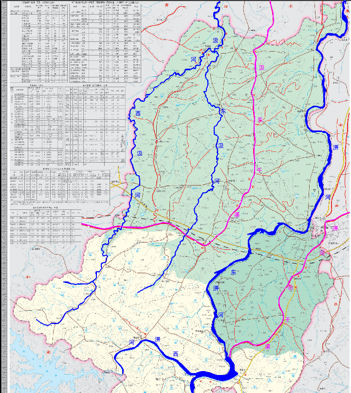

# 前 言

## 六安市裕安区位于安徽省西部，大别山北麓、淮河以南，江淮丘陵西缘，东邻金安区、西接金寨县、南与霍山县接壤、北和霍邱县相连，总面积1926km2，总人口104.3万人，耕地面积93609hm2，下辖3个街道、12个镇、7个乡。淠河、汲河自南向北穿区而过。淠河上游横排头水源保护区总长33km，其中有27km位于裕安区。区内大型灌区主要有淠河灌区、史河灌区，控制面积分别为282.5km2、894km2，内有淠河总干渠、汲东干渠两条大型骨干输水渠道。

## “十三五”以来，裕安区认真贯彻党的十八大、十九大精神，以习近平新时代中国特色社会主义思想为指导，深入落实新发展理念和一系列重大战略决策部署。以全面提升水安全保障能力为主线，围绕全面建设节水型社会、健全水利改革发展体制机制、完善水利基础设施网络、保护和修复水生态环境、夯实农村水利基础等领域的主要任务，有序推进规划实施。

## 结合六安市“一谷一带”建设，在区委、区政府的正确领导和全社会共同努力下，裕安区继续深入实施“水利裕安”战略，立足治理与保护并重、建设与管理并举的决策部署，水灾害防治、水资源配置、水环境治理、水生态修复、水工程管理等取得明显成效，为全区脱贫攻坚、高质量发展提供了强有力的水利支撑与保障。但由于特殊的自然地理气候环境决定了裕安区水资源时空分布不均，水旱灾害频发。从新问题来看，水安全中的洪涝灾害问题仍有待解决。

## 党的十八大以来，以习近平同志为核心的党中央高度重视生态环境保护和生态文明建设，习近平总书记站在党和国家事业发展的全局高度，强调河川之危、水源之危是生存环境之危、民族存续之危，要求把“绿水青山就是金山银山”作为重要的发展理念，深刻阐述“山水林田湖”是一个生命共同体的辩证法，明确提出“节水优先、空间均衡、系统治理、两手发力”新时代治水思路。习近平总书记重要讲话精神和中央作出的一系列重大决策部署，是制定水利改革发展“十四五”规划的重要指南，为全面深化水利改革、切实做好各项水利工作指明了方向。

## 按照“十九大”确定的“两步走”战略目标，“十四五”时期，是建成富强民主文明和谐社会的社会主义现代化国家的关键起步期，中国特色社会主义即将进入新时代，水利改革发展面临新形势、新任务、新要求。“十四五”时期是裕安区迈进新时代、全面开启社会主义现代化建设新征程的首个五年。按照“水利工程补短板、水利行业强监管”的水利改革发展总基调要求，聚焦水灾害、水资源、水生态、水环境等新老水问题。从防洪除涝、供水保障、生态修复、信息化等方面补强水利基础设施短板，不断强化涉水事务监管及改革创新，以满足人民群众对防洪保安全、优质水资源、健康水生态、宜居水环境、先进水文化的需求，加快建设人水和谐的示范幸福河湖。

## 根据省水利厅、市委市政府的统一部署，按照《关于印发安徽省水利发展“十四五”规划编制工作方案的通知》（皖水规计函〔2020〕75号）、《六安市水利改革发展“十四五”规划思路报告》以及裕安区关于“十四五”规划的编制要求，总结裕安区“十三五”水利发展规划实施成就，分析“十四五”期间存在的问题以及面临的形势，研究提出今后五年水利改革发展的总体思路、发展目标、主要任务，编制《六安市裕安区水利发展“十四五”规划》。

# 1 区情水情

## 1.1 自然条件

## 1.1.1 自然地理

## 裕安区位于安徽省西部，大别山北麓、淮河以南，江淮丘陵西缘，东邻金安区、西接金寨县、南与霍山县接壤、北和霍邱县相连，共辖19个乡镇，3个街道，总面积1926km2，总人口104.3万人，耕地面积93609hm2。

## 裕安区地处大别山北部边缘，为皖西南北升降过渡地带。境内西南、南部为低山，海拔一般在500m左右，最高峰为西河口九尖峰，海拔651m；北部呈长岗状粱的波状平原，为丘陵为主的低山、低岗、湾畈平覃等多种地貌类型。

图1.1-1 裕安区地理位置图

## 1.1.2 水文气象

## 裕安区地处北亚热带的北缘，属湿润季风气候，多年平均气温为15.5℃，多年平均降水量为1174mm，具有南多北少、山区多平原少、夏春季多、冬秋季少以及年际间降水悬殊过大等特点。全区年平均相对湿度在79%，年平均日照时数2225.6h，日照率达50.8%。年均无霜期200d。多年平均风速2.5m/s，最大风速20m/s，常年风向东南偏东。

## 1.1.3 河流水系

## 裕安区属淮河流域，其境内主要水系为淠河水系和汲河水系。

## （1）淠河水系

## 淠河，是淮河右岸的主要支流之一，位于安徽省西南部，发源于岳西和金寨县境内的大别山北麓。流经霍山县、岳西县、六安市，于正阳关入淮河。淠河全长253km，流域面积6130km2。其中山区面积占全流域的72%，是洪水的主要来源，具有汇流集中，随涨随落，峰高量大的特点。横排头以下属丘陵平原区，河岸开阔，河道比降平缓，平均比降为0.4～0.2‰。淠河主河槽宽一般在100～300米，平槽泄量较小，只有500～1800m3/s，受河槽调蓄作用影响，该段洪水过程从上游到下游逐渐变缓，形成该段洪峰流量上大下小的情况。

## 淠河自南向北纵穿裕安区，经正阳关入淮。主河道流经裕安区89.7km。即西河口汇合处至横排头枢纽长9km，横排头至六安下龙爪37km，下龙爪以下43.7km。流经裕安区西河口、青山、独山、石板冲、狮子岗、苏埠、韩摆渡、分路口、徐集、城南、平桥、新安、顺河、单王14个乡镇。

## 东淠河，发源于大别山北麓，主要源流有西支漫水、东支黄尾河，佛子岭水库坝下主要支流有孔家河、深水河、戴家河、柳林河、幽芳河、高庙河、熊家河、龙门河等汇入东淠河，干流东淠河经霍山县城北郊及下符桥镇团山嘴，在裕安两河口与西淠河汇合流入淠河；东淠河全长103km，流域面积2697km2。

## 西淠河，古称湄水，亦名西河、麻步川，发源于鄂皖交界的三省垴，源流称黄氏河；西淠河从宋家河、乌鸡河汇合口五七桥起，东流有青龙河（又名姜家河）入，再东经青山、于青枫岭莲花河水入响洪甸库区。出库后，经驻驾湾，独山折向东南至两河口；西淠河全长68km，流域面积1585km2。

## 淠河总干渠，上游源自佛子岭、磨子潭、响洪甸三大水库，水库出水由东、西淠河汇合后从渠首横排头进水闸行经三里岗进入六安市区，穿过六安市区至九里沟，下游经罗管节制闸过青龙堰入裕安区境，全长104.5km，境内长56.8km。

## （2）汲河水系

## 汲河，因贯穿安徽省霍邱县城东湖而得名，发源于大别山北侧外山区，有东、西两源，于霍邱县固镇镇汇合北流，注入城东湖，在溜子口入淮。全长160km，流域面积2200km2，平均比降1.9‰。

## 汲河上游又分东、西汲河。西汲河发源于裕安区石婆店与金寨交接的三仙山。东汲河发源于狮子岗。东西汲河汇合于固镇三叉，以下为汲河主河道注入霍邱城东湖进入淮河。西汲河为主源流，流经该区石婆店、江家店、罗集、固镇，全长102km，流域面积854km2。东汲河流经该区狮子岗、分路口、徐集、丁集、固镇，全长82km，流域面积469km2。主河道流经该区固镇7km，流域面积48km2。

## 汲河蜿蜒曲折，上游坡陡流急，下游地势低洼，河床平缓。汲河主河道河槽弯曲，河槽宽56-74m，堤距窄，且成收缩状态，从窦堰头至大阴沟堤距由350m缩至150m，最窄处（砖洪集）不足100m。

## 汲东干渠灌区西抵西汲河，与史河总干渠直灌区及沣东灌区为邻；东以淠河为界，南入金寨白大、六安独山深丘区，北过左王集接沿淮湖洼地。干渠全长112.58km。

## （3）中小河流

## 裕安区有中小河流7条，总长291km。即：东淠河、西淠河、汲河、西汲河、东汲河、方小河、安城河，河道长分别为东淠河17km、西淠河21km、汲河7km、西汲河102km、东汲河82km、方小河34km、安城河28km。

## （4）淠河、汲河一级支流

## 裕安区淠河、汲河一级支流共计20余条，主要河流有：龙门河、游芳冲河、毛岔河、冷水冲河、通水冲河、磨剑冲河、演将冲河、舞旗畈冲河、七里冲河、旱保片河、九公冲河、石板冲河、柿树冲河、狮子岗冲河、东冲河、陈氏祠河、白马庙河、方小河、安城河、张祠河等，累计河流长度233.4km，流域面积437.7km2，堤防长度87.2km，防洪影响范围涉及人口17.12万人。

图1.1-2 裕安区主要河流水系图

表1.1-1 裕安区主要河流（1000km2以上）基本情况表

| 流域 | 水系 | 河流名称 | 境内河长（km） | 境内流域面积（km） | 流经乡镇（村） | 备注 |
|---|---|---|---|---|---|---|
| 淮河 | 淠河 | 东淠河 | 103 | 2697 | 西河口、青山、独山、石板冲、狮子岗、苏埠、韩摆渡、分路口、徐集、城南、平桥、新安、顺河、单王 | 二级支流 |
| 西淠河 | 68 | 1585 | 二级支流 |
| 淠河(包括东、西淠河) | 253 | 5569.4 | 一级支流 |
| 淮河 | 汲河 | 160 | 2200 | 石婆店、江家店、罗集、固镇 | 一级支流 |

## 1.2 社会经济

## “十三五”时期，裕安区取得了经济持续健康发展、社会全面进步的历史性成就。经济总量连上两台阶。地区生产总值连跨200亿元和300亿元台阶，经济实力显著增强。2018年、2019年连续两年跻身全省“制造业发展十快区”，五年累计固定资产投资完成超过800亿元，保持全市领先。地方财政收入达25.1亿元，年均增长12.2%。脱贫攻坚胜利完成，全区建档立卡贫困户人均纯收入由2014年的2524元增加到2020年的12688元。发展动力不断增强，经济结构持续优化，三次产业结构由2015年的19.2：29.6：51.2转变为2020年的14.7：26.8：58.5。高新技术企业总数37家，累计备案国家科技型中小企业达68家，科技创新实力明显提升。城乡面貌焕发新颜，“一心两轴多极增长”取得实效，中心城区、南部新城、河西滨水新区、六安高新区同步推进，相互促进。茶谷、淠河经济带，串点成线，形成新型城镇化发展轴。产业集群镇、特色小镇、三产融合项目，特色产业增长极相互辉映。“农村四好路”、安全饮水工程覆盖全区，公交通达所有建制镇，治安案件逐年下降，群众安居乐业。

## 1.3 水资源状况

（1）水资源总量

根据《2019年六安市水资源公报》，2019年裕安区全区水资源总量14.79亿m3。其中地表水资源量4.09亿m3，地下水资源量0.79亿m3，地表水与地下水不重复计算量0.00亿m3。

表1.3-1 2019年六安市行政分区水资源总量 单位：亿m3

| 行政分区 | 年降水量 | 地表水资源量 | 地下水资源量 | 地下水与地表水不重复计算量 | 水资源总量 | 产水系数 | 产水模数(万m3/km2) |
|---|---|---|---|---|---|---|---|
| 裕安区 | 14.79 | 4.09 | 0.79 | 0.00 | 4.09 | 0.28 | 20.95 |
| 全 市 | 136.63 | 50.34 | 10.78 | 2.38 | 52.72 | 0.39 | 28.58 |

2019年全市6座大型水库和城东湖、城西湖年末蓄水量15.30亿m3，较年初减少18.87亿m3；中型水库年末蓄水总量0.426亿m3。

（2）用水量

2019年裕安区全区供水总量3.15亿m3。其中地表水供水量2.96亿m3，地下水供水量0.07亿m3，其他水源供水量0.11亿m3。全区用水总量3.15亿m3。其中农田灌溉用水量2.30亿m3，林牧渔畜用水量0.10亿m3，工业用水量0.2287亿m3，城镇公共用水量0.09亿m3、居民生活用水量0.37亿m3和生态环境用水量0.06亿m3。全区用水消耗总量1.90亿m3。

表1.3-2 2019年六安市行政分区用水量表 单位：亿m3

| 行政分区 | 农田灌溉 | 林牧渔畜 | 工业 | 城镇公共 | 居民生活 | 生态环境 | 合计 |
|---|---|---|---|---|---|---|---|
| 火(核)电工业 | 非火(核)电工业 |
| 裕安区 | 1.471 | 0.073 | 0.0692 | 0.036 | 0.028 | 0.177 | 0.050 | 1.90 |
| 全 市 | 11.530 | 0.386 | 0.076 | 0.514 | 0.136 | 0.881 | 0.295 | 13.82 |

（3）水资源利用概况及用水指标

2019年裕安区全区人均用水量341.2m3；万元GDP用水量107.3m3；农田灌溉亩均用水量272.3m3；万元工业增加值用水量47.4m3；居民人均生活用水量39.7m3。

表1.3-3 2019年六安市主要用水指标

| 行政分区 | 人均综合用水量（m3/人） | 万元GDP用水量（m3/万元） | 居民生活人均用水量（m3/人） | 万元工业增加值用水量（m3/万元） | 农业灌溉亩均用水量（m3/亩） |
|---|---|---|---|---|---|
| 裕安区 | 341.2 | 107.3 | 39.7 | 47.4 | 272.3 |
| 全 市 | 474.4 | 142.7 | 38.2 | 52.6 | 337.1 |

## 1.4 水旱灾害

## 1.4.1 旱灾

（1）历史干旱灾害

中华人民共和国成立以来，我区发生过8次较为严重的干旱年份，分别是1966年、1967年、1976年、1978年、1990年、1994年、2000年和2001年，其中1966年、1967年、1978年、2000年旱情最为严重。

据气象资料统计，我区多年平均降雨量在1110～1180mm之间。裕安区灌区灌溉期（4~10月份）1966年、1967年、1976年、1978年、1990年、2019降雨量分别为387.6 mm、502.1 mm、475.3 mm、380.7 mm、509.8 mm，396mm上述年份灌溉期降雨量小，均发生较为严重的干旱。

（2）2019年旱灾总体情况

根据裕安区各雨量站统计数据，2019年裕安区年平均降雨量为736.9mm，相比裕安区多年平均降雨量1135mm，年降水频率94.5%，为枯水年2019年裕安区整体旱情属于“严重干旱”级别，局部地区属于“特大干旱”。

根据裕安区水利局实地摸底资料，2019年9月开始，旱情发生以来，对反映饮水困难和供水工程水源告急的狮子岗乡、江店镇、徐集镇、分路口镇、丁集镇、罗集乡、单王乡、石婆店8个乡镇群众饮水情况和全区规模水厂进行了全面摸排，从汲东干渠和东汲河取水的3处规模水厂相继出现水源水量不足。

根据裕安区水利局下属各乡镇水利站对全区旱情统计，截至2019年12月底，旱情涉及19个乡镇及高新区，受旱影响人口19.09万，旱灾影响耕地面积40.08万亩，因旱秋收减产面积22.08万亩，因旱影响秋种面积13.96万亩。

## 1.4.2 洪涝灾害

（1）历史洪涝灾害

淠河流域洪涝灾害直接由暴雨产生的，形成大暴雨的主要天气系统是涡切变和台风。暴雨出现时间一般在每年的5～9月份。淠河洪水主要来源于上中游山区，东、西淠河汇合的两河口以上流域呈扇形，支流众多，汇流集中，洪水峰高量大，陡涨陡落，易形成灾害。淠河六安段以上，最大安全泄量为2500m3/s。六安段以下由于多种原因，安全泄量只有2000～2500m3/s，不足十年一遇标准，对裕安区沿淠乡镇、街构成严重威胁。据统计，中华人民共和国成立后淠河发生较大洪水年份有10年之多，平均约5年一次。较大的有1969年、1975年、1983年、1991年及1999年。特别是1991年（相当于五十年一遇洪水标准）灾害损失惨重。

## 汲河蜿蜒曲折，上游坡陡流急，下游地势低洼，河床平缓。汲河主河道河槽弯曲，河槽宽56-74m，堤距窄，且成收缩状态，从窦堰头至大阴沟堤距由350m缩至150m，最窄处（砖洪集）不足100m。历史上汲河洪涝灾害与淮河多灾紧密相联，又因是城东湖行蓄洪区，故是一条多灾河道。汲河几十年来灾情连年，特别是姚李桥至储渡口段沿河生产圩、平畈区，小雨小灾，大雨大灾，灾害频繁。从20世纪80年代始，汲河已发生过1981年、1985年、1986年、1991年等6次大的洪涝灾害，几乎年年有灾，其中以1986年灾情最重，成灾面积10.9万亩，人口7.7万人，倒房万余间，直接经济损失数千万元。经过汲河综合治理后，汲河的防洪标准由5年一遇提高到现在的10年一遇、20年一遇。

（2）2020年洪灾总体情况

汛情雨情：2020年7月17日18时~19日18时，裕安区普降特大暴雨（以下称“7.20洪水”），48小时最大降雨量超过381.2mm，最大时段降雨量裕安区石婆店镇碾盘冲水库站106mm，破历史极值，其中汲河流域48小时最大金玉良达641mm，超过多年平均降雨量的50%。受特大暴雨和上游泄洪、下游高水位顶托共同影响，全区22个乡镇街均遭受洪涝灾害，其中受灾最严重的为固镇镇和罗集乡。固镇镇位于东、西汲河交汇处洼地，受此次特大暴雨影响，东、西汲河来水量达到3.5亿方左右，汲河水位随之暴涨，7月19日6时开始超20年一遇27.09m保证水位后，汲河固镇段高水位上涨运行，7月19日24时开始，6小时后（7月20日6时）达到固镇站最高水位27.83m，为建站以来最高，汲河固镇段超保证水位运行40小时以上。下游霍邱城东湖水位较高形成顶托效应，造成汲河固镇段洪水下泄缓慢，水位居高不下，导致东、西汲河出现历史以来首次全线溢坝，短时间内淹没了固镇镇、丁集镇等地约70km2，其中积水最深处就达3m左右。

洪涝灾害损失情况：因2020年入汛以来，遭受持续强降雨，导致裕安区受灾严重，截至7月31日8时，全区受灾人口20.33万人，农作物受灾面积35858.22公顷，成灾面积23054.91公顷，绝收面积11932.22公顷；漫破圩口4个；因灾严重损坏房屋60户120间，一般损坏房屋773户1562间，其中损坏农房829户1672间。全区直接经济损失256407.62万元，其中农作物经济损失约53244.05万元，工矿企业损失59392.876万元，基础设施损失105456.71万元，公益设施8203.842万元，家庭财产损失30106.845元。其中固镇镇灾情较重，受灾人口2.5万人，农作物受灾面积5.6万亩，全镇直接经济损失11.58亿元，其中农业损失1.37亿元，工矿企业损失4.5亿元，基础设施损失3.98亿元，公益设施损失0.4亿元，家庭财产损失1.3亿元。

## 水利设施受损情况：“7.20洪水”使裕安区水利工程遭受严重破坏，共水毁2352处，损失约5.81亿元，其中损坏水库18座、损坏堤防60处、护岸170处、水闸247座、灌溉设施1008处、塘坝676座、水文测站1个、机电井28眼、机电泵站109座，农村安饮工程损毁13处，其它22处。水利工程水毁直接经济损失达5.81亿元。

# 2  现状与形势

## 2.1 “十三五”主要成就

## “十三五”期间，裕安区深入贯彻落实习近平新时代中国特色社会主义思想和市委市政府一系列战略部署，在区委、区政府的坚定领导下，积极践行“节水优先、空间均衡、系统治理、两手发力”新时代治水方针，紧紧围绕裕安区经济社会发展总体要求，着力构建“工程水利、资源水利、民生水利、生态水利”四大水利体系，打造环境优美的生态水城。“十三五”规划各项目标任务基本顺利如期落实完成，水利改革发展建设成效显著，全面提升了水安全保障能力，全面推进了全区水利现代化建设。

## 2.1.1 防洪减灾体系逐步夯实

## （1）淠河综合治理项目：“十三五”期间，完成淠河左岸石板冲段9.2km，右岸韩摆渡段8.8km河道治理，完成项目投资17657万元；淠河支流石板冲靠山渠治理2km，完成投资300万元；淠河六安以下段河道治理41.98km及险工险段治理，已完成项目投资35400万元。

## （2）中小河流治理项目：“十三五”期间，完成裕安区中小河流已治理总长90.47km，完成总投资23810万元。其中安城河治理长11.4km，投资2430万元；方小河（城区段）治理长14.8km，投资5220万元；东汲河综合治理河道长度11.8km，完成投资4800万元；西淠河治理河道长度16.4km，完成投资4050万元；西汲河（含汲河）治理长36.07km，完成投资7310万元。

## （3）山洪沟防洪治理项目：目前已完成龙门河山洪沟治理工程，已完成项目投资1000万元。

## （4）蓄洪区建设及洼地治理项目：2019年实施城东湖蓄洪区建设，主要建设内容包括城东湖蓄洪区裕安区境内居住在低洼地不安全居民迁建工程，搬迁3288户，10600人，完成投资31037.88万元。

## 防洪减灾体系项目完成投资约10.92亿元。已实施的子项目，淠河、西淠河、东汲河、西汲河主干工程实施情况良好，基本按规划内容逐次实施，支流治理工程实施情况较差，且大部分无明确后续项目支持；山洪沟治理规划投资较大，已实施的、未实施的工程与规划相距甚远；方小河仅治理了城区段，东淠河治理没有实施。防洪减灾体系部分实施项目方小河治理有后续项目支撑；东淠河治理、各支流治理、大部分山洪沟治理暂无明确计划支撑。

## 防洪减灾体系的逐步夯实保障了人民群众生命安全，成功应对暴雨、洪涝、干旱、台风等多种灾害，战胜了2016年特大洪涝灾害，境内重要支流及中小河流堤防抵御了洪水的侵袭，水库无一垮坝，防洪减灾效益显著。2020年特大洪涝灾害中，依托现有水利设施，将损失降到了最低。2019年特大干旱中，新建及现有的蓄水工程蓄积了足够的水量，基本上抗御了旱灾，保障了粮食灌溉供水和居民生活用水。

## 2.1.2 农村水利建设持续发力

## （1）安全饮水提质增效项目：“十三五”期间，加快实施裕安区农村饮水安全巩固提升和农村饮水安全精准扶贫工程，截至2020年3月，累计解决76.64万人的饮水安全问题，全区农村自来水普及率达88.68%，集中供水率88.68%，水质达标率81.52%。裕安区自十二五开始在全区范围内实施农村饮水安全工程建设，至2020年3月底裕安区共完成集中供水工程20处，其中千吨万人供水工程17处，城市管网延伸工程3处，其中日处理水规模1000≦W﹤5000m3/d的水厂有12座，日处理水规模5000≦W﹤10000m3/d的水厂有7座，日处理水规模10000m3/d≦W的水厂有1座。集中供水水源共17处，其中除单王乡的胡台水厂和单王水厂采用中深层地下水外，其余15处水厂取水水源均为地表水，水质达到Ⅱ类水的2处，达到Ⅲ类水的15处。16处水厂采用常规处理方法进行水质处理，胡台水厂增加了除锰工艺。

## （2）新建及加固小水库工程：新建小（2）型水库1座；除险加固小型水库70座，已完成项目投资9845万元。其中2017年病险小水库除险加固30座，完成投资3600万元；2018年实施裕安区马庄等30座小水库除险加固工程，完成投资4438万元；2019年实施六安市裕安区关仓等10座水库除险加固工程，完成投资1428万元。

## （3）灌排泵站更新改造：改扩建排涝站2座；更新改造及新建面上小型排灌泵站55座。

## （4）小型农田水利“八小”改造提升工程及农田水利“最后一公里”：小型农田水利“八小”改造提升项目已完成，完成项目投资6986.3万元。农田水利“最后一公里”已完成排灌片区治理3万亩，完成项目投资2000万元。

## （5）高标准农田建设：“十三五”期间，高标准农田建设完成治理12万亩，11个片区，已完成项目投资2300万元。

## （6）淠史杭灌区续建配套及节水改造工程：“十三五”期间，完成汲东干渠2段计14km除险加固，支渠2条，25km续建配套，已完成工程投资4500万元。实施裕安区2020年度农业水价综合改革项目，实施淠史杭灌区汲东干渠裕安区(K30+180-45+000)段和淠河总干渠金杯支渠续建配套与节水改造工程，实施淠史杭灌区汲东干渠裕安区(K45+000-56+875)段除险加固工程，完成投资3650万元。

## （7）淠史杭灌区清凉寺分干渠灌区现代化改造试点：2020年4月开工建设，年底完成建设任务，项目总投资1135万元。

## （8）小型水利工程改造提升：2017年度省级下达裕安区小型水利工程改造提升任务投资3600万元，主要任务包括：小型泵站1000kw、小型水闸43座、塘坝910座、沟河60条、末级渠系2万亩。

## （9）扶贫水利薄弱环节治理工程：2020年扶贫水利薄弱环节工程项目117个，重点是清淤加固各类渠道、维修整治放水涵闸，涉及全区19个乡镇，总投资6264万元，目前已全部完工。

## “十三五”期间，加快实施裕安区农村饮水安全巩固提升和农村饮水安全精准扶贫工程；大力推进淠史杭灌区续建配套及节水改造工程和高效节水灌溉工程；解决农田水利灌排最后一公里问题；加快实施泵站更新改造工程。农村水利体系项目完成投资约6.91亿元。

## 2.1.3 水资源管理进一步加强

## 落实最严格水资源管理制度，实施水资源消耗总量和强度双控行动。坚持以水定需，量水而行，强化用水总量控制，实行用水计划管理，建立规划水资源论证制度，严格取水许可审批和监管，促进水资源合理开发利用和节约保护，保障经济社会可持续发展。2019年全区用水总量14.79亿m3，全区人均用水量341.2m3；万元GDP用水量107.3m3；农田灌溉亩均用水量272.3m3；万元工业增加值用水量47.4m3；居民人均生活用水量39.7m3。

## 以淠河、汲河为干线，以各支流为支线的水资源体系，启动一批骨干水源工程的建设，解决工程性缺水问题，有效改善重点地区水资源配置格局，增强水资源调配能力，构建城镇多水源供水安全保障体系。开展取用水专项整治行动，在全市率先完成任务。实施《国家节水行动六安市裕安区实施计划》，推进节水型社会建设，提高水资源利用效率，裕安区灌区农田灌溉水有效利用系数，由原先0.5030，增加到2020年0.5153，使裕安灌区水资源发挥最佳灌溉效益；加快建立节约集约型用水方式，以水资源可持续利用支撑经济社会持续健康发展。

## 2.1.4 水生态修复扎实开展

## （1）水土保持治理项目：持续开展水土流失治理，2016~2019年，裕安区实施国家水土保持重点建设工程为六里冲、陶家河和九里冲3条小流域水土保持综合治理工程，新增水土流失综合治理面积55.5km2，主要建设内容坡耕地治理，水蚀坡林地治理，山塘整修，封禁治理等，完成总投资2211万元。2020年实施关塘小流域水土保持综合治理工程，治理水土流失面积25.4km2，年度完成投资1270万元。

## （2）水资源保护项目：“十三五”期间，排污口封闭2处，新建排污管道80km，已完成投资25000元。

## （3）青山湿地综合治理项目：水源保护工程青山湿地综合治理已完成目标任务，包括7.1公里堤防加固工程以及观光桥等，投资2154万元。

## （4）西淠河综合治理生态基础设施工程(一期）：该项目为已治理段西淠河左右岸进行绿化建设，总绿化面积27.54万m2，范围自独山翻版坝下200m至独山虎头潭大桥，绿化段总长度5.0km，项目主要分为A、B、D三个区，分别为A：红色文化展示区；B：湿地观赏区；D：户外体验区和滨水休闲区，项目目前已完成全部主体工程建设，总投资5634.5622万元。

## 水土保持完成4条小流域综合治理项目；水源保护工程青山湿地综合治理已完成目标任务；水环境优美乡村建设已按年度目标完成；水资源保护与生态修复体系建设非工程措施已成立相应组织并完成。加强水源地保护，严格落实纳污量控制红线制度，全面完成入河排污口核查、登记、建档、立牌工作。强化水功能区监管，重要江河湖库水质持续向好。

## 2.1.5 水利改革创新不断深化

## （1）河长制体系建立

## 裕安区自全面推行河湖长制以来，出台了《六安市裕安区全面推行河长制工作方案》《裕安区关于全面推行湖长制的实施方案》，全面建成区乡村三级河湖长组织体系，同时对设立区级河湖长的河湖明确了副河长成员单位。2017年以来，裕安区根据市里要求并参照市里制度，结合裕安实际，共制定10项工作制度，分别为《裕安区全面推行区级河长会议制度》、《裕安区“河长制”工作制度》、《裕安区全面推行河长制信息共享制度》、《裕安区全面推行河长制信息报送制度》、《裕安区全面推行河长制工作督察制度》、《裕安区全面推行河长巡查制度》、《裕安区全面推行河长制考核问责和激励制度》、《裕安区河长制工作交办督办制度》、《裕安区河（湖）长制工作投诉举报办理工作制度》、《裕安区全面推行河（湖）长制暗访工作制度》等。其中《裕安区全面推行区级河长会议制度》经过区级总河长会议研究进行了局部修正调整，裕安区各乡镇、街道、高新区根据区里要求并参照区里制度，相应制定了河长会议、河长工作、信息共享、信息报送、工作督察、河长巡查、考核与问责激励等7项制度。

## （%1） 河长工作开展情况

## 各级河长开展常态化巡河，2018年至2020年，区乡村三级河湖长共开展巡河巡湖53780次，发现解决问题137个。

## 河湖保洁、持续保障。以垃圾治理全覆盖PPP项目为抓手，开展河流垃圾清理专项行动，确保垃圾不入河，落实乡镇街、开发区管委会、村两委等基层的治水工作责任，完善长效管理机制，健全日常巡查机制，根据职责分工强化河道及沿岸日常管理和维护，及时发现并清除河道违建和违占问题。并以垃圾治理为切入点，逐项落实河长制各项任务，打造示范河长、示范乡镇、村。确保实现河畅、水清，打造安全、清洁、健康的城乡水环境。完成裕安区16条河流、汲东干渠、清凉寺分干渠、8座小（1）型水库、3座中型涵闸、3座泵站及1处湖泊的划界工作。

## 举办基层河湖长制业务知识培训。2019年聘请水利行业专家教授及相关专业人士对区河长办工作人员、区水利局水政水资源股、水政监察大队、乡镇（街）、高新区河长办分管负责人及业务人员50多人进行了培训和现场观摩；2020年聘请水利行业省市专家及区检察院相关人士对区级副河长成员单位分管负责人，乡镇（街道）、高新区分管负责人与河长办工作人员及村级河湖长，灌区管理中心、河道管理中心负责人，区河长办及相关人员约110人进行了培训，此次培训得到了省、市河长办高度认可。

## 广泛动员群众参与。通过横幅、标语、宣传栏、发放宣传品、宣传车及裕安区河长制微信公众号等多种方式，向广大群众宣传河长制的重要意义、河流、渠道、小水库、湖泊保护措施、监督方式，动员人民群众主动参与到河湖保护之中；在中小学中，开展“河小青”助力河长制工作，深入开展“保护母亲河”的宣传教育，部分中小学校以主题班队会、演讲比赛、文艺演出等多种形式，强化学生的生态保护意识，并采取“小手拉大手”的方式，让各中小学生和其家长共同学习关于河流保护的法律法规，增强环保意识。完成裕安区西淠河（虎头潭大桥至独山翻板坝段）市级示范幸福河湖建设；完成独山乐水河、城南陡步河区级美丽示范河湖建设。建立生态检察官，在区内重要河流、湖泊设立河湖警长，形成了全区河湖治理管护的“河长责任链”和“治水共同体”。

## （3）建立“一河（湖）一档”，制定“一河（湖）一策”实施方案

## 完成设立区级河长的淠河干流裕安段、淠河总干渠裕安段、横排头坝上、东淠河、西淠河、汲河干流、东汲河、西汲河、汲东干渠、清凉寺分干渠10条河流“一河一档”资料收集工作及水利应用门户系统录入工作；完成东淠河、西淠河、横排头坝上、西汲河、东汲河、汲东干渠、清凉寺分干渠、龙门河、下泊河、安城河等10条河流的“一河一策”及石婆湖“一湖一策”实施方案的编制工作；完成石婆湖保护规划的编制审查及批复工作。

## （4）推进河湖管护问题整改和专项整治行动开展

## 全面开展砂石专项整治行动。2017年关停到期砂场22家，拆除违章采砂房及附属设施3000多平方米，拆除、撤离非法采砂船370艘，采砂设备90多台（套）；完成长江经济带固体废弃物35项整治工作，开展垃圾围坝整治工作，顺利完成3处垃圾整治销号工作；开展河湖“清四乱”专项行动，区财政投入约100万元，全面完成裕安区“清四乱”13个问题的整改工作；顺利完成生态区域违法建设问题115个（纳入河长制上报）整改工作。

## （5）农业水价综合改革试点

## 全面推进农业水价综合改革，完成丁集、徐集2个片区，3万亩治理，项目投资2165万元。

## 2.1.6 行业能力建设得到加强

## 完善了职能科室和职责分工，加强人才队伍建设，分工到人，明确责任，加强工程运行操作和管理养护力度，提升管理形象，提高服务保障能力，保障了灌区重点工程安全运行，满足职能配置的需要。

## 灌区管理中心水利管理设施建设逐步完善，配齐段站巡逻车辆与维养设备，完成汲东干渠裕安段所有直放口和分干渠、支渠重要的引水口、分水口、供水分界断面等处新建量测水设施102处，覆盖灌区面积59.5万亩。

## 裕安区灌区农田灌溉水有效利用系数得到提高，为实现灌区现代化、数字化、智能化水利管理体系夯实了基础，实现了灌区农业用水定额管理、总量控制、精准计量，提高了用水效率、促进节约用水。

## 2.1.7 水利信息化水平同步提升

## 全面完成主要河湖、大中型水利工程远程视频监控设施建设，构建覆盖区（县）、乡和主要防洪工程的水利信息化建设，建设完善信息化基础设施和数据中心，实施信息资源共享和系统集成整合，建成自动化调度控制系统；建设现代化的防汛抗旱指挥系统和水资源管理系统，提升信息采集、传输和处理应用能力和水平，实现了取水许可大户取用水在线计量监测。

## “十三五”期间，实施裕安区小型水库雨水情自动测报系统建设工程，新建小水库雨水情自动测报站198座，改造站点25座，2020年底完成建设任务，完成投资3430万元。

## 开展河湖监管信息化平台建设，流域50km2以上河流、汲东干渠、清凉寺分干渠、江店支渠、石婆湖河湖监管信息化平台建设，主要建设内容为：数据仓库建设、决策子系统建设、业务办公子系统建设、运营维护子系统建设、微信公众号服务建设、前段监测采集系统建设、河长制服务支撑平台建设、与其他系统集成等建设，形成重要河湖监管全覆盖。

## 依托“安徽省农村饮水安全信息采集系统”，建立建档立卡贫困村通水和贫困人口饮水台账。

表2.1-1 六安市裕安区“十三五”水利发展主要目标指标实现程度统计表

| 序号 | 项 目 | 规划指标 | “十三五”末 | 备 注 |
|---|---|---|---|---|
| 1 | 洪涝灾害年均损失率 （损失占GDP比例，%） | （<0.8） | 实现 | 预期性 |
| 2 | 干旱灾害年均损失率（%） | （<0.7） | 实现 | 预期性 |
| 3 | 用水总量控制*（亿m3） | 3.675 | 3.15 | 约束性 |
| 4 | 万元国内生产总值用水量下降（%） | 25 | 25 | 约束性 |
| 5 | 万元国内生产总值用水量（m3） | [110] | 110 | 约束性 |
| 万元工业增加值用水量下降（%） | 9 | 9 |
| 6 | 万元工业增加值用水量（m3） | 66 | 48 | 预期性 |
| 农田灌溉水有效利用系数 | 0.55 | 0.5153 |
| 7 | 农村自来水普及率（%） | [90] | 73 | 预期性 |
| 8 | 农村集中式供水人口比例（%） | [90] | 91.4 | 预期性 |
| 9 | 新增农田有效灌溉面积（万亩） | 2 | 实现 | 预期性 |
| 10 | 新增高效节水灌溉面积（万亩） | 2 | 实现 | 预期性 |
| 11 | 新增农村水电装机容量（万kW） | 0.21 | 实现 | 预期性 |
| 12 | 新增水土流失综合治理面积（万km2） | 0.023 | 0.008 | 预期性 |
| 13 | 重要江河湖泊水功能区水质达标率（%） | [93] | 83 | 约束性 |

## 注：指标中带（）为5年平均值，带〔〕为期末达到数，其余为5年累计数。

## *用水总量控制指标不包括贯流式火电直流冷却水、再生水等非常规用水量。

## 2.2 前期水利建设情况

2020年期间，裕安区计划开工12个水利项目，开工总投资19.18亿元，“十四五”期间将继续推进建设进度。其中列入省市2020年续建、计划开工项目主要如下：

（1）防洪减灾

1）裕安区重点中小河流防洪保安工程：主要工作目标为完成方小河、西汲河治理目标任务的50%；

2）安徽省淮河流域重要行蓄洪区建设工程（裕安区）：主要工作目标为完成4个保庄圩加固完成目标任务50%。

3）六安市裕安区桃花岗等5座小型水库工程：主要工作目标为完成新建2座小水库任务。

（2）农村水利

1）裕安第二自来水厂建设工程：主要工作目标为完成水厂厂区主体工程，主管道铺设完成工程量的80%。

2）裕安区自来水管网延伸工程：主要工作目标为完成优先实施具备供水管网延伸条件的未通水村管网工程。

3）六安市裕安区东北部城乡供水一体化工程：主要工作目标为完成编制项目可研和初步设计，做好与市自来水公司的前期对接工作。

（3）水资源保护与水生态修复

六安市淮河支流裕安段水环境综合治理工程：主要工作目标为完成4条主要河流水环境治理工程。

## 2.3 存在问题

从总体情况来看，“十三五”期间，裕安区水利发展工作取得了重大发展，实施情况较好，各类工程、非工程发挥了主要作用。但也必须清醒的认识到，在“十四五”期间，裕安区经济社会发展面临新形势，新老水问题交织，水利发展还存在诸多不平衡、不充分、不协调的问题并需亟待破解。

## 2.3.1 防洪减灾体系存在短板

经多年建设，裕安区主要河流的防洪减灾体系已逐渐完善，但由于受到国家和地方水利投资渠道和规模的限制，裕安区的水利发展仍然存在诸多的薄弱环节，尤其是在直接关系民生的防汛抗旱等基础设施建设方面，存在明显不足，如重要支流及部分中小河流尚未全面系统治理、病险水库水闸安全度汛、蓄洪区及洼地排涝方面仍面临风险，需进一步提升裕安区水旱灾害防御能力，以充分发挥减灾兴利效益。

（1）主要河流淠河

通过“十三五”期间建设，主要堤防段按照设计标准加固完成，但由于河床下切，部分有堤防段堤脚崩塌，无堤防段崩岸较为严重；狮子岗段、分路口段崩岸严重，急需治理。

（2）中小河流（200km2以上）

裕安区有中小河流7条，总长291km，已治理90.47km，占河道总长31.1%，中小河流治理中大部分河段还未得到有效治理。未治理段存在主要问题有无堤防或堤防防洪标准低、堤防不封闭、崩岸、排涝涵闸工程老化、排涝泵站设备陈旧、河滩阻水物多等。

（3）小河流（200km2以下）

河道缺乏统一规划，随意筑堤，随意筑坝拦水。存在主要问题有堤防标准极低、阻水物多、河道淤积、崩岸。

（4）蓄洪区、行洪区安全建设

裕安区城东湖蓄洪区四个保庄圩堤防未达标，配套泵站设备老化，排涝涵闸老损；两个庄台外围无防护；非工程措施薄弱。

淠河行洪滩地苏陆段、顺新段存在大量居民，行洪时生命财产安全无法保证。

（5）洼地易涝区建设

裕安区城东湖洼地、淠河洼地抽排能力不足，现有排涝泵站除窦堰头站、六安城区站外，其它泵站设备老化，部分不能正常排涝；现有排涝涵闸老损水毁较为严重；区域内排水沟道淤积，排水不畅。

（6）山洪灾害防治

裕安区山洪沟20条，已治理1条。存在主要问题有：沟道弯曲、崩岸、水土流严重。沟道内阻水建筑物多，行洪不畅。监测预警等非工程措施不完善，已有的急需升级改造。

## 2.3.2 水资源合理配置和高效利用体系尚未完善

（1）水资源保障能力

裕安区水资源总量丰富，但由于降水时空分布不均，导致水资源调控能力有限，干旱年份水资源缺口较大，抗旱水源保障能力不足。

（2）水资源利用率

裕安区的水资源消耗90%以上来自农业用水，用水模式是粗放型的。再有部分工业企业设备陈旧、工艺落后，取用水量大、水资源总体利用效率和效益不高。水资源浪费现象时有发生，节水工作需进一步加强，继续推进节水型社会的建设。

（3）水库后续治理

已除险加固水库由于受投资限制，部分规划内容没实施；未除险加固水库大部分水库淤积、岸坡浸蚀、泄水通道不畅、周边环境较差、无防汛道路等问题没有解决，急需进行后续治理；水库管养缺乏经费，建后管护不力。部分区域用水矛盾突出，急需新建水库。

（4）灌区配套设施

裕安区内有史河、淠河灌区。史河灌区主要是汲东干渠中上游灌区及众夏分干渠的长沟、牌坊两条支渠下游灌区。

灌区工程存在输水系统不畅，灌水不及时，配套水平低等问题。汲东干渠、主要骨干支渠续建与节水改造未完成。

灌区管理存在制度不完善。现行的《安徽省淠史杭灌区管理暂行办法》已不适应社会主义市场经济和《水利产业政策》的需求。管理手段更新不及时，无灌区管理现代化设备、设施，管养经费不足。

汲东干渠供水不足，灌溉保证率不能保证，尤其是干旱年供水量与农业用水存在较大矛盾。

（5）农村供水保障

裕安区农村供水保障方面总体存在水源工程分散，管理不完善，信息化水平不高等问题。部分乡村供水站饮用水水源地保护工程缺乏，存在局部经常性、总体阶段性水质超标，尤其是裕安北部；以汲东干渠为水源的水厂存在着季节性缺水；大部分水厂规模小，管理主体多样，与城乡一体化，区域规模化要求相差较大；管理人员专业知识有待提高，管理与运行经费单一，无长效管理机制。

2.3.3 水生态、水环境保护与修复有待推进

按照节水型社会、环境友好型社会的要求，裕安区公众参与水资源管理的程度相对较低，没有形成节约与保护水资源的内在动力机制。随着美好乡村建设步伐的加快，农村河湖水生态环境亟须治理。河湖水域岸线管控不到位，少数河湖生态空间乱占、乱采、乱堆、乱建等“四乱”问题偶有发生。水生态修复工程投入相对不足。

生态修复治理工程的进展较为缓慢，水土保持规划项目实施进度远远不能满足治理工程需要，人为水土流失仍有存在，生产建设项目水土保持措施未完全落实到位现象时有发生。

2.3.4 水利信息化建设任务迫切

裕安区水利信息化较水利现代化发展的目标，还存在较大差距。基础信息采集点密度小，信息时效性不高，工程采集起步晚，视频监测点数量少，自动监控覆盖率低；数据资源共享度低，信息化建设以来，系统建设各自为政、规模效益相对较差；水利传输专网覆盖面窄，信息传输对社会公网依赖性大，由于公网的安全性、保密性和地域自然灾害的能力有限，影响了水利信息传输的可靠性和实效性；水利信息标准化和规范化工作相对滞后。

2.3.5 行业监管能力尚需加强

（1）水政执法人员数量、水平、装备不能满足区域水政执法要求；水利行业人才队伍，知识结构青黄不接，远不能满足智能水利、智慧水利管理要求；水利工程质量及安全监督手段落后；办公设施、设备陈旧，与时效化、网络办公有较大差距；乡镇水利管理力量薄弱，设施、设备陈旧，工程管养经费投入不足。

（2）全社会节水意识较为薄弱，水资源管理能力建设亟待加强，河长制工作推进深度不足，有效保护河湖水生态环境的社会管理体制机制尚不健全，河湖水域及岸线利用保护等统一高效的监管体制机制有待建立。要坚持以问题为导向，从法律、体制、机制入手，结合河长制湖长制，深化“河长制+”工作机制，建立一整套多部门协调、务实高效管用的监管体系，推动水利行业监管从“整体弱”到“全面强”。“十四五”需要通过高科技手段，提升水利监管措施，满足现代水利、信息水利、高效水利、效率水利的新要求。

（3）裕安区还没有制定较为完善的符合裕安区河道特点的《裕安区河道管理办法》；河道管理机构基础设施薄弱，尚需加强；管理河段较长，没有配备齐全的装备，管理人员不足。裕安区圩口众多，堤防长，大部分堤防标准不高，防洪任务重，现有防汛交通基础设施、水文观测设施、工程监测设施、工程维护设备不能满足工程运行管理要求。

2.3.6 改革创新活力不足

## 水权水价水市场改革仍需深入推进；节水载体、节水型社会建设尚需继续推进；分级决策、分级审批、分级负责的水行政审批制度尚未完全建立；基层单位技术人才缺乏；水利科技创新动力不足，政策研究、科技创新成果对水利决策和管理的基础支撑作用不强；水利行业运用市场化手段和方法解决发展中遇到的问题能力不足；重点领域和关键环节改革仍需深化，现代化水利体制机制尚未形成。迫切需要加快水利行业改革创新，加大放管服、水利科技创新，健全水法规体系，提高依法治水管水水平，切实增强水利发展活力，加快推进水治理体系和治理能力现代化。

## 2.4 面临形势

## “十四五”时期是我国全面建成小康社会向基本实现社会主义现代化迈进的关键时期，是深入践行习近平生态文明思想、深入落实新时代治水方针和全面开启建设社会主义现代化新征程的第一个五年规划。习近平总书记“十六字”治水思路为新时期水利改革发展指明了方向；生态文明建设、乡村振兴建设对裕安区水利工作提出了更高的要求，也带来了前所未有的机遇。

## （1）新时期治水思路对水利发展指明新方向。贯彻新时期治水思路，水利要有新作为。贯彻落实党的十九大重大决策部署，要求进一步发挥水利基础支撑和保障作用。推进生态文明建设，对系统治理提出更高要求。实施乡村振兴战略，要求提供强有力的农村水利支撑和保障。实施国家节水行动，要求全面建成节水型社会。加强水利工作和经济社会发展重要支撑，着力推进水利现代化，集中力量建成一批打基础、管长远、惠民生的重大水利工程。

## （2）习近平生态文明思想，赋予了水利工作新使命。水利事关民生福祉和人类生存，也与水生态环境息息相关。江河湖库是水利工程的归属空间，也是水生态系统的依附场所；水流、水位、水量是水旱灾害的治理指标，也是水生态系统的控制要素。在继续巩固和提升水利工程防洪减灾、水量调配、灌溉供水等方面的同时，要坚持人与自然和谐共生，立足流域水循环全过程和河湖生态系统，发挥水利工程修复和稳定河湖生境的重要作用，建设造福人民的幸福河湖。

## （3）治水矛盾转变对治水工作提出新思路。2019年全国水利工作会议强调，“水利工程补短板、水利行业强监管”是当前和今后一个时期水利改革发展的总基调，也是水利建设和工程管理的优先方向。落实水利改革发展总基调，要求加快补齐水利工程短板、强化水利行业监管。

## （4）强化振兴水利支撑保障，激发水利进步新动力。针对水治理体系体制机制不健全、不完善的制约因素，裕安区应按照产业兴旺、生态宜居、乡风文明、治理有效、生活富裕的总要求，发挥政府与市场的协同作用，推动水利重点领域和关键环节改革，破除水利改革发展瓶颈。在完善法律法规体系、深化价税改革、推动产权改革、深化水利投融资机制改革、加强政策引导、加强创新引领等方面，全面深化改革，激发水利发展内生动力和活力。

## （5）优化水利体制机制改革。党中央高度重视发挥水利在生态文明建设中的重要作用，将水利摆在九大基础设施网络建设之首。省委、省政府高度重视生态安徽建设和高质量发展，确立了建设现代化五大发展美好安徽的战略部署，要求加快完善水利基础设施网络，补齐补强水利薄弱环节短板，大力增强水旱灾害防御能力，全面提升水生态文明建设水平，着力构建现代化水治理制度体系，全力推进水利高质量发展。裕安区应按照提升水治理体系和治理能力现代化水平的要求，加快构建系统完备、科学规范、运行有效的水治理制度体系和水利监督监管体系。

# 3 总体思路

## 3.1  指导思想

## 以习近平新时代中国特色社会主义思想为指导，全面贯彻党的十九大和十九届二中、三中、四中全会精神，深入贯彻习近平总书记“3.14”重要讲话精神，积极践行“节水优先、空间均衡、系统治理、两手发力”的治水思路，牢牢把握“水利工程补短板，水利行业强监管”水利改革发展总基调和“防洪保安全、优质水资源、健康水生态、宜居水环境”的治理要求，牢固树立山水林田湖草是一个生命共同体和绿水青山就是金山银山的发展理念，把建设人水和谐的幸福河湖作为主线，把水安全风险防控作为底线，把水资源作为刚性约束上限，把水生态保护修复作为控制红线，坚持新发展理念，共同抓好大保护、协同推进大治理，坚持推动高质量发展。

## 认真落实省委、省政府建设五大发展美好安徽决策部署，区委、区政府扎实推进绿色振兴战略，着力解决发展不平衡不充分问题。不断推进裕安区水治理体系和治理能力现代化，走出一条具有裕安区特色的水利现代化道路，努力把裕安区的河流建设成为造福人民的幸福河。

## 3.2  基本原则

## （1）人水和谐，绿色发展。坚持人与自然和谐共生，牢固树立和践行“绿水青山就是金山银山”的理念，加快形成节约水资源、保护水环境、涵养水生态的空间格局、产业结构、生产生活方式和消费模式，推动绿色、循环、低碳发展，还河湖以宁静、和谐、美丽，建设水清河畅、岸绿景美、江湖安澜的美好家园，实现水利高质量发展。

## （2）以人为本、造福人民。在满足人民群众对除水害兴水利的需求基础上，进一步更好地满足人民群众对水资源、水环境。水生态的需求，优先解决人民群众最关心、最直接、最现实的水资源、水环境、水生态问题。不断增强水利公共服务供给，促进水利基本公共服务均等化，让水利改革发展成果更多更公平惠及全体人民。

## （3）节水优先、高效利用。强化水资源承载能力刚性约束，实行水资源消耗总量和强度双控，把节水贯穿到经济社会发展全过程和各领域，以水定城、以水定地、以水定人、以水定产，加快推进用水方式由粗放向节约集约转变，形成节水型生产生活方式，不断提高用水效率和效益。

## （4）聚焦短板、强本固基。始终把水安全保障放在重要位置，着力解决群众最关心最直接最现实的水利问题。针对水利发展中不平衡不充分问题，聚焦防洪排涝、供水保障、生态修复、水源保护、水利信息化等重点领域，补齐基础设施短板，统筹解决好水灾害、水资源、水生态、水环境问题。

## （5）统筹兼顾、综合施策。从国家战略和安徽发展的全局出发，把握“重在保护，要在治理”战略要求，坚持山水林田湖草系统治理，以全面推行河长制湖长制和高质量建设工程为重点，实施水资源、水生态、水环境、水灾害统筹治理。统筹促进区域、城乡、流域协调发展，提高水利发展与经济社会发展的协调性、水资源要素与其他要素的适配性，构筑空间均衡格局。

## （6）预防为主、监管有力。强化底线思维，增强忧患意识，从注重事后处置向风险防控转变，从减少灾害损失向降低安全风险转变。强化依法治水管水，全方位提升监管的水平和质量。从法制、体制、机制上，建立一整套务实高效管用的监管体系，有效应对自然风险和人为风险、内部风险和外部风险，保障水利高质量发展。

## （7）改革创新、激发活力。全面深化水利改革，完善水利发展机制体制，强化依法治水管水，努力提升水利行业监管水平。充分发挥市场在资源配置中的决定性作用，更好发挥政府作用。依法治水管水护水，全方位提升监管的水平和质量，深化水利智慧化建设，构建系统完备的水治理制度体系。

## 3.3 规划依据

1、《六安市裕安区国民经济和社会发展第十四个五年规划和2035年远景目标纲要》

2、《裕安区乡村振兴战略规划（2018-2022年）》

3、《六安市裕安区水资源综合规划（2016-2030年）》

4、《六安市水土保持规划（2016-2030年）》

5、《六安市裕安区农村居民供水安全保障规划》

6、《六安市裕安区农业灌溉供水保障规划》

7、《裕安区“十四五”农村供水保障规划》

8、《中共中央国务院关于实施乡村振兴战略的意见》

9、《全国、全省水利工作会议主要精神传达提纲》

10、《安徽省水利改革发展“十四五”规划思路报告》

11、《市重点水利工程规划布局专题研究》

12、《六安市水利改革发展“十四五”规划思路报告》

## 13、其他相关文件及规划

## 3. 4   规 划范围及水平年

3.4.1 规划范围

## 六安市裕安区水利发展“十四五”规划范围为裕安区，总面积1926km2，共辖19个乡镇、3个街道、1个高新开发区；256个行政村、54个居委会（社区）。

3.4.2 规划水平年

## 本次规划现状水平年取2020年，规划水平年为2025年。

## 3. 5   规划目标

## 根据裕安区目前的水利发展现状，结合前述分析裕安区水利发展面临的形式，按照安徽省、六安市经济发展布局以及“十四五”水利发展规划指导思想，分析裕安区水利发展趋势并提出“十四五”水利发展总体思路及目标。

3.5.1 总体思路

当前我国治水的主要矛盾已经从人民群众对除水害兴水利的需求与水利工程能力不足的矛盾，转变为人民群众对水资源水生态水环境的需求与水利行业监管能力不足的矛盾。其中，前一矛盾尚未根本解决并将长期存在，而后一矛盾已上升为主要矛盾和矛盾的主要方面。为此裕安区在“十四五”期间水利工作重心将逐步转到“水利建设补短板、水利行业强监管”上来，这也是当前和今后一个时期裕安区水利改革发展的总基调。

“十四五”时期，是加快转变水利发展方式、提升水安全保障能力、改善水生态环境至关重要的五年，根据裕安区水利现状、存在的问题和经济社会发展对水利的要求，规划以工程措施和非工程措施两大措施为基本落脚点；以点、线、面结合、上下游结合和近远期结合三大结合为规划关键点，以工程水利、资源水利、民生水利、生态水利四大水利为主要着力点，紧紧围绕乡村振兴战略目标，坚持问题为导向，因地制宜，重点补好全区城乡防洪保安体系、农田灌溉保障体系、城乡供水安全保障体系、水资源节约保护与水土保持生态环境保护体系、智慧水利管理人才队伍及管理设施保障体系等5个方面的短板，加强对裕安区渠河水库管理、水资源管理、水利工程建设管理、水土保持建设管理、水利资金建设管理、水行政事务工作管理等六个方面的监管工作，进一步强化政府对水资源的社会管理和公共服务职能作用，以水资源的可持续利用支撑裕安区经济、社会、文化、生态的可持续发展。

3.5.2 总体目标

## 计划通过5年努力，认真补好五个体系建设短板，努力加强六个方面监管能力。初步建成水利综合保障体系，进一步增强防洪抗旱减灾能力和水资源配置能力，形成较为完善的水利管理运行机制。将坚持以问题为导向，以整改为目标，以问责为抓手，从法制、体制、机制入手，建立一整套务实高效的监管体系，从根本上让水利行业监管“强起来”，从而全面提升裕安区水利工程管理和公共服务能力，推动全区水利行业的跨越式发展。

## （1）五个体系“补短板”

## 防洪保安体系：通过中小河流治理、保庄圩安全建设，实现主要河段、重要圩口防洪标准达20年一遇；以山洪沟治理及其非工程措施实现重点山洪沟防洪标准达10年一遇，山洪灾害影响减轻；实施淠河行洪滩地移民迁建，削除淠河行洪滩地居民不安全因素；通过淠河洼地、城东湖洼地治理实现易涝区除涝能力达10年一遇。

## 农田灌溉保障体系：实施汲东干渠段续建配套与节水改造工程、汲东干渠重要支渠配套工程提高灌溉用水效率；以引响济汲调水工程提升汲东干渠灌溉保证率；通过续建、新建、扩建水库塘坝工程，增加蓄水，提高抗旱防灾能力。

## 城乡供水安全保障体系：以重点水源地综合治理工程、水源区保护工程解决供水水质问题；以裕安区自来水全覆盖项目解决乡村通水率问题；通过兴建裕安第二自来水厂解决北片供水水质、季节性缺水，实现区域供水规模化。

## 水资源节约保护与水土保持生态环境保护体系：以节水基地建设，节水型社会系统建设，提高全民节水意识；以用水监管系统建设，灌区现代化建设实现水资源的严格管控与有效利用；以小流域综合治理，河道治理等，促进生态修复。积极推进水生态文明城市、水环境优美乡村、生态清洁小流域建设；逐步修复重点河库及生态环境脆弱地区的生态，城乡水环境得到一定程度改善；初步建立有效的水土流失综合防治体系和河流、湖库、地下水生态保护体系，逐步实现水资源可持续利用、水生态环境优美的目标。

## 智慧水利管理人才队伍及管理设施保障体系：通过职工业务技能培训，人才引进，奠定水利管理的人才基石；配置必要的管理设施、设备、管护费用，进一步提升行业管理能力。聚焦洪水、干旱、水工程安全运行、水工程建设、水资源开发利用、城乡供水、节水、江河湖泊、水土流失、水利监督等水利信息化业务需求，加强水文监测站网、水资源监控管理系统、水库大坝安全监测监督平台、山洪灾害监测预警系统、水利信息网络安全建设。

## （2）六个方面“强监管”

对江河湖泊的监管：要以河长制为抓手，以“清四乱”为重点，集中力量解决乱占、乱采、乱堆、乱建等问题。在对“水”的监管上，压实河长主体责任，统筹解决水多、水少、水脏、水浑等问题，维护裕安区河库水生态环境的健康。

对水资源的监管：要落实节水优先方针，按照以水定需原则，体现水资源管理“最严格”的要求，全面监管水资源的节约、开发、利用、保护、配置、调度等各环节工作。强化水资源开发利用监控，整治水资源过度开发、无序开发、低水平开发等各种现象。

对水利工程的监管：以点多面广的中小水库、农村饮水等工程为重点，加大对工程安全规范运行的监管。抓好水利工程建设监管，全面提升工程建设质量，引导裕安区水利建设市场良性发展。

对水土保持的监管：运用技术手段对裕安区水土流失开展监测，实现水土流失动态监测全覆盖和人为水土流失监管全覆盖，及时发现并查处水土保持违法违规行为，有效遏制人为水土流失。

对水利资金的监管:以资金流向为主线，实行对水利资金分配、拨付、使用的全过程监管。确保资金得到安全高效利用。

## 对行政事务工作的监管:将裕安区水利改革发展中的重点任务及其他需要贯彻落实的重要工作，全面纳入监管范围，对责任不落实、履职不到位，不作为、慢作为、乱作为的严肃追责问责。

## 3. 6   总体布局

## 根据裕安区地形地貌、水系及水资源条件，综合考虑全区土地利用、经济发展布局、城乡建设、生态环境保护规划等，本次将裕安区划分为淠史河上游区和王蚌南岸沿淮区两个分区（面积分别为268km2和1658km2）进行总体布局。

## （1） 淠史河上游区：包括西河口乡全境以及青山乡、石板冲乡、独山镇、石婆店镇的一部分，主要水系为西淠河、东淠河及淠河。该区域地处大别山区域，地貌类型多样，山地、丘陵和盆地交织，气候条件季节变化大，水资源分布不均，该区水资源相对丰富。受地形条件限制，面上蓄水工程以小水库为主，分散多样化发展。

## 该区域要更加重视水资源节约保护、水土保持治理，以及山洪沟治理。大力实施农村供水安全保障工程，解决农村饮水中存在的工程设施、水质保障以及工程运行等方面的问题，保障农村饮水安全。加强对区域内中小型灌区骨干工程维修养护，开展节水改造与续建配套、强化水利基础设施建设。

## （2）王蚌南岸沿淮区：包括六安市城区、安徽六安裕安经济开发区、苏埠镇、韩摆渡镇、新安镇、顺河镇、城南镇、丁集镇、固镇镇、徐集镇、分路口镇、江家店镇、单王乡、平桥乡、罗集乡、狮子岗乡全境以及独山镇、石婆店镇、青山乡、石板冲乡一部分，主要水系包括淠河、东汲河、西汲河及部分人工干渠等。该地区地处江淮分水岭区域，区域水资源条件较差，年内水资源分布不均，干燥易旱，面上蓄水工程以塘坝、小水库为主，受地形条件限制，分散多样化发展。淠河、东西汲河为区内提供重要的生活、工业、农业及生态用水，在区内用水中扮演者极其重要的作用；汲东干渠、清凉寺干渠以及淠河总干为区内提供重要的农业灌溉、生态等水源。

## 要从重视水资源开发利用向重视水资源节约、保护和优化配置转变，着力提升水资源管理水平，提高节水意识。针对区内中小型灌区骨干工程老化失修、渠系不配套、渗漏损失严重等问题，开展田间工程节水改造、强化农田水利基本建设。加强区域水库、塘坝水资源调控，高效利用节水技术，大力发展高效节水农业设施，加强农业用水总量控制与灌溉定额管理。圩区主要加固堤防，提高排涝标准，进行排涝沟治理。灌区主要进行续建配套，提高灌溉用水效率。通过续建、新建、扩建水库塘坝工程，增加蓄水，提高抗旱防灾能力。规划裕安第二自来水响洪甸水库引水水源工程，解决该区季节性缺水，提升汲东干渠灌溉保证率。通过裕安区东北部城乡供水一体化工程的建设，实现区域供水规模化。

表3.6-1 六安市裕安区水利发展“十四五”规划主要指标表

| 目标领域 | 序号 | 主要指标 | 规划目标 | 备注 |
|---|---|---|---|---|
| 防洪减灾 | 1 | 江河堤防达标率（%） | 60 | 预期性 |
| 水资源节约集约利用 | 2 | 用水总量控制（亿m3） | 3.675 | 约束性 |
| 3 | 万元GDP用水量下降（%） | 15 | 约束性 |
| 其中万元工业增加值用水量下降（%） | 9 | 约束性 |
| 4 | 农田灌溉水有效利用系数 | 0.55 | 预期性 |
| 5 | 水利工程新增年供水能力（亿m3） |  | 预期性 |
| 6 | 农村自来水普及率（%） | 93 | 预期性 |
| 水生态保护 | 7 | 水土保持率 | >73 | 预期性 |
| 涉水事务监管 | 8 | 重要河湖水域岸线监管率 | >80 | 约束性 |

# 4  水利工程 补短板，完善基础设施网络

## “十四五”时期，是加快转变水利发展方式、提升水安全保障能力、改善水生态环境至关重要的五年，根据裕安区水利现状、存在的问题以及经济社会发展对水利的要求，规划以工程水利、资源水利、民生水利、生态水利四大水利为主要着力点，紧紧围绕乡村振兴战略目标，坚持问题为导向，因地制宜，重点补好全区城乡防洪保安体系、农田灌溉保障体系、城乡供水安全保障体系、水资源节约保护与水土保持生态环境保护体系、智慧水利管理人才队伍及管理设施保障体系等5个方面的短板。加快推进重大工程建设，完善防洪提升工程布局，增强供水保障能力，推进水生态文明建设，提升水利信息化水平，继续加大行业能力建设，构建与社会主义现代化进程相适应的水安全保障体系，初步实现水治理体系和治理能力现代化，为深度融入长三角区域一体化发展提供坚强的水利支撑和保障，实现裕安区水利高质量发展。

## 按照保障防洪安全，优质水资源，健康水生态、宜居水环境、示范幸福河湖建设的要求。“十四五”期间建设项目主要包括防洪提升工程、节水及水资源配置工程、水生态环境修复工程、水利工程维修养护和水利信息化及行业能力建设五大类，总投资74.70亿元。

## 4.1  防洪提升工程

## 全面推进重要支流及中小河流治理工程建设，“十四五”期间，实施完成六安市裕安区淠河治理提升工程、东淠河、东汲河、西汲河、方小河、安城河治理工程，扩大裕安区境内重要支流及中小河流行洪能力；加强山洪沟及排涝沟治理工程建设；加快推进蓄洪区建设及洼地治理；实施完成病险水库、水闸除险加固工程，为全区防洪提升工程编织一张精密的网络。

## 4.1.1 重要支流及中小河流治理

加快流域面积3000km2以上重要支流治理，结合近年来的灾情、工情以及项目实施情况，实施裕安区淠河治理工程建设，提高重要支流防洪标准。加快流域面积200～3000km2中小河流治理，优先安排防洪问题突出、易发生洪涝灾害的中小河流治理，解决中小河流城镇河段防洪不达标、河堤损毁等问题。

1、六安市裕安区淠河治理提升工程

淠河治理提升工程涉及淠河沿岸西河口乡、独山镇、石板冲乡、狮子岗乡、分路口镇、新安镇、顺河镇、单王乡等主要乡镇险工险段及崩岸治理，单王乡胡台、宁沟、福合村堤后管涌段治理。

2、中小河流治理工程

（1）六安市裕安区东淠河治理工程（裕安区）：涉及青山乡、西河口乡，治理河道长20km，主要建设内容包括堤防加培、护坡护岸、道路交通等。

（2）六安市裕安区西汲河治理工程：涉及江家店镇、石婆店镇，黄涧河至G40高速段，总长36.5km，主要建设内容：险工险段治理及应急除险工程。

（3）六安市裕安区方小河治理工程：涉及城南镇、韩摆渡镇，治理方小河自淠河总干至312国道段，总长15km，主要建设内容包括堤防加培、护坡护岸、清杂清障、景观绿化及道路交通等。

（4）六安市裕安区安城河治理工程（二期）：涉及新安镇、顺河镇，治理河道长30.4km，主要建设内容包括干流及主要支流河道清淤、疏浚、扩挖、堤坝加宽加高、部分段做砼护坡；配套建筑物等。

（5）六安市裕安区东汲河治理一期续建工程：涉及丁集镇六明圩及下游罗集、固镇段，治理总长15.3km。主要建设内容包括干流及主要支流圩堤加高培厚、堤顶道路、河道清杂清障及护坡护岸等。

（6）六安市裕安区东汲河二期工程：对丁集镇东汲河车渡口闸以上24km河道进行治理，涉及丁集镇、徐集镇、江家店镇以及狮子岗乡，主要建设内容为干流及主要支流堤防加培、护坡护岸、河道清杂清障清淤及穿堤建筑物等。

（7）六安市裕安区西汲河治理二期工程：涉及江家店镇、石婆店镇，黄涧河至G40高速段，总长36.5km。主要建设内容：防洪除涝达标建设。

## （8）六安市裕安区汲河治理提升工程：河道治理长度20km，主要建设内容包括西汲河罗集、固镇段河道堤防道路拓宽，河道清杂清障、部分河道段拓宽及裁弯取直。

表4.1-1 裕安区重要支流及中小河流治理工程规划表

| 序号 | 项目名称 | 投资估算（万元） | 主要建设内容 |
|---|---|---|---|
| 合计 | 143900 |  |
| 1 | 六安市裕安区淠河治理提升工程 | 14600 | 淠河沿岸西河口乡、独山镇、石板冲乡、狮子岗乡、分路口镇、新安镇、顺河镇、单王乡等八个主要乡镇险工险段及崩岸治理，单王乡胡台、宁沟、福合村堤后3km管涌段治理。 |
| 2 | 六安市裕安区东淠河治理工程（裕安区） | 7000 | 堤防加培、护坡护岸、道路交通等。 |
| 3 | 六安市裕安区西汲河治理工程 | 9000 | 险工险段治理及应急除险工程。 |
| 4 | 六安市裕安区方小河治理工程 | 20000 | 堤防加培、护坡护岸、清杂清障、景观绿化及道路交通等。 |
| 5 | 六安市裕安区安城河治理工程（二期） | 15000 | 干流及主要支流河道清淤、疏浚、扩挖、堤坝加宽加高、部分段做砼护坡；配套建筑物等。 |
| 6 | 六安市裕安区东汲河治理一期续建工程 | 15300 | 干流及主要支流圩堤加高培厚、堤顶道路、河道清杂清障及护坡护岸等。 |
| 7 | 六安市裕安区东汲河二期工程 | 15500 | 干流及主要支流堤防加培、护坡护岸、河道清杂清障清淤及穿堤建筑物等。 |
| 8 | 六安市裕安区西汲河治理二期工程 | 27500 | 防洪除涝达标建设。 |
| 9 | 六安市裕安区汲河治理提升工程 | 20000 | 西汲河罗集、固镇段清杂清障清淤，部分河道段拓宽及裁弯取直。堤防道路标准提高为双车道沥青路面，路面净宽6.5m。 |

## 4.1.2 山洪沟及排涝河沟治理

## 加强山洪灾害严重、影响人口较多的重点山洪沟治理工作，坚持非工程措施与工程措施相结合，建立健全山洪灾害监测预警体系，着力推进重点山洪沟治理。加快小河流及圩区排涝能力建设，根据易涝区工程现状、历年受灾情况，按照轻重缓急、逐步实施裕安区重点排涝河沟治理工程。

## 1、六安市裕安区重点山洪沟治理工程

## 规划治理重点山洪沟9条，分别为石板冲靠山渠、独山毛岔河、冷水冲河、石婆店镇沙家湾河、黄涧河、青龙河、西河口锅棚店河、邵冲河、落地岗河。主要建设内容：清淤清障、护坡护岸，堤防加培及配套建筑物等。

## 2、六安市裕安区重点排涝河沟治理工程

## 治理重点排涝河沟，包括江店河、陡步河等小河流；顺新圩、固镇圩等圩区排涝沟。主要建设内容：河道清淤疏浚、清杂清障、护坡护岸，堤防加培及配套建筑物等。

表4.1-2 裕安区山洪沟及排涝河沟治理工程规划表

| 序号 | 项目名称 | 投资估算（万元） | 主要建设内容 |
|---|---|---|---|
| 合计 | 40000 |  |
| 1 | 六安市裕安区重点山洪沟治理工程 | 18000 | 清淤清障、护坡护岸，堤防加培及配套建筑物等。 |
| 2 | 六安市裕安区重点排涝河沟治理工程 | 22000 | 河道清淤疏浚、清杂清障、护坡护岸，堤防加培及配套建筑物等。 |

## 4.1.3 蓄洪区建设及洼地治理

## 按照水利现代化建设要求，结合裕安区水利发展总体思路以及“十四五”规划目标，切实强化区域排涝工程建设，推进淠河洼地、汲河洼地、重要行蓄洪区、沿淮行蓄洪区、城东湖蓄洪区保庄圩5块区域治理工程建设，提高区域排涝能力及排涝效率。

1、安徽省淮河流域重要行蓄洪区建设工程（裕安区）

安徽省淮河流域重要行蓄洪区建设工程（裕安区）位于东、西汲河下游两岸，城东湖蓄洪区尾部裕安区境内，涉及固镇镇、丁集镇两个乡镇。

主要建设内容为：对裕安区城东湖蓄洪区内的固镇保庄圩、陈圩保庄圩、佛庵保庄圩和彭桥保庄圩进行堤防加固、堤防护坡、排涝站、扩建、排涝涵重建接长、堤顶道路、管理房等。

2、六安市其它洼地（淠河洼地）治理工程

设计排涝标准为抽排5年一遇，自排10年一遇。西河口圩封闭，西河口新建香沟、河口排涝站，石板冲新建陶冲站、新安新建杨家洼排涝站、顺河新建安城排涝站、单王新建街东排涝站；排涝沟治理为6条：韩摆渡丁沙河排涝干沟、新安排涝沟、安城河排涝沟、张祠排涝沟、单王排涝沟、隐贤圩中心排涝沟（上段），总治理长度为53.564km，总排涝面积448.39km2。

3、六安市沿淮行蓄洪区洼地治理工程

设计排涝标准为抽排5年一遇，自排10年一遇。重建及更新改造固镇镇大阴沟排涝一站、二站、小河口、鱼塘、界牌石、冷水沟、黄大塘排涝站；重建固镇镇窦堰头、王家楼、冷水沟排涝闸。

4、六安市裕安区汲河洼地治理工程

设计排涝标准为抽排5年一遇，自排10年一遇。固镇镇窦堰头排涝站更新改造，堰湾排涝站重建、新建罗集老湖堰排涝站，洼地排涝沟整治150km。

5、裕安区城东湖蓄洪区保庄圩提升工程

涉及固镇镇，建设内容：将固镇、佛庵2座保庄圩防洪标准提高至50年一遇，保庄圩撤退路加宽至5.0m，双侧设人行步道1.0m，新建固镇保庄圩撇洪沟，完善2座保庄圩内部排水系统。

6、六安市裕安区易涝洼地居民迁建工程

涉及西河口、罗集、江家店、新安、顺河等有关乡镇，将西河口圩内以及沿淠、沿汲的易涝低洼地居民全部迁建，迁移户共计约3000余户。

表4.1-3 裕安区蓄洪区建设及洼地治理工程规划表

| 序号 | 项目名称 | 投资估算（万元） | 建设规模 |
|---|---|---|---|
| 合计 | 163082 |  |
| 1 | 安徽省淮河流域重要行蓄洪区建设工程（裕安区） | 20060 |  |
| 2 | 六安市其它洼地（淠河洼地）治理工程 | 45427 | 设计排涝标准为抽排5年一遇，自排10年一遇。 |
| 3 | 六安市沿淮行蓄洪区洼地治理工程 | 7095 | 设计排涝标准为抽排5年一遇，自排10年一遇。 |
| 4 | 六安市裕安区汲河洼地治理工程 | 9500 | 设计排涝标准为抽排5年一遇，自排10年一遇。 |
| 5 | 裕安区城东湖蓄洪区保庄圩提升工程 | 6000 | 将固镇、佛庵2座保庄圩防洪标准提高至50年一遇。 |
| 6 | 六安市裕安区易涝洼地居民迁建工程 | 75000 | 迁移户共计约3000余户 |

## 4.1.4 病险水库（水闸）除险加固

## 继续实施病险水库（水闸）除险加固工程，全面完成中小型病险水库、水闸除险加固。“十四五”期间，裕安区将进行26座小水库除险加固工程，主要建设内容包括大坝防渗、防汛道路、环境治理、闸门启闭机维修及更换等。裕安区将实施鲍家杠泄水闸重建工程、闵家堰闸重建工程，以及重建吴家岸泄水闸工程。

表4.1-4 裕安区病险水库（水闸）除险加固工程规划表

| 序号 | 项目名称 | 投资估算（万元） | 主要建设内容 |
|---|---|---|---|
| 合计 | 11750 |  |
| 1 | 六安市裕安区小水库除险加固工程 | 5250 | 小水库除险加固26座，主要建设内容：大坝防渗、防汛道路、环境治理、闸门启闭机维修及更换等。 |
| 2 | 六安市裕安区鲍家杠泄水闸重建工程 | 3000 | 泄水闸闸体为钢筋砼开敞式，3孔，每孔净宽3.5m；拆除重建。 |
| 3 | 六安市裕安区闵家堰闸重建工程 | 1500 | 现状浆砌石结构，1.5*1.8m*10孔；拆除重建。 |
| 4 | 裕安区吴家岸泄水闸工程 | 2000 | 重建3类泄水闸。 |

## 4.2  节水及水资源配置工程

## 落实最严格水资源管理制度，坚持节水优先，强化水资源刚性约束。结合裕安区地形特点，建设一批小型水库和水闸等水源工程，增加供水能力；加快提水工程建设，提升区域水资源配置及保障能力；推进节水型社会建设，加快实施灌区及续建配套建设；实施农村供水保障工程，大力推进城乡一体化供水建设，构建城乡一体化供水网络，持续提升节水及水资源配置工程建设水平。

## 4.2.1 水源工程

新建水库（水闸）工程：新建水库（水闸），控制上游来水，有效拦蓄地表水，合理开发利用水资源，增加当地水资源量，改善区域水环境，持续推进中小河流控制性水源工程建设。“十四五”期间，规划新建丁集车渡口水库、城南桃花岗水库、独山龙井湖水库以及西河口龙门冲水库共4座；规划新重建小型水闸56座。

丁集车渡口水库：所在河流东汲河，主要功能防洪灌溉，总库容161.2万m3，为小（1）型水库。

城南桃花岗水库：所在河流方小河，主要功能防洪灌溉，总库容60.72万m3，为小（2）型水库。

独山龙井湖水库：位于龙井沟景区游客中心南边山谷中，拦水筑坝形成龙井湖，大坝位于龙井湖北部，全长98m，坝顶高程289m，最大坝高35m，坝顶宽7m，龙井湖水库淹没线海拔282m，水面面积约47.67亩，最大水深28m，按最大水深一半计算蓄水量，蓄水量约44.49万m3。龙井湖建成后，蓄水既能保持龙井沟景区常年溪流不断，保持水土流失；又能防止讯期山水造成洪涝灾害。

西河口龙门冲水库：西河口乡小水库建设项目位于西河口乡龙门冲、红石岩两村，项目共规划建设6个小水库，其中在龙门冲村十八盘自红军广场向上沿诸响路边的河流修建4个小水库，在红石岩村红石岩组的红石岩河上游修建2个小水库，总库容量约150万m3。龙门冲水库为其中之一。项目建成后对龙门河上游的河流形成有效地截流，保障了山区群众在干旱季节的生产生活用水，减少了雨季洪涝灾害的发生，为水库下游群众生命财产提供一份安全保障；丰富了山区水生动植物资源，改善了生态环境；增加了山区景观资源，有利于打造乡村生态旅游。

表4.2-1 裕安区新建水库（水闸）工程规划表

| 序号 | 项目名称 | 投资估算（万元） | 主要建设内容 |
|---|---|---|---|
| 合计 | 14300 |  |
| 1 | 车渡口水库 | 5500 | 大坝加高培厚，堤顶道路及护坡、溢洪道、放水建筑物接长等。 |
| 2 | 桃花岗水库 | 2000 | 大坝加高培厚，堤顶道路及护坡、溢洪道、放水建筑物接长等。 |
| 3 | 龙井湖水库 | 1500 | 大坝加高培厚，堤顶道路及护坡、溢洪道、放水建筑物接长等。有利于龙井沟景区打造生态旅游。 |
| 4 | 龙门冲水库 | 1800 | 大坝加高培厚，堤顶道路及护坡、溢洪道、放水建筑物接长等。 |
| 5 | 裕安区新重建小型水闸工程 | 3500 | 新重建小型水闸56座。 |

## 4.2.2 提水工程

## 规划对部分现有泵站进行改扩建并新建必要的提水泵站。“十四五”期间，新建提水泵站2座（鲍家杠提水站、清凉寺提水站），涉及分路口、罗集2个乡镇。规划实施裕安区提水泵站重建及更新改造工程以及裕安区3座国营电灌站现代化改造工程。

表4.2-2 裕安区提水工程建设规划表

| 序号 | 项目名称 | 投资估算（万元） | 主要建设内容 |
|---|---|---|---|
| 合计 | 18670 |  |
| 1 | 裕安区鲍家杠提水站工程 | 11500 | 设计流量10m3/s，扬程约22m。涉及灌溉面积约20万亩。 |
| 2 | 裕安区清凉寺提水站工程 | 1000 | 新建灌溉泵站，扬程27m,装机2000W，1.3m管道2.2km。 |
| 3 | 裕安区提水泵站重建及更新改造工程 | 5000 | 新建新安镇赵元电灌站、顺河镇新河口提水站、徐集镇西堰泵站、寨岗泵站、单王乡罗台提水站、罗集乡兴罗提灌站、后楼抽水站、瓦楼提水站、南庄提水站、狮子岗乡顺河提水站。 |
| 4 | 裕安区3座国营电灌站现代化改造工程 | 1170 | 二天门电灌站700kw，石堰电灌站120kw，分路电灌站120kw。 |

## 4.2.3 灌区建设

## 围绕乡村振兴战略，按照现代农业建设要求，开展中型灌区续建配套与节水改造项目，持续推进淠史杭灌区清凉寺分干渠灌区现代化改造项目，提高农田灌溉水有效利用系数和农田灌溉水保证率。

1、中型灌区续建配套与节水改造

## 本次规划对狮子岗灌区、小淠河灌区、谢坝灌区、陶家河灌区、九子堰灌区进行续建配套与节水改造，主要建设内容包括渠道整治、配套建筑物加固、改扩建等，改善灌溉面积5万亩，新增灌溉面积0.4万亩。总投资10948万元。

2、淠史杭灌区清凉寺分干渠灌区现代化改造项目

## 清凉寺分干渠现代化改造项目区域位于六安市裕安区江家店镇，东起清凉寺分干渠，西至西汲河，北抵X010县道，南至宁西铁路，整个试点区域幅员面积约18.72km2。主要分布在华祖、林寨、张墩、芝麻地村境内，耕地面积约为1.8万亩。试点由10个分区构成，其中核心区4个，分别为现代农业核心区、虾稻共生核心区、林寨生态园核心区及经果林核心区，面积约1.08万亩，耕地面积约0.65万亩；拓展区6个，面积约1.73万亩，耕地面积约1.15万亩。

## 主要建设内容为：共计6项建设任务（4+1+1），分别为水源工程、灌排工程、水文化及水环境工程、智能监控工程、信息化建设及管理体制机制建设。

## 项目总投资1.44亿元，其中建筑工程部分投资为1.13亿元。项目主要资金来源为中央补助、区政府自筹资金。

3、续建配套项目

## “十四五”期间，规划实施灌区续建配套项目，包括汲东干渠续建配套与现代化改造、汲东干渠节制闸工程、樊通桥渠下涵拆除重建工程、汲东干渠裕安区段（61+000--71+000)续建配套工程、以及裕安区支渠及分支渠配套工程。

表4.2-3 裕安区灌区续建配套项目规划表

| 序号 | 项目名称 | 投资估算（万元） | 主要建设内容 |
|---|---|---|---|
| 合计 | 54039 |  |
| 1 | 汲东干渠续建配套与现代化改造 | 4118 | 维修及重建放水建筑物109座。 |
| 2 | 汲东干渠节制闸工程 | 1800 | 在汲东干渠江店支渠进口下游和裕安霍邱交界处新建节制闸2座，孔径宽4m，5孔。 |
| 3 | 樊通桥渠下涵拆除重建工程 | 10000 | 设计流量289m3/s，原为圬工涵，4*4.71（孔数*孔宽）。 |
| 4 | 汲东干渠裕安区段（61+000--71+000)续建配套工程 | 4400 | 渠道清於整治、渠堤加培、护坡衬砌等。 |
| 5 | 裕安区支渠及分支渠配套工程 | 33721 | 裕安区15条支渠配套，13条分支渠配套。 |

## 4.2.4 节水型社会建设

## 深入贯彻“节水优先”方针，按照“严管控、抓重点、建机制”的思路，大力实施节水型社会建设。“十四五”期间，裕安区通过节水载体建设，推进农业、工业、城镇等重点领域节水，推动形成节水型生产生活方式，提高水资源利用效率和效益，全面提升全社会节水意识。投资估算1400万元。

## 4.2.5 构建城乡一体化供水网络

## 按照城乡区域协调发展和乡村振兴战略部署，聚焦民生改善，积极推进农村供水保障工程建设，充分利用骨干水源、大水厂以及现有的供水设施和输配水管网，构建城乡一体化供水网络。投资估算9.63亿元。

1、裕安第二自来水厂工程

新建裕安第二自来水厂，设计一期供水规模2.5万m3/d，待响洪甸水库引水水源工程实施后，水源保障进一步提升，总供水规模为5.0万m3/d，受益人口24.2万人。一期铺设DN600输水主干管1.0km自汲东干渠引水，配水主干管162.0km。

2、裕安区东北部城乡供水一体化工程

规划通过新建供水主干网将新安、顺河、单王现状的3个集中供水水厂（新安水厂、单王水厂、胡台水厂）纳入六安市自来水公司的市政供水管网。新建新安加压站，设计规模10000m3/d；改造西桥加压站，设计规模扩至5000m3/d；胡台水厂改造为加压站；新建配水管道111.85km，改造配水管道4.5km。

3、裕安水厂扩建改造提升工程

规划通过输水干管将裕安水厂与分路口水厂连接，并整合陶洪集水厂、兼并韩摆渡水厂、城南供水站，并通过管网延伸向开发区供水。扩建30000t/日，征地面积20亩。主要建设：取水工程；输水管道；净水设施；供水设备；配水主管道等。

4、裕安第二自来水响洪甸水库引水水源工程

规划新建响洪甸水库引水水源工程，从响洪甸水库引水，设计取水规模5万m3/d，输水管道大小为DN800，输水管道长度共27km，其中隧洞长度2.8km。

5、固镇水厂改造提升工程

固镇水厂改造提升工程，规划对主干管进行更新，对破损管网进行维修改造，配备加药、消毒设备以及自动化监控，计量装置，进行水源保护等。

6、钱集水厂改造提升工程

钱集水厂改造提升工程，规划对主干管进行更新，对破损管网进行维修改造，配备加药、消毒设备以及自动化监控，计量装置，进行水源保护等。

7、西河口水厂提升改造工程

西河口水厂提升改造工程，规划对主干管进行更新，对破损管网进行维修改造，配备加药、消毒设备以及自动化监控，计量装置，进行水源保护等。

8、南岳水厂提升改造工程

南岳水厂提升改造工程，规划对主干管进行更新，对破损管网进行维修改造，配备加药、消毒设备以及自动化监控，计量装置，进行水源保护等。

9、石板冲水厂提升改造工程

石板冲水厂提升改造工程，规划对主干管进行更新，对破损管网进行维修改造，配备加药、消毒设备以及自动化监控，计量装置，进行水源保护等。

10、独山水厂提升改造工程

## 独山水厂提升改造工程，规划对主干管进行更新，对破损管网进行维修改造，配备加药、消毒设备以及自动化监控，计量装置，进行水源保护等。

11、小型集中供水提升改造工程

## 小型供水工程主要为解决因地形受限规模水厂无法覆盖的农村居民供水。根据调查统计资料，受地形限制采用分散式供水工程主要分布在西河口乡、独山镇、石婆店镇、青山乡和石板冲乡等5个乡镇的27个行政村内。根据具体地形条件和水源条件，在条件具备的行政村内通过1~2个有保障的水源点（山泉水），通过建设拦水坝、高位水池等工程设施保障水源水量和水质，然后通过铺设管道供水到户。本次规划拟建小型水源工程，主要建设内容为泵房、水泵、水质净化、消毒设备及管网等。

表4.2-4 裕安区构建城乡一体化供水网络项目规划表

| 序号 | 项目名称 | 投资估算（万元） | 主要建设内容 |
|---|---|---|---|
| 合计 | 96310 |  |
| 1 | 裕安第二自来水厂工程 | 28000 |  |
| 2 | 裕安区东北部城乡供水一体化工程 | 17000 | 新建新安加压站，设计规模10000m3/d；改造西桥加压站，设计规模扩至5000m3/d；胡台水厂改造为加压站；新建配水管道111.85km，改造配水管道4.5km。 |
| 3 | 裕安水厂扩建改造提升工程 | 18675 | 扩建30000t/日，征地面积20亩。主要建设：取水工程；输水管道；净水设施；供水设备；配水主管道等。 |
| 4 | 裕安第二自来水响洪甸水库引水水源工程 | 21900 | 引水管道：从响洪甸水库引水，设计取水规模5万m3/d，输水管道大小为DN800，输水管道长度共27km，其中隧洞长度2.8km。 |
| 5 | 固镇水厂改造提升工程 | 1268 | 管网改造及延伸，自动化监控，计量装置，水源保护。 |
| 6 | 钱集水厂改造提升工程 | 1396 | 管网改造及延伸，自动化监控，计量装置，水源保护。 |
| 7 | 西河口水厂提升改造工程 | 1202 | 管网改造及延伸，自动化监控，计量装置，水源保护。 |
| 8 | 南岳水厂提升改造工程 | 985 | 管网改造及延伸，自动化监控，计量装置，水源保护。 |
| 9 | 石板冲水厂提升改造工程 | 849 | 管网改造及延伸，自动化监控，计量装置，水源保护。 |
| 10 | 独山水厂提升改造工程 | 1435 | 管网改造及延伸，自动化监控，计量装置，水源保护。 |
| 11 | 小型集中供水提升改造工程 | 3600 | 水源建设，净化消毒，管网延伸 |

## 4.3  水生态环境修复工程

## 坚持保护优先，满足人民群众对健康水生态、宜居水环境的要求，加大水生态修复与保护力度，开展农村水系综合整治，加强重点水土流失区治理，实施生态清洁小流域建设。

## 4.3.1 水系连通及水生态修复与保护

## 针对河湖“四水”突出问题，加大水系连通及水生态修复与保护力度。重点实施六安市淮河支流裕安段水环境综合治理工程、河湖岸线整治工程、幸福河湖建设工程等项目。

1、六安市淮河支流裕安段水环境综合治理工程

## 六安市淮河支流裕安段水环境综合治理工程实施小型河道及沟渠共23条，生态护岸长233.2km，生态沟渠长度140km，河道垃圾清理110万吨，污染底泥清理1100万m3，治理范围基本覆盖裕安区全境所有乡镇。投资估算88000万元。

2、河湖岸线整治工程

流域50km2以上河流、重要支渠及支渠以上渠道迎水侧房屋、阻水建筑物拆除清运，卡脖子河流段扩挖整治，断头河疏通治理，高杆作物清理、树木清障、围河拦网及滩地建筑垃圾及生活垃圾清理等。投资估算25000万元。

3、幸福河湖建设工程

按照幸福河湖建设评分标准，对系统治理过的河流进行提升改造，示范段内建成水质监测系统、视频监控系统，完成管理范围划定、“四乱”问题整改，做好生态水量补给、管理范围绿化，合理布设滨水步道、亲水平台、人行桥梁等亲水便民设施，加大水文化建设，做好水文化宣传等工作。投资估算12000万元。

## 4.3.2 农村水系综合整治

针对农村水系存在的突出问题，立足乡村河流特点，以乡镇为单元、河流为脉络、村庄为节点，通过清淤疏浚，岸坡整治、水系连通、水源涵养与水土保持等多种措施，集中连片推进，水域岸线并治，开展裕安区农村水系综合整治，使农村河湖生态、防洪排涝、灌溉供水等基本功能得到恢复，为打造幸福河湖奠定基础。估算投资5000万元。

## 4.3.3 水土保持生态建设

## “十四五”期间，裕安区坚持预防为主，防治结合，不断提升源头地区水源涵养和生态维护等水土保持功能，强化重点区域水土流失防治，因地制宜推进生态清洁小流域建设。规划每年投资1000万元，治理面积达20km2。

## 4.4 水利工程维修养护

## 水利工程的维修和养护工作是保证其正常运转，满足社会需求，创造社会价值的关键环节。水利工程工程量大，施工难度系数较高，建造时耗费资金盘子大，为了延长其使用寿命，应该严格遵守国家相关制度规定，有效推进水利工程维修养护工作顺利进行，保证水利工程正常运转，以便更好地为民众提供服务，实现经济效益和社会效益最大化。“十四五”期间，裕安区将在河道维修养护、水库维修养护、灌区维修养护、农村供水工程维修养护以及蓄洪区保庄圩管护五个方面投入11000万元，其中河道方面主要对区内重要河流及中小河流进行维修养护；水库方面维修养护小（1）型水库8座，小（2）型水库240座；灌区方面主要为淠河、史河灌区以及中型灌区的维修养护；农村供水工程的维修养护包括水厂及供水管网维修养护；蓄洪区保庄圩管护主要是对保庄圩堤防、建筑物等的维修管护。

## 4.5 水利信息化及行业能力建设

## “十四五”期间，裕安区充分运用物联网、大数据、人工智能、5G、区块链等新一代信息技术，加快智慧水利建设，不断提升水利行业政务服务水平和监管能力。聚焦洪水、干旱、水工程安全运行、水工程建设、水资源开发利用、城乡供水、节水、江河湖泊、水土流失、水利监督等水利信息化业务需求，加快河湖监管信息化平台建设，加强水文监测站网、灌区管理能力、河道管理能力、水政执法能力建设，切实提升水利信息化水平，依托水利信息化建设不断提升行业监管能力和决策支持水平。继续推进水利工程质量及安全监督、水利行业人才队伍、现代化办公能力、乡镇水管站管理能力以及水厂管理体制改革等方面的建设，大力提升行业能力建设，便于加强专项督查，在水利信息化及行业能力方面为实现乡村振兴提供坚实的壁垒。

## 表4.5-1 裕安区水利信息化及行业能力建设项目规划表

| 序号 | 项目名称 | 投资估算（万元） | 主要建设内容 |
|---|---|---|---|
| 合计 | 35960 |  |
| 1 | 河湖监管信息化平台建设 | 2500 | 流域50km2以上河流、汲东干渠、清凉寺分干渠、江店支渠、石婆湖河湖监管信息化平台建设。主要建设内容为：数据仓库建设、决策子系统建设、业务办公子系统建设、运营维护子系统建设、微信公众号服务建设、前段监测采集系统建设、河长制服务支撑平台建设、与其他系统集成等建设。 |
| 2 | 水文监测预报预警工程 | 2500 | 规划建设水位自动测报站28座，流量站3座。 |
| 3 | 灌区管理能力建设 | 500 | 汲东干渠、清凉寺分干渠维养工程工器具、设备、交通、房屋等。 |
| 4 | 河道管理能力建设 | 500 | 河道、堤防、涵闸等维养工程工器具、设备、交通、房屋等。 |
| 5 | 水政执法能力建设 | 600 | 沿淠河道重点地段安装高清摄像头，执法装备配备。 |
| 6 | 水利工程质量及安全监督 | 300 | 水利工程质量监查设备、大中型水利工程质量安全现场适时监控系统。 |
| 7 | 水利行业人才队伍建设 | 200 | 职工业务技能培训，人才引进。 |
| 8 | 现代化办公能力建设 | 500 | 现有办公设备升级改造、财务（资产管理系统和财务信息化建设）。 |
| 9 | 乡镇水管站管理能力提升建设 | 500 | 办公设备升级改造，重点水利工程网络监管系统。 |
| 10 | 水厂管理体制改革建设 | 27860 | 兼并整合19座水厂，并收购民营水厂及水厂承包人投资的水厂固定资产。 |

# 5 水利行业强监管，提升行业监管水平

## 针对涉水事务监管薄弱环节，围绕裕安区水利工程建设重点领域，结合全区水利行业监管现状，加强对裕安全区渠河水库管理、水资源管理、水利工程建设管理、水土保持建设管理、水利资金建设管理、水行政事务工作管理等六个方面的监管工作，加快建立健全监管法制体制机制，强化重点领域全过程、全要素监管。全力提升水利行业监管水平，实现制度治水，制度管水。

## 5.1 对江河湖泊的监管

## 以河长制为抓手，以“清四乱”为重点，集中力量解决乱占、乱采、乱堆、乱建等问题。在对“水”的监管上，压实河长主体责任，统筹解决水多、水少、水脏、水浑等问题，维护裕安区河库水生态环境的健康。

## 全面完成全区河湖管理范围划界确权工作，建立界线清晰、权责落实的河湖管理与保护体系。全面完成主要河湖岸线保护与利用规划、湖泊保护规划编制工作，推行负面清单管理制度。进一步建立健全相关工作制度，完善各级河长办工作机制，形成河湖保护管理工作合力，推进示范幸福河湖建设，开展河湖综合、系统治理，实现“河畅、水清、岸绿、景美、人和”的目标，实现“一县一样板、一乡一亮点”；推进河湖违法建设问题全面清理整治，加强河湖水域岸线的空间管控。广泛动员全社会参与河湖治理与保护。发挥社会参与、民间监督的作用，推动河湖管护常态化。

## 5.2 对水资源的监管

## 落实节水优先方针，按照以水定需原则，体现水资源管理“最严格”的要求，全面监管水资源的节约、开发、利用、保护、配置、调度等各环节工作。强化水资源开发利用监控，整治水资源过度开发、无序开发、低水平开发等各种现象。

## （1）加强用水总量控制。利用科技网络，建设系统管理平台，实现农业、工业、生活用水互联技术，实时掌握用水动态。加强对水库等重要蓄水工程调度与监管，制定枯水期调度方案。转变治水思路，减少水资源的过度开发利用，加强水资源合理配置，建立科学有效的信息化管理模式，提升水资源利用率和资源管理效率，实现合理利用和科学分配水资源。深入推进水污染治理工程建设，加快水功能区水质安全达标建设，促进水资源可持续健康发展。

## （2）强化最严格水资源管理监督考核制度。把最严格水资源管理控制指标纳入上级政府对下级政府的考核指标体系。严格取水审批制度，加强水资源论证，强化对高耗水工业企业监督管理，倡导中水利用，发扬节能减排，节约用水，提高水资源利用系数。加强取水口的监管，强化取水监测计量安装，动态监测用水户取水变化过程。取水户制定年度用水计划，严格落实用水计划，实行超计划取水累进加价制度。

## （3）加强水资源监管，增强全民节水意识。加强取用水监督管理，健全水资源监管制度，利用科学技术手段管水、治水。加大水法律法规宣传力度，多举办“节约用水”主题活动。持续推进节水载体建设，建成一批节水型单位、学校及农业示范园，加快推进节水型社会建设。

## （4）加强水资源管理队伍建设，提高水资源管理保障。随着新形势下水资源管理工作的开展，需要增加水资源管理人员，提升水资源管理人员业务技能。加大水资源管理方面工作资金投入，配备一定设施，保障水资源管理工作顺利开展。

## 5.3 对水利工程的监管

## 加强水利工程市场监管，抓好水利工程建设监管，继续推进水利工程安全规范运行的监管工作，全面提升工程建设质量，引导裕安区水利建设市场良性发展。

## （1）加强水利工程市场监管。严格规范程序，依法公开建设项目信息，加强水利工程招投标监督，强化市场主体行为动态监管，严格落实水利市场守信激励失信惩戒机制，督促市场主体履约守信，严肃惩处违法违规行为。

## （2）加强水利工程建设监管。落实“分级管理、分级负责”的建管机制，严格执行“四制”，进一步完善水利工程建设质量监管制度和监督机制，保障水利工程质量总体可控、稳步提升。

## （3）加强水利工程运行监管。重点以中小水库、农村饮水等工程为核心，继续推进水利工程安全规范运行的监管工作。推进水利工程制度化、规范化、精细化管理，抓好已建工程安全规范运行，开展工程管理现代化试点，发挥示范引领作用，探索推行工程管理社会化。进一步推进小型水库标准化建设与管理，积极推进管养分离，探索多元管护模式，实现小型水库管护专业化、社会化、物业化。

## 5.4 对水土保持的监管

## 坚持预防为主，全面加强水土保持监测，加强生产建设项目事中事后监管力度，依法依规严肃追责，着力提升管理能力和水平，使裕安区的水土保持走向良性循环。

## （1）加强水土流失监管。加强农林开发等生产建设活动的水土保持监管，实现人为水土流失的全面监管。建立行政审批、监督检查与行政执法协作联动机制，推进水土保持监管制度化、规范化，提升全社会水土保持意识。规范生产建设项目水土保持方案报告书审查审批、跟踪督查、措施落实、工程验收等环节。实施水土保持目标责任制和考核奖惩制度。

## （2）提升水土保持监测能力。为提高水土保持信息化监管水平，裕安区充分运用无人机、移动终端等技术手段对全区水土流失开展监测，实现水土流失动态监测全覆盖和人为水土流失监管全覆盖，及时发现并查处水土保持违法违规行为，有效遏制人为水土流失。

## 5.5 对水利资金的监管

## 裕安区全面加强水利资金使用监督管理，健全水利资金管理制度体系。以资金流向为主线，建立健全检查、抽查、验收、总结、考评等管理制度，实行对水利资金分配、拨付、使用的全过程监管，确保资金得到安全高效利用。组织开展预算资金和项目建设资金绩效评价，把绩效评价成果作为安排下年度资金的重要依据。

## 5.6 对行政事务工作的监管

## 将裕安区水利发展中的重点任务及其他需要贯彻落实的重要工作，全面纳入监管范围，对责任不落实、履职不到位，不作为、慢作为、乱作为的严肃追责问责。

## 深化管理体制改革，进一步加强水行政监管队伍建设，强化部门监管职责，健全监管长效机制，完善涉水事务合力监管机制，规范水事监管行为。

## 强化水利行业安全监督管理，理顺流域水利行业安全监督管理体制，建立和完善水利安全监督检查制度。健全和落实水利行业安全生产责任制，加强对重点领域、重点项目、重点环节的检查督导；严格执行水利工程项目安全设施“三同时”制度，落实项目法人、设计、监理、施工、运行管理等多环节的安全责任；推进水利工程安全评价工作，建立水利安全生产监管长效机制。

# 6  水利创新促改革，激发水利发展的活力

## “十四五”时期，按照“破障碍、激活力”的思路，加快水权水价改革，探索水生态补偿机制，深化水利投融资机制改革，拓宽投入渠道，加强水利行业创新引领，提升监管水平。裕安区全面发挥政府与市场的协作作用，推动水利重点领域和关键环节改革，破除水利改革发展的藩篱，激发水利发展的活力。

## 6.1 加快水权水价改革

## （1）继续推进农业水价综合改革，协同推进水价、水资源税改革。深入推进水权确权登记，提高水资源配置效率。推进实施基本水价和计量水价相结合的两部制水价，推行农业用水终端水价制度，实行定额内用水优惠水价，超定额用水累进加价机制。积极探索建立水权制度，加快推进全区水量分配方案制定，按照水源属性和用水户类型规范取水许可证发放，有序推进水权交易试点，健全水权交易制度体系。

## （2）探索建立市场化、多元化生态补偿机制。积极探索资金筹措方式，多渠道筹集补偿资金，加大对江河源头区、集中式饮水水源地、水生态修复治理区、水土流失重点预防区和重点治理区、重要蓄滞洪区等区域生态补偿力度，合理确定补偿标准，逐步扩大补偿范围。健全资源开发补偿、水资源节约补偿制度，积极推进市场化多元化生态补偿机制建设。建立全流域综合水生态保护横向补偿机制，构建合理的补偿标准体系，积极探索资金补偿、对口协作、产业专业、人才培训、共建园区等方式，选择有条件的地区开展试点。

## 6.2 大力推进节水行动

## 推进节水型社会建设，全面完成裕安区节水型社会达标建设。严格执行节水评价机制，将水资源节约和保护的主要指标纳入经济社会发展综合评价体系。分级建立各类用水户用水计划，分级负责监控，加强用水过程管理，规范用水行为。建立开发节水调水监控平台，逐步实现节水调水在线监控和信息化管理。

## 6.3 深化水利投融资机制改革

## （1）加大预算资金和项目资金监管力度，发挥财政资金使用效益。一是预算执行方面：严格执行年度预算，严肃财经纪律，严格执行国库集中支付制度和政府采购制度；二是项目资金监管方面：每年开展对3~4个水利基本建设项目财务检查，提高水利基本建设项目竣工审计质量；三是绩效评价方面：组织开展预算资金和项目建设资金绩效评价，把绩效评价成果作为安排下年度资金的重要依据；四是配合做好巡察、稽察、审计工作，并抓好问题整改。

## （2）改善水利工程投资渠道。优化政府职能，在政府指导下，充分发挥市场在资源配置中的积极作用，提高投资效率，在创造经济利益和社会效益之间取得平衡点。

## （3）鼓励社会资本参与水治理。深化政府和社会资本合作，扩展社会资本投入范围，盘活优质资源，发挥水利工程综合效益。

## 6.4 加快行业能力提升

## （1）深化管理体制改革。加快水行政管理职能转变，不断深化水行政管理体制改革，加快推进治水兴水新跨越。准确把握政府职能转变的时代内涵，解决好政府与市场、政府与社会的关系问题，通过简政放权，进一步发挥市场在资源配置中的决定性作用，建立事权清晰、权责一致、规范高效、监管到位的水行政管理体制，提高水行政管理效率和质量。抓好深化行政审批制度改革重点，继续简政放权，最大限度减少对微观事务的管理，建立完善的分级审批、分级负责制度。严格水利工程管理考核制度，全面提升工程管理水平，促进水利工程管理现代化，保障水库等工程运行安全、充分发挥效益；加强市级地方性水法规建设，完善相关规范法规，对管理空白、或者不适应现状的规范，积极争取修编相应文件，确保管理有法可依、有章可循，且相关规范有针对性、可操作性。

## （2）加大水利科技创新。加快技术创新，建立现代化的水预测预报调度系统；充分利用现代网络技术、GIS、GPS、RS技术建立科学的防洪减灾决策指挥系统；研究建立水生态信息管理系统的硬件和软件技术；研究解决水利工程建设中的重大科技问题。积极推广各种先进技术，重点推广水量遥测、节水、水污染治理、水资源保护等技术，提高水利行业整体水平。

## （3）加强专业队伍建设。制定水利人才队伍建设规划，加大高层次和紧缺型人才引进培养力度，重点抓好基层水利人才队伍建设。以高层次专业技术人才、高技能人才、基层水利人才和急需紧缺型人才为重点，健全水利人才引进培养机制。创新激励保障机制，完善水利人才到基层服务的政策措施，引导人才向基层流动。

## 从制度上提高基层水利队伍人才储备，改善裕安区乡村基层编制固化、人才流动困难的现状；从教育上加强基层队伍的继续教育，利用相关院校等平台在专业技术上的优势，分期分批对全区各级水利部门不同岗位业务人员开展培训，提高专业技能；从财政上向基层倾斜，加强基层监管执法装备建设，将水库、闸站、水文监测站点等管理纳入天网建设，实现大数据、实时监管，实现统筹调度，提高管理智能化水平。

## （4）加快依法治水管水。全面推进依法行政，坚持依法治水管水。强化执法能力建设，完善执法巡查制度，落实重大水事违法案件挂牌督办制度。全面贯彻行政许可法，加强涉河工程审查审批和水行政执法队伍建设，开展专业培训，完善执法装备，提高执法效能，执法管理能力和应急处置能力明显提高。开展水法宣传，营造良好的法制环境。

# 7    投资规模匡算

## 根据“十四五”期间水利发展的目标与建设任务，“十四五”规划中水利建设项目的投资共分为防洪提升工程、节水及水资源配置工程、水生态环境修复工程、水利工程维修养护和水利信息化及行业能力建设五大类。

## 根据裕安区水利发展情况，六安市裕安区水利发展“十四五”规划总投资测算为75.08亿元，其中防洪提升工程35.87亿元，占47.78%；节水及水资源配置工程21.01亿元，占27.98%；水生态环境修复工程13.50亿元，占17.98%；水利工程维修养护1.10亿元，占1.47%；水利信息化及行业能力建设3.60亿元，占4.79%。

表7-1 六安市裕安区水利发展“十四五”规划投资表

| 序号 | 项目名称 | 总投资（亿元） | 十四五总投资（亿元） |
|---|---|---|---|
|  | 投资总计 | 75.08 | 75.08 |
| 一 | 防洪提升工程 | 35.87 | 35.87 |
| 1 | 重要支流及中小河流治理 | 14.39 | 14.39 |
| 2 | 山洪沟及排涝沟治理 | 4.00 | 4.00 |
| 3 | 蓄洪区建设及洼地治理 | 16.30 | 16.30 |
| 4 | 病险水库（水闸）除险加固 | 1.18 | 1.18 |
| 二 | 节水及水资源配置工程 | 21.01 | 21.01 |
| 1 | 水源工程 | 1.43 | 1.43 |
| 2 | 提水工程 | 1.87 | 1.87 |
| 3 | 灌区建设 | 7.94 | 7.94 |
| 4 | 节水型社会建设 | 0.14 | 0.14 |
| 5 | 构建城乡一体化供水网络 | 9.63 | 9.63 |
| 三 | 水生态环境修复工程 | 13.50 | 13.50 |
| 1 | 水系连通及水生态修复与保护 | 12.50 | 12.50 |
| 2 | 农村水系综合整治工程 | 0.50 | 0.50 |
| 3 | 水土保持生态建设 | 0.50 | 0.50 |
| 四 | 水利工程维修养护 | 1.10 | 1.10 |
| 五 | 水利信息化及行业能力建设 | 3.60 | 3.60 |

# 8  保障措施

（1）强化组织领导，明确责任主体。裕安区水利局高度重视，成立专班编制水利发展“十四五”规划，认真研究谋划项目，统筹协调推进工程建设进度。区发改委、财政局、自然资源局、生态环境局、林业局等相关部门密切配合，通力协作，协同推进，形成水利发展工作合力。

（2）深化项目论证，推进前期工作。提前谋划，统筹安排，深入做好重大项目的论证，推进水利项目前期工作。建立项目前期工作责任制，严格执行用惯强制性标准和规范规程，确保前期工作进度、质量与深度，提高成果质量。加大协调力度，及时研究解决严重制约水利工程建设进程的问题；建立前期经费筹措机制，落实前期工作经费。

（3）加大水利投入，保证建设需求。争取政府支持，完善相关配套政策，加大财政资金整合力度，优先用于水利发展“十四五”规划项目建设。充分发挥公共财政在水利建设中的主渠道作用，多渠道筹集配套资金，争取国家国债、专项债等支持水利工程建设政策，确保水利建设资金需求；积极采取PPP等模式，吸引撬动社会资本参与水利薄弱环节建设性治理。

（4）强化项目监督，加强廉政建设。切实落实水利主管部门监管责任、项目法人主体责任和参建单位合同责任，认真落实项目法人、设计、施工、监理等单位质量和安全责任。严守政治纪律和政治规矩，充分发挥群众监督作用，切实加强廉政风险防范，严格依法履职，确保工程、资金、干部、生产“四个安全”。

## （5）引导公共参与，促进和谐治水。向公众普及和宣传水利发展有关的水政策、水法规，提高全市民众的水患意识、节水意识、水资源保护意识。加大水利发展“十四五”规划的宣传力度，保障公众对水利规划尤其是重大规划应有的知情权、参与权和监督权。广泛听取群众意见，及时回应群众的相关诉求，在全社会积极营造治水兴水、构建人水和谐的幸福河湖。

## 附录1：六安市裕安区水利发展“十四五”规划重大水利工程项目表

## 附录2：六安市裕安区水利发展“十四五”规划重大水利工程项目图
