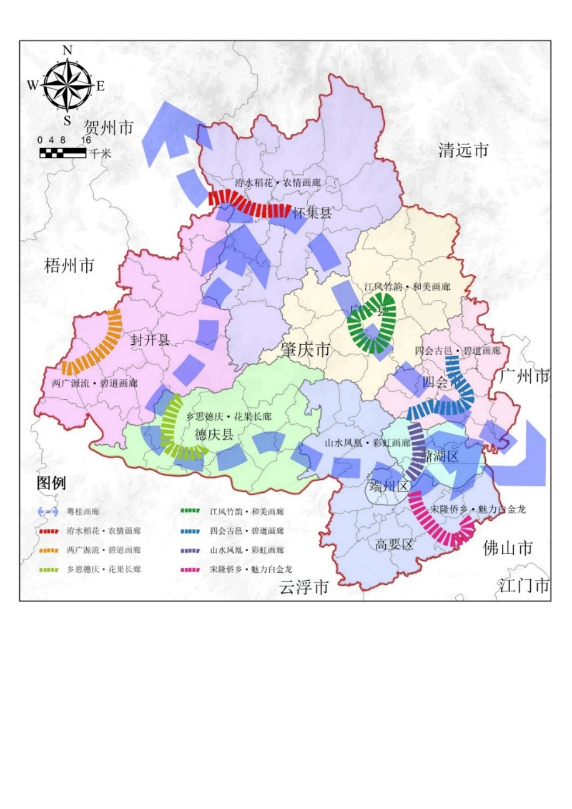

肇府〔2022〕4号

肇庆市人民政府关于印发肇庆市农业农村

现代化“十四五”规划的通知

各县（市、区）人民政府，肇庆高新区管委会，肇庆新区管委会，粤桂合作特别试验区（肇庆）管委会，市政府各部门、直属各单位：

现将《肇庆市农业农村现代化“十四五”规划》印发给你们，请认真组织实施。实施过程中遇到的问题，请径向市农业农村局反映。

肇庆市人民政府

2022年3月7日

肇庆市农业农村现代化

“十四五”规划

2022年3月

“十四五”时期是巩固拓展脱贫攻坚成果同乡村振兴有效衔接、意气风发迈向“第二个百年”奋斗目标的重要战略期。为深入贯彻习近平总书记关于“三农”工作的重要论述精神，全面落实中央和省、市的工作部署，进一步提升肇庆市农业农村现代化发展水平，特编制《肇庆市农业农村现代化“十四五”规划》（以下简称《规划》）。《规划》将作为“十四五”时期肇庆市全面推进乡村振兴、加快农业农村现代化的重要依据和指导性文件。规划期限2021－2025年，展望至2035年。

## 第一章 基础条件与发展环境

## 一、总结新成效，推进农业农村现代化基础扎实

“十三五”期间，我市大力推进现代农业发展“611”工程，加快转变农业发展方式，全市农业农村发展呈现出良好的势头，为“十四五”时期农业农村持续稳定发展奠定了坚实基础。重要农产品生产保障能力稳步提升。2020年全市农林牧渔业总产值678.51亿元，农林牧渔业增加值443.77亿元。全市柑桔产值全省第一，淡水养殖量全省第二，粮食产量和畜禽出栏量均列全省第三。现代农业产业体系加快构建。全市成功创建1个国家级产业强镇，10个省级现代农业产业，认定全国“一村一品”示范村镇10个，省级专业镇16个、专业村96个，“一县（市、区）一园、一镇一业、一村一品”总体布局初步形成。美丽宜居乡村建设扎实推进。全面完成全市行政村村庄规划编制和13759个自然村（居）的“三清三拆三整治”，村庄保洁覆盖面100%，无害化卫生户厕普及率99.7%。在全省率先实行农村公路“路长制”，全市1255个建制村100%通客车。在全省率先开展21个“书记项目”示范镇建设，首批7个示范镇全面建成。贺江碧道画廊成为全省省际廊道美丽乡村示范带标杆。脱贫攻坚战取得全面胜利。截止2020年底，全市累计投入各类扶贫资金23亿多元，帮扶建档立卡贫困户37504户88204人全部实现脱贫，111个省定贫困村全部达标退出。结对帮扶广西桂林、贺州4个县含236个贫困村、16.57万贫困人口全部如期脱贫摘帽。在全省扶贫成效五年总考核中排名全省第3，赢得了市内市外“两个战场”脱贫攻坚战的全面胜利。农业农村各项改革不断深化。基本完成承包地确权登记颁证，在全省率先整市基本完成农村集体产权制改革阶段性任务，全市21023个集体经济组织完成改革任务，完成率达98%；四会市作为2018年全国农村集体产权制度改革试点单位，改革经验被农业农村部列为改革典型进行全国推广。

## 二、认清新形势，推进农业农村现代化任务艰巨

当今世界面临百年未有之大变局，各种内外部不确定性因素对经济发展的冲击越发明显，并加速向“三农”领域传导，广东省作为全国对外联系的重要窗口，更是首当其冲。地处珠三角的肇庆在接下来的农业农村现代化建设进程中任务将更加艰巨。一是现代农业大而不强。全市粮食等重要农产品产量长期位居全省前列，但农业规模化、标准化发展程度不高，价值链较短，经营效益偏低，农业科技创新能力不强，农业综合竞争力与肇庆全省农业大市的地位不相匹配。同时，随着周边省市南药、柑橘、蔬菜等产业快速发展，市场竞争加剧。推动我市农业转型升级，建设农业强市压力凸显。二是乡村建设任务依然艰巨。全市山区面积占比较大，城乡发展不平衡的矛盾较为突出，农村基础设施和公共服务短板较多，农村整体风貌尚不足以匹配建设粤港澳大湾区世界级城市群的目标要求，农村综合改革和社会治理体系建设与珠三角核心城市存在一定差距。建设宜居宜业宜游的岭南美丽乡村任重道远。三是培育高素质现代农民的任务尤为凸显。现阶段，农村面临着劳动力短缺与农民素质不高的双重困境、乡村产业发展人才需求与农村精英人才流出的双重挑战。全职青壮年农业劳动力比重已降至10%以下，全市农业技术人员不足3000人，占全市专业技术人员的比例不足3%。全市农村居民人均可支配收入仅略高于全省平均水平。巩固拓展脱贫攻坚成果、全面推进乡村振兴，促进农民富裕富足的任务十分艰巨。

## 三、立足新阶段，推进农业农村现代化机遇巨大

# “十四五”时期，是全面推进乡村振兴战略实施的重要发力期。立足新发展阶段，贯彻新发展理念，构建新发展格局，为全市农业农村现代化发展带来了重大机遇。一是各级党委政府高度重视，形成全市“三农”工作强大合力。党的十九届历次全会和中央农村工作会议进一步释放出新阶段持续重农强农的明确信号；省委省政府把实施乡村振兴战略纳入全省“1+1+9”工作部署；市委市政府始终坚持农业农村优先发展总方针，举全市之力推动全市“三农”工作高质量发展。二是构建国内国际双循环发展格局，凸显农业农村“压舱石”作用。农业农村是国民经济的压舱石和稳定器，更是形成强大国内市场的双循环战略核心环节和动力源泉。肇庆作为全省农业大市，对全省重要农副产品的稳产保供具有重要支撑作用。把握“双循环”新发展机遇，加快农业供给侧结构性改革，延伸和拓展农业产业链、价值链，推动农业资源优势转变为农业产业优势，为农业农村高质量发展提供新动能。三是“双区”建设、“双城”联动，拓展肇庆“三农”发展新空间。肇庆作为粤港澳大湾区重要节点城市之一，是广东面向大西南的门户，是“双区”建设的重要参与者和“双城”联动的重要辐射区。充分发挥区位、生态和产业优势，全方位参与“双区”建设、“双城”联动，积极参与广州都市圈建设，强化与广州、深圳等粤港澳大湾区核心城市的协同发展，为全市发展精细农业、建设精美农村、培育精勤农民拓展新空间。

## 第二章 指导思想与发展目标

## 一、指导思想

高举中国特色社会主义伟大旗帜，以习近平新时代中国特色社会主义思想为指导，立足新发展阶段，贯彻新发展理念，构建新发展格局，深入贯彻习近平总书记关于“三农”工作的重要论述和党的十九大和十九届历次全会精神，贯彻落实省委省政府和市委市政府关于加快推动农业农村现代化的系列工作部署，聚焦珠三角核心区西部增长极和粤港澳大湾区现代新都市“两个定位”，加快建设现代农业强市。加强党对“三农”工作的全面领导，坚持农业农村优先发展，以实施乡村振兴战略为总抓手，以推动农业农村高质量发展为主题，以深化农业供给侧结构性改革为主线，以改革创新为根本动力，以满足农民群众日益增长的美好生活需要为根本目的，努力在提高农业附加值和竞争力、建设美丽乡村、促进农民增收上取得新突破、新进展、新成效，开创农业农村现代化新局面，为肇庆在实现社会主义现代化新征程中贡献“三农”力量。

## 二、基本原则

坚持党对“三农”工作的全面领导。坚持“三农”工作重中之重地位，确保党在“三农”工作中始终总揽全局、协调各方，切实加强党对农村经济建设、政治建设、文化建设、社会建设、生态文明建设和党的建设各项工作的全面领导。

坚持农业农村优先发展。对标乡村振兴目标任务，着力补齐农业农村短板，在干部配备、要素配置、资金投入、公共服务等方面优先保障，确保“三农”资源和要素供给，巩固农业农村发展的良好态势。

坚持农民主体地位。充分发挥农民主体作用和首创精神，提升农民家园意识，调动农民积极性。加快培育勤劳作、精技艺、有情怀、敢创业的新时代精勤农民，持续增加农民收入，尊重农民意愿，保障农民权益，增进农民福祉，提升农民的获得感、幸福感和安全感。

坚持深化改革创新。巩固完善农村基本经营制度，深入推进农村土地制度、集体产权制度改革，突出抓好改革关键环节，提高工作的系统性、整体性、协调性，建立健全城乡融合发展体制机制和政策体系，激发农村发展内在动力和活力。

坚持绿色发展。牢固树立和践行绿水青山就是金山银山的理念，把绿色发展方式贯穿到推进农业农村现代化的全过程，正确处理乡村发展和生态环境保护的关系，让绿色成为乡村振兴发展的最大底色、最好产品、最靓风景和最强魅力，促进农业高质高效发展、农村宜居宜业宜游。

## 三、发展定位

深入实施乡村振兴战略，以发展精细农业、建设精美农村、培育精勤农民为主攻方向，以“高质量发展现代农业”“高标准打造粤港澳大湾区绿色农副产品集散基地”“高水平建设宜居宜业宜游新乡村”为主要支撑，奋力打造粤港澳大湾区西部农业强市和活力新乡村。

——高质量发展现代农业。坚持高质量发展理念，围绕粮食、蔬菜、水果、畜禽、水产、南药等6大主导产业以及花卉、茶叶、油茶等特色优势产业，持续深化农业供给侧结构性改革，着力建链延链补链强链，推动农业规模化、标准化、品牌化发展，促进一二三产融合发展，不断提高农产品附加值和核心竞争力，着力构建现代化的种养殖体系、精深加工和市场流通体系，当好大湾区生态农场和“中央厨房”。

——高标准打造粤港澳大湾区绿色农副产品集散基地。充分发挥肇庆农业大市的资源优势和东融西联节点城市的区位优势，高标准高水平建设粤港澳大湾区辐射大西南的农副产品集散、加工、冷链、物流服务体系，搭建大宗农副产品交易平台，形成以保障粤港澳大湾区绿色农副产品供应安全和应急需要为重点，并辐射大西南乃至东盟地区的绿色农副产品集散中转枢纽和交易高地，把肇庆打造成为粤港澳大湾区的“米袋子”“菜篮子”“果盘子”“水缸子”“茶罐子”。

——高水平建设宜居宜业宜游新乡村。大力实施乡村建设行动，全面推进农房管控和乡村风貌提升，连线连片打造具有肇庆特色的美丽乡村风貌示范带。加强和改进乡村治理，持续深化农村综合改革，营造文明乡风，释放高素质农民和乡村人才活力，高质量推进农村创新创业。深入挖掘乡村特色资源，培育休闲农业、观光农业、康养旅游等新业态，打造一批休闲农业与乡村旅游示范村镇和精品路线，推动美丽乡村向“美丽经济”转变，建设成为具有岭南风韵、肇庆特色的活力新乡村。

## 四、发展目标

“十四五”发展目标。到2025年，全市农业农村现代化取得重要进展，具备条件的县（市、区）率先基本实现农业农村现代化。乡村产业体系进一步健全，主要农产品综合生产能力稳步提高，产业融合发展水平显著提升。农村基础设施和公共服务持续改善，城乡统一的社会保障制度基本建立，全市乡村风貌提升取得显著效果，乡村治理能力显著提升。农民增收渠道持续拓宽，农民现代化迈出坚实步伐。脱贫攻坚成果进一步巩固拓展，全面实现与乡村振兴有效衔接。

精细农业产业体系总体形成。粮食等重要农产品保障能力不断增强，粮食产能稳定在110万吨以上。农业产业提质增效，结构持续优化，链条不断健全，三产融合发展水平显著提高。六大百亿产业集群全面形成，农产品加工产值与农业总产值比达到2.6:1，主要农作物综合机械化水平达到75%以上，农业科技进步贡献率达到75%以上。

精美农村建设取得重点突破。深入开展农村人居环境整治提升五年行动，农村污水治理率达到70%以上，美丽宜居村达标率达到80%以上，乡村振兴示范带建设成效显著。农村生活更加便捷，党在农村的执政基础更加牢固，农村发展安全保障更加有力，共建共治共享的乡村治理体系走在全省前列。

精勤农民培育迈出坚实步伐。加快建设精勤农民队伍，逐步健全职业教育培训体系，培育一批高素质农民和乡村人才。农民创业就业活力有效激发，持续增收渠道不断拓宽，农村居民人均可支配收入达3万元，城乡居民收入差距进一步缩小。

城乡融合发展体制机制基本建立。农村改革不断深化，城乡要素双向合理流动的制度性通道基本打通，城乡融合发展省级试点取得重要成效，城乡基础设施加快互联互通，普惠性公共服务加快并轨，新型工农城乡关系初步形成。

2035年远景目标。到2035年，全市乡村振兴取得决定性进展，基本实现农业农村现代化。建成现代化农业种养模式、农副产品精深加工体系和农村物流体系，实现从种养殖到食品供应的全产业链，农业质量效益和竞争力迈上新台阶。岭南特色生态宜居精美乡村基本建成，城乡基本公共服务实现均等化，城乡要素双向合理流动的制度性通道完全打通。农民综合素质不断提升，城乡居民收入差距显著缩小。

表2-1 肇庆市农业农村现代化“十四五”规划目标列表

| 分类 | 序号 | 主要指标 | 单位 | 基期值 | 目标值 | 属性 |
|---|---|---|---|---|---|---|
| 2019① | 2020 | 2025 |
| 农业高质高效 | 1 | 粮食综合生产能力 | 万吨 | 110 | 110 | 110 | 约束性 |
| 2 | 粮食生产功能区面积 | 万亩 | — | 80.82 | 80.82 | 约束性 |
| 3 | 高标准农田面积 | 万亩 | 140 | 145 | 150② | 约束性 |
| 4 | 生猪出栏量 | 万头 | 299.3 | 223.6 | 500 | 预期性 |
| 5 | 科技进步贡献率 | % | 69 | 70.2 | 75 | 预期性 |
| 6 | 水稻耕种收综合机械化率 | % | 72.47 | 75.04 | 85 | 预期性 |
| 7 | 农产品质量安全监测合格率 | % | 98.3 | 98.2 | >98 | 预期性 |
| 8 | 规模以上农产品加工业产值 | 亿元 | 144.53 | 160.78 | 410 | 预期性 |
| 农村宜居宜业 | 9 | 畜禽粪污综合利用率 | % | 92.1 | 93.28 | >80 | 约束性 |
| 10 | 村庄内道路硬化占比 | % | 83.1 | 90.1 | 100 | 预期性 |
| 11 | 农村自来水普及率 | % | 87 | 90 | >99 | 预期性 |
| 12 | 农村生活污水治理率 | % | 15.6 | 58.9 | >70 | 预期性 |
| 13 | 农村卫生户厕普及率 | % | 99.2 | 99.7 | 100 | 预期性 |
| 14 | 美丽宜居村达标率 | % | 25.1 | 40.7 | >80 | 预期性 |
| 15 | 县级及以上文明村占比 | % | 20.48 | 28.47 | >60 | 预期性 |
| 16 | 村综合性文化服务中心覆盖率 | % | 85 | 100 | 100 | 预期性 |
| 农民富裕富足 | 17 | 农村居民人均可支配收入 | 万元 | 1.92 | 2.06 | 3 | 约束性 |
| 18 | 城乡居民人均可支配收入之比 | — | 1.7:1 | 1.7:1 | 1.6:1 | 预期性 |
| 19 | 集体经济强村占比③ | % | 15.8 | 16.9 | 24 | 预期性 |
| 20 | 农村人才及高素质农民数量④ | 万人 | — | 6.87 | >35 | 预期性 |

注：①由于受新冠疫情影响，2020年的很多数据呈现出非正常变动，特增加2019年数值，以作参照。

②“十四五”期间高标准农田面积以省下达我市建设任务为准。

③集体经济强村是指村集体经济年收入50万元以上的行政村。

④农村人才及高素质农民包括：新型经营主体带头人、青年农场主、家庭农场主、广东技工、粤菜师傅、南粤家政、乡村工匠、乡土专家、农业经理人等各类人才。

## 第三章 优化区域空间发展格局，协同推进农业农村发展

遵循国土空间开发总体要求，以全市“一带一廊一区”区域经济布局为指引，按照因地制宜、突出重点、分类施策原则，构建“三区一廊”农业农村总体发展布局，全面加快农业农村现代化，努力建设粤港澳大湾区乡村振兴示范区。

## 一、都市农业发展先行区

该区域主要位于我市东南部（包括端州区、鼎湖区、高要区、四会市），作为全市经济发展中心，城市化水平较高、信息物流集聚、休闲观光需求大，围绕参与粤港澳大湾区建设、满足都市需求的目标，着力打造建设都市菜篮子安全供应、现代休闲农业观光体验和农业信息服务三大中心，构建都市农业新业态，引领全市实现农业现代化。

## 二、生态农业发展提升区

我市西北部广宁县、德庆县、封开县、怀集县为丘陵山地地区，土地、自然资源和劳动力丰富，气候条件优良，是传统的农业县。“十四五”期间，重点建设优质稻、柑橘、蔬菜、畜禽、茶叶等绿色农产品生产基地，突出粮食和重要农产品生产保障功能。整合土地资源发展规模化、标准化优质高效农业和特色生态农业，推广循环农业发展模式，改造提升传统产业。强化生态保护建设，落实生态环境准入清单，调整优化农村生产生活生态空间，构建和巩固全市生态保护屏障。大力发展绿色优质农产品，健全完善农产品加工流通体系，推进乡村旅游与休闲农业发展。

## 三、农业科技创新核心区

充分发挥肇庆高新区、肇庆新区高新技术产业集聚、科技实力雄厚的优势，以农业高新技术研发、农产品精深加工、农业合作创新为主攻方向，打造全市农业科技创新核心区。升级打造农业科技研发服务平台，创建农业科技交流与合作中心。

图1 肇庆市农业发展空间格局

## 四、生态宜居美丽乡村走廊

以人与自然和谐共生为目标，坚持绿水青山就是金山银山理念，通过全域整治、示范带动、串点成线，构建肇庆生态宜居美丽乡村走廊。围绕“四沿”地区，结合全域旅游示范和粤桂画廊建设，打造特色鲜明、内涵丰富的关键美丽圩镇和美丽乡村，形成鼎湖山水凤凰彩虹画廊、高要宋隆侨乡魅力白金龙、四会古邑碧道画廊、广宁江风竹韵和美画廊、德庆乡思花果长廊、封开贺江碧道画廊、怀集洊水稻花农情画廊等一批美丽乡村风貌示范带。统筹做好休闲农业精品园区、农业公园、农村产业融合发展示范园、田园综合体、农业庄园规划布局，串点连线打造美丽乡村休闲旅游走廊。

图2 肇庆市生态宜居美丽乡村走廊空间格局

## 第四章 打造现代农业产业体系，促进全产业链融合发展

进一步调整优化农业生产结构和区域布局，统筹抓好“一村一品、一镇一业”、特色农业示范基地、现代农业产业园、优势产业跨县集群等项目建设，大力扶持农产品精深加工，完善市场流通体系，推进休闲农业等新产业新业态，构建“跨区集群、一县多园、一镇一业、一村一品”现代农业产业布局。

## 一、优化产业发展布局，保障重要农产品的有效供给

立足全市资源禀赋，做大做强粮食、水果、蔬菜、南药、水产、畜禽六大产业集群，加快发展茶叶、花卉、油茶等特色产业，构建推动全市农业产业发展的核心支撑。

保持粮食种植面积稳定。推进全市撂荒耕地整治，严防耕地非粮化，重点在高要区、广宁县、封开县、怀集县等产粮大县建设一批集约化经营、规模化种植、产业化加工为一体的优质水稻生产基地。推广土地托管等农业生产服务模式，实现规模化、集约化与专业化生产，确保“十四五”期间全市粮食种植面积稳定在290万亩以上，粮食总产量稳定在110万吨以上。

促进水果产业提质增效。优化特色水果产业布局，打造岭南优质水果产业带。巩固提升四会沙糖桔、德庆贡柑等优势水果产业，大力发展高要火龙果，广宁大肉山楂，德庆桂味荔枝，封开麒麟李，怀集汶朗蜜柚等特色水果产业。大力推广良种良法，优化早、中、晚熟品种结构，进行优质高产栽培示范，确保“十四五”期间全市水果种植面积在120万亩以上。

大力发展绿色蔬菜种植。推动蔬菜种植提质扩面，重点在高要区、四会市、广宁县、德庆县、封开县、怀集县等主要产地，建设一批规模化高标准设施蔬菜种植示范基地，确保“十四五”期间全市蔬菜种植面积稳定在120万亩以上。积极引入优良秋冬蔬菜品种和技术，优化蔬菜种植结构，提高蔬菜重要时节应急供应能力。

扩大特色南药种植规模。大力发展何首乌、巴戟天、广佛手、肉桂、砂仁等南药种植，在高要区、德庆县、广宁县等优势产区建设一批规模化道地药材GAP种植基地，确保“十四五”期间全市南药种植面积稳定在140万亩以上。建立中药材良种繁育基地，加强南药种质资源保护利用。

优化畜禽养殖产业结构。加快构建先进养殖体系，以高要区、四会市、广宁县、封开县、怀集县为重点，推进标准化规模化养殖场建设。重点稳定全市生猪、肉鹅、肉鸡等主要品种产量，大力发展黑山羊、杏花鸡等地方优良品种饲养以及肉鸽、鹌鹑等特色珍禽养殖。确保2025年生猪出栏量达500万头以上、畜禽出栏量保持1亿羽以上。

创新发展绿色淡水养殖。深入实施水产绿色健康养殖“五大行动”，创建一批水产健康养殖示范基地和水产养殖尾水处理示范基地。开展水产品“不安全、不上市”专项行动，探索构建水产品质量安全长效监管机制。稳步实施珠三角百万亩养殖池塘升级改造绿色发展，推进13万亩养殖池塘进行升级改造，建设3个以上美丽渔场。

因地制宜发展特色作物。鼓励各地挖掘特色农业资源，因地制宜发展特色农业产业。支持高要园艺、四会兰花、德庆四季茶花、广宁油茶、封开白马茶、怀集新岗高山茶等特色产业发展，在优势产区建立规模化生态生产园区，打造产业化、规模化、品牌化产业链条，推动肇庆优质特色农业产业发展。

## 二、强化农副产品加工体系，提高农产品附加值

（1） 推动农副产品加工全产业链建设

拓展农产品初加工。鼓励和支持发展农产品产地初加工，提高质量效益。果蔬、畜禽等鲜活农产品，重点发展预冷、保鲜、冷冻、清洗、分级、分割、包装等仓储设施和商品化处理。粮食等耐储农产品，重点发展烘干、储藏、脱壳、磨制等初加工。食用类初级农产品，重点发展发酵、压榨、干制、腌制、熟制等初加工。棉麻丝、木竹藤棕草等非食用类农产品，重点发展整理、切割、打磨、编织等初加工。

提升农产品精深加工。引导大型农业企业加快生物、信息等技术集成应用，促进农产品多次加工。推进技术升级，利用专用原料，配套专用设备，研制专用配方，开发类别多样、营养健康、方便快捷的系列化产品。创新超临界萃取、超微粉碎、生物发酵、蛋白质改性等技术，提取营养因子、功能成分和活性物质，开发系列化的加工制品。

推进综合利用加工。鼓励大型农业企业和农产品加工园区推进加工副产物循环利用、全值利用、梯次利用。采取先进的提取、分离与制备技术，推进稻壳米糠、麦麸、油料饼粕、果蔬皮渣、畜禽皮毛骨血、水产品皮骨内脏等副产物综合利用，开发新能源、新材料等新产品，提升增值空间。

（2） 建设一批农副产品精深加工基地

发挥特色农产品产业优势，大力开展招商引资，培育壮大食品加工龙头企业，建设一批食品饮料、肉类深加工、南药加工生产基地。以现有大型食品饮料生产企业为核心，推动企业增资扩产和技术改造升级，做大做强食品饮料产业。加快推进高要、广宁、封开、怀集肉类深加工产业项目建设，发展壮大肉类深加工产业。以国家级肇庆南药市场落地建设为契机，创建一批中药饮片、中药制剂加工基地。到2025年，农产品加工业与农业总产值比达到2.6:1以上，主要农副产品加工率达到75%以上，特色农产品精深加工比例达到30％以上。加快培育一批中药工业和农副产品加工龙头企业，力争中药工业总产值达到75亿元，农副产品加工年产值达150亿以上。

（3） 实施预制菜产业发展工程

## 推进建设预制菜产业园，构建预制菜品研发、优质食材供应、冷链运输物流、能源集中供应的一体化产业运营模式。进一步强化产业招商落地，积极引用现代食品科学技术和先进装备，实现清洗、切配、包装等手工或半机械化操作环节的自动化替代，引育一批即食、即热、即烹、即配食品的龙头骨干企业。力争将高要区预制菜产业园打造成为省级现代农业产业园，到2025年，产业园总产值达80亿元，年创税收达3.5亿元。

## 三、完善市场流通体系，促进农副产品高效流通

完善农产品“12221”市场体系建设，以肇庆（怀集）绿色农副产品集散基地为核心，“菜篮子”产品配送分中心、国家级肇庆南药市场、水产综合交易中心、封开县农副产品批发市场为重要节点，构建起“1+4”的区域农副产品流通体系。

（1） 加快物流节点平台建设，丰富流通功能

加快建设肇庆（怀集）绿色农副产品集散基地。立足大湾区、面向大西南，加快基础设施建设，完善区域绿色农副产品集散体系布局。加强农业大数据的基础设施建设，通过大数据平台的市场信息分析，实现市场预测、产销对接、产需对接，确保农业产品的供给链，打造面向粤港澳大湾区的绿色农副产品战略物资加工储备基地和农副产品综合交易中心，形成粤西北、大西南以及内陆地区乃至东盟地区绿色农副产品进入粤港澳大湾区的集散中转枢纽和交易高地。

进一步提升“菜篮子”产品肇庆配送分中心流通能力。进一步完善冷链等基础设施建设，提高中心整体配送能力，构建集食品预冷、速冻、冻干、气调保鲜、冰温保鲜、低温冷藏储存、冷链运输等功能于一体的综合性、现代化、集约化的全冷链物流园区，打造全链条、全过程的质量安全溯源和监管体系以及高效便利的流通体系。

积极推进国家级肇庆南药市场建设。打造南药物流集散中心，辐射带动中药（南药）制造业发展。加快大型南药交割仓等物流基础设施建设，推动多种物流模式有机衔接，促进中药材物流现代化。推动中药材电子现货交易标准化，吸引大企业大平台加入，编制发布全国性中药材价格指数，推动南药产品分等分级和流通、交易标准化建设，适时开展中药材期货交易。

加快粤港澳大湾区（肇庆）水产综合交易中心建设。加快建设水产品批发中心、物流配送与冷链仓储中心、电商综合服务中心、水产文化展示区、特色美食街等“加工+物流+服务硬件”基础设施建设，完善以建设水产品批发市场为主体，以加工、配送、零售为核心的市场交易体系，推动水产交易契约化、物流服务个性化、交易功能专业化、市场管理系统化、信息公示网络化。

谋划筹建封开农副产品批发市场。结合封开县特色农副产品生产情况及区位交通条件，重点围绕杏花鸡、油栗、茶叶、麒麟李等产业需求，积极对接肇庆（怀集）绿色农副产品集散基地，筹建农副产品批发市场，推进区域一体化融合发展。

（2） 加大物流基础设施建设，提高流通能力

加快冷链物流基础设施建设。加快补齐冷链物流短板，建立健全“市级农产品骨干冷链物流网络+县级区域性农产品仓储保鲜冷链物流基地+镇村级田头冷链保鲜仓”的区域农副产品流通体系和农副产品市场体系。加大水果、蔬菜等农产品冷链加工仓储物流建设投入，在全市产业重点镇和中心村鼓励建设一批田头小站。到2025年，打造2个农产品仓储保鲜冷链物流示范县、建设20个“田头小站”，初步构建全市农产品骨干冷链物流网络。

大力推进电子商务进农村，建立适应农产品网络销售的快递服务体系。持续推进信息进村入户工程，完成益农信息社建设任务，创建县级运营示范中心和益农信息社示范社，强化信息进村“四项服务”。培育多元化农村电子商务市场主体，增强县、乡、村电子商务服务站（点）和配送中心服务功能，培育一批具有较强竞争力的农产品网络销售运营主体，协力打通农村物流“最初一公里”和“最后一公里”。

## 四、打造农旅融合体系，推动乡村休闲农业健康发展

（1） 突出区域特色、创新旅游产品

依托自然风貌、人文环境、乡土文化等资源禀赋，建设一批休闲农业精品园区、农业公园、农村产业融合发展示范园、田园综合体、农业庄园，策划一条多类型、多层次的“田园乡境”乡村休闲旅游廊道。鼓励鼎湖区发展森林观光、山地度假、温泉养生等旅游产品，高要区和德庆县开发康养旅游产品，广宁县、怀集县充分利用农村土地、闲置宅基地、闲置农房等资源，建设乡村民宿、养老等项目，四会市、封开县依托当地自然和文化资源禀赋发展禅修和古村落特色民宿。“十四五”期间，全市共培育30个以上省级休闲农业与乡村旅游示范镇（点）。

（2） 完善配套设施、提升服务水平

完善以交通为核心的旅游基础设施建设，推动城市公共交通向近郊乡村延伸。围绕重点旅游路线，梳理乡村地区“路网、电网、水网、电信网”等四网脉络，切实加强道路系统、电力系统、给排水、电信等设施的配套与完善，实现全域四网联通。制定完善乡村旅游服务规范和标准，强化居民旅游服务意识。鼓励先进文化、科技手段在乡村旅游产品体验和服务、管理中的运用。探索运用连锁式、托管式、共享式、会员制、分时制、职业经理制等现代经营管理模式，提升乡村旅游的运营能力。

## 五、整合优势农业资源，大力推进一二三产融合发展

（1） 聚焦优势资源、打造跨区域特色产业集群

聚焦优势产业资源，跨区域整合优势农业产业要素，积极探索与相邻地市在优质特色农业产业上的合作共建，以生猪、水产、南药、家禽等产业为重点，培育龙头企业，依靠核心科技，做强区域品牌，谋划打造跨市域、县域的特色产业集群。到2025年，初步建成一批产业链条完整、一二三产融合程度高、具有一定区域影响力的特色产业集群。

（2） 聚焦优化提升、巩固农业产业园龙头地位

积极培育创建一批产业链完整、辐射带动能力强、联农带农效果好的国家级、省级现代农业产业园。支持各县（市、区）创建市级农业产业园，逐步构建形成布局合理、要素聚集、功能完备、集中连片的现代农业产业园发展格局。扶持壮大园区经营主体，加强上游基地建设和下游市场体系建设，推进规模化、标准化、一体化发展，提升园区精深加工能力，力争创建后省级园区主导产业农产品加工业产值（二产）与农业总产值（一产）比达到2.5:1。到2025年，力争创建1个国家级现代农业产业园、14个省级现代农业产业园、10个市级现代农业产业园，5个以上农业产业园主导产业总产值超20亿。

（3） 立足主导产业、建设特色农业示范基地

发挥粮食、水果、蔬菜、水产、畜禽、南药及花卉、茶叶等主导产业优势，依托数字农业技术，推行统一种植品种、统一肥水管理、统一病虫防控、统一技术指导、统一机械作业等“五统一”生产模式，支持有条件的镇（乡）规划建设规模化、标准化生产基地。到2025年，建成一批核心区面积千亩以上、示范带动面积万亩以上的特色农业示范基地。

（4） 强化政策引导、推进专业性村镇提质扩面

加大涉农资金统筹整合力度，引导资金进一步向优势产业集中，提高“一村一品、一镇一业”聚集度，推动生产环节向前后链条延伸，重点培育发展农产品精深加工、生鲜农产品物流冷链、农村电商和休闲农业、观光农业等新产业新业态，促进特色产业迈向价值链中高端。到2025年底，建成20个以上农业强镇和特色专业镇，150个以上农业特色专业村。

## 第五章 完善现代农业支撑体系，促进精细农业高质高效

全面推进农业绿色转型，加快构建现代农业科技创新推广体系、新型农业社会化服务体系、农产品质量安全监管体系、新型农业经营体系等，通过支撑体系的健全促进现代农业生产方式和经营方式的精细化转型，提升现代农业高质量发展水平。

## 一、全面推进农业绿色转型

（一）推进农业资源保护和高效利用

严格执行耕地保护政策，推进耕地数量、质量、生态“三位一体”保护。强化农业野生动植物资源保护。落实最严格水资源管理制度及水资源消耗总量和强度“双控”要求，全面施行农业取水许可管理。加快实施田间高效节水灌溉工程，因地制宜推广水肥一体化等技术。建立合理水价形成机制和节水激励机制，提高农民有偿用水意识和节水积极性。

（二）全面深入开展农业清洁生产

深入推进化肥减量增效行动，全面推进测土配方施肥，积极创建化肥减量增效示范县。开展农作物病虫统防统治，稳步提升统防统治、绿色防控覆盖率。严格落实兽药使用休药期规定，规范使用饲料添加剂，减量使用兽用抗菌药物。积极发展生态循环农业，构建循环性的农业生产系统。大力推进德庆县做好国家农业绿色发展先行区建设。

（三）开展农业产地环境净化行动

深入实施耕地污染防控计划，强化主要产粮大县耕地土壤环境保护。开展耕地土壤和农产品协同监测与分类治理，提升土壤环境监测能力。加强农业面源污染综合防治，推进秸秆综合利用和农膜回收。全面推进畜禽养殖废弃物资源化综合利用，实施畜禽粪污种养循环建设。到2025年，受污染耕地安全利用率达到92%以上，秸秆资源化利用率达90%以上，农膜回收率达85%以上，畜禽粪污资源化利用率达80%以上。

## 二、大力实施质量强农战略

（一）推进农业生产全程标准化建设

加快制（修）定肇庆市保障农产品质量安全生产技术规范和操作规程。积极推进农业生产全过程标准化，创建一批集约化程度高、辐射带动能力强的农产品生产示范基地、畜禽养殖标准化示范场、水产健康养殖示范场。支持新型农业经营主体规范生产流程，开展绿色、有机、地理标志认证。实施粤港澳农业标准互认协同工程，推动内外销产品“同线同标同质”。

（二）完善农产品质量安全保障体系

积极创建国家农产品质量安全市，实行农产品质量安全可追溯制度、市场准入和退出制度，建立全程可追溯、互联共享的农产品质量和食品安全信息平台。高标准建设粤港澳大湾区（广东）绿色农产品质量安全检测中心，加强县、镇级检测平台建设，建设“市、县（市、区）有检测中心、乡（镇）有检测站、规模生产基地有检测室”的四级检测体系。加强质量安全信息分析及预警，定期发布农产品质量安全状况报告，提高农产品质量安全信息透明度。到2025年，全市主要农产品质量安全例行监测合格率稳定在98%以上。

（三）全面实施肇字号品牌提升行动

实施农业知名品牌创建行动，建立覆盖全市域、全品类、全产业链的“肇农优品”区域公用品牌目录，培育培优一批带动产业发展的肇庆“新三品”（区域公用品牌、企业品牌和产品品牌）。鼓励农业企业积极开展商标注册、SC认证、品牌营销、文化挖掘和科技创新，支持农业生产经营主体申报“粤字号”农业品牌等品牌认证，打造一批拥有核心品牌价值的新型企业。到2025年，努力打造1-2个品牌价值超百亿元的国家级区域公共品牌，30个“粤字号”农业品牌，打造1-2个品牌价值超百亿元的国家级区域公共品牌。

## 三、强化农业科技支撑能力

（一）建立农业科技创新体系

结合创新驱动发展“1133”工程，加快构建农业科技创新体系。搭建农业企业与科研院校“产学研”合作平台，鼓励农业龙头企业建立技术研发中心和创新中心。加强动植物重大生物灾害防控、农产品加工与食品安全等研究领域的基础研究与产业技术研究。加快建设岭南现代农业科技创新中心和省农科院肇庆分院，争创一批新的省级农业科技园。

（二）深入实施种业提升工程

加强种质资源保护利用，鼓励支持地方品种申请地理标志产品保护和重要农业文化遗产。加快标准化育苗基地建设，强化种子质量安全监管。培育引进高产优质、环境友好、适宜全程机械化生产的优良作物品种，构建良种繁育体系。大力引进、培育一批育繁推一体化种业企业，鼓励种业企业加大研发投入，推进良种育繁推一体化体系建设。

（三）促进农业科技成果转化

建立科技成果转化交易平台，支持高校和科研院所建设科技成果转化和服务基地，构建科技成果快速转化通道。强化基层农业技术推广体系建设，建立健全现代农业科技创新推广体系和农业科技服务体系，培育形成以基层农技推广体系为主导，农业科研院校、农村新经营主体、农业龙头企业、农村经济能人等共同参与的多元化农技推广网络。创新良种良法示范展示模式，促进良种良法进村入户到田。“十四五”期间力争全市创建6个县级农技推广服务驿站，每个项目县建设不少于2个农业科技示范展示基地，农业主推技术到位率≥95%。

## 四、推动设施装备现代建设

（一）巩固提升高标准农田建设

优先支持粮食生产功能区、现代农业产业园、优势特色产业集群等区域高标准农田改造升级。加强土地整理和复垦力度，切实提高农田集中连片程度和产出能力，强化农田用途管控。扎实推进耕地质量保护与提升行动，开展县域耕地质量等级变更评价，健全耕地质量监测网络，提升全市土壤有机质含量和耕地质量等级。完善农田建后管护机制，落实管护责任主体。“十四五”期间，确保累计建设高标准农田面积150万亩以上。

（二）推进农业机械化全面发展

推进粮食等主要农作物全程机械化发展。落实农机购置补贴政策，大力推广重点产业生产环节先进适用农业机械。培育壮大农机社会化服务组织，创新服务模式，增强服务能力，打造一批“全程机械化+综合农事”服务体。推进开展丘陵山区宜机化改造，提高农机作业便利程度。到2025年，全市农机总动力达185万千瓦，全市主要农作物耕种收综合机械化水平达75%以上，水稻耕种收综合机械化率达85%。争取创建全国“平安农机”示范市和2个主要农作物生产全程机械化示范县。

（三）着力提升农业抗风险能力

加强农业气象基础设施和服务体系建设，实施智慧气象为农服务系统工程，到2025年，建立10-25套现代农业园区农田小气候站。完善水文监测和防汛抗旱监测预警预报体系和事故灾难应急预案体系，加强江河治理骨干工程和防洪薄弱环节建设，加快抗旱水源工程建设和人工影响天气标准化作业基地建设，提升应急保障能力。强化农作物病虫疫情监测预警设施和应急防控物资储备，支持四会市建设重大植物疫情综合治理示范区。健全完善市县乡村四级动物疫病防控体系，探索建设疫病净化示范场和无疫小区。

## 五、实施数字农业行动计划

（一）加强综合数字农业平台建设

依托肇庆市政务大数据中心和肇庆市政务云平台，以实施肇庆市农业大数据平台和南药信息中心平台建设为抓手，整合全市农业农村数据资源，加强农业大数据的“云”“网”“端”基础设施建设，推进数据的共享和开放，加快形成跨层级、跨地域、跨系统、跨部门、跨业务的农业数字资源体系。

（二）推动农业产业数字智慧发展

大力发展数字农业，以省级现代农业产业园为重点，推进数字农业产业聚集，提升园区数字化基础设施水平。在怀集和封开的平原地区，建设大田作物精准耕作、智慧养殖、园艺作物智能化生产等数字农业示范基地。在鼎湖、高要、四会，改造建设数字水产养殖场。在封开、广宁等山地、丘陵地区，推广现代化集约型专用设施，形成一批畜禽数字养殖小区。到2025年，力争建设一批主导产业突出、现代要素集聚、设施装备先进、生产方式绿色、辐射带动有力的省级数字农业产业园。

## 六、建设精细农业经营体系

（一）培育新型农业经营主体

引导农业企业通过品牌嫁接、资本运作、产业延伸等方式进行联合重组，着力培育一批科技含量高、产业关联度大、带动能力强的龙头企业，引进一批产业链完整的全国知名农业企业。力争到2025年，新增国家级农业龙头企业1家，省级农业龙头企业30家，市级以上农业龙头企业80家，全市各级农业龙头企业达到500家以上，其中产值超10亿元以上的农业龙头企业达5家，上市农业企业2家以上。全面推进合作社规范化建设，推动农民合作社向跨区域、多主体联合发展。大力支持广宁县、怀集县创建省级农民合作社示范县。完善家庭农场创建、名录管理制度，推动家庭农场健康发展。支持有文化、懂技术、会经营的农村实用人才发展适度规模经营，通过土地流转成立家庭农场。力争到2025年，新增省级示范家庭农场50家，市级示范家庭农场220家。

（二）促进多元主体融合发展

鼓励新型农业经营主体与农户建立密切利益联结机制，引导农户、农民合作社、村集体、农业企业多主体协同发展。大力推广“龙头企业+合作社+农户”的利益联结方式，推动“企业+基地”“企业+合作社+农户”“企业+基地+农户”“公司+家庭农场”等产业化经营模式发展，提高农民参与产业化经营的收入。支持新型经营主体通过接包、租赁、专业合作、股份合作、土地托管等形式发展连片适度规模经营，引导农民以承包土地入股等形式与企业进行合作。

## 七、完善农业支持保护制度

（一）构建新型助农服务体系

依托各类农业经营主体，打造集生产、供销、信用合作于一体的县、镇、村三级助农服务平台（中心），形成覆盖产前产中产后的完备服务体系。鼓励农民合作社及联合社积极承接政府购买服务，做好技术业务培训、帮民办事等延伸服务。升级赋能县域助农服务平台，拓展生产、供销、信用“三位一体”综合服务功能，搭建面向小农户和新型农业经营主体的一站式便民综合服务窗口。推进金融服务资源下沉基层，构建具有供销特色的农村普惠金融服务项目，通过“三位一体”数字化服务平台信用数据库资源，为农户提供金融服务，解决融资、贷款、信用难题，打通农村金融服务“最后一公里”。

（二）完善农业支持保护制度

全面落实永久基本农田保护制度，严守耕地红线，建立完善保护性耕作制度。创新农业补贴政策和财政资金使用机制，切实提升财政支农政策效果和支农资金使用效益。促进农业保险向“保价格、保收入”升级，支持开展特色农产品保险，鼓励发展农业互助保险，研发气象指数保险产品。到2025年，基本建成功能完善、运行规范、基础完备的多层次农业保险体系。健全完善农业综合执法体系，建立健全农业综合行政执法与行业监管双向反馈机制，开展农业综合执法示范创建，推进农业综合行政执法队伍年轻化、专业化。

## 八、提升农业合作开放水平

加强与广州粤港澳大湾区菜篮子工程、深圳农副产品供销平台以及大西南地区的对接合作，增强肇庆（怀集）绿色农副产品集散基地和“粤桂画廊”辐射能力，促进区域间农业的空间整合和功能协调，打造粤港澳大湾区优势农产品外销地。紧抓区域全面经济伙伴关系协定签署、广东农业自贸区建设机遇，支持农产品出口备案基地和出口资质企业认证，培育创建“六新”出口示范基地。加强与“一带一路”沿线国家或地区的交流合作，利用国际农产品展销会、互联网线上展示等多种形式宣传推介名特优农产品，扩大特色水果、蔬菜、中药材等在国内乃至国际市场上的销售份额。

## 第六章 大力实施乡村建设行动，建设生态宜居精美农村

巩固拓展农村人居环境整治行动成果，全面提升农村人居环境质量，切实抓好农房管控，着力提升乡村风貌，修复保护乡村生态，推进城乡基本公共服务均等化，加强乡村治理能力和治理体系现代化建设，在促进农村全面进步中展现岭南特色精美农村风韵。

## 一、持续改善农村人居环境

（一）巩固人居环境综合成果

持续开展村庄清洁行动，推动农村环境从干净整洁向生态美丽宜居迈进，建立健全农村人居环境整治长效管护和运行机制。深入推进“书记项目”示范镇建设，实施镇村同建同治同美，建成49个乡村振兴示范镇。巩固提升省定贫困村创建社会主义新农村示范村、省级新农村示范片和省际廊道美丽乡村示范带建设成果，深入推进四会市、德庆县创建省生态宜居美丽乡村示范县建设，新打造一批农村人居环境整治示范镇、示范村。2025年，全市80%以上行政村达到省美丽宜居村标准，建成2个生态宜居美丽乡村示范县、10条美丽乡村精品旅游线路、特色精品村100个。

（二）深入推进农村厕所革命

持续开展农村老旧厕所改造提升，引导农村新建住房配套建设无害化卫生户厕及粪污处理设施设备。加强农村厕所革命与生活污水治理有机衔接，因地制宜推进厕所粪污分散处理、集中处理与纳入污水管网统一处理。积极推进农村厕所粪污资源化利用，统筹适用畜禽粪污资源化利用设施设备，逐步推动厕所粪污就地就农消纳、综合利用。落实农村公共厕所管护主体责任，提高乡村旅游区等公共卫生厕所覆盖率。到2025年，农村卫生户用厕所基本普及，乡村景区旅游厕所全部达到A级以上标准，农村公共厕所长效管护机制基本建立，厕所粪污基本实现无害化处理或资源化利用。

（三）推进生活垃圾分类处理

健全完善村收集、镇转运、县处理的农村生活垃圾收运处理体系，统筹建设村庄垃圾收集点，配套建设垃圾分类投放收集设施。积极探索符合农村特点的分类处理模式，开展就地分类、源头减量试点，加快回收利用体系建设，推进德庆县率先实行城乡垃圾分类。加强生活垃圾资源化利用与无害化处理，推动垃圾分类和再生资源回收“两网融合”。完善农村垃圾处理各级投入机制，建立健全农村卫生保洁长效运营机制。到2025年，全市基本实现农村可回收垃圾资源化利用。

（四）开展生活污水综合治理

以县域为单位，编制农村生活污水治理规划方案，合理选择技术方案和治理模式。统筹推进农村黑臭水体治理与农村生活污水治理，将农村水环境治理纳入河长制、湖长制管理。优先完成重点国考省考断面水质达标控制单元、跨省（区）交界断面周边区域、饮用水水源保护区、“千村示范、万村整治”工程示范县等重点区域范围的农村污水治理工作。加快推进德庆县农村生活污水治理示范建设。积极探索农村生活污水资源化利用方式。建立健全农村生活污水治理设备设施运营、维护、管理工作长效机制。到2025年，全市村庄生活污水治理率提高到70%以上。

（五）深入实施“五美”行动

全面推进村庄美化、绿化、亮化，加大田园日常整治和监管力度，全面清理整治田园垃圾杂物、乱搭乱建田间窝棚、小散乱畜禽养殖场等，严禁农村生活污水和工业废水未经处理直接排入河湖，将湖泊等纳入“清漂”专项行动范围，严格水产品尾水排放管理。推进村域范围内工业园、农业产业园等厂房外立面风貌管控，拆除周边乱搭乱建建筑，清理积存垃圾，搞好园区绿化美化。把“四沿”区域整治作为重要节点，推动连线连片农村人居环境整治。到2025年，全市美丽乡村示范县镇村创建区域、“四沿”地域等美丽乡村风貌带全部建成。

## 二、推进乡村风貌管控提升

（一）优化提升村庄规划

分类推进村庄规划优化提升工作，合理确定村庄分类，统筹考虑村庄发展定位、主导产业选择、用地布局、人居环境整治、生态保护等。强化交通沿线、江河沿线、拟建机场周边、风景区、自然保护区、交通枢纽等重点地区的村庄规划管控。科学布局乡村生产生活生态空间，引导农村宅基地集中建设，加强传统村落和村庄特色风貌保护，保留岭南乡土特色和肇庆山水风貌，对乡村规划进行“回头看”。重点解决规划不落地、不符合“多规合一”问题。

（二）严格加强农房管控

严格执行“一户一宅”管理规定，坚决遏制新增农村违法违规建房行为，建立全市农村乱占耕地建房问题整治工作台账，有序妥善解决农房建设历史遗留问题。到2025年，全市基本完历史遗留问题的整治。加快推进“房地一体”农村不动产登记发证工作。符合登记发证条件的农村宅基地使用权和集体用地使用权及其地上建筑物、构筑物发证率达95%以上，全面建立规范有序、管控有效的农房建设管理新秩序。

（三）大力提升乡村风貌

推进存量农房微改造，到2025年，全市60%以上存量农房完成微改造。加强乡村风貌引导，突出乡土特色和地域特点，不搞千村一面，加强农房建设质量监管。弘扬优秀农耕文化，积极推进传统村落挂牌保护，建立动态管理机制。充分发挥山水林田湖草和路桥、水利等设施对乡村风貌塑造提升的重要作用，结合古驿道保护修复利用、万里碧道建设等工程，沿线连片推进人居环境整治和风貌提升，建设美丽驿站和风景长廊。深入实施乡村绿化美化行动，引导鼓励村民通过栽植果树花木等开展庭院、村庄绿化，因地制宜打造“四小园”（小菜园、小果园、小花园、小公园）等小生态板块。到2025年，基本实现房前屋后闲置用地的利用。

## 三、修复保护乡村生态系统

（一）筑牢生态安全屏障

突显北部山区绿色天然屏障功能，提升北部生态保护、水源涵养、生物多样性保护的承载力。大力开展天然林保护和国家级生态公益林建设，建立完善各级自然保护区管理体系，有效保护珍稀濒危动植物物种、生境以及原生生态系统。着力培育森林生态系统，筑牢生态安全屏障，提高区域森林的生产能力与生态防护功能。结合“万里碧道”“粤桂画廊”和五大“美丽行动”建设，打造生态景观廊道，协调发展乡村“美丽经济”。

（二）健全乡村生态保护长效机制

健全农村生态保护长效机制，将农村环境治理纳入河长制、湖长制、林长制工作范畴。加强水系整治及水环境改善，实施农村生态清洁小流域建设。有效控制农业面源和重金属污染，创新完善生态保护补偿机制，探索开展排污权、碳排放交易权交易等试点。以低碳生态的乡村地域综合体为载体，推动乡村能源、产业、金融、治理、空间低碳化，以及生态资源资产化发展，探索创建一批碳中和示范村镇。

## 四、着力补齐乡村民生短板

（一）完善乡村基础设施建设

以县域为单元统筹规划城乡基础设施建设，建立完善“城乡互联”的城乡一体化基础设施体系。落实好农村公路“路长制”，持续推进“四好农村路”建设和自然村村内3类道路硬化。到2025年，全市农村公路等级公路比率达100%，具备通行条件的行政村农村客运班车通达率达100%。统筹推进县镇村集中供水设施及配套管网建设，促进城镇供水管网向农村延伸，因地制宜实施小型集中供水工程建设，到2025年，实现全市自然村集中供水全覆盖。健全农村电网改造升级长效机制，全面提升乡镇电源变电站覆盖率，以县域为单位的农村电网三大指标达到国家新一轮农网改造要求，供电可靠率不低于99.8%，综合电压合格率不低于97.95%，户均配变容量不低于2千伏安。优化乡村能源结构，大力推广太阳能、生物质能等可再生能源。强化乡村信息基础设施建设，实施宽带进村工程，积极推动20户以上自然村5G信号覆盖，确保农村家庭宽带接入能力达到500Mbps以上。健全农村对各种自然灾害、事故灾难、公共卫生、社会安全等各类突发事件的预防预警和应急处置体系。到2025年，市县镇村室内外应急避难场所服务覆盖率达到100%，确保灾害发生8小时之内受灾人员基本生活能够得到有效救助。

（二）提升乡村公共服务供给

实施学前教育优质普惠发展、义务教育扩容提质等农村教育提升行动计划，鼓励和扶持有条件的村集体开办公办幼儿园，每个乡镇补足配齐1所以上规范化公办中心幼儿园。积极推进城乡基本公共卫生服务均等化，构建统筹城乡、覆盖全民、满足多层次需求的农村医疗保障体系。积极推进农村敬老院公建民营试点改革，探索多元乡村养老服务模式，完善统一的城乡居民基本养老保险制度。到2025年，城乡居民基本医疗保险覆盖率达到98%，城乡居民基本养老保险覆盖率达到95%。构建以社会保障为基础、慈善事业为辅助的农村社会救助体系。联合相关部门利用农村公共服务设施和闲置场所支持非营利性婴幼儿照护服务机构开展服务。健全农村留守儿童和妇女、老年人、农村残疾人关爱服务体系。

## 五、创新优化乡村治理体系

（一）强化基层党组织的领导

实施好新一轮基层组织建设三年行动计划（2021-2023），开展抓党建促乡村振兴行动。全面落实“四议两公开”决策、村级党组织“三个在先”、农村基层组织向党组织报告工作等制度。深入实施“头雁”工程和“西江党旗红”党员先锋工程，分期分批组织村党组织书记开展精准化专题培训，选优配强农村党组织书记。完善乡镇基本公共服务清单，在全市乡镇街道组建党群服务、建设发展、社会事务、依法治理等“四大中心”，打造镇村“一门式办理”“一站式服务”公共服务平台。

（二）稳步提升基层治理能力

厘清县镇职责，放权强镇、赋能活村。进一步加强村民自治组织规范化建设，建立村党组织领导下的“民主协商、一事一议”的村民协商自治模式。继续开展村务公开“五化”创建活动，健全务实管用的村务监督机制。加强法治乡村建设，开展省级民主法治示范村创建，推进公共法律服务实体平台建设。深入探索乡村德治实现形式，积极培育服务性、公益性、互助性农村社会组织，完善推广农村“信用七条”，发挥村规民约作用创新实施乡风文明建设积分激励机制。建立完善村级事务代办员制度，提升村级信息管理系统操作和服务能力。

（三）深入推进平安乡村建设

健全矛盾排查、现场调解、利益受损者救济救助等机制，实现矛盾纠纷“一站式”化解。完善农村治安防控体系建设，积极推动乡村“雪亮工程”。建立健全农村地区扫黑除恶防范打击长效常治机制，从源头上防范黑恶势力的滋生蔓延。依法加大对农村非法宗教、邪教活动打击力度。加大农村普法教育和实践，组织实施培育农村学法用法示范户工作，广泛开展“民主法治村”创建，实现全市民主法治村创建全覆盖。积极开展安全生产宣传进农村活动，持续开展农村安全隐患治理，建设完善乡村自然灾害、事故灾难应急体系。

## 第七章 重点培养高素质农民，促进精勤农民全面发展

以培养精勤农民为主攻方向，培育新时代高素质农民，促进农民富裕富足，在全面发展中展现肇庆精勤农民的精神面貌。

## 一、加快推进乡村人才振兴

（一）健全高素质农民培育体系

建立健全教育培训、评定管理、人才服务和政策扶持“四位一体”衔接配套的高素质农民培育体系。全面落实新一轮农技人员、家庭农场主等农业从业人员培训。深入实施“粤菜师傅”“广东技工”“南粤家政”三大工程，大力开展“肇庆管家”“农村电商”“乡村工匠”行动，培育壮大新一代乡村企业家队伍。建立高素质农民培训信息库，分类开展农村实用人才评定工作。确保乡村振兴产业贷款、地方特色农业保险等扶持政策适当向高素质农民倾斜。

（二）创新差异化培育形式手段

推进农民短期培训、职业培训和学历教育衔接贯通，鼓励农民参加继续教育。支持鼓励按产业分级分类开设专题培训班，探索设立乡村人才实训基地，大力推广“田间学校”“产学合作”“互联网+”等培训方式，有效提高乡村人才培训效果。加大中高等职业教育扩招政策宣传力度，制定落实学费减免等补助政策，支持农民提升学历层次。大力推进职业院校、大学等教育资源开展面向农民的学历教育，培养高层次技术技能人才。

（三）开展培育成果的示范推广

系统总结高素质农民培育工作好经验好做法，搭建各类成果展示和与跨区域学习交流平台。积极遴选推介优秀学员、优秀教师、优秀工作者，评选精品课程、优质教材和受欢迎培训机构，继续开展高素质女农民培训和乡村振兴青年先锋评选活动，树立宣传先进典型，引导学优争先。积极弘扬“学习光荣、素质高贵、创造伟大”的时代风尚，在全社会营造关心支持高素质农民发展的良好氛围。

## 二、大力推进农民创新创业

（一）健全创业创新政策体系

加强对返乡入乡创业创新人员的政策支持和指导服务，建立完善财政补贴、税收优惠、融资信贷、费用减免、培训服务等政策体系。稳妥引导金融机构开发农村创业创新金融产品和服务方式，深入实施农村创业创新带头人培育行动，探索农村创业创新纳入小微企业融资优惠政策支持范围，分层次、分力度落细落小返乡创业补贴政策。

（二）大力建强创业创新平台

围绕发展农村健康产业、生态旅游、乡村共享经济、数字农业、农副产品精深加工、冷链物流、农村文化创意等新产业形态，规划建设一批农民创业创新园和农民创业创新见习基地，积极搭建各类农民创业创新网络信息平台、投资贸易平台。支持创业创新园区加强与高校、中介机构对接，强化创业孵化功能，打造集科技转化、技术集成、融资支持、就业带动、平台服务于一体的创新创业平台。

（三）培强引强创业创新主体

针对农村能人、农村青年、大学生村官、回乡人员等农村创业主体开展专题推进活动，统筹提供见习实习、创业培训、技术指导、工商注册等服务，培育一批农村创新创业带头人。组建创业创新导师队伍，实行“一带一”“师带徒”“一带多”等多样化辅导方式。深入实施“西江产业人才计划”，积极引进创业创新领军人员和团队，提升农村创新创业层次水平。

## 三、全面提升农民收入水平

（一）推动高质量就业增收

促进农民就业和服务企业用工相结合，完善覆盖城乡、区域均衡、全民共享的公共就业服务体系。建立常态化就业援助机制，引导农村新型社区和产业园区实行临时性、季节性、弹性用工和借调代岗，吸纳农民工灵活就业、兼业就业、共享就业，提高农民工资性收入。

（二）健全经营增收机制

推行土地托管、统种统收等合作方式，推动专业化经营、标准化生产，带动小农户分享产业高质量发展红利。支持农民以土地、资金、劳动、技术、产品为纽带，开展多种形式的合作与联合，参与全产业链发展，分享加工、销售环节收益。支持各类新型经营主体开辟新空间，发展乡村传统特色产业，开拓乡村产业经营增收新增长点。

（三）创新财产性收入模式

以农村集体产权制度改革为抓手，落实农民财产权利。推动农村“三变改革”，积极盘活各类农村生产要素，采取出租、入股等稳妥形式，使农民获得稳定收入。探索财政支农项目资金折股量化到户模式，有效促进农户财产增收。

## 四、有序促进农村消费升级

（一）推动农村消费提质扩容

组织开展消费节、商品下乡，引导农村居民增加通信、文化娱乐、家电、汽车等消费，扩大乡村优质商品和服务供给。深入开展城乡高效配送专项行动，引导电商企业在乡镇和农村建设服务网点，持续畅通城乡双向联动销售渠道。实施减免税费、优惠券等措施，开展品牌消费、品质消费促销活动。促进消费新业态新模式向农村市场拓展，培育农村消费新增长点。

（二）全面优化农村消费环境

持续完善农村消费基础设施，健全农村现代流通网络体系。积极创建电子商务示范县镇，加快以中心镇为单位的物流配送中心、专业批发市场、冷链仓储物流等设施建设。强化消费领域大数据应用，增加农村对合格产品的消费使用。加大消费者权益保护力度，营造安全放心消费环境。

## 五、深入提高农民精神风貌

（一）全面提升农民整体素质

大力弘扬社会主义核心价值观，深入开展习近平新时代中国特色社会主义思想学习教育，持续推进“文明村镇”“星级文明户”创建。引导邻里守望相助，持续开展移风易俗、告别陋习、树立新风等活动，培育农民卫生文明生活方式。推进农民职业道德和公共道德建设，建立健全农村信用体系，引导完善守信激励和失信惩戒机制。

（二）积极开展农村文化活动

传承发展岭南特色乡土文化、乡风民俗，增强农民群众对乡村文化的认同感和归属感。加快建设农村乡村公共文化服务设施和全民健身设施，常态化举办各类乡村节庆、特色体育赛事、科普宣传和耕读教育等活动，充分发挥各级文化体育馆站的引领作用，促进各级公共文化机构开展送文艺下乡活动。

## 第八章 巩固拓展脱贫攻坚成果，全面有效衔接乡村振兴

实现巩固拓展脱贫攻坚成果同乡村振兴有效衔接，逐步完善农村低收入人口分类帮扶机制，接续全面推进乡村振兴，确保共同富裕取得更为明显的实质性进展。

## 一、巩固拓展脱贫攻坚成果

（一）保持主要帮扶政策总体稳定

在五年过渡期内严格落实“四个不摘”要求，稳定落实好兜底救助类政策，切实抓好教育、医疗、住房、养老、饮水等普惠性政策落实工作，确保主要帮扶政策总体稳定。深化产业、就业、消费等帮扶措施，持续发展壮大扶贫产业，做好脱贫人口稳岗就业，多渠道开发公益性岗位，促进农村弱劳力、半劳力人口就近就地就业，稳定脱贫人口增收渠道。

（二）大力完善返贫监测帮扶机制

健全易返贫致贫人口快速发现和响应机制，将脱贫不稳定户、边缘易致贫户，以及因病因灾因意外事故等导致基本生活严重困难户纳入常态化监测预警范围。建立完善市统筹调度、县负总责、镇村落实的定期核查和动态管理机制，强化防止返贫大数据监测功能，对纳入监测范围的易返贫致贫人口实行动态管理，分类分层落实帮扶措施，实行动态清零机制。

（三）有效巩固两不愁三保障成果

精准制定教育资助方案，确保除身体原因不具备学习条件外的脱贫家庭义务教育阶段适龄儿童少年不失学辍学。统筹发挥基本医疗保险、大病保险、医疗救助三重保障制度综合梯次减负功能，防范因病因残返贫致贫风险。建立农村脱贫人口住房安全动态监测机制，继续实施农村危房改造，保障低收入人口基本住房安全。加强乡村供水基础设施建设，推进全域自然村集中供水，不断提升农村安全饮水保障水平。

（四）建立完善扶贫资产监督管理

做好经营性扶贫资产和公益性扶贫资产确权登记工作，摸清扶贫资产的存量、结构、分布和运行效益情况，建立县、镇、村三级扶贫资产管理台账和制度体系。加强对公益性扶贫资产的运营管理，及时调整完善经营性扶贫资产收益分配制度，引导经营性扶贫资产的收益重点用于项目运营、巩固拓展脱贫攻坚成果和村级公益事业等。强化镇村和行业部门监督责任，依法维护农户财产权利。

## 二、加强农村低收入人口有效帮扶

（一）拓宽稳定增收渠道

巩固原有的产业、就业、消费帮扶渠道，加强补贴性农民职业技能培训。完善现代农业产业园、“一镇一业、一村一品”联农带农机制，采取以工代赈、生产奖补、劳务补贴等方式增加农村低收入人口收入。完善各类产业园区、扶贫车间、农业基地等吸纳劳动力就业管理机制，继续加大公益性岗位开发力度，促进农村低收入劳动力就地就近就业。

（二）提高社会保障水平

完善兜底保障政策体系，及时落实临时救助政策，保障因病、因残、因灾等意外变故导致基本生活陷入暂时困难的家庭的基本生活。完善养老保障和儿童关爱服务，加大对农村残疾人的帮扶力度。完善医疗保障工作，将农村低收入人口纳入城乡居民基本医疗救助范围，落实医疗救助政策。将符合条件的农村低收入家庭纳入教育、住房等政策保障范围，逐步提高社会综合保障水平。

## 三、全面衔接推进乡村振兴

（一）落实驻镇帮镇扶村政策

把我市88个乡镇作为乡村振兴支持重点，整合对口帮扶我市的省直中直驻粤单位、佛山市以及我市党政机关企事业单位和社会力量等资源，开展“党政机关+企事业单位+科研力量”组团式帮扶，着力打造一批彰显肇庆特色的乡村振兴亮点样板，推动全市乡村振兴全面发展。

（二）大力培育发展镇村经济

实施“千企兴千村”行动，完善企业参与乡村振兴的财政、金融、税费等支持政策，鼓励企业通过村企结对、村企共建、连片包镇等形式，积极参与乡村特色产业开发、消费帮扶协作、基础设施建设、乡村风貌提升、农村人才培养。各涉农县（市、区）每年打造一个以上特色产业示范基地，加快推动农产品精深加工、仓储物流、冷链配送、交易中心等发展，引导劳动密集型产业、农村二三产业在城镇融合发展。引导农村集体经济组织挖掘集体土地、房屋、设施等资源和资产潜力，培育乡村研学、生态康养、休闲旅游等新产业新业态。

## 四、深化拓展肇贺协作

（一）健全协作机制

健全肇贺协作机制，开展定期互访，召开联席会议。以现有投入水平为基础，结合省财政资金安排计划和我市财力状况合理安排财政援助资金。加强协作项目、资金和资产管理监督。东西部协作工作成效纳入帮扶县（市、区）党政领导班子和市直相关单位领导班子推进乡村振兴战略实绩考核范围。

（二）强化协作共建

建设广东省东西部产业协作肇庆基地，支持昭平县茶叶、富川县“贺电送粤”项目建设，打造粤桂合作示范标杆项目。定期选派专业技术人才开展协作支援，接收协作地区专业技术人才来肇进修培训，“订单式”开展“粤菜师傅”和“南粤家政”等创业就业培训。在协助地区积极推进“五个一批”建设，共同发展一批乡村特色产业，改善一批乡村基础设施，提升一批乡村公共服务，塑造一批美丽乡村样板，建设一批数字乡村试点，打造肇贺协作帮扶乡村振兴示范点。

## 第九章 加快重点领域改革创新，建立优先发展政策体系

全面深化农业农村改革，努力破除制约农业农村高质量发展体制机制障碍，为推进全市农业农村高质量跨越式发展提供制度保障和政策支撑。

## 一、激发乡村发展内在活力

（一）巩固完善农村基本经营制度

完善农村承包地“三权分置”制度，建立健全土地承包权依法自愿有偿转让机制。继续开展全市农村耕地撂荒整治，推动农村土地承包经营权有序流转，发展多种形式适度规模经营。统筹整合各级涉农财政资金，支持各地发展新型农村集体经济，探索新型农村集体经济实践新模式。

（二）稳慎推进农村宅基地制度改革

探索开展农村宅基地“三权分置”有效实现形式。加快推进德庆县国家新一轮农村宅基地制度改革试点取得实效。建立和完善房地一体农村不动产权籍调查和确权登记成果数据库。支持县级政府优化村庄用地布局，鼓励农村集体经济组织及其成员探索盘活利用闲置宅基地和农房资源，发展三产融合项目。

（三）探索集体经营性建设用地入市

有序推进农村存量集体经营性建设用地就地入市或异地调整入市，推动城中村、城边村、村级工业园等可连片开发区域土地依法合规整治入市。推动集体经营性建设用地使用权和地上建筑物所有权房地一体、分割转让，建立兼顾各方利益的土地增值收益分配机制。

（四）深化农村集体产权制度改革

深入开展农村集体资产管理专项整治。推进农村“三资”管理、农村财务监管和土地流转等平台整合。探索农村集体经济组织成员对所持有集体资产股份占有、收益、有偿退出及抵押、担保、继承权的更多有效实现形式，推广资源变资产、资金变股金、农民变股东“三变”模式。到2023年，基本实现全市村级集体经济组织年经营性收入10万元以上目标，显著增强全市村级集体经济整体实力。

（五）全面深化供销合作社综合改革

重点建设完善专业化农资农技服务、一体化农产品冷链物流、农产品产销对接、农村合作金融服务、多样化城乡综合服务等五大网络，推动供销合作社从单纯流通服务向全程农业社会化服务转变，从供销合作向生产、供销、信用综合合作转变，加快成为服务农民生产生活的综合平台。

## 二、推动城乡要素优化配置

（一）完善城乡人才流动保障体系

全面落实支持农业转移人口市民化的有关政策，逐步统一农民工与城镇居民的低保、医保和养老保险标准，增强小城镇服务能力和吸纳农村人口转移就业定居能力。建立乡村高层次急需紧缺人才引进机制，加大各类人才投身乡村建设的政策支持和保障力度。

（二）创新乡村振兴多元投入机制

推动市级财政预算内资金进一步向农业农村领域倾斜。全面落实中央调整完善土地出让收入使用管理规定，分年度稳步提高对农业农村的投入比例，争取土地出让收益投入农业农村的比例不低于50%。完善融资贷款、税收优惠、配套设施建设补助等政策，创新抵押融资方式。大力发展农村信用贷款，完善农村产权抵押担保权能。建立完善支持社会资本投入乡村振兴的政策体系。

（三）保障农业农村发展用地供给

组织村庄规划修编优化村庄用地布局，盘活农村存量建设用地。强化乡村振兴建设用地指标保障，市级年度计划指标应安排不少于10%用于保障乡村振兴新增建设用地需求，新增建设用地指标优先保障农业农村基础设施、重大农业产业项目、农村人居环境整治、公共服务等用地需求。支持腾退集体建设用地，采取入股、联营等合作模式，与龙头企业合作发展都市现代农业、供应链产业等项目。

## 三、大力促进城乡融合发展

（一）提升县域城镇化水平

实施强县行动，加快建设怀集市域城市副中心。对乡镇街道职能相近、职责交叉和协作密切的管理服务事务进行统筹整合，组建党群服务中心、建设发展中心、社会事务中心、依法治理中心“四大中心”，在镇村一级建立“一门式办理、一站式服务”公共服务平台。全面推进高要区金利镇、四会市大沙镇开展城乡融合省级试点工作。

（二）构建县域城乡产业融合体系

提升县域农业科技产业化中心、农村金融服务中心、农村职业人才培训中心、便企政务服务中心和现代农业产业园、农业产业强镇等融合发展平台建设水平，打造成为城乡产业要素资源双向流动的交汇点，引导城市超负荷产能和优质产业项目在资源环境承载力强、发展潜力大的县乡村超前布局，发展壮大县域经济。

（三）建立健全城乡基本公共服务普惠共享机制

建设城乡教育联合体，多渠道增加现存普惠性学前教育资源，推行城乡义务教育学校标准化建设。实施医疗健康下乡行动。完善统一的城乡居民基本医疗保险和基本养老保险制度。统筹城乡公共文化设施布局、服务提供、队伍建设，推动文化资源重点向乡村倾斜。打造城镇村公共资源共享综合体，建设公共服务向农村延伸、社会事业向农村覆盖的综合平台。

## 第十章 保障措施

坚持党对“三农”工作的全面领导，建立健全政策协调和工作协同机制，按照市级统筹县抓落实的原则，加强政策、法制、人才保障，加强考核监督，注重典型带动，确保规划落实落地。

## 一、强化组织领导

始终坚持把解决好“三农”问题作为全党工作的重中之重，完善党委统一领导、政府负责、农村工作部门统筹协调的农村工作领导体制。党政“一把手”是第一责任人，四级书记抓乡村振兴。健全工作专班制度，做到农业农村发展事事有规可循、层层有人负责。深化“放管服”改革，创新一体化综合服务模式。

## 二、统筹政策支持

积极争取上级涉农政策支持，加快完善土地、资金等要素支撑的政策措施。完善财政扶持政策，确保公共财政更大力度向“三农”倾斜。充分发挥融资担保体系作用，强化担保融资增信功能，推动落实创业担保贷款贴息政策，撬动金融和社会资本更多投向乡村发展。切实保障农业农村发展用地供给。

## 三、加强法制保障

从乡村振兴实际需要出发，制定促进重点领域发展的地方性政策文件。开展规范性文件清理工作，用法治思维和法治方式推进乡村振兴和农业农村现代化工作。强化农业综合行政执法体系建设，创新监督管理方式，建立依法办事规章制度为农业农村现代化工作营造良好的法治环境。

## 四、夯实人才基础

加强“三农”工作干部队伍的培养、管理和使用。加强基层队伍岗位聘用、职级晋升和职称评定方面的倾斜政策。强化优良品种繁育、特色农副产品营销、农村建设和管理等方面中高级人才的引进，加强种植、养殖等领域专业技术人才的培养。加大基层队伍人才培训，提升基层队伍人员素质。

## 五、严格评估考核

健全常态化工作调度机制，建立任务落实台账，将规划落实情况纳入各地各部门乡村振兴实绩考核范畴，重点考核规划重要指标实现、重要任务、重点项目落实情况。实施定期跟踪评估，建立规划实施督促检查和第三方评价机制，适时开展规划中期评估和总结评估。

## 六、注重典型带动

注重典型示范，立足各地实际，探索创新多元模式，及时总结推广乡村振兴发展的先进经验、先进做法。以先进村庄、先进人物的生动实践引领，以点带面、点面结合，推动全市农业农村现代化加快发展。充分利用新一代信息技术和新兴媒体平台，广泛宣传我市农业农村的相关政策和典型实例。

# 附件

# 肇庆市农业农村现代化“十四五”规划重大项目表

单位：亿元

| 序号 | 项目名称 | 建设内容和规模 | 建设起止年限 | 总投资 | 至2020年底完成投资 | “十四五”计划投资 | 责任单位 |
|---|---|---|---|---|---|---|---|
|  | 总计（21项） |  |  | 505.86 | 17.91 | 414.71 |  |
|  | 1、 农业发展类（15项） |  |  | 440.99 | 8.28 | 359.47 |  |
| 1 | 国家级肇庆南药市场项目 | 项目按照国家农产品批发市场“九位一体”的要求完善功能布局，计划在肇庆新区建设中药材保税及进出口加工区（配套价格形成中心、科技研发中心、展览展示中心、文化交流中心、数据管理中心、金融支撑中心等）；在高要区建设大宗南药交割仓（含物流集散中心、检验检测中心、生产调度中心等）；在德庆县及高要区北部建设一二三产融合的南药加工产业园及互联网+南药小镇，积极推进粤港澳大湾区（肇庆）南药健康产业基地项目建设，将国家级南药批发市场打造成为全国物流集散中心、价格形成中心、产业信息中心、科技交流中心、会展贸易中心，形成“一站式”南药集散交易平台，建设具有国际影响力和市场话语权的现代化南药市场。 | 2021-2025 | 50.00 | 0.00 | 50.00 | 市农业农村局、高要区政府、德庆县政府、肇庆新区管委会 |
| 2 | 粤港澳大湾区（广东）绿色农产品质量安全检测中心项目 | 规划建设一个覆盖种植业产品、禽畜产品、水产品质量安全及农业环境、农业投入品等生产全过程的高水平综合型农产品检测机构，主要承担政府农产品质量安全监控计划实施、风险监测、风险评估、监督抽查检测等工作。 | 2020-2025 | 0.51 | 0.00 | 0.51 | 市农业农村局、鼎湖区政府 |
| 3 | 粤港澳大湾区（肇庆）水产综合交易中心项目 | 项目分两期建设，建设包括批发、零售冰鲜、塘鱼、咸鱼、海味等鲜活干咸水产品和农副产品市场，以及与市场相配套的水产品加工场、冷库、大型停车场、物资供应、信息等设施，打造集市场观光旅游于一体的区域中心大型综合市场。 | 2021-2023 | 12.00 | 0.00 | 12.00 | 高要区政府、市农业农村局 |
| 4 | 肇庆市高要区粤腾食品有限公司集中屠宰场、冷链、加工设施建设项目 | 建设年屠宰量200万头标准化生猪定点屠宰场，主要建设内容包括生产大楼、工程用房、污水处理车间、动检楼、门卫、公厕楼、冷库、深加工车间、倒班宿舍、研发中心、检疫楼、配电房、配套工程等以及设备、工器具购置。 | 2020-2025 | 3.30 | 0.00 | 3.30 | 高要区政府 |
| 5 | 粤港澳大湾区（高要)预制菜产业园项目 | 依托我市预制菜产业基础和优势，立足自身资源禀赋，抢抓预制菜产业发展机遇，瞄准粤港澳大湾区和国内国际市场，高标准规划建设粤港澳大湾区（高要）预制菜产业园，推动预制菜产业加快集聚发展，着力建设大湾区菜篮子工程、农业RCEP三产合作基地、乡村振兴农产品食品化工程聚集区。明确肉类深加工和水产深加工为园区主导产业方向，高标准建设集水产禽畜养殖、生产加工、冷链配送、中试研发、检验检测、电商金融及科普观光等肉类和水产深加工全产业链功能于一体的预制菜示范园区，重点打造大湾区预制菜“八大中心”“六大功能区”。“八大中心”，指大湾区预制菜研发联盟、标准制定、质量安全中心，预制菜数字化生产集聚中心，预制菜原材料交易中心，预制菜数字仓储物流中心，预制菜直播营销暨预制菜品牌文化推广中心，预制菜人才培训中心，预制菜美食文化中心，预制菜产业基金中心。“六大功能区”，指预制菜加工区，冷链物流区，预制菜综合服务及文化体验区，高校科研及金融服务区，生产生活配套区，美丽鱼塘农旅体验区。引育一批即食食品、即热食品、即烹食品、即配食品的龙头骨干企业，力争将粤港澳大湾区（高要）预制菜产业园打造成为省级现代农业产业园。 | 2021-2025 | 180.00 | 0.00 | 180.00 | 高要区政府、市农业农村局、市投资促进局、市发改局、市工信局、市资源局、市商务局、市市场监管局、市金融局、市供销社 |
| 6 | 广宁县肉鸽现代农业产业园项目 | 依托产业园项目，将建成集标准化规模养殖、饲料生产、精深加工、仓储物流、品牌销售、农旅融合等环节为一体的一条龙生产经营模式，将成为农民增收和乡村振兴的现代农业产业园。 | 2020-2022 | 9.00 | 0.32 | 8.68 | 广宁县政府 |
| 7 | 广宁县养殖肉兔产业园项目 | 项目选址位于广宁县洲仔镇，深加工选址初定位于洲仔镇洲仔社区，占地面积1800亩，建筑面积约83700平方米(其中13400平方米用于深加工)。 | 2021-2023 | 1.28 | 0.00 | 1.28 | 广宁县政府 |
| 8 | 中法农业产业园（生猪养殖、屠宰、深加工一体化项目） | 屠宰深加工项目建设规模为年屠宰分割生猪30万头，其中22万头约23300吨为冷链鲜肉配送；8万头约6000吨为深加工最终产品；养殖基地建设规模为清桂年产生猪15万头，江屯年产生猪7.5万头和谭布产生猪场7.5万头。 | 2019-2022 | 6.80 | 0.40 | 6.40 | 广宁县政府 |
| 9 | 粤港澳大湾区“菜篮子”产品肇庆配送分中心项目 | 建设内容包括：进园道路、桥梁、粤港澳大湾区“菜篮子”产品肇庆配送分中心。占地面积约70000平方米，建筑面积约45000平方米，按功能分区标准建设6个功能区：产品仓配（加工）集散区、电子商务与展贸区、运营管理信息区、产业合作交流区、综合商务办公区、报关服务区。 | 2020-2025 | 5.70 | 1.00 | 4.70 | 广宁县政府 |
| 10 | 德庆县南药现代农业产业园项目 | 建设集中药材种植、初精深加工、仓储、收购、销售、文旅等为一体的产业融合发展园区。 | 2020-2023 | 5.00 | 1.30 | 3.70 | 德庆县政府 |
| 11 | 越秀集团生猪养殖项目 | 建设聚落式的种猪、育肥舍、配套饲料车间、养殖废弃物资源化利用、环保干湿分离种养循环体系，年出栏100万头生猪。同时，发展果蔬、林木、作物种植园、菜篮子基地等项目。 | 2021-2025 | 25.00 | 0.00 | 25.00 | 封开县政府 |
| 12 | 粤港澳大湾区肇庆（怀集）绿色农副产品集散基地项目 | 项目建设包括：冷链物流仓储中心、海关检验检疫及通关中心、保税物流中心、数据信息处理中心、电商服务平台、绿色农副产品交易博览中心、会展服务中心、金融结算中心、农产品深加工标准厂房、周边路网及雨污水管网，广东省东西部产业协作肇庆基地，以及有关调度中心基础设施等。 | 2020-2027 | 100.00 | 3.96 | 30.00 | 怀集县政府 |
| 13 | 怀集县生猪养殖项目 | 主要建设宝鑫现代农业示范园建设项目，新好农牧有限公司诗洞、洽水种猪场项目，肇庆鼎和农牧有限公司年产10万头生猪养殖项目等。 | 2020-2026 | 35.90 | 0.00 | 28.70 | 怀集县政府 |
| 14 | 鹧鸪育种基地和商品鹧鸪现代农业产业园基地项目 | 拟租地58亩，项目主要从事鹧鸪养殖、育种、销售、加工和研发等。 | 2021-2023 | 1.50 | 0.00 | 1.50 | 怀集县政府 |
| 15 | 洪业公司乳鸽养殖项目 | 拟租地4000亩，其中农业施舍用地600亩，主要从事乳鸽养殖、销售等。 | 2020-2023 | 5.00 | 1.30 | 3.70 | 怀集县政府 |
|  | 2、 乡村建设类（6项） |  |  | 64.87 | 9.63 | 55.24 |  |
| 1 | 乡村振兴示范带建设项目 | 到2022年底，每个涉农县（市、区）建设一条不少于10公里的乡村振兴示范带。 | 2021-2022 | 3.75 | 0.24 | 3.51 | 各涉农县（市、区）政府 |
| 2 | 实施“村内道路建设攻坚行动”项目 | 完成自然村内干路路面全部通硬化路919.47公里，其中鼎湖区9.49公里，高要区336.91公里，四会市32.67公里，广宁县199.5公里，德庆县257.67公里，封开县10.26公里，怀集县72.97公里。 | 2021-2022 | 3.03 | 0.00 | 3.03 | 各涉农县（市、区）政府 |
| 3 | 高要区宜居（卫生）村创建项目 | 围绕“三清三拆”、村庄“三线”整治、生活垃圾治理、生活污水治理、农村厕所革命、家禽圈养整治、“四小园”建设等方面，用五年时间开展农村人居环境整治，实现全覆盖创建宜居（卫生）村，循序渐进改善农村人居环境，持续提升农民群众的获得感和幸福感。2022年春节前，宜居（卫生）村创建工作取得阶段性成效，建成100个以上宜居（卫生）村；2023年底，农村人居环境整治常态化有效落实，完成农村人居环境整治补短板工程；2025年建成1000个以上宜居（卫生）村，全区1516个自然村全部达到干净整洁标准。 | 2021-2025 | 25.00 | 0.00 | 25.00 | 高要区政府 |
| 4 | 四会市古邑碧道画廊建设项目 | 东起四会大桥，途经贞山街道、石狗镇，西至黄田西岸古码头，全长约26公里，依托绥江沿线古村、古寺、古窑、古码头、古会纸作坊等历史文化资源，通过建设“生态廊道”“文脉廊道”“美丽廊道”“产业廊道”“善治廊道”，着力打造千年古邑文脉接续传承的有效“活化”带，现代文化旅游产业和现代农业产业有机融合发展的乡村产业振兴示范带，城乡一体发展、城市人圆乡村梦的乡村美好宜居生活展示带，努力建设成为国家4A级景区，打造粤港澳大湾区乡村振兴样板和肇庆幸福产业集聚带的重要平台。 | 2020-2025 | 2.58 | 0.73 | 1.85 | 四会市政府 |
| 5 | 四会市生态宜居美丽乡村建设项目 | 2025年四会全市村庄达到美丽宜居村标准；完成相关精品线路、示范片、示范村、相关绿化、厕所、污水处理及景观节点等配套建设。 | 2019-2025 | 26.51 | 8.66 | 17.85 | 四会市政府 |
| 6 | 乡村振兴多镇连片先行示范建设项目 | 对南丰镇、金装镇、长安镇沿省道266、县道449线的约37个行政村连片建设，长度45公里，涉及农户约5000户。以中心村、历史文化村落等节点为载体，推动美丽乡村串珠成链、连线成片、集聚发展。主要包括开展道路提升美化、垃圾整治、门户标识美化、公共厕所、公共服务设施升级、建筑立面整治风貌提升等工程，首期打造两个高速口门户区风貌改造和四个重要节点村庄设施建设。 | 2022-2025 | 4.00 | 0.00 | 4.00 | 封开县政府 |

公开方式：主动公开
