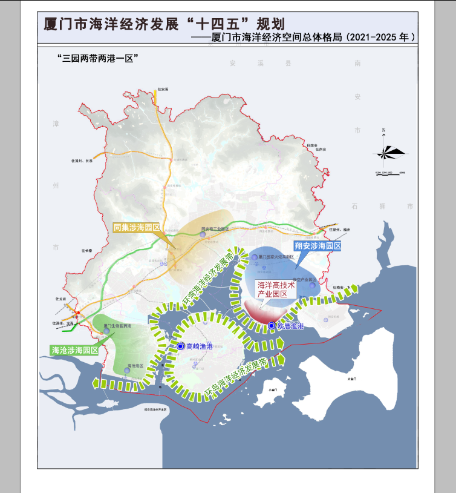

厦门市海洋经济发展“十四五”规划

## 前 言

党的十九大提出“坚持陆海统筹，加快建设海洋强国”，《中华人民共和国国民经济和社会发展第十四个五年规划和2035年远景目标纲要》也专章提出“积极拓展海洋经济发展空间”。习近平总书记对海洋事业发展寄予厚望，指出“海洋是高质量发展战略要地，要加快建设世界一流的海洋港口、完善的现代海洋产业体系、绿色可持续的海洋生态环境，为海洋强国建设作出贡献”。2021年3月，习近平总书记来闽考察期间，要求福建省要大力发展海洋新兴产业，强化海洋生态保护。

“十三五”以来，厦门围绕经济发展高素质、生态环境高颜值的现代化国际化强市发展目标进行了积极探索，在促进海洋经济发展与建设海洋生态文明方面取得了长足进步。厦门经济基础扎实、科技实力雄厚、生态环境优美、海洋特色鲜明，在促进区域协调、推动海洋经济高质量发展、提升海洋治理体系和治理能力现代化方面发挥了引领和示范作用。

编制兼具前瞻性、科学性、可行性的《厦门市海洋经济发展“十四五”规划》，对深入学习贯彻党的十九大精神和习近平总书记关于海洋工作的一系列重要指示精神，全面落实福建省委省政府“海洋强省”、建设“海上福建”和厦门市委市政府“海洋强市”工作部署，推动建设具有国际特色的海洋中心城市具有重要作用。

本规划以党中央国务院关于全面深化改革、生态文明建设、乡村振兴、区域协调发展和促进经济高质量发展等重要文件为指导，按照国家、省、市“十四五”规划和2035年远景目标纲要的总体要求，提出“十四五”时期厦门海洋经济和产业发展的指导思想、战略定位、发展目标、主要任务等，明确海洋经济空间布局的优化方向，细化新技术与海洋产业进一步融合发展的重点领域，为促进“十四五”时期厦门海洋经济高质量发展提供指引。

规划期限：2021-2025年，展望到2035年。

规划范围：以厦门市陆域及管辖海域海岛为规划重点，辐射周边沿海区域。

## 一、发展现状

“十三五”时期，厦门市海洋经济保持平稳较快增长。海洋经济规模持续壮大，2020年海洋生产总值1405.29亿元，占地区生产总值22%。海洋新兴产业发展态势良好，海洋产业空间布局不断优化，海洋生态文明建设深入推进，并获批为国家海洋经济创新发展示范市、国家海洋经济发展示范区、蓝色海湾综合整治试点城市。

## （一）“十三五”发展成效

## 1. 海洋新兴产业蓬勃发展

2020年全市海洋新兴产业实现增加值524.38亿元，占海洋生产总值的37.32%。海洋生物种业、海洋生物制药和功能食品产业群基本形成，蓝湾科技、金达威等一批拥有国际领先技术的新兴企业发展壮大，生物医药港成为东南沿海最大的生物与新医药产业基地；海洋电子信息、海洋仪器装备领域一批关键技术和设备取得技术突破，船舶防污涂料、海工装备制造领域形成新的特色产品；海洋文化和休闲产业不断涌现新业态，游艇经济发展势头良好，“设计-研发-制造-销售-赛事”的一体化产业链条逐步形成。海洋新兴产业已经成为厦门海洋经济发展新的增长点。

## 2. 智慧港口建设初见成效

2020年，厦门港集装箱吞吐量完成1140.53万标箱，逆势增长2.54%，增幅高于全国1个百分点。货物吞吐量完成2.07亿吨，港口总体服务能力和国际竞争力不断增强。

航运枢纽能级得到进一步提升的同时，智慧港口建设取得实质性进展。厦门港率先建成第四代自动化码头，并提出新一轮智能化码头改造“厦门模式”，“厦门国际航运中心港口智慧物流平台示范工程”顺利通过交通运输部验收。区块链、、自动驾驶等新技术的利用，有效促进了航运要素集聚和厦门自由贸易片区建设。

## 3. 滨海旅游产业快速发展

金砖会议、国际海洋周的旅游溢出效应不断显现，优质旅游资源得到进一步整合。“厦金游”“湿地游”“环岛游”的知名度和吸引力持续提升，鼓浪屿被列入世界文化遗产名录。

邮轮游艇帆船产业快速发展。2019年，厦门港接待邮轮艘次居全国第二，达到136艘次，邮轮旅客吞吐量居全国第四，为41.37万人次，分别较上年增长41.67%和27.38%。围绕游艇、帆船、游船的高品质旅游产品陆续推出，五缘湾游艇港成为我国规模最大的游艇港之一。

## 4. 海洋科技创新能力不断提高

通过实施国家海洋经济创新发展区域示范项目，争取中央财政资金3.0亿元，带动投资9.21亿元，新建成或新改造生产线49条，新增研发投入11.39亿元。

建成国际最大的深海生物基因库、全国最大的海洋药源生物种质资源库和国内首个海洋“双创基地”。此外，还新建院士工作站3个、企业研发中心4个，新增海洋创新和研发平台17个，累计完成研发成果转化96项，形成标志性成果54项，申请制定标准32项，新增海洋专利488项。

## 5. 海洋生态文明建设持续推进

基本完成近岸海域养殖清退，海域清淤达50平方公里。完成7个海堤开口，海沧湾种植红树林17万平方米。开展退填还海湿地修复工程，截止“十三五”末共退还违法填海约，修复岸线。滨海湿地公园建设持续推进，下潭尾项目成效显著。对保留的填海工程进行海堤防护及海底生态化改造，建成人造沙滩100多万平方米。鼓浪屿、观音山、黄厝、前埔沙滩海岸公园成为福建省首批海岸公园，中华白海豚保护经验成为全国标杆。

## 6. 对台对外合作交流继续深化

作为两岸融合发展的重要区域，自贸区厦门片区对台合作取得了积极进展，两岸在现代渔业、海洋生物医药与保健食品、游艇制造、滨海旅游等领域合作不断深化。

依托东亚海岸带可持续发展地方政府网络、厦门国际海洋周、APEC（亚太经济合作组织）海洋可持续发展中心，不断推动区域海洋可持续利用和经贸、科技、环保领域的交流合作。厦门国际海洋周、国际游艇展成为国际海洋交流合作的重要平台，厦门国际海洋论坛、海上丝绸之路国家海洋管理与蓝色经济部级研讨班、国际游艇展等活动成功举办。

图1 厦门市海洋产业布局现状

## （二）存在的问题

## 1. 海洋产业竞争力不强

海洋新兴产业增速较快但规模偏小，具有全国影响力的龙头企业和拳头产品相对较少。海洋产业集聚效应不显著，缺少专门的海洋产业园区，涉海企业、项目布局分散于生物医药港、轻工食品工业区、翔安火炬高新区等一些综合园区。海洋金融对产业的扶持力度有限，多元化融资机制有待完善。

## 2. 科技优势有待进一步发挥

海洋高新产业项目库储备不足，海洋科技成果转化激励机制有待完善，鼓励科研人员转化科技成果的政策针对性、力度还需提高。企业创新主体地位不够突出，人才引进政策吸引力较兄弟城市还显不足。

## 3. 海洋资源环境承载压力较大

厦门海域面积约355平方公里、海岸线，人均岸线占有率仅为全省水平的42%。此外，海洋生态环境保护与修复压力较大，受上游九龙江影响，陆源入海污染物总量控制任务艰巨，海洋环境质量提升空间受限。

## （三）机遇与挑战

从国际看，随着全球经济中心东移与经济要素向海流动，将为包括厦门在内的亚太沿海地区带来新的发展机遇。同时，大数据、区块链、人工智能等新技术与海洋工程装备制造、深海矿产勘探开发、海洋可再生能源利用、生态环境治理的深度融合，为海洋经济高质量发展注入了新动力。

从国内看，“十四五”时期是加快推进生态文明建设和经济高质量发展的攻坚期，国家提出要积极拓展海洋经济发展空间。当前，在加快形成“构建以国内大循环为主体，国内国际双循环相互促进发展”新格局的背景下，我国沿海地区将成为新时代更高水平对外开放的关键地带，海洋将成为我国高水平对外开放的关键领域，海洋经济将成为培育新动能、壮大新产业、支撑国民经济高质量发展的重要引擎。

近年来，厦门海洋经济发展的政策利好不断。“一带一路”倡议将福建列为21世纪海上丝绸之路建设的核心区，厦门成为海上合作重要战略支点城市；在福建自由贸易试验区中，厦门片区被定为两岸新兴产业和现代服务业合作示范区、东南国际航运中心、两岸区域性金融服务中心和两岸贸易中心。《闽西南协同发展规划》和《海洋经济发展专项规划》将厦门定位为海峡蓝色产业带和厦漳泉都市区的核心节点。此外，《福建省国民经济和社会发展第十四个五年规划和二〇三五年远景目标纲要》与2021年福建省政府工作报告均明确提出要推进厦门国家海洋经济发展示范区建设，做优做强做大厦门国际航运中心。

厦门海洋经济在面临重大发展机遇的同时，也存在着一些挑战。一是面对更为严峻的宏观环境。当前世界经济衰退、国际贸易和投资萎缩、经济全球化遭遇挑战，无疑会对海洋经济发展带来显著的不利影响。二是在我国经济仍处在转变发展方式、优化经济结构、转换增长动力的大背景下，厦门自身面临着海洋经济增长方式和发展模式转变的困难和挑战。三是较为严重的海域空间利用矛盾，厦门受海洋资源环境约束越来越明显。厦门海域面积仅为355平方公里，如何充分利用现有海洋资源，协调布局海洋产业是厦门海洋经济发展面临的一大挑战。此外，厦门面临日趋激烈的城市间竞争，在本省范围内，福州、泉州、漳州等周边沿海城市的发展在为厦门带来机遇的同时，也使厦门面临部分海洋产业空心化的挑战；在全国范围内，上海、深圳、青岛、大连、宁波-舟山等地先后部署全球海洋中心城市建设，意味着厦门将在涉海项目、产业、技术、人才、制度等方面面临更为激烈的竞争。

## 二、总体思路

## （一）指导思想

以习近平新时代中国特色社会主义思想为统领，全面贯彻党的十九大“坚持陆海统筹，加快建设海洋强国”战略部署，落实省委省政府“海洋强省”“海上福建”和市委市政府“高素质、高颜值、现代化、国际化”“海洋强市”的要求，按照国家、省、市“十四五”规划要求，坚持新发展理念，深化海洋领域供给侧结构性改革，抢占海洋科技创新高地，抢抓新基建政策机遇，围绕海洋资源集约节约开发、海洋生态环境整治修复、海洋产业转型升级，夯实智慧海洋、互联网+等基础能力建设，培育海洋经济发展新技术、新模式、新业态，壮大海洋新兴产业，推动海洋经济发展质量变革、效率变革、动力变革，全面提高厦门海洋中心城市的辐射带动作用，为促进闽西南协同发展、两岸融合发展、海丝沿线国家合作发展做出贡献。

## （二）基本原则

## 1. 坚持陆海统筹、区际联动

坚持海岸带综合保护与利用，推动陆海联动、区域融合，在产业布局、生态保护、基础设施建设等方面形成合力。加快厦门空间格局由海岛型城市向海湾型城市转变的步伐，形成以厦门湾为核心的湾区一体化协同发展格局。

## 2. 坚持产业融合、跨越发展

优化提升海洋传统产业，大力发展海洋新兴产业。以海洋综合体建设为抓手加快海洋一二三产业融合发展。通过延长产业链、提升科技创新水平，推动海洋产业向全球价值链中高端迈进。

## 3. 坚持生态优先、绿色发展

坚持开发利用与保护并重，强化自然岸线和海湾、海岛生态保护提升。强化以生态系统为基础的区域海洋综合管理，合理、适度、有序利用海洋资源。

## 4. 坚持科技兴海、创新驱动

充分利用新一轮科技革命，激发全社会海洋科技创新活力。推动关键领域核心技术突破，加大海洋科技创新载体建设，全面提升企业创新主体地位。促进海洋科技成果高效转化，提升自主品牌，推进海洋产业结构优化和全面升级。

## 5. 坚持合作共享、开放共赢

发挥对台合作优势，加强两岸产业对接、优势互补、人才交流，促进两岸进一步融合发展。加强与海丝沿线国家和地区在海洋资源开发、经济贸易、海洋科技与文化交流、海洋生态协调保护等领域的合作。

## （三）战略定位

综合考虑国际国内海洋发展大势，结合厦门市“十四五”规划和2035年远景目标，聚焦海洋高质量发展，聚焦海洋强市和国际特色海洋中心城市建设。

1. 打造特色鲜明的现代化湾区。立足厦门区位、资源禀赋、产业基础、科技力量等独特优势，加强陆海统筹，推进闽西南海洋协同发展与厦漳泉金海洋融合发展，做好湾区经济文章，打造产业聚集、科技密集、交通汇集、城市群集的厦门湾区。

2. 打造国家海洋高端高新产业基地。聚焦“推动海洋新兴产业链延伸和产业配套能力提升”，大力引进国际先进生产要素，强化海洋科技创新，建设国家重要海洋科教高地，提升海洋生物医药与制品业、海洋高端装备制造业、智慧海洋产业、海洋文旅产业和海洋现代服务业，打造海洋高端高新产业集群。

3. 打造国际滨海旅游名城。全面落实全域旅游和国际化旅游发展战略，整合优化滨海旅游资源，大力提升滨海旅游业，壮大邮轮旅游，发展海洋旅游综合体，建设国际级浪漫海岸线和国际著名邮轮母港。

4. 打造东南国际航运中心。立足厦门港口资源和发展基础，完善现代港口物流体系，拓展内陆腹地海铁联运，构筑连接“丝绸之路经济带”和“21世纪海上丝绸之路”的海陆空多式联运国际大通道。

5. 打造国际海洋治理典范城市。创新海洋环境治理与生态保护模式，提升海岸带综合管理，为全球海洋生态文明建设和海洋治理提供厦门范本。

## （四）发展目标

到2025年，全市海洋生产总值占GDP比重达30%以上，海洋经济发展布局进一步优化，海洋经济辐射带动和区域协同发展能力显著提升，海洋环境和生态名片更加靓丽，全面建成现代海洋城市和海洋强市。

海洋经济新旧动能加速转换，新技术、新产业、新业态、新模式不断推进，培育形成千亿量级海洋高端、高新产业集群。国际航运中心地位不断巩固，海洋科技创新能力进一步提升，海洋生态文明建设不断深入，海洋文化设施建设持续推进，海洋治理体系和治理能力现代化水平不断提高，形成各部门配合顺畅、管理高效、特色突出的厦门海洋管理新模式。

表1 2025年厦门市海洋经济具体发展目标

| 指标 | 指标内容 | 单位 | 2020年 | 2025年 | 属性 |
|---|---|---|---|---|---|
| 海洋经济发展水平 | 海洋生产总值 | 亿元 | 1405.29 | 3000 | 预期性 |
| 占全市GDP比重 | % | 22 | 30 | 预期性 |
| 海洋新兴产业增加值 | 亿元 | 524.38 | 900 | 预期性 |
| 滨海旅游业增加值 | 亿元 | 395.35 | 1480 | 预期性 |
| 海洋交通运输业增加值 | 亿元 | 110.31 | 180 | 预期性 |
| 海洋生态环境质量 | （大陆）自然岸线保有率 | % | 18.16 | ≥18.16 | 约束性 |
| 岸线修复长度 | 千米 | - | ≥5.4 | 预期性 |
| 近岸海域一、二类海水水质面积比例 | % | 82.4 | ≥85 | 约束性 |
| 海洋科技创新能力 | 新增研发成果转化 | 项 | 18 | 45 | 预期性 |
| 新增涉海专利 | 项 | 105 | 300 | 预期性 |
| 新增海洋创新和研发平台 | 个 | 12 | 20 | 预期性 |

展望2035年，全市海洋生产总值占GDP比重达35%以上，建成国际特色海洋中心城市，成为世界一流港口、国际滨海旅游名城、“一带一路”海洋文化交流中心、区域性海洋科技创新高地、全球海洋生态治理典范。基本实现“十二项标志性建设”目标，包括：打造成为国际海洋科技创新示范基地、培育一所海洋职业大学、成立一个综合性海洋创新实验室、建成国际性海洋科普教育基地、建设国际海洋科考保障基地、打造跨区域海洋战略性新兴产业集群、建设国际航运中心、建成国际性高端水产品交易中心、形成国际性海洋产业金融服务体系、建成国际化海洋绿色生态示范基地、培育一批国际海洋休闲体育品牌、打造成为国际化海洋文旅交流中心。

## 三、空间布局

根据现有“三园”产业空间分布，以及未来产业基础和发展潜力、资源环境承载力，按照拥湾发展、区际联动、优势集聚、功能明晰的要求，优化海洋开发布局，着力建设“三园、两带、两港、一区”的海洋经济发展空间格局。

## （一）“三园”：优化现有产业集聚

“三园”为厦门现有基本成型的海洋产业聚集区，即海沧涉海园区、同集涉海园区、翔安涉海园区。“三园”空间优化布局的核心思想是强化现有海洋产业集聚水平，优化既有空间分布。通过产业布局和生产要素的进一步调整，打造厦门现代海洋产业体系，引领未来五年海洋经济协调发展。

## 1．海沧涉海园区

核心区包括厦门生物医药港、国际航运中心、排头船舶工业区，总面积约为30.7平方公里。依托海沧港区、厦门生物医药港、游艇制造基地，着力发展港口物流、海洋医药和生物制品、船舶制造、游艇制造等产业，同时发挥辐射作用，吸引周边涉海企业进驻。

## 2．同集涉海园区

核心区包括轻工食品工业园、轻工电子工业集中区，总面积约为14.1平方公里。依托集美学村、同安轻工园区重点发展海洋新材料、海洋功能食品、研学、海洋科研教育产业，依托环东海域滨海浪漫线发展滨海旅游业。同时，发挥厦门电子信息产业的优势，大力发展海洋信息产业、海洋技术服务业。

## 3．翔安涉海园区

核心区包括火炬（翔安）产业区、临空经济区莲河片区、欧厝产业园区，总面积约为47.4平方公里。依托刘五店港区、国家火炬高新区、欧厝渔港等重点发展休闲渔业、临海工业，鼓励厦门其他区域的相关产业向翔安区域的工业园区集中，积极探索闽西南、闽台海陆空产业协同发展的新途径。

## （二）“两带两港”：拓展海洋产业发展新格局

坚持“功能协调互动、产业相对集聚、生态环境和谐”的布局原则，打造东西走向的环湾经济走廊和特色鲜明、布局合理的生产生活生态空间。

## 1．环湾海洋经济发展带

环湾海洋经济发展带呈东西走向，包括海沧湾、马銮湾、杏林湾、以及大小嶝岛，向东拓展辐射到泉州西南海岸，向西延展至漳州东部沿海。通过对马銮湾、同安湾等海域的环境治理和生态开发，打造全国知名的高端滨海湾区，形成新的旅游、会展、文创集聚区；在马銮湾、丙洲岛、澳头推动海洋综合体建设，打造以战略性新兴产业、渔业特色小镇、海洋主题乐园建设为核心的产业集聚区。

## 2．环岛海洋经济发展带

主要包括本岛及周边海岛。依托东渡港、邮轮码头、高崎渔港重点发展现代海洋交通运输、滨海旅游、休闲渔业和水产品交易。在五缘湾、东部沿海地区重点布局海洋创意产业、海洋文化产业、邮轮游艇帆船产业、会展产业。在本岛东北部打造以海洋渔业文化为主题的五通凤头海洋综合体。

## 3．两港——高崎渔港和欧厝渔港

推动高崎渔港提升改造，建设厦门国际水产品交易平台、“渔市游”和渔业一二三产融合发展等项目，完善集、疏、运体系建设。开展欧厝综合渔港规划和建设，完善基础设施项目，突出对台、远洋和休闲渔业以及科考维权等基地功能，承接机场搬迁后高崎中心渔港外溢的水产品批发市场和物流中心功能。

## （三）“一区”：打造厦门海洋高新产业园区

厦门海洋高新产业园规划范围北至肖厝南路，南至海域，西至翔安大道，东至港汊公园，园区规划总用地面积约12.9平方公里，岸线全长约。重点布局以海洋生物医药与制品、海洋高端装备与新材料、海洋信息与数字产业、渔港经济与海洋种苗业、海洋文创与高端滨海旅游、蓝碳及海水综合利用为主导，以海洋研发创新载体、海洋总部经济为支撑的园区“6+2”产业体系，建成具有较高展示度的海洋经济示范片区。

积极引入高品质、具有一定影响力的海洋高新产业项目，形成现代海洋产业组团和海洋高技术研发配套服务组团。以现有南方海洋创新创业基地为孵化器，引入中国大洋样品生物分馆、海洋科学技术福建省实验室、国家海洋生物资源综合开发利用工程中心等海洋科研平台，形成海洋科技研发中心；以现有海洋交通运输、海洋渔业和滨海旅游业为基础，引入海水综合利用、装备制造、海洋种苗、海洋生物医药、海洋救助服务、海洋环保服务等项目，建设现代海洋创新创业园区，推动海洋生物医药与功能制品、海洋高端装备、高优渔业种苗和水族产业、海洋文创研究、研学为代表的产业项目或科研成果在厦门落地，培育形成我国东南沿海重要的海洋战略性新兴产业集群。

图2 厦门市海洋经济空间总体布局（2021-2025年）

## 四、构建现代海洋产业体系

## （一）壮大海洋新兴产业

坚持科技创新、融合发展，围绕创新链布局产业链，全面提高产业竞争水平。通过科技成果转化、跨界融合、重塑商业模式，在形成经济新增长的同时，对其他产业起到带动和激活效应，打造跨区域海洋战略性新兴产业集群。

## 1. 海洋生物医药与制品业

积极培育海陆结合、中西医融合的特效海洋医药产品。推动硫酸氨基葡萄糖氯化钠复盐仿制药规模化生产；重点突破海洋抗肿瘤南强菌素、抗三阴性乳腺癌靶点新药YXY-211、抗非酒精性脂肪肝炎靶点新药XS593、抗肥胖症靶点新药XS503、抗结肠癌靶点新药K-80003等研发和临床测试。

大力发展高端海洋饲料、海洋生物工程材料、海洋功能制品产业。提高种苗开口饲料生产规模，打造饲料总部经济，做大做强微藻DHA、辅酶Q10、虾青素、香兰素等系列产业；推动海洋益生元、硒化卡拉胶规模化制备工艺研究，以及海洋钙源生物制品、海藻复方营养与降血糖功能性食品等海洋功能制品研发及产业化，形成一批海洋活性糖类、蛋白和脂类保健品和海洋化妆产品；通过拓展产业链条，推进抗菌肽、海洋生物工具酶制剂、海藻多糖生物肥、海洋渔用疫苗等海洋生物制剂与生物材料的产品开发。

| 专栏1 海洋生物医药与制品业壮大工程围绕海洋生物科技基础研发、制备工艺优化、开发应用示范和公共服务平台建设，在药品、制剂、饲料、化工、食品、材料等领域布局若干项目，全面拓展海洋生物医药与制品产业链，大幅度扩大产业规模。重点建设项目包括：欧米克天然功能化学品生物工程二期项目；鼍龙集团鳄鱼总部及研发基地；海洋活性肽科技园（二期）；海洋生物发酵制品研发及产业化；海洋动物肠道功能微生物的研发及产业化示范项目等。 |
|---|

## 2. 海洋高端装备制造与材料业

进一步提高邮轮、游艇、帆船等小型船舶的自主研发、设计和制造能力，培育游艇帆船自主品牌。增强海工装备和仪器设备的设计、建造及智能化水平。研发水下机器人、无人航行器等新型装备。对浮式生产储卸装置、半潜式深海渔业养殖平台进行联合攻关。推动绿色智能型移动浮岛示范工程建设，加快各型传感器、质谱仪、导航、化学生物检测、浮标的研发生产。推动海上风电、海洋可再生能源、海水淡化、深海矿产领域国产装备的示范应用。

加快海洋新材料研发。提高产业创新能力，培育优势核心企业，鼓励企业建立技术创新联盟和新材料工程技术中心。组织实施重点领域、关键技术联合研发，重点研制新型海洋防腐材料、环保型海洋防污材料，大力发展海洋装备金属材料、高性能复合材料、自修复材料，打造海洋新材料产业集群。推动中船重工725所生产项目落地投产。

| 专栏2 海洋高端装备制造能力提升工程 |
|---|
| 根据厦门海洋工程装备产业的基础，选择若干船型、若干核心船用设备、船用材料为突破口，实现自主研发、设计、制造能力，形成本土品牌。重点建设项目包括：天吴海洋仪器研发、检测及海洋风电系统研发与建设；天津海之星智能海洋装备；瑞士F&P机器人研发与生产等。 |

## 3. 海洋信息与数字产业

以“新基建”投资带动“智慧海洋”工程建设，加快卫星组网、、海洋大数据、云计算、物联网、海底数据中心等基础设施建设。发射海洋观测小卫星双子座，建设相应的综合应用系统。开展全球气候变化背景下多维度海洋与海岸带环境综合观测。通过卫星遥感、航空监测、海上浮标等多种手段，在厦门湾全海域及九龙江流域建设GB级宽带通信网络和海上通信自组网，建设覆盖“天基、海基、船基、海底基、岸基”的海洋立体观测网示范工程，支持海底数据中心关键核心技术突破并在厦门海域开展示范应用，通过用能指标等政策手段有序引导陆上高能耗数据中心布放海底，探索数据中心绿色低碳发展新模式。

推动“智慧海洋”工程与海洋产业领域深度融合，鼓励区块链、渔联网等新技术应用于传统海洋产业，建立智慧渔业水产品电商交易与服务平台，促进海洋大数据服务渔民管理和安全生产。加快推进电子信息、人工智能等新一代信息技术在港口物流、航运交通、远洋科考、资源勘探、海事监管、环境监测、灾害预警、海域规划等领域的示范应用，建设智慧海洋高层次示范基地。

鼓励涉海单位在海洋信息感知获取、传输汇聚、处理分析等领域持续开展项目研究和技术攻关。支持通过资本运作、自主创新和技术引进等形式深化与国际一流设备厂商或研发机构的合作。培育一批涉海电子信息装备技术领先的龙头企业及一批“专、精、特、新”的配套生产企业。

| 专栏3海洋数字产业化工程通过智慧海洋领域新基建提高海洋资源环境的监测、管理能力，培育新型服务产品，促进不同海洋产业之间、海洋产业与信息产业之间融合发展。重点建设项目包括：华箭雷达监控系统、数据处理与通讯设备研发项目；高端检测仪器设备研发产业园；近海雷达网综合感知与信息通信服务系统；达华智慧海洋运营中心等。 |
|---|

## 4. 海洋文化创意产业

打造全国有影响力的海洋文化产业基地，发展海洋主题影像产业，建设环岛路海洋文化创意产业带、沙坡尾渔人码头、曾厝垵文创休闲渔村、澳头文化产业园、五通凤头渔村特色小镇。增加海洋文化载体，建设一批海洋科普文化馆、海洋虚拟场馆、博物馆、展览馆等，并推动各类海洋场馆和海洋科考船向社会开放。

创建具有厦门特色和融入海洋要素的研学基地，大力扶持包括研学产业园、研学旅行主题营地、研学旅行泛营地在内的全产业链海洋研学旅行产业，建成国际性海洋科普教育基地。通过组建各类海洋文化宣传教育联盟，串联厦门各类特色海洋文化资源，开展集海洋文化教育、文化传播与实践研究于一体的系列活动。不断创新研学课程内容，形成固定线路的研学产品，打造成具有厦门特色的研学品牌。

深度挖掘厦门本地民俗文化、海丝文化、闽南文化、学村文化、嘉庚精神、厦门海堤精神，并赋予其新的时代价值，将其打造为新的厦门海洋文化名片。

继续办好厦门国际海洋周、国际游艇帆船展、中国俱乐部杯帆船赛等活动，谋划创办中国海洋精品旅游线路展、海洋休闲产业博览会等，不断扩大厦门海洋文化影响力，打造国际化海洋文旅交流中心。

| 专栏4 海洋文化创意产业品牌工程将厦门的本地文化与海洋要素相结合，形成独具厦门文化和海洋特色的研学产品，打造海洋文创产业基地。重点建设项目包括：厦门-东盟综合交流中心；韩菲诗电商直播项目（海洋系列产品）；厦门旅梦湾海洋主题乐园；蓝海天海洋科技文化产业基地等。 |
|---|

## 5. 海洋高技术服务业

优化海洋科技发展环境，健全海洋科技服务体系，鼓励发展海洋科技中介机构和服务组织，积极开展海洋研发服务、海洋技术转移服务、海洋检验检测认证服务、海洋创业孵化服务、海洋知识产权服务、海洋科技咨询服务、海洋科技金融服务、海洋科普及服务。

大力发展海洋生产性服务，面向海洋资源开发，发展海洋环境信息服务、渔获物交易标准化和信息化服务、海洋资源勘察服务；面向工程建设和海洋生产过程，发展海域使用论证与海洋环境影响评价服务、海岸带空间信息应用、海洋工程咨询、企业管理、法律、知识产权服务。

积极培育海洋环保咨询服务，进一步提升污染防治监测的覆盖面和监测频次。加快培育专业化海洋污染治理骨干企业，形成专业化海洋污染治理队伍。通过政府引导和蓝色海湾整治带动海洋生态修复下游产业，形成岸线修复、滩涂生态修复、海岛生态保护等关键技术服务。

## 6. 涉海金融服务业

积极推动设立专业化涉海金融机构，吸引各类涉海金融服务企业集聚落户厦门。推动金融信息服务平台整合，促进产融对接，形成海洋产业金融服务体系。

创新涉海金融产品，探索开发以海域使用权、无居民海岛使用权、在建船舶、船网工具指标、海产品仓单等为抵质押的贷款金融产品。促进精准服务，拓展“海洋助保贷”的业务范围，为涉海中小企业融资和纾困提供资金。

鼓励各类金融机构开展涉海业务，支持银行、证券、保险、融资租赁等各类金融机构发展“证券+保险”“信贷+保险”“租赁+保险”“信贷+基金”等交叉性金融产品。探索巨灾保险和再保险机制，加快发展航运险、滨海旅游险、环境责任险等，扩大出口信用保险覆盖范围。

发挥厦门市海洋产业基金引导作用，将其打造成为厦门市重大海洋项目投资平台。鼓励各类股权投资机构在厦门设立海洋新兴产业发展风险投资基金，引导创投基金、天使基金、成果转化基金支持海洋产业发展。

## （二）加快建设东南国际航运中心

完善厦门海洋货物交通运输体系，重点打造海沧、东渡港区协同发展的局面，推动厦门“丝路海运”工程，加快建设东南国际航运中心。

## 1. 巩固国际集装箱干线港地位

完善港航设施、港区集、疏、运体系和现代航运服务体系建设，推动厦门港与“海丝”沿线国家和地区交通互联互通。强化港口辐射能力，巩固集装箱干线运输，拓展现代物流和高端航运服务。

## 2. 建设智慧港口和绿色港口

推动厦门港口新基建发展，提高厦门港信息化水平。运用物联网信息感知和交互技术，实现厦门湾港口决策和生产计划安排的最优化，提高厦门港区的管理能力。推动“绿色港口”建设，实施eRTG（电动式轮胎式集装箱起重机）混合动力改造、自动化码头建设、LNG（液化天然气）等清洁能源应用、港口船舶岸基供电、绿色照明，大力提升港口大气污染、水污染防治能力和溢油应急反应能力。

## 3. 打造“丝路海运”升级版

进一步提效降费，压缩整体通关时间，优化通关流程，提升跨境贸易便利度，打造一流口岸营商环境。落实厦门国际贸易“单一窗口”“十四五”规划，丰富地方特色服务功能，深化航运金融服务支撑，打造厦门口岸公共信息服务生态圈。不断强化“丝路海运”联盟运行机制，扩大品牌影响力。巩固厦门国际航运中心地位。

| 专栏5厦门东南国际航运中心提升工程完善货物交通运输体系，提升港口智能化水平，加快建设国际航运中心。重点建设项目包括：后石港区大宗散货码头；中远邮轮总部；海峡两岸海运快件、跨境电商物流枢纽集散中心；厦门港海沧港区22#-24#泊位工程；海投临港国际物流中心；中谷海运东南物流基地等。 |
|---|

## （三）打造高端滨海旅游业

深度挖掘海湾海岛资源，提升滨海旅游业品质。做强帆船游艇旅游、邮轮旅游、游船旅游，开发湿地游、岸线游等，打造丰富多元的滨海旅游产品体系，推动全域旅游纵深发展和厦门国际滨海旅游目的地建设。

## 1. 培育海洋旅游精品品牌

积极推动区域滨海旅游协同发展，设计厦门到周边以及东南沿海的精品旅游线路。发挥海洋资源、生态资源、文化资源和旅游叠加融合的溢出效应，打造“厦门浪漫海岸线徒步游”“厦门湿地游”等旅游产品，筹划具有厦门特色的大型水上/海上情景演出，培育一批国际海洋休闲体育品牌。实施“海上公交”项目，优化旅游基础设施建设，便利游客出行，提升游客体验，推动全域旅游发展，打造国际级浪漫海岸线。

## 2. 推动邮轮产业高质量发展

持续优化邮轮物供通关流程，逐步做大做强邮轮物供产业链，打造厦门邮轮物供品牌形象，为国际邮轮来厦常态化运营提供保障。

探索邮轮母港片区“前港、中区、后城”联动发展模式，重点打造集旅游、观光、会展、商贸于一体的东渡邮轮服务集聚区。

积极培育本地邮轮企业，引进国际大型邮轮公司，发展与国际接轨的标准化、规范化邮轮服务，构建多元化的邮轮母港航线网络，建设东南沿海最具活力的国际邮轮母港和海峡邮轮旅游经济圈的核心港口。

## 3. 建设游艇帆船体验之都

发挥厦门海洋旅游影响力，加强与周边城市在游艇帆船方面的交流合作，共同布局游艇帆船休闲体验空间与路线。

充分利用五缘湾游艇港、五通码头等资源，加快专用开放口岸、公共码头、停靠驿站等设施建设，探索开放口岸设置、登记、船艇管控、出入境管理等游艇自由行便利化措施，全力打造“一站式”游艇帆船度假天堂。

大力发展群众性游艇帆船休闲活动，规划设计滨海湿地、海上垂钓、海洋牧场、水上娱乐、特色餐饮、临海工业游等特色旅游项目。利用赛事营造帆船游艇文化氛围，不断提升“国际游艇帆船展”“中国俱乐部杯帆船赛”“海峡杯帆船赛”等展会赛事影响力。

| 专栏6 滨海旅游品牌工程形成厦门海洋旅游精品品牌，推动邮轮经济高质量发展，打造游艇帆船等高端海洋旅游产业链。重点建设项目包括：厦门海上世界；环东海域滨海旅游浪漫线二期工程；环东海域滨海旅游浪漫线三期工程；中奥游艇港项目；极地海洋世界项目等。 |
|---|

## （四）推动现代渔业快速发展

推进渔业发展方式转变，促进渔业一二三产深度融合。着力发展工厂化循环水养殖，做优做强水产品加工和远洋渔业，支持企业在海外设立渔业基地，建设水产品冷链物流体系，打造辐射国内外的高端水产品交易中心。

## 1. 做精海洋水产种业和工厂化养殖

支持龙头企业针对优势养殖生物、药源生物、观赏生物和珍稀生物开展育种制种研究及产业化开发。做强绿盘鲍、海马、石斑鱼、青蟹等特色海洋水产种业和工厂化养殖。推动凡纳滨对虾、鲍鱼种质选育和苗种生产体系建设，打造“厦门虾苗”区域品牌。

预留和拓展水产种苗业发展新空间，保持全国水产种苗供应基地地位。在同安、翔安等地规划布局水产种业园区，壮大设施渔业，实现苗种生产良种化、标准化、无害化，以及水产养殖的集约化、工厂化。鼓励厦门科研机构、苗种企业在漳州、泉州建立分支机构和中试基地，推动养殖技术创新、规范、推广。

## 2. 做强水产品深加工

支持龙头企业开发水产品加工新技术、新工艺、新设备、新产品，推动水产品上下游精深加工和高值化加工，提升副产物综合利用水平，带动涉海食品、调味品、水产饲料、冷链物流、休闲渔业等相关产业的协调发展。

大力发展金枪鱼等水产品加工业，形成“一个水产品形成一条产业链，打造一个产业园区”的水产品加工业发展模式。

## 3. 稳妥发展远洋渔业

推动厦门远洋渔业企业走出去，获得海外渔场捕捞权，发展境外渔业基地。积极拓展与东盟国家、非洲国家的渔业合作，开拓太平洋和印度洋大洋性项目和塞内加尔、缅甸等过洋性项目。推动远洋捕捞向远洋渔业加工、海外养殖转变，鼓励自捕远洋渔获物回运厦门。支持企业在厦成立远洋渔业总部，创新台湾远洋捕捞渔船直航厦门停靠政策。

## 4. 打造高端水产品区域集散中心

健全完善水产品质量安全体系，加强新冠肺炎疫情下的水产品安全监测，推动渔获物区块链和渔获物互联网业务的发展。建设国际高端渔获物交易中心和国内金枪鱼交易集散中心。以水产加工企业为核心建立水产品原料供应冷链物流体系，利用第三方冷链物流发展水产品加工销售体系。加快渔区产地水产品冷链物流配送中心建设，将夏商国际水产交易中心打造成为区域性冷链物流集散中心和海峡西岸水产品交易中心。

打造水族产业集散地，实现集观赏鱼销售、珊瑚繁育、饲料和药物生产、技术服务、水族用品批发展销于一体的全产业链发展态势，持续提升厦门海洋水族产业规模。

## 5. 开展渔港经济圈及示范渔村建设

大力推进乡村振兴战略，落实海域退养上岸渔民转岗转业政策。以高崎闽台中心渔港和欧厝综合渔港为核心，发展渔市游，打造现代渔港经济圈。推动高崎渔港向旅游、休闲转型，加快渔港综合体建设步伐。推进欧厝综合渔港建设，突出远洋、对台、休闲、维权、科考主题。挖掘渔村特色文化，将翔安澳头渔港小镇及周边片区、渔港特色风情街、渔人码头、沙坡尾、曾厝垵等建设成为集海洋与渔业文化、旅游观光、休闲养生为一体的渔港特色小镇。

| 专栏7 现代都市渔业构建工程推动海洋渔业产业结构调整，鼓励区域协作，促进远洋渔业发展，建设水产品冷链物流体系。重点建设项目包括：翔安澳头渔港小镇；福建安井食品股份有限公司增资扩产；海福盛冻干食品深加工；仔虾繁育产业园；国贸宏龙（海洋渔业）总部；绿盘鲍新品种产业化项目；金枪鱼加工销售贸易项目；凡纳滨对虾种业微卫星选育技术产业化示范等。 |
|---|

## 五、打造海洋科技创新高地

深化海洋基础研究，加强海洋优势学科建设，进一步提升涉海高校、科研院所、涉海园区、企业研发中心在科技创新方面的引领作用，打造国际海洋科技之城。

## （一）加强海洋教育机构和科研平台建设

推进世界一流海洋学科建设，整合资源争取创办海洋职业大学。瞄准海洋科技前沿，引进世界领先的海洋科研力量，推动创新型科研机构落户厦门。

加快建设海洋科学与技术福建省创新实验室、海洋生物制备技术国家地方联合工程实验室，争创国家级实验室，建设国际海洋综合科考保障基地。

以汇聚本地海洋研究力量、建设对外合作平台、服务本地和中国东南地区海洋事业发展为核心，打造国家南方海洋智库。

## （二）进一步推动海洋科技成果转化

完善海洋科技成果转化机制和平台建设，提升“厦门南方海洋中心”能力，助推海洋科技转化步伐。建设海洋创新成果转移中心，打造国际海洋科技创新示范基地。

培育和发展专业的海洋技术转移机构，鼓励人才创新创业，促进研究成果交易和转移。利用“6.18”项目成果交易会、国际海洋周等平台，促进海洋科技成果与企业对接，加速产业链和创新链的深度融合。

落实国家、省、市科技创新政策，鼓励科研机构和人员采取技术转让、成果入股、共同开发等形式，畅通、完善海洋科技成果转化渠道，激发城市科研活力。

## （三）突出企业创新主体地位

突出以涉海企业为主体、产学研深度融合的海洋技术创新体系。合理确定涉海企业、科研院校在创新体系中的定位，完善产学研合作的利益机制，推动企业与海洋科研院校机构的研究合作和人员交流。

围绕企业，加强“政企产学研金服用”对接，探索建设海洋产业技术创新联盟。支持海洋企业争创国家、省级工程技术研究中心、企业技术中心、企业重点实验室、工程实验室、国家地方联合工程实验室等。鼓励企业、高校院所建立海外研发中心、联合实验室、国际科技合作基地。

进一步推动创新链和产业链上的各类主体协同创新，充分发挥众创空间、中试基地作用，打造大厦门湾区域海洋技术创新服务平台，构建具有区域特色的海洋产业集群。

| 专栏8 海洋科技创新能力提升行动强化海洋学科建设，推动打造国家重要的海洋科技创新平台，夯实厦门海洋科技创新领先地位。重点任务项目包括：海洋科学与技术福建省创新实验室；海洋三所翔安基地；厦门智慧海洋创新研究院；厦门海洋高技术产业基地创业创新共享服务平台等。 |
|---|

## 六、推动海洋生态文明建设

坚持顺应海洋、保护海洋的原则，对自然状态的海湾岸线和生态系统进行保护提升，对人造海洋环境工程进行科学维护和管理。抓好基于陆海统筹的海洋污染控制与整治，推进海洋生态环境监督评价，严守生态保护红线，加强海洋生态保护与修复，创新海洋生态产品价值实现机制，实现保护、修复、补偿、执法联动的综合治理体系。

## （一）加强海洋生态环境预警监测

加强对滨海湿地等重要生态系统以及保护区重点物种的监测，完善海洋环境监督机制，提高对海洋灾害的监测与预警能力。

## 1．开展海洋环境监测评价

加快入海河流交接断面及海域自动在线监测系统建设，加强入海污染物监测；进一步优化监测站位和监测指标，完善海洋监测监管体系；强化滨海湿地调查监测，以及海洋生物多样性状况调查和定期评价，针对典型海洋生态物种制定长期监测计划。

## 2．完善海洋环境监督机制

加强涉海相关部门的协作，有序推进部门间涉海监测、观测数据共享，实现海洋环境监测数据共享和信息公开。完善涉海部门年度联合执法制度，以防止入海污染物为重点，加强对陆源排污口、海洋工程、违规倾废、船舶及海上养殖区生态垃圾排海污染等联合执法检查，强化海洋环境监督管理。

## 3．提高海洋灾害监测与预警能力

开展海洋减灾示范社区创建和智能网格化预报系统建设，加强海域赤潮灾害，海上溢油、危化物等突发性水污染事故监测预警。加强重点海域、岸段和海岛的海上浮标、综合观测平台和观测站建设，开展精细化数值预报，配置移动应急观测设施设备，形成大厦门湾应急监测与预警管理决策综合平台。

## （二）推动海洋生态保护与修复

进一步规范用海管理，加强滨海湿地生态系统、海岛生态系统等典型海洋生态系统的保护与修复，严格保护自然岸线。

## 1．加强海洋空间管控和岸线修复

落实国土空间总体规划，严守海洋生态保护红线，促进海洋自然资源依法依规、集约节约利用。严格保护大陆自然岸线和海岛自然岸线，维持岸线自然属性，保护岸线原有生态功能，加强对受损自然岸线的整治与修复，增加沙滩及红树林等软质岸线比重，有效保护岸线生态与景观资源，促进岸线的集约节约利用。

## 2．加强典型生态系统修复

实施厦门湾海域生态保护修复工程，加强对滨海湿地生态系统的保护修复。完成马銮湾湿地、下潭尾湿地修复工程。结合马銮湾、海沧湾等湾区整治，推进湾区湿地恢复，推动受损无居民海岛生态系统的整治与修复。加强海洋生态和渔业资源保护，继续推进海域增殖放流。

## 3. 打造海洋碳汇交易平台

探索海洋生态产品价值实现机制和蓝碳进入市场机制，探索开展“蓝碳”交易，推动海洋碳汇交易平台发展，推动海洋碳中和试点工程。配合国家、省探索制定海洋碳汇观测方案、核算标准、海洋碳汇交易规则，推动海洋碳汇市场基础能力建设。推动开展海水养殖增汇、滨海湿地和红树林增汇、海洋微生物增汇等试点工程，因地制宜评估厦门海域增汇路径和固碳潜力。

## （三）强化陆海环境污染联防联治

加强海陆污染联动治理，建立实施排放许可制度，加强船舶污染控制，强化海洋垃圾治理，严格海洋倾废管理。

## 1．完善陆源污染物防治

完成入海、入河排口溯源整治，全面摸清入海、入河排口现状，清理整顿各类违法设置的入海入河排口。落实河（湖）长制、湾（滩）长制，推进入海河流综合整治，加强重点直排海污染源监管，实施同安湾生态综合治理，推进“美丽海湾”保护与建设。研究流域上下游生态补偿和激励机制，完善九龙江流域生态保护补偿制度。

## 2．加强船舶污染控制

加强港口、船舶污染控制，建立健全船舶防控污染应急体系，完善船舶污染海洋环境的监测监视系统，提高突发事件应急能力。进一步完善港口船舶含油污水、压载水、洗舱水和船舶垃圾接收处理设施。推动港口、码头、装卸站以及从事船舶修造单位配备必要的污染监视设施和污染物接收设施，实行渔船废油和生活垃圾回收制度。

## 3．强化海洋垃圾治理

强化海洋垃圾治理。加强海漂垃圾的综合治理，加大沙滩保洁力度，减少海洋垃圾，实现海域、沙滩整洁的目标。完善海上环卫机制，逐步扩大海上保洁范围，推进海漂垃圾清理、回收、转运装备和设施建设。加强厦金海域海洋垃圾治理合作及经验交流。

| 专栏9 海洋生态文明建设工程抓好海洋污染控制与整治、推进海洋生态环境监督评价、加强海洋生态保护与修复，创新海洋生态产品价值实现机制。重点建设项目包括：马銮湾片区清淤护岸工程；琼头外侧海域清淤工程；下后滨外侧海域清淤工程；鳌冠海域岸线保护和生态综合整治（鳌冠片区海域修复工程）；马銮湾新城集美片区水生态修复工程；下潭尾滨海湿地公园二期工程；集美大桥-厦门大桥集美侧岸线整治工程；马銮湾新城-马銮湾南岸生态岛绿化工程等。 |
|---|

## 七、形成跨区域海洋合作新格局

加快实施以厦门为核心的现代化湾区战略、闽西南区域发展战略，推动产城融合发展。发挥对台合作优势，深化厦金区域和产业优势互补、共赢互利。以21世纪海上丝绸之路核心区建设为契机，推动海丝沿线国家海洋合作和厦门海丝战略支点城市建设。

## （一）推动大厦门湾区融合发展

发挥厦门在闽西南协同发展区的中心城市作用和在海洋金融、产业集聚方面的优势，主动谋划创新区域联动和产业融合的政策机制，加强与泉州、漳州在海洋产业、海洋科技、涉海金融服务、海洋生态环境和防灾减灾领域的合作，形成分工清晰、优势互补、融合发展的沿海经济带。

## （二）深化对台海洋交流合作

充分发挥厦门对台交流先行先试优势，加快推动两岸现代渔业、海洋新兴产业、海洋文化创意、海洋生态保护等领域的交流合作。依托高崎和欧厝综合渔港及厦门国际海洋周平台，开展与台湾远洋渔业、水产苗种、观赏鱼、冷链物流等渔业交流合作；以两岸新兴产业和现代服务业合作示范区、海洋经济发展示范区、两岸区域性金融服务中心以及厦门国际航运中心等为载体，加快两岸海洋新兴产业的对接与融合，开展游艇、帆船、邮轮、海洋生物医药与保健食品、航运物流等领域的交流合作；以闽南文化为纽带，推动两岸在海洋文化、旅游会展、体育赛事、动漫游戏、演艺娱乐、工艺美术、创意设计、海洋科普研学、闽南非物质文化遗产利用等领域开展合作对接；以台湾海峡海洋环境保护和治理为纽带，加强两岸海洋生态与环境保护与合作，持续开展厦金联合渔业增殖放流；以厦金协同发展为重点，研究探讨大厦门湾一体化发展格局。

## （三）拓展海洋对外开放合作

加大国际一流涉海企业和核心技术“引进来”力度，加快厦门海洋产业升级和新业态发展。鼓励厦门涉海企业“走出去”，面向国际范围优化海洋资源配置，建设一批海外产业园区、海外渔业基地，拓展海洋产业发展新空间。

发挥厦门国际海洋合作中心的作用，深耕蓝色合作，策划、组织、实施海洋国际合作计划和项目，提供海洋合作公共产品。探索建立“金砖+”海洋产业合作机制，在厦门国际海洋周、PNLG（东亚海岸带可持续发展地方政府网络）秘书处等已形成的海洋国际合作品牌和平台的基础上，深化与21世纪海上丝绸之路沿线国家在海洋管理、海洋科技和防灾减灾等领域的合作，争取涉海国际组织在厦门设立分支机构，支持厦门大学马来西亚分校建设。

## 八、保障措施

构建激励有效、覆盖广泛的政策体系和保障措施，优化顶层设计，从组织协调、财税扶持、法治保障、监测评估、人才队伍等方面着手，促进海洋经济高质量发展。

## （一）加强组织协调与监督考核

1. 加强组织保障。成立市海洋经济高质量发展领导小组，加强对海洋经济发展、海洋生态文明建设等海洋综合管理重大决策的统筹协调。加强闽西南区域发展协调机制，促进厦漳泉海洋产业融合发展和重大基础设施协调建设。

2. 健全规划实施监督机制。完善涉海事务统筹协调机制。制定规划年度实施计划，将规划与建设项目、行动计划紧密结合，保障规划预期目标任务落地实施。完善目标考核监督机制，推进考核评估工作的规范化、制度化。

3. 健全专家咨询机制。扩大海洋专家选聘的国际视野，充实完善海洋领域专家库，充分发挥海洋高层次专家的专业优势，通过专题研究、议题咨询等形式对海洋经济重大决策进行专家咨询。

4. 健全信息沟通机制。畅通政府与企业、公众的信息沟通与反馈机制，落实规划信息公开制度，及时听取各方对规划实施的意见建议，增强政府指导和调节海洋经济运行的针对性。

## （二）创新财政支持与涉海金融支撑

1. 加大财政资金支持。发挥财政资金杠杆作用，针对海洋产业特点，综合运用财政补贴、风险补偿等手段进行扶持。根据实际项目需求安排相应的资金额度，并争取国家和省级海洋经济发展相关资金支持，强化海洋基础设施项目、海洋公共平台建设，扶持海洋新兴产业发展，鼓励海洋科技成果转化，培育海洋经济龙头企业。

2. 积极落实相关税收政策。充分考虑疫情、海洋灾害等突发事件影响，支持企业依法享受涉海企业研发费用加计扣除、涉海企业增值税期末留抵退税等税收减免、优惠政策。

3. 支持涉海金融服务。支持和鼓励涉海金融产品创新，推动海洋产业和涉海金融服务业的深度融合。发挥政府引导基金作用，串联起海洋产业、金融企业和会计事务、法律、咨询等配套企业，推动航运融资、物流金融、海上保险、离岸金融、大宗海产品交易等海洋金融服务创新。

4. 拓宽涉海企业融资渠道。开展涉海企业信用等级评估，支持信用好、项目优、还本付息能力强的企业通过发行企业债券、公司债券、短期融资券、中期票据、权证及其他金融创新产品筹措资金。引入风险投资和私募股权投资等，支持涉海企业积极参与证券市场，并为有高新技术的中小涉海企业在创业板、新三板上市提供便利。

## （三）完善海洋政策与法律保障体系

1. 发挥政策引导作用。以制度创新促进海洋经济高质量发展，针对海洋经济各产业特点，明确厦门市海洋产业扶持清单，制定差异化多样化扶持措施，引导和鼓励资源整合。强化对海洋基础设施项目、海洋环保与生态修复、海洋科创成果转化及传统海洋渔业转型等的扶持力度。创新项目推进机制，实行涉海项目动态调整、分类管理，对涉及国家重大建设、海洋生态修复和厦门产业扶持项目建立审批绿色通道。推进海洋高新产业园建设，打造海洋产业集群和海洋特色园区，推动海洋产业向国际化、高端化、智能化方向发展，以产业集聚为核心实现海洋经济高质量发展。

2. 完善招商引资优惠政策。扩大对外开放，完善招商引资优惠政策，建立招商引资激励机制。强化招商引资工作人员培训，建立一支专业化的招商引资人才队伍。提升招商引资优惠政策宣传力度，通过建设市政府招商网站、发布项目招商信息、举办推介会等各种形式，提供招商信息咨询服务。丰富对台、对外招商方式和激励政策，巩固和加强与台湾、海丝沿线国家和地区的海洋交流合作，积极拓展面向日韩等优势地区和欧美特别是中东欧等潜力区域的开放招商，促进外资来源地多元化。

3. 健全海洋法律法规。落实海洋生态损害赔偿和损失补偿，积极推进涉海自然资源开发利用和保护相关制度的修订修编。立足自身区位、资源、环境和产业优势，不断完善海洋经济发展的相关配套制度，进一步优化海洋经济高质量发展的政策和法治环境。

## （四）强化海洋综合管理和公益服务

1. 深化“放管服”改革。创新海洋资源优化配置、管理引导和调控机制，推动区域经济与海洋产业协同发展。科学编制国土空间规划，促进海洋自然资源集约节约利用。规范用地用海管理，保障重点涉海工程和海洋生态保护项目建设的用海需求。进一步加强海域使用动态监视监测管理系统建设，强化海域空间管理水平。完善用海项目环境影响评价制度、海域使用论证制度和海域有偿使用制度，实施用海项目全过程监管。

2. 强化海洋综合执法。提升海洋综合执法能力，加强海上执法队伍建设，推进海上联合执法，加大对违法用海的处罚力度，开展航道通航保障专项整治和海上联合执法等专项执法行动，实现海洋综合执法常态化。

3. 完善海洋公益服务体系。抓好公共服务平台建设，推动海洋产业平台信息共享。推进海洋公益服务基础设施建设与应用，健全海洋环境应急响应与管理机制，推进海洋环境、海洋灾害监测和预警体系建设，进一步提高海洋灾害应急和防御能力。

4. 积极开展海洋宣传教育。重视海洋文化建设，提升民众海洋意识。开展多种形式的宣传教育活动，在各级管理部门和广大人民群众中树立和培养知海、爱海、亲海、护海的思想意识和行为习惯，赢取社会各界对海洋的关注与支持，创造海洋经济发展的良好环境和氛围。

## （五）加强海洋人才培养和队伍建设

1. 完善海洋人才保障机制。发挥厦门涉海科技力量雄厚的优势，创建有利于人才发挥作用的工作条件、生活条件和激励机制。对涉海高校、科研院所实施海洋人才引进优惠政策，完善与市场经济体制相适应的用人机制，用好人才发展专项资金，实施创业扶持、创新创业激励、安家支持、服务保障等优惠政策。创新人才股权激励机制，对有突出贡献的科技人员和企业家给予必要的表彰和相关奖项。

2. 加强海洋人才培训。完善高校、科研院所创新人才流动机制。加强涉海校企合作，建立联合培养机制，提高人才培养能力。支持本地企业、科研机构与国内涉海高校联合创办海洋专业研究生创新实践基地，开办海洋类职教专业及急需紧缺技能人才的海洋职业培训班，形成人才支撑体系，助推厦门海洋经济发展示范区建设。制定海洋科技人才再教育制度，加强对海洋业务骨干的定期进修培训，通过政府财政补贴，联合研究所、高校和专业技术学校，有针对性开展培训工作，提高业务素质。

3. 加强海洋科技创新团队的引进和扶持。加强海洋领军人才、专业应用技术人才和科技创新团队的引进，对入选计划的人才和团队给予政策优惠。加强海洋院士工作站、博士后工作站等研究平台建设。发挥厦门南方海洋研究中心协调功能，利用厦门高校、科研院所人才培养基础，凝聚重点高校和科研机构海洋科技资源以及浙、粤、台的海洋科技力量，推动强强联合，为海洋发展提供人才资源。

## 规划编制文件依据目录

[1]《中华人民共和国国民经济和社会发展第十四个五年规划和2035年远景目标纲要》

[2]《关于进一步加快建设海洋强省的意见》

[3]《福建省国民经济和社会发展第十四个五年规划和二〇三五年远景目标纲要》

[4]《闽西南协同发展区发展规划》

[5]《高质量建设高素质高颜值现代化国际化城市》

[6]《厦门市国民经济和社会发展第十四个五年规划和二〇三五年远景目标纲要》

## [7]《厦门市人民政府关于印发促进海洋经济高质量发展若干措施的通知》(厦府规〔2020〕14号)

## [8]《福建省厦门市海洋经济发展示范区方案》

## [9]《加快建设“海上福建”推进海洋经济高质量发展三年行动方案（2021—2023年）》(闽政〔2021〕7号)
