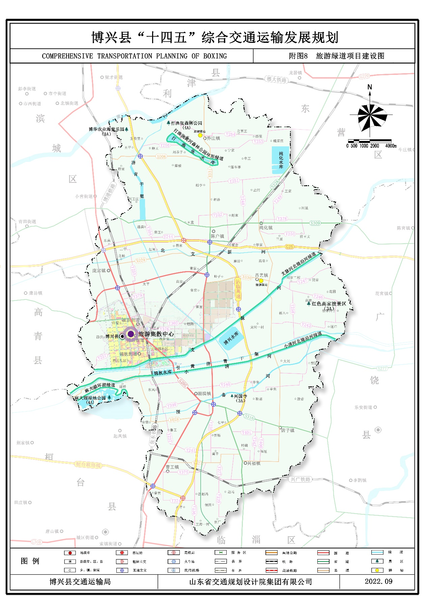

《博兴县“十四五”综合交通运输发展规划》

为保障公民、法人和其他组织对城乡规划的知情权、参与权，推进政务公开和依法行政，提高交通规划的科学性、可行性和可操作性，对《博兴县“十四五”综合交通运输规划》规划内容进行社会公示。

一、公示内容

1.为统筹博兴县交通设施资源，增强博兴县对外交通辐射能力，建成“安全、便捷、高效、绿色、经济”的现代化综合交通运输体系，指导近期交通设施建设，依据相关上位规划、法律法规和技术规范编制本规划。

2. 规划期限

规划期限为2021－2025年。规划对象包括铁路、公路、内河、公共交通等内容以及基础设施、客运服务、现代物流、绿色交通、安全应急等方面的内容。

3. 规划范围

本规划范围为博兴县全域，总面积900.7平方公里。

4. 规划目标

“十四五”期间，博兴县综合交通运输根据自身区位优势、资源禀赋以及对交通的需求，打造以公路、铁路为支撑，港口为辅助的综合交通网络，构建多方式协同发展、人民满意的运输服务格局，着力优化交通运输结构、着力提高客货运输服务水平、着力做好各种运输方式之间的衔接，重点推动“交通+旅游”“交通+产业”融合发展，助力打造乡村振兴齐鲁样板博兴模式；完善两个“1小时交通圈”，为建设环境优美、产业高端、社会和谐、群众安康的现代化新博兴提供强有力的交通运输保障。

5. 规划发展战略

博兴县交通运输“1234发展战略”

“1”个目标：基本建成“安全、便捷、高效、绿色、经济”的现代化综合交通运输体系；

“2”大通道：建设或完善鲁北通道、沾（化）-临（沂）通道；

“3”大网络：完善公路网络、铁路网络、城乡公交网络三大网络；

“4”大支撑：行业治理和绿色、安全、智能的行业保障。

6. 规划重点内容

积极对接省内“四横五纵沿黄达海”综合运输通道，博兴全县将建成以铁路和公路为主、水运为辅的“一横一纵”区域综合运输通道。推进铁路专用线项目的建设，完善公路网骨架，加快小清河复航工程，完善集疏运体系建设，推进现代化养护管理水平。

提高铁路、水路和城乡公交一体化运输能力，补短板、强弱项，全力推进运输结构调整。提升综合客运服务品质，推动货物物流“降本增效”，打造“全域公交”一体化，更好服务群众的美好出行。完善旅游交通基础设施网络体系，促进交通建设与农村地区资源开发、产业发展有机融合。

建设节能环保、集约高效；运行可靠，反应迅速；智慧引领、富有活力的安全绿色智能化的综合交通运输。

7. 本规划由规划文本和规划图纸两部分组成。规划文本和图纸是相互联系的整体，具有同等的法律效力。

8. 综合立体交通网络规划

完善综合交通运输通道。建成以铁路和公路为主、水运为辅的“一横一纵”区域综合运输通道。其中，“横一”为鲁北综合运输通道，“纵一”为沾临综合运输通道。

构建综合交通网络。推进滨临高铁前期工作，推进博港铁路电气化改造提升工程，形成“两货”铁路专用线网络，即博兴县鑫圣华物流有限公司铁路专用线、国家能源博兴发电有限公司铁路专用线。形成以高速公路为对外主轴线，普通国省道为主体，农村公路为补充的公路网系统，依托小清河航道规划博兴港区，积极推动湖滨作业区建设，建设疏港公路，构建码头作业区立体化集疏运网络。

加快推进以铁路、公路客运站为主的综合客运枢纽和以铁路货运站场、港口作业区、快递物流园为主的货运枢纽体系建设。形成“三客三货”的博兴县综合交通枢纽。

9. 运输结构调整规划

（1）提高铁路集疏运能力。

“十四五”期将建成博兴县鑫圣华物流有限公司铁路专用线、国家能源博兴发电有限公司铁路专用线，大大提升主要物流通道铁路运输能力，提升运输能力。

（2）建设水路运输系统。

积极推动小清河复航工程及港区建设，适时推进港口作业区视频监控系统建设，提升水运安全监管信息化水平。加强航道日常养护和航标维护，加强重点水域应急抢通、战枯保畅力度。

（3）提升城乡公交一体化水平。

科学安排路线布局，实现“五个一体化，四个100%”目标。即场站一体化、线网一体化、经营主体一体化、票制票价一体化、管理保障一体化；公交公司化经营率100%，运行车辆GPS安装率100%，运行车辆符合国家排放要求达到100%,从业人员培训、考核、持证率达到100%。至“十四五”末，博兴县将初步形成城市、城镇、镇村三级公交网络，逐步实现全域公交一体化。

10. “四好农村路”建设规划

按照乡村振兴和“四好农村路”要求，进一步提升“四好农村路”建设水平,全面推进城乡交通运输一体化建设深度。

（1）完善农村公路网建设。

深入实施乡村振兴战略，打造乡村振兴齐鲁样板博兴模式，建成3个“四好农村路”示范镇，以助力入选省级城乡融合发展试验区和创建国家级农村产业融合发展示范园为契机，县道规划建设以补短板、优布局为重点，建立对外衔接顺畅、对内联系便捷的高品质交通基础设施，乡道村道逐步消除路网中“瓶颈路”，打通“大动脉”，畅通“微循环”，全面提升农村公路通行、融合、支撑能力。

（2）深化管养体制改革。

围绕全面推进“四好农村路”建设，重点考虑保障公交通行、打通瓶颈路段、提升公路设施标准等完善路网服务的功能性项目以及安全生命防护工程；建立规范化可持续管护机制；促进交通建设与农村地区资源开发、产业发展有机融合，加强特色农产品优势区与旅游资源富集区交通建设，加强农村邮政等基础设施建设。完善农村公路管理养护权责划分。落实农村公路管理养护机构人员设置，实施“县道县管、乡村道乡村管”的划分原则，全面落实县、乡、村三级路长制。

县道重点实施X006滨乔路、X027曹纯路兴福店子界至S309段、X031陈乔路、X028博安路道旭干渠段、X029庞陈路等道路拓宽改建和X028博安路改线工程6个项目。乡道重点对Y244西高-许楼、Y246闫坊-许李、Y237湖滨-鲁刘、Y241兴福-东鲁、Y375 G205-老官、Y374曹一-大程、Y252聚合-相周、Y242董官-福旺等8条乡道进行加宽改建；对Y257潍高路-苗集、Y243曹纯路-许李、Y247刘官-王浩、Y240曹纯路-柳桥、Y242董官-福旺、Y401博临路-西郑、Y258大王-闫坊、Y244西高-许楼、Y255大宁-广青路、Y304绳耿-通滨、Y238西门-曹纯路、Y241兴福-东鲁、Y254王旺庄-东崔、Y239曹纯路-官厂、Y248贾家-五号路等15条乡道进行大中修。

11. “交通+”体系规划

推进“交通+旅游”。近年来，交通运输与旅游融合发展已经成为旅游业转型发展的新趋势。不断完善旅游交通基础设施网络体系，健全交通服务设施旅游服务功能，提升旅游运输服务质量。

“十四五”期间，结合博兴实际资源条件，依托麻大湖旅游基础设施项目，规划建设麻大湖环湖绿道、打渔张黄河森林公园环形绿道、滨河绿道等多条旅游绿道，全长78.4公里。同时在乔庄镇和吕艺镇设置2处旅游驿站。

推进“交通+产业”。发挥港口重要物流枢纽作用，筑巢引凤，引导产业向港口周边集聚，营造“洼地效应”；依托港口周边现有规划，完善物流园区、产业园区建设；强化顶层设计，优化港区、园区和城区空间布局，加强环境保护，促进港口与产业、城市高效协同发展，引爆“聚合效应”。规划发展“产业路”“致富路”，打造乡村振兴齐鲁样板博兴模式。

12. 安全绿色智能化交通规划

建设节能环保、集约高效的绿色交通体系。大力完善公共自行车服务系统；建设一批自行车、步行示范区；推进无障碍交通设施与服务体系建设，构建慢行交通体系。推进公交优先发展战略，探索发展定制公交、夜间公交、社区公交等多层次公交服务模式。全面推进绿色物流发展，完善节能减排配套政策。落实对新能源汽车推广应用的政策措施，以城市公交、公路客车、出租汽车等为重点，大力推广应用纯电动汽车；推进高速公路服务区和普通国省道沿线充电站（桩）设施建设，加快形成城际快充网络；加强绿色资源综合循环利用，开展低碳公路、交通枢纽等示范工程。

建设运行可靠、反应快速的交通运输安全体系。充分利用信息化、智能化、大数据等科技手段提升动态监测预警、安全风险分析研判能力。构建现代化交通工程建设质量管理体系，完善安全风险分级防控、隐患排查治理双重预防机制，切实提高工程质量和耐久性，加大铁路、公路安全防护设施投入力度。建立健全跨方式、跨部门综合交通预警、应急信息沟通机制，建立健全应急决策机制和现场指挥与协调机制。

推进智慧引领、富有活力的智慧交通发展体系。建成全县统一的交通运输地理信息平台，建立包括基础地理信息要素、路网、站场、交通设施等图层在内的全县交通运输“一张图”，为交通运输管理、决策、应急保障和公众出行提供精确的地理信息服务。加快交通大数据平台建设，建立以交通运行协调指挥中心为核心的新一代智能交通管理与服务体系。开展道路、桥梁、铁路结构类型与构造设计、抗震及修复加固等规划设计新技术的研究与应用。构建“物联网+”运输平台。

13. 规划保障措施

（1）健全政策法规体系。加强组织规划实施，完善相关配套政策措施；加大政策支持力度，加强土地、投资、补贴等组合政策支撑保障。健全综合交通运输发展规划建设工作推进体系，发挥综合交通运输工作领导小组及公路、铁路、民航建设工作专项小组等各议事协调机构作用。

（2）加大政策及资金扶持力度。完善交通基础设施建设融资模式，拓宽融资渠道。进一步完善资金使用效益和监管机制，加强绩效评价管理，健全债务风险监管制度，确保示范项目支持资金及时到位。推进重点领域投融资创新，拓宽资金筹措渠道，推动政府与社会资本合作模式的应用，充分发挥各交通方式、各层级融资平台的主体作用，广泛争取各类资金补贴和政策支持。

（3）加强人才队伍建设。坚持创新人才培养开发机制，人才评价发现机制、人才选拔任用机制、人才流动配置机制，有效提升交通运输从业人员素质和交通人才信息化管理水平，建设行业人才资源库。

（4）做好应急保障工作。完善博兴县交通运输部门和交通运输企业各类应急预案。建立纵向贯通、横向协同的多部门联动应急机制，建立科学有效的应急能力评估机制。做好极端天气的预防、预警、防范和应急保障工作，建立交通运输系统恶劣环境（条件）和突发事件下的防护体系，保障在自然灾害条件下的交通运输安全，防范次生灾害和二次事故。

14.相关规划图

14.1博兴县“十四五”国省道重点项目建设图

14.2博兴县“十四五”铁路重点项目建设图

14.3博兴县“十四五”农村公路重点项目建设图

14.4博兴县“十四五”场站重点建设项目图

14.5博兴县“十四五”旅游绿道建设项目图

二、组织编制

组织编制单位：博兴县交通运输局

三、公示时间、地点及方式

1、公示时间： 2022年9月19 日至 2022年 10月21 日（20工作日）

2、现场公示：博兴县交通运输局

3、网上公示：博兴县政务网

网址：

四、意见收集与反馈

1. 意见反馈

公开意见及电子邮箱：bxxjtysj@bz.shandong.cn

2. 咨询电话

0543-8606620

博兴县交通运输局

2022年 9月19日
