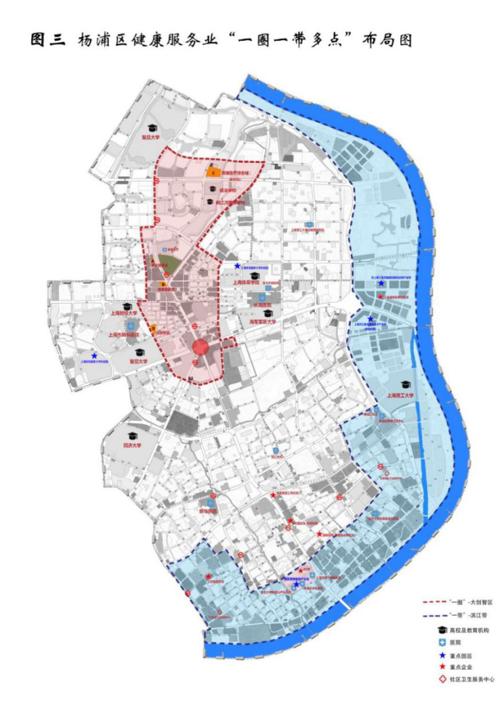

杨浦区卫生健康改革和发展“十四五”规划

“十四五”时期是上海在新的起点上全面深化“五个中心”建设、加快建设具有世界影响力的社会主义现代化国际大都市的关键五年，也是杨浦践行人民城市重要理念，争做人民城市建设标杆的重要时期。为服务经济社会发展大局，满足人民群众日益增长的对高品质健康服务的追求，推动本区卫生健康事业高质量发展，建设健康幸福的人民城市，根据《上海市卫生健康发展“十四五”规划》《上海市杨浦区国民经济和社会发展第十四个五年规划和二〇三五年远景目标纲要》等，制定本规划。

一、发展基础

“十三五”期间，杨浦卫生健康系统坚持“三区联动”“三城融合”核心理念，围绕杨浦“三区一基地”建设全面推动卫生健康改革发展和能级提升，各项工作取得重要进展，人民健康水平明显提高，卫生事业发展规划目标和任务稳步推进，21项发展指标均完成，18项重点工程建设目标基本完成。2020年，本区户籍居民平均期望寿命84.58岁，比2015年提高1.65岁；婴儿死亡率2.09‰，比2015年下降1.21‰；孕产妇死亡率为0/10万，三项指标已达世界发达国家（地区）水平，并优于全市平均水平。

（一）公共卫生服务体系进一步完善

重大传染性疾病得到有效控制。“十三五”期间杨浦区传染病发病持续保持低态势，未发生甲类传染病，2020年乙类传染病发病率为122.45/10万，控制在全市较低水平。国家规划免疫接种率始终保持在99.81%以上。新发肺结核病人的签约率和报销率均为100%。2020年，面对突发新冠肺炎疫情，区卫生健康系统27家医疗机构5280名医护人员第一时间投入防疫斗争，全力以赴开展疫情防控救治。3家区属发热门诊，规范设置隔离留观区域，引导发热患者集中就诊，本区9例确诊患者均在首诊的发热门诊确诊。严格落实境外来沪人员闭环管理，累计收住22891名对象，提供核酸检测服务103694人次，防控成效明显。

基本公共卫生服务项目全面落实。实施第四轮公共卫生体系建设三年行动计划，落实18个市级项目和2项本区重点项目。完成市重大公共卫生服务项目居民大肠癌筛查和60岁以上老年人肺炎疫苗接种。提供免疫规划一类疫苗接种和心理卫生服务。完成常住孕妇免费唐氏筛查、失独家庭父母免费体检、社区慢病精细化管理等项目。杨浦区在本市率先完成12个“智慧健康驿站”建设，获得市重点工程实事立功竞赛优秀团队称号。

表一 基本公共卫生服务项目情况表

| 公共卫生服务项目 | 受益情况 |
|---|---|
| 大肠癌筛查 | 218300人次 |
| 60岁以上老年人肺炎疫苗接种 | 77835人次 |
| 免疫规划一类疫苗接种服务 | 1051827剂次 |
| 心理卫生服务 | 居民19632人次白领6877人次 |
| 孕妇免费唐氏筛查 | 8558人次 |
| 失独家庭父母免费体检 | 6500人次 |
| 社区慢病精细化管理 | 829200人 |

公共卫生应急管理体系逐步健全。编制实施《杨浦区贯彻落实本市〈关于完善重大疫情防控体制机制健全公共卫生应急管理体系的若干意见〉的实施方案》《杨浦区加强公共卫生体系建设三年行动计划（2020-2022年）》。投入5802.05万元财政资金用于疫情监测及检验、发热门诊留观室规范化建设及防疫物资保障。对标现代疾病预防控制体系要求，实施区疾病预防控制中心标准化建设。完成区中心医院传染病分院改造装修。全面落实区中心医院、市东医院发热门诊的达标建设。中心医院传染病分院增设发热门诊。12家社区卫生服务中心同步完成发热哨点诊室建设。区中心医院入选上海市首批城市核酸检测基地、与市东医院、控江医院等通过场地改造、设备购置和人员配置完成核酸检测能力提升，全区日核酸检测能力提升至9600人次。

妇幼保健和慢病防治服务持续增强。增强儿科医疗资源供给，中心医院和市东医院完成规范化儿科门诊和病房建设。强化各助产医院“产安办”作用，进一步健全危重孕产妇抢救绿色通道和危重新生儿会诊抢救转运机制。圆满通过“国家慢病防控示范区”复评审。重性精神障碍患者管理率持续保持在98.9%以上。积极构建“医疗-康复-社区”相结合的社区精神卫生全程服务模式，通过“全国精神卫生综合管理试点区”评审。

（二）医药卫生体制改革有序推进

公立医院改革试点稳步实施。全面落实《杨浦区深化医药卫生体制综合改革试点实施方案（2016-2020年）》，完善政府投入机制，公立医院实现基本建设、大型设备购置、学科建设、公共卫生的财政托底。加强公立医疗机构评价和监管，依托“制度+科技”逐步建立公立医院病种组合指数测算机制和公立医院医疗服务产出评价体系。制定出台《关于完善杨浦区公立医疗机构绩效工资分配管理的指导意见》，探索基于综合评价结果的绩效工资考核分配改革试点。落实药品供应保障体系改革，全面取消区属公立医院药品加成，完成区属公立医疗机构药品集团化采购试点。区中心医院和第一康复医院纳入市级公立医院章程试点，全区各公立医院建立现代医院管理制度，区属公立医院全面实行临床路径管理。

“医联体”和区域医疗服务能力全面提升。强化与大学医学院合作，分别与同济大学、交通大学等签署战略框架协议，区中心医院创建为同济大学附属杨浦医院；市东医院创建为上海理工大学附属医院（筹）；市第一康复医院创建为同济大学附属康复医院（筹）；区中医医院成为上海中医药大学教学医院；区精神卫生中心成为上海健康医学院附属医院（筹）。先后形成“上海市北部儿科医疗联合体”“杨浦-新华综合医疗联合体”“杨浦-肺科专科医疗联合体”“杨浦-长海脑卒中联盟”等。制定《杨浦区医疗机构设置规划（2016-2020年）》，科学规划以中心医院为核心的“1+8+X”南部综合医联体布局、以市东医院为核心的“1+4+X”北部综合医联体布局和以“康复、中医和精神卫生”为特色的三个区属专科医联体。2019年区中心医院全科医师临床培养基地建成并投入使用，2020年区中心医院获批成为全市第一批区域性医疗中心建设单位，市东医院被列入第二批区域性医疗中心建设单位名单。

中医药事业发展势头强健。制定《杨浦区中医药发展“十三五”规划》。成立全市首批“中医专科医疗联合体”，并按照上海市卫健委打造“北部中医医联体”的部署，成立“岳阳-杨浦中医医联体”。充分发挥中医“治未病”在防治疫情和预防保健、康复护理及养老服务体系中的作用。“十三五”期间两次以高分成绩通过杨浦区“全国基层中医药工作先进单位”复评审。

康复与老年护理体系持续加强。稳步实施《杨浦区进一步加快残疾人康复体系建设实施方案》，先后构建“华山-一康成人肢体康复服务联盟”“新华-一康儿童康复医联体”，建立以市第一康复医院为核心、社区为支撑的区属康复服务联合体。积极应对深度老龄化，新增1163张老年医疗护理床位，超额率达到7%。建立“医养结合”社区卫生服务中心与养老机构的签约服务支持机制，12家社区卫生服务中心和区内养老机构、日间老人照料中心实现“医养结合”签约服务100%。积极配合“长护险”试点工作，截至2020年底，共评估31223人。

健康服务业高质量新发展。制定实施《杨浦区加快推进健康服务业高质量发展三年行动计划（2020-2022年）》，推进区属控江医院与上海微医集团合作建立互联网医院项目。加强与“平安好医”等集团公司合作，推进“平安健康城”、互联网医院项目建设。鼓励本区健康体检机构向健康管理机构转型发展。围绕数字化健康产品的研发设计、信息系统集成、数据处理、数字内容服务等，打造健康信息产业集群。全力构建以智慧健康、“互联网+医疗”为特色的“一圈一带多点”的杨浦健康服务业布局。

（三）社区卫生综合改革持续深化

社区卫生综合改革机制深化推进。12家社区卫生服务中心均纳入本市深化社区卫生综合改革试点，先后建立基于信息化、标化工作量、工作质量为核心指标的区级财政投入机制、全面预算管理机制和薪酬总额核定机制。制定出台家庭医生招录、进编、晋升、在职培养、出国培训等倾斜政策。社区中医药服务综合指数达到市级标准。社区残疾人康复示范点完成挂牌。长白、延吉社区卫生服务中心荣获优质服务基层行优秀单位。社区卫生服务中心市民满意度连续三年居十大行业服务质量测评首位。

家庭医生签约服务全面推开。全区建立家庭医生“11125”服务模式，各社区卫生服务中心组建300个家庭医生团队，开展家庭医生“1+1+1”组合签约服务，提供预约门诊、优先转诊、慢病长处方、延伸处方、慢病精细化管理等签约优惠服务，并在20个家庭医生工作站实现“医药云”平台药品外配。截至2020年12月，签约居民签约社区门诊就诊依从性80.81%，开具延伸处方51779张。

表二 截至“十三五”期末家庭医生签约服务情况

| 签约人群 | 签约人数 | 签约率 |
|---|---|---|
| 总人群 | 409200 | 31.58% |
| 60岁以上人群 | 268000 | 104.44% |
| 重点人群 | 245400 | 65.69% |

社区卫生服务网底建设不断完善。进一步完善本区社区卫生服务网底布局和基本建设。完成新江湾城社区卫生服务中心新建、控江社区卫生服务中心门诊综合楼新建并投入使用；五角场社区卫生服务中心新建项目开工并完成主体结构建设；长海社区卫生服务中心完成分中心过渡用房修缮并开业；完成四平社区卫生服务中心整体修缮，延吉社区卫生服务中心加固装修等工程。完成大桥社区卫生服务中心及江浦社区卫生服务中心电梯加装。社区卫生服务站标准化建设项目有序完成，杨浦区域内形成“12+60+301”（12个社区、60个社区站、301个居委健康管理点）的15分钟“基本医疗服务圈”。

社区卫生服务能力不断提升。依托区校联动推进社区全科临床和科教能力建设。大桥和定海社区卫生服务中心创建为同济大学医学院附属社区卫生服务中心(筹)。殷行社区卫生服务中心挂牌复旦大学上海医学院社区卫生服务中心。长白和延吉社区卫生服务中心创建为上海健康医学院附属社区卫生服务中心。

（四）人才培养和学科建设富有成效

卫生健康人才队伍不断壮大。十三五末，杨浦区卫生技术人员总量为18336人，千人口卫技人员17.3人，千人执业（助理）医师数为5.37人，千人注册护士数为8.54人，比十三五初期大幅度增加。区属医疗机构人员职称结构不断优化，具有高级职称的比例10.8%，中级职称47.4%，硕士及以上学历12.5%，学历水平明显提升。全区卫生健康领军人才、优势学科和科研、管理团队进一步提升。1个团队获得“全国优秀家庭医生服务团队”称号。入选上海领军人才、浦江人才计划、市卫健委优青各1人，区拔尖人才22名，获银蛇奖三等奖和提名奖各1人，5人获上海市“区域名医”。

人才政策得到有效落实。围绕人才强卫战略，杨浦区卫生健康系统积极探索，争取区委、区政府和相关部门的支持配合，落实人才发展的政策措施。先后制定《杨浦区卫计系统专业技术人员自主招聘办法》《杨浦区卫生计生系统全科医生引进住房办法》《杨浦区卫生健康系统卫生专业技术高层次人才绩效管理试行办法》等人才政策，为区域卫生健康人才发展打下了良好的基础，通过实施“三好”建设工程，打造杨浦区卫生健康人才培养的品牌，有效带动人才队伍整体素质的提升，进一步实现人才政策覆盖“引、育、用、留”全链条。

（五）居民健康素养全面提升

全面完成《上海市杨浦区建设健康城区2015-2017年行动计划》7大类33项行动计划指标和《上海市杨浦区建设健康城区2018-2020年行动计划》5大类18项行动指标。累计建设健康社区、健康促进医院等场所177家，建成健康主题公园2个、健康步道112条、智慧健康驿站12个、健康知识一条街12条。延吉新村街道被命名为“世界卫生组织城市合作中心健康社区”。成功建成二联小学等24家市级“健康城市建设优秀健康单位”。进一步深化、拓展以“市民健康自我管理小组”为平台的社区健康促进活动，受益人群2.28万名，培育黄兴绿园等8个市级先进健康自我管理小组。2017年杨浦区通过国家卫生区复审。2020年被评为全国健康促进区。

（六）人口监测与家庭发展有序推进

稳妥实施“全面两孩”政策，2020年常住人口计划生育率达97.85%。落实计划生育奖励扶助政策，完成全区计划生育特殊家庭特别扶助金的审核和资金安全发放。开展为特殊家庭优先提供家庭医生“1+1+1”签约服务、安康通居家养老服务、辅助就医服务，为特殊家庭父母提供免费健康体检。完成国家级青少年健康发展项目试点。完善全面两孩政策配套，医院、商场等公共场所母婴设施建设配置率达100%。爱心妈咪小屋数量已超120家。2018年荣获全国流动人口基本公共卫生计生服务均等化示范区称号。

（七）区域卫生信息化建设加快实施

全面建成区域卫生信息化二期项目。区中心医院完成电子病历五级评审和互联互通四级甲等评审工作，市第一康复医院、控江医院、区精神卫生中心完成四级电子病历建设，市东医院完成电子病历四级评审工作。长白和江浦社区卫生服务中心对标EHR四级标准完成系统升级改造。延吉、四平、殷行社区卫生服务中心已对标EHR五级标准完成升级改造。区域卫生平台和区疾控平台对标等保2.0完成系统安全加固，完成区属21家医疗机构医疗付费“一件事”改革，成功打造“基于信用无感支付”的信用就医新型服务体系。

（八）依法行政和行业管理水平不断提高

行业综合监督有力有效。以“双随机、一公开”为主线，加强公共卫生管理。完成区卫生监督所参公转制，推进卫生监督综合能力建设，积极规范执法程序，加强现场和专项稽查，强化法制监督和行政执法信息公开。实施卫生监督协管机制，加强传染病防治、公共场所、生活饮用水和放射卫生等监督，2020年顺利通过上海市卫生综合监管专家组督察。将打击无证行医工作与当前医药卫生体制改革、药品医疗器械管理、房屋出租管理、流动人口管理、社会诚信体系建设有机结合，通过“宣传、排摸、打击”同步进行的方式，推进社会共治，提高无证行医整治效果。

“放管服”改革不断深化。借助“一网通办”“市民云”、随申办APP等资源，加强居民和企业的指导，将服务关口前移，通过“电子亮证”和“两个免于提交”等惠民便民措施，减少企业和群众现场办理等候时间和提交材料数量。2019年在全市率先开展中医诊所备案项目。2020年将76项业务纳入区级政务行政中心的“秒办”事项。本区医疗机构、医师、护士电子化注册率已达100%、99.12%、97.96%。

（九）存在问题和瓶颈

公共卫生应急管理体系有待重塑。杨浦区人口密度高达21658人/平方公里，居于全市前列，公共卫生潜在风险大，防控难度更大。目前本区的公共卫生应急指挥体制机制还不健全，还未能完全形成协同联动、统一高效、权责清晰的应急管理组织架构。医防结合的紧密性、融合度还有待增强，监测预警、决策指挥、应急处置、医疗救治、综合保障等各个环节需要强化系统设计。专业化人才还不够充足，应急装备亦有欠缺。重应急、轻预防的倾向仍未扭转。区疾控中心在空间规模、实验室检测能力、专业车辆配置、信息化水平等方面与现代化建设目标存在差距，均需要着眼长远、整体谋划、全面提升。

区域医疗卫生资源布局有待提升和优化。城区改造进程推动了居住人口集聚趋势的改变，对医疗服务提出了新的要求。当前辖区南、中、北部医疗卫生资源布局仍然不均衡，尤其是北面优质医疗资源稀缺，亟需进一步加快优质医疗资源扩容和区域均衡布局。对标本市新一轮社区卫生服务机构设置标准，12家社区卫生服务中心空间规模和硬件设施存在短板。对标公立医院等级评审、大学附属医院、区域性医疗中心建设标准等，大多数公立医院的空间规模绝对量不足，床位规模、设备设施等方面都存有短板。健康产业规模和质量还不足，在土地资源供给、信息化、人才引育的健康产业政策支撑上还需加大力度。

卫生健康学科人才队伍质量有待提高。“十三五”期间卫生健康系统人才的“引、育、用、留”等环节的政策和举措比较优势还不够明显。区内高层次领军人才数量相对不足，全科、康复、精神、急诊、创伤、重症、感染、儿科等紧缺人才依然不足，公共卫生学科和人才建设更亟需解决。人才培养的整体性和协同性不够，学科带头人对团队建设带动效应还需进一步强化。

卫生信息化建设仍需大力推进。区域卫生信息化二期项目的建成使本区卫生信息化达到了全市平均水平，但是部分公立医院和整体社区卫生服务中心信息化水平处于全市下游。随着医改深入，对卫生信息化建设要求不断提高。本区社区卫生服务中心电子健康档案等级达标建设处于起步阶段，对标只完成了1家社区卫生服务中心的测评工作，后续实施和测评任务较重。只有部分公立医院对标完成电子病历建设。系统安全性方面，还有1/3的公立医院和12家社区卫生服务中心未通过三级等保建设。

二、发展趋势

（一）杨浦区域战略定位对卫生健康高质量发展提出新期望

“十四五”是杨浦全面建成高标准人民城市实践区、高能级科技创新引领区、高水平社会治理先行区、高品质生态生活融合区，成为具有世界影响力的社会主义现代化国际大都市的人民城市标杆区的关键时期，杨浦区卫生健康事业发展要有更高的站位，补齐区域卫生资源短板，优化区域医疗资源配置，加大“放管服”改革力度，从全局入手，坚持问题、需求、结果导向，探索把卫生健康的发展步伐，与区域经济发展动力、城区功能定位、空间布局框架相适匹配，融入长三角地区医疗水平协同进步，全面提升健康发展水平，努力全方位全周期保障人民健康，更好地实现健康和经济社会良性协调发展。

（二）杨浦区位特点对公共卫生安全保障发出新挑战

“十四五”规划是处在新冠肺炎疫情防控进入常态化阶段编制的五年规划，预期上海和杨浦仍将面临多种传染病威胁并存、多种健康影响因素交织的复杂局面，人口高度密集、人员国内外流动频繁，大大增加了重大传染病、核化生等突发公共卫生事件的风险，迫切需要加快城市治理体系和治理能力现代化建设，提升公共卫生安全防控能力，确保人民群众生命安全和身体健康。杨浦作为上海面积最大、人口最多的中心城区之一，“十四五”期间人口将持续导入，需要建立形成统一高效、响应迅速、科学精准、联防联控、多元参与的公共卫生应急管理体系，打造高水平公共卫生人才队伍，推动重大疫情和突发公共卫生事件的应对能力达到上海一流水准，使杨浦成为上海公共卫生最安全的城区之一，更好地保障经济社会可持续发展。

（三）新发展阶段人口结构和健康需求转变向供给侧提出了新要求

区域老龄化程度不断加剧，区域产业结构的进一步调整，区域外来人口流动增加，居民生活方式及疾病谱变化导致慢性非传染性疾病高发态势，对区域医疗卫生服务供给能力提出了新的挑战。随着大卫生、大健康理念引领全面健康，居民对于全方位、全生命周期的健康管理提出了新的需求，杨浦区需要顺应健康需求的变化，构建优质、高效卫生健康服务体系，推动建立整合型医疗服务模式，以人民健康为中心，从疾病治疗转向提前预防和健康维护，推动“大健康”相关产业和健康服务业的健康发展，将“健康杨浦”融入区域经济社会发展各项政策之中，提高健康服务能力和水平。

（四）新技术应用为健康服务模式转变和服务新发展格局创造新机遇

随着生命健康相关学科的内涵不断丰富和外延持续拓展，现代医学与信息技术、生物工程、高端材料、装备制造等专业学科交叉融合日益显著，5G、人工智能、云计算、物联网等现代信息技术不断改变卫生健康服务供给和需求对接方式，也为卫生健康服务新模式、新手段、新业态的创新发展提供了可能。随着国家、市级有关文件规范的制定出台和新型服务模式手段的创新运用，要求医疗机构进一步转变发展和管理方式，顺应健康服务智能化和医学创新加速发展趋势，主动参与融入到区内外生命健康相关产业的各个环节，更好适应和服务新发展格局，更好发挥卫生健康保障民生和促进经济社会发展的重要作用。

（五）新发展阶段健康主要矛盾变化对卫生健康改革提出新课题

辖区卫生健康发展仍然不平衡、不充分，基本医疗卫生服务体系整合衔接不够完善，疾病预防控制体系能级不够高，中医药传承不足、创新不够、作用发挥不充分，多元化健康服务供给不足。公立医疗机构服务供给与功能定位尚不匹配，保障公益性的机制还不健全，体验不佳等问题仍较为突出，部分医院发展方式尚未从规模扩张型向内涵集约型转变。对医疗服务新业态综合监管能力仍需增强。严峻复杂的经济形势和日益增长医疗费用支出给医保基金和居民就医带来一定的压力，迫切需要提升卫生健康治理体系和治理能力的现代化水平，抓好“三医联动”，促进卫生健康高质量发展。

三、指导方针

（一）指导思想

以习近平新时代中国特色社会主义思想为指导，深入贯彻党的十九大和十九届二中、三中、四中、五中全会精神，深入贯彻习近平总书记考察上海重要讲话和在浦东开发开放30周年庆祝大会上的重要讲话精神，把保障人民健康放在优先发展的战略位置，践行“人民城市人民建，人民城市为人民”和“健康融入万策”的重要理念，以基层为重点，以改革创新为动力，预防为主，中西医并重，共建共享，打造整合型、智慧化、高品质健康服务体系。落实“健康上海”建设总体部署，主动服务城市战略和城区发展。以普及健康生活、优化健康服务、完善健康保障、建设健康环境、发展健康产业为重点，全面推进健康杨浦建设和“四高城区”建设。

（二）基本原则

1.人民至上，健康优先。把健康放在优先发展的战略地位，以提高人民健康水平为核心，着力推动卫生健康发展方式从“以治病为中心”向“以健康为中心”转变，把工作重心向全方位、全过程、全生命周期健康管理转移，增强重大疫情防控和公共卫生安全保障能力，推进卫生健康内涵式、集约型、绿色化高质量发展，进一步改善健康公平，促进健康与经济社会协调发展。

2.优化整合，提升能级。坚持新发展理念，优化卫生资源配置，补齐机构布局和服务能级短板，推动各级各类健康服务机构资源共享、联动发展，推动医疗、教学、科研、产业协同发展，推进预防、医疗和康复护理服务链条整合，实现资源配置效益最大化和效率最优化。深化与高等院校、市级医疗机构和科研团队的合作，推动区域性医疗中心建设，促进优质医疗卫生资源扩容下沉，增强基层医疗卫生服务能力，完善分级诊疗模式。

3.深化改革，创新发展。以改革创新为动力，加快卫生健康重点领域和关键环节改革步伐，加强各级各类卫生健康机构分工协作，注重现代科学技术、信息技术、互联网技术的应用，发挥科技创新和信息化的引领支撑作用，强化综合监管能力，建立促进全民健康的制度体系，提高卫生体系运行效率，提升发展质量和服务绩效。进一步形成大卫生、大健康治理格局。

4.全民参与，共建共享。完善政府主导、部门合作、社会参与的工作机制，推动将健康融入所有政策，促进基本公共卫生服务均等化，强化基本医疗卫生服务公益性和个人健康责任，加大重点人群健康服务管理，积极推动健康产业发展，共同推进健康城区建设。注重服务国家战略和城市发展，积极参与长三角一体化合作和健康治理，加快形成人人参与、人人建设、人人享有的高水平全民健康新格局。

四、发展目标和主要指标

（一）发展目标

全面推进健康杨浦建设。构建与经济社会发展水平相适应、与城区功能定位相匹配、以人民健康为中心的整合型、智慧化、高品质的整合型健康服务体系，推进医防融合的健康服务管理，实现医疗保障待遇公平适度、运行稳健持续、服务优化便捷、治理协同高效，成为全市公共卫生体系最健全、最安全的城区之一。

——居民健康水平不断提升。健康素养水平逐步提高，重大慢性病过早死亡率逐步降低，常见恶性肿瘤诊断时早期比例逐步提高。市民主要健康指标继续保持发达国家水平，人均健康期望寿命达到全市先进水平。

——公共卫生服务体系更加完善。建立健全统一高效、响应迅速、科学精准、联防联控、多元参与的公共卫生应急管理体系，打造平战结合、训练有素的专业公共卫生人才队伍和结构合理、高效响应的医疗应急救援队伍。区域疾病预防控制、公共卫生应急和医疗保障能力达到全市先进水平。

——医疗服务体系更完备。建成满足居民多层次、多类型健康服务需求，功能整合、分工协作的医疗服务体系，加强区域性医疗中心、特色专科医院和基层医疗卫生机构服务能力建设，鼓励发展高水平社会办医疗机构，提升健康服务业的贡献度，区域医疗服务供给能力全市领先。

——健康服务产业更具规模。形成内涵丰富、布局合理、结构优化的健康服务业体系，成为城区的重要“新兴产业”。建成与健康服务新业态、卫生发展新趋势相适应的行业管理体系。

——健康智慧化程度不断提升。以卫生健康数字化转型为抓手，加快推进互联网医院和智慧医院发展，加强社区健康服务信息平台建设，基本实现卫生健康服务智慧化。依托5G、大数据、人工智能等新技术促进区域卫生健康服务管理智能化水平和整体效能显著提升。

——全行业治理水平明显提高。行业管理法治化、标准化、智慧化水平进一步提升，基本建成覆盖全行业、全要素、全流程的智能化综合监管体系。

（二）主要指标

“十四五”末杨浦区人均预期寿命大于84.6岁，人均健康预期寿命大于71岁；婴儿死亡率≤5‰、5岁以下儿童死亡率≤4‰、孕产妇死亡率≤7/10万；重大慢性病过早死亡率小于9.5%；常见恶性肿瘤诊断时早期比例大于35%；居民健康素养水平达到35%；千人口执业（助理）医师数达到3.6人；千人口注册护士数大于4.7人；千人口全科医生数达到0.45人左右；精神科执业（助理）医师数达到每4.8/10万人;健康服务业增加值占GDP比例达到6.5%；千人口献血率达到17.5‰;区级医院病种组合指数大于0.9。

五、主要任务

（一）完善公共卫生应急体制机制，提高应对突发公共卫生事件能力和水平

1.完善应急指挥体制机制。完善公共卫生事件应急指挥体制，明确相关部门职责，加强卫生健康部门与应急管理等部门的协同联动，构建统一领导、权责匹配、权威高效的本区公共卫生应急管理组织架构。健全突发公共卫生事件应急响应制度，建立本区重大公共卫生安全专家库，结合本区人口密集特点，制定突发公共卫生事件操作级、战术级应急预案体系并建立定期修订制度。依托城市运行“一网统管”平台，在区疾控中心建设多数据、全方位、广覆盖的本区公共卫生应急指挥中心和疫情联防联控大数据智慧决策平台，实现突发态势全面感知、资源统筹调度、重大信息统一发布、关键指令实时下达、多级组织协同联动、发展趋势智能预判。

2.强化监测预警与快速响应。完善疫情信息收集、上报和预警机制，建立智慧化的公共卫生安全预警多点触发机制，完善信息报告奖惩机制。推进发热门诊监测哨点布局和标准化建设。依托家庭医生制度完善居民电子健康档案系统，形成区属各级各类医疗机构与区疾控中心之间的信息推送、会商分析和早期预警制度。利用大数据和人工智能技术，开展公共卫生安全相关场所、人员、行为、物流等应用场景特征分析和疫情追踪，及时监测预警高危地区、高危区域和高危人群，提升公共卫生风险评估和预警的前瞻性、精准性、高效性。以新发突发传染病、食源性疾病、不明原因疾病为重点，实施本区区域性医疗中心、区中医医院发热、肠道门诊等感染性疾病门急诊标准化建设等项目。实施区域性医疗中心和其他具备条件的区属专科医院的生物安全二级实验室达标建设，推进区域性医疗中心城市核酸检测基地建设。探索建立高校与疾控、医疗机构共同合作的运转高效、联合攻关、能力互补、检测能力强大的公共卫生实验室检测网络。

3.建设平急结合的区域应急医疗体系。一是完善应急状态下全区医疗卫生机构动员响应、区域联动和人员调集机制，强化卫生应急队伍建设，提高卫生应急核心能力。优化传染病救治床位资源空间布局，3家区域性医疗中心设立传染病科，把区中心医院打造为全市医防结合、传染病救治标杆性区域性医疗中心，在多院区设置发热门诊，统筹设置管理区传染病定点医院，将区中心医院安图分部病房楼改造为“平战结合”的传染病应急腾空救治点。制定大型公共设施转换为应急救治设施的预案，以街镇为单位储备临时可征用设施。二是推进分层级、分区域应急医疗救治体系建设，完善救治网络。逐步健全院前急救转运体系。通过独立设置区级传染病医院，在全市率先探索形成由“区级定点传染病医院-区域性医疗中心-社区卫生服务中心和社会办医疗机构”构成的区域应急医疗救治体系。

4.完善公共卫生应急社会治理。一是完善公共卫生应急治理体系，明确责任分工，压实属地责任，落实各部门防控职责，实施依法防控、联防联控、群防群控，形成外防输入、社区防扩散的公共卫生应急社会面防控体系。二是统筹疫情防控和经济社会发展，制定和储备经济社会应急政策，做好基本民生保障，加强社会风险防范和矛盾化解。三是加强社会组织能力建设，完善社会力量参与机制，培育公共卫生领域社会组织和专业社工、志愿者队伍。完善社区治理体系，建立完善应急状态下街道、公安派出所、社区卫生服务中心三方联动机制，进一步完善以基层党组织为核心，居委会为主导，业委会、物业公司、社区党员、志愿者、居民骨干等共同参与的基层社区防控架构。

5.强化应急保障措施。加大公共卫生经费投入，持续加大公共卫生安全保障投入力度。对重大疫情防控和公共卫生应急管理所需人员经费、基本建设、设备购置、信息化建设等予以保障。坚持平战结合、采储结合，健全应急物资储备预案，加强实物储备和动态使用机制，在区疾控中心和区域性医疗中心建设本区公共卫生应急储备中心和分中心，创新性采用“本土化储备+应急供应商轮库”的方式储备防护物资。依托区级公共卫生突发事件信息平台，动态提供全区卫生应急人员、物资、值守以及全区应急物资储备资源情况，确保应急物资科学高效节约利用。在突发重大疫情和公共卫生应急状态等紧急情况下，确保区属医疗机构先救治后收费，确保患者不因费用问题影响就医，确保医疗机构不因支付政策影响救治。落实对特殊群体、特定疾病就医完善“兜底”政策，减轻困难群体就医就诊后顾之忧。

（二）贯彻健康杨浦行动，推进公共卫生体系建设，打造医防融合的健康服务新模式

1.推进疾病预防控制体系现代化建设。优化管理体制机制，建设医防融合、运转高效、响应及时的疾病预防控制体系。实施区疾病预防控制中心达标建设和能力提升工程，加强疾病预防控制机构和本区高校、科研机构合作，共建高水平公共卫生学科。完善疾病预防控制信息基础建设和业务信息系统功能，建立多部门业务协同和信息共享机制，推进健康大数据在公共卫生领域的应用。提高医疗机构绩效考核评价中疾病预防控制工作的权重，完善与居民健康结果相挂钩的公共卫生和社区卫生服务激励机制。

2.打造精准的健康教育与科普体系。以社区人群健康为基础，通过多种社会力量的有机整合，大力宣传健康生活方式，建立健全社区健康教育和健康促进网络。统筹各类健康教育资源，建立完善健康科普专家库、资源库，依托“健康讲师团”“健康进社区系列讲堂”等特色品牌，以居民社区、科技园区、大中小学等为主要阵地，开展健康促进活动。倡导“把健康融入所有政策”，引导健康自我管理活动从社区居民向职场人群拓展。在医疗机构建设健康科普基地，强化医疗机构和医务人员的健康教育与促进职责。充分发挥学术团体、教师、媒体在健康科普中的作用，提高市民科学素养和健康素养。

3.发展精准化健康管理服务。做好“上海健康云”平台落地，实现对高血压、糖尿病、脑卒中、肿瘤、视力低下等重点疾病的自动识别、筛选推送、有序分诊,支持社区卫生服务中心、综合性医疗机构和公共卫生专业机构协同落实“三位一体”的全程健康管理，有效支撑居民自主健康管理。进一步加强慢性肾病综合防治，推进区中心医院、市东医院对外协作，依托杨浦区卫生培训中心专业培训平台，引进国际先进管理理念，完善社区网络建设，完善具有杨浦特色的慢性肾病“预防-干预-治疗”综合防治模式。完善视觉、口腔健康服务管理网络，落实分级分类视觉服务管理，推进儿童青少年近视综合防治，实施健康口腔行动。加强职业健康管理与服务，加强职业人群肌肉骨骼疾患、工作压力综合征和新发职业病危害因素监测和干预。落实国民营养计划实施方案，对重点人群实施营养干预。因时、因地、因需开展群众身边的健身活动，分层、分类引导运动项目发展，丰富和完善全民健身活动体系。制定实施青少年、在职人群、老年人、残疾人等群体的体质健康干预计划。

4.完善覆盖全人群的精神卫生服务体系。以创“全国社会心理服务体系建设试点”工作为抓手，全面推动区域心理卫生服务体系建设。以抑郁症、焦虑症等常见精神障碍为重点，大力开展心理健康科普，提升公众心理健康素养，提高主动就医意识。加强对儿童、青少年、老人、特殊职业人群、慢性病患者、流动人口等重点人群的心理健康服务，提高早期发现和及时干预能力。完善严重精神障碍患者服务管理体系，加强报告登记、随访管理和救治救助，提高患者面访率、治疗率和体检率，预防精神障碍患者肇事肇祸事件发生。推进心理健康咨询点建设，实现社区全覆盖，加强精神障碍社区康复，鼓励、引导社会力量提供心理健康和精神障碍康复服务，加强规范化管理，促进患者康复和回归社会。

5.完善妇幼健康服务体系。加强产儿科资源配置和优质资源供给，进一步加强与复旦大学妇产科医院、新华医院、长海医院产科合作，提升对区域高危产妇的医疗保障能力。探索在社区卫生服务中心开设儿科门诊或依托全科医师提供儿科服务，提高社区儿科诊疗和健康管理能力。深入推进优生促进工程，完善出生缺陷预防、干预三级网络建设，加强婚前医学检查，落实孕前优生健康检查。强化产前诊断技术服务和管理，推广新生儿疾病筛查技术。加强儿科医疗服务能力建设，完善危重孕产妇抢救保障机制，提高危重孕产妇和婴儿综合救治能力。提高人口素质，控制剖宫产率，强化人类辅助生殖技术管理。探索社区生殖健康促进模式，加强流动人口、青少年、未婚育龄和更年期人群生殖健康公共服务。全面推广儿童早期生长发育综合评价标准和体系，完善优化社区0～3岁科学育儿指导服务和学龄前儿童身高发育监测早期干预项目，加强儿童健康体检，促进儿童体质健康。

6.提高家庭发展能力促进家庭和谐幸福。推动工作目标向提高出生人口素质、优化人口结构、服务家庭发展转变。完善利益导向机制，构建以生育支持、幼儿养育、青少年发展、老人赡养、病残照料为主题的家庭发展政策框架，积极鼓励居民按政策生育。完善家庭计划指导服务体系，深入开展创建幸福家庭活动，保护家庭传统功能。加强对计划生育特殊家庭的扶助关怀。推进流动人口基本公共服务均等化。加强人口监测和人口形势分析，促进家庭健康发展。加强出生人口性别比综合治理，实现出生人口性别比自然平衡。

（三）优化医疗资源配置，构建整合型医疗卫生服务体系

1.明确各级各类医疗机构功能定位。优化医疗资源布局，强化区域医疗机构设置规划，夯实区属各级医疗机构功能定位，合理划分不同层级医疗机构服务功能，建成体系完整、分工明确、功能互补、密切协作、运行高效的整合型医疗服务体系。持续加强区域性医疗中心建设，强化质量、提高水平，承担区域内居民的常见病多发病诊疗、急危重症抢救，疑难病转诊，培训和指导基层医疗卫生机构人员的任务。把社区卫生服务中心打造成为政府履行基本卫生健康服务职能平台、全科医生执业平台、市场资源整合平台、居民获得基本卫生健康服务项目的服务平台、医养结合支持平台。促进中医、康复、精神卫生、妇幼保健、牙病防治等专科医疗机构发展，形成鲜明的跨区域技术特色。优化多元办医格局，推进社会医疗机构与公立医疗机构协同发展。

2.加快推进区域性医疗中心建设。结合区中心医院、市东医院、控江医院三家区级综合性医院定位和发展需要，按照每30-50万人配置1家区域性医疗中心的目标，规划设置杨浦南、中、北三个集医疗、科研、教学功能于一体的区域性医疗中心（医疗服务圈）。在南部，科学规划杨浦区中心医院整体布局和建设，打造具有三级甲等医院服务能级的标杆性区域医疗中心。医院综合楼建成使用、推进医疗辅助楼等建设项目。在北部，推进市东医院空间规模提升。围绕医工交叉特色，对标区域性医疗中心的建设标准加强市东医院医教研能力建设。以三级乙等综合性医院和大学附属医院标准强化市东医院内涵质量建设。在中部，推动完成控江医院扩建工程，进一步提高控江医院的服务能级，力争在服务资源和学科建设方面达到区域性医疗中心的标准，创建二级甲等综合性医院。优化区域性医疗中心学科布局和建设，重点提升急诊、胸痛、卒中、创伤、产科、儿科、呼吸、重症、感染等学科的医疗服务能力。

图二  杨浦区域性医疗中心布局图

3.提升基层医疗服务规模和质量。一是深化15分钟社区健康服务圈，完善基层医疗卫生服务体系。依据《上海市社区卫生服务机构功能与建设指导标准》（2020年版），按照每新增5-10万居住人口增设1家社区卫生服务中心或分中心的要求，逐步推进杨浦区12家社区卫生服务中心新一轮功能提升与空间扩容。完成五角场街道社区卫生服务中心新建项目并投入使用，推进殷行等社区卫生服务中心分中心建设，启动大桥、平凉社区卫生服务中心新址建设。推进“社区医院”建设和示范性社区康复中心建设。二是以完善家庭医生制度为核心，进一步加强家庭医生服务平台和信息化平台建设。丰富家庭医生签约内涵，宣传签约政策、有效提高居民与家庭医生的签约率和服务率。制订实施分层分类签约服务策略，进一步推进分级诊疗建设。强化老年人、慢性病患者和长期照护居民签约服务，扩大家庭医生签约服务工作覆盖面，有效提高家庭医生服务的有效性，为居民打造全生命周期的全程健康管理服务。

4.深化多层次医疗联合体建设。深化区域综合性医联体发展，充分发挥区属医院在医联体中的核心枢纽作用，形成市级医院、区域性医疗中心、社区卫生服务中心、康复、精神、中医、护理等医疗机构之间职责明晰的医联体。鼓励区域性医疗中心与区域内市级医院以多种方式建立长期稳定的业务协作机制，借助管理输出和技术支撑核心作用，推动市级医院学科人才与区域医疗资源的融合发展，针对中医、儿科、神经、妇产等优势学科建立专科医联体或联盟。推动区域性医疗中心与基层医疗卫生机构建立医联体，组织成立专项工作小组，优质医疗资源下沉，派驻专家至区内12家社区卫生服务中心开设医联体专家工作室，开展带教门诊、教学查房、科研合作等工作，逐步实现医联体内常见病、多发病诊疗水平同质化。

5.完善以家庭医生为核心的分级诊疗。建立健全以家庭医生为基础、区域性医疗中心为支撑的分级诊疗格局。做优家庭医生签约服务，持续推进“1+1+1”医疗机构组合签约，探索医保合并支付管理，完善分工协作模式，进一步畅通双向转诊通道，放大优质医疗资源辐射效应。以常见病、多发病诊治为突破口，加快形成比较成熟的“基层首诊、双向转诊、急慢分治、上下联动”的分级诊疗和就医模式。以家庭医生为核心，优化整合各类服务资源，为居民提供主动、连续、规范、个性化的健康服务。充分发挥信息化对形成分级诊疗格局的支撑作用。

6.发展社会化国际化医疗服务。鼓励有条件的医疗机构开展国际化医疗服务，推进医疗服务和标准与国际接轨。积极培育与国际接轨的家庭医生服务市场，扩大高品质家庭医生服务供给，满足多层次家庭健康服务需求。建立区域内统一的医疗保险评估与结算平台，强化商业健康保险对国际化医疗服务的支撑。推动社会办医疗机构规模化、特色化发展，在新江湾城、滨江功能区建设有一定规模、影响和品牌特色并提供高端医疗服务的国际化医疗机构。

（四）深化公立医院改革，推动公立医院高质量发展

1.优化公立医院管理体制。建立健全公立医院治理体系，深化现代医院管理制度建设，提升医院综合治理能力。落实公立医院经营管理自主权，强化卫生健康行政管理部门对医院的监管职能。深入贯彻党委领导下的院长负责制，推进党建工作与医疗业务管理紧密结合。制定和完善符合医院发展改革实际的章程，充分发挥专业委员会决策咨询作用，推进医院管理团队职业化建设。

2.完善公立医院运营机制。以医院章程为引领，完善公立医院运行和治理机制。推动公立医院建立基于全面预算的全业务、全流程闭环管理体系，形成符合医疗发展规律的人、财、物等资源配置体系。实行医疗服务全成本核算，优化流程管理，加强成本控制，实现收支平衡，促进可持续发展。利用大数据等信息技术加强公立医院预算执行审计监督，规范收支行为。转变公立医院薪酬分配机制，根据床位规模、成本、效率、规划定位等综合要素，核定医院人员费用总量，优化薪酬结构，重点向临床一线、业务骨干、关键岗位、紧缺学科以及支援基层和有突出贡献的人员倾斜。

3.健全公立医院绩效考核。贯彻落实关于加强国家二、三级公立医院绩效考核工作的要求，逐步将疾病预防控制、医防融合课题研究、公共卫生应急、健康促进和教育纳入考核范围。充分发挥绩效考核“指挥棒”的作用，推动公立医院发展方式从注重规模扩张转向提高质量效益，管理模式从粗放转向精细，提高医疗质量和管理水平。完善以公益性为核心的公立医院绩效考核制度，将考核结果作为调整政府财政投入、医保支付、绩效工资总量、院长绩效、医院发展规划等的重要依据。

4.加强公立医院医疗质量管理。完善医疗质量管理与控制信息化平台，实现全行业医疗质量精准化、动态化管理与控制。全面实施临床路径管理，规范诊疗行为，优化诊疗流程。建立以患者为中心的医院药学管理模式，完善临床药学服务体系，推进合理用药。保障临床用血安全。发展智慧医疗，推进信息惠民，改善就医体验。建立公立医院医疗服务评价体系，加强医保监督管理，完善医疗服务投诉机制，促进医院持续改进服务质量。

5.推进医保、医药联动改革。充分发挥药品、医用耗材集中带量采购在深化医药服务供给侧改革中的引领作用，完善基本药物制度，促进基层与二级以上医疗机构用药衔接，逐步提高各级医疗机构基本药物使用比例。推进药品、医疗器械流通企业向供应链上下游延伸开展服务，形成现代流通新体系。推广应用现代物流管理和技术，健全药品、医疗器械现代流通网络和追溯体系。规范推进医药电子商务，丰富药品流通渠道和发展模式。健全由基本医疗保障、其他多种形式补充保险和商业健康保险、社会医疗救助组成的多层次医疗保障体系。完善重特大疾病医疗保障机制，实现与医疗救助制度有效衔接。建立与基本医疗保险制度相衔接的长期护理保险制度，完善长期护理服务需求评估体系和待遇保障机制。

（五）加快健康产业培育和发展，为经济转型升级注入新动能

1.统筹推进健康服务业集聚区布局。按照“发挥优势、突出特色、分工合理、协作共赢”的原则，构建杨浦“一圈一带多点”的健康服务业集聚发展布局。推进“一圈”——大创智“智慧医疗”建设，聚焦健康服务业总部经济建设、开展产业链和医疗服务链协同创新、技术支撑平台和产业政策创新，打造全区健康服务产业的驱动核。推进“一带”——杨浦滨江带建设，打造为人民的全生命周期提供全过程、系统连续健康服务的城区健康治理新模式。在“多点”——相关产业园区，筛选一批效益好、技术强、潜力大的健康服务企业入驻。在环复旦、上理工、同济、上财大等高校科技园区，开展医工交叉、体医结合、健康金融等特色化健康服务业发展。

2.培育优质社会办医品牌。优化本区社会办医疗机构设置规划，支持社会力量提供多层次多样化医疗服务。鼓励辖区内社会办医疗机构与公立医院在人才、管理、技术等方面建立协议合作关系，参加医疗联合体建设。推进新江湾城高水平智慧医疗综合体项目，深度结合精准医疗，瞄准国际高端医疗健康技术产业前沿，承接区域内健康服务业产研成果，发展高端医疗服务产业。鼓励社会力量发展老年医疗、护理、养老、康复、母婴照料、精神和残疾人康复护理等专业健康服务机构。落实完善社会办医疗机构基本医疗保险支持政策，鼓励高水平社会办医疗机构提供基本医疗服务。

3.推动智慧健康服务产业发展。以智慧健康（医疗）、互联网医疗为引领，构建在全市具有代表性的“互联网+大健康”综合示范区。推进健康管理与智慧医疗、移动互联网、健康大数据等融合发展。促进“互联网+医疗健康”发展，支持依托实体辖区医疗机构发展互联网医院。推动健康大数据、人工智能在医学影像、病理分析、医疗辅助诊断领域和社区的应用。推广疾病早期筛查和居民基本健康状况评价，开展肿瘤、传染性疾病、感染性疾病的精准防控。鼓励健康体检机构向健康管理机构转型发展。

4.加快家庭医生服务市场培育。充分依托上海市全科临床质控中心和研究中心资源，探索支持社会力量举办全科诊所，鼓励发展家庭医生集团，培育连锁品牌。引导社会资本在滨江沿线、办公楼宇、高端园区、企事业总部、高等院校等功能社区举办高品质、个性化全科诊所。支持具备全科医师资质的执业医生开办全科诊所。鼓励社会办全科诊所进入社区卫生服务中心平台的管理与支持体系。

5.完善体医融合健康产业发展。促进体育与卫生健康等多领域融合发展。发挥杨浦区体育产学研联盟作用，依托上海体育国家大学科技园、上海体育学院、国家兴奋剂检测中心等集聚优势，深化环上海体院体育健康圈建设。进一步深入推进五角场国家体育产业示范基地建设。依托智慧健康驿站、社区健康师，发挥体医融合作用，大力发展运动医学和康复医学，支持兴办以科学健身为核心的体医结合健康管理机构。

6.创新健康金融服务体系。鼓励商业健康保险公司开展健康管理服务，促进“互联网+医疗健康+保险”模式发展，为居民提供便捷、个性化的健康管理服务。鼓励辖区医疗机构与商业保险公司开展合作，推进商业保险公司与医疗机构之间的数据交流，实现居民医疗费用直接理赔支付。支持商业保险资金参与医疗健康创业创新，促进商业健康保险与基本医疗保险等的衔接。

（六）推动中医药事业发展，充分发挥中西医结合特色优势

1.优化区域中医药服务体系。以区中医医院为重点，推进中医优质资源均衡布局。在上海中医药大学附属岳阳医院-区中医医院建立的上海市北部中医医联体和上海市“区域中医医联体试点建设项目”的基础上，构建“区域+专科专病”点面结合、全专互补的中医医联体新模式。强化中医医联体对区域性医疗中心中医科及家庭医生团队中医药服务能力建设的技术支撑。推动中医优质资源下沉，完善中西医协作机制，加强中医药应急救治能力建设，优化中医药应急救治网络。

2.持续提升中医药服务能力。以提升疑难重症诊疗能力为核心，实施中医药临床强优行动。建设一批中医临床重点专科、特色优势专科和中医非药物疗法示范中心，打造系列中医药优质品牌。强化康复、妇儿、养生养老等重点领域中医药特色优势。推进中医药融入社区健康服务一体化发展，提升家庭医生团队中医药服务能力。加强中医药应急救治能力和救治网络建设，加强中医药应急救治设施设备与人才技术储备。完善中西医协作机制，积极应用中医药技术方法。

3.提升中医药基层服务能力。加强符合社区诊疗特点的中医特色专科专病建设，大力推广中医药适宜技术。推动中医药与长期照护、安宁疗护等社区公共服务相衔接。继续实施治未病健康工程。建设社区卫生服务中心中医药相关服务能力标准，完善家庭病床、智慧健康驿站建设中医药相关服务内容。深化新一轮中医药特色示范社区卫生服务中心、家庭医生中医药服务示范岗等建设，推进中医药在家庭医生团队服务中的全覆盖。大力推进中医优质资源下沉社区，推进中医专科专病联盟、中医专家社区师带徒等工作。

4.推进中医药服务智慧化。运用大数据、人工智能等技术，推进中医药服务新模式、新业态发展。推进“智慧中医”建设，建设覆盖所有医疗机构中医药医疗、“治未病”、健康管理、医养结合的网络体系和中医药综合信息平台。实施“互联网+中医药健康服务”，开发中医智能辅助诊疗系统，开展线上线下一体化服务和远程医疗服务。推进医疗人工智能为中医药发展赋能。借助大数据和人工智能，加强学术传承临床转化应用，推进海派中医流派的传承创新。

（七）深入推进医养结合，建设老年友好型医疗健康服务体系

1.完善老年健康服务体系建设。健全本区老年健康危险因素干预、疾病早发现、早诊断、早治疗和失能预防三级预防网络体系。加强老年友善医疗机构建设。建立完善以机构为支撑、社区为依托、居家为基础，覆盖老年患者疾病急性期、慢性期、康复期、长期照护期、生命终末期的老年护理服务网络。支持医疗卫生机构与养老机构邻近设置。完善老年健康促进与教育工作机制，提高老龄健康促进和老年人自我健康管理能力。开展老年人健康知识普及行动，倡导健康生活方式。推广开展老年人肺炎疫苗接种等，实施老年人糖尿病、脑卒中、大肠癌等社区筛查项目，加强老年人骨骼、视觉、口腔健康等服务管理，开展老年人群营养健康行动。促进老年人心理健康，完善老年人心理健康与精神疾病的早期预防及干预机制。重点关注空巢、留守、失能、重残、计划生育特殊家庭等特殊困难老年人。

2.推进老年疾病医疗服务网络建设。建设适应老年健康需求，集“保健-预防-治疗-康复-护理-安宁疗护”为一体的综合性、连续性健康养老医疗服务体系。推进二级以上综合性医院设立完善老年医学科，加强控江医院等区域性老年医学重点学科临床基地建设，加大肿瘤、心脑血管疾病、呼吸系统疾病等老年人常见多发疾病诊疗服务能力建设，推动老年医学与相关交叉专业学科的联动协同发展。建立健全符合老年人疾病发展规律的早期、系统、专业、连续的康复医疗服务模式和精神卫生等亟需服务项目。推进社区综合为老服务中心设置卫生服务站或家庭医生工作室，深化社区卫生服务中心与养老机构签约合作，加大家庭医生签约服务，实现治疗、康复与护理的无缝衔接。鼓励社会力量兴办医养结合机构，不断提升医养结合服务质量。切实满足居民需求，整体提升本区域老年医疗健康服务水平。

3.提升医养服务保障水平。持续优化资源配置，深入发展老年医疗护理服务体系基础设施和学科人才水平，提供服务基础保障。积极推进“长护险”试点工作有序开展,为老年人提供与其需求相匹配又相对多元的长期护理服务。加强对护理机构的监管，提高护理人员的规范化、职业化水平，切实提高老年人的实际获得感和幸福感。

4.加强安宁疗护服务。推进区级安宁疗护中心建设，引导医疗、护理、养老和社区托养等机构开展安宁疗护服务，加强机构、社区与居家服务相衔接，提升安宁疗护服务质量。开展安宁疗护机构标准化、规范化建设，努力扩大辖区安宁疗护服务特色品牌影响。加强鼓励发动各方力量参与安宁疗护人文关怀、倡导服务。普及“优逝”安宁疗护文化理念，营造社会广泛关注支持的良好氛围。

（八）促进医学与相关学科深度融合，打造区域医学科技创新路径

1.促进医学与相关学科深度融合。继续实施重点学科和专科建设计划，建设一批区内领先、上海一流的医学学科。以严重危害人类健康的疾病为重点，推进基础医学与临床医学融合发展，开展致病机理、预防、诊断和治疗等联合攻关。在全市率先设立本区重点薄弱学科建设项目，重点扶持一批区属医疗机构感（传）染、呼吸、急危重症、精神心理、职业卫生等学科发展，加强公共卫生与临床学科结合。聚焦恶性肿瘤、心脑血管疾病、内分泌代谢疾病、罕见病等疾病，加快精准医学突破。支持医学与新兴学科交叉融合发展。

2.打通医学科技成果转化链条。发挥区医疗机构临床转化研究中心的作用，搭建合作与转化平台，加快心脑血管疾病、恶性肿瘤、内分泌代谢疾病、老年性疾病等重大疾病研究成果转化。支持医疗机构设立科研成果转化部门，鼓励委托第三方机构开展技术转移服务。鼓励产业园区、行业组织、展会平台等建立“产学研医”对接平台，推动医学科技成果转化。

（九）坚持以人民健康为中心，健全多层次医疗保障制度体系

1.完善覆盖全民的医疗保障体系。坚持和完善覆盖全民、依法参加的基本医疗保险（生育保险）制度和政策体系，推进法定医疗保障制度更加成熟定型，健全重特大疾病医疗保险和救助制度。深入实施全民参保计划，增强全民参保意识，确保应保尽保。适应新业态发展，完善灵活就业人员参保缴费方式。稳妥推动职工基本医疗保险个人账户改革，完善门诊共济保障机制。落实国家医疗保障待遇清单制度。根据经济发展水平和基金承受能力，稳步提高医疗保障水平。

2.健全稳健可持续的筹资运行机制。建立与区域经济社会发展相适应、与各方承受能力相匹配、与基本健康需求相协调的筹资机制，切实加强基金运行管理，加强风险预警，坚决守住不发生系统性风险底线。建立基本医疗保险基准费率制度。优化职工医保基金结构，优化居民医保个人缴费和政府补助结构，探索应对老龄化医疗负担的多渠道筹资机制。加强财政对医疗救助投入，拓宽医疗救助筹资渠道。科学编制医疗保障基金收支预算，加强预算执行监督，全面实施预算绩效管理。健全基金运行风险评估、预警机制。

3.推进医保价格及支付方式改革。持续推进药品带量采购，引入综合竞价机制。鼓励公立医疗机构对未纳入带量采购的药品开展集中议价采购。建立高值医用耗材医保评估管理体系和标准体系，按类别探索集中挂网采购。完善总额预算管理框架下的多元复合医保支付方式，持续推进DRGs付费、病组分值付费改革。推进“健康医保”，将医疗保障模式进一步从保障疾病向保障健康转变，探索以健康保障价值导向的医保支付模式。建立医保预算总额与医疗服务相挂钩的协议管理制度。执行国家医保药品目录，完善医保目录动态调整机制。

4.健全医保基金监管机制。进一步健全基金监管体制机制，智能监管、信用监管、联合监管全面应用。加强医疗保障公共服务机构内控机构建设，落实协议管理、费用监控、稽查审核责任。完善对医疗机构的监控机制，建立信息强制披露制度，依法依规向社会公开医药费用、费用结构等信息。实施跨部门协同监管，探索引入第三方监管力量和建立信用评价体系，强化社会监督。完善医保监督检查常态机制，依托人工智能、大数据等新技术，持续推进智慧监管。实施基金运行全过程绩效管理，建立医保基金绩效评价体系。加强部门联合执法，综合运用协议、行政、司法等手段，坚决打击欺诈骗保、危害参保群众权益的行为。

5.优化医保公共服务能力建设。建设“服务医保”，推进医保经办管理服务更加精准化、精细化。实现医疗保障“一站式服务、一窗口办理、一单制结算”。精简办理材料、优化办理流程、缩短办理时限，加快推进服务事项网上办理。推进“智慧医保”建设，打造统一、高效、兼容、便捷安全的“一体化”医疗保障平台，医保电子凭证普遍推广，支持线上线下多种场景，助力本市互联网医疗发展，增强医保服务的便民性和体验感。着力提升医保干部队伍政治素养和专业能力，打造与新时代医疗保障工作要求相适应的专业人才队伍。规范和加强具有资质的商业保险公司、专业机构等社会力量参与医疗保障的经办服务。

6.支持商业健康保险和补充医疗保险发展。依法推进卫生健康数据资源开放，支持商业健康保险产品创新。推动商业保险、医疗服务、健康管理等健康服务业融合发展，鼓励商业保险公司开展健康管理服务。鼓励医疗机构与商业保险公司开展合作，推进国际医疗保险结算，逐步实现医疗费用直接理赔支付。持续拓展职工医保个人账户资金购买商业健康保险产品。支持商业保险参与居民大病保险。探索购买商业保险承担部分基本医保经办服务。支持各类补充医疗保险发展。鼓励积极开展社会慈善捐赠，充分调动各方积极性，统筹推进慈善医疗帮扶工作。完善罕见病用药保障机制。

（十）深化区域健康信息化建设，推动卫生健康数字化转型

1.推进区域医疗卫生信息化平台系统升级。加强与市级平台的拓展应用，在区域影像云的基础上增加其他医技信息，实现全市范围内的互联互通互认。加强与区大数据中心等相关部门信息共享，实现数据的跨部门协同综合应用。医疗机构对标完成信息安全、电子健康档案、电子病历、互联互通、智慧医院达标建设。建成具有杨浦特色的“基于病种分组的公立医院绩效评价系统”，全面综合评价二级以上公立医院。

2.推进智慧医疗和信息惠民。加强区域卫生信息平台的能级提升和大数据应用建设，有效支撑智慧医疗和信息惠民建设。利用云计算、大数据、物联网、5G等技术，加强互联网和医疗、养老、健身等领域的融合，创新互联网医疗服务模式，推进医疗模式的变革。建立新型医疗服务体系，构建医疗机构的综合预约和转诊体系，实现就诊前、中、后服务的全覆盖。整合先进的信息技术和医护人员服务相结合，优化医疗服务流程，快速提升诊疗服务能力和服务质量。

3.推进智慧管理综合平台建设。完善区卫生综合管理平台，有效开展监督、评估、考核等工作。提高管理工作效率，提高信息资源的利用水平和决策水平，为各级卫生管理部门提供及时、准确、全面的信息。采取现代化管理模式，围绕日常人、财、物的管理，增强管理者对人、财、物，各项综合资源的计划、使用、协调、控制、评价和激励等方面的管理。

（十一）加强卫生健康综合监管，打造文明和谐医疗环境

1.提升卫生健康综合监督能力。加快构建综合监管体系，形成监管合力，坚持正确处理好政府和市场、政府和社会的关系。建立区医疗卫生机构运营管理绩效考核制度，保障基本医疗卫生服务公益性。充分利用基于制度的依托“智慧卫监”科技手段，加大对区医疗卫生机构运行的实时、全程监管，将监管结果应用到综合评价中，与政府投入、绩效分配挂钩，进一步提升区医疗卫生机构的运行效率，确保公益性。全面实施行政审批标准化管理，推行网上审批，规范审批行为，提高审批效能，实现卫生行政审批“公开、透明、高效、便捷”。

2.加强卫生健康综合监督执法水平。完善卫生健康综合监督机制，形成政府重点监管、行业加强自律、单位普遍自觉、社会有效监督、工作整体联动、信息技术支撑相结合的工作格局。完善卫生健康监督标准规范和事中事后监管制度，优化监管流程、规则和方法，提高监管透明度。加强无证行医综合治理。开展公共卫生监督综合评价和量化分级监督。建立卫生健康监督公共服务信息系统，加强传染病、公共场所、生活饮用水等卫生执法，强化重点单位的风险监控。推进卫生健康监督执法重心下移，完善基层监督网络，加强监督队伍能力建设。深入开展卫生健康综合监督稽查和绩效考核，不断提高执法水平。

3.加强精神文明和政风行风建设。聚焦卫生健康改革发展大局和重点领域，做好新闻发布、政策解读、舆论引导和突发事件的积极应对。践行社会主义核心价值观，加强文化建设，提升卫生健康事业的软实力。推动医疗卫生单位积极争创各级文明单位和先进集体，大力宣传先进典型，弘扬新时期医务人员职业精神，加强医务人员医学人文素养培育，强化医务人员职业道德、文明礼仪、医学人文、生命伦理和法制纪律教育培训。用人文细节服务改善患者就医体验，大力营造和谐友善的医患关系。增进社会各界对医学事业、医务工作者的理解、尊重与关心。推进医务社工和医院志愿者的联动发展与制度化、专业化、社会化建设。大力培育卫生健康社会组织，发挥社会组织在行业管理中的作用。推进政风行风建设，加强行业规范和制度建设，加强依法执业，持续推进行业自律和诚信建设。加强行风建设，坚持有腐必惩，加大源头治理力度，联合开展案件查处及惩戒，坚决整肃医疗卫生领域不正之风，努力彰显行业主流价值，树清风立正气。

（十二）推进行业管理标准化，打造卫生健康治理体系

1.强化政府主导责任。确立区域各管理部门权责清单和监管责任，坚持谁审批、谁主管、谁监管。建立由区卫生健康行政部门牵头，其他部门为主要协助单位的医疗卫生行业综合监管会商机制。将医疗卫生行业综合监管工作纳入城乡社区网格化管理，合理配置监管协管力量。

2.落实医疗卫生机构主体责任。推动医疗卫生机构对本单位依法执业、规范服务、服务质量和安全、行风建设等承担主体责任，落实主要负责人第一责任，不断健全管理制度，完善医院章程。全面实施医疗卫生机构依法执业自查。引导社会办医提高诚信经营水平，促进社会办医健康规范发展。强化办医主体对医疗机构依法执业、规范服务的管理责任。

3.提升行业自治水平。支持社会第三方组织在行业规范、自律管理、权益保护、纠纷调处、失信惩戒等方面积极发挥作用。推动社会第三方组织参与制定行业管理规范和技术标准，健全医疗质量、技术、安全、服务评估机制和专家支持体系，发挥评估机制和专家支持体系在医疗技术、药品、医疗器械等临床准入、规范应用、停用淘汰等方面的决策支持作用。进一步加强事中事后监管，建立医疗卫生行业黑名单制度。以标准引领行业持续发展、打造行业监管“杨浦标准”。

4.以信息引领行业规范运行。充分利用区域卫生管理信息平台，发挥公立医院综合监管平台、医保智能审核系统、药品采购和临床使用综合监管平台、医疗执业管理信息系统和数据库等信息平台的管理作用，推进信息共建共享。实现对医疗行业服务规范、质量管理、费用控制的精准监管，实现对医务人员执业的全程电子化动态监管。

（十三）全面加强人才培养，为卫生健康可持续发展提供强力支撑

1.完善人才培养机制。完善人才培养与发展的相关配套政策。进一步优化卫生健康人才招录、培养、薪酬、执业环境等方面的支持政策，形成覆盖卫生健康人才“引、用、育、留”全链条的政策保障。制定完善《杨浦区卫生健康紧缺专业人才目录》，建立紧缺人才预警和管理机制。以促进卫生健康人才可持续发展为目标，推进人才政策和人才工作机制的创新，强化卫生健康人才柔性流动、绩效激励、发展平台等方面的政策和管理机制创新，争取更有竞争优势的人才管理制度和工作机制。

2.加强紧缺人才队伍建设。聚焦卫生健康人才建设中的短板，更加注重公共卫生、基层卫生、急需紧缺专业和管理人才队伍建设，有效推进“3633”人才建设项目。采用柔性引进、联合培养等各种模式，进一步增加各类卫生健康人才数量。统筹不同区域、不同机构之间的人才配置和流动，使不同区域、机构的人才得到均衡发展。到2025年，全科医生的数量达到每千人口0.45人，每千人口执业医师数、护士数、公共卫生专业人员数在全市达到中上水平。

3.加强卓越卫生人才培养。充分发挥学科带头人的辐射和带动效应，遴选一批学术基础扎实、创新能力突出、发展潜力巨大的学科骨干进行重点培养。坚持引进和培养相结合，推进高层次卫生人才更好发展。对照国家和市级高层次人才建设计划和要求，在已开展的两轮区级重点学科建设、“好院长”“好医师”建设工程等项目的基础上，力争到2025年，区级医疗卫生机构新增纳入市级人才计划的高层次人才大于20人，新增纳入区级人才计划的高层次人才40人，力争在全市卫生健康系统各类人才奖项中处于中上水平。

4.优化人才发展保障。优化区域内专业技术岗位结构比例，加强公共卫生人才的人事薪酬保障，优化高层次人才的绩效奖励，制定医疗卫生机构稀缺人才和高层次人才薪酬的倾斜政策。进一步落实卫生健康人才配套的住房、落户、子女入学、就医等相关便利和优惠政策措施，为吸引和留住卫生健康人才提供服务保障。

六、实施保障措施

（一）加强领导，统筹实施

区政府将本规划确定的主要目标和指标纳入区国民经济和社会发展年度计划，对主要指标设置年度目标，明确责任，认真组织落实，有序推进各项重点任务。区各有关部门各负其责，密切配合，形成合力，精心组织各项工作实施，强化工作保障，确保服务质量。区卫生健康委建立工作目标责任制，强化规划落实，确保卫生健康工作科学、有序地发展。

（二）保障投资，优化结构

完善政府主导的多元卫生筹资机制，强化政府对卫生健康基本公共服务的投入责任，加大政府对卫生健康事业发展的投入力度，“十四五”期间卫生健康事业经费增长幅度保持在合理水平。增加卫生健康领域薄弱环节的政府投资，发挥市场机制的引导作用，优化卫生行业社会投资环境，加大重点领域投资与改革力度。

（三）转变方式，提高效率

本着“尽责、务实、作为”的基本工作方式，理顺工作关系，履行职责，形成卫生领域各部门有效的同步运行机制。以求真务实的作风，重实干、出实招、求实效，切实为区域居民的卫生健康谋福利。围绕争先进位、目标必成，永葆为民情怀，凝聚发展合力，提升工作水平，以高效高质的工作内容推动区域卫生健康领域的不断发展。

（四）加强宣传，营造氛围

以“大宣传、大联合、大推动”为主基调，采取线上线下多种手段，广泛动员，多方宣传，营造卫生健康领域的浓厚积极工作氛围。紧紧围绕“人民城市人民建，人民城市为人民”的工作理念，真抓实干，务实求效，持续营造良好的健康生活方式和氛围，不断提高区域居民健康水平和生活质量。

附件

主要指标和名词解释

1.人均健康预期寿命：指“处于良好健康状态的期望寿命,相当于个体能预期活在这种健康状态下的平均年数,是在寿命表的基础上,将人群的功能状态、活动能力和死亡状况等一系列指标结合起来,综合评价人群的健康状况。该指标在评价人群健康水平时,综合考虑了生命的长度和质量,包含了死亡、疾病和伤残等一系列信息，多维度综合反映人群健康状况。2000年，世界卫生组织(WHO)在《世界卫生报告》中，推荐将健康期望寿命作为评价人群健康的综合测量指标。

2.居民健康素养：指个体具有获取、理解、处理基本健康信息和服务，并运用这些信息和服务做出正确判断和决定，维持和促进健康的能力。其评价指标为健康素养具备率，主要围绕健康理念和基本知识、健康生活方式和行为以及健康技能等三方面，综合反映居民健康素养情况。

3.健康服务业：健康服务业以维护和促进人民群众身心健康为目标，主要包括医疗服务、健康管理与促进、健康保险以及相关服务，涉及药品、医疗器械、保健用品、保健食品、健身产品等支撑产业，覆盖面广，产业链长。加快发展健康服务业，是深化医改、改善民生、提升全民健康素质的必然要求，是进一步扩大内需、促进就业、转变经济发展方式的重要举措，对稳增长、调结构、促改革、惠民生，全面建成小康社会具有重要意义。按照国家统计局对健康服务业外延分类，健康服务业产值统计范围主要包括医疗卫生服务、健康管理与促进服务、健康保险和保障服务以及其他与健康相关的服务。

4.健康杨浦：建立与杨浦经济社会发展水平相适应的基本医疗卫生制度，建立与城市功能定位相匹配的公共卫生与医疗服务体系，基本医疗卫生和计划生育服务更加优质、均衡，医学科技水平和创新能力不断提升，居民健康水平进一步提高。

5.区域性医疗中心：是从符合标准和布局要求的区级医院中遴选，立足区域医疗服务基本需求，向区域内居民提供基本医疗卫生服务的重要载体。承担区域内居民常见病、多发病诊疗，急危重症抢救与疑难病转诊，培训和指导基层医疗卫生机构人员等工作。

杨府发〔2021〕4号

区政府各委、办、局，各街道办事处：

《杨浦区卫生健康改革和发展“十四五”规划》已经2021年7月13日区政府第142次常务会议通过，现印发给你们，请认真按照执行。

上海市杨浦区人民政府

2021年7月27日

杨浦区卫生健康改革和发展“十四五”规划

“十四五”时期是上海在新的起点上全面深化“五个中心”建设、加快建设具有世界影响力的社会主义现代化国际大都市的关键五年，也是杨浦践行人民城市重要理念，争做人民城市建设标杆的重要时期。为服务经济社会发展大局，满足人民群众日益增长的对高品质健康服务的追求，推动本区卫生健康事业高质量发展，建设健康幸福的人民城市，根据《上海市卫生健康发展“十四五”规划》《上海市杨浦区国民经济和社会发展第十四个五年规划和二〇三五年远景目标纲要》等，制定本规划。

一、发展基础

“十三五”期间，杨浦卫生健康系统坚持“三区联动”“三城融合”核心理念，围绕杨浦“三区一基地”建设全面推动卫生健康改革发展和能级提升，各项工作取得重要进展，人民健康水平明显提高，卫生事业发展规划目标和任务稳步推进，21项发展指标均完成，18项重点工程建设目标基本完成。2020年，本区户籍居民平均期望寿命84.58岁，比2015年提高1.65岁；婴儿死亡率2.09‰，比2015年下降1.21‰；孕产妇死亡率为0/10万，三项指标已达世界发达国家（地区）水平，并优于全市平均水平。

（一）公共卫生服务体系进一步完善

重大传染性疾病得到有效控制。“十三五”期间杨浦区传染病发病持续保持低态势，未发生甲类传染病，2020年乙类传染病发病率为122.45/10万，控制在全市较低水平。国家规划免疫接种率始终保持在99.81%以上。新发肺结核病人的签约率和报销率均为100%。2020年，面对突发新冠肺炎疫情，区卫生健康系统27家医疗机构5280名医护人员第一时间投入防疫斗争，全力以赴开展疫情防控救治。3家区属发热门诊，规范设置隔离留观区域，引导发热患者集中就诊，本区9例确诊患者均在首诊的发热门诊确诊。严格落实境外来沪人员闭环管理，累计收住22891名对象，提供核酸检测服务103694人次，防控成效明显。

基本公共卫生服务项目全面落实。实施第四轮公共卫生体系建设三年行动计划，落实18个市级项目和2项本区重点项目。完成市重大公共卫生服务项目居民大肠癌筛查和60岁以上老年人肺炎疫苗接种。提供免疫规划一类疫苗接种和心理卫生服务。完成常住孕妇免费唐氏筛查、失独家庭父母免费体检、社区慢病精细化管理等项目。杨浦区在本市率先完成12个“智慧健康驿站”建设，获得市重点工程实事立功竞赛优秀团队称号。

表一 基本公共卫生服务项目情况表

| 公共卫生服务项目 | 受益情况 |
|---|---|
| 大肠癌筛查 | 218300人次 |
| 60岁以上老年人肺炎疫苗接种 | 77835人次 |
| 免疫规划一类疫苗接种服务 | 1051827剂次 |
| 心理卫生服务 | 居民19632人次白领6877人次 |
| 孕妇免费唐氏筛查 | 8558人次 |
| 失独家庭父母免费体检 | 6500人次 |
| 社区慢病精细化管理 | 829200人 |

公共卫生应急管理体系逐步健全。编制实施《杨浦区贯彻落实本市〈关于完善重大疫情防控体制机制健全公共卫生应急管理体系的若干意见〉的实施方案》《杨浦区加强公共卫生体系建设三年行动计划（2020-2022年）》。投入5802.05万元财政资金用于疫情监测及检验、发热门诊留观室规范化建设及防疫物资保障。对标现代疾病预防控制体系要求，实施区疾病预防控制中心标准化建设。完成区中心医院传染病分院改造装修。全面落实区中心医院、市东医院发热门诊的达标建设。中心医院传染病分院增设发热门诊。12家社区卫生服务中心同步完成发热哨点诊室建设。区中心医院入选上海市首批城市核酸检测基地、与市东医院、控江医院等通过场地改造、设备购置和人员配置完成核酸检测能力提升，全区日核酸检测能力提升至9600人次。

妇幼保健和慢病防治服务持续增强。增强儿科医疗资源供给，中心医院和市东医院完成规范化儿科门诊和病房建设。强化各助产医院“产安办”作用，进一步健全危重孕产妇抢救绿色通道和危重新生儿会诊抢救转运机制。圆满通过“国家慢病防控示范区”复评审。重性精神障碍患者管理率持续保持在98.9%以上。积极构建“医疗-康复-社区”相结合的社区精神卫生全程服务模式，通过“全国精神卫生综合管理试点区”评审。

（二）医药卫生体制改革有序推进

公立医院改革试点稳步实施。全面落实《杨浦区深化医药卫生体制综合改革试点实施方案（2016-2020年）》，完善政府投入机制，公立医院实现基本建设、大型设备购置、学科建设、公共卫生的财政托底。加强公立医疗机构评价和监管，依托“制度+科技”逐步建立公立医院病种组合指数测算机制和公立医院医疗服务产出评价体系。制定出台《关于完善杨浦区公立医疗机构绩效工资分配管理的指导意见》，探索基于综合评价结果的绩效工资考核分配改革试点。落实药品供应保障体系改革，全面取消区属公立医院药品加成，完成区属公立医疗机构药品集团化采购试点。区中心医院和第一康复医院纳入市级公立医院章程试点，全区各公立医院建立现代医院管理制度，区属公立医院全面实行临床路径管理。

“医联体”和区域医疗服务能力全面提升。强化与大学医学院合作，分别与同济大学、交通大学等签署战略框架协议，区中心医院创建为同济大学附属杨浦医院；市东医院创建为上海理工大学附属医院（筹）；市第一康复医院创建为同济大学附属康复医院（筹）；区中医医院成为上海中医药大学教学医院；区精神卫生中心成为上海健康医学院附属医院（筹）。先后形成“上海市北部儿科医疗联合体”“杨浦-新华综合医疗联合体”“杨浦-肺科专科医疗联合体”“杨浦-长海脑卒中联盟”等。制定《杨浦区医疗机构设置规划（2016-2020年）》，科学规划以中心医院为核心的“1+8+X”南部综合医联体布局、以市东医院为核心的“1+4+X”北部综合医联体布局和以“康复、中医和精神卫生”为特色的三个区属专科医联体。2019年区中心医院全科医师临床培养基地建成并投入使用，2020年区中心医院获批成为全市第一批区域性医疗中心建设单位，市东医院被列入第二批区域性医疗中心建设单位名单。

中医药事业发展势头强健。制定《杨浦区中医药发展“十三五”规划》。成立全市首批“中医专科医疗联合体”，并按照上海市卫健委打造“北部中医医联体”的部署，成立“岳阳-杨浦中医医联体”。充分发挥中医“治未病”在防治疫情和预防保健、康复护理及养老服务体系中的作用。“十三五”期间两次以高分成绩通过杨浦区“全国基层中医药工作先进单位”复评审。

康复与老年护理体系持续加强。稳步实施《杨浦区进一步加快残疾人康复体系建设实施方案》，先后构建“华山-一康成人肢体康复服务联盟”“新华-一康儿童康复医联体”，建立以市第一康复医院为核心、社区为支撑的区属康复服务联合体。积极应对深度老龄化，新增1163张老年医疗护理床位，超额率达到7%。建立“医养结合”社区卫生服务中心与养老机构的签约服务支持机制，12家社区卫生服务中心和区内养老机构、日间老人照料中心实现“医养结合”签约服务100%。积极配合“长护险”试点工作，截至2020年底，共评估31223人。

健康服务业高质量新发展。制定实施《杨浦区加快推进健康服务业高质量发展三年行动计划（2020-2022年）》，推进区属控江医院与上海微医集团合作建立互联网医院项目。加强与“平安好医”等集团公司合作，推进“平安健康城”、互联网医院项目建设。鼓励本区健康体检机构向健康管理机构转型发展。围绕数字化健康产品的研发设计、信息系统集成、数据处理、数字内容服务等，打造健康信息产业集群。全力构建以智慧健康、“互联网+医疗”为特色的“一圈一带多点”的杨浦健康服务业布局。

（三）社区卫生综合改革持续深化

社区卫生综合改革机制深化推进。12家社区卫生服务中心均纳入本市深化社区卫生综合改革试点，先后建立基于信息化、标化工作量、工作质量为核心指标的区级财政投入机制、全面预算管理机制和薪酬总额核定机制。制定出台家庭医生招录、进编、晋升、在职培养、出国培训等倾斜政策。社区中医药服务综合指数达到市级标准。社区残疾人康复示范点完成挂牌。长白、延吉社区卫生服务中心荣获优质服务基层行优秀单位。社区卫生服务中心市民满意度连续三年居十大行业服务质量测评首位。

家庭医生签约服务全面推开。全区建立家庭医生“11125”服务模式，各社区卫生服务中心组建300个家庭医生团队，开展家庭医生“1+1+1”组合签约服务，提供预约门诊、优先转诊、慢病长处方、延伸处方、慢病精细化管理等签约优惠服务，并在20个家庭医生工作站实现“医药云”平台药品外配。截至2020年12月，签约居民签约社区门诊就诊依从性80.81%，开具延伸处方51779张。

表二 截至“十三五”期末家庭医生签约服务情况

| 签约人群 | 签约人数 | 签约率 |
|---|---|---|
| 总人群 | 409200 | 31.58% |
| 60岁以上人群 | 268000 | 104.44% |
| 重点人群 | 245400 | 65.69% |

社区卫生服务网底建设不断完善。进一步完善本区社区卫生服务网底布局和基本建设。完成新江湾城社区卫生服务中心新建、控江社区卫生服务中心门诊综合楼新建并投入使用；五角场社区卫生服务中心新建项目开工并完成主体结构建设；长海社区卫生服务中心完成分中心过渡用房修缮并开业；完成四平社区卫生服务中心整体修缮，延吉社区卫生服务中心加固装修等工程。完成大桥社区卫生服务中心及江浦社区卫生服务中心电梯加装。社区卫生服务站标准化建设项目有序完成，杨浦区域内形成“12+60+301”（12个社区、60个社区站、301个居委健康管理点）的15分钟“基本医疗服务圈”。

社区卫生服务能力不断提升。依托区校联动推进社区全科临床和科教能力建设。大桥和定海社区卫生服务中心创建为同济大学医学院附属社区卫生服务中心(筹)。殷行社区卫生服务中心挂牌复旦大学上海医学院社区卫生服务中心。长白和延吉社区卫生服务中心创建为上海健康医学院附属社区卫生服务中心。

（四）人才培养和学科建设富有成效

卫生健康人才队伍不断壮大。十三五末，杨浦区卫生技术人员总量为18336人，千人口卫技人员17.3人，千人执业（助理）医师数为5.37人，千人注册护士数为8.54人，比十三五初期大幅度增加。区属医疗机构人员职称结构不断优化，具有高级职称的比例10.8%，中级职称47.4%，硕士及以上学历12.5%，学历水平明显提升。全区卫生健康领军人才、优势学科和科研、管理团队进一步提升。1个团队获得“全国优秀家庭医生服务团队”称号。入选上海领军人才、浦江人才计划、市卫健委优青各1人，区拔尖人才22名，获银蛇奖三等奖和提名奖各1人，5人获上海市“区域名医”。

人才政策得到有效落实。围绕人才强卫战略，杨浦区卫生健康系统积极探索，争取区委、区政府和相关部门的支持配合，落实人才发展的政策措施。先后制定《杨浦区卫计系统专业技术人员自主招聘办法》《杨浦区卫生计生系统全科医生引进住房办法》《杨浦区卫生健康系统卫生专业技术高层次人才绩效管理试行办法》等人才政策，为区域卫生健康人才发展打下了良好的基础，通过实施“三好”建设工程，打造杨浦区卫生健康人才培养的品牌，有效带动人才队伍整体素质的提升，进一步实现人才政策覆盖“引、育、用、留”全链条。

（五）居民健康素养全面提升

全面完成《上海市杨浦区建设健康城区2015-2017年行动计划》7大类33项行动计划指标和《上海市杨浦区建设健康城区2018-2020年行动计划》5大类18项行动指标。累计建设健康社区、健康促进医院等场所177家，建成健康主题公园2个、健康步道112条、智慧健康驿站12个、健康知识一条街12条。延吉新村街道被命名为“世界卫生组织城市合作中心健康社区”。成功建成二联小学等24家市级“健康城市建设优秀健康单位”。进一步深化、拓展以“市民健康自我管理小组”为平台的社区健康促进活动，受益人群2.28万名，培育黄兴绿园等8个市级先进健康自我管理小组。2017年杨浦区通过国家卫生区复审。2020年被评为全国健康促进区。

（六）人口监测与家庭发展有序推进

稳妥实施“全面两孩”政策，2020年常住人口计划生育率达97.85%。落实计划生育奖励扶助政策，完成全区计划生育特殊家庭特别扶助金的审核和资金安全发放。开展为特殊家庭优先提供家庭医生“1+1+1”签约服务、安康通居家养老服务、辅助就医服务，为特殊家庭父母提供免费健康体检。完成国家级青少年健康发展项目试点。完善全面两孩政策配套，医院、商场等公共场所母婴设施建设配置率达100%。爱心妈咪小屋数量已超120家。2018年荣获全国流动人口基本公共卫生计生服务均等化示范区称号。

（七）区域卫生信息化建设加快实施

全面建成区域卫生信息化二期项目。区中心医院完成电子病历五级评审和互联互通四级甲等评审工作，市第一康复医院、控江医院、区精神卫生中心完成四级电子病历建设，市东医院完成电子病历四级评审工作。长白和江浦社区卫生服务中心对标EHR四级标准完成系统升级改造。延吉、四平、殷行社区卫生服务中心已对标EHR五级标准完成升级改造。区域卫生平台和区疾控平台对标等保2.0完成系统安全加固，完成区属21家医疗机构医疗付费“一件事”改革，成功打造“基于信用无感支付”的信用就医新型服务体系。

（八）依法行政和行业管理水平不断提高

行业综合监督有力有效。以“双随机、一公开”为主线，加强公共卫生管理。完成区卫生监督所参公转制，推进卫生监督综合能力建设，积极规范执法程序，加强现场和专项稽查，强化法制监督和行政执法信息公开。实施卫生监督协管机制，加强传染病防治、公共场所、生活饮用水和放射卫生等监督，2020年顺利通过上海市卫生综合监管专家组督察。将打击无证行医工作与当前医药卫生体制改革、药品医疗器械管理、房屋出租管理、流动人口管理、社会诚信体系建设有机结合，通过“宣传、排摸、打击”同步进行的方式，推进社会共治，提高无证行医整治效果。

“放管服”改革不断深化。借助“一网通办”“市民云”、随申办APP等资源，加强居民和企业的指导，将服务关口前移，通过“电子亮证”和“两个免于提交”等惠民便民措施，减少企业和群众现场办理等候时间和提交材料数量。2019年在全市率先开展中医诊所备案项目。2020年将76项业务纳入区级政务行政中心的“秒办”事项。本区医疗机构、医师、护士电子化注册率已达100%、99.12%、97.96%。

（九）存在问题和瓶颈

公共卫生应急管理体系有待重塑。杨浦区人口密度高达21658人/平方公里，居于全市前列，公共卫生潜在风险大，防控难度更大。目前本区的公共卫生应急指挥体制机制还不健全，还未能完全形成协同联动、统一高效、权责清晰的应急管理组织架构。医防结合的紧密性、融合度还有待增强，监测预警、决策指挥、应急处置、医疗救治、综合保障等各个环节需要强化系统设计。专业化人才还不够充足，应急装备亦有欠缺。重应急、轻预防的倾向仍未扭转。区疾控中心在空间规模、实验室检测能力、专业车辆配置、信息化水平等方面与现代化建设目标存在差距，均需要着眼长远、整体谋划、全面提升。

区域医疗卫生资源布局有待提升和优化。城区改造进程推动了居住人口集聚趋势的改变，对医疗服务提出了新的要求。当前辖区南、中、北部医疗卫生资源布局仍然不均衡，尤其是北面优质医疗资源稀缺，亟需进一步加快优质医疗资源扩容和区域均衡布局。对标本市新一轮社区卫生服务机构设置标准，12家社区卫生服务中心空间规模和硬件设施存在短板。对标公立医院等级评审、大学附属医院、区域性医疗中心建设标准等，大多数公立医院的空间规模绝对量不足，床位规模、设备设施等方面都存有短板。健康产业规模和质量还不足，在土地资源供给、信息化、人才引育的健康产业政策支撑上还需加大力度。

卫生健康学科人才队伍质量有待提高。“十三五”期间卫生健康系统人才的“引、育、用、留”等环节的政策和举措比较优势还不够明显。区内高层次领军人才数量相对不足，全科、康复、精神、急诊、创伤、重症、感染、儿科等紧缺人才依然不足，公共卫生学科和人才建设更亟需解决。人才培养的整体性和协同性不够，学科带头人对团队建设带动效应还需进一步强化。

卫生信息化建设仍需大力推进。区域卫生信息化二期项目的建成使本区卫生信息化达到了全市平均水平，但是部分公立医院和整体社区卫生服务中心信息化水平处于全市下游。随着医改深入，对卫生信息化建设要求不断提高。本区社区卫生服务中心电子健康档案等级达标建设处于起步阶段，对标只完成了1家社区卫生服务中心的测评工作，后续实施和测评任务较重。只有部分公立医院对标完成电子病历建设。系统安全性方面，还有1/3的公立医院和12家社区卫生服务中心未通过三级等保建设。

二、发展趋势

（一）杨浦区域战略定位对卫生健康高质量发展提出新期望

“十四五”是杨浦全面建成高标准人民城市实践区、高能级科技创新引领区、高水平社会治理先行区、高品质生态生活融合区，成为具有世界影响力的社会主义现代化国际大都市的人民城市标杆区的关键时期，杨浦区卫生健康事业发展要有更高的站位，补齐区域卫生资源短板，优化区域医疗资源配置，加大“放管服”改革力度，从全局入手，坚持问题、需求、结果导向，探索把卫生健康的发展步伐，与区域经济发展动力、城区功能定位、空间布局框架相适匹配，融入长三角地区医疗水平协同进步，全面提升健康发展水平，努力全方位全周期保障人民健康，更好地实现健康和经济社会良性协调发展。

（二）杨浦区位特点对公共卫生安全保障发出新挑战

“十四五”规划是处在新冠肺炎疫情防控进入常态化阶段编制的五年规划，预期上海和杨浦仍将面临多种传染病威胁并存、多种健康影响因素交织的复杂局面，人口高度密集、人员国内外流动频繁，大大增加了重大传染病、核化生等突发公共卫生事件的风险，迫切需要加快城市治理体系和治理能力现代化建设，提升公共卫生安全防控能力，确保人民群众生命安全和身体健康。杨浦作为上海面积最大、人口最多的中心城区之一，“十四五”期间人口将持续导入，需要建立形成统一高效、响应迅速、科学精准、联防联控、多元参与的公共卫生应急管理体系，打造高水平公共卫生人才队伍，推动重大疫情和突发公共卫生事件的应对能力达到上海一流水准，使杨浦成为上海公共卫生最安全的城区之一，更好地保障经济社会可持续发展。

（三）新发展阶段人口结构和健康需求转变向供给侧提出了新要求

区域老龄化程度不断加剧，区域产业结构的进一步调整，区域外来人口流动增加，居民生活方式及疾病谱变化导致慢性非传染性疾病高发态势，对区域医疗卫生服务供给能力提出了新的挑战。随着大卫生、大健康理念引领全面健康，居民对于全方位、全生命周期的健康管理提出了新的需求，杨浦区需要顺应健康需求的变化，构建优质、高效卫生健康服务体系，推动建立整合型医疗服务模式，以人民健康为中心，从疾病治疗转向提前预防和健康维护，推动“大健康”相关产业和健康服务业的健康发展，将“健康杨浦”融入区域经济社会发展各项政策之中，提高健康服务能力和水平。

（四）新技术应用为健康服务模式转变和服务新发展格局创造新机遇

随着生命健康相关学科的内涵不断丰富和外延持续拓展，现代医学与信息技术、生物工程、高端材料、装备制造等专业学科交叉融合日益显著，5G、人工智能、云计算、物联网等现代信息技术不断改变卫生健康服务供给和需求对接方式，也为卫生健康服务新模式、新手段、新业态的创新发展提供了可能。随着国家、市级有关文件规范的制定出台和新型服务模式手段的创新运用，要求医疗机构进一步转变发展和管理方式，顺应健康服务智能化和医学创新加速发展趋势，主动参与融入到区内外生命健康相关产业的各个环节，更好适应和服务新发展格局，更好发挥卫生健康保障民生和促进经济社会发展的重要作用。

（五）新发展阶段健康主要矛盾变化对卫生健康改革提出新课题

辖区卫生健康发展仍然不平衡、不充分，基本医疗卫生服务体系整合衔接不够完善，疾病预防控制体系能级不够高，中医药传承不足、创新不够、作用发挥不充分，多元化健康服务供给不足。公立医疗机构服务供给与功能定位尚不匹配，保障公益性的机制还不健全，体验不佳等问题仍较为突出，部分医院发展方式尚未从规模扩张型向内涵集约型转变。对医疗服务新业态综合监管能力仍需增强。严峻复杂的经济形势和日益增长医疗费用支出给医保基金和居民就医带来一定的压力，迫切需要提升卫生健康治理体系和治理能力的现代化水平，抓好“三医联动”，促进卫生健康高质量发展。

三、指导方针

（一）指导思想

以习近平新时代中国特色社会主义思想为指导，深入贯彻党的十九大和十九届二中、三中、四中、五中全会精神，深入贯彻习近平总书记考察上海重要讲话和在浦东开发开放30周年庆祝大会上的重要讲话精神，把保障人民健康放在优先发展的战略位置，践行“人民城市人民建，人民城市为人民”和“健康融入万策”的重要理念，以基层为重点，以改革创新为动力，预防为主，中西医并重，共建共享，打造整合型、智慧化、高品质健康服务体系。落实“健康上海”建设总体部署，主动服务城市战略和城区发展。以普及健康生活、优化健康服务、完善健康保障、建设健康环境、发展健康产业为重点，全面推进健康杨浦建设和“四高城区”建设。

（二）基本原则

1.人民至上，健康优先。把健康放在优先发展的战略地位，以提高人民健康水平为核心，着力推动卫生健康发展方式从“以治病为中心”向“以健康为中心”转变，把工作重心向全方位、全过程、全生命周期健康管理转移，增强重大疫情防控和公共卫生安全保障能力，推进卫生健康内涵式、集约型、绿色化高质量发展，进一步改善健康公平，促进健康与经济社会协调发展。

2.优化整合，提升能级。坚持新发展理念，优化卫生资源配置，补齐机构布局和服务能级短板，推动各级各类健康服务机构资源共享、联动发展，推动医疗、教学、科研、产业协同发展，推进预防、医疗和康复护理服务链条整合，实现资源配置效益最大化和效率最优化。深化与高等院校、市级医疗机构和科研团队的合作，推动区域性医疗中心建设，促进优质医疗卫生资源扩容下沉，增强基层医疗卫生服务能力，完善分级诊疗模式。

3.深化改革，创新发展。以改革创新为动力，加快卫生健康重点领域和关键环节改革步伐，加强各级各类卫生健康机构分工协作，注重现代科学技术、信息技术、互联网技术的应用，发挥科技创新和信息化的引领支撑作用，强化综合监管能力，建立促进全民健康的制度体系，提高卫生体系运行效率，提升发展质量和服务绩效。进一步形成大卫生、大健康治理格局。

4.全民参与，共建共享。完善政府主导、部门合作、社会参与的工作机制，推动将健康融入所有政策，促进基本公共卫生服务均等化，强化基本医疗卫生服务公益性和个人健康责任，加大重点人群健康服务管理，积极推动健康产业发展，共同推进健康城区建设。注重服务国家战略和城市发展，积极参与长三角一体化合作和健康治理，加快形成人人参与、人人建设、人人享有的高水平全民健康新格局。

四、发展目标和主要指标

（一）发展目标

全面推进健康杨浦建设。构建与经济社会发展水平相适应、与城区功能定位相匹配、以人民健康为中心的整合型、智慧化、高品质的整合型健康服务体系，推进医防融合的健康服务管理，实现医疗保障待遇公平适度、运行稳健持续、服务优化便捷、治理协同高效，成为全市公共卫生体系最健全、最安全的城区之一。

——居民健康水平不断提升。健康素养水平逐步提高，重大慢性病过早死亡率逐步降低，常见恶性肿瘤诊断时早期比例逐步提高。市民主要健康指标继续保持发达国家水平，人均健康期望寿命达到全市先进水平。

——公共卫生服务体系更加完善。建立健全统一高效、响应迅速、科学精准、联防联控、多元参与的公共卫生应急管理体系，打造平战结合、训练有素的专业公共卫生人才队伍和结构合理、高效响应的医疗应急救援队伍。区域疾病预防控制、公共卫生应急和医疗保障能力达到全市先进水平。

——医疗服务体系更完备。建成满足居民多层次、多类型健康服务需求，功能整合、分工协作的医疗服务体系，加强区域性医疗中心、特色专科医院和基层医疗卫生机构服务能力建设，鼓励发展高水平社会办医疗机构，提升健康服务业的贡献度，区域医疗服务供给能力全市领先。

——健康服务产业更具规模。形成内涵丰富、布局合理、结构优化的健康服务业体系，成为城区的重要“新兴产业”。建成与健康服务新业态、卫生发展新趋势相适应的行业管理体系。

——健康智慧化程度不断提升。以卫生健康数字化转型为抓手，加快推进互联网医院和智慧医院发展，加强社区健康服务信息平台建设，基本实现卫生健康服务智慧化。依托5G、大数据、人工智能等新技术促进区域卫生健康服务管理智能化水平和整体效能显著提升。

——全行业治理水平明显提高。行业管理法治化、标准化、智慧化水平进一步提升，基本建成覆盖全行业、全要素、全流程的智能化综合监管体系。

（二）主要指标

“十四五”末杨浦区人均预期寿命大于84.6岁，人均健康预期寿命大于71岁；婴儿死亡率≤5‰、5岁以下儿童死亡率≤4‰、孕产妇死亡率≤7/10万；重大慢性病过早死亡率小于9.5%；常见恶性肿瘤诊断时早期比例大于35%；居民健康素养水平达到35%；千人口执业（助理）医师数达到3.6人；千人口注册护士数大于4.7人；千人口全科医生数达到0.45人左右；精神科执业（助理）医师数达到每4.8/10万人;健康服务业增加值占GDP比例达到6.5%；千人口献血率达到17.5‰;区级医院病种组合指数大于0.9。

五、主要任务

（一）完善公共卫生应急体制机制，提高应对突发公共卫生事件能力和水平

1.完善应急指挥体制机制。完善公共卫生事件应急指挥体制，明确相关部门职责，加强卫生健康部门与应急管理等部门的协同联动，构建统一领导、权责匹配、权威高效的本区公共卫生应急管理组织架构。健全突发公共卫生事件应急响应制度，建立本区重大公共卫生安全专家库，结合本区人口密集特点，制定突发公共卫生事件操作级、战术级应急预案体系并建立定期修订制度。依托城市运行“一网统管”平台，在区疾控中心建设多数据、全方位、广覆盖的本区公共卫生应急指挥中心和疫情联防联控大数据智慧决策平台，实现突发态势全面感知、资源统筹调度、重大信息统一发布、关键指令实时下达、多级组织协同联动、发展趋势智能预判。

2.强化监测预警与快速响应。完善疫情信息收集、上报和预警机制，建立智慧化的公共卫生安全预警多点触发机制，完善信息报告奖惩机制。推进发热门诊监测哨点布局和标准化建设。依托家庭医生制度完善居民电子健康档案系统，形成区属各级各类医疗机构与区疾控中心之间的信息推送、会商分析和早期预警制度。利用大数据和人工智能技术，开展公共卫生安全相关场所、人员、行为、物流等应用场景特征分析和疫情追踪，及时监测预警高危地区、高危区域和高危人群，提升公共卫生风险评估和预警的前瞻性、精准性、高效性。以新发突发传染病、食源性疾病、不明原因疾病为重点，实施本区区域性医疗中心、区中医医院发热、肠道门诊等感染性疾病门急诊标准化建设等项目。实施区域性医疗中心和其他具备条件的区属专科医院的生物安全二级实验室达标建设，推进区域性医疗中心城市核酸检测基地建设。探索建立高校与疾控、医疗机构共同合作的运转高效、联合攻关、能力互补、检测能力强大的公共卫生实验室检测网络。

3.建设平急结合的区域应急医疗体系。一是完善应急状态下全区医疗卫生机构动员响应、区域联动和人员调集机制，强化卫生应急队伍建设，提高卫生应急核心能力。优化传染病救治床位资源空间布局，3家区域性医疗中心设立传染病科，把区中心医院打造为全市医防结合、传染病救治标杆性区域性医疗中心，在多院区设置发热门诊，统筹设置管理区传染病定点医院，将区中心医院安图分部病房楼改造为“平战结合”的传染病应急腾空救治点。制定大型公共设施转换为应急救治设施的预案，以街镇为单位储备临时可征用设施。二是推进分层级、分区域应急医疗救治体系建设，完善救治网络。逐步健全院前急救转运体系。通过独立设置区级传染病医院，在全市率先探索形成由“区级定点传染病医院-区域性医疗中心-社区卫生服务中心和社会办医疗机构”构成的区域应急医疗救治体系。

4.完善公共卫生应急社会治理。一是完善公共卫生应急治理体系，明确责任分工，压实属地责任，落实各部门防控职责，实施依法防控、联防联控、群防群控，形成外防输入、社区防扩散的公共卫生应急社会面防控体系。二是统筹疫情防控和经济社会发展，制定和储备经济社会应急政策，做好基本民生保障，加强社会风险防范和矛盾化解。三是加强社会组织能力建设，完善社会力量参与机制，培育公共卫生领域社会组织和专业社工、志愿者队伍。完善社区治理体系，建立完善应急状态下街道、公安派出所、社区卫生服务中心三方联动机制，进一步完善以基层党组织为核心，居委会为主导，业委会、物业公司、社区党员、志愿者、居民骨干等共同参与的基层社区防控架构。

5.强化应急保障措施。加大公共卫生经费投入，持续加大公共卫生安全保障投入力度。对重大疫情防控和公共卫生应急管理所需人员经费、基本建设、设备购置、信息化建设等予以保障。坚持平战结合、采储结合，健全应急物资储备预案，加强实物储备和动态使用机制，在区疾控中心和区域性医疗中心建设本区公共卫生应急储备中心和分中心，创新性采用“本土化储备+应急供应商轮库”的方式储备防护物资。依托区级公共卫生突发事件信息平台，动态提供全区卫生应急人员、物资、值守以及全区应急物资储备资源情况，确保应急物资科学高效节约利用。在突发重大疫情和公共卫生应急状态等紧急情况下，确保区属医疗机构先救治后收费，确保患者不因费用问题影响就医，确保医疗机构不因支付政策影响救治。落实对特殊群体、特定疾病就医完善“兜底”政策，减轻困难群体就医就诊后顾之忧。

（二）贯彻健康杨浦行动，推进公共卫生体系建设，打造医防融合的健康服务新模式

1.推进疾病预防控制体系现代化建设。优化管理体制机制，建设医防融合、运转高效、响应及时的疾病预防控制体系。实施区疾病预防控制中心达标建设和能力提升工程，加强疾病预防控制机构和本区高校、科研机构合作，共建高水平公共卫生学科。完善疾病预防控制信息基础建设和业务信息系统功能，建立多部门业务协同和信息共享机制，推进健康大数据在公共卫生领域的应用。提高医疗机构绩效考核评价中疾病预防控制工作的权重，完善与居民健康结果相挂钩的公共卫生和社区卫生服务激励机制。

2.打造精准的健康教育与科普体系。以社区人群健康为基础，通过多种社会力量的有机整合，大力宣传健康生活方式，建立健全社区健康教育和健康促进网络。统筹各类健康教育资源，建立完善健康科普专家库、资源库，依托“健康讲师团”“健康进社区系列讲堂”等特色品牌，以居民社区、科技园区、大中小学等为主要阵地，开展健康促进活动。倡导“把健康融入所有政策”，引导健康自我管理活动从社区居民向职场人群拓展。在医疗机构建设健康科普基地，强化医疗机构和医务人员的健康教育与促进职责。充分发挥学术团体、教师、媒体在健康科普中的作用，提高市民科学素养和健康素养。

3.发展精准化健康管理服务。做好“上海健康云”平台落地，实现对高血压、糖尿病、脑卒中、肿瘤、视力低下等重点疾病的自动识别、筛选推送、有序分诊,支持社区卫生服务中心、综合性医疗机构和公共卫生专业机构协同落实“三位一体”的全程健康管理，有效支撑居民自主健康管理。进一步加强慢性肾病综合防治，推进区中心医院、市东医院对外协作，依托杨浦区卫生培训中心专业培训平台，引进国际先进管理理念，完善社区网络建设，完善具有杨浦特色的慢性肾病“预防-干预-治疗”综合防治模式。完善视觉、口腔健康服务管理网络，落实分级分类视觉服务管理，推进儿童青少年近视综合防治，实施健康口腔行动。加强职业健康管理与服务，加强职业人群肌肉骨骼疾患、工作压力综合征和新发职业病危害因素监测和干预。落实国民营养计划实施方案，对重点人群实施营养干预。因时、因地、因需开展群众身边的健身活动，分层、分类引导运动项目发展，丰富和完善全民健身活动体系。制定实施青少年、在职人群、老年人、残疾人等群体的体质健康干预计划。

4.完善覆盖全人群的精神卫生服务体系。以创“全国社会心理服务体系建设试点”工作为抓手，全面推动区域心理卫生服务体系建设。以抑郁症、焦虑症等常见精神障碍为重点，大力开展心理健康科普，提升公众心理健康素养，提高主动就医意识。加强对儿童、青少年、老人、特殊职业人群、慢性病患者、流动人口等重点人群的心理健康服务，提高早期发现和及时干预能力。完善严重精神障碍患者服务管理体系，加强报告登记、随访管理和救治救助，提高患者面访率、治疗率和体检率，预防精神障碍患者肇事肇祸事件发生。推进心理健康咨询点建设，实现社区全覆盖，加强精神障碍社区康复，鼓励、引导社会力量提供心理健康和精神障碍康复服务，加强规范化管理，促进患者康复和回归社会。

5.完善妇幼健康服务体系。加强产儿科资源配置和优质资源供给，进一步加强与复旦大学妇产科医院、新华医院、长海医院产科合作，提升对区域高危产妇的医疗保障能力。探索在社区卫生服务中心开设儿科门诊或依托全科医师提供儿科服务，提高社区儿科诊疗和健康管理能力。深入推进优生促进工程，完善出生缺陷预防、干预三级网络建设，加强婚前医学检查，落实孕前优生健康检查。强化产前诊断技术服务和管理，推广新生儿疾病筛查技术。加强儿科医疗服务能力建设，完善危重孕产妇抢救保障机制，提高危重孕产妇和婴儿综合救治能力。提高人口素质，控制剖宫产率，强化人类辅助生殖技术管理。探索社区生殖健康促进模式，加强流动人口、青少年、未婚育龄和更年期人群生殖健康公共服务。全面推广儿童早期生长发育综合评价标准和体系，完善优化社区0～3岁科学育儿指导服务和学龄前儿童身高发育监测早期干预项目，加强儿童健康体检，促进儿童体质健康。

6.提高家庭发展能力促进家庭和谐幸福。推动工作目标向提高出生人口素质、优化人口结构、服务家庭发展转变。完善利益导向机制，构建以生育支持、幼儿养育、青少年发展、老人赡养、病残照料为主题的家庭发展政策框架，积极鼓励居民按政策生育。完善家庭计划指导服务体系，深入开展创建幸福家庭活动，保护家庭传统功能。加强对计划生育特殊家庭的扶助关怀。推进流动人口基本公共服务均等化。加强人口监测和人口形势分析，促进家庭健康发展。加强出生人口性别比综合治理，实现出生人口性别比自然平衡。

（三）优化医疗资源配置，构建整合型医疗卫生服务体系

1.明确各级各类医疗机构功能定位。优化医疗资源布局，强化区域医疗机构设置规划，夯实区属各级医疗机构功能定位，合理划分不同层级医疗机构服务功能，建成体系完整、分工明确、功能互补、密切协作、运行高效的整合型医疗服务体系。持续加强区域性医疗中心建设，强化质量、提高水平，承担区域内居民的常见病多发病诊疗、急危重症抢救，疑难病转诊，培训和指导基层医疗卫生机构人员的任务。把社区卫生服务中心打造成为政府履行基本卫生健康服务职能平台、全科医生执业平台、市场资源整合平台、居民获得基本卫生健康服务项目的服务平台、医养结合支持平台。促进中医、康复、精神卫生、妇幼保健、牙病防治等专科医疗机构发展，形成鲜明的跨区域技术特色。优化多元办医格局，推进社会医疗机构与公立医疗机构协同发展。

2.加快推进区域性医疗中心建设。结合区中心医院、市东医院、控江医院三家区级综合性医院定位和发展需要，按照每30-50万人配置1家区域性医疗中心的目标，规划设置杨浦南、中、北三个集医疗、科研、教学功能于一体的区域性医疗中心（医疗服务圈）。在南部，科学规划杨浦区中心医院整体布局和建设，打造具有三级甲等医院服务能级的标杆性区域医疗中心。医院综合楼建成使用、推进医疗辅助楼等建设项目。在北部，推进市东医院空间规模提升。围绕医工交叉特色，对标区域性医疗中心的建设标准加强市东医院医教研能力建设。以三级乙等综合性医院和大学附属医院标准强化市东医院内涵质量建设。在中部，推动完成控江医院扩建工程，进一步提高控江医院的服务能级，力争在服务资源和学科建设方面达到区域性医疗中心的标准，创建二级甲等综合性医院。优化区域性医疗中心学科布局和建设，重点提升急诊、胸痛、卒中、创伤、产科、儿科、呼吸、重症、感染等学科的医疗服务能力。

图二  杨浦区域性医疗中心布局图

3.提升基层医疗服务规模和质量。一是深化15分钟社区健康服务圈，完善基层医疗卫生服务体系。依据《上海市社区卫生服务机构功能与建设指导标准》（2020年版），按照每新增5-10万居住人口增设1家社区卫生服务中心或分中心的要求，逐步推进杨浦区12家社区卫生服务中心新一轮功能提升与空间扩容。完成五角场街道社区卫生服务中心新建项目并投入使用，推进殷行等社区卫生服务中心分中心建设，启动大桥、平凉社区卫生服务中心新址建设。推进“社区医院”建设和示范性社区康复中心建设。二是以完善家庭医生制度为核心，进一步加强家庭医生服务平台和信息化平台建设。丰富家庭医生签约内涵，宣传签约政策、有效提高居民与家庭医生的签约率和服务率。制订实施分层分类签约服务策略，进一步推进分级诊疗建设。强化老年人、慢性病患者和长期照护居民签约服务，扩大家庭医生签约服务工作覆盖面，有效提高家庭医生服务的有效性，为居民打造全生命周期的全程健康管理服务。

4.深化多层次医疗联合体建设。深化区域综合性医联体发展，充分发挥区属医院在医联体中的核心枢纽作用，形成市级医院、区域性医疗中心、社区卫生服务中心、康复、精神、中医、护理等医疗机构之间职责明晰的医联体。鼓励区域性医疗中心与区域内市级医院以多种方式建立长期稳定的业务协作机制，借助管理输出和技术支撑核心作用，推动市级医院学科人才与区域医疗资源的融合发展，针对中医、儿科、神经、妇产等优势学科建立专科医联体或联盟。推动区域性医疗中心与基层医疗卫生机构建立医联体，组织成立专项工作小组，优质医疗资源下沉，派驻专家至区内12家社区卫生服务中心开设医联体专家工作室，开展带教门诊、教学查房、科研合作等工作，逐步实现医联体内常见病、多发病诊疗水平同质化。

5.完善以家庭医生为核心的分级诊疗。建立健全以家庭医生为基础、区域性医疗中心为支撑的分级诊疗格局。做优家庭医生签约服务，持续推进“1+1+1”医疗机构组合签约，探索医保合并支付管理，完善分工协作模式，进一步畅通双向转诊通道，放大优质医疗资源辐射效应。以常见病、多发病诊治为突破口，加快形成比较成熟的“基层首诊、双向转诊、急慢分治、上下联动”的分级诊疗和就医模式。以家庭医生为核心，优化整合各类服务资源，为居民提供主动、连续、规范、个性化的健康服务。充分发挥信息化对形成分级诊疗格局的支撑作用。

6.发展社会化国际化医疗服务。鼓励有条件的医疗机构开展国际化医疗服务，推进医疗服务和标准与国际接轨。积极培育与国际接轨的家庭医生服务市场，扩大高品质家庭医生服务供给，满足多层次家庭健康服务需求。建立区域内统一的医疗保险评估与结算平台，强化商业健康保险对国际化医疗服务的支撑。推动社会办医疗机构规模化、特色化发展，在新江湾城、滨江功能区建设有一定规模、影响和品牌特色并提供高端医疗服务的国际化医疗机构。

（四）深化公立医院改革，推动公立医院高质量发展

1.优化公立医院管理体制。建立健全公立医院治理体系，深化现代医院管理制度建设，提升医院综合治理能力。落实公立医院经营管理自主权，强化卫生健康行政管理部门对医院的监管职能。深入贯彻党委领导下的院长负责制，推进党建工作与医疗业务管理紧密结合。制定和完善符合医院发展改革实际的章程，充分发挥专业委员会决策咨询作用，推进医院管理团队职业化建设。

2.完善公立医院运营机制。以医院章程为引领，完善公立医院运行和治理机制。推动公立医院建立基于全面预算的全业务、全流程闭环管理体系，形成符合医疗发展规律的人、财、物等资源配置体系。实行医疗服务全成本核算，优化流程管理，加强成本控制，实现收支平衡，促进可持续发展。利用大数据等信息技术加强公立医院预算执行审计监督，规范收支行为。转变公立医院薪酬分配机制，根据床位规模、成本、效率、规划定位等综合要素，核定医院人员费用总量，优化薪酬结构，重点向临床一线、业务骨干、关键岗位、紧缺学科以及支援基层和有突出贡献的人员倾斜。

3.健全公立医院绩效考核。贯彻落实关于加强国家二、三级公立医院绩效考核工作的要求，逐步将疾病预防控制、医防融合课题研究、公共卫生应急、健康促进和教育纳入考核范围。充分发挥绩效考核“指挥棒”的作用，推动公立医院发展方式从注重规模扩张转向提高质量效益，管理模式从粗放转向精细，提高医疗质量和管理水平。完善以公益性为核心的公立医院绩效考核制度，将考核结果作为调整政府财政投入、医保支付、绩效工资总量、院长绩效、医院发展规划等的重要依据。

4.加强公立医院医疗质量管理。完善医疗质量管理与控制信息化平台，实现全行业医疗质量精准化、动态化管理与控制。全面实施临床路径管理，规范诊疗行为，优化诊疗流程。建立以患者为中心的医院药学管理模式，完善临床药学服务体系，推进合理用药。保障临床用血安全。发展智慧医疗，推进信息惠民，改善就医体验。建立公立医院医疗服务评价体系，加强医保监督管理，完善医疗服务投诉机制，促进医院持续改进服务质量。

5.推进医保、医药联动改革。充分发挥药品、医用耗材集中带量采购在深化医药服务供给侧改革中的引领作用，完善基本药物制度，促进基层与二级以上医疗机构用药衔接，逐步提高各级医疗机构基本药物使用比例。推进药品、医疗器械流通企业向供应链上下游延伸开展服务，形成现代流通新体系。推广应用现代物流管理和技术，健全药品、医疗器械现代流通网络和追溯体系。规范推进医药电子商务，丰富药品流通渠道和发展模式。健全由基本医疗保障、其他多种形式补充保险和商业健康保险、社会医疗救助组成的多层次医疗保障体系。完善重特大疾病医疗保障机制，实现与医疗救助制度有效衔接。建立与基本医疗保险制度相衔接的长期护理保险制度，完善长期护理服务需求评估体系和待遇保障机制。

（五）加快健康产业培育和发展，为经济转型升级注入新动能

1.统筹推进健康服务业集聚区布局。按照“发挥优势、突出特色、分工合理、协作共赢”的原则，构建杨浦“一圈一带多点”的健康服务业集聚发展布局。推进“一圈”——大创智“智慧医疗”建设，聚焦健康服务业总部经济建设、开展产业链和医疗服务链协同创新、技术支撑平台和产业政策创新，打造全区健康服务产业的驱动核。推进“一带”——杨浦滨江带建设，打造为人民的全生命周期提供全过程、系统连续健康服务的城区健康治理新模式。在“多点”——相关产业园区，筛选一批效益好、技术强、潜力大的健康服务企业入驻。在环复旦、上理工、同济、上财大等高校科技园区，开展医工交叉、体医结合、健康金融等特色化健康服务业发展。

2.培育优质社会办医品牌。优化本区社会办医疗机构设置规划，支持社会力量提供多层次多样化医疗服务。鼓励辖区内社会办医疗机构与公立医院在人才、管理、技术等方面建立协议合作关系，参加医疗联合体建设。推进新江湾城高水平智慧医疗综合体项目，深度结合精准医疗，瞄准国际高端医疗健康技术产业前沿，承接区域内健康服务业产研成果，发展高端医疗服务产业。鼓励社会力量发展老年医疗、护理、养老、康复、母婴照料、精神和残疾人康复护理等专业健康服务机构。落实完善社会办医疗机构基本医疗保险支持政策，鼓励高水平社会办医疗机构提供基本医疗服务。

3.推动智慧健康服务产业发展。以智慧健康（医疗）、互联网医疗为引领，构建在全市具有代表性的“互联网+大健康”综合示范区。推进健康管理与智慧医疗、移动互联网、健康大数据等融合发展。促进“互联网+医疗健康”发展，支持依托实体辖区医疗机构发展互联网医院。推动健康大数据、人工智能在医学影像、病理分析、医疗辅助诊断领域和社区的应用。推广疾病早期筛查和居民基本健康状况评价，开展肿瘤、传染性疾病、感染性疾病的精准防控。鼓励健康体检机构向健康管理机构转型发展。

4.加快家庭医生服务市场培育。充分依托上海市全科临床质控中心和研究中心资源，探索支持社会力量举办全科诊所，鼓励发展家庭医生集团，培育连锁品牌。引导社会资本在滨江沿线、办公楼宇、高端园区、企事业总部、高等院校等功能社区举办高品质、个性化全科诊所。支持具备全科医师资质的执业医生开办全科诊所。鼓励社会办全科诊所进入社区卫生服务中心平台的管理与支持体系。

5.完善体医融合健康产业发展。促进体育与卫生健康等多领域融合发展。发挥杨浦区体育产学研联盟作用，依托上海体育国家大学科技园、上海体育学院、国家兴奋剂检测中心等集聚优势，深化环上海体院体育健康圈建设。进一步深入推进五角场国家体育产业示范基地建设。依托智慧健康驿站、社区健康师，发挥体医融合作用，大力发展运动医学和康复医学，支持兴办以科学健身为核心的体医结合健康管理机构。

6.创新健康金融服务体系。鼓励商业健康保险公司开展健康管理服务，促进“互联网+医疗健康+保险”模式发展，为居民提供便捷、个性化的健康管理服务。鼓励辖区医疗机构与商业保险公司开展合作，推进商业保险公司与医疗机构之间的数据交流，实现居民医疗费用直接理赔支付。支持商业保险资金参与医疗健康创业创新，促进商业健康保险与基本医疗保险等的衔接。

（六）推动中医药事业发展，充分发挥中西医结合特色优势

1.优化区域中医药服务体系。以区中医医院为重点，推进中医优质资源均衡布局。在上海中医药大学附属岳阳医院-区中医医院建立的上海市北部中医医联体和上海市“区域中医医联体试点建设项目”的基础上，构建“区域+专科专病”点面结合、全专互补的中医医联体新模式。强化中医医联体对区域性医疗中心中医科及家庭医生团队中医药服务能力建设的技术支撑。推动中医优质资源下沉，完善中西医协作机制，加强中医药应急救治能力建设，优化中医药应急救治网络。

2.持续提升中医药服务能力。以提升疑难重症诊疗能力为核心，实施中医药临床强优行动。建设一批中医临床重点专科、特色优势专科和中医非药物疗法示范中心，打造系列中医药优质品牌。强化康复、妇儿、养生养老等重点领域中医药特色优势。推进中医药融入社区健康服务一体化发展，提升家庭医生团队中医药服务能力。加强中医药应急救治能力和救治网络建设，加强中医药应急救治设施设备与人才技术储备。完善中西医协作机制，积极应用中医药技术方法。

3.提升中医药基层服务能力。加强符合社区诊疗特点的中医特色专科专病建设，大力推广中医药适宜技术。推动中医药与长期照护、安宁疗护等社区公共服务相衔接。继续实施治未病健康工程。建设社区卫生服务中心中医药相关服务能力标准，完善家庭病床、智慧健康驿站建设中医药相关服务内容。深化新一轮中医药特色示范社区卫生服务中心、家庭医生中医药服务示范岗等建设，推进中医药在家庭医生团队服务中的全覆盖。大力推进中医优质资源下沉社区，推进中医专科专病联盟、中医专家社区师带徒等工作。

4.推进中医药服务智慧化。运用大数据、人工智能等技术，推进中医药服务新模式、新业态发展。推进“智慧中医”建设，建设覆盖所有医疗机构中医药医疗、“治未病”、健康管理、医养结合的网络体系和中医药综合信息平台。实施“互联网+中医药健康服务”，开发中医智能辅助诊疗系统，开展线上线下一体化服务和远程医疗服务。推进医疗人工智能为中医药发展赋能。借助大数据和人工智能，加强学术传承临床转化应用，推进海派中医流派的传承创新。

（七）深入推进医养结合，建设老年友好型医疗健康服务体系

1.完善老年健康服务体系建设。健全本区老年健康危险因素干预、疾病早发现、早诊断、早治疗和失能预防三级预防网络体系。加强老年友善医疗机构建设。建立完善以机构为支撑、社区为依托、居家为基础，覆盖老年患者疾病急性期、慢性期、康复期、长期照护期、生命终末期的老年护理服务网络。支持医疗卫生机构与养老机构邻近设置。完善老年健康促进与教育工作机制，提高老龄健康促进和老年人自我健康管理能力。开展老年人健康知识普及行动，倡导健康生活方式。推广开展老年人肺炎疫苗接种等，实施老年人糖尿病、脑卒中、大肠癌等社区筛查项目，加强老年人骨骼、视觉、口腔健康等服务管理，开展老年人群营养健康行动。促进老年人心理健康，完善老年人心理健康与精神疾病的早期预防及干预机制。重点关注空巢、留守、失能、重残、计划生育特殊家庭等特殊困难老年人。

2.推进老年疾病医疗服务网络建设。建设适应老年健康需求，集“保健-预防-治疗-康复-护理-安宁疗护”为一体的综合性、连续性健康养老医疗服务体系。推进二级以上综合性医院设立完善老年医学科，加强控江医院等区域性老年医学重点学科临床基地建设，加大肿瘤、心脑血管疾病、呼吸系统疾病等老年人常见多发疾病诊疗服务能力建设，推动老年医学与相关交叉专业学科的联动协同发展。建立健全符合老年人疾病发展规律的早期、系统、专业、连续的康复医疗服务模式和精神卫生等亟需服务项目。推进社区综合为老服务中心设置卫生服务站或家庭医生工作室，深化社区卫生服务中心与养老机构签约合作，加大家庭医生签约服务，实现治疗、康复与护理的无缝衔接。鼓励社会力量兴办医养结合机构，不断提升医养结合服务质量。切实满足居民需求，整体提升本区域老年医疗健康服务水平。

3.提升医养服务保障水平。持续优化资源配置，深入发展老年医疗护理服务体系基础设施和学科人才水平，提供服务基础保障。积极推进“长护险”试点工作有序开展,为老年人提供与其需求相匹配又相对多元的长期护理服务。加强对护理机构的监管，提高护理人员的规范化、职业化水平，切实提高老年人的实际获得感和幸福感。

4.加强安宁疗护服务。推进区级安宁疗护中心建设，引导医疗、护理、养老和社区托养等机构开展安宁疗护服务，加强机构、社区与居家服务相衔接，提升安宁疗护服务质量。开展安宁疗护机构标准化、规范化建设，努力扩大辖区安宁疗护服务特色品牌影响。加强鼓励发动各方力量参与安宁疗护人文关怀、倡导服务。普及“优逝”安宁疗护文化理念，营造社会广泛关注支持的良好氛围。

（八）促进医学与相关学科深度融合，打造区域医学科技创新路径

1.促进医学与相关学科深度融合。继续实施重点学科和专科建设计划，建设一批区内领先、上海一流的医学学科。以严重危害人类健康的疾病为重点，推进基础医学与临床医学融合发展，开展致病机理、预防、诊断和治疗等联合攻关。在全市率先设立本区重点薄弱学科建设项目，重点扶持一批区属医疗机构感（传）染、呼吸、急危重症、精神心理、职业卫生等学科发展，加强公共卫生与临床学科结合。聚焦恶性肿瘤、心脑血管疾病、内分泌代谢疾病、罕见病等疾病，加快精准医学突破。支持医学与新兴学科交叉融合发展。

2.打通医学科技成果转化链条。发挥区医疗机构临床转化研究中心的作用，搭建合作与转化平台，加快心脑血管疾病、恶性肿瘤、内分泌代谢疾病、老年性疾病等重大疾病研究成果转化。支持医疗机构设立科研成果转化部门，鼓励委托第三方机构开展技术转移服务。鼓励产业园区、行业组织、展会平台等建立“产学研医”对接平台，推动医学科技成果转化。

（九）坚持以人民健康为中心，健全多层次医疗保障制度体系

1.完善覆盖全民的医疗保障体系。坚持和完善覆盖全民、依法参加的基本医疗保险（生育保险）制度和政策体系，推进法定医疗保障制度更加成熟定型，健全重特大疾病医疗保险和救助制度。深入实施全民参保计划，增强全民参保意识，确保应保尽保。适应新业态发展，完善灵活就业人员参保缴费方式。稳妥推动职工基本医疗保险个人账户改革，完善门诊共济保障机制。落实国家医疗保障待遇清单制度。根据经济发展水平和基金承受能力，稳步提高医疗保障水平。

2.健全稳健可持续的筹资运行机制。建立与区域经济社会发展相适应、与各方承受能力相匹配、与基本健康需求相协调的筹资机制，切实加强基金运行管理，加强风险预警，坚决守住不发生系统性风险底线。建立基本医疗保险基准费率制度。优化职工医保基金结构，优化居民医保个人缴费和政府补助结构，探索应对老龄化医疗负担的多渠道筹资机制。加强财政对医疗救助投入，拓宽医疗救助筹资渠道。科学编制医疗保障基金收支预算，加强预算执行监督，全面实施预算绩效管理。健全基金运行风险评估、预警机制。

3.推进医保价格及支付方式改革。持续推进药品带量采购，引入综合竞价机制。鼓励公立医疗机构对未纳入带量采购的药品开展集中议价采购。建立高值医用耗材医保评估管理体系和标准体系，按类别探索集中挂网采购。完善总额预算管理框架下的多元复合医保支付方式，持续推进DRGs付费、病组分值付费改革。推进“健康医保”，将医疗保障模式进一步从保障疾病向保障健康转变，探索以健康保障价值导向的医保支付模式。建立医保预算总额与医疗服务相挂钩的协议管理制度。执行国家医保药品目录，完善医保目录动态调整机制。

4.健全医保基金监管机制。进一步健全基金监管体制机制，智能监管、信用监管、联合监管全面应用。加强医疗保障公共服务机构内控机构建设，落实协议管理、费用监控、稽查审核责任。完善对医疗机构的监控机制，建立信息强制披露制度，依法依规向社会公开医药费用、费用结构等信息。实施跨部门协同监管，探索引入第三方监管力量和建立信用评价体系，强化社会监督。完善医保监督检查常态机制，依托人工智能、大数据等新技术，持续推进智慧监管。实施基金运行全过程绩效管理，建立医保基金绩效评价体系。加强部门联合执法，综合运用协议、行政、司法等手段，坚决打击欺诈骗保、危害参保群众权益的行为。

5.优化医保公共服务能力建设。建设“服务医保”，推进医保经办管理服务更加精准化、精细化。实现医疗保障“一站式服务、一窗口办理、一单制结算”。精简办理材料、优化办理流程、缩短办理时限，加快推进服务事项网上办理。推进“智慧医保”建设，打造统一、高效、兼容、便捷安全的“一体化”医疗保障平台，医保电子凭证普遍推广，支持线上线下多种场景，助力本市互联网医疗发展，增强医保服务的便民性和体验感。着力提升医保干部队伍政治素养和专业能力，打造与新时代医疗保障工作要求相适应的专业人才队伍。规范和加强具有资质的商业保险公司、专业机构等社会力量参与医疗保障的经办服务。

6.支持商业健康保险和补充医疗保险发展。依法推进卫生健康数据资源开放，支持商业健康保险产品创新。推动商业保险、医疗服务、健康管理等健康服务业融合发展，鼓励商业保险公司开展健康管理服务。鼓励医疗机构与商业保险公司开展合作，推进国际医疗保险结算，逐步实现医疗费用直接理赔支付。持续拓展职工医保个人账户资金购买商业健康保险产品。支持商业保险参与居民大病保险。探索购买商业保险承担部分基本医保经办服务。支持各类补充医疗保险发展。鼓励积极开展社会慈善捐赠，充分调动各方积极性，统筹推进慈善医疗帮扶工作。完善罕见病用药保障机制。

（十）深化区域健康信息化建设，推动卫生健康数字化转型

1.推进区域医疗卫生信息化平台系统升级。加强与市级平台的拓展应用，在区域影像云的基础上增加其他医技信息，实现全市范围内的互联互通互认。加强与区大数据中心等相关部门信息共享，实现数据的跨部门协同综合应用。医疗机构对标完成信息安全、电子健康档案、电子病历、互联互通、智慧医院达标建设。建成具有杨浦特色的“基于病种分组的公立医院绩效评价系统”，全面综合评价二级以上公立医院。

2.推进智慧医疗和信息惠民。加强区域卫生信息平台的能级提升和大数据应用建设，有效支撑智慧医疗和信息惠民建设。利用云计算、大数据、物联网、5G等技术，加强互联网和医疗、养老、健身等领域的融合，创新互联网医疗服务模式，推进医疗模式的变革。建立新型医疗服务体系，构建医疗机构的综合预约和转诊体系，实现就诊前、中、后服务的全覆盖。整合先进的信息技术和医护人员服务相结合，优化医疗服务流程，快速提升诊疗服务能力和服务质量。

3.推进智慧管理综合平台建设。完善区卫生综合管理平台，有效开展监督、评估、考核等工作。提高管理工作效率，提高信息资源的利用水平和决策水平，为各级卫生管理部门提供及时、准确、全面的信息。采取现代化管理模式，围绕日常人、财、物的管理，增强管理者对人、财、物，各项综合资源的计划、使用、协调、控制、评价和激励等方面的管理。

（十一）加强卫生健康综合监管，打造文明和谐医疗环境

1.提升卫生健康综合监督能力。加快构建综合监管体系，形成监管合力，坚持正确处理好政府和市场、政府和社会的关系。建立区医疗卫生机构运营管理绩效考核制度，保障基本医疗卫生服务公益性。充分利用基于制度的依托“智慧卫监”科技手段，加大对区医疗卫生机构运行的实时、全程监管，将监管结果应用到综合评价中，与政府投入、绩效分配挂钩，进一步提升区医疗卫生机构的运行效率，确保公益性。全面实施行政审批标准化管理，推行网上审批，规范审批行为，提高审批效能，实现卫生行政审批“公开、透明、高效、便捷”。

2.加强卫生健康综合监督执法水平。完善卫生健康综合监督机制，形成政府重点监管、行业加强自律、单位普遍自觉、社会有效监督、工作整体联动、信息技术支撑相结合的工作格局。完善卫生健康监督标准规范和事中事后监管制度，优化监管流程、规则和方法，提高监管透明度。加强无证行医综合治理。开展公共卫生监督综合评价和量化分级监督。建立卫生健康监督公共服务信息系统，加强传染病、公共场所、生活饮用水等卫生执法，强化重点单位的风险监控。推进卫生健康监督执法重心下移，完善基层监督网络，加强监督队伍能力建设。深入开展卫生健康综合监督稽查和绩效考核，不断提高执法水平。

3.加强精神文明和政风行风建设。聚焦卫生健康改革发展大局和重点领域，做好新闻发布、政策解读、舆论引导和突发事件的积极应对。践行社会主义核心价值观，加强文化建设，提升卫生健康事业的软实力。推动医疗卫生单位积极争创各级文明单位和先进集体，大力宣传先进典型，弘扬新时期医务人员职业精神，加强医务人员医学人文素养培育，强化医务人员职业道德、文明礼仪、医学人文、生命伦理和法制纪律教育培训。用人文细节服务改善患者就医体验，大力营造和谐友善的医患关系。增进社会各界对医学事业、医务工作者的理解、尊重与关心。推进医务社工和医院志愿者的联动发展与制度化、专业化、社会化建设。大力培育卫生健康社会组织，发挥社会组织在行业管理中的作用。推进政风行风建设，加强行业规范和制度建设，加强依法执业，持续推进行业自律和诚信建设。加强行风建设，坚持有腐必惩，加大源头治理力度，联合开展案件查处及惩戒，坚决整肃医疗卫生领域不正之风，努力彰显行业主流价值，树清风立正气。

（十二）推进行业管理标准化，打造卫生健康治理体系

1.强化政府主导责任。确立区域各管理部门权责清单和监管责任，坚持谁审批、谁主管、谁监管。建立由区卫生健康行政部门牵头，其他部门为主要协助单位的医疗卫生行业综合监管会商机制。将医疗卫生行业综合监管工作纳入城乡社区网格化管理，合理配置监管协管力量。

2.落实医疗卫生机构主体责任。推动医疗卫生机构对本单位依法执业、规范服务、服务质量和安全、行风建设等承担主体责任，落实主要负责人第一责任，不断健全管理制度，完善医院章程。全面实施医疗卫生机构依法执业自查。引导社会办医提高诚信经营水平，促进社会办医健康规范发展。强化办医主体对医疗机构依法执业、规范服务的管理责任。

3.提升行业自治水平。支持社会第三方组织在行业规范、自律管理、权益保护、纠纷调处、失信惩戒等方面积极发挥作用。推动社会第三方组织参与制定行业管理规范和技术标准，健全医疗质量、技术、安全、服务评估机制和专家支持体系，发挥评估机制和专家支持体系在医疗技术、药品、医疗器械等临床准入、规范应用、停用淘汰等方面的决策支持作用。进一步加强事中事后监管，建立医疗卫生行业黑名单制度。以标准引领行业持续发展、打造行业监管“杨浦标准”。

4.以信息引领行业规范运行。充分利用区域卫生管理信息平台，发挥公立医院综合监管平台、医保智能审核系统、药品采购和临床使用综合监管平台、医疗执业管理信息系统和数据库等信息平台的管理作用，推进信息共建共享。实现对医疗行业服务规范、质量管理、费用控制的精准监管，实现对医务人员执业的全程电子化动态监管。

（十三）全面加强人才培养，为卫生健康可持续发展提供强力支撑

1.完善人才培养机制。完善人才培养与发展的相关配套政策。进一步优化卫生健康人才招录、培养、薪酬、执业环境等方面的支持政策，形成覆盖卫生健康人才“引、用、育、留”全链条的政策保障。制定完善《杨浦区卫生健康紧缺专业人才目录》，建立紧缺人才预警和管理机制。以促进卫生健康人才可持续发展为目标，推进人才政策和人才工作机制的创新，强化卫生健康人才柔性流动、绩效激励、发展平台等方面的政策和管理机制创新，争取更有竞争优势的人才管理制度和工作机制。

2.加强紧缺人才队伍建设。聚焦卫生健康人才建设中的短板，更加注重公共卫生、基层卫生、急需紧缺专业和管理人才队伍建设，有效推进“3633”人才建设项目。采用柔性引进、联合培养等各种模式，进一步增加各类卫生健康人才数量。统筹不同区域、不同机构之间的人才配置和流动，使不同区域、机构的人才得到均衡发展。到2025年，全科医生的数量达到每千人口0.45人，每千人口执业医师数、护士数、公共卫生专业人员数在全市达到中上水平。

3.加强卓越卫生人才培养。充分发挥学科带头人的辐射和带动效应，遴选一批学术基础扎实、创新能力突出、发展潜力巨大的学科骨干进行重点培养。坚持引进和培养相结合，推进高层次卫生人才更好发展。对照国家和市级高层次人才建设计划和要求，在已开展的两轮区级重点学科建设、“好院长”“好医师”建设工程等项目的基础上，力争到2025年，区级医疗卫生机构新增纳入市级人才计划的高层次人才大于20人，新增纳入区级人才计划的高层次人才40人，力争在全市卫生健康系统各类人才奖项中处于中上水平。

4.优化人才发展保障。优化区域内专业技术岗位结构比例，加强公共卫生人才的人事薪酬保障，优化高层次人才的绩效奖励，制定医疗卫生机构稀缺人才和高层次人才薪酬的倾斜政策。进一步落实卫生健康人才配套的住房、落户、子女入学、就医等相关便利和优惠政策措施，为吸引和留住卫生健康人才提供服务保障。

六、实施保障措施

（一）加强领导，统筹实施

区政府将本规划确定的主要目标和指标纳入区国民经济和社会发展年度计划，对主要指标设置年度目标，明确责任，认真组织落实，有序推进各项重点任务。区各有关部门各负其责，密切配合，形成合力，精心组织各项工作实施，强化工作保障，确保服务质量。区卫生健康委建立工作目标责任制，强化规划落实，确保卫生健康工作科学、有序地发展。

（二）保障投资，优化结构

完善政府主导的多元卫生筹资机制，强化政府对卫生健康基本公共服务的投入责任，加大政府对卫生健康事业发展的投入力度，“十四五”期间卫生健康事业经费增长幅度保持在合理水平。增加卫生健康领域薄弱环节的政府投资，发挥市场机制的引导作用，优化卫生行业社会投资环境，加大重点领域投资与改革力度。

（三）转变方式，提高效率

本着“尽责、务实、作为”的基本工作方式，理顺工作关系，履行职责，形成卫生领域各部门有效的同步运行机制。以求真务实的作风，重实干、出实招、求实效，切实为区域居民的卫生健康谋福利。围绕争先进位、目标必成，永葆为民情怀，凝聚发展合力，提升工作水平，以高效高质的工作内容推动区域卫生健康领域的不断发展。

（四）加强宣传，营造氛围

以“大宣传、大联合、大推动”为主基调，采取线上线下多种手段，广泛动员，多方宣传，营造卫生健康领域的浓厚积极工作氛围。紧紧围绕“人民城市人民建，人民城市为人民”的工作理念，真抓实干，务实求效，持续营造良好的健康生活方式和氛围，不断提高区域居民健康水平和生活质量。

附件

主要指标和名词解释

1.人均健康预期寿命：指“处于良好健康状态的期望寿命,相当于个体能预期活在这种健康状态下的平均年数,是在寿命表的基础上,将人群的功能状态、活动能力和死亡状况等一系列指标结合起来,综合评价人群的健康状况。该指标在评价人群健康水平时,综合考虑了生命的长度和质量,包含了死亡、疾病和伤残等一系列信息，多维度综合反映人群健康状况。2000年，世界卫生组织(WHO)在《世界卫生报告》中，推荐将健康期望寿命作为评价人群健康的综合测量指标。

2.居民健康素养：指个体具有获取、理解、处理基本健康信息和服务，并运用这些信息和服务做出正确判断和决定，维持和促进健康的能力。其评价指标为健康素养具备率，主要围绕健康理念和基本知识、健康生活方式和行为以及健康技能等三方面，综合反映居民健康素养情况。

3.健康服务业：健康服务业以维护和促进人民群众身心健康为目标，主要包括医疗服务、健康管理与促进、健康保险以及相关服务，涉及药品、医疗器械、保健用品、保健食品、健身产品等支撑产业，覆盖面广，产业链长。加快发展健康服务业，是深化医改、改善民生、提升全民健康素质的必然要求，是进一步扩大内需、促进就业、转变经济发展方式的重要举措，对稳增长、调结构、促改革、惠民生，全面建成小康社会具有重要意义。按照国家统计局对健康服务业外延分类，健康服务业产值统计范围主要包括医疗卫生服务、健康管理与促进服务、健康保险和保障服务以及其他与健康相关的服务。

4.健康杨浦：建立与杨浦经济社会发展水平相适应的基本医疗卫生制度，建立与城市功能定位相匹配的公共卫生与医疗服务体系，基本医疗卫生和计划生育服务更加优质、均衡，医学科技水平和创新能力不断提升，居民健康水平进一步提高。

5.区域性医疗中心：是从符合标准和布局要求的区级医院中遴选，立足区域医疗服务基本需求，向区域内居民提供基本医疗卫生服务的重要载体。承担区域内居民常见病、多发病诊疗，急危重症抢救与疑难病转诊，培训和指导基层医疗卫生机构人员等工作。
