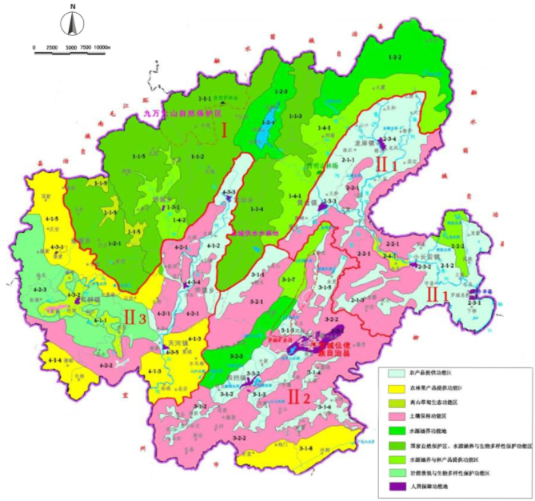

罗城仫佬族自治县生态环境保护“十四五”规划

罗城仫佬族自治县人民政府

广西水环环保科技有限公司

## 第1章　 生态环境保护形势

### 第一节  “十三五”生态环境保护成效

“十三五”期间，罗城坚持以习近平生态文明思想为指导，坚决落实各级关于生态环境保护决策部署,坚持方向不变、力度不减,紧紧围绕打好打赢污染防治攻坚战、服务经济高质量发展,坚持精准治污、科学治污、依法治污,统筹打好蓝天、碧水、净土三大保卫战，完成了中央环保督察及“回头看”、自治区级环保督察问题整改，确保全县生态环境质量总体稳定并持续向好,牢牢守住生态环境安全底线,不断提高人民群众对生态环境的获得感。

（一）生态环境保护管理体制逐步建立

2015年12月31日，罗城出台了《关于印发<罗城仫佬族自治县环境保护“党政共管、一岗双责”责任制管理办法>的通知》(罗办发〔2015〕101号)，明确生态环境保护“党政同责、一岗双责”的责任体制。定期召开全县环保工作会议，和11个乡镇党政负责人签定《环境保护工作目标责任书》。

（二）环境质量进一步改善

1.环境空气质量

根据环境监测站的环境空气质量监测年报，2015-2020年，县城区大气中可吸入颗粒物(PM10)、细颗粒物（PM2.5）两项项指标日均值和年均值均呈逐年下降的趋势，2020年罗城县城区PM10、PM2.5年平均浓度分别为37微克/立方米和25微克/立方米，达到上级下达的指标任务。

2.声环境质量

2018年完成城区声功能区划定，城区噪声昼间和夜间符合各类别功能区的要求；城区道路交通噪声状况良好，符合国家相关标准要求。

3.水环境质量

2020年，罗城境内两条主要河流武阳江、东小江交界断面各项指标监测结果均符合《地表水环境质量标准》（GB 3838—2002）Ⅱ类水质标准限值要求，水质达标率为100%，均优于所制定的水质目标要求，水质质量稳定并持续改善。3个县级集中式饮用水水源地全年水质监测达标率为75%，其中好峒水源地（湖库型）达标率100%，双坝塘、龙潭呇地下水水源地，主要为2020年下半年菌落总数和总大肠杆菌群2项超标，自治区人民政府已于2021年3月20日批复同意撤销龙潭呇饮用水水源保护区。

4.土壤环境质量

2020年全县农用地安全利用完成面积9.93万亩，总体完成率101.51%，超额完成自治区下达罗城的农用地安全利用和严格管控类耕地任务目标。

5.生态环境

“十三五”期间，罗城坚持生态立县不动摇，推进有益的尝试和大胆的探索，走出了一条保护与发展并举、环境与经济同步发展的科学之路，全县形成了环境优美、经济繁荣、发展协调、社会和谐的新局面。目前，全县共有国家地质公园2个，国家级自然保护区1个；成功创建自治区级生态村16个，市级生态村52个。

6.农村环境整治

加强农村饮用水源保护，编制划定了21个农村千人以上集中式饮用水源保护地保护区，集中式饮用水源地水质合格率达到100%，解决了全县农村安全饮水问题；引导农户进行改厨改厕，鼓励农户新建、改造化粪池，已建成并投入运行的农村污水处理设施10座，在建农村污水处理设施7座；按照《罗城仫佬族自治县人民政府办公室关于印发罗城仫佬族自治县畜禽养殖禁养区划定方案的通知》（罗政办发〔2019〕140号）要求，对禁养区内养殖户实行退养，对适养区内规模化养殖场建设污染防治设施，防止对环境造成污染。

（三）主要污染物减排工作取得重大进展

“十三五”期间，罗城以工程减排为主要抓手，以产业结构调整为主要措施，对所有直接和间接排放工业废气单位都要实行排污许可，实施排污许可证制度。实行大气污染排放控制制度，实现污染减排目标，各部门齐抓共管，实现减存量、控新增，圆满完成污染减排任务，完成年度氨氮、二氧化硫和氮氧化物和挥化性有机物总量控制和减排任务。

（四）污染防治工作取得较大成效

“十三五”期间，罗城积极协助自治区生态环境厅开展农用地土壤污染状况详查采样工作，完成了辖区内所有农用地点位土壤样品及水稻样采集工作；积极协助自治区生态环境厅及河池市生态环境局开展重点行业企业用地污染状况调查工作；全面完成了耕地土壤环境质量类别成果划分工作，并按类别划分成果开展农用地安全利用工作；扎实推进受污染耕地综合治理，超额完成自治区下达全县的农用地安全利用和严格管控类耕地工作任务目标；加快推进2016年度中央土壤污染防治专项资金使用进度，发挥土壤污染防治专项资金效益；加强对已关闭涉重金属企业的日常监管，对已关闭涉重企业地块进行场地调查与风险评估，为下一步的治理修复提供依据，确保污染地块得到有效风险管控和治理修复，提高污染地块安全利用率。

（五）稳步推进重点领域突出环境问题整改

扎实推进中央环保督察“回头看”和自治区级环保督察问题整改落实工作。完成中央生态环境保护督察“回头看”及自治区级环保督察信访交办件，严格落实整改“销号制”，按照“条条要整改、件件有着落”原则，明确责任单位、责任人、整改目标、整改措施和整改时限，督办落实，办结销号，目前已全部完成办结销号。同时，加强了组织领导，深化了思想认识，举一反三，在全县范围内开展了突出环境问题大排查、大整治。

（六）环境管理制度进一步完善

严格按照法律规定和法定程序开展环评审批工作。坚持把建设项目环境管理作为控制新污染源的重要手段，严把建设项目审批准入门槛，杜绝高能耗、高污染；进一步做好“放管服”和“四办”改革,优化审批事项服务流程,完善审批事项目录；全面推进“三线一单”编制工作,建立“生态保护红线、环境质量底线、资源利用上线、环境准入负面清单”环境管控体系。

（七）环境监测、监察能力进一步提高

环境保护监测站通过竣工验收，备配了日常所需监测设备，罗城基础监测需要得到有效保障。综合执法大队标准化建设通过上一级的验收。执法大队保持严厉打击环境违法行为的高压态势，让企业自觉守法。巩固提升环境执法大练兵活动成果，深入推进环境执法“双随机”。开展了全县环境污染隐患大排查工作，严厉打击违法行为，关闭、停产、处罚了一批环境违法企业，整改了一批突出环境污染隐患企业，有效预防和遏制了环境污染事件发生，制定《突发环境事件应急预案》，做好突发环境事件预警及应急处置，确保不发生重大环境污染和生态破坏事件，保障环境安全。积极开展县城及周边地区大气污染成因及控制对策研究，为大气污染防治提供科学支撑；加大重点水域水质监测频次，为饮用水水源保护提供科学依据;完成环境质量监测及声功能区划分工作，进一步扎实推进生态功能区考核工作。

（八）夯实环境宣传教育，推动知行合一

以生态环保教育“五进”“下基层”等活动为契机，开展环保宣传进企业、进机关、进社区、进农村、进学校活动。围绕环保主题“美丽中国，我是行动者”，积极开展“6.5”世界环境日集中宣传活动。三是进一步扩展了环保宣传渠道；及时在政府网站公开环保有关信息，做到公开透明。

### 第二节 当前存在的主要生态环境问题

尽管近年来罗城生态环境质量持续改善，但产业发展结构性问题还有待全面解决，工业园区环境保护基础设施仍存在短板，这些给我们敲响了警钟，我们也正在抓紧整改。对标党中央、国务院生态文明建设决策部署，经分析梳理，罗城生态环境保护工作主要存在6个方面的薄弱环节。

（一）产业结构调整任重道远

2020年全县实现地区生产总值58.35亿元，比上年同期增长2.1%（按2015年不变价格计算）。其中第一产业增加值23.4亿元，增长2.0%；第二产业增加值4.73亿元，增长7.3%；第三产业增加值30.22亿元，增长1.4%。第一、二、三产业增加值占地区生产总值的比重分别为40.1%、8.1%和51.8%，对经济增长的贡献率分别为37.8%、27.8%和34.4%。三产比重刚过半，经济转型和结构调整还需要大力推进。在产业结构方面，全县“两高”项目仍未建立。

（二）生态环境质量持续改善空间有限

罗城环境质量总体趋势持续向好，多项环境质量指标位居全区前列，要确保环境质量“只能变好，不能变坏”需要付出更大的努力。一方面，污染防治新老问题交织。大气污染治理仍处于初级阶段，城乡社会面源污染管控能力薄弱，加上外部过境污染源的影响，2021年1月至3月，全县细颗粒物（PM2.5）平均浓度同比上升31.0%，可吸入颗粒物（PM10）平均浓度同比上升59.7%，优良天数比例同比下降8.9个百分点，累计出现污染天气11天，一季度污染天数比上年全年度的还多出6天，大气污染防治形势非常严峻。农村生活污染、种植养殖污染等治理难度较大。部分固体废物综合利用和处置途径较窄、技术不成熟。另一方面，全县减排空间已大幅收窄，重金属污染物减排项目有限，继续减排潜力不大。

（三）城乡生态环境基础设施不够完善

2018-2020年，罗城实施了生态环境保护基础设施建设三年攻坚作战，多措并举全力推进基础设施建设，取得明显成效。2020年，罗城生活垃圾无害化处理能力为2.8万吨/年，无害化处理率达到100%；城镇污水处理率达99%；累计建成镇级污水处理设施4座（2018年前建成2座），实现镇镇建成污水处理设施目标，目前全县还有4个乡未实现污水集中处理。城镇生活污水和工业园区污水处理设施配套管网覆盖不够。

（四）矿产资源开发生态环境保护仍存在突出问题

在矿产资源开发中，仍存在部分露天矿山企业未按照矿山开采设计（开发利用方案）实施开采，未按照矿山地质环境恢复治理与土地复垦方案实施治理和复垦，超批准生产规模开采现象仍然存在；部分矿山企业管理薄弱，开采加工过程、矿产运输等造成的生态环境破坏和污染问题长期得不到解决，群众反复投诉；在矿产资源开采闭矿后，生态修复治理投入资金不足，大部分是采取封山搁置方式进行自然复绿，恢复过程缓慢。

（五）突出生态环境问题整改仍需持续发力

个别部门对加快推进督察整改的紧迫感不强，跟踪督办不够，对环境治理的长期性艰巨性认识不足，环境治理和污染防治攻坚合力不够、办法不多，整改工作还面临一些困难和问题。

（六）生态敏感区域的保护工作仍跟不上新形势新要求

自然保护区管理存在短板，自然保护地内违规违法活动仍然存在。辖区内存在群众人工林，按保护区条例不允许采伐，且尚未出台补偿赎买方案，群众对林木采伐意愿强烈，上访现象频发，维稳压力大。现管理中心已将集体人工林赎买方案报自治区林业局审核；部分村屯在保护区内，群众生产建设都存在限制，目前保护区整合优化方案将部分村庄等调出保护区，方案已报自治区林业局审核。

（七）治理体系、能力现代化仍需完善

环保执法力量仍有不足。现有基层环境执法人员偏少，监管任务重、环境风险大；缺乏部分应急救援装备，不能较好满足现场监察执法及应对环境突发事件的需求；环保系统内部监管力量未能高效整合，环境监测数据未能有效用于现场执法监管，精细化执法能力有待提升。

环境监管能力尚不健全。全县土壤环境质量的监管能力依然薄弱，土壤治理和修复的经验仍然较少，土壤污染风险管控和土壤安全利用工作仍处于初期阶段；新时期各类环保问题复杂糅合，相关部分环保职责尚未厘清理顺，涉及多部门的环保问题未能根本解决，权责不明难以实现长效管理；环保监管对象面广量大，监管任务日益繁重，监管要求不断提高，环保监管力量与监管任务不相适应。

### 第三节 生态环境保护新机遇

（一）生态环境保护战略地位更加突出

党的十八大明确提出将生态文明建设提升至国家战略高度。党的十九大提出，建设生态文明是中华民族永续发展的千年大计，必须把坚持人与自然和谐共生作为新时代坚持和发展中国特色社会主义基本方略的重要内容，把建设美丽中国作为全面建设社会主义现代化强国的重大目标，把生态文明建设和生态环境保护提升到前所未有的战略高度。党的十九届五中全会明确提出了“十四五”时期“生态文明建设实现新进步”的主要目标，提出了2035年“生态环境根本好转，美丽中国建设目标基本实现”的远景目标，为新时代加强生态文明建设和生态环境保护工作提供了方向指引和行动指南。

（二）广西确立以生态立区之路

党的十八大以来，广西把绿色发展贯穿经济建设全过程，一手抓生态经济发展，一手抓环境保护治理，不断擦亮“山清水秀生态美”的金字招牌。党的十九大以来，广西牢牢守住“发展与生态”两条底线，以创新、协调、绿色、开放、共享发展理念为引领，坚定不移实施以生态建设为主的林业发展战略，生态建设与经济建设同步推进的可持续发展之路越走越宽。2017年广西壮族自治区人民政府办公厅印发《开展“美丽广西·宜居城市”建设活动任务分工方案》的通知，完善设施建设，实施城市承载力提升行动，要求建设绿色家园，实施城市修补与生态修复工程、蓝天碧水工程、宜居城市创建活动。

（三）河池进入生态建设提质增效期

河池市委、市人民政府紧紧围绕广西争创全国生态文明示范区的奋斗目标，确立了“生态立市、生态兴市、生态强市”的生态建设战略部署。坚持生态严管严治，守护青山绿水，留住蓝天白云，让“河池生态优势金不换”更加深入人心。“十四五”期间，河池进入经济社会发展的赶超期和生态建设的提质增效期。

## 第2章　 指导思想及基本原则

### 第一节 指导思想

“十四五”时期是深入贯彻落实习近平生态文明思想、污染防治攻坚战取得阶段性胜利、全面启动美丽中国建设、推动实现第二个百年目标的首个五年规划的关键时期；是广西壮族自治区开启全面建设社会主义现代化、建设壮美广西、共圆复兴梦想新征程，适应我国社会主要矛盾历史性新要求和积极应对世界百年未有之大变革的第一个五年规划；是罗城仫佬族自治县在全面脱贫、顺利实现与全国、自治区同步全面建成小康社会目标之后，向全面建设社会主义现代化迈进的关键时期。罗城仫佬族自治县将严格落实“五位一体”总体布局和“四个全面”战略布局，力争实现与全国社会经济建设同步发展。

围绕“十四五”期间贯彻落实习近平生态文明思想、污染防治攻坚战取得阶段性胜利、全面启动美丽中国建设目标要求，全县环保工作面临历史性转型和改善机遇。作为国家级重点生态功能区，罗城仫佬族自治县需以改善环境质量为核心，严守空间红线、总量红线、准入红线，强化主体功能区建设，守住生态环保和安全生产底线，加大环境综合治理与生态保护修复力度，严格环境风险防控，深化环保供给市场与治理主体多元化改革，强力推进环保法制建设。

面对新时期经济社会发展、环境保护新常态，科学谋划罗城仫佬族自治县“十四五”环境保护战略布局，对指导全县“十四五”环境保护工作，破解资源环境约束、全面改善环境质量、推动环保工作实现新突破具有重要意义。

全面贯彻党的十九大和十九届二中、三中、四中全会精神和习近平总书记系列重要讲话精神，大力推进生态文明建设，与《环境保护法》接轨，以科学发展观为指导，坚持“四个全面”战略布局，坚持创新、协调、绿色、开放、共享的发展理念，坚持以人为本，按照全面建成小康社会各项要求，紧扣我国社会主要矛盾变化，突出抓重点、补短板、强弱项，特别是要坚决打好防范化解重大风险、精准脱贫、污染防治的攻坚战

全面启动美丽中国建设、推动实现第二个百年目标的根本要求，统筹规划城市生态体系构架，明确区域环境功能分区；优化产业结构，合理开发利用和保护自然资源；大力实施环境综合整治和生态修复，促进经济、社会与环境全面、协调、可持续发展，实现人与自然和谐。

为顺利完成“十四五”发展目标，根据国家和自治区、河池市的相关工作部署，罗城仫佬族自治县人民政府提出编制《罗城仫佬族自治县生态环境保护“十四五”规划》（以下简称《规划》），根据工作需要，由广西水环环保科技有限公司承担《规划》的编制工作。

项目技术团队通过基础资料收集、数据统计分析、现场调研，详细了解了罗城发展整体状况、环境质量现状、环境保护工作面临的压力与挑战，分专题开展了研究并在此基础上实施了《规划》的编制工作。本规划以“以人为本，生态优先；质量主线，标本兼治；法制统领，空间管控；改革创新，多元共治”为原则，从生态环境功能区划分、大气环境保护、水环境保护、声环境保护、固体废物污染防治、土壤环境保护、生态与农村环境保护、循环经济发展、环境监管能力建设等方面入手，提出具体措施与工程项目，为加快全县振兴发展提供良好的环境支撑。

### 第二节 基本原则

（一）以人为本，生态优先

以解决损害群众健康突出问题为重点，提出和解决重点环境问题的对策和任务，全力改善区域环境质量，坚持生态优先，促进人与自然的和谐共生。

（二）质量主线，标本兼治

以环境质量主线为抓手，以资源环境承载力为先决条件，实现环境优先战略，标本兼治，促进经济社会发展与环境保护相协调。

（三）法治统领，空间管控

以最严格的环境保护制度为统领，构建科学合理的生产、生活、生态空间格局，推进“多规合一”，实现空间管控“一张蓝图绘到底”。

（四）改革创新，多元共治

深化环境保护体制机制改革，积极适应环保新常态，逐步形成政府、企业、公众多元共治的环境治理体系。

### 第三节 编制依据

（1） 《中华人民共和国环境保护法》（2015年1月1日施行）；

（2） 《中华人民共和国水法》2016年7月2日修订；

（3） 《中华人民共和国节约能源法》（2016年7月2日修订）；

（4） 《中华人民共和国循环经济促进法》（2018年）；

（5） 《中华人民共和国水污染防治法》（2017年）；

（6） 《中华人民共和国大气污染防治法》（2018年）；

（7） 《中华人民共和国土壤污染防治法》（2018年）；

（8） 《中华人民共和国环境噪声污染防治法》（2018年）；

（9） 《中华人民共和国固体废物污染环境防治法》（2020年9月1日施行）；

（10） 《饮用水水源保护区污染防治管理规定》（2010年）；

（11） 《广西壮族自治区环境保护条例》（2019年修订）；

（12） 《广西壮族自治区饮用水水源保护条例》（2017年）；

（13） 《广西壮族自治区大气污染防治条例》（2018年）；

（14） 《广西环境保护和生态建设“十三五”规划》；

（15） 《广西国民经济和社会发展第十三个五年规划纲要》；

（16） 《广西大气污染防治攻坚三年作战方案（2018-2020年）》（桂政办发〔2018〕80号）；

（17） 《广西水污染防治攻坚三年作战方案（2018-2020年）》（桂政办发〔2018〕81号）；

（18） 《广西土壤污染防治攻坚三年作战方案（2018-2020年）》（桂政办发〔2018〕82号）；

（19） 《广西生态环境保护基础设施建设三年作战方案（2018-2020年）》（桂政办发〔2018〕83号）；

（20） 《罗城县国民经济和社会发展第十三个五年规划纲要》；

（21） 《罗城仫佬族自治县土地利用总体规划（2006-2020年）》（2015调整）；

（22） 《罗城仫佬族自治县县城总体规划（2014-2030年）》；

（23） 《罗城仫佬族自治县全域旅游发展规划》（2018-2025年）；

（24） 《广西罗城国家地质公园规划（2016-2025年）》；

（25） 《罗城仫佬族自治县工业园区总体规划（2018-2030年）》；

（26） 《自治县畜牧养殖现代化发展“十四五”规划》；

（27） 《自治县水产养殖发展“十四五”规划》；

（28） 《罗城仫佬族自治县国民经济和社会发展第十四个五年规划纲要（草案）》；

（29） 《罗城仫佬族自治县“十四五”规划重大项目表》；

（30） 《罗城仫佬族自治县国家生态文明建设示范县规划（2020－2030年）研究报告》；

（31） 其他政府和生态环境部门工作报告。

### 第四节 规划范围及年限

（一）规划范围

规划范围为罗城仫佬族自治县全境，包括东门镇、四把镇、小长安镇、黄金镇、龙岸镇、怀群镇、天河镇、兼爱乡、纳翁乡、宝坛乡、乔善乡等7个镇4个乡，涉及总人口数38.17万，国土面积2651平方公里。

（二）规划时限

规划基准年为2020年，部分数据在2020年资料缺失的情况下，引用2019年的数据做为参照。规划期限“十四五”期间为2021年到2025年。

## 第3章　 规划目标和战略重点

### 第一节 规划目标

坚持以人为本、布局优化、生态文明、改革创新的发展理念，把罗城仫佬族自治县建设成为经济、社会、环境全面协调可持续发展的践行生态文明的绿色城市。

到2025年，主要污染物排放总量持续下降，水环境质量保持优良，大气环境质量明显改善，土壤环境质量总体保持稳定，农村环境保护工作得到切实加强，环境基础设施不断完善，环境安全保障能力明显增强。

### 第二节 规划指标体系

“十四五”时期，罗城仫佬族自治县生态环境保护以持续推进全县生态环境质量持续改善为目标；严守生态保护红线不退让、筑牢区域生态安全的底线，促进经济社会高质量发展；坚守生态环境质量底线，保护罗城山清水秀生态美的生态品牌。着力优化绿色发展方式，着力聚焦污染防治攻坚战，着力提升生态监管能力，着力创新治理体制机制。全面推进落实“绿色发展、污染治理、固废处置、风险防控、生态修复、提升监管能力”等方面任务。

结合国家、自治区、河池市相关要求和全县生态环境管理现状、生态文明建设发展趋势，围绕大气环境质量、水环境质量、土壤环境质量、生态保护、环境安全、气候变化、人居整洁等方面设置相关约束性、预期性指标，指标体系考虑：一是坚持以改善生态环境质量为核心；二是与美丽中国指标相衔接，生态环境主要要素与领域的全覆盖，强化规划的宏观性、全面性、指导性；三是坚持可量化、可评估、可分解、可考核，立足河池市情，突出规划的约束力和可操作性。初步考虑“十四五”指标体系包括环境质量改善、应对气候变化、污染物排放总量控制、环境风险管控、生态安全维护、人居环境改善等六大类28项指标。

| 专栏1 “十四五”时期罗城仫佬族自治县生态环境保护主要指标 |
|---|
| 类别 | 指标 | 2020年 | 2025年 | 指标属性 |
| 环境质量改善 | 1、县城空气质量优良天数比率（%） | 98.6 | 达到上级考核要求 | 约束性 |
| 2、县城细颗粒物（PM2.5）年平均浓度（μg/m3） | 25 | 达到上级考核要求 | 约束性 |
| 3、地表水质量达到或好于III类水体比例（%） | 100 | 100 | 约束性 |
| 4、地表水质量劣Ⅴ类水体比例（%） | 0 | 0 | 约束性 |
| 5、地下水质量V类水体比例（%） | -① | 达到上级考核要求 | 预期性 |
| 6、县级集中式饮用水水源地水源达标率（%） | 100 | 达到上级考核要求 | 约束性 |
| 应对气候变化 | 7、单位地区生产总值二氧化碳排放量降低（%） | (15.9)② | 达到上级考核要求 | 约束性 |
| 8、单位地区生产总值能源消耗降低（%） | -① | 达到上级考核要求 | 约束性 |
| 9、非化石能源占一次能源消费比例（%）⑥ | -① | 达到上级考核要求 | 预期性 |
| 污染物排放总量控制 | 10、氮氧化物排放总量减少（%） | [-15]③ | 达到上级考核要求 | 约束性 |
| 11、挥发性有机物排放总量减少（%） | -① | 达到上级考核要求 | 约束性 |
| 12、化学需氧量排放总量减少（%） | [1] ③ | 达到上级考核要求 | 约束性 |
| 13、氨氮排放总量减少（%） | [1.1]③ | 达到上级考核要求 | 约束性 |
| 14、涉重金属重点行业重点重金属污染物减排量（千克）④⑤ | -① | 达到上级考核要求 | 约束性 |
| 环境风险防控 | 15、工业固体废物综合利用处置率（%）④⑤ | 47.5 | ≥75⑥ | 预期性 |
| 16、受污染耕地安全利用率（%） | 88 | 达到上级考核要求 | 约束性 |
| 17、污染地块安全利用率（%） | 100 | 100 | 约束性 |
| 18、重大及以上等级突发环境事件数量（起）④⑤ | [0]③ | [0]③ | 预期性 |
| 19、较大及以上等级辐射事故数量（起）⑤ | [0]③ | [0]③ | 预期性 |
| 生态安全维护 | 20、生态质量指数（新EI） | -① | 稳中向好 | 预期性 |
| 21、森林覆盖率（%） | 70.92 | ≥70.92 | 约束性 |
| 22、湿地保有量（万公顷）④ | 0.34 | ≥0.34 | 预期性 |
| 23、生态保护红线面积（万公顷） | -① | 不下降 | 约束性 |
| 人居环境改善 | 24、城镇生活污水集中处理率（%）④⑤ | 92.5 | ≥95 | 预期性 |
| 25、农村生活污水治理率（%） | 1.5 | 达到上级考核要求 | 预期性 |
| 26、县级及以上城市黑臭水体比例（%）⑤ | -① | 基本消除 | 预期性 |
| 27、城镇生活垃圾无害化处理率（%）④⑤ | 98 | 100 | 预期性 |
| 28、农村生活垃圾无害化处理率（%）④⑤ | 94.38 | ≥96 | 预期性 |
| 注：①“－”表示当时不具备监测手段或未纳入统计等原因，无相关数据。②（）内为2019年数据。③[ ]为5年累计数，负值表示增加。④国家 “十四五”时期生态环境保护指标外管控指标。⑤自治区“十四五”时期生态环境保护指标外管控指标。⑥《自治区生态环境保护 “十四五”规划》指标值。 |

### 第三节 规划重点

(一)加强生态保护，提升生态文明建设水平

坚持生态保护与生态建设并举，污染防治与生态保护并重的原则，从源头防止生态破坏和退化，大力实施生态保护和建设重点工程，提高生态安全和生态服务水平。

1.强化重要生态功能区保护与考核。贯彻落实《罗城仫佬族自治县国家生态文明建设示范县规划》远期目标，巩固生态功能区划成果，加强重要生态功能区域的保护和建设，防止生态脆弱地区、重要生态功能区的生态环境受到新的破坏。优先在生态功能区划确定的重点生态功能区规划建设生态功能保护区，根据《国家重点生态功能区县域生态环境质量考核办法》的要求，开展重点生态功能区县域生态环境质量监测、评价与考核工作。强化监督管理，维护区域生态系统的稳定，增强生态系统涵养水源、保持水土、生物多样性等生态功能。

2.明确生态空间严守生态红线。强力推进生态保护红线划定工作，依据《生态保护红线划定技术指南（修订版）》《广西生态保护红线管理办法》《广西生态保护红线划定方案》等相关文件要求，科学划定县域重要生态功能区生态红线、生态环境敏感区/脆弱区生态红线和生物多样性生态红线。加强生态红线管控，实行严格的环境准入制度和管控措施；改善和提高生态系统服务功能，构建结构完整、功能稳定的生态安全格局；建立健全生态保护红线管控长效机制和破坏生态保护红线责任追究机制。

3.强化资源开发生态监管。发挥生态功能区划对资源开发的引导作用。进一步强化资源开发特别是重要生态功能区域、自然保护区内开发建设活动的生态监管，从源头防止新的人为生态破坏。切实加强水、矿产、土地、森林、生物等重要自然资源开发活动及交通基础设施、水电工程、旅游设施等项目建设的生态环境监管，严格执行环境影响评价制度和“三同时”制度，落实企业生态保护和恢复主体责任，规范开发建设与运营活动。严格自然保护区、森林公园、风景名胜区、地质公园、自然遗产地、重要湿地等区域资源开发规划及建设项目环评，强化开发活动的生态环境监察。

4.加快推进石漠化综合治理。采取封山育林恢复自然植被、退耕还林、小流域水土保持、农村能源建设等措施，全面推进石漠化综合治理，逐步恢复和重建岩溶地区生态系统。大力开展封山育林、人工造林，加强管护，提高岩溶地区森林覆盖率。建立石漠化土地动态监测管理系统和石漠化综合治理效果评价指标体系，定期开展石漠化土地动态变化和治理效果监测。

5.推进生态示范创建。完善生态文明制度建设深化生态示范建设，大力培育和繁荣生态文化，不断提升生态文明建设水平。推进不同层次的生态文明示范创建活动，大力开展生态乡镇、生态村试点建设，巩固和提升生态乡镇、生态村考核指标。“十四五”期间，力争完成国家级生态文明示范县创建工作。

（二）加强水环境综合整治，保持水质稳定达标

切实加强水环境综合治理，进一步改善水环境质量，保障饮用水安全。

1.保障饮用水水源地环境安全。加大集中式饮用水水源地环境保护力度，加强饮用水源区划工作，逐步完善饮用水源保护机制，实行严格的饮用水源地保护制度，严禁饮用水源保护区的一切违法开发建设活动。加强重点城镇饮用水源地一级、二级保护区污染源整治工程、生态修复与建设工程及饮用水源地环境监管能力项目建设；开展水源地水质日常监测工作，加大饮用水水源监测频次和监督频次，建立健全饮用水源地水质信息公开平台；结合公众监督，定期开展饮用水源地污染隐患排查，重点解决水源污染问题。

2.深化重点流域污染综合防治。深入实施东小江、阳江流域重点治理规划，加快淘汰高耗能重污染企业，加强沿江企业及企业废水治理设施监管，严格监管沿江排污口污水排放情况，重点推进沿江乡镇污水处理厂工程，提高辖区污水集中处理率。通过深度治理工业企业污染、推进城镇生活污染治理、积极防治养殖业污染，改善水环境质量；通过调整农业产业结构，发展生态农业及绿色农业，减轻农药、化肥对水体的污染，遏制化肥农药对水环境污染加剧的趋势。

3.加强重点流域断面的水环境质量保护。以环境质量改善为刚性约束，强化环境质量目标管理，建立流域水生态环境功能分区管理体系。开展东小江、武阳江流域水质季度性监测，密切关注流域断面水质，严格控制流域断面附近河道的纳污总量，确保东小江、武阳江流域总共2个监测断面均达到或优于Ⅲ类水质要求。

（三）加强大气污染防治，稳步提升大气环境质量

采取优化区域产业结构和布局、对重点工业行业进行废气治理、开展机动车排气污染防治、推广使用清洁能源等综合措施防治大气污染，稳步改善区域大气环境质量。

1.推进多种污染物综合控制。加强重点行业企业废气治理，控制工业二氧化硫、氮氧化物、烟尘、粉尘排放，全面整治燃煤小锅炉，大力推广使用清洁能源替代普通煤，禁止新建每小时20蒸吨以下的燃煤锅炉；加快重点行业脱硫、脱硝、除尘改造工程建设，每小时20蒸吨及以上的燃煤锅炉要实施脱硫，新型干法水泥窑要实施低氮燃烧技术改造并安装脱硝设施，实施燃煤、燃生物质锅炉和工业窑炉现有除尘设施升级改造。推进挥发性有机物污染治理，逐步完成县城区加油站的油气回收系统升级改造，鼓励和推广使用低毒、低挥发性有机溶剂。强化机动车辆尾气污染防治，实施城县公交优先战略，鼓励新能源汽车和电动汽车的使用，加快淘汰黄标车和老旧车辆，严格发放环保合格标志。加强地面扬尘污染防治，综合整治城市扬尘，加强施工扬尘监管，积极推进绿色施工。加大城县餐饮业油烟污染防治力度，开展餐饮油烟污染治理，城区餐饮服务经营场所应安装高效油烟净化设施，推广使用高效净化型家用吸油烟机。加强污水处理厂、淀粉厂、肥料厂、畜禽养殖场的恶臭污染防治。促进能耗低、排放少的低碳产业发展，有效降低碳排放强度，加强温室气体排放源的监测和监管。

2.推进区域环境空气联防联控。按照国家及自治区统一部署，逐步建立区域环境空气联防联控体系，健全环境空气监测和预警体系。重点推进辖区内环境空气质量自动监测站建设，开展环境空气质量评估，确保城镇空气质量优良率优于年度考核要求。建立环境空气质量信息发布平台，及时向社会公开城区环境空气质量状况。

（四）加强重金属污染综合防治

“控新治旧”相结合，加大重点行业重点区域重金属污染防治力度，强化监管，淘汰涉重金属产业落后产能，逐步解决重金属污染历史遗留问题。

1.强化重金属污染综合防治。严格执行国家有关产业政策以及有色金属行业调整振兴规划，严把涉重金属项目环境准入关，以重有色金属矿（含伴生矿）采选业和重有色金属冶炼业两大行业为重点防控行业，大力开展专项整治，采取停产整顿、技改搬迁、强制性清洁生产审核等措施，加快淘汰不符合产业政策的落后生产工艺、技术和设备。到2025年，确保实现区域重点重金属污染物排放量较“十三五”期间水平明显下降的目标。

2.着力解决区域重金属污染历史遗留问题。重点推进河池市罗城涉重企业遗留地块风险管控项目、罗城仫佬族自治县横山有色金属冶炼厂土壤污染治理工程、广西罗城明武矿业有限公司明武冶炼厂土壤污染治理工程等3个重金属污染治理项目建设，并完成工程竣工验收工作。

3.强化涉重金属企业环境监管。加强对已关闭重金属污染企业的环境监管，将涉重金属企业列为重点污染源加强监管，建立重金属排放企业监督性监测制度，排污口安装在线监测装置并与生态环境部门联网，确保污染源治理设施正常稳定运行。建立健全重金属环境风险防控系统和企业环境应急预案体系，开展违法排放重金属污染物专项整治行动。

（五）推进固体废物处理处置，防控危险废物环境风险

加强各类固体废物、危险化学品、持久性有机物等环境监管和风险防控，加快安全处理处置体系建设，提升处理处置能力和水平，保障环境安全。

1.提高危险废物和医疗废物安全处置水平。全面加强和规范全县危险废物和医疗废物管理，健全危险废物产生、利用、处置单位信息档案库和数据库；加强危险废物全过程监督管理，杜绝危险废物非法转移现象；制定、落实相关管理规定和技术规范，建立危险废物和医疗废物的收集、运输、处置全过程环境监督管理体系，加快危险废物处置中心建设，提高县医疗废物处置设施无害化处置能力和标准化管理水平。加大对重点企业及危险废物处置设施运行的监督力度，促进危险废物产生单位和经营单位规范化管理，推动危险废物处理处置收费政策和标准的制定和完善，切实保障危险废物和医疗废物处置设施正常运行。到2025年，乡镇以上医疗卫生机构医疗废物处置率达到100%以上，确保危险废物治理达标率达到95%以上。

2.完善生活垃圾处理设施。持续推进城镇生活垃圾处理设施建设，完善城镇垃圾回收、转运体系，推进垃圾处置及配套设施建设和运营的县场化，强化垃圾处置设施的环境监管，到2025年，全县城镇生活垃圾无害化处理率达到95%以上，其中县城及以上城镇生活垃圾无害化处理率达到100%以上。

3.大力推进固体废物综合利用。鼓励有色金属矿采选、有色金属冶炼、制糖等重点行业优先采用先进的技术和工艺，提高资源利用率，从源头上减少固体废物的产生。加强共伴生矿及尾矿、废石、冶炼炉渣、脱硫石膏等固体废物的综合利用技术研发，提高工业固体废物综合利用率。重点推进工业固体废物综合利用试点建设。

4.加强危险化学品风险防控。严格化学品环境监管，对化学品生产经营企业进行环境隐患排查，加强化学品环境风险防控，强化安全保障措施，建立化学品环境污染责任终身追究制和全过程行政问责制。制定重点环境管理化学品清单，建立和实施危险化学品环境管理登记制度，定期开展化学品生产、储存、使用、经营、运输和废弃物处理处置领域的环境监察执法。强化化学品生产准入和行业准入，推行工业产品生态设计，严格限制高毒、高残留、对环境和人体健康危害严重的物质生产、销售、使用，开展强制性清洁生产审核。严格执行国家颁布的有毒、有害化学品淘汰目录，加大有毒、有害化学品淘汰力度。

（六）推进农村环境保护，促进新农村建设。

按照建设社会主义新农村、推进城乡经济社会发展一体化的要求，以保障农村饮用水安全、治理农村生活污水垃圾污染、提高农业污染防治水平为重点，加强农村环境保护，大力推进农村环境综合整治，不断改善农村环境。

1.切实抓好农村饮用水水源地环境保护。大力推进农村集中式饮用水水源地保护区环境整治工作，复核《罗城仫佬族自治县乡镇集中式饮用水水源保护区划定方案》，将水源地纳入重点整治区域，协调饮用水水源地周边的自然村落优先建设。优先考虑水源地、一级保护区、二级保护区周边农村污水管网以及污水处理设施的建设，结合各乡镇总体规划，协调各村屯污水处理的方式，在镇域规划范围内的，选择纳入乡镇污水厂处理。

2.全面推进农村环境综合整治。加快乡村生活污水处理设施和生活垃圾的收集、转运、处置系统建设，规划至2025年，33个自然屯将建成33套分散式污水处理站，122个自然屯将建成122套集中式污水处理站，4个自然屯采用纳管方式处理生活污水，建成污水处理站总规模达2810.0m3/d，使得全县人口受益率达12.1%，污水治理行政村覆盖率达25.5%。大力推行垃圾“户分类、村收集、镇转运、县处理”模式，积极推广清洁环保生产方式防治农业面源污染；建立农村环境综合整治目标责任制，健全农村环境保护长效机制。

（七）规范核与辐射污染管理与防治，确保环境安全。

加快核与辐射安全及放射性污染防治的县县监管体系和队伍建设，建立和配备针对核与辐射安全及放射性污染的有效评价体系和检测手段，强化对核设施和放射源安全监管，完善对放射源实施全寿命周期跟踪的放射源管理信息系统，有效控制核与电磁辐射污染。严格电磁辐射建设项目，特别是移动通信发射基站、输变电工程的辐射环境管理，从源头抓起，做好总体规划，落实规划环评、审批和“三同时”监管制度，有效监控电磁辐射项目。进一步加强对放射性同位素与射线装置生产、使用、销售的安全许可和监管，建设对放射源实施全寿命周期跟踪的放射源管理信息系统。加强放射性废物库的安全保卫，积极开展辐射建设项目的审批工作，防止产生新的辐射污染。

（八）强化能力建设，提升环境监督管理水平。

1.环境监察能力建设。优化生态环境保护执法方式提高执法效能，深化生态环境保护综合行政执法改革、构建现代环境治理体系、加强和规范事中事后监管的决策部署；全面履行生态环境保护行政执法责任，强化和创新生态环境监管执法；严格规范生态环境执法行为，着力提高生态环境执法效能，推动建立职责明晰、上下协调、运转高效、保障有力的生态环境保护综合行政执法体系；坚持方向不变、力度不减、重点突出“依法、精准、高效、规范”执法，建设一支机构规范化、装备现代化、队伍专业化、管理制度化的生态环境保护综合行政执法队伍。

2.环境监测能力建设。加强与上级部门的技术和业务交流，不断完善基础设施建设，强化业务学习；建立健全环境监测质量管理制度体系，加强数据质量控制，完善环境监测技术体系，提高监测数据综合分析能力。

3.环境应急能力建设。制定、完善各级各类环境应急预案，结合本县突发性环境污染事故的特点和规律，增加应急处置、快速机动和自身防护装备、物资的储备。基本建立覆盖全县的精干高效、反应迅速的环境应急响应网络系统。定期组织开展环境应急培训和演练，提高应急处置队伍业务素质和能力，有效应对突发环境污染事故。

4.环境信息、宣教能力建设。加强环境统计与信息能力建设,提高信息共享与综合管理水平，建成全县环境信息资源共享平台、信息管理与发布平台；丰富和完善环境宣传教育手段，加强环境宣教工作人员的培训，提高业务水平。

5.环境科研能力建设。构建全县环境科研平台，建设和完善环境科研咨询服务机构，优化环保科研人员专业结构，合理配备各类技术人才，逐步形成一支以县环科所为主导力量，县内有关高校、科研机构为构架的精干、高效、高水平的环境科研队伍，全面提高全县环保科研水平。

（九）严格总量控制，确保完成减排目标。

实行主要污染物排放总量控制制度，按照“减存量、控增量、挖潜力”的工作思路，全面推进化学需氧量、氨氮、二氧化硫、氮氧化物等主要污染物减排，落实减排责任，通过强化结构减排、深化工程减排、实化管理减排和推进清洁生产，降低产排污强度。

1.加快淘汰落后产能。严格执行国家相关产业政策，进一步加大对淀粉、有色冶炼、水泥、建材等行业落后产能淘汰力度，实行主要污染物排放总量控制，建立污染减排、淘汰落后产能完成情况与新建项目相衔接的审批机制，实施“等量置换”或“减量置换”。以高标准推动传统产业改造提升，加快淘汰落后工艺技术和设备。

2.大力实施主要水污染物减排工程。

①全面深化工业行业水污染物减排。以制糖、淀粉、有色金属采选、有色金属冶炼、酒类制造、食品、医药、农副产品加工等行业为重点，继续加大工业污染深度治理和工艺技术改造力度，提高行业污染治理技术水平，降低单位产品污染物排放强度。到2025年，国控重点污染源工业废水排放综合达标率达100%。

②继续推进城镇生活水污染物减排。优先完善已建成污水处理厂收集管网和脱氮除磷设施，加强污水处理设施运行监管，力争设施运行负荷率达到80%以上，提升城镇污水处理能力；到2025年，全县城镇污水集中处理率达到92.5%以上。加快建设污泥无害化处理处置设施，到2025年，建成并投入运行县城区污水处理厂污泥无害化处理设施。强化垃圾渗滤液治理，实现达标排放。

③大力推动农业源减排。积极推进以规模化畜禽养殖场和养殖小区为重点的农业源减排，推广清洁养殖方式，应用先进实用技术治理畜禽养殖污水和废弃物，实现废弃物的无害化处理和资源化利用，最大限度地减少污染物的排放量。到2025年，规模化畜禽养殖场固体废物和废水无害化处理率达100%。

3.加快推进主要大气污染物减排工程。持续推进工业行业大气污染物减排，鼓励推行使用清洁能源。加快重点行业脱硫、脱硝、除尘改造工程建设，实施燃煤、燃生物质锅炉和工业窑炉现有除尘设施升级改造，每小时20蒸吨以上的现有燃煤锅炉实施烟气脱硫。

4.强化管理减排。

①加强减排监管。健全减排统计、监测、考核制度，落实减排目标责任制，落实污染物排放总量控制要求。全面推行排污许可证制度，加强已投运脱硫脱硝设施、工业和生活污水处理设施运行监管，严格执法检查，完善重点污染源自动监控管理体系，确保设施正常运行和达标排放，提高减排效率。结合罗城实际，实施更为严格的涉重金属企业污染物排放标准、清洁生产标准。

②严格环境准入。强化源头控制，推进重点产业发展规划和工业园区规划环境影响评价，把污染物排放总量控制指标作为环评审批的前置条件。严格执行国家产业政策，进一步提高高能耗、高排放和产能过剩行业的环保准入门槛，严把项目环评审批关。建立健全新建项目管理部门联动机制和项目审批问责制，控制污染物新增量。

③推进清洁生产。将清洁生产审核作为环保审批、环保验收、核算污染物减排量的重要因素，提高企业清洁生产水平，减少污染物排放。重点推进工业行业清洁生产，在有色金属采选、有色金属冶炼、水泥、淀粉、酒精等重点行业推行清洁生产，进一步加强超标排污或超过污染物排放总量控制指标的企业强制性清洁生产审核。逐步开展农业、服务业清洁生产工作。全面实施工业污染全防全控战略，加强污染物排放管理工作，落实污染减排总量控制要求。逐步建立企业保护环境的激励和约束的长效机制，推行稳定达标排放。

## 第4章　 大气环境保护规划

### 第一节 规划目标

到2025年，工业行业大气污染物排放控制水平得到大幅度提升，建立起高效的大气污染综合防治体系和完善的大气污染执法监督体系，初步建立大气监测预报预警体系。氮氧化物排放总量、挥发性有机物排放总量达到自治区考核要求，县城中心空气质量优良天数比率、PM2.5年平均浓度达到自治区考核要求。

### 第二节 主要任务和措施

（一）严格环境准入，源头控制排污

优化产业布局。完成生态红线、环境质量底线、资源利用上线、环境准入清单编制工作，明确禁止和显示发展的行业、生产工艺和产业目录。完善高耗能、高污染和资源型行业准入条件，对环境空气质量未达标的按上级要求施行更严格的产业准入门槛。积极推行区域、规划环境影响评价，新（改、扩）建建材、有色等项目的环境影响评价应满足区域规划环评要求。加大区域产业布局调整力度，加快城市建成区重污染企业半期改造或关闭退出。

（二）推广清洁能源，优化产业结构

严格落实自治区“两高”项目联席会议审查制度，对产能过剩行业按国家规定实行产能等量或减量置换。严格执行质量、环保、能耗、安全等法规标准，加快淘汰水泥等行业的落后产能和过剩产能；实施糖业清洁燃烧技术改造，促进大气治理重点技术装备的产业化发展和推广应用；制定全县工业炉窑、砖窑综合整治实施方案，建立各类窑炉管理清单，加快淘汰中小型煤气发生炉，鼓励工业窑炉使用电、天然气等清洁能源或由周边热电厂供热。

（三）深化工业源治理，推进脱硫、脱硫、除尘工作

加大环境执法监管力度，将延期在线监测数据作为执法依据，推动企业限期达标治理。按照国家排污许可证行业发放要求，完成排污许可证核发工作，加强证后监管，对无证排污的实施停产整治。建立“散乱污”企业动态管理机制，依法依规对“散乱污”企业实施分类处置，2022年全面完成清理整治工作，坚决杜绝“散乱污”项目建设和已取缔的“散乱污”项目异地转移、死灰复燃。加强水泥行业、制糖行业排污许可证后监管，开展糖厂锅炉烟气治理，榨季实现全面稳定达标排放。

全面整治“散乱污”企业及集群，重点对矿山开采、耐火材料、碳酸钙粉体、砖瓦窑、废塑料、木材加工、石材加工、水泥粉磨站、混凝土搅拌等行业企业，实行拉网式排查和清单制、台账式、网格化管理，分类实施关停取缔、整合搬迁、整改提升等措施，

开展建材、有色等重点行业燃煤锅炉无组织排放排查，建立无组织排放管理清单及无组织排放整治方案；2022年基本完成物料（废渣）储存、装卸、破碎、输送及工艺工程的无组织排放进行深度治理，推动重点行业企业在安全生产许可条件下，实施水泥企业水泥窑、粉磨设备（粉磨站）除尘系统提升改造，原料场密闭化、原料高效输送改造、厂区道路硬化及保洁。

（四）削减挥发性有机物，着力控制臭氧污染

推动工业涂装、包装印刷、电子信息、合成材料等重点行业挥发性有机物（VOCs）污染防治，开展VOCs排放摸底调查，建立排污单位名录，积极推动工业涂装等行业VOCs削减和有毒有害原料替代。

鼓励企业生产中使用符合环保要求的水基型、非有机溶剂型、低有机溶剂型产品，提高环保型涂料使用比例。深化工业涂装、包装印刷、电子信息、合成材料等行业挥发性有机物排放达标治理工作。

开展生活源挥发性有机物排放控制。在建筑装饰装修行业推广使用符合环保要求的水性或低挥发性建筑涂料、木器漆和胶粘剂，逐步减少有机溶剂型涂料的使用。在服装干洗行业淘汰开启式干洗机，推广使用配备制冷溶剂回收系统的封闭式干洗机。

（五）发展绿色交通，减少移动机械设备污染排放

加强城市交通管理，加快各行业老旧车辆更新，推广使用新能源和清洁能源车辆。大力发展绿化货运，推广甩挂运输。严格新车准入，落实环境保护部、工业和信息化部《两部门关于实施第五阶段机动车排放标准的公告》（2016年第4号）的要求。未达到本行政区域现行执行的国家阶段性机动车污染物排放标准的机动车，不予办理注册登记。组织开展新车环保达标打假行动和车用油品质量监督检查，通过现场检查、抽样检测等方式，加强对新生产、销售机动车大气污染物排放状况和车用成品油质量监督检查。

以开展柴油货车超标排放专项整治为抓手，统筹开展油、路、车治理和机动车船污染防治。严厉打击销售不达标车辆、排放检验机构弄虚作假等违法行为；加快淘汰老旧车辆，鼓励推广使用清洁能源车辆、船舶；鼓励淘汰老旧船舶、工程机械和农业机械。尽快实现车用柴油、普通柴油和部分船舶用油标准并轨；内河和江海直达船舶必须使用硫含量不大于10毫克/千克的柴油，严厉打击生产、销售和使用非标车（船）用燃料行为，彻底清除黑加油站点。

（六）深化面源整治，控制扬尘和有毒气体排放

加强施工及道路扬尘污染治理。推广施工扬尘污染防治技术，积极推进绿色施工，督促施工单位落实施工现场封闭围挡、设置冲洗设施、道路硬化等扬尘防治措施，严禁敞开式作业。重点施工工地应按要求安装视频监控设施。强化道路扬尘控制水平，使用道路清洁机械对路面进行日常清扫，增加道路洒水保洁频次，减少道路扬尘负荷。

加强各类堆场扬尘治理。所有露天堆场、散货码头、大货车停车场等地面实施硬化处理，划分道路界限，配置清洗设备，及时清除散落物料并清洗道路；矿石、煤炭码头堆场、城市建成区内砂石堆场等应设置防风围挡、覆盖防尘网、洒水喷淋等设施，卸料部位采取收尘或喷淋等抑尘措施，防控物料装卸、堆放、运输过程中的粉尘污染；建筑垃圾、渣土堆场采取围挡、覆盖等措施。

强化油烟污染的治理力度，新建饮食服务经营场所应使用管道煤气、天然气、电等清洁能源；以位于居民稠密区的餐饮污染源为重点，全面开展餐饮油烟污染治理加强餐饮油烟污染治理，2022年底前，全县建成区所有排放油烟的餐饮企业和单位食堂安装高效油烟净化设施，设施正常使用率不低于98%。推广使用高效净化型家用吸油烟机。建立多部门联合查处制度，加强餐饮油烟污染监督管理，开展规模化餐饮企业在线监控试点工作，建立长效监管机制。

严控有毒气体排放，禁止露天焚烧可能产生有毒有害烟尘和恶臭的物质或将其用作燃料。加大秸秆焚烧执法检查力度，对因焚烧秸秆造成火灾、人员伤害、交通事故的严肃依法查处，对构成犯罪的追究刑事责任。实行目标责任制，对秸秆焚烧严重和综合利用率低的地区启动问责机制。此外，减少化肥农药使用量，增加有机肥使用量，实现化肥农药使用量零增长，强化畜禽粪污资源化利用，改善养殖场通风环境，提供畜禽粪污综合利用率，减少氨挥发排放。

（七）积极推进碳达峰、碳中和工作

完善应对气候变化工作领导小组工作机制，加快制定罗城县二氧化碳排放达峰行动方案，科学合理地确定碳达峰、碳中和的总体目标及阶段性目标，明确达峰路径以及政策措施，推动全县经济社会发展全面绿色转型。强化应对气候变化能力建设，完善科技、人才、金融、产业、生态环境等领域的配套政策、制度、机制。

## 第5章　 水环境保护规划

### 第一节 规划目标

以保障公众饮水安全为目标，优先保护饮用（备用）水源水质达标；大力推进生活、农业面源污染综合整治，加强河流及水库流域治理和生态修复，确保水环境功能达标；加快完善污水集中处理设施，促进流域经济社会与环境保护的协调发展。

——至2025年集中式饮用水源地水质达标率保持100%；

——至2025年重点流域环境污染得到治理，地表水水质保持良好，地表水环境功能区水质达标率100%；

——饮用水监测预警应急能力和风险防范能力得到显著提升，应急备用水源建设得到切实加强；

——到2025年，积极建设完善城镇污水处理设施及其配套管网，全县城镇生活污水集中处理率达到95%。

### 第二节 主要任务与措施

“十四五”期间，水污染防治工作总体以国家及自治区的相关文件要求为导向，坚持政府市场协同，注重改革创新；坚持全面依法推进，实行最严格环保制度；坚持落实各方责任，严格考核问责；坚持全民参与，推动节水洁水人人有责，形成“政府统领、企业施治、市场驱动、公众参与”的水污染防治新机制，实现环境效益、社会效益与经济效益多赢。

至2025年底，城市集中式饮用水源水质高标准稳定达标，农村饮用水源水质基本得到保障。主要江段地表水体水质基本达到环境功能要求，全县基本消除劣Ⅴ类水体，重要湿地得到有效保护，水体的物理、化学和生物完整性明显提升，水生态功能基本得到修复。

（一）全面贯彻实施河长制湖长制

落实行政区域与流域相结合的自治区、市、县、乡、村五级河长（湖长）主体责任，构建责任明确、协调有序、监管严格、保护有力的江河湖库管理保护新机制。建立健全以党政领导负责制为核心的责任体制，实行分级负责、属地管理、联防联控，明确各级河长（湖长）职责，协调各方力量，形成一级抓一级、层层抓落实的系统网格化工作格局。定期开展河道湖库垃圾清理和保洁，保持清洁畅通。

（二）加强饮用水源保护，确保饮水安全

1.强化饮用水源保护区污染防治

目前，罗城境内已经划定保护区并获得自治区人民政府、河池市人民政府批复的饮用水源共32个，其中县城饮用水水源地2个，乡镇饮用水水源地9个，农村饮用水水源地21个。为保障全县饮用水源的可持续利用和人民身体健康，让人民群众喝上干净水，应严格执行《饮用水水源保护区污染防治管理规定》、《广西壮族自治区饮用水水源保护条例》等有关法规、政策，强化饮用水水源保护区污染防治。

一级饮用水水源保护区内禁止从事可能污染水质的活动，禁止建设与供水设施、水源保护无关的项目，限期拆除已设置的排污口；对二级饮用水水源保护区的点源污染，尤其是污染性工业企业、违规建筑物和建设项目，制定清拆、整治和总量控制方案，分析方案的技术可行性，开展工业和生活污染源治理、保护区内人口搬迁、集中式畜禽养殖控制等点源污染治理工程，同时采用工程措施控制面源污染；采用包括河岸生态防护工程、湖库水源地周边隔离工程、湖库内生态修复工程、湖库内生物净化工程加快二级保护区及准保护区生态修复与建设。

2.加快水源地污染整治

明确县政府对辖区内涉及地方政府饮用水安全管理的主体责任，建立从水源到水龙头全程监测和监管机制，保障“龙头水”的水质安全。严格执行《饮用水水源保护区污染防治管理规定》、《广西壮族自治区饮用水水源保护条例》等有关法规、政策，强化饮用水源保护区划定和管理工作，建立健全饮用水水源保护长效管理机制，全面开展饮用水水源地环境安全评估。

加强水源水、出厂水、管网水、末梢水的全过程管理。定期监（检）测、评估集中式饮用水源、供水单位供水和用户水龙头水质状况，至少每季度向社会公开一次，全面排查整治饮用水水源保护区内的违法违规问题，对饮用水水源一级保护区实行封闭式管理，各乡（镇）人民政府应当在一级保护区外围设立隔离设施。逐步推进饮用水水源保护区内水源涵养林建设，在饮用水水源保护区（含备用水源）内已经种植的速生桉树，进行树种结构调整。

（三）实施农村环境综合整治工程

1.推进农村环境综合整治

因地制宜采用污染治理资源利用相结合、工程措施与生态措施相结合、集中与分散相结合的建设模式，加快实施农村环境综合整治项目。推动城镇污水管网向周边村庄延伸覆盖，加大相关涉农财政资金、乡村振兴专项资金投入力度，初步建立农村环境基础设施长效运行维护机制，加强对农村环境基础设施运行管理，确保达到污染治理预期效果。

2.开展农村人居环境整治

大力推进农村厕所革命与农村环境基础设施建设相结合，加快普及卫生厕所。到2025年，农村人居环境明显改善，农村生活污水处理率明显提高，农村生活垃圾处置体系基本完善，厕所粪污基本得到处理或资源化利用，全县农村生活垃圾处理率和无害化卫生厕所普及率均保持在90%以上。

3.加强畜禽和水产养殖污染防治

坚持种植和养殖相结合，充分发挥沼气池的作用，就地就近消纳利用畜禽养殖废弃物。到2025年，建立科学规范、全责清晰、约束有力的畜禽养殖废弃物资源化利用制度，构建种养循环发展机制，全县畜禽粪污综合利用率达到94%以上，规模养殖场废物处理设施装备配套率达到95%以上，大型规模化养殖场粪污处理设施装备配套率达到100%。现有规模化畜禽养殖场（小区）根据污染防治需要，配套建设经主管部门验收合格的粪污贮存、处理、利用设施。新（改、扩）建规模化畜禽养殖场（小区）实施雨污分流、粪污资源化利用。散户养殖实行干清粪，配套建设畜禽粪污存储设施，落实粪污处理利用责任，提高养殖废弃物综合利用率；在散养密集区统一建设畜禽粪污处理利用第三方服务组织，对畜禽粪污、病死畜禽统一回收处理。鼓励扶持种植企业、合作社、家庭农场、种植大户和养殖企业开展有机肥还田合作，实施粪肥低成本就近利用，提高粪污资源化水平，杜绝粪污或沼液直排。完善养殖水域滩涂规划，合理布局水产养殖空间，按要求划定水产养殖禁养区。逐步推广高效安全配方饲料，减少冰鲜杂鱼饲料使用，降低养殖活动造成的环境污染。开展重点江河湖库破坏生态环境的养殖方式综合整治，加大违法水产养殖执法力度，依法清理违法违规的养殖设施，严厉打击非法养殖活动。

4.有效控制农业面源污染

重点控制化肥农药使用不当造成的水污染问题，减少化肥农药的使用量，严格执行化肥农药等农业投入品质量标准，严格控制高毒高风险农药使用，推进有机肥代替化肥、病虫害绿色防控替代化学防治和废弃农膜回收，完善废旧地膜和包装废弃物等回收处理制度。到2025年，科学施肥水平明显提升，化肥农药使用量零增长。进一步优化施肥结构，足额完成上级业务部门下达的指标，确保农作物秸秆综合利用率达90%。

（四）加快污水处理设施及配套管网建设与改造

全面推进城镇污水处理设施建设进度，加快补齐城镇污水收集和处理设施短板。强化城区污水截流、收集，逐步实现污水管网全覆盖、收集，逐步实现污水管网全覆盖、全收集、全处理，大幅提升城镇污水收集处理能力。加快现有合流制排水系统雨污分流改造，难以改造的应采取截流、调蓄和治理等措施。加强城市初期雨水资源化利用，有效减少城市面源污染。至2025年，城镇生活污水处理率达到95%以上，各个建制镇建成污水处理厂，全面完成县城建成区内排水管网雨污分流改造，建成完善的排水防涝设施。

（五）深化工业污染防治

1.集中治理工业区污染

确保罗城工业园区污水处理厂稳定运行及达标排放，总排口安装自动监控系统、视频监控系统，并与环境保护主管部门联网。按照“清污分流、雨污分流”原则，实施废水分类收集、分质处理，入园企业在达到国家或地方规定的排放标准后接入园区集中式污水处理设施。

2.专项整治重点污染行业

推进重点行业企业达标排放限期改造。落实《广西壮族自治区工业污染源全面达标排放计划实施方案》《河池市工业污染源全面达标排放计划实施方案》，以水泥、污水处理、制糖、酒精、有色金属、农副食品加工、印刷、垃圾填埋等行业为重点，全面推进行业达标排放改造。能立即整改的，立即整改解决，一时难以完成整改的，责令其明确落实整改的措施、责任和时间；对问题严重、达标无望的，依法责令其停业、关闭。根据专项治理方案和年度工作计划，对有色金属、农副食品加工等行业实施清洁化改造。新（改、扩）建上述行业建设项目实行主要污染物排放等量或减量置换。

## 第6章　 声环境保护规划

### 第1节　 规划目标

根据罗城县城区声环境质量现状及历年变化趋势，结合罗城县城区未来发展与噪声污染控制要求，综合考虑《罗城仫佬族自治县城市总体规划（2014-2030）》的衔接，确定罗城县城区声环境质量规划的目标为：2025年，罗城县城区区域环境噪声平均值<55dB(A)，交通干线噪声平均值<70dB(A)。

生活噪声和交通噪声是罗城县城区噪声污染防治的重点。

### 第2节　 主要任务与措施

（一）加强规划用地功能控制

近年来，随着罗城县城区社会经济的进一步发展，建成区内居住、商业、工业混杂扩展，城区内各种功能用地较为分散。合理的功能布局是控制城区噪声污染的根本途径。因此，应不断通过强化城市规划用地功能控制，使罗城县城区各用地功能合理分割，城区内与居住区混杂的现有工业、仓储用地应逐步迁出，明晰居民区、商业区和工业区，逐步改变工业企业、餐饮娱乐服务业与居民住宅交错混杂的局面，从而有效地控制城区生活、交通、工业等噪声污染。居民区、交通干线、工业区之间应设置一定距离的防护隔离带，并逐步从功能定位上消除一楼商铺、二楼以上居住的格局。

（二）改善交通路网布局

道路交通噪声是罗城县城区环境噪声的主要来源之一，是噪声污染控制的主要对象。完善城区交通路网的规划建设，合理组织城区对外交通通道，将远程交通和过境车流控制在城区外围，是减轻城区交通压力、降低交通噪声污染的重要举措。

合理确定路网结构，优先发展公共客运交通系统，鼓励群众公交出行，减低对摩托车、私家车等的依赖，降低机动车辆的使用对居民生活环境的影响。开展道路拓宽工程，新建道路设计尽可能有助于车辆通行顺畅，减少交通阻塞，避免因车辆怠速、停车、重新启动而产生的高噪污染。

新规划的交通干线两侧应避免建设对噪声敏感的建筑群，城区生活居住群内的道路应发挥其疏通人流的主要功能，尽可能降低车辆的通行频率。老城区内分散的居住建筑应逐步改造成组团式成片分布，通过公共建筑等外围设施或加装围墙、绿化带等建筑隔离噪声，并引导机动车辆在居住组团外部通过。控制过境车辆，规划城镇过境公路；合理规划城镇交通网络；合理规划停车场。

（三）开展降噪工程建设

对高速公路两侧噪声影响较大的路段加设隔声设施，以减轻列车和机动车运行噪声对噪声敏感区域的污染。对城区内穿越或靠近居民区、文教区等噪声敏感区域的交通干道开展路面改造工程，推广采用低噪路面及材料（如空隙型混凝土、细槽型混凝土、颗粒化沥青等），降低轮胎造成的路面噪声。定期对低噪路面进行清洗，以避免因路面孔隙堵塞而减低减噪效果。对道路进行经常性维护，提高路面平整度，降低轮胎路面噪声和车体振动噪声。

城区内主要道路干线两侧可采用绿化带设置消噪屏障，为充分发挥绿地减噪效果，隔声绿化带应选用花木、灌木、乔木建成密集的绿色屏障，对有条件的地方，可建设凸堤、凹堤等人工地形，加强声屏障的作用。此外，应不断改善城区铁路和主干道两侧、工业区和居住区之间的防护绿地的建设。

（四）加强噪声污染防治管理

1.施工噪声防治管理

加强对建筑施工噪声的监督管理，严格限定施工作业时间，限制在敏感区内夜间进行产生噪声污染的施工作业。2类声环境功能区和其他噪声敏感区如确需要夜间施工，应执行审批夜间施工许可证制度。产生环境噪声污染的运输车辆，应在规定的时间内施工作业。未经批准，不得在夜间使用产生严重噪声污染的大型施工机具，施工现场夜间禁止使用电锯等高噪设备。施工设备和土石方、打桩、结构、装修等施工阶段的噪声排放必须符合国家建筑施工场界噪声限值标准，鼓励使用低噪声施工设备和工艺。

2.生活噪声防治管理

严格噪声敏感区的行业准入，禁止在噪声敏感区内设立噪声扰民的金属加工、木材加工、石材加工、车辆修理等小型企业。对居民区内已经设立的五金加工等噪声扰民严重的企业应限期治理或限期搬迁。严格执行《社会生活环境噪声排放标准》，禁止商业经营活动在室外使用音响器材招揽顾客。娱乐场所噪声达不到相应功能区标准的要限期整改，整改后仍不能达标的予以关停。宾馆、饭店和商业等经营场所安装的冷却塔、水泵房和空调器等配套服务设施造成的噪声污染必须加以有效治理。积极推行室内综合市场，取缔扰民的露天或马路市场。明确限制室内装修作业时间，午间和夜间不得使用电钻、电锯、电刨等产生严重环境噪声污染的工具进行装修作业。

3.交通噪声防治管理

限定货车进入城区噪声敏感路段行驶时间，根据城区发展制定并逐步扩大机动车禁行范围。在城区狭窄路段实施机动车单向通行，完善城区内停车场建设，减少交通拥堵。各路段的出入口标志应设置规范，保障车辆进出顺畅，减少怠速噪声。强化城区机动车禁鸣喇叭管理，逐步扩大机动车辆禁鸣路段和区域范围。对居住集中区、教育科研机构、医疗卫生设施等敏感建筑物集中区域和敏感时段，采取禁鸣、限行、限速等手段，降低交通噪声。

4.工业噪声防治管理

贯彻执行《工业企业厂界环境噪声排放标准》，严厉查处工业企业噪声排放超标扰民行为。对位于噪声敏感建筑物集中区域内的现有企业高噪声设备进行限期整改，对噪声大又无法治理的噪声源，应实施搬迁或转产。工业企业应以低噪声小振动的工艺和设备代替高噪声强振动的工艺和设备。鼓风机、空气压缩机、空调机、各种泵、发电机、冷却塔等主要噪声源应选用通过国家相关机构认证的低噪声产品。对达不到相应要求的，应视工业噪声声源的类型、性质和声传播途径，采用隔音、消声、吸声、隔振，阻尼以及综合控制措施。

## 第7章　 固体废物污染防治规划

### 第1节　 规划目标

到2025年，城乡统筹的固体废物回收处理和综合利用体系全面完善，工业固体废物的综合利用水平达到75%；城镇生活垃圾无害化处理率达到100%，分类收集处理水平不断提高；重点监管单位危险废物安全处置率达到100%，工业危险废物、医疗废物和污水处理厂污泥全部得到安全处理处置。

### 第2节　 主要任务与措施

（一）推进生活垃圾处理设施建设

加快生活垃圾无害化处理设施、密闭化收运系统和分类化收集系统的建设，提高生活垃圾无害化、减量化、资源化处理水平。逐步开展垃圾分类收集，建立完善的环卫配套设施，实现生活垃圾减量化、资源化、无害化处理。

规划期间以全面推广乡镇、农村垃圾定点收集处理，推广生活垃圾分类收集，实现全县生活垃圾无害化处理为导向，以城区为试点，实施生活垃圾分类收集，力争将分类收集范围覆盖到各镇，大力实施生活垃圾源头减量，提高生活垃圾资源回收和综合利用水平。

全面推行“户收集、村集中、镇转运、县统筹处理”的农村生活垃圾收运处理模式，通过“一县一厂、一镇一站、一村一点”建设，完善农村生活垃圾基础设施建设，实现农村生活垃圾收集处理全覆盖。完善生活垃圾收集运输系统，进一步完善垃圾转运站建设，对现有垃圾转运站进行改扩建，提高规范收集转运能力，实现环卫作业机械化和运输密闭化，减少生活垃圾在收集、转运中造成二次污染。从县城开始，逐步开展电池、灯管、废油漆等有毒有害垃圾的专门收集处置。

（二）推动工业固废资源化利用

工业固体废物的污染防治应突出资源化、减量化和无害化。

粉煤灰、炉渣、木屑、尾矿等大宗工业固体废物的主要产生单位应加强清洁生产，通过技术改进、降低能耗和原材料消耗，减少固体废物的产生。拓展资源化利用途径，大力提高工业固体废物的资源化利用水平。

以加大粉煤灰、炉渣、木屑等主要工业固体废物的资源化综合利用为重点，提高工业固体废物的集中处理和资源化利用水平。继续拓宽粉煤灰、炉渣和木屑的综合利用途径，加强在建筑材料生产、筑路等方面的应用；推进尾矿在建筑材料生产、筑路和回填方面的直接利用；推广尾矿库综合利用等废物资源化利用技术。

以调整产业结构，推进清洁生产，发展循环经济为重点，通过改进工艺、提高原料利用效率、加强质量管理等手段，减少工业固体废物的产生。规划期内，应组织落实建设用地和建设资金，以政府、企业、社会多渠道筹措资金，建成罗城县工业固体废物处置中心，对列入国家鼓励发展的固体废物处置技术和设备，可按规定申请节能减排、循环经济、技术改造和环保补助等财政专项资金支持。力争到2025年，工业固体废物重点产生企业全部通过清洁生产审核，积极培育资源回收处理和再生利用产业，逐步形成再生资源回收、加工、利用的产业链条，进一步提高资源化利用水平。

（三）加强危险废物污染防治

危险废物的污染防治包括产生源监管、转运过程监理和处理处置等方面。罗城仫佬族自治县应落实自治区和河池市关于危险废物产生单位规划化管理的工作要求，完善危险废物监管体制机制，加强工业危险废物、危险化学品和医疗废物的污染防治。

在规划期间，应以提高危险废物的资源化利用水平，完善危险废物运输转移机制为重点，杜绝危险废物混入一般工业固体废物或生活垃圾进行处理处置的现象，全面推进危险废物安全处理处置。培育技术先进、综合利用水平高、环境治理设施完善的危险废物持证经营单位，加强危险废物的资源化综合利用；完善危险废物管理台账、转移联单等管理制度，逐步设置电子标签管理，提高危险废物手机、运输、处理处置的全过程信息化管理水平。

（四）加强废旧电子电器回收处理处置

加强废旧电子电器的规范化收集处理，首先需要规范的回收渠道作为保障，建立规范的废旧电器电子产品收集网络，完善电子废物的回收处理体系。继续推进建设废旧电子电器回收网点，加强宣传教育为重点，提高电子废物的收集率，有效控制废旧电器电子产品的流向。所有回收网点应在显著位置设置环保回收标志，收集的废旧电器电子产品全部交由有资质的单位进行处理，禁止非法拆解处理。规划期间逐步在人口密集的镇街增设电子废物回收网点，完善回收网络，建立规范的旧货交易市场，加强电子废物收集处理的监管。

## 第8章　 土壤环境保护规划

### 第1节　 规划目标

到2023年，全县土壤污染问题得到初步解决，土壤环境质量总体保持稳定，农用地和建设用地土壤环境安全得到基本保障，土壤环境风险得到基本管控，受污染耕地安全利用率达到90%以上，查明污染地块并实现场地安全利用率达到90%以上；到2025年，全县土壤环境质量稳中向好，农用地和建设用地土壤环境安全得到有效保障，土壤环境风险得到全面管控，全县受污染耕地安全利用率、污染地块安全利用率达到上级考核要求。

### 第2节　 主要任务与措施

（一）深入实施农用地分类管理

1.优先保护农用地

对未污染的农用地实行优先保护，要将符合条件的优先保护类耕地划为永久基本农田，实行严格保护，确保其面积不减少、土壤环境质量不下降，高标准农田建设项目向优先保护类耕地集中的地区倾斜。避免因过度施肥、滥用农药等掠夺式农业生产方式造成土壤环境质量下降。重点围绕“提质、节地、节肥、节水”，大力推行秸秆还田、增施有机肥、少耕免耕、粮豆轮作、农膜减量与回收利用等措施，改良土壤，培肥地力，消除或减轻使用化肥、农药和除草剂等对土壤的污染。

2.保障受污染耕地安全利用

按照国家受污染耕地安全利用技术指南，制定实施受污染耕地安全利用方案，采取农艺调控、替代种植等措施，降低农产品超标风险。强化农产品质量检测，建成布局合理、职能明确、功能齐全、运行高效的农产品质量安全检验检测体系。加强对农民、农民合作社的技术指导和培训。到2023年，完成90%的受污染耕地安全利用任务指标，到2025年，完成上级人民政府下达的受污染耕地安全利用任务指标。

3.实施严格区域管控

在依法划定特定农产品禁止生产区域，严禁种植食用农产品。农业和林业部门制定实施重度污染耕地种植结构调整或退耕还草还林计划，并落实有关措施，将严格管控类耕地纳入国家新一轮退耕还林还草实施范围。

（二）严格落实建设用地准入管理

1.强化空间布局管控

根据土壤等环境承载能力，合理确定区域功能定位、空间布局。鼓励工业企业集聚发展，提高土地节约集约利用水平，减少土壤污染。严格执行相关行业企业布局选址要求，结合推进新型城镇化、产业结构调整和化解过剩产能等，有序搬迁或依法关闭对土壤造成严重污染的现有企业。结合区域功能定位和土壤污染防治需要，科学布局生活垃圾处理、危险废物处置、废旧资源再生利用等设施和场所，合理确定畜禽养殖布局和规模。

2.落实监管责任

加强对建设用地土壤环境状况调查、风险评估和污染地块治理与修复活动的监管。充分利用土壤环境信息管理平台，对建设用地实行联动监管。自2020年起，要结合土壤污染状况详查情况，根据建设用地土壤环境调查评估结果，逐步建立污染地块名录及开发利用负面清单，合理确定土地用途。暂不开发利用或现阶段不具备治理修复条件的污染地块，组织划定管控区域，设立标识，发布公告。

3.严格用地准入

县人民政府应当将土壤污染防治工作纳入国民经济和社会发展规划、环境保护规划。生态环境主管部门应当会同发改、农业农村、自然资源、住建、林业等主管部门，根据环境保护规划要求、土地用途、土壤污染状况普查和监测结果等，编制土壤污染防治规划。编制相关规划时，应充分考虑污染地块的环境风险，合理确定土地用途，符合相应规划用地土壤环境质量要求的地块，可进入用地程序。县人民政府及其有关部门应当按照土地利用总体规划和城乡规划，严格执行相关行业企业布局选址要求，禁止在居民区和学校、医院、疗养院、养老院等单位周边新建、改建、扩建可能造成土壤污染的建设项目。

（三）切实抓好未污染土壤保护

1.科学管理未利用地

按照科学有序原则开发利用未利用地，加强纳入耕地后备资源的未利用地保护。拟开发为农用地的，要先进行土壤环境质量状况评估；不符合相应标准的，不得种植食用农产品。建设项目占用优先保护类耕地的，应当对耕作层剥离再利用，剥离的耕作层土壤用于补充耕地质量提升、土壤改良，土地整治、城乡建设用地增减挂钩拆旧区复垦和工矿废弃地复垦、地质环境恢复治理及复垦等。

2.重点保护未污染耕地、林地、草地和饮用水水源地

耕地、林地、草地是人们从事农业、林业、畜牧业等生产的土地。饮用水水源地是为人们提供饮用水水源的土地。对这些土地，各乡（镇）人民政府应当予以重点保护。例如，根据国务院《土壤污染防治行动计划》，按污染程度将农用地划为三个类别，未污染和轻微污染的划为优先保护类。

3.禁止对未污染土壤的污染行为

加强土壤保护，除了要加强对已污染土地的风险管控和修复，更为重要的是要加强对未污染土壤的保护，防止造成新的土壤污染，以体现预防为主、保护优先原则。

出台相关政策，严禁向耕地、林地、草地和饮用水水源地、自然保护地、未利用土地等非法排污、倾倒有毒有害物质。对污染行为作出相应惩罚。

（四）确定重点监管企业名录，做好土壤污染预防工作

1.确定重点监管单位名录

按照国务院生态环境主管部门的规定，根据有毒有害物质排放等情况，确定本县土壤污染重点监管单位名录，向社会公开并适时更新。土壤污染重点监管单位应当履行下列义务：（一）严格控制有毒有害物质排放，并按年度向生态环境主管部门报告排放情况；（二）建立土壤污染隐患排查制度，保证持续有效防止有毒有害物质渗漏、流失、扬散；（三）制定、实施自行监测方案，并将监测数据报生态环境主管部门。重点监管单位各项义务应当在排污许可证中载明。重点监管单位应当对监测数据的真实性和准确性负责。生态环境主管部门发现土壤污染重点监管单位监测数据异常，应当及时进行调查。县人民政府要与重点行业企业签订土壤污染防治责任书，明确相关措施和责任，并向社会公开。

2.加强工业废物处理处置

全面整治煤矸石、工业副产石膏、粉煤灰以及脱硫、脱硝、除尘产生固体废物的堆存场所，完善防扬散、防流失、防渗漏等设施，制定整治方案并有序实施。加强工业固体废物综合利用，对一般工业固体废物再生利用活动进行清理整顿，引导有关企业采用先进适用加工工艺、集聚发展，集中建设和运营污染治理设施，防止污染土壤和地下水。有色金属冶炼等行业企业拆除生产设施设备、构筑物和污染治理设施，要事先制定残留污染物清理和安全处置方案，严格按照有关规定实施安全处理处置，防止土壤受有机污染物污染，并报生态环境、工业和信息化部门备案。

3.提高生活污染无害化处理水平

科学规范处置城镇生活垃圾，建立政府、社区、企业和居民协调机制，通过分类投放收集、综合循环利用，促进垃圾减量化、资源化、无害化。严禁将城镇生活垃圾、污泥、工业废物直接用作肥料。整治非正规垃圾填埋场，开展水泥窑协同处置生活垃圾试点。鼓励将处理达标后的污水处理厂的污泥用于园林绿化。开展利用建筑垃圾生产建材产品等资源化利用示范。强化废氧化汞电池、镍镉电池、铅酸蓄电池和含汞荧光灯管、温度计等含重金属废物的安全处置。继续深入推进农村生活垃圾分类处理，深入实施“以奖促治”政策，扩大农村环境连片整治范围，建全村庄保洁制度，建立农村生活污染长效机制。

（五）严防矿产资源开发污染土壤，推进矿区生态恢复利用

1.提高矿山综合开发治理水平

提高废渣综合利用处理能力，提高多金属伴生矿的采、选分离与回收和工业固体废物综合利用水平，年固体废弃物产生量达50万吨和产生有毒有害废弃物的企业，必须制定废弃物处置利用方案。严格要求采矿企业按设计排放采矿废石和选矿尾矿，鼓励采矿企业将废石在采空区作就地填埋无害化等处理。加强对矿产资源开采活动的监管，明确矿山企业的主体责任，提升矿山企业的采选水平，要求矿山企业严格按照环评报告做好预防和控制生态破坏的措施。坚持打击违法勘查开采矿产资源长效机制，重点加强对非法盗采行为打击；对矿山加强监管，未达环评要求严禁开采，严防污染扩大。

2.促进矿山土地复垦和生态环境重建

坚持矿山建设和地质环境保护与恢复治理工程“三同时”，落实矿山地质环境恢复治理保证金制度和土地复垦履约制度。强化露天矿采空区复垦工作，创新矿山剥离-采矿-复垦一体化模式，促进土地复垦和生态环境重建。矿山企业需完成《矿山地质环境保护与恢复治理方案》和《土地复垦方案》合并编制，按照编制的《矿山地质环境恢复治理与土地复垦方案》履行相应地质环境恢复治理与土地复垦义务。加强对矿产资源开采活动影响区域内未利用地的环境监管，发现土壤污染问题的，要及时督促有关企业采取防治措施。按照“宜农则农，宜林则林，宜建则建”的原则，加大对地质环境问题突出的老矿山治理，有效增加治理区内的林地、耕地、建设用地面积，消除地质灾害导致污染隐患，恢复矿山生态环境。开展全县矿山地质环境调查，查明矿山地质环境问题，分析矿山地质环境问题，提出矿山地质环境与恢复治理的对策与建议；开展废弃矿井调查，摸清废弃矿井分布、空间形态特征、所处地质环境条件及存在的地质环、环境问题的隐患，制定处理（封堵）等方案。

3.深化尾矿库综合治理

深化尾矿库综合治理,一是“头顶库”、“三边库”安全环境风险可控，其中“三边库”全部完成升级加固改造或搬走库内尾砂。二是全面完成无主尾矿库治理，不出现新的废弃库和无主尾矿库，完成符合闭库条件的尾矿库闭库和验收。三是对已改变用途或库内尾砂已经搬移或已经采取了有效措施，以及确认不会发生尾矿库垮坝、溃坝事故的尾矿库完成注销工作。尾矿库安全标准化等级明显提升。生产运行的尾矿库全部达到安全标准化三级以上水平，三等尾矿库全部安装在线监测监控系统并达到安全标准化二级以上水平。尾矿库应急救援联防联动机制进一步完善。

完成全面精准摸底排查会诊尾矿库安全、环境现状及下游情况，结合对尾矿库安全、环保状况精准排查情况，本着优先治理危、险、病库和“头顶库”、“三边库”、无主库以及取缔关闭库的原则，制定操作性强的尾矿库综合治理具体实施方案。

（六）加强农业污染预防和减量，保障农业生态环境安全

1.控制农业面源污染

根据自治区人民政府化肥使用量零增长行动要求，围绕“稳粮增收调结构，提质增效转方式”的工作主线，到2025年，测土配方施肥技术到户率达到90%，畜禽规模化养殖场粪便肥料化还田率达到60%，农作物秸秆养分还田率达到60%，农作物肥料利用率达到40%左右，实现农作物化肥用量零增长。

2.科学合理使用农药

在保障粮食安全的前提下，遵循生态学、生态经济学规律，依靠科技进步，大力推进生态农业、绿色防控、统防统治和无公害标准化生产，推行测土配方施肥和农作物病虫害统防统治与全程绿色防控，提高农民科学施肥用药意识和技能。完善农药风险评估技术标准体系，深入实施高剧毒农药替代计划，严格控制高毒高风险农药使用。协同推进果菜茶有机肥替代化肥示范县和果菜茶病虫害全程绿色防控示范试点建设。到2025年，全县主要农作物化肥农药使用量实现负增长，化肥、农药利用率均达到40%以上，测土配方施肥技术覆盖率达到90%以上，主要农作物绿色防控覆盖率达到30%以上，主要农作物病虫害专业化统防统治覆盖率达到40%以上。

3.加强废弃农膜回收利用

加大新修订的地膜国家标准宣传贯彻力度，从源头保障地膜可回收性。完善废旧地膜等回收处理制度，积极探索农膜“以旧换新”机制，试点“谁生产、谁回收”的地膜生产者责任延伸制度，实现地膜生产企业统一供膜、统一回收。建设农田残膜回收示范点，集成示范推广农田残膜捡拾、回收相关技术，提高农田残膜捡拾、回收效率。建设农田残膜回收网点和再利用加工厂，逐步健全回收加工网络。到2025年，全县当季农膜回收率达到80%以上。

4.推进种植、养殖污染治理和综合利用

持续推进生态养殖，因地制宜大力推广“微生物+”生态养殖多种模式，加强节水控污。严格规范兽药、饲料添加剂的生产和使用，促进源头减量，防止过量使用。鼓励支持畜禽粪便处理利用设施建设，促进畜禽粪便在种植业上实现轻便化、简便化、商品化利用。鼓励、扶持农业专业合作社、家庭农场、种植大户等新型农业经营主体结合秸秆回收利用，重点抓好秸秆机械化还田、腐熟还田、商品化有机肥还田和过腹还田等。加快推进生态循环农业建设，开展生态农业生产基地认证，创建生态农产品品牌，大力发展绿色、有机农产品。

5.加强灌溉水水质管理

推行农业灌溉用水总量控制和定额管理。突出农艺节水和工程节水措施，推广农业节水技术，大力发展节水农业。到2025年，全县农田灌溉水有效利用系数达到0.493。灌区实现制度化管理，一是加强农田灌溉工程的修养维护，二是积极开展冬修水利建设工作，三是做好灌溉水源区的生态保护工作，保证灌溉水源生态环境免遭破坏。对因灌溉用水不符合农田灌溉水水质标准导致土壤污染严重、威胁农产品质量安全的，要及时调整种植结构。

（七）开展污染地块治理修复

1.明确治理与修复主体

按照“谁污染、谁治理”原则，造成土壤污染的单位或个人承担治理与修复的主体责任。责任主体发生变更的，由变更后继承其债权、债务的单位或个人承担相关责任和义务。土地使用权依法转让的，由土地使用权受让人或双方约定的责任人承担相关责任。

2.制定治理与修复规划

以影响农产品质量和人居环境安全的突出土壤污染问题为重点，制定土壤污染治理与修复规划，明确重点任务、责任单位和分年度实施计划，建立项目库。

3.有序开展治理与修复

结合城市环境质量提升和发展布局调整，以拟开发建设居住、商业、学校、医疗和养老机构等项目的污染地块为重点，大力开展土壤治理与修复工作。根据土壤污染程度、环境风险及其影响范围，确定治理与修复的重点区域。

4.强化治理与修复工程监管

治理与修复工程原则上要在原址进行，并采取必要措施防止污染土壤挖掘、堆存等造成二次污染；需要转运污染土壤的，有关责任单位要将运输时间、方式、线路和污染土壤数量、去向、最终处置措施等，提前向当地和接收地生态环境部门报告。工程施工期间，责任单位要设立公告牌，公开工程基本情况、环境影响及其防范措施。所在地生态环境部门要对各项环保措施落实情况进行检查。工程完工后，责任单位要委托第三方机构对治理与修复效果进行评估，结果向社会公开。同时，实行土壤污染治理与修复终身责任制，按照国家出台的有关责任追究办法执行。

5.落实监督目标任务

定期向河池市生态环境局报告土壤污染治理与修复工作进展。对土壤污染防治工作实施统一监管，并向河池市人民政府汇报年度工作进展情况。

## 第9章　 生态功能区划与生态建设

### 第1节　 生态功能区划与分区管理

（一）生态功能区划

罗城仫佬族自治县作为南岭山地森林及生物多样性国家级重点生态功能区，按主体功能定位划分为城镇空间、农业空间和生态空间等三类功能空间。通过明确各类空间区域范围、主体功能和开发方向，为形成集约高效的县域国土空间开发格局，推进生态空间重点生态功能区保护建设、保障生态产品供给稳定，促进经济社会与环境生态协调发展奠定基础。

图9.1.1-1 罗城仫佬族自治县空间区划图

根据生态环境现状、生态环境敏感性和生态服务功能重要性，坚持“点状开发，面上保护”原则和适宜性开发理念，将全县区域划分为西北生态调节区、东南农林产品提供区，生态景观旅游带，工业化城镇化建设点。

1.西北生态调节区。分布罗城县西部、北部，主要是广西九万大山国家级自然保护区、九万山中低山水源涵养与生态多样性保护区、青明山水源涵养与生态多样性保护区、好洞——瑶山冲水源涵养与生态多样性保护区、兼爱高山草甸景观与生物多样性保护区以及县域水源涵养区、保护区等区域。实施区域强制性保护，控制人为因素对自然生态的破坏，严禁不符合功能定位的开发活动，引导人口逐步有序转移，建成自治区重要的天然森林氧吧。

2.东南农林产品提供区。主要布局在县域东部和西部，以特色绿色农业为主导产业，以改造现有传统产业为重要抓手，积极发展生态型高效农业，适度发展资源消耗少、环境污染小的生态型工业。确保全县农产品供给安全和生态安全。形成以优质稻、糖蔗、毛葡萄、桑蚕、烟叶、红薯、木薯、无公害蔬菜、畜牧水产、土特产加工为重点的农贸区。加快开发九万大山天然山泉水资源，培育壮大天然饮用水产业。

3.生态景观旅游带。以旅游业为主导产业，立足丰富的旅游资源，开发武阳江景区、青明山庄园景区、怀群剑江带景区示范带，通过合理规划、市场运作、综合开发，将旅游业培育成为全县经济发展新兴增长极，形成大旅游格局。

4.工业化城镇化建设点。以县城、中心镇为核心，以工业园区为载体，适度发展生态环境可承载的生态型产业，着力调整和优化空间结构，提高空间利用效率；扩大基础设施建设，增强区域吸引投资、集聚产业、承接人口转移的能力，加快推进新型工业化和新型城镇化进程，成为辐射带动全县经济社会发展的核心增长极。将当前交通、产业基础、经济和人口集聚条件较好的东门镇、四把镇、小长安镇、牛毕港工业园等区域作为重点开发区域。大力发展以食品加工业、低碳环保型新兴产业为主的绿色产业，抓好工业园区建设，将小长安、龙岸、黄金三镇培育成为促进罗城经济发展的重要增长点。

图9.1.1-2 罗城仫佬族自治县生态功能区划图

（二）生态控制分区管理

根据《生态广西建设规划纲要（2006-2025年）》（桂政发〔2007〕34号），综合考虑罗城社会发展和生态建设、环境保护现状及未来发展需求，对罗城进行生态控制分级管理，将国土空间划分为重点开发区、限制开发区和禁止开发区。

1.重点开发区

重点开发区包括罗城县城建成区、部分中心城镇开发区、工业园区以及集中的农业开发区。这部分区域自然条件优越，开发程度较高，经济相对发达，在今后的发展中实行优化开发和重点开发，坚持环境优先，优化产业结构、加快产业和产品的升级换代；科学合理利用资源环境承载力，推进工业化和城镇化进程；率先完成排污总量消减任务，做到增产不增污甚至减污；加大和提升环保基础设施建设，不欠新账，多还旧账。在这类区域要根据资源环境承载力的状况和潜力，提升经济结构层次和增长方式，以提高发展质量和效益为重，通过合理规划产业布局，提高吸纳现有流动人口和其他区域转移人口的能力，以最经济的资源环境成本承载全区域的人口与经济发展。

重点开发区的发展方向与功能定位主要参照《罗城仫佬族自治县城市总体规划2014-2030》，按采用“点轴式”空间发展模式，突出重点、据点开发、轴线扩展、环式组合、有序集中、整合发展，优化城镇布局，重组空间结构。罗城县域城镇体系空间结构可概括为“一心、三轴、四重点”。其中，一心为经济中心；三轴为发展轴线，包括县域城镇经济主要发展轴，南北向次要发展轴和东西向次要发展轴；四重点则包括四把镇、小长安镇、怀群镇、龙岸镇。

①一心

以东门镇为中心，充分依托S204省道、桂林至河池的高速公路，以及有利于中心城镇各项功能成长的措施，增强县城的区域辐射影响力，强化东门镇的桥头堡作用，提升城镇的综合服务功能。利用其在全县的中心城镇地位和有利的区位优势带动县域内各级城镇实现共同发展。

②三轴

一是县域城镇经济主要发展轴：沿小长安镇－东门镇－四把镇－天河镇－怀群镇－兼爱乡一线布局，连接县城和五个重点乡镇，为县域重点经济增长轴。该发展轴线为县域的工业重点区，也是重要的物资流通通道。

二是南北向次要发展轴：沿东门镇－黄金镇－龙岸镇一线布局，以东门至龙岸的县道为依托，确定龙岸镇为重点镇。以龙岸镇为中心带动东部片区的经济发展。

三是东西向次要发展轴：沿天河镇－乔善乡－宝坛乡－龙岸镇一线布局，以天河至龙岸的县道为依托，确定乔善乡为重点镇。以乔善乡为中心带动北部片区的经济发展。

③四重点

以四把镇、怀群镇、龙岸镇、乔善乡等四个重点乡镇作为县域次中心（乡镇），对全县的经济发展起到带动的作用，增强其对周边乡镇的吸引力和辐射力。重点发展特色农林业、生态旅游业，融入巴马长寿养生国际旅游区。

2.限制开发区

限制开发区指集中式饮用水源保护区的二级保护区、准保护区，土壤侵蚀较敏感区以及农产品生产基地等。本区域应在不危及区域生态系统安全的基础上，引入适度的开发，迁村并点，优化资源配置，发展生态产业。建设绿色及有机农业生产基地，发展农业产业化，延伸农业产业链。严格退耕还林，限制化肥农药的施用强度，控制农业面源污染和水土流失。禁止毁林开荒和陡坡开垦，禁止采矿采砂石。维护和保护现有森林，加强封山育林，提高森林覆盖率和林木质量，积极防治水土流失。在植被生态服务功能较高的地区，可在保障其主体功能的前提下适当发展一些旅游业、水电开发，但必须统筹规划、因地制宜和适度发展，以保证整个区域的生态安全。限制本区域内城镇发展规模，完善城镇环境基础设施，防治城镇生活、生产污染

3.禁止开发区

禁止开发区指集中式饮用水源地一级保护区，自然保护区和风景名胜区的核心区，森林公园、地质公园，坡度大于25度的林地、山坡地，以及其他维护生态系统完整性的重要生态廊道、湿地和绿地等。主要包括罗城县主要饮用水源地一级保护区，广西九万山国家级自然保护区的核心区；罗城国家地质公园；江河流域坡度大于25度的土壤侵蚀敏感区等。本区应当严格保护，逐步转变不符合生态功能保护要求的土地功能；逐步迁出区内居民点，全面禁养和退耕还林；逐步清除区内已建的与生态功能保护要求无关的建筑物、构筑物。区内除重大基础设施或公用设施等项目外，禁止进一步开发；区内进行重大基础设施或公用设施等建设项目，应当作为环境影响重大项目，依法进行可行性研究、环境影响评价及规划选址论证。

### 第2节　 生态节点建设

在整个区域生态体系或景观格局中，存在一些关键战略点，通常被称为“生态关键节点”，生态节点状况的改变将显著影响到区域生态体系的结构或生态过程。区域层次的关键节点主要是指一般可分为两种：作为物种传播和动物迁徙中转站的踏脚石和重要生态廊道间的交汇点（或脆弱点）。广西九万山自然保护区等一个“踏脚石”。

具体建设内容为：划定的生态节点建设区内，限制大规模土地开发、限制工业规模扩张、特别是坡度大于25%的山地、林地以及海拔超过50米高地禁止开发、禁止滥砍滥伐，禁止烧荒，开垦、狩猎、采矿等经营性活动；重点建设节点区的绿地生态系统以及其他生态防护系统，提高节点区的生态稳定性及其生态服务功能。在“踏脚石”范围内，尽量减少人类干扰，维护其生态传输功能，在进行绿化或林业经营时，强调优先采用本地物种，建立多物种、多层次绿地系统，丰富其系统结构。优先保护水系廊道交汇点。

### 第3节　 自然保护区建设

（一）自然保护区建设目标

结合罗城的实际情况，建立一个类型较丰富、分布合理、面积适宜、建设和管理科学、生态效益良好的自然保护区体系。到2025年，形成完整的自然保护区管理体系，自然保护区建立管理机构并配备专业人员。

（二）自然保护区建设规划

1.加强政府对自然保护区的建设和管理

把自然保护区建设工作纳入本届政府的任期目标责任制，定期进行考核。自然保护区行政主管部门和有关综合管理部门要按自治区自然保护区发展规划目标，将自然保护区建设列入本部门的工作计划，切实加强自然保护区的建设和管理。同时充分发挥人大、政协的监督作用，定期对自然保护区建设工作进行检查，监督各级政府和有关部门认真落实自然保护区发展规划的建设任务。

2.切实解决自然保护区的建设和管理经费

建立地方财政资金投入主渠道。建设自然保护区是一项公益事业，其主要效益是环境效益和社会效益，是地方政府的重要职责。根据《中华人民共和国自然保护区条例》，自然保护区建设和管理经费由自然保护区所在地的县以上地方人民政府安排，政府要将自然保护区的发展规划纳入当地的国民经济和社会发展计划组织实施，自然保护区建设和管理所需资金列入当地政府的年度财政预算予以安排落实。

3.完善规章制度建设，强化依法管理

根据《中华人民共和国自然保护区条例》及有关法规，建立和完善自然保护区管理规章制度。生态环境主管部门和自然保护区主管部门要通过定期检查制度，加强对本区域内自然保护区建设和管理工作的监督检查。对取得成绩的予以表彰和奖励；对违法行为严肃处理；对资源遭到破坏、管理质量不合格的自然保护区采取限期整改，并依法追究有关负责人和直接责任人的责任。

4.推进自然保护区优化升级

目前，自然保护区管理机构级别较低及配备管理人员不足等问题，要予以分期解决。同时，加强管理人员的培训，提高人员素质和管理水平。

### 第4节　 农村环境保护

（一）农村环境保护目标

到2025年，农村环保基础设施实现全覆盖，各镇建成区均建成生活污水处理处置设施，建成完善的农村生活垃圾无害化处理处置网络，农村生活污染物及畜禽养殖污染物排放量大幅下降，生态农业得到全面推广，生态环境质量显著提高，农村人居环境实现根本改善。

（二）农村环境保护任务与措施

## 1.进一步加大宣传教育力度，提高群众环保意识

环保是一项长期性的工作，也是面向全社会的工作，需要全社会的共同参与共同保护。一是提高社会各界的认识，特别是基层领导干部的认识，要作为“一把手”工程，切实抓紧抓好。二是结合当前的乡村振兴大会战等活动，广泛动员全民参与农村生态环境治理，教育和引导农民养成爱卫生、讲文明、树新风的良好习惯。三是继续加大舆论宣传力度，开展多层次、多形式的农村环境保护知识宣传教育，树立生态文明理念，提高农民的环保意识，调动农民参与农村环境保护的积极性和主动性，引导农民转变观念，摒弃陋习，移风易俗，大力培养新型农民、培育文明乡风，并注重宣传报道，弘扬文明之风。

## 2.加快编制罗城农村生态环境保护总体规划

一是要着眼罗城实际，按照“五位一体”的布局要求，高起点、高标准编制罗城县生态文明建设规划。各乡镇也要根据总规，加快编制乡镇生态环保规划。二是坚持经济适用、量力而行的原则，充分考虑不同乡镇、不同村庄的经济发展水平和环境卫生现状，选择符合农村特点和当地实际的垃圾收集处理方式和技术。三是进一步强化政府主导作用，要把乡村规划建设融入实施乡村振兴战略中，坚持立足当前，着眼长久，规划先行，分步实施，紧扣本土红色资源、绿色产业等，把生态旅游与绿色发展紧密融合，围绕生态建设、产业发展、村庄布局、土地利用、基础设施、环境保护等关键环节组织编制乡村建设规划。建议全县打造投入小，效果大的1~2个乡村振兴旅游精品线路示范点，稳步推进，逐步推开。

## 3.加快完善罗城垃圾和污水项目管理机制

全县应以农村垃圾、污水治理和村容村貌提升为主攻方向，推进农村生活垃圾、污水治理，同时扩大范围，面向田间河流江畔，分阶段清运和处理陈年垃圾，基本消除垃圾山、垃圾沟、垃圾河等。一是相关部门加快完善垃圾和污水项目竣工验收等各项后续工作，确保全面投入使用。二是督促施工方要做好项目质量检测、技术改造、技术培训及项目施工遗留问题等工作。三是乡镇要落实好垃圾焚烧炉的灰渣堆放点，确保不产生二次污染。四是建立项目管理机制。采用购买服务的方式，由第三方专业机构负责运营管理，相关部门要明确职责，分清责任，确保项目规范运行，充分发挥项目作用。

## 4.倡导绿色生活生产方式

随着人们对绿色有机农产品的需求日益增加，我们应顺应潮流，转变传统思想，改变传统生产方式，推进农业绿色化发展。一是推进化肥减量增效，在产业核心区建立有机肥替代化肥示范点，引导农民和大户采取多种方式施用有机肥，打造有机农产品。二是推进农药减量增效，加大绿色防控力度，推动绿色防控替代化学防治，稳定实现农药使用量负增长。三是推进生态养殖。大力发展池塘和工厂化循环水养殖、稻渔综合种养等生态健康养殖模式。四是推进秸秆综合利用。坚持把秸秆机械化还田作为秸秆综合利用的主渠道，引导农民采取机械化粉碎还田的方式处理农作物秸秆，在全县推广联收联耕整村推进秸秆还田模式，方可有效杜绝秸秆焚烧对生态环保造成的污染。

## 5.进一步完善工作机制

一是明确管理机构、职责，完善工作机制，加强部门配合。二是要强化队伍建设，通过录用人员的方式加强队伍建设，明确乡镇环保人员职责，及时对农村环境污染情况进行监察。三是建立健全考核评价机制。把农村生态环境保护工作纳入年度考核指标，适时开展联合督查，进行评价和考核，奖惩并重，并加大问责力度，将重大农业农村污染问题、农村人居环境问题纳入督查范围，对污染问题严重、治理工作不力的乡镇进行问责，对治理成效明显的予以表彰激励。

## 6.进一步拓宽渠道，建立健全多元化的资金筹措机制

一是以政府支持为主，每年安排一定的农村环境保护经费。二是鼓励社会力量参与农村生态环境建设，积极拓宽筹资渠道，引导社会、群众广泛参与的多元化投资机制。三是积极争取上级项目资金，逐年增加县本级资金投入。

## 第10章　 产业绿色化发展规划

### 第1节　 产业发展存在的问题

（一）产业竞争力较弱

全县除酒类加工行业以外的其他农副产品特色加工业尚未形成规模和产业链，加工企业规模偏小，市场竞争力不强。企业规模偏小，科技创新能力若，普遍存在增值能力低、科技含量低、产品档次低的“三低”现象，以及“初级产品多、精深加工产品少，普通产品多、名特优产品少，一般品牌多、有一定市场份额的知名品牌少”的“三多三少”现象。

（二）企业辐射带动作用有限

多数特色加工企业与农户之间还没形成长期有效的紧密型利益共享机制，龙头辐射作用不够增强，带动农户脱贫成效不够明显。

（三）技术滞后、人才缺口造成的发展瓶颈

缺乏创新型人才，技术开发投入不足，企业整体装备水平、工艺技术较为落后，自主创新能力不足，新产品研发和升级严重滞后，专利产品、知名品牌欠缺，农产品加工副产物综合利用率低，产品成本较高等，都将成为制约产业绿色发展的瓶颈。

### 第2节　 产业绿色建设任务

（一）严格环评审批，提升环境准入门槛

推动环境保护主动优化经济发展，严格把好项目环评关，加强建设项目环境管理。把污染物排放总量削减指标作为建设项目环评审批的前置条件，实行建设项目环保管理主要污染物排放总量前置审核制度，对未取得总量控制指标的项目，一律不予批准建设；未达到总量控制目标要求的项目，一律不得投入生产；污染物排放总量超过分配指标的地区，一律不得新建排放该污染物的项目。

严格控制新建污染项目，把好环境准入关口。禁止发展并关停取缔严重污染、浪费资源的企业，适度发展中度污染型的城镇工业；鼓励发展轻污染及无污染的城镇工业，特别注重发展高新技术产业和现代服务业。以优先保护饮用水与重要生态功能区为基本原则，在城乡居民饮用水源水质安全保护区与重要生态功能区范围内，不得规划、定点建设污染行业。新建企业和老企业有所区别，以集中建设为主，零散老企业经治理达标后适当保留，限期迁入定点区域。

全县工业园区严格按照园区产业准入目录引入企业，进园企业要符合产业结构调整政策的要求，符合《国家重点行业清洁生产技术导向目录》、《关于实施差别化环保准入促进区域协调发展的指导意见》的要求，并与园区发展规划、产业定位相协调。

（二）建设绿色工业

坚持生态优先，以建设现代“绿色工业基地”为目标，以推进山区新型工业化为方向，按照产业集聚区——产业集群——产业链的发展思路，加强政策引导、加大资源整合、推进战略合作、加快技术改造、强化品牌建设，引导产业集群化发展，配合工业园的建设步伐，打造绿色低碳的现代化工业基地。找准与罗城的人才、资金、技术、资源相适应的产业，大力培育发展2至3个工业支柱，带动全县工业快速发展。

加强产业清洁生产。严格按照广西壮族自治区人民政府办公厅《关于印发广西壮族自治区清洁生产审核实施细则（暂行）的通知》（桂政办发〔2005〕129号）的有关要求，深入扎实推进重点企业清洁生产审核工作。坚持强制性清洁生产审核和自愿性清洁生产审核相结合的原则，推动企业实施清洁生产，推广清洁生产技术。以赤泥堆场再利用产业作为清洁生产的重点，培育高标准，规范化的清洁生产示范企业。

按照产业发展生态化、生态产业园区化要求，加快“一区三园三平台”建设，城东工业园以酒水及林产品加工为主，民族工业园以民族工艺品为主，罗城（牛毕）港工业园以新能源、物流仓储和机械制造为主，配套搭建互联网商务平台、产品检测分析服务平台、产品安全监控追溯平台等三平台，把园区建设成为功能区划合理、上下游产品循环连接、管理运营水平一流的现代生态工业基地。

1.做大做优天然山泉水支柱产业

罗城县地处我国珠江流域涵养水源保护和南岭山地重点生态功能保护区域，具有“广西九万山国家级自然保护区”这一特有生态品牌。围绕建成全国有影响力的优质天然饮用水基地，打造九万大山优质山泉水品牌，鼓励“九千万”、“纳翁”、“野芭蕉”、“见力”等高端饮用水品牌做大做优。通过权威机构认证和检测、高端平台的宣传推广，将罗城县的仫佬族文化、生态优势融入品牌概念，通过整体策划，提升罗城天然山泉水品牌价值，塑造“绿色高端天然保健水”形象。

2.做大做强特色酿酒支柱产业

依托“中国野生毛葡萄之乡”这一特有生态品牌，围绕打造“中国南方特色酒城”目标，着力推进酿酒工业优先发展。以野生毛葡萄酒为品牌和特色，带动白酒、黄酒业发展，形成罗城毛葡萄酒、白酒、小米酒、黄酒等系列品牌共同发展格局。

以继承传统、工艺创新、节能降耗为出发点，采用融合现代机械化大规模生产技术和先进的自动化控制技术的酿造工艺进行升级改造。

3.进行园区循环化改造

依据园区现有产业结构和资源环境，以提高资源产出率为目标，按照“布局优化、产业成链、企业集群、物质循环、创新管理、集约发展”的要求，统筹规划园区空间布局，调整产业结构，优化资源配置，推进园区土地集约利用，大力推行清洁生产，把县域园区改造成为“经济快速发展、资源高效利用、环境优美清洁、生态良性循环”的循环经济示范园区。

推进罗城工业园区基础设施项目建设，推动园区实现七通一平，提升园区承载能力。大力推动园区基础服务绿色化改造，培育废弃物循环利用产业链，强化智慧园区建设，全面提升园区循环绿色发展能力。提高土地利用率，科学招商引资，统筹安排建设用地规划空间和计划指标，充分发挥土地利用规划计划的管控和引导作用，实行用地差别化管理，严格产业用地准入，促进产业结构调整。鼓励园区企业建设多层标准厂房、下沉式车间，实施“零增地”技术改造，提高园区土地利用效率。按照产业发展生态化、生态产业园区化要求，加快“一区三园三平台”建设，把园区建设成为功能区划合理、上下游产品循环连接、管理运营水平一流的现代生态工业基地。

4.推进新兴工业加速发展

利用境内丰富的石灰石、硅石等石材资源，依托罗城港的投建、火车站的运营和牛毕工业园的建设，引进新型建材(地砖、墙砖、天花板)企业落户罗城，实现新型建材生产的突破。以《仫佬族医药》为指南，建立仫佬特色药材种植示范基地和仫佬民族医药制药企业。全力培育大数据产业，推动大数据产业园建设，培育新的经济增长极。加快培育生物技术、新能源汽车、新材料等产业。推进互联网、大数据、人工智能等与其他产业深度融合，推动先进制造业集群发展，构建一批各具特色、优势互补、结构合理的战略性新兴产业增长引擎，培育新技术、新产品、新业态、新模式。

按国家重点生态功能县定位，优化风电开发布局，适度开发风电，推动风电场智能管控运维，加快形成新的经济增长点。重点扶持太阳能、生物能等新能源发展，充分利用国家政策，建设国家“西电东送”能源基地。

5.加快传统产业升级转型

以资源的高效利用和循环利用为核心，围绕生产废物“减量化、资源化、再利用”原则进行生态化升级转型，通过糖料蔗提效工程、制糖业循环产业开发工程提升制糖业效益。按照“扶强扶优、产品延伸”的思路，积极引导木材加工企业向“精、深、优”方向发展，淘汰初级加工、附加值低的木材加工厂。开展竹木领域工业设计，切实提高竹木生产技术水平，推动竹产业向高附加值精深加工延伸，重点发展生态板、细木工板、纸制品、建筑模板、竹地板材、家具家居等产品生产。支持重点有色金属企业的生态化转型升级，推进生态环保型有色金属产业示范基地建设，形成有色金属回收利用及冶炼废水废渣综合利用示范工程，推动有色金属循环经济发展。积极引导大型企业对全县有色金属资源进行整合开发，延伸产业链条，实行矿产资源就地精深加工，培育有色金属冶炼和压延加工业，以轻质、高强、耐高温、耐腐蚀为发展方向，提高产品附加值。

| 工程项目包1. “十四五”园区建设重点项目 |
|---|
| 罗城工业园区建设标准厂房项目、罗城工业园区基础设施建设项目、罗城工业园区展示大厅、罗城城东工业园污水处理厂项目、固体废物处理站项目、罗城城东工业区新建4800绪自动缫丝开发项目、城东工业园消防站项目、朝阳路延长线到城东工业园人行道铺装项目、城东工业园排涝项目、罗城工业园区垃圾中转站项目、矿区安置点生活排污项目。 |

（三）做大现代特色农业

加快全县优势特色农业产业发展，拉长全县农业产业链、提升价值链、完善利益链，促进一二三产业深度融合发展，不断推动农业现代化发展。

1.加快发展特色现代农业

紧紧围绕“十大百万”特色农业产业，深入推进农业供给侧结构性改革，加大农作物及经济作物种植的推广力度，推动糖料蔗、水果、油茶、畜禽等特色产业发展。

扎实推进“订单农业”，建立农民和企业利益联结新机制，实行事前定价，鼓励糖料蔗收购按质论价，定糖料蔗种植预期收益，提高种蔗质量。有序扩大桑园种植面积，围绕“桑、蚕、丝、桑蚕文旅”拉伸产业链条，将桑蚕产业打造成彰显地域特色的优势产业。调整水果产业品种结构，引进水果新品种，提升红心猕猴桃、火龙果、金玉柚、柑橘、珍珠李、毛葡萄等名特优水果产量和品质。进一步调整优化畜禽养殖布局，打造高标准规模化养殖示范场，加快推进畜禽粪污资源化利用项目建设，构建种养结合、农牧循环的绿色发展机制。认真落实自治区油茶“双千”计划，推行“基地+农户”模式，建立产业基地，创建万亩连片高产油茶种植示范区。依托丰富的林地资源和林荫空间资源，大力推动“公司＋基地＋农户”“专业合作社＋基地＋农户”的经营发展模式，引导带动从林下经济发展单一模式向多样化转变，开辟一条“不砍树能致富，保生态也得益”的绿色发展新路子。

2.推进农业优质高效发展

建立覆盖全过程的农产品质量安全监管制度，推进食品农产品合格证和“一品一码”并行制度，建立健全重大动植物疫病防控工作机制，推进区域、产业、规模生产基地全覆盖，织密产地准出网，提升农产品质量安全水平。大力推广农作物标准化生产，做好源头监控。加大“罗城毛葡萄”等一批“三品一标”认证产品的宣传推介力度，打造4个有一定市场占有率的地域特色农产品品牌，进行专业的包装及品牌打造，树立县域优质农产品专用品牌形象。

3.推动农村产业深度融合

立足罗城当地资源禀赋，促进农村产业“接二连三”全产业链融合发展，使一二三产业同步升级、同步增值、同步受益。实施农产品加工提升工程，大力推进农产品产地初加工，做强地域特色的休闲食品产业，大力提高农产品加工转化率，巩固提升现有自治区级现代特色农业核心示范区建设，建成8个自治区级核心示范区，县级示范区6个，乡级示范园15个，村级示范点50个。大力发展以采摘、观光和旅游为主的都市农业，集中打造采摘农业、观光农业、田园综合体、休闲农庄、民宿餐饮等旅游农业，培育农业科教示范基地、农业嘉年华、特色小镇、星级农家乐等富有特色的休闲农业品牌。

4.加大现代农业基础设施建设

本着兴利除害并重、开发与保护并举的原则，围绕打造现代农业园区标准，加快、加强水利工程建设。建设必要的水资源调蓄工程，加快建设地表水灌区工程，实施配套建设灌溉渠与续建节水改造，建设防洪减灾体系。

积极扶持秸秆收储运服务组织发展，建立规范的秸秆储存场所，促进秸秆后续利用；支持秸秆代木、纤维原料、清洁制浆、生物质能、商品有机肥等新技术的产业化发展，完善配套产业及下游产品开发，延伸秸秆综合利用产业链。建设农田残膜回收示范点，集成示范推广农田残膜捡拾、回收相关技术，提高农田残膜捡拾、回收效率，建设农田残膜再利用加工厂，逐步健全回收加工网络，完善废旧地膜等回收处理制度，积极探索农膜‘以旧换新’机制。

5.建立农业社会化服务体系

深入实施新型农业经营主体培育工程，规范发展家庭农场和农民合作社，扶持发展农机专业合作社、供销社等农业社会化服务主体。建设农村农业信息服务网络平台，做好信息延伸服务，重点开展粮食、蔬果、茶叶、水产畜禽等主要农产品市场信息监测研判，科学引导农业生产发展。完善监管机制，强化监管手段，建立业主质量安全承诺和诚信机制，着力打造有机绿色食品。

| 工程项目包2. “十四五”农业发展重点项目 |
|---|
| 种养殖项目：年出栏生猪100万头养殖项目、罗城小龙虾养殖项目、乡村振兴、农业产业发展规划、国家储备林基地建设工程、油茶产业项目、罗城九万山林下经济项目、广西罗城正源种养农民专业合作社发展油茶种植项目、广西罗城群富种养农民专业合作社发展桑蚕桑果种植项目、广西广隆牧业国家级万头奶牛生态牧场、肉牛养殖示范基地、核桃示范基地。产业融合发展：罗城野生毛葡萄综合开发项目、广西罗城年产4000吨毛葡萄饮料项目、猪肉深加工、油茶深加工、富硒米种植加工、肉牛产品深加工、现代万头奶牛场及乳制品加工厂、罗城仫佬医药种植与加工临床运用项目、罗城特色果品加工项目。 |

（四）加快现代服务业发展

1.做强特色文化旅游

牢固树立“全域旅游”发展新理念，着力在强龙头、促融合、创精品、优环境、增活力、拓市场上下功夫，发挥仫佬民族文化资源，整合开发红色旅游、历史文化、民族民间文化、农业休闲观光等旅游资源，提升做强底蕴深厚、特色鲜明、风情浓郁、团结和谐的仫佬族文化名城，打造中国生态民俗文化旅游示范区。

瞄准全域旅游发展目标，根据空间开发模式、资源禀赋、道路交通、市场需求，积极构建相互衔接、规范有效的旅游规划体系，以棉花天坑、成龙湖公园、石围古村、大勒洞仫佬族古寨、仫佬族风情街为代表的仫佬族民族文化旅游布局，以武阳江、剑江为代表的喀斯特山水旅游布局和以米椎林、青明山、水上相思林为代表的生态养生旅游布局。同时加强与龙胜、融水、三江、环江、宜州区域合作，共同建设龙胜—三江—融水—罗城—环江—宜州民族特色旅游合作发展试验区。

围绕旅游产业链进行旅游产品设计和开发，推动“旅游+历史文化”“旅游+生态观光”“旅游+主题娱乐”“旅游+农林体验”“旅游+科教研学”“旅游+体育健身”“旅游+健康养生”“旅游+新型工业”等，重点打造仫佬族文化旅游产业链、生态旅游链、于成龙廉政文化旅游产业链和葡萄酒文化旅游产业链等四条主要旅游产业链，注重延伸扩展，将本地特色产业、特色产品纳入旅游产业链，不断丰富罗城旅游产品，大幅提升罗城旅游特色品牌形象。进一步充实完善旅游基础设施，建设智慧旅游平台，打造数字文旅共享经济新模式。

2.整合发展物流业

着力提升物流发展的现代化、高端化、网络化和信息化水平，构建多业联动、点网结合、绿色高效的现代物流服务体系。积极优化物流企业结构，提升企业技术装备水平和服务质量，鼓励企业向综合化、一体化、冷链专业化方向发展。围绕西部陆海新通道建设，加快建设物流基地，统筹推进物流基础设施、产业物流体系建设，以公路运输为支撑，形成对接粤港澳大湾区、联通西南和中南地区的高效便捷物流网。加快完善县、乡、村三级农村物流基础设施网络体系，大力推进专业物流园区、物流配送中心、冷链物流中心、集散中心、农产品批发市场等建设，重点推进城东物流城建设。加快发展多式联运，积极提升电商物流、冷链物流等发展水平，拓展智能配送、快捷物流、精益物流、绿色物流等新领域。

在宝坛乡、四把镇、龙岸镇、东门镇等鲜活农产品主产区、特色农产品优势区，主要围绕水果、蔬菜等鲜活农产品开展仓储保鲜冷链设施建设。大力发展智慧物流，构建物流信息供应链平台，推动物流企业运用物联网信息技术，逐步提升物流服务的高效化、一体化和智能化。

3.创新发展电子商务

加快推进全国电子商务进农村综合示范项目，通过实施电子商务进农村工作，建立适合本县电子商务发展需要的支撑服务体系，扩大农村电子商务的应用范围，增强农村电子商务的应用能力，提高农产品的商品化，进一步完善农村物流配送体系，提升农村流通现代化水平。构建电子商务产业生态圈，完善大宗商品的仓储、物流和供应链体系，扶持发展电商软件开发、网店建设、仓储管理、营销推广、售后服务和代运营等电子商务服务业，招引落地一批优质电商服务商，为电商发展提供“一站式”服务。建立罗城电子商务公共服务中心、11个乡（镇）电商服务站、141个行政村（社区）电商服务点，使行政村（社区）网点覆盖率达到50%以上。推动新经济和复合型业态聚集发展，进一步加大网络直播行业的扶持力度，充分发挥直播带货的市场潜力。发挥电商引领作用，在京东、阿里、苏宁、腾讯、淘实惠、一亩田、唯品会等大型平台至少建设2个县域特色馆，发挥好“中欧鲜农”网上搭建的“罗城特色展示厅”作用，培育个人创业网商，运用自媒体做好精准营销，拓宽本地农产品上行渠道。

4.探索发展大健康产业

围绕“医、养、管、食、游、动”全产业链，着力发展健康医疗医药、健康养生养老、健康管理、健康食品、健康旅游、健康运动等重点产业。充分开发四把镇“自治区养生养老小镇”的潜能，丰富罗城大健康产业品牌，打造仫佬康养小镇，申报罗城为“中国长寿之乡”。

利用罗城文化旅游养生养老基地建设的契机，逐步建立以家庭养老为主、社区养老为辅、机构养老为补充的养老体系，形成融入式养老基地的格局。鼓励社会力量发展康养服务，探索养老机构“公建民营”、“民办公助”、“一院两制”等发展模式，重点发展社会化疗养院、养生养老公寓、养生养老综合体、生态养生农庄等，鼓励现有的疗养院、疗养基地引进社会资本改造或提升。重点发展整合观光旅游、候鸟式养老、休闲疗养、健康医护的综合性养老产业，重点推进棉花天坑中医药健康旅游示范基地项目建设。

5.推进绿色产品认证，引领产业绿色发展

“绿色产品”是指在全生命周期中符合环境保护要求，对生态环境和人体健康无害或危害小、资源能源消耗少、品质高的产品。绿色产品认证则是市场监管总局在全国统一推行的自愿性产品认证，认证对象以终端消费品为主，选取消费者关注度高、消费升级急需、生态环境及人体健康影响大的产品，市场定位为绿色高端产品的认证。

倡导节能环保、有机、绿色、无公害等绿色产品，推动企业节能降耗技术的进步，推动有机、绿色、无公害等绿色产品的产品认证，进一步提高产品质量。

| 工程项目包3. “十四五”现代服务业发展重点项目 |
|---|
| 现代物流：罗城仫佬族自治县城东物流城、广西罗城天地源水果交易中心及配套加工项目、冷链物流项目。大健康：罗城仫佬康养小镇、罗城凤凰谷生态康养项目。 |

（五）加快传统产业转型升级

加快“两化”融合、装备升级、模式创新和品牌质量建设，促进传统产业与新兴产业在资源要素、产业结构、空间格局和市场等方面协同融合，推动传统产业高端化、智能化、绿色化。

1.提升发展制糖业

以资源的高效利用和循环利用为核心，围绕生产废物“减量化、资源化、再利用”原则进行生态化升级转型，通过糖料蔗提效工程、制糖业循环产业开发工程提升制糖业效益，提升制糖产业在全县工业中的比重。到2025年，实现年产糖6.6万吨、年产生态复合肥2.5万吨，总产值达到4.3亿元。

促进糖料蔗生产降本增效。创新糖料蔗经营管理模式，积极推广“企业+基地+农户”、“企业+合作社+基地+农户”等生产模式，提升糖料蔗生产规模化、集约化水平。鼓励制糖企业、种业企业、专业合作社、家庭农场、种植大户等开展多种模式合作，建立紧密的利益联结与分享机制。大力推动糖料蔗生产全程机械化，加大机具购置力度，建设一批糖料蔗生产机械化核心示范基地。加强区、市内外育种机构合作，推动甘蔗良种繁育联合攻关，着力培育一批“育繁推一体化”种植业龙头企业。加强糖料蔗精细化生产管理，鼓励和引导社会化服务组织开展物资采购、农机耕种管收、病虫害防治等专业化服务。

推动食糖生产降本增效。优化糖料蔗砍运、运输车辆配置，提升糖料蔗进厂新鲜度，减少重量损失和糖分转化。因地制宜推行糖料蔗收购中转站、集蔗点和农民自运等模式，推广机械化装车，缩短滞留地头时间。推进制糖加工节能降耗，推广蔗渣清洁燃烧技术，推广应用高效节能的次高压锅炉和发电机组。推进糖厂“三化”改造，实现制糖生产全过程自动化、智能化、数字化。推进糖业产业链延伸，引进食糖精深加工和综合利用项目。做优广西凤糖集团罗城公司糖料蔗循环经济产业链，探索滤泥资源化利用新途径，提高蔗叶利用水平，提升“武阳江”品牌蔗糖市场竞争力。

促进糖业商贸物流降本增效。建立物资产品集中购销平台，鼓励制糖企业充分利用泛糖产品交易平台集中采购石灰、包装袋等大宗物资，缩短采购流程，降低采购成本。集中销售糖产品及糖蜜、蔗渣等副产品，减少中间环节，降低销售成本。强化仓储物流管理，推动糖业智慧储运平台建设，打造集防伪溯源、产品批次、仓储物流等一体化的管理系统，降低仓储费用，减少存货资金占用。推行厂仓、点对点交货，仓库向销区、港口、码头前移，减少转库和装卸次数，降低短途运费和装卸费用。加强仓储信息化管理，盘活零配件资源。探索发展白糖期货，建立白糖防灾防损机制，进一步帮助蔗农管理价格风险。

2.整合发展林木加工

按照“扶强扶优、产品延伸”的思路，积极引导木材加工企业向“精、深、优”方向发展，淘汰初级加工、附加值低的木材加工厂，重点整合锦隆木业、玉麒木业、桉利木业、霖昇木业等企业，组建集团公司，提升竞争力。开展竹木领域工业设计，切实提高竹木生产技术水平，推动竹产业向高附加值精深加工延伸，重点发展生态板、细木工板、纸制品、建筑模板、竹地板材、家具家居等产品生产，推进年产10万套（件）橱柜门、定制板式家具及配套建设年产200万张香杉生态板等项目建设。推动竹产业向高附加值精深加工延伸，提升竹木原材料综合利用效率。建成智能家居体验馆，推进中高端全屋家具定制产品生产制造。到2025年，规模以上林产加工业企业达到10家，力争全县木材加工能力达到26万立方米，总产值达到10亿元。

| 工程项目包4. “十四五”传统产业重点项目 |
|---|
| 林木加工产业：年产10万套（件）橱柜门、定制板式家具及配套建设，年产200万张香杉生态板项目。 |

（六）打造园区重要引擎

进一步加强基础设施建设，完善功能，优化营商环境，形成新的集聚效应和增长动力，打造项目集聚的主平台、高质量发展的主引擎、招商引资的主力军和项目建设的主战场。

1.加快园区基础和配套设施建设

进一步完善以道路、水、电、通讯为主的公共设施建设，推进罗城工业园区基础设施项目、罗城城东工业园污水处理厂项目建设，推动园区实现七通一平，提升园区承载能力，打造基础设施完善、产业集聚度高、产业主题突出、发展潜力大、势头好的自治区A类园区。大力推动园区基础服务绿色化改造，培育废弃物循环利用产业链，强化智慧园区建设，全面提升园区循环绿色发展能力。着力打造特色园区科技创新平台、人才保障平台、公共服务平台、投融资服务平台和“两化融合”平台，提升特色园区综合竞争力。

2.保障园区用地规模

提高土地利用率，科学招商引资，统筹安排建设用地规划空间和计划指标，充分发挥土地利用规划计划的管控和引导作用，实行用地差别化管理，严格产业用地准入，促进产业结构调整。健全完善节约集约用地的激励、约束、评价机制，全面提高存量土地利用水平，不断提高单位土地投资强度、产出效率和综合效益。统筹推进园区“腾笼换鸟”，开展批而未供、闲置土地处置专项行动，盘活利用低效用地。鼓励园区企业建设多层标准厂房、下沉式车间，实施“零增地”技术改造，提高园区土地利用效率。对新入园的重点企业、重大工业项目优先供应土地，简化土地审批流程，提高项目落地效率。

3.推进产城融合发展

制定、完善工业园区与城市新区互动发展规划，促进产教融合、产城融合，推动园区向城市综合功能区转型。合理设置公共服务设施以及市政设施，把产业园区的要素配置和基础设施建设纳入县城建设整体统筹考虑，提升园区配套服务能力。积极探索县城保障性住房为产业园区服务的可行性，适当安排产业园区的中低收入产业工人入住，形成产业工人就近集中居住，带动产业园区和县城区的人气集聚。

4.创新园区体制机制

实施市场化运作，与管委会政企分开、政资分开、并建立现代企业管理制度，完善（法人）治理机构。支持罗城工业园区在行政职能、管理体制、工作机制、运行机制、激励机制、行政改革等方面进行探索和创新，制定和出台相关政策和措施。完善园区发展考核奖励办法，实行招商引资奖励政策。

5.优化园区功能定位和产业布局

按照产业发展生态化、生态产业园区化要求，加快“一区三园三平台”建设，城东工业园以酒水及林产品加工为主，民族工业园以民族工艺品为主，罗城（牛毕）港工业园以新能源、物流仓储和机械制造为主，配套搭建互联网商务平台、产品检测分析服务平台、产品安全监控追溯平台等三平台，把园区建设成为功能区划合理、上下游产品循环连接、管理运营水平一流的现代生态工业基地。

## 第11章　 环境监管能力建设规划

### 第1节　 规划目标

到2025年，环境应急能力进一步得到提升，先进的环境监测预警体系基本建成；环境信息机构全面达到标准化建设要求，环境信息化服务水平大幅度提升；环境宣教、公众参与环境保护的有效机制基本建立，初步搭建起全民参与的环境宣教体系。

### 第2节　 主要任务与措施

（一）着力推动环保数字体系的构建

1.推动环境信息机构的监理健全

推动罗城仫佬族自治县环境信息机构的建立，按照《关于全面加强环境信息基础能力规范化建设的意见》（环发〔2010〕87号）要求，以机构队伍建设为先导，以基础设施建设为重点，大力推进环境信息机构标准化建设，着力强化UPS系统、机房监控系统、防火墙和备份存储系统和数据中心机房等环境信息基础设施的建设，充实完善人员队伍，推动建立业务用房建设和装备设备更新机制。到2025年，全县环境信息基础能力全面提升。

## 2.构建完善的环保信息网络平台

按照建设功能全面、体现行业水平的环境应用平台的目标，加强环保信息网络平台的建设。环保信息网络平台主要包括：市、县互联互通的环保网络，生态环境机构局域网络，接入空气质量、河流水质、饮用水源水质等监测自动站的环境质量监测网络。以河池市罗城生态环境局为核心，各企业环境保护部门和监测站积极配合，对全县的污染状况特别是企业污染状况进行全面调查统计，突出重点，动态跟踪，逐步建立和健全环境污染源档案库。按照统一的技术规范、标准，依托自治区电子政务平台建设环保信息网络平台，建成功能完善、互联互通、覆盖全县的环境信息网络平台系统，为电子政务综合信息平台和环保业务系统平台的建设提供硬件和网络保障。在此基础上，统一规划各业务系统建设，整合业务系统中的数据，把分散在各处的信息汇在一起，实现环境信息系统从单项业务独立运行向协同互动型与构件集成化转变。

到2025年，全面建成集污染源数据、空间地理数据、环境质量数据、电子政务数据及环境相关资源数据为一体的高度融合的环境信息数据中心。建立环境信息共享机制，推动信息资源共享，使环境信息最大限度地共享，为环境管理和决策服务。

## 3.建立一体化的电子政府综合管理平台

按照统一规划、逐步实现的原则建设电子综合信息平台，建成与上级部门互联互通的电子政府综合信息平台系统，实现一体化的公务协作及事务管理。该信息平台主要包括办公自动化系统、环保业务网上审批系统、行政处罚管理、信访投诉处理、人大政协提案处理、环保执法管理等对公众电子政务服务系统等。根据电子政务工作要求，抓紧建设和完善对外网站的建设，将网站作为对公众服务的重要窗口和服务平台来建设和管理。依托环境信息网站，发展网上办公、信息查询等环境信息的公共服务能力，支持环境保护政务公开、“一站式”服务，使环境信息网站在提供全社会的环境保护参与意识、加强政府与公众之间的信息交互与沟通中发挥出更大作用。

进一步完善信访管理系统，健全举报制度，充分发挥“12369”环保举报热线、微信、微博等多个网络平台作用，公开曝光环境违法典型案件。限期办理群众举报投诉的环境问题，强化公众对环境违法行为的监督作用。通过公开听证、网络征集等形式，充分听取公众对重大决策和建设项目的意见。积极推行环境公益诉讼。

## 4.推进环保业务管理的信息化

全面推进主要环保业务管理系统的信息化，这些业务系统主要包括：建设项目管理信息系统、污染源综合管理系统、排污费征收管理系统、污染源在线监测管理系统、行政执法信息系统、电磁辐射源、放射源信息管理系统、环境信息分析和辅助决策系统等。整合各类环境管理数据与业务内容，融入先进的环保信息化管理理念，让环境业务管理与环境信息化从脱节分离向有机融合转变，加快实现环境业务管理信息化。到2025年，信息系统的业务覆盖率达100%，实现各业务应用板块的优化和协同，提高环境监管效能。

（二）提升环境科学技术能力

在现有的技术咨询业务基础上扩展新业务，如环境监理、清洁生产等；配备充足的科研技术人员，积极开展环境科研工作；在条件允许的情况下，力争成立实验室，建立环境监测平台，形成“监测—预测—决策”为环保管理模式，为科学研究、环境应急、环境决策和管理提供强力支撑。

（三）建设全民参与的环境宣教体系

## 1.着力推进环境宣教机构标准化建设

按照《全国环保系统环境宣教教育机构规范化建设标准》的相关要求，强化宣教设备的配备和环境宣教队伍的建设，推动环境宣教机构由未达标向达标迈进，提高环境宣教的工作能力和标准化建设水平，建立设备更新机制。到2025年，宣教机构硬件设施基本达到地市级标准化建设要求，环保宣教能力进一步得到提升。

## 2.丰富和完善环境宣传教育手段

围绕建设资源节约型、环境友好型社会和提高生态文明水平，以“世界环境日”、“世界地球日”、“生物多样性保护日”等纪念日为契机，开展范围广、影响大的环境宣传活动。不断改进宣传内容及形式手段，开展环保讲座，举办环保科普知识竞赛等活动，扩大教育范围，丰富宣传题材、风格和载体，贴近群众、贴近生活、贴近实际、不断增强宣传教育活动的实效。针对不同对象的不同特点提出不同要求，广泛、深入、扎实地开展环境法制宣传教育，提高公众预防环境风险意识，鼓励公众依法参与环境公共事务，维护环境权益；提高企业守法意识，自觉履行社会责任。利用广播、电视、电影、图书、文艺表演、经典诵读和技能培训等多种形式，扎实开展“环保知识下乡”活动，深化生态文明村创建工作，传播生态文明理念，引导农民自觉保护生态环境，转变生产与生活方式，提高生活质量。

## 3.开展全民环境教育行动

生态环境部门与相关部门要加强协调配合，积极探索有效途径，扎实开展群众性精神文明创建活动，提高生态文明水平。强化基础阶段环境教育，鼓励中小学开办各种形式的环境教育课堂。充分利用自然保护区、污水处理厂等独具环境教育功能的地区、设施，创建一批环境教育基地。继续推进绿色学校、绿色社区、环境教育基地的创建，加大社区文化宣传橱窗建设，把环保活动从政府部门延伸到社区、学校和家庭。生态环境部门要会同有关部门将环境教育培训列入日常，制定年度计划，面向全社会开展培训，尤其要加大对各级党政领导干部、学校教师和企业负责人的培训力度，增强他们的环境意识和社会责任感。

## 4.引导规范环境保护公众参与

建立健全环境保护公众参与机制，拓宽渠道，鼓励广大公众参与环境保护。积极引导、规范公众有序开展环境宣传教育、环境保护、环境维权等活动，维护自身的环境权益和社会公共环境权益。推动城镇环境质量、重点污染源、重点城市饮用水水质、企业环境信息公开，满足公众环境知情权。加强政府扶持力度，改善环保社会组织发展的外部环境，注重培育和支持青少年生态环保社团。深入研究有效的渠道和方式，建立引导、管理和服务机制，鼓励、引导环保民间组织积极有序参与环境保护。

整合提升，全面建成全县环境综合网系统。通过罗城生态环境局环境综合网系统平台的建设，大大减少传统管理中信息“不全面、不直观、不一致、不及时、不正确”的情况，为局系统“分散运作的”各专业部门实现集中统一的生产、运行、维护和管理提供有效的帮助。加强与政府部门间的信息流通，提高工作效率，为局系统提供业务管理和决策支撑平台。其中，将重点建成全县环境数据中心和地理信息系统。努力以更加精细和动态的方式实现环境管理和决策的智慧。

## 第12章　 重点建设项目与投资估算

生态建设工程主要包括农村环境整治工程、土壤污染治理工程、生态保护和修复工程等项目，规划期间投资173785.77万元。具体见表12-1。

表12-1 罗城仫佬族自治县“十四五”规划重点工程项目

| 序号 | 项目名称 | 主要建设内容及规模 | 总投资（万元） | 牵头单位/责任单位 | 建设年限 |
|---|---|---|---|---|---|
| 1 | 全区土壤及重金属污染定位预警监测采样工作 | 在全县各乡镇，开展全区土壤及重金属污染定位预警监测采样工作，建立建设用地土壤污染风险管控和修复名录制度，对存在不可接受风险的建设用地地块，未完成风险管控或修复措施的，执行严格准入管理。 | 500 | 生态环境局 | 2021-2022年 |
| 2 | 关闭矿区矿坑废水治理项目 | 新建集中式污水处理站处理已关闭矿区矿坑遗留废水，解决原罗城矿务局关闭后遗留的环境污染问题。 | 2000 | 生态环境局 | 2021-2023年 |
| 3 | 河池市罗城涉重企业遗留地块风险管控项目 | 对广西罗城红星矿业有限公司、广西罗城新联矿业有限公司、罗城仫佬族自治县兼爱肯棚铅锌矿、广西罗城宝坛寨卜选矿厂、罗城坪洞岭铅锌矿选矿厂等5个地块采取原址水平阻隔、截洪沟、地下水监测井、固废及地表水处置、制度控制等措施进行风险管控，配合恢复场地生态；对场地遗留3m3危险废物进行疏挖、清运，并安全处置；对场地内10784m3废渣进行疏挖，并清运至填埋场；新建一座填埋场，修建截洪沟、围栏、监测井等，拆除破旧厂房、办公用房等建构筑物，生态恢复面积27272m2。 | 1122.49 | 生态环境局 | 2021-2022年 |
| 4 | 罗城仫佬族自治县横山有色金属冶炼厂土壤污染治理工程 | 对厂区开展修复治理，对场地遗留危险废物、二类固废和污染土壤进行疏挖、清运，并安全处置；修建截洪沟、围栏、监测井等，拆除破旧厂房、办公用房等建构筑物。 | 2000 | 生态环境局 | 2023-2024年 |
| 5 | 广西罗城明武矿业有限公司明武冶炼厂土壤污染治理工程 | 对厂区开展修复治理，对场地遗留危险废物、二类固废和污染土壤进行疏挖、清运，并安全处置；修建截洪沟、围栏、监测井等，拆除破旧厂房、办公用房等建构筑物。 | 1500 | 生态环境局 | 2024-2025年 |
| 6 | 罗城仫佬族自治县秸秆禁烧智能化视频监控监管系统 | 在全县建设秸秆禁烧智能化视频监控监管系统。 | 250 | 生态环境局 | 2022-2023年 |
| 7 | 白坝水库水源地整治项目 | 修建护堰、排洪沟、宣传警示牌、水质监测能力建设等。 | 1000 | 生态环境局 | 2022-2025年 |
| 8 | 瑶山冲水库水源地整治项目 | 修建护堰、排洪沟、宣传警示牌、水质监测能力建设等。 | 1500 | 生态环境局 | 2022-2025年 |
| 9 | 板阳东水库水源地整治项目 | 修建护堰、排洪沟、宣传警示牌、水质监测能力建设等。 | 1500 | 生态环境局 | 2022-2025年 |
| 10 | 罗城县村屯级生活污水治理项目 | 新建157套农村生活污水处理设施，配套新建主管网146684米、新建分支管网75692米。 | 16000 | 生态环境局 | 2021-2025年 |
| 11 | 罗城仫佬族自治县四把镇地门村地门屯的黑臭水体治理项目 | 在四把镇地门村地门屯建设1座处理规模为80吨/天的污水处理站，配套建设管网建设，清淤疏浚500平方米及相应的修复区域。 | 500 | 生态环境局 | 2022-2023年 |
| 12 | 罗城仫佬族自治县乔善乡乔本村独山屯黑臭水体治理项目 | 在乔善乡乔本村独山屯建设1座处理规模为40吨/天的污水处理站，配套建设管网长约2780米：清淤疏浚400平方米，构建生态渠20米，植物净化及驳岸修复区域150平方米。 | 252.38 | 生态环境局 | 2022-2023年 |
| 13 | 生态清洁型小流域综合治理工程 | 建设内容主要包括：龙岸镇、黄金镇、四把镇、天河镇、小长安镇、东门镇、纳翁乡、宝坛乡等7个乡镇共20村屯周边河道综合整治：完善村内排水水沟：道路硬化及公共场所绿化美化（种树）、生态景观小品：污水集中处理等。 | 6060 | 水利局 | 2021-2025年 |
| 14 | 广西罗城县阳江龙岸镇水产坡河段整治工程 | 中小河流治理项目，治理河长3公里。 | 1200 | 水利局 | 2022--2023年 |
| 15 | 广西罗城县阳江龙岸镇八联村河段整治工程 | 中小河流治理项目，治理河长1.8公里。 | 800 | 水利局 | 2022--2023年 |
| 16 | 广西罗城县阳江宝坛乡拉郎村金洞河段整治工程 | 中小河流治理项目，治理河长1.5公里。 | 650 | 水利局 | 2022--2023年 |
| 17 | 广西罗城县阳江黄金镇宝聚村河段整治工程 | 中小河流治理项目，治理河长4公里。 | 2500 | 水利局 | 2022--2023年 |
| 18 | 广西罗城县东小江乔善乡古金村河段整治工程 | 中小河流治理项目，治理河长2.5公里。 | 1000 | 水利局 | 2022--2023年 |
| 19 | 广西罗城县东小江纳翁乡民族村河段整治工程 | 中小河流治理项目，治理河长1.2公里。 | 800 | 水利局 | 2023--2024年 |
| 20 | 广西罗城县东小江纳翁乡板阳村河段整治工程 | 中小河流治理项目，治理河长1.6公里。 | 650 | 水利局 | 2023--2024年 |
| 21 | 广西罗城县罗城河东门镇章罗村、平洛村、古耀村河段整治工程 | 中小河流治理项目，治理河长5.2公里。 | 1900 | 水利局 | 2023--2024年 |
| 22 | 广西罗城县罗城河四把镇石门河段整治工程 | 中小河流治理项目，治理河长1.8公里。 | 700 | 水利局 | 2023--2024年 |
| 23 | 广西罗城县宝坛河乔善乡古城村河段整治工程 | 中小河流治理项目，治理河长3.0公里。 | 2300 | 水利局 | 2024--2025年 |
| 24 | 秸秆综合利用饲料化、燃料化试点项目 | 主要包括厂棚建设、收储体系建设和秸秆饲料化、燃料化利用加工点、收储点建设等。 | 5000 | 农业农村局 | 2022-2023年 |
| 25 | 水源地保护项目、乡镇水源地达标项目 | 建设内容主要包括：1、乡镇水源点保护区划定、新建厂区、进厂道路、厂区绿化、便民池，排水渠、管理房、水源保护房、输水管、架设低压线路、水源保护区警示牌等；2、保护区安装隔离网措施、建设陆域截污沟、污水收集处理工程，污水收集处理工程，水源地安全监控设施，水质监测、视频监控等。 | 3000 | 水利局 | 2021-2025年 |
| 26 | 罗城山洪沟排来河治理工程 | 全县山洪沟治理，河道治理数22条，整治长度25公里，新建护岸40公里。 | 1400 | 水利局 | 2024-2025年 |
| 27 | 2021-2025年农村供水保障工程 | 新建供水保障工程10处，改造5处，覆盖受益人口3.04万人。 | 4775.9 | 水利局 | 2021-2025年 |
| 28 | 国家储备林基地建设工程 | 项目建设总面积约30万亩，其中：营造速丰林20万亩；现有林抚育改培10万亩；建设苗圃基地1550亩。 | 100000 | 林业局 | 2021-2025年 |
| 29 | 罗城县城区污水管网提升改造工程 | 新建25.25公里污水管网。 | 6925 | 住房和城乡建设局 | 2021年 |
| 30 | 城区污水处理厂提标改造及污泥处置工程 | 新建5000吨/天污水处理能力的污水处理设施，将出水标准提高至一级A标，新建10吨/天污泥处理设施。 | 6000 | 住房和城乡建设局 | 2022-2024年 |
| 合计 | 173785.77 |

## 第13章　 保障措施与目标可达性分析

本规划的顺利实施，必须以完善的组织管理、充裕的资金投入、优秀的人才队伍作为保障，同时以公众参与作为有效监督手段。建立综合决策机制，列入政府议事日程制定科学决策，明确地方政府主体责任；建立部门合作机制，加强部门间信息共享和协调联动；加强规划实施的评估考核，定期向社会公布考核结果。保障环保资金投入，加大环保投资预算，并建立专款专用监管制度；健全环保融资机制，建立经济激励机制。加强环境保护党政人才、专业技术人才、技能人才、基层环保人才和经营管理人才队伍建设，为环保事业发展提供坚实的人才保障和智力支撑。

### 第1节　 规划保障措施

（一）组织管理保障

1.建立综合决策机制

切实将环境保护列入政府的主要议事日程，组织制定重大环境与发展政策，完善部门协调和综合决策机制机制，协调解决重大环境问题，审议重大经济、社会发展政策及规划的环境影响评价，讨论配套环境政策等。认真落实环境保护任期目标责任制，逐级签订环保目标任期责任书，明确目标任务，狠抓措施，定期检查落实。切实做到“领导到位、责任到位、措施到位、投入到位”，形成党政一把手负总责、主管领导具体负责、环保行政主管部门统一监督管理、政府各部门分工负责的局面。建立环保政绩考核制度，将环境保护目标责任考核纳入年度考核体系。

2.建立部门合作机制

加强各部门间的合作，逐步理顺部门职责分工，增强环境监管的协调性、整体性，建立部门间信息共享和协调联动机制。各有关部门依照各自职责，做好相关领域环保工作。生态环境部门要切实履行职责，统一环境规划，统一执法监督，统一发布环境信息，加强综合管理。加强与市政府有关职能部门和周边县（区）的沟通协作，制定相关政策，加大跨界流域污染治理的力度，切实解决好跨区污染和污染转移问题。

3.加强规划实施的评估考核

进一步强化政府环保目标责任制，化对规划实施情况的跟踪考核。县人民政府是规划的实施主体，要把规划目标、任务、措施和重点工程纳入全县国民经济和社会发展总体规划，把规划执行情况作为地方政府领导干部综合考核评价的重要内容。2023年年底和2025年年底，分别对规划执行情况进行中期评估和终期考核，评估和考核结果向社会公布，并作为对地方人民政府政绩考核的重要内容。建立规划实施责任追究制度，通过强化规划实施的人大监督、行政监督和公众监督，加强对规划实施情况的全方位监督检查，确保规划确定的各项任务和措施得到落实。

（二）资金投入保障

1.保障环保资金投入

认真贯彻执行《国务院关于加强环境保护重点工作的意见》（国发〔2011〕35号）的有关精神，即：“实施有利于环境保护的经济政策，把环境保护列入各级财政年度预算并逐步增加投入”。进一步加大环保投入资金预算，力争环境保护投入占同期国内生产总值2.0%以上。贯彻执行国家在基本建设、技术改造、综合利用、财政税收、金融信贷及引进外资等方面的环境保护经济政策和环境保护资金渠道的规定，并建立相应的监督检查和考核制度，确保落实。同时，加强资金监管，建立有效的资金专款专用监管制度，严格执行投资问效、追踪管理。对资金的来源、申请、使用进行严格的审核，对资金的使用过程进行全程监督，对资金使用效率进行审核与检查，对资金使用失误进行责任追究。

2.健全环保融资机制

把政府调控与市场机制有机结合、法规约束与政策激励有机结合，以政府投入带动社会投入，建立多元化的投融资机制，鼓励社会资金转向环境保护领域。全面推行促进民营资本参与环境基础设施建设运营的城市污水处理收费、垃圾处理收费、危险废物处理收费政策。推动城市污水和固体废物处理单位加快转制改企，采用公开招标方式，择优选择投资主体和经营单位，实行特许经营，并强化管理。

（三）建立经济激励机制

坚持“谁污染谁付费”原则，完善环境基础设施的服务、价格、质量、成本监管体系和特许经营等相关配套政策，按照国家税收政策，对资源综合利用企业给予支持，对污染治理成绩突出的企业以及采用清洁工艺以及废物资源无害化利用的环保企业，可以通过信贷优惠、给予环境保护专项资金支持等措施，逐步增加间接优惠，从而使经济激励形式多样化，提高企业参与污染治理的积极性。

（三）公众参与保障

1.加强舆论阵地宣传

各乡（镇）人民政府及生态环境、教育、文化、广播电视、新闻出版等有关部门要积极组织开展环境宣传教育，增强各级领导和广大公众的环境忧患意识和保护环境的责任感、紧迫感，引导全社会参与环境保护。全县各新闻媒体要充分发挥新闻舆论的宣传教育和舆论监督作用。

2.完善公众参与环境监督制度

一是保障公众对环境的知情权和参与权，实行环保监督员制度；二是鼓励公众积极参与环境保护，监督污染企业的排污情况，检举揭发环境违法行为；三是建立健全重大环境政策应召开听证会或在媒体上发布的制度，公开征求公众意见；四是对有效举报者给予奖励，奖励资金由污水处理费中列支；五是把群众举报的环境违法情况，纳入县人民政府和生态环境部门的年度考核内容。

### 第2节　 规划目标可行性分析

本规划根据上述罗城仫佬族自治县环境保护的规划目标和指标，综合考虑当前环境质量现状、环境保护能力、污染防治水平、总量控制指标，结合现有区域社会经济水平和技术条件，提出了环境质量改善、应对气候变化、污染物排放总量控制、环境风险管控、生态安全维护、人居环境改善等六类共28项规划指标，并从大气环境保护、水环境保护、声环境保护、固体废物污染防治、土壤环境保护、生态功能区与生态建设、产业绿色化发展、环境监管能力建设等方面入手，规划实施水污染防治、生活污水处理设施建设、大气污染防治、固体废物处理处置、生态建设、农村环境保护、环境监管能力建设等工程，按照现在的技术水平规划建设各项污染控制工程，使治理后的污染排放量控制在全县环境容量内并能实现主要污染物总量减排的目标，随着科学技术的不断进步，各项技术的推陈出新，污染防治能力会更强，因此，各项环境保护工程在技术上是可行的。

在经济投入方面，全县环境保护投资不仅限于生态环境部门的投资，还包括其他部门及企业的市政建设、能源结构调整等环境保护与生态建设项目，环保总投资基本合理。

随着罗城社会经济快速发展，区域环境压力日趋增加，本次规划从环境保护优化经济发展考虑，全面分析了全县的环境现状，测算了各项环境因子的环境容量，提出了气、水、声、生态等功能分区方案，引导社会经济合理布局，提出了旨在促进全县经济又好又快发展的各项环保规划方案，符合全县社会经济环境的发展需要，符合国家政策导向，同时，规划也系统考虑了与《罗城仫佬族自治县城市总体规划（2014-2030）》、《罗城仫佬族自治县国民经济和社会发展第十四个五年规划纲要》以及各相关规划的衔接，提出的环境保护目标、任务和对策符合国家、广西壮族自治区法律法规，切合当地实际，有较好的政策支持基础，因此，政策上是可行可达的。
