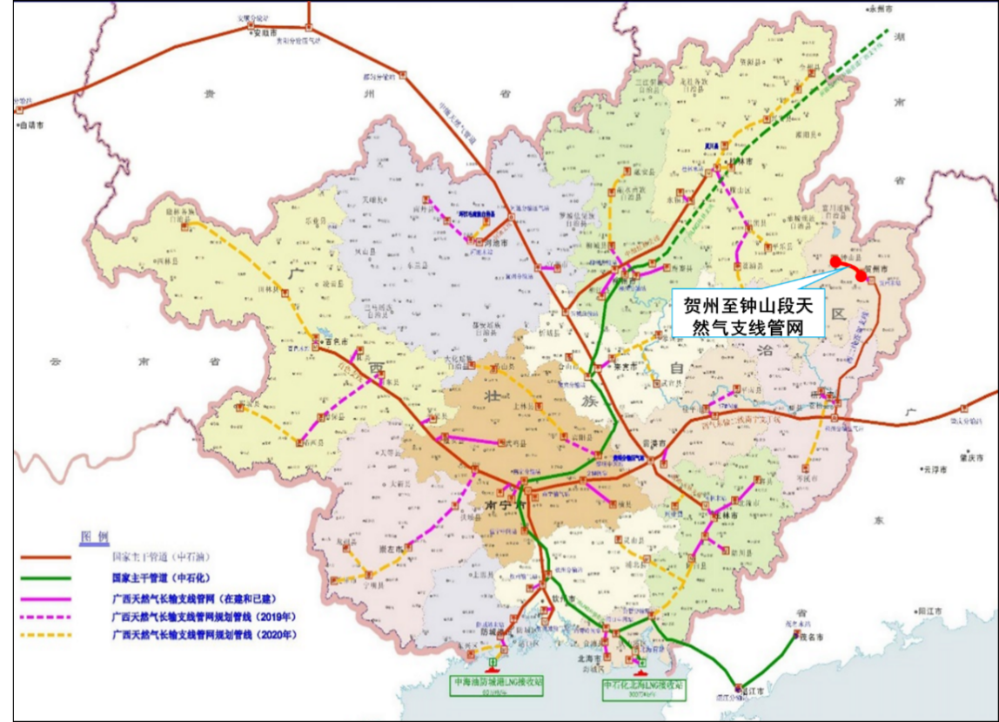

# 第1篇 概述

## 第1章 规划背景

贺州市位于广西壮族自治区东北部，是湘、粤、桂三省区的交界地。“十三五”期间，贺州市全力打通东融的交通“大动脉”，永贺高速主线、贺巴高速、贺富一级路贺街至望高段建成通车，贺州港马江作业区集装箱码头建成运营，实现贺州集装箱专用港口零突破，永贺高速贺州支线、贺州火车站综合交通枢纽等项目加快建设。截至2020年，全市公路通车里程5426.5公里，每百平方公里公路密度为46.171公里/百平方公里，四级及四级以上公路占路网的100%，乡乡通二级或三级公路率达到100%，全市建制村通客车率达到100%。

“十四五”发展时期即将到来，贺州市作为广西向东开放合作的先行区，“21世纪海上丝绸之路”、“川贵广－港澳－南亚国际物流大通道”上的国际陆港枢纽，城镇化、工业化建设步伐在不断地加快，发展和建设的外部区域环境和内部发展条件有了新的变化。“一带一路”、粤港澳大湾区、西部陆海新通道、中西部地区承接新一轮产业转移以及广西东融先行示范区（贺州）的建设，为贺州市带来了重要的外部发展机遇。从自身而言，贺州市为全国“多规合一”试点市、国家生态保护与建设示范市、国家级医养结合试点市、国家全域旅游示范区。启动“十四五”规划、各级国土空间总体规划编制工作，对城市发展空间的管控力明显提升。

作为广西东融粤港澳大湾区的先行示范区，贺州市将紧抓机遇，坚持交通先行的现代交通发展理念，继续加快建设交通基础设施，积极建成各种运输方式布局合理、结构优化、便捷通畅、互联互通的现代化综合立体交通网，基本建成面向东盟、对接粤港澳大湾区、联通西南和中南地区，运力充分、配置优化、效率领先、服务优质的物流网。

为此，贺州市交通运输局委托广西交通设计集团有限公司编制《贺州市综合交通运输“十四五”发展规划》，根据广西东融的发展战略要求以及自治区对贺州的发展定位，梳理区域协调发展、产业布局、城镇布局等与交通运输发展的关系，确定贺州市交通运输发展定位、发展目标、总体格局以及规划期发展重点。

## 第2章 规划范围和期限

1.规划范围

本次规划范围为贺州市域全境，包括八步区、平桂区，钟山县、富川瑶族自治县及昭平县，总国土面积为11855平方公里。

2.规划期限

以2020年为基准年，规划期为：2021—2025年。

## 第3章 规划依据

1.《交通强国建设纲要》（2019年9月印发）；

2.中共中央、国务院印发《国家综合立体交通网规划纲要》；

3.《国务院关于印发“十四五”现代综合交通运输体系发展规划的通知》（国发〔2021〕27号）；

4.《国务院关于进一步促进广西经济社会发展的若干意见》（国发〔2009〕42号）；

5.《国家公路网规划（2013—2030年）》；

6.《内河航运发展纲要》（交规划发〔2020〕54号）；

7.《国家乡村振兴战略规划（2018—2022年）》；

8.《西部陆海新通道总体规划（2019—2025年）》；

9.《广西乡村振兴战略规划（2018—2022年）》；

10.《广西高速公路网规划（2018—2030年）》；

11.《广西普通公路省道网规划》（桂政函〔2011〕330号）；

12.《广西综合立体交通网规划（2021—2035年）》（桂发〔2021〕22号）；

13.《广西综合交通运输发展“十四五”规划》（桂政发〔2021〕40号）；

14.《珠江－西江经济带发展规划》（发改地区〔2014〕1729号）；

15.《中共广西壮族自治区委员会广西壮族自治区人民政府关于深入实施大数据战略加快数字广西建设的意见》（桂发〔2018〕16号）；

16.《广西全面对接粤港澳大湾区建设总体规划（2018—2035年）》；

17.《贺州市国民经济和社会发展第十四个五年规划和2035年远景目标纲要》；

18.《贺州市城市总体规划》（2016—2035年）；

19.《贺州市土地利用总体规划》（2014—2030年）；

20.《贺州市综合交通运输发展规划（2016—2030年）》；

21.《贺州港总体规划》；

22.《贺江流域综合规划》；

23.《贺州市铁路网发展规划研究》（2019—2045）；

24.《广西东融先行示范区（贺州）发展规划（2018—2025年）》；

25.《广西东融先行示范区（贺州）建设三年行动计划（2019—2021年）》；

26.《桂贺一体化发展规划》（2014年）；

27.《贺州市全域旅游总体规划》（2016—2030）；

28.《贺州市旅游公共服务体系规划（2018—2035年）》；

29.《贺州市乡村旅游发展规划》（2018—2025）。

# 第2篇 交通运输发展基础

## 第4章 综合交通系统发展现状

### 第一节 公路发展现状

1.路网规模及结构

2020年，全市公路通车里程5426.5公里，每百平方公里公路密度46.171公里/百平方公里，低于全区55.41公里/百平方公里的平均水平；全市二级以上公路通车里程达1085公里，“十三五”期间，增加约292公里，增长率达36.8%；畅通主要园区、景区以及农村的“毛细血管”，建成乡乡通二级、三级公路315.9公里，707个建制村通水泥（沥青）路、通客车目标提前实现。贺州市已消除等外公路，公路网均由四级及四级以上公路构成。其中普通国省道765.1公里，占全市公路总里程的14.10%。但高等级公路占比仍然较小，二级及二级以上等级公路仅占全路网的19.99%。

表2—1 贺州市公路按行政等级划分里程统计表（2020年）

| 行政等级 | 国道 | 省道 | 县道 | 乡道 | 村道 | 合计 |
|---|---|---|---|---|---|---|
| 里程（公里） | 688.4 | 419.9 | 907.1 | 1,255.8 | 2,155.3 | 5,426.5 |
| 路网密度（公里/百平方公里） | 5.857 | 3.572 | 7.718 | 10.685 | 18.338 | 46.171 |
| 比例 | 12.69% | 7.74% | 16.72% | 23.14% | 39.72% | 100.0% |

按技术等级划分具体情况如下表2-2所示。

表2-2 贺州市公路按技术等级划分里程统计表（2020年末）

| 指标 | 高速 | 一级 | 二级 | 三级 | 四级 | 等外 |
|---|---|---|---|---|---|---|
| 里程（公里） | 343.2 | 119.0 | 622.3 | 519.9 | 3822.1 | 0 |
| 路网密度（公里/百平方公里） | 2.920 | 1.013 | 5.295 | 4.424 | 32.520 | 0 |
| 比例 | 6.33% | 2.19% | 11.47% | 9.58% | 70.43% | 0.00% |

2.高速公路发展

“十三五”期间，贺州市实现了县县通高速，运营高速公路里程达343公里，市域范围基本形成“一心五辐射”的高速公路布局结构，建成通车广西麦岭（湘桂界）至贺州高速、贺巴高速钟山至昭平段、贺巴高速昭平至蒙山段；开工建设广东连山至广西贺州高速公路（贺州段）、信都至梧州高速公路（贺州段）及永贺高速贺州支线；积极推进广宁经苍梧至昭平、信都至广东南丰、平乐至昭平、昭平至平南、桂林经恭城至钟山高速公路及G78汕昆高速（贺州段）改扩建工程的前期工作研究，具体情况如下表所示：

表2-3贺州市高速公路现状情况一览表

| 阶段 | 项目名称 | 里程规模（公里） | 技术等级 |
|---|---|---|---|
| 已建 | G78汕昆高速（贺州段） | 76.5 | 双向四车道 |
| G65包茂高速（贺州段） | 111 | 双向四车道 |
| S13广西麦岭（湘桂界）至贺州高速 | 85 | 双向四车道 |
| 贺巴高速昭平至蒙山段（贺州段） | 14 | 双向四车道 |
| S30贺巴高速公路钟山至昭平段 | 54 | 双向四车道 |
| 在建 | 广东连山至广西贺州高速公路（贺州段） | 53 | 双向四车道 |
| 信都至梧州高速公路（贺州段） | 25 | 双向四车道 |
| 永贺高速贺州支线 | 48 | 双向四车道 |
| 工可 | 广宁经苍梧至昭平（贺州段） | 77 | 双向四车道 |
| 信都至广东南丰高速公路（贺州段） | 20 | 双向四车道 |
| 平乐至昭平高速（贺州段） | 15 | 双向四车道 |
| 昭平至平南高速（贺州段） | 20 | 双向四车道 |
| 桂林经恭城至钟山高速（贺州段） | 22 | 双向四车道 |
| G78汕昆高速（贺州段）改扩建工程 | 133 | 双向八车道 |

3.普通国省道发展

截至2020年底，贺州市境内国道688.4公里，省道419.9公里，扣除高速公路343.2公里外，其他普通国省道共计765.1公里，其中一级公路112.7公里、二级公路515.3公里、三级公路137.1公里。

表2-4贺州市境内现状国省道情况一览表

| 编号 | 路段 | 等级 | 里程（公里） | 路基宽度（米） | 设计速度（公里/小时） | 旧编号 |
|---|---|---|---|---|---|---|
| G323 | 八步区炭冲村-八步区马尾 | 二级 | 11.07 | 12 | 60 | G323 |
| 八步区马尾-平桂区担石村 | 二级 | 8.83 | 18 | 60 | G323 |
| 平桂区担石村-平桂区担杆岭 | 二级 | 3.56 | 9 | 60 | G323 |
| 平桂区担杆岭-平桂区西湾坪滩桥头 | 一级 | 3.88 | 24 | 60 | G323 |
| 西湾坪滩桥头-钟山县路口 | 二级 | 26.08 | 8.5 | 60 | G323 |
| 钟山县路口-桂林贺州界（林岩） | 二级 | 27.67 | 12 | 60 | G323 |
| G207 | 湖南界-富川瑶族自治县白沙路口 | 二级 | 5.57 | 12 | 60 | G207 |
| 富川瑶族自治县白沙路口-八步区东鹿村 | 一级 | 141.70 | 24/24.5 | 80 | G207 |
| 八步区东鹿村-信都镇 | 二级 | 48.11 | 12 | 60 | G207 |
| G241 | 桂林贺州界（林岩）-钟山县林岩路口 | 二级 | 3.25 | 12 | 60 | G323 |
| 钟山县林岩路口-昭平县三门滩 | 二级 | 54.22 | 8.5 | 60 | S207 |
| 昭平县三门滩-昭平县富裕 | 二级 | 14.45 | 12 | 60 | S207 |
| G538 | 湖南界（富川瑶族自治县麦岭部队）-富川瑶族自治县城东出口） | 二级 | 38.36 | 12 | 60 | S203 |
| 富川瑶族自治县城东出口-钟山县 | 三级 | 30.43 | 7.5 | 40 | X720/X734 |
| G355 | 广东界（八步区灵峰）-贺州梧州界 | 二级 | 45.41 | 12 | 60 | S301 |
| 梧州贺州界（林场）-昭平县花冲 | 四级 | 7.17 | 6.5 | 20 | Y024 |
| 昭平县花冲-昭平县富裕 | 二级 | 54.65 | 8.5 | 40 | X701 |
| 昭平县富裕 | 二级 | 2.66 | 12 | 60 | S207 |
| 昭平县富裕-贺州梧州界（昭平九步埃） | 二级 | 14.92 | 8.5 | 40 | S207 |
| S201 | 富川瑶族自治县城东路口-富川瑶族自治县白沙路口 | 一级 | 22.78 | 24.5 | 80 | G323 |
| 平桂区望高一级路接口-城厢镇 | 二级 | 10.22 | 12 | 60 | G323 |
| 城厢镇-回龙乡 | 二级 | 9.70 | 17 | 80 | X594 |
| 回龙乡-公会镇 | 三级 | 28.44 | 7.5 | 40 | X706 |
| 公会镇-长塘 | 二级 | 3.88 | 9 | 60 | Y981 |
| 昭平县潮江-昭平县三合村 | 三级 | 38.36 | 7.5 | 40 | X699 |
| 昭平县三合村-昭平县花冲 | 二级 | 10.24 | 8.5 | 40 | X699 |
| 昭平县马江渡口西-贺州梧州界（塘脊冲） | 三级 | 15.97 | 7.5 | 40 | X701 |
| S302 | 湖南界（白芒营）-富川瑶族自治县福利路口 | 二级 | 21.95 | 10 | 60 | X725/X715 |
| 富川瑶族自治县龙岩路口-贺州桂林界 | 三级 | 22.28 | 7.5/6.5 | 40 | X720/X949 |
| S503 | 平桂八步界（民田）-平桂区沙田村 | 二级 | 14.96 | 12 | 60 | S327 |
| 平桂区沙田村-昭平黄姚镇入口 | 二 | 49.71 | 9 | 60 | S327 |
| 昭平黄姚镇入口-昭平县西坪 | 二 | 18.30 | 8.5 | 60 | S327 |

4.县乡道公路

截至2020年底，贺州市境内县道里程907公里，乡道里程1256公里，村道里程2155公里，农村公路等级分布如下表所示。

表2-5贺州市农村公路里程统计表（2020年末）

| 行政等级 | 里程总计（公里） | 按技术等级分（公里） |
|---|---|---|
| 等级公路 | 等外公路 |
| 高速 | 一级 | 二级 | 三级 | 四级 |
| 县道 | 907 |  | 6.351 | 79.681 | 320.558 | 500.558 | - |
| 乡道 | 1256 |  | - | 22.587 | 47.436 | 1185.751 | - |
| 村道 | 2155 |  | - | 4.741 | 14.826 | 2135.745 | - |

5.客货运量

贺州市历年公路客货运量情况见表2-6所示，扣除2020年疫情原因影响，公路客运量呈逐年下降趋势，货运量呈逐年上升趋势。

表2-6贺州市历年公路运输量表

| 年份 | 公路运输量 |
|---|---|
| 客运量（万人） | 客运周转量（万人公里） | 货运量（万吨） | 货运周转量（万吨公里） |
| 2011 | 3614 | 242744 | 1145 | 326651 |
| 2012 | 4158 | 290889 | 1278 | 396058 |
| 2013 | 1324 | 127036 | 3989 | 687559 |
| 2014 | 1402 | 135139 | 4283 | 765797 |
| 2015 | 1250 | 128742 | 3800 | 854304 |
| 2016 | 1195 | 127381 | 4086 | 832420 |
| 2017 | 1141 | 120482 | 4449 | 909317 |
| 2018 | 1086 | 114604 | 4889 | 992828 |
| 2019 | 1035 | 107899 | 4874 | 786440 |
| 2020 | 780 | 77713 | 4632 | 550806 |

注：1. 数据来源于贺州市交通运输局与交通统计年鉴；2. 2013年起按新口径进行统计；3.2020年起按照新统计口径进行统计。

### 第二节 铁路发展现状

截止2020年底，贺州市境内铁路运营总里程约243公里，其中高速铁路113公里。贺州市铁路网包括益湛铁路及贵广高铁。贵广高铁设有贺州、钟山西站两个车站。

运输现状：2020年贺州铁路货运量669万吨，比2019年的580.8万吨增长88.2万吨，同比增长15.19%，占全市货运总量5347万吨的12.5%。

贺州市现有富川、井山、钟山、贺州、信都共5个铁路货运站，均由梧州货运中心负责经营其货运物流服务业务。钟山货运站设计总到发能力为450万吨/年，经过扩能改造，目前通过运力调度可以实现450万吨/年的发货能力。贺州货运站设计总到发能力为150万吨/年，经过扩能改造，目前通过运力调度可以实现100万吨/年的发货能力。富川货运站设计总到发能力为50万吨/年，目前暂未开办业务。井山货运站为华润电力（贺州）有限公司专用铁路接轨站，目前只办理华润电力所需的煤炭到达业务，设计能力600万吨/年，堆场能力50万吨，不对外营业。信都货运站目前只办理贺州发电站所需的煤炭到达业务，设计能力570万吨/年，堆场能力11万吨，暂不对外营业，信都货运站于2021年3月开始启动运营。

经贺州至广州的动车日均达25个车次，贺州到达南宁的车次为4个车次，到达广州的时间缩短到一个半小时，到达贵阳的时间约为3个半小时，到达南宁的时间为4个小时，到达桂林的时间为1个小时。

### 第三节 水运发展现状

1.航道现状

贺州市水路运输历史悠久。辖区内贺江、桂江目前为国家六级航道，通航里程为212公里，其中：桂江段93公里，贺江段119公里。贺江航道八步至省界段规划建设等级为四级航道，全长119公里（其中上游20.7公里为城区规划段），全线规划建设厦岛、莲塘、合面狮、云腾、信都、扶隆等六座水电枢纽，其中厦岛、合面狮、云腾等枢纽已建，莲塘、信都、扶隆等枢纽在规划建设中。

桂江发源于兴安县的猫儿山，流经桂林市、贺州市昭平县，于梧州市注入西江，全长438公里（其中昭平至梧州西江段长154公里，昭平县境内长93公里），桂江平乐至莲花大桥段共333公里，现状为六级航道，规划等级为四级航道。莲花大桥至河口段共8.3公里，航道等级为三级航道。桂江平乐至桂江河口段目前共建成巴江口、昭平、下福、金牛坪、京南、旺村6座水利枢纽，均设置过船设施。

2.港口设施现状

贺州目前已建成贺州港马江作业区、昭平作业区、信都作业区等港口作业区三个，桂江贺州港马江作业区有4个1000吨级泊位，桂江昭平作业区有3个300吨级泊位，贺江信都作业区有4个300吨级泊位。

3.水运运输现状

贺州目前拥有各类营运船舶169艘，总载重14733吨，共有5641客位。县区内旅游客运公司2家。截止2020年12月底，全市完成水路货运量45.5万吨，货运周转量3431万吨公里，完成水上客运1.09万人次、客运周转量22.3万人公里。

### 第四节 航空发展现状

目前，贺州市当前航空基础设施建设尚处于空白。贺州支线机场、通用机场、警用和应急救援机场项目的前期工作正加快推进。

### 第五节 交通信息化发展现状

2017年6月，贺州市启动智慧交通信息化建设。2017年底，贺州市完成综合交通指挥中心及硬件基础建设，成为广西第一个启用的综合交通信息平台，包含信息化基础支撑平台、综合交通门户平台、智能治超系统、联网联控系统、公众出行服务平台、综合交通运行监测系统、12328交通服务监督热线分中心等8项内容，在加快客运换乘、优化公共交通等方面，为群众提供更加便捷的出行服务。其中智能治超系统是以大数据为依托，对车辆违法超限运输行为进行自动监测的超限高速精检系统，具备24小时货运车辆运输监控能力。公众出行方面，针对当前贺州公交车准点率不高、出租车营运不规范等突出问题，贺州市自主开发公益性“畅行贺州”APP，便于市民和游客出行查询实时公交动态和附近出租车情况，使公众出行更便捷、更安全、更舒适。

### 第六节 管道发展现状

贺州市首条天然气管道是西二线苍梧-贺州支线，该支线属西二线广州-南宁支干线的下游供气支线，主要将天然气输往贺州市及其周边县市。线路全长212公里，其中贺州段长76公里，管线走向与G207国道并行，纵向跨越大桂山，已于2014年完工通气。

### 第七节 交通运输服务现状

1.多式联运结构不断完善。“公水联运”、“铁水联运”初显成效。一方面，随着桂江航道马江作业区4个千吨级泊位的建成，为“公水联运”奠定了基础，形成通过桂江接入西江后转运珠江的水运大通道；另一方面，不断开发提升铁路运能，2020年7月22日贺州开通了至北部湾港的海铁班列，贺州铁路货运量取得较大幅度的增长，为企业物流运输降本增效。

2.危货运输实现全过程监管。贺州是全区道路危险货物运输安全监管3个试点城市之一，通过采取有效措施推进道路危险货物运输全过程监管平台建设，实现以“一份目录、一个平台、一张通行证、一份电子货单”为基础的道路危险货物运输安全监管体系并投入使用，建立了全市危险货物生产企业和运输车辆目录，通过电子货单和通行证等技术实现对全市危险货物的全过程监管。

3.坚持优先发展公共交通为主导。贺州加快使用新能源公共交通工具，推广绿色出行，全域道路客运网络发展取得新突破。全市共投入新能源公交车285辆，新能源出租车4辆，清洁能源出租车240辆。推动交通与旅游融合发展，积极探索发展旅游专线。结合创5A景区工作先后开通了姑婆山、黄姚、西溪温泉等一批通达旅游景点的公交线路、旅游专线。通过优化调整公交线路，公交线网由市城区逐步向周边工业园区、旅游景区、乡镇村屯辐射。

4.全力推进全市村村通客车工作。2019年，全市共707个建制村提前实现100%通客车目标，超额完成自治区当年下达任务196.87%。目前共有农村客运班线93条，投入车辆324辆，日发班次1582班次，解决了偏远乡村群众出行难问题。各县区乡镇农村客运班线公交化改造，目前全市已有265个建制村开通了公交车。

5.物流服务水平不断提高。乡村电商物流得到进一步发展。积极探索“电子商务+农村物流”服务模式，整合特色产业、电子商务、邮政快递、站场运力等农村物流市场，不断完善县、乡（镇）、村三级服务网点布局，并通过邮政集团旗下的邮乐购以及阿里巴巴农村淘宝的村级服务站点为农产品的上行销售以及工业产品下行销售提供服务，以“农户种植+合作社加工+电商销售”的方式扩大农产品销售。

## 第5章 综合交通运输“十三五”规划评估

### 第一节 规划指标完成情况

采用《贺州市综合交通运输发展规划（2016-2030年）》近期（2016—2020年）目标体系进行评估，结果如下表所示。完成的规划目标有综合运输网总规模、铁路里程、通三级以上公路的乡镇比例、建制村通达率、乡镇通客车率、建制村通客车率；但公路网总里程、高速公路里程、二级以上公路比重、铁路站数量、二级及以上公路客运站、有等级客运站的乡镇比率方面未能完成指标；在水运航道、机场方面未有突破，贺州市仍未有四级以上航道和机场。

表2-7《贺州市综合交通运输发展规划（2016-2030年）》近期主要指标进展

| 指 标 | 单位 | “十二五” | 2020年 | 目标 | 完成情况 |
|---|---|---|---|---|---|
| 综合运输网总规模 | 公里 | 5220 | 6291.5 | >6029 | 完成 |
| 公路里程 | 公里 | 4893.1 | 5426.5 | 5680 | 未完成 |
| 高速公路里程 | 公里 | 198 | 343.2 | 478.56 | 未完成 |
| 二级以上公路比重 | - | 16.78% | 19.99% | >35% | 未完成 |
| 铁路里程 | 公里 | 130 | 243 | >130 | 完成 |
| 航道里程 | 公里 | 322 | 322 | 322 | 未有突破 |
| 四级以上航道里程 | 公里 | 0 | 0 | 0 | 未有突破 |
| 通三级以上公路的乡镇比例 | - | 90% | 100% | 100% | 完成 |
| 建制村通达率 | - | 99% | 100% | 100% | 完成 |
| 铁路站 | 个 | 3 | 6 | 8 | 未完成 |
| 机场 | 个 | - | 0 | 0 | 未有突破 |
| 二级及以上公路客运站 | 个 | 3 | 4 | 5 | 未完成 |
| 有等级客运站的乡镇比率 |  | 94% | 94.74% | 100% | 未完成 |
| 乡镇通客车率 | - | 100% | 100% | 100% | 完成 |
| 建制村通客车率 | - | 85.6% | 100% | 80% | 完成 |

### 第二节 开放指标完成情况

1.时空目标

根据《贺州市综合交通运输发展规划（2016-2030年）》近期（2016-2020年）目标，规划至2020年，依托区域综合运输网络，形成以贺州城区为中心的“4321”铁路交通圈和“8421”公路交通圈。

铁路交通圈方面，贺州至贵阳约4个小时，基本实现4小时覆盖贵阳，但未能到达长沙等其他中部重要城市；至深圳约2个小时，基本实现2小时覆盖珠三角经济圈；贺州至南宁高铁需要约4个小时，未能实现3小时覆盖广西北部湾经济区；贺州至桂林、肇庆需要1个小时左右，但至梧州、柳州等均需超过1个小时，仅能部分实现1小时覆盖市域内主要组团以及邻近周边城市。

公路交通圈方面，贺州至长沙约7.3小时、至贵阳约8.4小时，基本实现6-8小时覆盖贵阳、长沙等中西部重要城市；贺州至南宁约5.5小时、至北海约6小时，距离3-4小时覆盖广西北部湾经济区以及邻近周边城市（梧州除外）的目标尚有差距；贺州至肇庆约3.4小时、至梧州约2.5小时，距离2小时覆盖珠三角经济圈以及梧州的目标尚有差距；贺州市区至钟山县、富川瑶族自治县、昭平县约1小时内，基本实现1小时覆盖市域内主要组团，且各县域中心半小时内可上高速公路。

2.基础设施指标

桂江IV级航道建设尚在推进，距离到2020年主要对外方向基本建成由公路、铁路、内河航道等组成综合运输大通道的目标尚有差距；航空机场未有突破，构建公、铁、水、航空等多方式衔接的综合运输枢纽仍有差距；随着2019年昭平至蒙山高速公路建成通车，贺州市提前实现了县县通高速的目标；在脱贫攻坚战略下，实现村村通沥青水泥路的目标，但距离镇镇通二级以上等级公路目标仍有差距。

### 第三节 规划实施存在的问题

1.2016年8月，《国土资源部、农业部关于全面划定永久基本农田实行特殊保护的通知》（国土资规〔2016〕10号）发布实施，实行永久基本农田特殊保护政策，受土地利用总体规划与基本农田保护的制约和影响，重大交通基础设施尤其是国省干线用地保障能力与规划项目建设用地需求不匹配等问题突出。部分重点项目因不符合土地利用总体规划或涉及占用基本农田，近期内无法推进项目进度。

2.随着物价水平不断上涨、交通服务品质要求不断提升、建设项目地形复杂程度不断升级、生态环境保护要求日益提高等因素影响，导致交通基础设施投资逐年增大。但“十三五”期间市财政资金紧缺，基础设施融资能力较弱，导致地方配套资金筹措困难，影响部分重大交通基础设施项目建设进度。进入实施阶段后，项目推进较为困难，县乡道提级改造工作推进缓慢。现状高等级公路占比仍较低，2020年二级及以上公路里程难以达到占比35%以上的目标。

3.受补偿政策、补偿标准、拆迁安置等问题影响，重大交通基础设施项目征地拆迁工作滞后，影响项目建设进度。

4.受到农村常住人口减少和私人小汽车拥有量增加的影响，乡镇客运的发展受到了影响，乡镇客运站覆盖率达到94.74%，正常在营的乡镇客运站仅有15个，利用率为26.8%，且一部分乡镇尚未建设客运站。

5.受到上级规划政策的影响，机场、水运建设未能取得有效的突破，在“十四五”期间，贺州市应该积极抓住政策红利，争取贺州支线机场尽早开工，争取桂江水运等项目尽快上马。

## 第6章 综合交通系统问题分析

### 第一节 基础设施建设仍不完善

航空发展相对滞后。目前贺州市尚未建设民航机场。相比区内桂林市、柳州市、梧州市、玉林市及临省湛江市、韶关市、永州市等周边城市航空发展现状，贺州已经逐步沦为区域航空洼地。航空发展的缺失，导致贺州市综合交通运输方式不全，交通服务链不完整。

铁路建设尚未成网。目前贺州市境内已通贵广高铁与益湛铁路，但线路布局单一，未形成联通周边城市的网络化铁路布局，易发展成为过境型交通节点。城际铁路建设滞后，与首府南宁市联通不足，货运铁路缺乏东融通道型铁路专线。贺州市作为资源型城市，对大中运能的铁路运输方式需求较高，目前贺州市货运铁路尚未与对外商贸主要区域及对外大型枢纽实现无缝衔接。

水运基础设施尚且薄弱。贺州市有贺江、桂江航道，但航道等级偏低，港口、码头配套设施等级不高，与重要产业园区衔接不足，规模化运营程度偏低。相比邻市梧州港，贺州港存在较大差距，大量货物需要通过公路运输至梧州港中转。

干线路网短板问题仍然突出。贺州市现状每百平方公里公路密度为46.171公里，略低于全区55.41公里/百平方公里；从公路等级上来看，贺州市三级及以上等级公路里程占全市公路总里程的29.57%，高等级公路占比偏低。此外，受地形限制等因素影响，贺州市公路技术标准整体偏低、路面质量较差、桥梁标准较低，加上长期承受重载交通，导致大部分道路路况日趋下降。

### 第二节 交通服务品质整体不优

无法适应井喷式的旅游出行需求。贺州市拥有优质的旅游资源，广贺高速公路开通以来，广东游客到贺州市的自驾车旅游呈“井喷”趋势。2020年贺州市全年接待国内旅客人数3311.89万人次，接待入境游客2.6万人次，国内旅游消费390.28亿元，受新冠肺炎疫情影响，接待旅客人数比2019年下降23.02%，入境游客人数下降94.28%。但2019年接待国内游客人数为4344.68万人次，比2018年增长33.57%，旅游总消费551.67亿元，比2018年增长39.23%，同时2018年、2019年连续两年贺州市游客综合满意度均排名全区第三。由此可见，未来随着疫情影响降低，贺州市旅游业将会迎来迅猛发展。但与旅游业迅猛发展的趋势相比，贺州市公路网络覆盖率和服务品质还是比较落后，缺少旅游景区专用公路，景观公路布局打造不够系统，公路与旅游资源优势结合度不强。

先进联运的综合物流运输通道尚未打通。贺州市拥有东接广东、北临湖南，面向全区的地缘优势，从区位上来说，是广西承东启西、助力东融的桥头堡。同时自治区政府明确划定贺州为广西东融先行示范区，贺州市近年碳酸钙产业发展迅猛，同时生态旅游资源丰富，区域间交通运输需求迅猛增长，但从当前交通衔接状况来看，集疏运体系仍不完善，产业园区道路、重点园区与铁路、码头联络线有待完善。对接周边区域的对外大通道建设相对滞后，大型综合客货运枢纽不完备，已有的货物运输站场设施陈旧简陋，功能单一，物流信息不畅。物流联运效率低下，一定程度上降低了交通服务效率。

运输结构传统落后，多式联运体系发展滞后。分担率占比方面，2020年公路运输约占到贺州全市货物运输市场的86.64%，铁路运输占12.51%，而水路运输仅占0.85%，货运结构不合理，各运输方式发展不均衡。运输能力方面，铁路、水路运能受限，时效性不足，导致很多企业即使运输范围在铁路运输的优势运距内，也倾向选择通过无车承运平台等公路运输方式进行运输。因此，各交通方式间组合效率不高，组合方式多样性不够，多式联运配套政策及集疏运专线进程仍然偏慢。

### 第三节 物流运输与交通设施供需矛盾日益凸显

截至2020年，贺州市货运量已经达到5347万吨，基本依赖公路方式进行运输，路网运输供给能力有限，随着贺州市“3+6”产业集群加快发展，贺州市货物运输量将在“十四五”期间实现翻一番的目标，届时已有路网设施远远不能满足货运需求。物流运输与交通基础设施运能供需矛盾将越来越突出。

### 第四节 行业治理体制机制改革仍需深化

综合交通运输体制机制改革有待深化，行业管理精细化程度仍不能适应交通网络运行效率和服务水平提升的要求，对新业态、新模式的行业监管能力不足。交通综合执法、农村公路管理养护体制、财政事权和支出责任划分等重点领域改革仍需加快推进。综合交通法规体系仍不完善。高素质、高层次人才较为缺乏，创新团队建设相对滞后，人才队伍结构还难以适应高质量发展的要求。

### 第五节 智慧交通水平有待提升

在交通信息化、交通智慧化等方面也存在提升空间。虽然局部实现通过云计算、互联网+等科技手段实时监管城市综合交通运输状况，但未充分利用智慧化、智能化的各类交通信息管理平台对全市的交通运行情况进行实时研判，有效引导城市交通流，改善城市交通运行环境；同时，缺乏对信息资源的整合利用，没有打通各环节、各部门间信息资源屏障，与交通相关的信息未能实现全面共享和利用，因此无法更好地提升交通服务水平与改善整体交通环境。

### 第六节 创新技术应用仍显滞后

运输产业的服务创新、技术创新、组织创新、管理创新和制度创新较慢，整体与周边区域尤其是大湾区存在一定差距。

### 第七节 用地指标、建设资金保障困难

资金：一是2018年以来，财政部下发了关于清理地方政府债务的有关文件，融资政策的变化影响了项目建设资金落实。二是投融资模式创新不足，除上级补助外，贺州市交通基础设施项目建设主要依赖地方政府配套资金，由于贺州市属于财政收入有限的地区，资金筹措问题影响项目推进。

用地：国务院颁布实施《基本农田保护条例》，对基本农田实行特殊保护政策，交通重点建设项目选址确实无法避开基本农田保护区，涉及农用地转用或征用的，必须经国务院批准，并补充划入数量和质量相当的基本农田。受基本农田政策影响，项目用地审批困难重重，交通项目点多、面广、线长，设计过程中需要与生态环境、自然资源、林业等多部门协调，导致项目前期工作推进缓慢。

图1－1

# 第3篇 发展形势及交通发展需求

## 第7章 发展形势

根据《贺州市国民经济和社会发展第十四个五年发展规划和2035年远景目标纲要》，在全国构建国际国内双循环格局中，贺州市独特区位优势将进一步凸显，西部陆海新通道建设将夯实贺州市沟通粤港澳大湾区与成渝地区双城经济圈、连接中南与西南的节点优势；自治区以东融为重点，全面对接粤港澳大湾区建设的全方位开放发展布局，为贺州市高点规划、高位推进广西东融先行示范区建设保驾护航；粤港澳大湾区产业面向国内市场畅通产业循环的趋势，为贺州市全力东融，实现经济社会高质量发展助跑；“十三五”的发展实践深刻验证全力东融是贺州市实现赶超跨越发展的必然选择，贺州市在东融战略的推动下，新旧动能加速转换，内生发展能力不断聚焦，城市功能不断完善，营商环境持续优化，区位和生态资源优势得到巩固提升，东融政策和国家、自治区改革政策叠加、释放，继续发展具有多方面优势和条件。

### 第一节 建设交通强国，服务“一带一路”，

## 需要交通发挥支撑作用

十九大报告中明确提出要建设“交通强国”。站在世界交通大国的新起点上，必须进一步深入落实习近平总书记对交通运输重要指示批示精神，瞄准建设交通强国奋斗目标，奋力从交通大国向交通强国迈进。“一带一路”即“丝绸之路经济带”和“21世纪海上丝绸之路”，是促进我国对外开放的新通道。在“一带一路”经济走廊中，贺州的地理位置比较特殊，是广西的东部门户，北靠桂林，南倚梧州，东面珠三角，但目前贺州市交通基础设施相对落后，现代化综合交通体系尚未形成，支撑贺州乃至国家现代化建设能力不足，已成为贺州融入“一带一路”的薄弱环节。因此，建设交通强国，服务“一带一路”，迫切需要贺州完善交通基础设施建设，支撑国家重大战略更好的推进和实施。

## 第%1节  实施“东融”战略，建设大湾区“后花园”，

## 需要构建助推融合发展的互联互通交通体系

贺州市地处粤港澳大湾区和大西南地区的联结点，应及时抓住国家建设粤港澳大湾区的巨大机遇，积极、主动融入大湾区的发展，接受先进地区的辐射带动，把贺州市建设成大湾区美丽后花园。2019年6月，广西壮族自治区发布《广西东融先行示范区（贺州）发展规划（2018-2025年）》，正式赋予贺州建设“广西东融先行示范区”的新定位新使命，明确贺州是当前广西“东融”的主战场、主阵地和桥头堡，提出贺州市要围绕建设面向大湾区的内联外通大通道目标，规划实施一批重大交通基础设施建设，形成“六条铁路、七条高速、三个机场、两条航道”纵横交汇、水陆空一体的区域性综合交通枢纽，构建与大湾区无缝衔接的互联互通交通体系。

### 第三节 上位规划新动向，

## 要求贺州交通主动衔接、适度超前发展

《广西高速公路网规划（2018-2030年）》已于2018年9月取得批复，《贺州市“交通强贺”方案研究》《贺州市铁路网发展规划研究》也于2019年陆续发布，广西铁路建设规划、国省道等规划正在调整，这一系列的重大规划相较于“十三五”均作出了相应的调整，要求贺州交通发展在“十四五”期间主动衔接新的上位规划；国土空间规划将进入最后收官阶段，要求贺州交通做好交通基础设施国土空间控制规划，同时做好与周边区域的交通衔接，提前预留出项目建设用地，保障项目后期顺利推进。

## 第%1节  打造川贵广-港澳-南亚国际物流大通道重要节点，

## 需要强大的现代化物流运输通道进行支撑

2018年10月，贺州市与广东物流行业协会签订了《共建21世纪海上丝绸之路川贵广-港澳-南亚国际物流大通道战略合作框架协议》，通过深入互动合作，将贺州打造建设成国际商旅陆港城市，建成集公路、商旅、铁路等综合服务功能为一体的现代化物流网络。

图3-1川贵广-港澳-南亚国际物流大通道

## 第%1节  适应经济发展新常态、促进产业长效发展，

## 要求贺州交通当好“先行官”，发挥先行引领作用

产业是经济发展的源头活水和关键支撑，贺州市将重点培育打造“3+6”产业群的产业发展方向，按照“强龙头、补链条、聚集群”和“抓创新、创品牌、拓市场”思路，坚持工业、农业、服务业同步推进，形成绿色高端碳酸钙、金属新材料、生物制药三大自治区产业集群，冶金循环、电子信息、绿色高端纺织、现代特色农林、大健康和文旅、现代服务业六大市级产业集群。推动工业优化升级，加快培育新兴产业、大力发展现代服务业、加快发展现代特色农林产业、提升大健康和文旅产业发展质量。

产业发展，交通先行。要想经济“跑得快”、产业发展有跨越，必须得交通发展“引得进来”和“走得出去”兼备，交通要发挥出先行引领作用，营造优质的交通条件，提供高质量的出行体验，尽可能降低运输成本，才能促进产业快速、长效发展。

## 第%1节  整合旅游资源，促进交旅融合，

## 需要贺州交通提升服务水平

随着居民生活水平的不断提高，人们对旅游业也提出了更高要求，让游客能在尽量短的时间内饱览各处风景，是未来旅游产品发展的必然趋势。贺州旅游资源得天独厚，拥有高密度、高品位、独具特色的优质旅游资源，根据《贺州市全域旅游总体规划（2016—2030）》，贺州将全力打造全域旅游。

近年来贺州旅游业发展迅速，境内外游客骤增，旅游业已成为区域重要的支柱产业。虽受到新冠肺炎疫情的影响，但2020年贺州市全年接待国内旅客人数3311.89万人次，接待入境游客2.6万人次，国内旅游消费390.28亿元。随着疫情的影响降低，贺州市旅游业将会迎来迅猛发展。旅游资源是基础，旅游体验是关键。提高出游体验，交通服务是重中之重，这就要求贺州交通必须做到：完善基础设施建设，提高旅游景区的可达性；构建快进漫游的旅游交通体系，提高旅行质量；便捷化公共旅游交通体系，提供精品化自驾旅游、全景化的低空旅游服务，促进交通与旅游的融合发展。因此，整合旅游资源，促进交旅融合，需要贺州交通提升服务水平。

### 第七节 推动新型城市化发展，着力保障和改善民生，

## 要求统筹城乡交通协调发展

贺州市在全国率先整合资源推进乡村振兴、推动新型城市化发展，根据发展定位，未来贺州市将继续加快新型城市化建设步伐，推动农村现代产业发展质量，更好满足农民出行需求以及服务农村经济、政治、文化和社会建设。农村公路是农村重要基础设施和公共服务设施，是乡村振兴建设基础，进一步加快乡村振兴要求继续推进农村公路“通达”、“通畅”建设工程、建设新时代“四好农村路”，加快乡镇农村公路网络化建设，推动农村客货运场站建设，提高农村公路安全保障水平，推进乡村客货运水平，建设覆盖城乡的交通运输服务网络，不断提高农村交通均等化服务水平。

### 第八节 加强法治交通建设，

## 需要贺州交通完善治理体系、提升交通治理能力

《交通强国建设纲要》明确指出，将“基本实现交通治理体系和治理能力现代化”作为推进交通强国建设的发展目标。贺州交通建设既要加强交通基础设施建设中的监管力度，做到流程规范、务实高效，又要做好对交通运输环节的监督管理，严格执法，保障社会运行有序和交通运输安全，营造交通行业良好的法治秩序；同时，要充分利用科技信息化手段提升交通治理能力，切实运用法治思维和法治方式推进交通运输治理体系和治理能力现代化，为贺州市交通事业又快又好发展及交通强国建设奉献力量。另外，应重点做好现代化交通管理系统建设，逐步引入智能交通管理平台系统，适应现代化交通发展需求，进一步提升交通治理能力。

## 第8章 交通需求分析

### 第一节 社会经济发展指标预测

结合发展形势分析，采用定性分析与定量计算相结合的方法，对项目影响区的社会经济发展主要指标进行分析预测。

首先，以规划影响区国民经济发展的历史数据及发展趋势、城市总体规划为基础，运用二阶段多项式、指标回归等趋势外推方法，初步预测项目影响区在规划期间各特征年的社会经济指标值。

然后，结合规划影响区内国民经济和社会发展“十四五”规划纲要中提出的“十四五”发展目标，把握项目影响区的社会经济发展趋势和目标，分析和适当调整项目影响区的初步社会经济预测值。最后，得到规划期内影响区的经济发展预测结果。

表3-1项目影响区社会经济发展预测表

| 区域 | 经济指标 | 年均增长率（%） |
|---|---|---|
| 2021～2025 | 2026～2030 | 2031～2035 |
| 广西 | 人口 | 0.80 | 0.75 | 0.65 |
| GDP | 6.5 | 6.0 | 5.5 |
| 贺州市 | 人口 | 0.80 | 0.75 | 0.70 |
| GDP | 10.0 | 9.0 | 7.0 |
| 钟山县 | 人口 | 0.85 | 0.70 | 0.60 |
| GDP | 11.0 | 10.0 | 7.5 |
| 昭平县 | 人口 | 0.35 | 0.30 | 0.30 |
| GDP | 10.5 | 9.5 | 7.0 |
| 富川瑶族自治县 | 人口 | 0.55 | 0.50 | 0.45 |
| GDP | 10.0 | 9.0 | 6.5 |

### 第二节 公路网规模论证

本规划以现状统计的等级公路里程基年值作为公路网总规模论证的数据基础，参考同级别城市公路交通发展情况，选用节点连通度法对贺州市未来几年的公路网规模进行预测。

（1）连通度法

节点连通法是利用网络几何学的知识，考察路网是否很好地连接节点以及节点之间是否有合理的连接形态，确定路网变形系数和连通度，进而利用模型确定区域公路网的合理发展规模。模型如下：

L=DN · ·√N·A

式中：L－公路总规模（公里）；

DN－网连通度；其值为0.5时，节点多为“悬点”；为1.0时，路网为“树”状结构；为2.0时，路网为方格状；为3.0时，路网呈方格+对角线型；

N－区域内节点数；

A－区域面积（平方公里）；

－路网变形系数。

贺州市公路网的节点选择考虑的主要因素是人口、城市、乡镇地位、经济发展水平等，所选节点主要包括贺州市市区、各县县城及其他具有一定规模的乡镇、行政村、公路枢纽等。贺州市总面积为1.18万平方公里，共有2个市辖区、3个县城、61个乡镇、707个行政村，节点数合计773个（重复节点按1个计）。

通过定性分析和专家咨询，考虑贺州地处广西东北部，地貌以低、中丘陵山地为主，路网变形系数取1.4；现状贺州市公路网布局为“树”状结构，长远来看，路网骨架会形成方格状，特征年连通度取值范围定为1.4和1.6，参数取值和计算结果见下表。

表3-2连通度法参数取值及计算结果

| 特征年 | 2020年 | 2025年 | 2035年 |
|---|---|---|---|
| 连通度 | 1.2 | 1.4 | 1.6 |
| 变形系数 | 1.4 | 1.4 | 1.4 |
| 节点个数 | 770 | 770 | 770 |
| 面积（平方公里） | 11855 | 11855 | 11855 |
| 路网里程（公里） | 5123 | 5933 | 6781 |

### 第三节 客、货运输量

考虑贺州市历年客货运量、GDP等数据及近年相关政策、规划，采用趋势分析、弹性系数两种方法分别预测并综合取值，预测至2025年，全市客货运输年均增长分别为6.5%和12.0%，客货运输总量分别为2160万人和11730万吨；至2035年，全市客货运输年均增长分别为4.5%和6.0%，客货运输总量分别为3360万人和21010万吨。

随着东融及工业强贺战略的深入实施，“十四五”公路客货运输量会一改“十三五”下降趋势，其中公路客运量会稳中有升、公路货运量呈快速增长趋势。

铁路客货运输量主要根据益湛铁路实际运行情况、贺州市综合运输发展趋势进行预测，预测规划期内区域内的铁路客货运输量将快速增长。

水运方面，随着贺江扩能规划的实施，贺江贺街作业区至省界河段航道按照Ⅲ级航道标准建设，枢纽船闸等级按Ⅱ级船闸设计，贺州市内河水路客货运量将快速增长。贺州市历年的水路运输量、运输周转量等数据无法反映未来的发展趋势，规划根据《贺江扩能规划研究报告》的研究成果进行预测。

表3-3 “十四五”期贺州市客货运输总量趋势分析法预测

| 指标 | 2016 | 2017 | 2018 | 2019 | 增长率 | 2025 | 增长率 | 2035 | 增长率 |
|---|---|---|---|---|---|---|---|---|---|
| 客运量（万人） | 1484.7 | 1486 | 1466 | 1483.14 | 0.2% | 2160 | 6.5% | 3360 | 4.5% |
| 货运量（万吨） | 4521 | 4814 | 5399 | 5946 | 9.6% | 11730 | 12.0% | 21010 | 6.0% |

表3-4“十四五”期贺州市客货运输总量弹性系数法预测

| 年份 | GDP（亿元） | 客运总量（万人） | 弹性系数 | 货运总量（万吨） | 弹性系数 |
|---|---|---|---|---|---|
| 数值 | 增长率 | 数值 | 增长率 | 数值 | 增长率 |
| 2016 | 518.19 | 8.1% | 1484.7 | — | — | 4521 | 8.8% | 1.1 |
| 2017 | 548.83 | 5.3% | 1486.0 | 0.1% | 0.02 | 4814 | 6.5% | 1.2 |
| 2018 | 602.63 | 8.9% | 1466.0 | -1.3% | — | 5399 | 12.2% | 1.4 |
| 2019 | 700.11 | 11.8% | 1493.1 | 1.9% | 0.16 | 5946 | 10.1% | 0.9 |
| 2025 | 1200 | 9.0% | 2158 | 6.3% | 0.7 | 11831 | 12.2% | 1.4 |
| 2035 | 2400 | 7.0% | 3260 | 4.2% | 0.6 | 20401 | 5.6% | 0.8 |

表3-5“十四五”期贺州市运输需求总量预测

| 指标 | 客运量（万人次） | 货运量（万吨） |
|---|---|---|
| 趋势分析法 | 2160 | 11730 |
| 弹性系数法 | 2158 | 11831 |
| 取值范围 | 2158-2160 | 11730-11831 |
| 推荐值 | 2169 | 11781 |
| “十四五”平均增速 | 6.5% | 11.67% |

各方式运输量预测结果详见下表。

表3-6贺州市客货运输量预测表

| 年份 | 指标 | 公路 | 水运（内河） | 铁路 | 民航 | 合计 |
|---|---|---|---|---|---|---|
| 2025年 | 客运量（万人） | 1424 | 50 | 688 | - | 2162 |
| 货运量（万吨） | 8214 | 1997 | 1318 | - | 11529 |
| 2035年 | 客运量（万人） | 1760 | 170 | 1400 | - | 3331 |
| 货运量（万吨） | 13044 | 3804 | 2842 | - | 19690 |

### 第四节 港口吞吐量

作为打造西江亿吨级黄金水道战略的重要组成部分，桂江、贺江扩能将有效缓解腹地公路、铁路运输压力，对促进水资源综合开发利用、加快腹地经济发展起到重要作用，并有助于贺州市中、远期社会经济发展目标的实现。同时，水运也是绿色交通发展的方向。

根据《贺州港总体规划》，根据贺州市主要货运需求，结合贺州港港口基础设施建设情况及通道发展情况，预测贺州港2025年、2035年吞吐量分别为1800万吨、4000万吨。

表3-7 2025-2035年贺州港分货类吞吐量预测表

（单位：万吨、万标准箱、万人次 ）

| 货物分类 | 2025年 | 2035年 |
|---|---|---|
| 合计 | 出港 | 进港 | 合计 | 出港 | 进港 |
| 货运量 | 1800 | 1123 | 677 | 4000 | 2313 | 1687 |

表3-8 贺州港分港区吞吐量合计（单位：万吨、万标准箱、万人次 ）

| 港口 | 2025年 | 2035年 |
|---|---|---|
| 吞吐量 | 其中集装箱 | 客运量 | 吞吐量 | 其中集装箱 | 客运量 |
| 合计 | 1800 | 116 | 50 | 4000 | 144 | 170 |
| 昭平港区 | 1500 | 106 | 20 | 2000 | 114 | 40 |
| 八步港区 | 300 | 10 | 20 | 2000 | 30 | 110 |
| 富川港点 | 0 | 0 | 0 | 0 | 0 | 0 |
| 钟山港点 | 0 | 0 | 4 | 0 | 0 | 10 |
| 平桂港点 | 0 | 0 | 6 | 0 | 0 | 10 |

# 第4篇 发展定位与目标

## 第9章 指导思想

高举中国特色社会主义伟大旗帜，坚持以习近平新时代中国特色社会主义思想为指导，深入贯彻党的十九大和十九届历次全会精神，统筹推进“五位一体”总体布局，协调推进“四个全面”战略布局，深入贯彻落实习近平总书记对广西工作的重要指示精神，全面落实“三大定位”新使命和“五个扎实”新要求，贯彻落实自治区党委提出的“发挥优势、突出特色、全力东融、加快发展”总体要求，坚持新发展理念，坚持稳中求进工作总基调，以推动高质量发展为主题，坚持以供给侧结构性改革为主线，以人民为中心的发展思想，以交通强国战略为统领，着力补齐短板，增强有效供给，优化基础设施网络，提升运输服务效率和品质，强化科技创新驱动，全面构建面向粤港澳大湾区的综合运输大通道，加快构建贺州现代综合运输体系，构建与粤港澳大湾区及周边省市无缝衔接的互联互通体系，高水平融入西部陆海新通道建设，为全市经济社会高质量发展提供强有力的支撑。

## 第10章 基本原则

——坚持党的领导、以人民为中心的理念

始终同以习近平同志为核心的党中央保持高度一致，为实现交通强国高质量发展提供根本保证。贯彻党为人民服务的宗旨，坚持交通服务人民，方便人民的理念，在规划、实施过程中，尊重人民，做到交通发展成果由人民共享，更好实现人民对美好生活的向往。

——坚持适度超前、加快发展的理念

积极融入新发展格局，加强前瞻性思考，根据贺州工业化、城镇化加速推进的阶段特征和经济社会跨越式发展的客观要求，充分发挥交通运输的先导性作用，贯彻适度超前理念，加快推进交通基础设施建设，全面扩大基础设施供给能力，满足便捷、通畅、高效和安全的运输服务需求，助力交通更高质量、更有效率、更加公平、更可持续、更为安全发展。

——坚持系统规划的理念

加强全局性谋划、战略性布局、整体性推进。加强与国家、自治区综合交通发展相关规划的衔接，做到规划统一、政策对接、建设同步、管理一体。要充分体现各种运输方式的比较优势，合理配置、节约利用运输线路资源，衔接优化各种运输设施空间布局。强化各种运输方式之间的衔接，全面提高综合运输效率。重视区域、城乡间交通运输体系的衔接，促进交通一体化发展。

——坚持新发展的理念

转变发展方式，通过科技创新和信息化建设，提高交通发展科技含量，促进交通运输发展方式加快转变，使交通基础设施及装备水平、经营组织与管理服务水平等实现质和量的提升。大力推进交通运输绿色、低碳发展，以节约集约用地、资源循环利用、强化节能减排等为重点，减少交通运输对环境的负面影响。

——坚持深化改革的理念

坚持全面深化改革，加快推进贺州交通建设和治理现代化。在改革过程中，坚持体制机制和科技创新，努力探索多种融资渠道，为交通建设提供坚实的资金保障，推进养护体制深化改革，持续增强交通发展动力活力。

## 第11章 发展定位

立足广西东融先行示范区、粤港澳大湾区产业外溢新高地和粤港澳大湾区生态绿色后花园战略定位，围绕贺州市创新驱动战略、全力东融战略、产业优先战略、乡村振兴战略和长寿品牌战略，构建便捷顺畅、经济高效、绿色集约、智能先进、安全可靠的现代化高质量综合立体交通网，重点提升等级高品质优的产业、景区功能性通道，建设“双文”交通体系，推进现代物流运输体系建设，全面构建贺州市面向粤港澳大湾区的综合运输大通道，把贺州市建成广西背靠大西南、面向粤港澳的重要交通节点城市。

## 第12章 “十四五”发展目标

### 第一节  总体目标

围绕建设综合交汇、城乡联动、水陆空一体的区域性综合交通枢纽的发展定位，构建贺州市面向粤港澳大湾区的综合运输大通道，重点提升多层次东融通道服务水平，强化陆路优势，补齐航空、水运短板，建设便捷顺畅、经济高效、绿色集约、智能先进、安全可靠的现代综合交通体系，推动综合交通运输体系高质量发展，实现“交通强市”发展目标。

### 第二节 时空目标

依托区域综合运输网络，形成以贺州为中心的123出行时圈。

至“十四五”期末，客运实现“123”经济交通圈，即1小时到达全市域，2小时到达周边地级市和国际海港（广州）、国际航空港（广州、桂林），3小时到达周边省会城市和主要经济区（北部湾、大湾区等），以互联互通的大交通体系推进经济社会发展。

至“十四五”期末，快递物流同步实现“123快递物流运输圈”，即区内及周边主要物流枢纽城市（南宁、柳州、广州、长沙、贵阳等）1天送达，全国主要物流枢纽城市（上海、重庆、郑州等）及东盟国家主要城市（河内、曼谷、新加坡等）2天送达，全球主要物流枢纽城市及经济区3天送达。

表4-1 “十四五”时期贺州综合交通运输主要指标

| 指标 | 2020年 | 2025年 | 增幅 | 属性 |
|---|---|---|---|---|
| （1）铁路/高铁对外辐射通道（辐射方向/铁路条数） | 4/2 | 6/4 | 50%/100% | 预期性 |
| （2）高速公路/出边对外辐射通道（条） | 5/3 | 10/7 | 100%/133% | 预期性 |
| （3）东融高速公路通道（条） | 1 | 4 | 300% | 预期性 |
| （4）支线机场数量 | 0 | 1 | - | 预期性 |
| （5）2000吨级航道里程（公里） | 0 | 168.5 | - | 预期性 |
| （6）高速公路总里程（公里） | 343 | 580 | 69% | 预期性 |
| （7）一级公路总里程（公里） | 119 | 240 | 102% | 预期性 |
| （8）二级及以上公路里程（公里） | 1084 | >1800 | >66% | 预期性 |
| （9）普通国道二级及以上比例（%） | 93.8 | 100 | 6.2%（增加量） | 预期性 |
| （10）普通省道二级以上比例（%） | 61.2 | 100 | 38.8%（增加量） | 预期性 |
| （11）乡镇通三级及以上公路比例（%） | 94 | 100 | 6%（增加量） | 约束性 |
| （12）通屯硬化路比例（%） | 89.4 | 100 | 10.6%（增加量） | 约束性 |
| （13）县乡村三级物流网络节点覆盖率（%） | 65 | 100 | 35%（增加量） | 预期性 |

### 第三节 重点任务

规划“十四五”期间并适当展望至中远期，争取建成贺州市“7高6铁5站4环3网2江1机场”的综合交通网格局。

7条高速公路：进一步提高贺州市高速公路覆盖密度，加速全力东融步伐，加快推进在建的信都至梧州高速、连山至贺州高速、永贺高速贺州支线，新开工建设桂林至钟山高速、广宁经苍梧至昭平高速、昭平至平乐高速，以及规划建设永州经贺州至韶关（含贺州支线）共7条高速公路，全面、畅通对接粤港澳大湾区新通道，提高与周边省市基础设施互联互通水平。

6条铁路通道：建设全面对接粤港澳大湾区的高标准铁路，加快推动渝粤铁路（桂林经贺州至肇庆段）、益湛铁路永州至玉林段扩能改造、贺州至梧州城际铁路、柳州经贺州至韶关铁路、柳州至贺州城际铁路、京广二通道（贺州联络线）高铁等6条铁路规划（建设），提升铁路运能，有效降低贺州工业园区、产业基地材料、产品运输成本。

5个综合站场：大力发展铁水、公铁、公水、空陆等多式联运模式，完善综合运输枢纽。建设贺州陆海新通道联运中心（贺州无水港）、贺州火车站综合客运枢纽、富川综合运输站场、马江综合运输站场、信都综合运输站场等5个包括铁路、公路、港口作业区在内的客货运输站场。

4个方向城市环线：解决市区拥堵问题，引导货车绕行，疏通城市道路，重点推进东、南、西、北四个方向城市环线公路建设，构建贺州市市区绕城一级公路。重点实施东环路（莲塘镇燕塘村至G207）、新南环路（贺街至平桂）、西环路（沙田道石圩至平桂区政府段、祥元大道至黄石村段）和北环路（莲塘燕塘村至新燕村段、创业路至姑婆山大道段、姑婆山大道至黄田镇里宁村段、黄田镇里宁村经长塘林场至黄石村段）建设。

3张交通网络：一是乡村振兴公路网，贯彻落实国家“乡村振兴”战略，持续推动“四好农村路”高质量发展，加快农村公路等级提升，新改建县乡联网路项目1607公里，建制村通双车道硬化路1060公里，自然村通硬化路705公里。建立规范化可持续管护机制，推行农村公路“路长制”，推进全国“四好农村路”示范市、示范县（区）、示范乡镇和示范路创建工作。二是交通信息网，加速交通基础设施、运输服务网发展，建设贺州智慧交通大数据中心体系。持续构建“1+3+N”智慧交通一体化平台，推动交通数据采集、传输、交互应用融合发展；整合交通行业内、外部信息资源，推动交通运输体系数字化转型，实现资源的集中、统一管理和应用；打造市级综合应用平台向县区延伸，实现行业纵向管理；打造全域智能治超、智慧工地、智慧航道、智慧港口、智慧公路等数字化基础设施，优化交通通行与管理工作效能。三是交邮物流网，疏通县乡村三级物流，健全县、乡、村寄递物流服务体系，补齐农村寄递物流基础设施短板，推进“农村客货邮融合发展样板县”创建工作，实现县县有物流中心、乡乡有网点、村村有服务。

2条水运通道：紧抓国家实施湘桂运河重大工程契机，争取把桂江扩能、贺江复航扩能融入湘桂运河方案中推进，切实加快项目建设，重点推进桂江“一路一航道两船闸”工程，完善桂江马江作业区至桂江河口段港口、船闸、航道等水运基础设施建设，推进贺江复航扩能前期工作，充分发挥桂江、贺江绿色水运大通道优势，为贺州产业发展提供强力的水运支撑。

1个支线机场：加快推进贺州支线机场，大力发展支线航空，推动干支有效衔接，提高航空服务能力和品质，推进贺州支线机场与南宁、桂林、广州机场的高效衔接。同时结合贺州市低空飞行布局规划，积极推进广西祥云亿航无人机航站楼等低空飞行场站建设，完善贺州市低空飞行网。

# 第5篇 规划内容

## 第13章 推动综合运输网络建设迈入新阶段

《中共中央关于制定国民经济和社会发展第十四个五年规划和二〇三五年远景目标的建议》为交通运输发展指明了方向，要求把创新、协调、绿色、开放、共享的发展理念贯彻发展的全过程和各领域，加快构建以国内大循环为主体，国内国际双循环相互促进的新发展格局，提升供给体系对国内需求的适配性，形成需求牵引供给、供给创造需求的更高水平动态平衡。根据《西部陆海新通道总体规划》，西部陆海新通道位于我国西部地区腹地，北接丝绸之路经济带，南连21世纪海上丝绸之路，协同衔接长江经济带，在区域协调发展格局中具有重要战略地位，西部陆海新通道建设将夯实贺州市沟通粤港澳大湾区与成渝地区双城经济圈、连接中南与西南的节点优势。因此，贺州市“十四五”时期交通运输发展需要紧抓发展机遇，贯彻创新、协调、绿色、开放、共享的新发展理念，争取衔接西部陆海新通道，形成内外畅通的双循环新发展格局，迈入交通强市新阶段。

### 第一节 打造高质量全方位的综合运输通道

《交通强国建设纲要》提出构建安全、便捷、高效、绿色、经济的现代化综合交通体系。《粤港澳大湾区发展规划纲要》要求贺州市作为广西对接大湾区发展的前沿地带和大湾区产业外溢发展的战略腹地，加快建设交通强国。中共中央、国务院印发《国家综合立体交通网规划纲要》，构建国家立体综合交通网络6条主轴、7条走廊和8条通道，贺州市位于粤港澳-成渝主轴和二湛通道沿线，“十四五”期间，把融入西部陆海新通道，衔接成渝地区双层经济圈，南向北部湾经济区，面向大湾区互联互通设施体系构建作为首要任务，形成贺州市高质量全方位综合交通运输网络体系，高效融入市域周边的交通循环系统，建成发达的快速网、完善的通道系统，形成对外联通对内畅通多层次、优衔接的综合运输通道格局。

1.以“东融”为重点，融入粤港澳-成渝主轴

贺州以东融粤港澳大湾区为重点，加快融入国家综合立体交通网粤港澳-成渝主轴，以贵（贵阳）广（广州）高铁、柳州经贺州至韶关铁路（厦昆铁路贺州段）、柳州至贺州城际铁路（贺州段）、渝粤铁路（桂林经贺州至肇庆段）、京广二通道（贺州联络线）高铁等铁路通道为骨架，规划以永贺高速贺州支线、广宁经苍梧至昭平高速、连山至贺州高速公路（广西段）、永州经贺州至韶关（含贺州支线）、昭平至平乐高速公路、G78汕昆高速（贺州段）改扩建工程为补充，形成以铁路、公路等构成的东西向运输通道，构建贺州市综合性、多通道、立体化、大容量、快速化的粤港澳-成渝主轴，为贺州市衔接西部陆海新通道，支撑作为大西南腹地和桂西北地区东融粤港澳地区的重要节点城市优势，为贺州市全力东融、高水平建设广西东融先行示范区提供重要支撑，提升贺州市开放水平，全面融入粤港澳大湾区发展，助力贺州市积极参与自治区打造国内国际双循环重要节点枢纽。

2.以“南向北联”为重点，融入二湛通道

贺州加快以“南向北部湾经济区”为重点，融入国家综合立体交通网二湛通道，以益湛铁路永州至玉林段扩能改造、贺州至梧州城际铁路等铁路通道为骨架，规划以G65桂梧高速公路、信都至梧州高速公路、昭平至平乐高速公路、昭平至平南高速公路、桂林经恭城至钟山高速公路、城北经朝东至桃川（湘）高速公路、桂江扩能工程、贺江复航扩能工程为补充，形成以铁路、公路、水路等为主要构成的南北通达运输通道，构建贺州市的内外连通、通江达海的二湛通道，构建公、铁、水高水平联运体系，为贺州市作为湖南等中部腹地面向北部湾地区的重要节点城市提供支撑，推动贺州市融入珠江-西江经济带发展，形成贺州市的另一个水陆出海大通道，借助北部湾经济区的发展，提高贺州市的经济发展开放水平。

表5-1贺州市综合运输通道规划方案表

| 通道名称及主要运输方式 | 线路名称 | 规划等级 | 建设性质 | 规划线路建成年限 |
|---|---|---|---|---|
| 东西贯通运输通道，融入粤港澳-成渝主轴 | 贵（贵阳）广（广州）高铁 | 高速铁路 | 提质改造 | 2023年 |
| 柳州经贺州至韶关铁路（厦昆铁路贺州段） | 国铁I级双线电气化 | 新建 | 2027年 |
| 柳州至贺州城际铁路（贺州段） | 国铁I级双线电气化 | 新建 | 2029年 |
| 渝粤铁路（桂林经贺州至肇庆段） | 国铁I级双线电气化 | 新建 | 2030年 |
| 京广二通道（贺州联络线） | 磁悬浮高速铁路 | 规划 | 2030年 |
| 贺巴高速（钟山至蒙山段） | 4车道高速 | 已通车 | 2020年 |
| 永贺高速贺州支线 | 4车道高速 | 续建 | 2024年 |
| 广宁经苍梧至昭平高速 | 4车道高速 | 新建 | 2025年 |
| 连山至贺州高速公路（广西段） | 4车道高速 | 续建 | 2024年 |
| 永州经贺州至韶关（含贺州支线） | 4车道高速 | 新建 | 2029年 |
| G78汕昆高速阳朔至灵峰段改扩建 | 8车道高速 | 改扩建 | 2028年 |
| 信都至广东南丰高速公路 | 4车道高速 | 新建 | 2028年 |
| 信都至大宁高速公路 | 4车道高速 | 新建 | 2029年 |
| 南北通达运输通道，融入二湛通道 | 益湛铁路永州至玉林段扩能改造 | 国铁I级、双线 | 改扩建 | 2027年 |
| 贺州至梧州城际铁路 | 国铁I级双线电气化 | 新建 | 2027年 |
| G65桂梧高速 | 4车道高速 | 已建 | 2009年 |
| 信都至梧州高速 | 4车道高速 | 续建 | 2022年 |
| 昭平至平乐高速 | 4车道高速 | 新建 | 2024年 |
| 昭平至平南高速 | 4车道高速 | 新建 | 2025年 |
| 桂林经恭城至钟山高速公路 | 4车道高速 | 新建 | 2025年 |
| 城北经朝东至桃川（湘）高速 | 4车道高速 | 新建 | 2025年 |
| 桂江扩能工程 | II级航道 | 新建、扩建 | 2030年 |
| 贺江复航扩能工程 | II/III级航道 | 新建、扩建 | 2030年 |

### 第二节 构建高质量的综合立体交通网

1.推动支线机场建设，打造贺州市航空枢纽基地

大力发展支线航空，新建贺州支线机场，补齐航空短板，提升贺州市对外开放水平，近期按飞行区等级4C标准建设，建设一条2600米×45米跑道，8100平方米航站楼，5个机位站坪等配套设施；远期飞行区等级由4C机场提升为4D，跑道延长至3000米，增建机位至10个。推动干支有效衔接，提高航空服务能力和品质，推进贺州支线机场与南宁、桂林、广州机场的高效衔接。

在昭平县黄姚镇、富川瑶族自治县、钟山县规划通用机场，按A1类通用机场、飞行等级为2B标准建设，建设一条1200米×30米的跑道，1500平方米的机场综合楼，6个机位（3个直升机、3个固定翼），同时配套建设油料供应库、通信、供电、供油、维修基地等基础设施。发展个人飞行、空中旅游、空中表演、空中航拍、空中测绘、农林喷洒等飞行业务。

图 5-1贺州市“十四五”机场建设规划

| 专栏 一：“十四五”期间规划的航空项目 |
|---|
| 支线机场：贺州支线机场通用机场：黄姚通用机场、富川通用机场、钟山通用机场 |

2.加快铁路互联互通，打造内疏外联的轨道网络

加快推动运输通道上高标准铁路规划建设，提升铁路运能，全面降低贺州工业园区、基地的材料、产品运输成本。

——加快对外通道快速联通

加快贺州市对外铁路通道联通。全面推进渝粤铁路（桂林经贺州至肇庆段）、柳州经贺州至韶关铁路、贺州至梧州城际铁路、益湛铁路永州经贺州经梧州至玉林段扩能改造、柳州至贺州城际铁路的开工建设，争取推进京广二通道（贺州联络线）高铁前期工作，将贺州市纳入京广二通道的联络节点，助力贺州市东融粤港澳大湾区。

图5-2贺州市“十四五”铁路干线对外通道

——实现内部专线有效衔接

（1）打造系统的产业园区专用线

结合贺州市产业布局及公水铁一体化运输发展需求，在现有贺街作业区、信都作业区发展铁水联运系统，建设贺州里松新型材料加工园区铁路专用线、广西中资控股集团有限公司钟山铁路专用线，实现主要工业园区铁路运输集疏运。规划建设贺州港贺街作业区专用线，里程约3公里；贺州港信都作业区专用线，里程约3公里，促进公铁水多式联运发展。

（2）提供市域旅游轨道交通服务

根据贺州市“一城引领、双核驱动、强化一带、优化五区”的文化旅游产业发展新格局，配套衔接顺畅的旅游铁路专线。

磁悬浮旅游专列。贺州市姑婆山景区为国家AAAA级景区，被誉为“华南地区最大的天然氧吧”，作为粤港澳大湾区后花园，姑婆山旅游景观基础设施配套需要进一步提高发展质量，与贵广高铁对接，建设无缝衔接的磁悬浮旅游专列，实现贵广高铁旅游客流有效转移。

旅游支线铁路。争取南乡镇及黄姚镇两个旅游重镇通旅游铁路专线，与贵广高铁贺州站无缝衔接，进一步提升沿线旅游业发展速度及服务品质。〔贺州至南乡支线：贺州高铁站连接南乡旅游景区，单线铁路，预留复线，长约35公里。贺州至黄姚（昭平）支线：贺州高铁站连接黄姚旅游景区，单线铁路，预留复线，长约42公里〕。

图 5-3贺州市“十四五”内部铁路专线布局

| 专栏 二：“十四五”期间规划的铁路项目 |
|---|
| 争取开工干线项目：渝粤铁路（桂林经贺州至肇庆段）、贺州至梧州城际铁路、柳州经贺州至韶关铁路（厦昆铁路贺州段）、益湛铁路永州至玉林段扩能改造、柳州至贺州城际铁路（贺州段）、贵阳至广州铁路提质工程争取开工支线项目：贺州至姑婆山磁悬浮项目、贺州里松新型材料加工园区铁路专用线、广西中资控股集团有限公司钟山铁路专用线、贺州至南乡支线、贺州至黄姚（昭平）支线、贺江信都作业区专用线、贺江贺街作业区专用线前期研究项目：京广二通道（贺州联络线）高铁 |

说明：

1.益湛铁路永州至玉林段扩能改造工程是国家《铁路“十二五”发展规划》项目，列入《中长期铁路网规划（2016-2025年）》普速铁路网的区际快捷大能力通道建设项目；

2.柳州至贺州至韶关铁路项目已完成了线路规划研究报告和预可行性研究报告的编制，并列入《中长期铁路网规划（2016-2025年）》的脱贫攻坚和国土开发铁路项目；

3.贺州至梧州城际铁路已列入自治区《全面深化改革推动广西铁路大发展实现市市通高铁工作方案》，贺梧城际铁路已完成项目方案研究报告。

4.柳州至贺州城际铁路已列入《广西城际铁路网规划》，于2018年3月完成可行性研究报告的编制和审查。

5.京广二通道（贺州联络线）高铁、渝粤铁路（桂林经贺州至肇庆段）目前尚处于谋划阶段，主要控制点尚未明确，“十四五”期间实施难度较大，重点目标是争取将贺州市作为节点之一纳入国家及自治区级“十四五”规划，并积极开展研究论证工作，为后续实施提供依据及可能性。

3.提速干线公路成网，提供更顺畅的骨干公路网服务

（1）高速公路成网工程

加速完善高速公路网建设。随着《广西高速公路网规划（2018-2030年）》前期工作的快速推进，全区将迎来高速公路发展的历史性机遇，根据《规划》方案，贺州市新增7条高速公路。

加密东融高速通道布局，全力提速东融步伐。加快推进永贺高速贺州支线、连山至贺州，信都至梧州，桂林经恭城至钟山，G78汕昆高速桂林至灵峰段改扩建，广宁经苍梧至昭平，昭平至平乐，昭平至平南，永州经贺州至韶关（含贺州支线）等高速公路项目建设，全面、畅通对接粤港澳大湾区新通道，提高与周边省市基础设施互联互通水平。形成“4横3纵3联1环”的布局方案。规划实施后将进一步加强与周边地市的联系，加密东融粤港澳大湾区通道。

图 5-4贺州市“十四五”高速公路网布局

环1：由包茂高速公路、汕昆高速公路、永贺高速贺州支线构成，形成贺八平钟一体化地区高速环线，促进沿线工农业生产、旅游业和城镇化快速发展。

横1：由桂林至恭城至钟山高速、永贺高速贺州支线及永州经贺州至韶关（含贺州支线）组成，主要经平乐、钟山、平桂、八步，为贺州连接桂林等相邻地市、粤港澳大湾区北片区和沿线重要区县的重要横向通道，整体沿贺州市康养廊道布设，与规划建设的柳州—贺州—清远—韶关铁路共同形成该廊道主要交通运输通道，向东转接清远、广州，融入粤港澳大湾区。

横2：由贺巴高速（钟昭段）、汕昆高速、连贺高速公路组成，主要经昭平、钟山、平桂、八步，为贺州通往粤港澳大湾区的又一大通道，也是连接桂林实现贺桂一体化的重要路线，通过与贺巴高速的直接连通，助力贺州市通边达海。以广西健康产业发展示范县（昭平县）、南乡西溪森林温泉养生特色小镇及壮乡风情园为重点合作平台，主要功能是承接大湾区的中高端康养人群，形成桂东粤西重要康养经济走廊。

横3：由汕昆高速构成，主要经钟山、昭平、平桂、八步，与贺州市规划的工业廊道走向一致，沿线分布旺高工业区（广西碳酸钙千亿元产业示范基地）、贺州高新技术产业开发区（生态产业园）、贺州临港产业区、广西东融产业园、贺州华润循环经济产业示范区、钟山工业区以及数字贺州产业园区、健康云港产业园、广西倍易通电子产业园等三大新兴产业园，是服务于贺州市工业发展的交通大通道，同时也是贺州市东融的重要通道。

横4：由广宁经苍梧至昭平高速构成，是贺州市南片区（昭平县）东融西合的重要通道，在昭平县内与桂江形成水陆联运大通道，提升贺州市南片区域融入粤港澳大湾区的水平。

纵1：由平乐至昭平、昭平至平南高速公路组成，在贺州市境内经过昭平县，主要承担过境交通，同时对昭平县北上南下交通出行提供了更便捷的选择，促进沿线昭平黄姚古镇影视基地的旅游业发展，同时有利于昭平县农产、工业产品的输送，对昭平县经济社会发展具有重要意义。

纵2：由包茂高速公路组成，主要经江永、富川、钟山、八步、苍梧，连接贺州与湖南南部市区、相邻地市和本市重要县、镇，为贺州市沿线工业、产业发展提供强有力的交通保障，助力贺州市融入二湛通道的主要高速公路路径，是贺州市衔接湖南、面向广东湛江、茂名出海口的重要运输通道。

纵3：由信都至大宁高速公路、信梧高速公路组成，主要经过八步区、苍梧、梧州万秀区，是贺州连接梧州市、融入珠江-西江经济带的便捷大通道，是贺州市提高公、水联运水平和发展沿线工业的交通保障。以广西东融产业园、大健康产业园、碳酸钙产业基地为服务重点，主要功能是对接梧州市西江航运通道，加强贺州市东部地区纵向干线交通服务水平，形成大容量、高效的水陆联运通道。

联1：由贺州支线机场连接道路（龙屏村西至G78汕昆高速贺州出口段）构成，主要服务于贺州市区与贺州支线机场的链接，支撑贺州空港枢纽的发展。

联2：由信都至南丰高速构成，联系广贺高速与广东的怀郁高速，形成贺州对接粤港澳大湾区的又一出口通道，缓解广贺高速灵峰段通行压力。

联3：由城北经朝东至桃川高速公路构成，联系恭城至灌阳高速公路与包茂高速，形成贺州北向桂林国际旅游胜地的又一衔接通道，织密区域高速公路网络。

表 5-2贺州市高速公路“十四五”网络布局规划方案表

| 布局类型 | 线路 | 联系节点 | 布局形态 |
|---|---|---|---|
| “1环” | 包茂高速-汕昆高速-贺州支线 | 莲塘镇、贺街镇、鹅塘镇及沿线街道 | 1环 |
| “4横” | 桂林经恭城至钟山高速-永贺高速贺州支线-永州至韶关高速 | 红花镇、钟山镇、羊头镇、西湾街道、黄田镇、莲塘镇、黄洞乡、南乡镇 | 1横 |
| 贺巴高速（钟昭段）-汕昆高速-连贺高速 | 文竹镇、昭平镇、走马镇、清塘镇、同古镇、凤翔镇、鹅塘镇、贺街镇、莲塘镇、黄洞乡、南乡镇 | 2横 |
| 汕昆高速 | 英家镇、同古镇、凤翔镇、鹅塘镇、贺街镇、步头镇、仁义镇、信都镇、灵峰镇 | 3横 |
| 广宁经苍梧至昭平高速 | 昭平镇、五将镇、北陀镇、富罗镇、水口镇 | 4横 |
| “3纵” | 平乐至昭平-昭平至平南高速 | 文竹镇、昭平镇、五将镇 | 1纵 |
| 包茂高速 | 麦岭镇、葛坡镇、富阳镇、柳家镇、钟山镇、回龙镇、同古镇、黄姚镇、富罗镇、马江镇 | 2纵 |
| 信都至大宁高速-信梧高速 | 大宁镇、 南乡镇、信都镇、仁义镇 | 3纵 |
| “3联” | 贺州支线机场连接道路（龙屏村西至G78汕昆高速贺州出口段） | 贺州支线机场、汕昆高速贺州出口 | 1联 |
| 信都至南丰高速 | 信都镇、南丰镇 | 2联 |
| 城北经朝东至桃川（湘）高速 | 城北镇、朝东镇 | 3联 |

| 专栏 三：“十四五”期间规划高速公路项目 |
|---|
| 永贺高速贺州支线、信都至梧州高速公路、连山至贺州高速公路（广西段）、桂林经恭城至钟山高速公路、广宁经苍梧至昭平高速公路、昭平至平乐高速公路、永州经贺州至韶关（含贺州支线）、G78汕昆高速阳朔至灵峰段改扩建、昭平至平南高速公路、G78汕昆高速灵峰省界综合服务区项目、信都至广东南丰高速公路、城北经朝东至桃川（湘）高速公路、信都至大宁高速公路、贺州支线机场连接道路（龙屏村西至G78汕昆高速贺州出口段） |

注：城北经朝东至桃川（湘）、信都至大宁高速公路、贺州支线机场连接道路尚未纳入国家及自治区级规划，“十四五”期间应争取纳入国家、自治区规划，并开展相关的前期研究工作。

（2）国省道扩能提级工程

加快提高连接主要景区和园区路网联通效率，重点对现有已通车运行的国省道路段进行改扩建，提高其通行能力。

紧紧围绕自治区将贺州市打造成为广西对接中部和东部的门户定位，将贺州市打造成高品质综合立体交通运输节点城市的目标，贺州市将重点建设连接十七个重点镇、五大园区、四个风情小镇的高等级干线路网提改工程，全力推动重要出省、出市路网建设。

随着贺州市东融粤港澳大湾区不断推进，“十四五”期间贺州市工业、特色农业、旅游业将迎来前所未有的发展机遇，产业发展对路网尤其是国省道干线路网必将提出更高要求，目前的路网技术等级显然已经普遍无法适应经济和社会发展需求，国省道路网等级亟需提升，本次规划结合贺州市交通短板与问题，通过国省道改线或提级进一步完善区域交通干线网络布局，带动区域旅游、产业发展。“十四五”期间，重点对境内G207、G323、G355、S302、S201等国省干线临近景区、产业园及城镇局部路段进行提级改造。

| 专栏 四：“十四五”期间规划国省道公路项目 |
|---|
| G207： G207国道绕城公路（信都段）、G207白沙至河路口一级公路、G207贺街至信都一级公路G323：G323大宁经赖村至连山一级公路、G323钟山至源头一级公路、G323平桂至钟山一级公路G355：国道G355联盟至信都公路、G355信都联盟至苍梧石桥二级公路、G355灵峰至联盟一级公路G538：G538麦岭至富川一级公路G241：G241马滩大桥至三门滩提级改造工程、G241五将至藤县平福二级公路S201：S201昭平潮江至木格二级公路一期（潮江至三合段）、S201钟山回龙至公会二级公路、S201昭平潮江至木格二级公路二期（马江至木格段）、S201望高至钟山一级公路、S201线三合至马江一级公路工程S302：S302富川柳家至平乐二塘二级公路（贺州段）、S302富川至白芒营一级公路（贺州段）S503：S503线大风坳至潮江一级路、S503平桂至公会段一级公路 |

注：国省道事权在国家和自治区，需得到上级批准方可实施，需积极协调对接上级主管部门，争取政策支持，纳入上位规划，确保实施的可行性。

（3）城市道路环绕工程

重点建设贺州市环线工程，着力解决市区拥堵问题，引导货车绕行，疏解城市道路交通，重点规划建设绕城东环路、西环路、南环路、北环路等，积极推动莲塘镇燕塘村至G207、贺街至平桂、沙田道石圩至平桂区政府段、祥元大道至黄石村段、莲塘燕塘村至新燕村段等四个方向环路所构成路段开工建设，打通城区环线路网，服务市区周边产业园区发展，引导市区土地开发，降低过境交通对城市内部交通的干扰，解决市区拥堵问题，提升城市内部交通服务质量。

图 5-5 贺州市“十四五”规划的城市环路分布图

| 专栏 五：“十四五”期间规划的城市环路项目 |
|---|
| 东环路（莲塘镇燕塘村至G207）、新南环路(贺街至平桂)、西环路（G323至电子科技园段）、西环路（长塘林场至平桂区政府段）、G323莲塘至西湾（北环路创业路尾至黄田里宁段）、G323莲塘至西湾（北环路黄田里宁至长塘林场段）、G323莲塘至西湾（北环路莲塘立琴庙至新燕村段）、G323莲塘至西湾（北环路立琴庙至黄洞段）、东环路（贺富路莲塘支线）、北环路交贺州大道立交桥、江口至练滩路网工程（含桂江三桥）、贺街出口至G323国道一级路、莲塘长湾至白面山公路（北二环） |

4.升级水运服务能力，有效降低产业物流运输成本

“十四五”期间：贺州市将充分挖掘境内水系通航能力，重点实施贺江、桂江扩能改造计划，全力发展贺州市水运交通网络，破解贺州市大宗货运成本高的难题。中远期研究潇贺古道运河网规划，打通贺州市水运通道网络，初步形成南北贯通、东西融合的对外水运通道网络结构。

图 5-6贺州市“十四五”水运规划布局

• 贺江复航扩能规划

贺江是西江东北延伸的支流，是沟通贺州与广东的重要跨省航道是湘桂运河东线方案（潇贺古道方案）重要组成部分，也是贺州东融粤港澳大湾区的重要途径。根据水利部2017年10月批复的《珠江流域综合规划（2012-2030年）》（国函〔2013〕37号），贺江水电开发规划有龟石（多年调节）、龙井、升平、城厢、蒋家洲、羊头、黄石、芳林、厦岛、三家滩、白浪滩、合面狮（季调节）、信都、铺门、扶隆、民华、都平、白垢和江口19级开发方案，各规划梯级均为中小型水电站，总装机容量24.6万KW，年发电量9.2亿KW·h。规划梯级中蒋家洲、三家滩、白浪滩、信都、铺门和扶隆等6级未建。

根据交通运输部《全国内河航道与港口布局规划（2018-2035年）（征求意见稿）》，规划贺江贺街至省界85.5公里为Ⅲ级航道，贺街以上为Ⅳ级航道，兼顾通航1000吨级单船。

经研究，“十四五”一期开展贺江扩能广西段即贺街至省界85.5公里可通航2000吨级船舶的航道疏浚，新建合面狮船闸，新建云腾渡、扶隆两个航电枢纽，新建38个1000吨集装箱码头，年设计货物吞吐能力4000万吨，二期开展湘桂运河东线（贺街至湖南水口段）建设工作。

• 桂江扩能规划

桂江是沟通珠江水系和长江水系的支流，是湘桂运河东一线（恭城河方案）、东二线（富群河方案）、新东二线（思勤江方案）重要组成部分，也是贺州融入陆海新通道的主要途径，桂江上游的漓江是桂林旅游产业的核心和支柱，平乐以下段打造成为桂北地区经西江航运干线与粤港澳地区进行物资交流水上货运通道。

《珠江流域综合规划（2012-2030年）》、《西江经济带基础设施建设大会战的实施方案》（桂政办发〔2014〕62号文）均对桂江扩能提出了相关规划。

结合贺州市发展需要，根据《广西壮族自治区内河水运发展规划修编（征求意见稿）》规划桂江贺州段马江至梧州河口93公里为Ⅱ级航道，马江作业区以上为Ⅲ级航道。经研究，规划“十四五”期间按照“先通后畅”的分期推进思路，实施桂江“一路一航道两船闸”工程，争取“十四五”末桂江航道马江至莲花大桥段实现1000吨级（兼顾2000吨级）船舶通航的目标。桂江扩能方案计划按两期工程分期实施：

一期工程立足于“先通”。投资约500万元，改造京南船闸上闸首母线廊道梁，使京南船闸满足全年通航1000吨船舶的要求，打通限制船闸净高关键节点；投资约1.5亿元实施旺村一线船闸改造，改变旺村船闸枯水期不能通航的现状，使旺村船闸满足全年通航1000吨级船舶的要求；投资约9.45亿元按Ⅲ级航道标准整治航道等3个项目，实现通道年设计双向通过能力380万吨的第一阶段目标；

二期工程主要实现由“通”至“畅”。通过建设京南二线船闸、旺村二线船闸，闸室有效尺度为265m×34m×5.8m（有效长度×宽度×门槛水深），水平年单向通过能力为2924万吨/年，设计双向通过能力4480万吨。（理想状况下，船舶全部满载时双向通过能力极限值约达6000万吨）。按Ⅱ级（2000吨级）标准整治83公里航道等3个项目，从根本上解决本河段碍航关键问题，完成桂江航道由“通”到“畅”的根本转变，力争在“十四五”末期实现4480万吨的目标，充分发挥桂江水运优势，打通贺州适水货物的外运通道。新建京南、旺村枢纽智能空轨翻坝集疏运工程，续建马江作业区18个500吨泊位（水工按靠泊1000吨级船舶设计）。

远期规划开展昭平至马江作业区80公里通航1000吨级船舶航道疏浚和新建昭平、下福、金牛坪二线船闸。

| 专栏 六：“十四五”期间规划的水运通道项目 |
|---|
| 1.贺江复航扩能项目：一期：开展贺江扩能广西段：贺街至省界85.5公里可通航2000吨级船舶的航道疏浚，新建合面狮船闸，新建云腾渡、扶隆两个航电枢纽，新建38个1000吨集装箱码头，年设计货物吞吐能力4000万吨。二期：开展建设湘桂运河东线（贺街至湖南水口段），由沱江经江华县水口镇至贺州开山镇之间峡谷主要以筑湖方式，辅助开挖形成约10公里Ⅲ级人工运河连接大宁河至贺江河口约80公里航道。2.桂江扩能项目：桂江扩能方案计划按两期工程分期实施：一期：改造京南船闸上闸首母线廊道桥、旺村一线船闸改造和按Ⅲ级航道标准整治航道。二期：桂江马江作业区至莲花大桥段83公里通航2000吨级航道疏浚工程，通过建设京南二线船闸、旺村二线船闸、闸室有效尺度为265m×34m×5.8m（有效长度×宽度×门槛水深），京南、旺村枢纽智能空轨翻坝集疏运工程、续建马江作业区18个500吨泊位。远景规划：昭平至马江作业区80公里通航1000吨级船舶航道疏浚工程，昭平二线船闸工程、下福二线船闸工程、金牛坪二线船闸工程。 |

5.完善支线管网延伸，实现县县通燃气目标

规划至2025年，建设完成钟山至富川段、贺州至钟山段、蒙山至昭平段天然气支线管网，至“十四五”末，实现县县通燃气的目标。

图 5-7 2020年广西天然气建设规划

图 5-8 2025年广西天然气建设规划

## 第14章 推动“四好农村路”迈入高质量发展新阶段

根据《广西实施乡村道路“三项工程”深化“四好农村路”高质量发展实施方案》（桂政办发〔2022〕2号），为深入贯彻落实习近平总书记关于“四好农村路”的重要指示精神，全面推进乡村振兴战略，加快农业农村现代化，不断改善和提升农村地区交通环境，特别是偏远地区群众出行条件，需进一步深化“四好农村路”高质量发展。本规划主要从乡村公路联网升级和管理养护体系优化两方面，进一步提质扩面，推行农村公路“路长制”，推进“四好农村路”示范市、示范县（区）、示范乡镇和示范路创建工作，以推动贺州市“四好农村路”高质量发展。

### 第一节 推动乡村公路联网升级

“十四五”期间，根据乡村产业及县域景区特征，合理布局旅游路、产业路、资源路；继续深化农村公路提级改造工程，建设“四好”农村公路，打造乡村振兴公路网。

乡村振兴联网工程：加快构建服务于乡村振兴发展的基础路网结构。加快实施交通基础设施建设，全力促进东融产业园发展，加快推进大桂山国家森林旅游公路、百里水墨画廊旅游公路、桂岭新材料产业区交通路网、农产品物流园至火车货运站公路等一批产业、旅游专项道路，形成与境内主要景区、产业园融合充分的高等级服务路网，进一步促进“交通+旅游+产业”大融合，大力提升交通对经济的引领带动作用。

乡乡通二级路工程：“十四五”期间，重点实施乡乡通二级公路，在已有国省道骨干线网提级改造的情况下，继续完善二级公路网络，对未通二级以上公路的乡镇重点规划，纳入网络，加快实施水口至梨埠二级公路、朝东至麦岭二级公路等24条乡乡通二级公路项目，争取实现乡乡通二级公路的目标。

图 5-9贺州市“十四五”乡乡通二级路工程

村村通双车道工程：“十四五”期，全面提升公路服务品质，重点实施偏远山区农村公路的延伸与提级，开展村村通6.5米双车道硬化路工程，提升农村公路服务品质。实施规模1060公里的建制村通双车道硬化工程。

图 5-10贺州市“十四五”各县区农村公路建设规模

自然村硬化路通畅工程。按照自然村屯100%通硬化路的目标，分类实施自然村屯硬化路通畅工程。30户以下，按照3.5m路面标准建设，同时在合适位置布设错车道；30户以上，按照4.5m路面标准建设。“十四五”期间，共实施705公里的农村公路通畅工程。

加强跨区域民族地区县乡公路连通工程。重点针对跨区域民族地区的农村公路衔接，完善对外联系水平，加密区域间的交通联系，进一步完善农村公路网络结构。“十四五”期间，重点完善与永州市间的农村公路衔接，实施27个项目，其中有3个项目为规划产业、园区公路。另外24个项目为新规划衔接农村公路，共72.9公里，总投资11921万元，用地1857亩。

| 专栏 七：“十四五”期间规划的乡乡通二级公路及农村公路项目 |
|---|
| 1.乡乡通二级路公会至六堡二级公路一期（公会至大平段）、公会至六堡二级公路（大平至水口）、富川瑶族自治县城北经葛坡至福利二级公路、福利至新华二级公路、富罗镇经黄花山温泉至北陀镇二级公路、文竹镇至仙回二级公路、燕塘至两安二级公路、朝东至麦岭二级公路、北陀至五将二级公路、巩桥至坡寨、平桂公会至昭平黄姚、樟木林至凤凰、钟山回龙至黄姚、信都至广东长安二级路、芦冲口至湖南省界二级路、古城经新华至涛圩（湘）、石家经福利至新华、S203富阳至柳家、平乐源头至昭平走马、大平（平桂）至仁义（八步）二级公路、都江口至南乡二级路、官扶桥至沙头二级路、桂岭经公平至大宁螺石二级路、水口至梨埠二级公路2.村村通双车道硬化路八步区村村通双车道硬化路172公里；平桂区村村通双车道硬化路186公里；钟山县村村通双车道硬化路196公里；富川瑶族自治县村村通双车道硬化路333公里；昭平县村村通双车道硬化路173公里。3.自然村屯硬化路通畅工程八步区自然村屯通硬化路165公里；平桂区自然村屯通硬化路68公里；钟山县自然村屯通硬化路120公里；富川瑶族自治县自然村屯通硬化路88公里；昭平县自然村屯通硬化路264公里。4.跨区域民族地区县乡公路连通工程产业、园区道路：新华种养长廊至涛圩镇道路硬化、赖村至桂岭桂开一级公路、桂岭桂开至开山二级公路新规划道路：泽源至松柏瑶族乡西栎尾村抬高扩建、民主-源口扩宽硬化、岔山-大地坪扩宽、福溪-石盘扩宽、黄沙-马蹄村扩宽、窑面前村至湖南柴洞扩宽、石枧至白芒营镇瓮水村扩建硬化、坪珠至白芒营石东官塘村改建扩建、凉井至猪头山道路改造、客姑山至白马塘道路改造、山塘面至马面山道路硬化、广西新山贵村至湖南回龙圩道路硬化、广西月塘村至湖南回龙圩兴隆道路硬化、广西长春林场至湖南回龙圩大兴塘道路硬化、麦岭至永济亭道路扩建、广西月塘村至湖南回龙湖景区路道路硬化、新山贵自然村至湖南松柏乡富素村道路硬化、新山贵自然村至湖南松柏乡莲花岗村道路硬化、新山贵自然至回龙圩镇李家塘村道路硬化、蒋屋至新圩、东南村至大圩镇大塘村、冷天公路、磨天公路、大鹰公路 |

### 第二节 推动管理养护体系优化

1.推动“路长制”全面实施

根据《国务院办公厅关于深化农村公路管理养护体制改革的意见》（国办发〔2019〕45号）、《交通强国建设纲要》、《关于推动“四好农村路”高质量发展的指导意见》（交公路发〔2019〕96号）以及《广西壮族自治区人民政府办公厅关于印发广西深化农村公路管理养护体制改革推进“四好农村路”高质量发展实施方案的通知》（桂政办发〔2020〕25号）等文件精神，以加强农村公路建设、管理、养护、运营和路域环境综合治理为主要任务，全面落实县级以下各级党委、政府的农村公路主体责任、健全农村公路管理体制机制为总体目标，全面建立和实行路长制，为实现建、管、护、运协调发展的“四好农村路”工作目标，发挥农村公路在服务乡村振兴战略中的支撑作用提供有效的机制保障。

根据《贺州市农村公路“路长制”实施方案》（贺政办发〔2020〕44号），规划至2021年6月底前，全市100%的乡镇落实农村公路专管员，农村公路监督管理机制、养护责任全面落实，净化、绿化、美化有提升，“安全、应急、畅通”有保障；到2022年底，阶段总结提高，完善农村公路“路长制”，全市年均养护工程比例不低于5%，中等及以上农村公路占比不低于80%。到2025年底，系统有序运行，发挥路长制工作效率，通过“美丽农村路”+建设、路域环境整治和“路田分家”、“路宅分家”实践，农村公路沿线乱堆乱放、违法侵占和违章建筑基本得到遏制，农村公路服务能力全面提升。

2.强化农村公路管理体系

一是推进农村公路管理机构规范化建设。县、乡级农村公路管理机构设置率100％，农村公路管理机构管理经费和人员经费纳入财政预算的比例100％，农村公路管理机构职责明确规范，运行高效。完善档案管理，按一路一档、一桥一档对所有道路和桥梁进行登记造册。

二是推广县域涉路综合执法、乡村协助执法的工作方式。建立县有路政员、乡有监管员、村有护路员的路产路权保护队伍，全面加强路政管理，依法保护路产路权，严查打击超载车辆，做好道路保护工作，加强道路巡查和隐患排查，乡镇要设立交通安全管理站、配备交通安全员，行政村设立交通安全劝导站、配备劝导员，所需资金由县（区）政府安排专项资金予以保障，确保交通安全。

三是建立农村公路路域环境整治常态化机制。杜绝占道经营、私设平交道口、违章建筑、乱堆乱放、倾倒垃圾等行为，采取有力措施巩固和保护整治成果，营造“畅、安、舒、美”的通行环境。

四是统一规划、完善农村公路标志标牌，实现与干线公路、旅游景区、重要行政节点的有效衔接，提高道路安全保障能力。

3.完善农村公路养护机制

一是建立农村公路多元化养护机制。积极探索推进市场化养护、专业化养护和群众养护相结合的养护新模式，推行县道专业化养护，乡、村道路以村或路线划分养护责任段养护，养护段负责人实行聘用制，切实增强人员责任，全面提高养护效益与质量。二是提高农村公路大中修养护工程建设水平，推行片区捆绑招标模式。三是建立应急长效机制。因自然灾害出现大面积桥隧垮塌、公路断交等紧急情况时，及时协调组织社会力量抢修保通。

4.落实农村公路管养资金保障

加大政府资金投入，整合使用各类涉及农村道路建设资金，创新建设融资渠道，强化资金保障能力，推行“土地增减挂+公路”、“旅游+公路”、“工业+公路”等融资新模式，加大农村公路建设资金筹措力度，为农村公路长足发展提供动力。加大贺州各级财政对农村公路养护的投入，严格使用成品油税费改革资金，落实自治区、市、县各级对日常养护资金的投入比例，加强农村公路养护资金使用监管，将资金落实和使用支出纳入财政部门的年度绩效考核范围。增强农村公路运营自身“造血”功能，结合管理养护工作的开展，在农村公路种植经济绿化树种，以路护树、以树养路，加大创收，提高路况水平。

## 第15章 推动交通运输业态发展迈入新阶段

交通运输业态包含运输服务、“交通+”融合发展、多式联运、绿色交通等多种模式，本次规划着重在优化运输服务品质、交通与文旅融合、交通与产业融合、交通与科技创新融合、多式联运体系构建、绿色交通发展六方面，推动交通运输新发展，迈入新阶段。

### 第一节 持续提高运输服务品质

1.中心城区坚持公交优先

根据《贺州市城市综合交通体系规划（2016-2035年）》，规划2条城市快速公交（BRT）为主骨架的公交网络，远景建设2条城市轻轨线路和4条市郊旅游轨道线，形成“2主4辅”城市客运枢纽体系。

规划实施后，将实现中心城区和各片区核心区路网高峰小时平均行程车速25公里/小时以上，其他区域30公里/小时以上；大运量公交准点率90%以上，普通公交车辆运营准点率达到80%以上；全日出行中公共交通分担比例提高到25%，非公交机动车分担比例控制在18%以内的目标，优先发展公共交通取得显著成效。

结合城市空间发展，“十四五”期间推动贺州市城市快速公交项目，一期计划从贺街至火车站26公里，按设计速度60公里/小时升级两条专用道，主要建设内容包括沿线道路的改造、BRT站台的建设，交通综合服务中心客运换乘天桥的建设、车辆购置等；二期计划从莲塘至电子科技产业园15公里，按设计速度60公路/小时升级两条专用道，主要建设内容包括沿线道路的改造、BRT站台的建设，交通综合服务中心客运换乘天桥的建设、车辆购置等，提高市区内客流运输能力和旅游集散能力。

推动贺州市城区公交场站及配套设施项目、贺州市新能源综合运输站场，完善公交枢纽配套，助力公交优先发展。其中，贺州市城区公交场站及配套设施项目主要建设内容包括：客运站、枢纽站、首末站，综合停车保养场、充电桩及智能公交系统、旅客集散中心、公交调度用房、司乘公寓、检修车间等。项目按东南西北中布局，分“莲塘公交枢纽站”、“园博园公交首末站”、“平桂区公交枢纽站”、“贺州火车站综合客运枢纽”、“总综合场站”5个子项分期推进。

2.市域推动城乡客运一体化

规划建设贺州空港站场，提升贺州市空港旅游客运集散能力，同时，规划建设黄姚客运站城市综合体，进一步提升旅游体验，进一步完善贺州市城乡客运站场布局体系。

坚持“城乡统筹、以城带乡、城乡一体、客货并举、运邮结合”的总思路，统筹“城际、城市、城乡、乡村”四级客运网络发展，促进农村客运网络与城市公交网络合理衔接，有效融合，全面实现农村客运站、候车亭等基础设施与新改建农村公路项目同步设计、同步实施、同步交付使用，做到路通车通。推广建设集农村客运、养护、交通执法、物流、电商、旅游、餐饮购物等多功能为一体的“多站合一”模式，推动富川瑶族自治区创建全国城乡交通一体化示范县，全市城乡客运一体化发展水平AAA级以上的县达到100％。

| 专栏 八：“十四五”期间规划客运站和公交停车场项目 |
|---|
| 客运站项目：贺州空港综合站场、黄姚客运站城市综合体项目贺州市城市快速公交：贺街至火车站线路（26公里）、莲塘至电子科技产业园线路（15公里）城市公交停车场项目：贺州市城区公交场站及配套设施项目、贺州市新能源综合运输站场 |

### 第二节 推动文旅交通融合稳步发展

1.推动旅游铁路支线建设

根据旅游产业布局，争取依托南乡镇及黄姚镇两个旅游重点乡镇以及姑婆山景区，规划建设贺州至南乡支线、贺州至黄姚（昭平）支线、姑婆山磁悬浮旅游专列，开展铁路特色旅游专线建设，提升铁路与景点旅游资源的融合水平，同时，与贵广高铁对接建设无缝衔接的磁悬浮旅游专列，实现贵广高铁旅游客流有效转移。

2.推动高速公路服务文旅融合发展

交通与文旅融合发展已成为未来交通发展的新趋势，构建“快进慢游”综合交通旅游网络，把高速公路服务区提档升级改造成旅游目的地、旅游服务地、旅游体验地，是推进高速公路供给侧结构性改革、深化高速公路文旅融合发展与合作的重要举措。贺州市可借助丰富的山水、人文旅游资源，推动路景融合，推动高速公路文旅融合发展主要做好以下四个方面：

一是进一步完善服务区功能，提升服务水平，努力构建具有自身特色的管理与服务标准体系；二是在硬件服务中不断增加具有地方特色的文化旅游服务元素，如增添旅游指南内容，设置旅游景区接驳站点等；三是创新发展模式，加强与知名旅游企业合作，结合具有地方特色的土特产品、旅游商品，开发服务系列产品，实现游客、旅游业务经营者与服务区商业运营的多赢局面；四是创建旅游主题服务区，试点“前服务、后景区”模式，配套建设汽车旅馆，自驾游和房车营地，旅客中心和旅游车辆换乘站。

“十四五”期间，贺州市重点推动汕昆高速灵峰省界综合服务区、大桂山停车区、公婆山停车区等项目的改造提升工作。

3.加大通景公路建设

加快实现旅游景区与骨干路网的便捷连接，AAAA级（含）以上旅游景区、自治区级（含）以上旅游度假区与重要公路和交通枢纽的连接线达到二级公路以上标准，确保高等级景区和旅游度假区实现与航空、高铁、高速公路等快速交通服务设施的无缝对接，加强与大湾区交通衔接便捷性，凸显贺州市东融示范区作为大湾区康养基地的区位优势。

建设连接十七个重点镇、五大园区、四个风情小镇、两江和机场的快速公路干线路网。改建新建二级以上公路路网，全力推动重要出省、出市路网建设，打通“毛细血管”，打造高效便捷的快速公路网，形成衔接综合运输通道，通达旅游景区的旅游干线网络。重点实施贺州至姑婆山磁悬浮项目、贺州至南乡铁路支线、贺州至黄姚（昭平）支线以及通达景区的干线公路，如旺黎至上新旅游二级公路、8号公路黄田至姑婆山段等。

4.打造美丽乡村公路

实施乡村旅游发展区域乡村公路提升工程，推进旅游公路网络向旅游景区、乡村旅游点延伸，打通、拓宽通往星级乡村旅游区、星级农家乐、乡村旅游民宿集聚区、特色农业核心示范区、田园综合等乡村、农业旅游点的乡村公路，切实解决到达景区的“断头路”和“最后一公里”问题，重点打造南乡温泉、大桂山森林公园、姑婆山景区、百里水墨画廊等旅游景区及主要特色民俗乡村（如花山乡大坪村等）旅游公路网，实现乡村公路由村村通向路路好转变，助推乡村旅游提升发展，加快实现乡村振兴。

5.推动交通运输支撑“粤桂画廊”专项规划

贯彻落实《关于印发粤桂画廊（肇庆-贺州-桂林）发展规划专项工作方案的通知》的要求，有效推动粤桂画廊（肇庆-贺州-桂林）前景谋划和项目建设，建设一个与都市区相匹配、内畅外联、互联互通、立体多元、绿色智能的现代综合交通运输体系，构建完善的陆路、水路客货运网络，推进城乡交通一体化，为粤桂画廊建设提供充分的综合交通运输支撑和保障。以汕昆高速、包茂高速、贵广高铁为主线，以沿线普通国省干线为辅线，将周边旅游景区串联起来。

图 5-11粤桂画廊选线示意图

贺州市以汕昆高速、包茂高速为主线，串联起市内的国、省、县、乡道路，将大桂山国家森林公园、姑婆山旅游区、贺州温泉等康养度假景点、乡村旅游景点、运动休闲景点、文化娱乐景点等连接起来，构建贺州市串联桂林市、肇庆市的全域旅游规划。因此，贺州市交通需要做好基础设施建设和运输服务水平提升两方面工作。

（1）加快推进重大交通项目建设

一是铁路建设方面。推动渝粤铁路（桂林经贺州至肇庆段）、柳州经贺州至韶关铁路（厦昆铁路贺州段）、益湛铁路永州经至玉林段扩能改造、贺州至姑婆山磁悬浮项目、贺州至南乡支线、贺州至黄姚（昭平）支线等7个项目前期工作。

二是高速公路方面。加快信都至梧州、永贺高速贺州支线、连山至贺州高速公路（广西段）、广宁经苍梧至昭平、昭平至平乐、桂林经恭城至钟山等高速公路项目建设，推动G78汕昆高速阳朔至灵峰段改扩建，富川瑶族自治县城北经湖南桃川至桂林阳朔，贺州环城高速机场支线，G78汕昆高速灵峰省界综合服务区、G78汕昆高速大桂山停车区改造工程（路景融合项目），G65包茂高速公婆山虚拟收费站及停车区等8个项目前期工作。

三是干线公路建设方面。进一步完善贺州市国省道路网，做好城市东环、南环、西环、北环形成的城市环线建设，规划建设南乡经金鸡坪至步头、望高至姑婆山、黄田至姑婆山、大桂山国家森林旅游公路、G355联盟至信都一级公路、G358灵峰至联盟一级公路、G323平桂至钟山一级公路、G323钟山至源头一级公路、S302富川柳家至平乐二塘二级公路（贺州段）等项目。

四是水运建设方面。继续推进贺州港马江作业区建设工作；推动桂江扩能和贺江扩能相关项目前期工作，争取列入交通运输部“十四五”交通建设发展规划和“湘桂运河”线路规划。

五是运输站场建设方面。推进贺州火车站综合客运枢纽项目建设，打造无缝衔接枢纽站场。

六是产业项目建设方面。推进贺州市乡村振兴产业公路项目建设，积极谋划一批通旅游景区公路提级改造。

（2）继续提升交通运输服务水平

旅客运输服务方面。进一步提升公交车、旅游客车服务质量，构建“线路功能明确，等级结构优化，与城市化进度和道路建设相适应”的公交线网建设体系，推进城市公共交通智能化建设。依法规范出租车与网约车融合发展。为城市和乡村打造优质便捷的客运服务。

| 专栏 九：“十四五”期间规划交通文旅融合项目 |
|---|
| 铁路旅游专线：贺州至姑婆山磁悬浮项目、贺州至南乡支线、贺州至黄姚（昭平）支线高速公路服务区提升项目：G78汕昆高速阳朔至灵峰段改扩建；G78汕昆高速灵峰省界综合服务区项目；G78汕昆高速大桂山停车区改造工程（路景融合项目）；G65包茂高速公婆山停车区建设项目旅游公路项目：南乡镇温泉大道一级公路、昭平县城至南山茶海二级公路、大桂山国家森林旅游公路、路花至里松二级公路、羊头中红至龙马现代农业产业园旅游公路、平桂城区至羊头藕莲天下休闲旅游公路、张屋至林坪（K5-K22）公路提级改造工程、旺黎至上新旅游二级路水楼民族风雨桥、黄田至姑婆山段、百里水墨画廊旅游公路（新马鞍经永丰农庄、廖屋、双元、枫木林、公婆山至十二车）、花山乡大坪乡村旅游区旅游公路、望高至姑婆山段、黄姚镇界塘至北莱乡村旅游公路 |

### 第三节 推动交通运输与产业融合发展

根据《西部陆海新通总体规划》，西部陆海新通道战略定位之一为促进交通物流经济深度融合的综合运输通道。即发挥交通支撑引领作用，以“全链条、大平台、新业态”为指引，汇聚物流、商流、信息流、资金流等，创新“物流+贸易+产业”运行模式，发挥通道对沿线经济发展的带动作用，促进区域产业结构优化升级，打造高品质陆海联动经济走廊。因此，贺州市需要推动交通运输与产业融合发展，完善运输场站设施，加强集疏运体系建设，优化物流设施建设。

1.推动产业园区通达公路建设

结合贺州市工业振兴和制造业攻坚突破行动方案，围绕绿色高端碳酸钙、金属新材料、生物制药、冶金循环、电子信息、绿色高端纺织、花岗岩“七大”主导产业和智能航空装备制造及应用、黄金珠宝加工“两大”新兴产业，重点推动望高工业园、钟山工业园、东融产业园、大健康产业园、生态产业园、华润产业园等园区集疏运交通体系建设，重点实施八步区经济带产业路网、东融产业园区产业路网、新材料产业园产业路网、乡村振兴产业路网等一批衔接产业的专项道路，推动产业与交通融合发展。

2.完善物流综合站场配置

根据《贺州市国民经济和社会发展第十四个五年规划和2035年远景目标纲要》，贺州市以大抓产业、抓大产业为重点，大力实施产业发展“千百十”工程，全力培育“3+6”产业集群。结合产业园区位置及发展定位，重点规划与各园区内部网络相适应、外部网络相衔接的物流基地。依托铁路、高速、水运、航空等大通道优势，全面实施市域物流一体化发展战略。

图 5-12贺州市“十四五”规划物流枢纽布局

规划建设贺州陆海新通道联运中心（贺州无水港）、贺州火车站综合客运枢纽、富川综合运输站场、马江综合运输站场、信都综合运输站场共5个重点综合站场项目，此外，布局规划平桂基地（亿航无人机物流园，亿航客运）、贺州信立物流园、贺州华垄物流园、贺州市农产品物流园、贺州冶金循环经济产业园仓储物流中心等，进一步完善物流综合站场布局体系，服务产业发展。

3.物流运输通道化，提升产业发展

（1）对外物流通道建设

加快推进港口集疏运铁路、物流园区等“公转铁”、“公转水”重点项目建设。发挥贺州市西部陆海新通道物流运输优势，将贺州市建成21世纪海上丝绸之路川贵广-港澳-南亚国际物流大通道的重要节点。争取将渝粤铁路（桂林经贺州至肇庆段）列入上级规划，并尽早实施，实现贺州货物通过桂林经贺州至广州（肇庆）铁路在肇庆实现转港运输，实现高效的铁水联运，并大大降低物流成本；加快桂江、贺江扩能改造工程，打造贺州市南北高效联通，东西充分融合的运河经济带枢纽城市；加快推进贺州里松新型材料加工园区铁路专用线，实现贺州里松新材料产业与交通融合发展，提升运输速度，提高运输结构质量；尽早实施益湛铁路扩能改造工程，加快通道内铁路货运能力，为贺州市陆港提供高效的运输组织条件。

（2）农村物流网建设

综合利用多种资源，完善农村配送网络，促进城乡双向流通。建立集航空、铁路、港口物流运输功能于一体的综合物流集散中心，促进城际干线运输与城市末端配送有机衔接，鼓励发展集约化配送模式。“十四五”期间，充分利用乡镇客运站、邮政快递网点、农村客运班车等公共设施，在重点乡镇规划一批小型货运配送中心，形成以农村客运网络为支撑、以农村配送中心和乡镇货运场站为依托的农村物流配送网络，逐步实现城乡物流配送全覆盖。

| 专栏 十：“十四五”期间交通与产业融合规划项目 |
|---|
| 通产业园专项公路：贺州旺高工业区物流大道、贺州市仁义至信都火车站公路、华润循环经济产业示范区物流大道、马江作业区进港一级公路、信都至扶隆一级公路、西湾至白面山二级公路、路花至里松二级公路、张屋至林坪（K5-K22）公路提级改造工程、农产品物流园至火车货运站公路、马江至北陀进港二级公路、昭平至木格三级公路（桂江东岸）、北陀至五将二级公路、五将至藤县平福二级公路、莲塘至桂岭公路（里松至桂岭）、赖村至桂岭桂开村一级公路、桂岭桂开村至开山二级公路、贺州市龙骨冲饰面用花岗岩矿山运输道三级公路、大平至富罗二级公路、望高经羊头至石龙二级公路、昭平县仙回-平乐县广运、G323线（草寺）至桂岭二级公路、平桂区矿山公路修复工程、X706钟山至公会岔路口公路、马江至京南桂江东岸）、仙回至长滩（荔浦）、思乐-石齿-三合、木格-大垌-仁厚、湾岛-花罗-大垌、仙回大中-文竹大广、江口至七冲、塘山至仁德、马江至盘古五站项目：贺州陆海新通道联运中心（贺州无水港）、贺州火车站综合客运枢纽、富川综合运输站场、马江综合运输站场、信都综合运输站场其他场站项目：平桂基地（亿航无人机物流园，亿航客运）、贺州信立物流园、贺州华垄物流园、贺州市农产品物流园、贺州冶金循环经济产业园仓储物流中心 |

### 第四节 科技创新引领交通发展

结合中央、国务院《交通强国建设纲要》、广西贯彻落实《交通强国建设纲要》实施方案、交通运输部《数字交通发展规划纲要》（交规划发〔2019〕89号）、《推进综合交通运输大数据发展行动纲要（2020-2025年）》（交科技发〔2019〕161号）、《中共广西壮族自治区委员会广西壮族自治区人民政府关于深入实施大数据战略加快数字广西建设的意见》（桂发〔2018〕16号）、《数字广西交通运输创新发展三年行动计划（2020-2022年）》及《西部陆海新通道总体规划》文件内容，在贺州已有先进成果下持续推动大数据、互联网、人工智能等新技术与交通运输行业的深度融合，加速交通基础设施网、运输服务网与信息网络融合发展，构建综合交通大数据中心体系。

1.提升智慧交通系统建设水平

在原有智慧交通云中心基础上，以服务公众出行、强化行业监管为导向，依托政务云资源，打造“1+3+N”信息化平台建设，构建包括综合交通云计算、行业共享交换平台、数字分析研判、交通联网联控、指挥调度、智能治超、治超源头治理、智慧交通工地、“四好农村路”综合管理系统的智慧交通一体化综合应用体系。实现对交通运输行业横、纵向综合行政管理数据分析、证据溯源、信息服务、互联互通、5G应用等提供大数据信息支持，全方位提高行业管理、行业治理、行业服务能力，为贺州交通运输事业发展提供科技支撑。

2.培养关键前沿科技研发使用

建立以企业为主体、产学研用深度融合的技术创新机制。开展贺州里松至八步（贺州站）智能空轨、贺州马江至望高智能空轨课题研究，优化科研资金投入机制。

3.建立产学研用技术创新机制

强化铁路、公路、水运、航空等数据资源的整合和开发，运用贺州市智慧交通系统进行交通运行监测、城市通勤、拥堵治理、应急管理。推广自由流收费、无人驾驶、车路协同、无人机、建筑信息模型（BIM）、5G等新技术在交通运输行业的应用。

建立以企业为主体、产学研用深度融合的技术创新机制。加快贺州里松至八步（贺州站）智能空轨、贺州马江至望高智能空轨研究建设，优化科研资金投入机制。争取以公交专用道建设为契机开辟5G无人驾驶公交试点线路。

| 专栏 十一：“十四五”期间信息网工程项目 |
|---|
| 贺州市智慧交通系统建设（二期）项目：依托政务云资源，打造“1+3+N”信息化平台建设，构建包括综合交通云计算、行业共享交换平台、数字分析研判、交通联网联控、指挥调度、智能治超、治超源头治理、智慧交通工地、“四好农村路”综合管理系统的智慧交通一体化综合应用体系。开展贺州里松至八步（贺州站）智能空轨、贺州马江至望高智能空轨研究 |

### 第五节 多式联运体系初显成效

根据《西部陆海新通道总体规划》，规划提升多式联运效率和质量，大力发展多式联运业务，健全运输技术标准规范体系，大力发展冷链物流发展。“十四五”期间重点从以下几方面突破：

一是推进智能化多式联运体系应用推广。通过建设京南、旺村枢纽智能空轨初步实现贺州市物流智能化多式联运，大大提升物流效率，有效降低物流成本。

二是加大多式联运通道集装箱航线和班列密度。发挥贺州东融粤港澳大湾区门户优势区位，实施贺州航道通航能力，拓展集装箱班轮航线和港铁联运班列，打造高效的川贵广-港澳-南亚国际物流多式联运大通道，衔接西部陆海新通道，加强通道间的物流运输效率。建设信都作业区、贺街作业区铁水联运集疏运铁路专线，实现铁水交通方式无缝衔接。

三是建设“一单制”单证体系。积极引进多式联运承担人，整合原有汽运单据、场站作业单据、铁路货物运单、港口作业单据、水运提单等，推行多式联运全程“一单制”，实现货物“一次托运、一份合同，一次付费、一次保险，一份联运提单”。依托西部陆海新通道内具备条件的贺州运输线路加快开展“一单制”探索。

四是运输装备标准化建设。有针对性地制定行业发展政策，大力推广全市应用集装箱、厢式半挂车等标准化运输装备，加快运载单元、快速转运设备等升级改造，提高不同方式之间的衔接转换效率，积极与西部陆海新通道内各主要节点城市，探索在西部陆海新通道物流联运中的应用，推动全流程互认和可追溯。加快全市道路货运车辆装备升级改造，加快中置轴汽车列车等先进车型推广应用，持续开展货运车辆标准化专项行动，制定行业管理办法，推进低水平非标车型车辆更新改造，加快淘汰落后运能。创新政策措施，推广标准化、厢式化、轻量化、清洁能源货运车辆；结合航道条件，积极推动货运船型向标准化、大型化、专业化发展，逐步淘汰非标准、高能耗、高排放的船型。

| 专栏 十二：“十四五”期间规划的多式联运项目 |
|---|
| 铁路专用线：贺江信都作业区专用线、贺江贺街作业区专用线、贺州钟山广西中资控股集团有限公司铁路专用线。多式联运体系：京南、旺村枢纽智能空轨翻坝集疏运工程。 |

### 第六节 绿色交通发展可持续

推进绿色公路、绿色航道等绿色交通基础设施，加强重点领域污染防治，持续推进运输结构调整。

1.促进资源节约集约利用

统筹利用通道、土地、岸线资源。合理规划通道上各种运输方式空间布局，提高通道运输集约效应。推行适应节约集约利用土地要求的交通运输工程技术，提高建设用地利用效率。采用地理信息系统（GIS）加强港口岸线资源管理，实现岸线资源动态监控，鼓励发展公用码头，合理、节约使用港口岸线资源。节约集约利用土地、水域、岸线、过江通道、空域等资源。深化马江作业区、信都作业区、贺街作业区港口一体化发展，推进航道资源共享共用。

推广资源循环再生利用技术。鼓励按照“减量化、再利用、资源化”原则选择交通基础设施建设材料和施工工艺，实现材料再生循环利用。推广高速公路服务区、港口、铁路站段水资源综合循环利用。

2.推动运输结构持续优化

科学配置各类运输资源，实现“宜铁则铁、宜公则公、宜水则水、宜空则空”。协调推进铁路、公路、水运、民航等客运系统有机衔接和差异化发展，贺州市产业属于原材料型为主，“十四五”需重点推进货运“公转水、公转铁”，优化物流组织方式，实现物流运输降本增效，促进不同运输方式间有效衔接，提高综合立体交通网整体运行效率，有效降低能源消耗。

3.强化节能减排和污染防治

优化交通能源结构，推广新能源和清洁能源应用，鼓励优先使用节能环保车、船、港作机械等。严格执行国家和地方污染物控制标准及船舶排放控制区管控要求，加强交通机械燃油质量监督检查，推进港口船舶油污物接收处理设施建设。全面开展绿色低碳出行行动。完善交通运输行业能源消耗和排放监测法规制度和标准，建立节能减排统计平台和监测网络。

4.强化交通生态环境保护修复

严守“三条控制线”要求，实施生态修复、地质环境治理恢复与土地复垦，将生态环保理念贯穿交通基础设施规划、建设、运营和养护全过程，推动国土空间开发保护格局科学有序。建设绿色生态廊道，提升铁路、公路、航道等的生态功能和景观品质，打造贺江、桂江生态航道。

5.打造绿色高效的现代物流系统

促进交通物流与经济深度融合发展的东融新通道建设，打造通道化、枢纽化物流网络。提升跨境物流便利化水平，打造贺州—粤港澳多式联运联盟基地。大力发展铁水、公铁、公水、空陆等多式联运，建设贺州市水陆联运物流中心，打造马江作业区、信都作业区、贺街作业区等一批临江园区，统一标准和规则，推行货运“一单制”服务。优化寄递枢纽和快递物流园区布局，提升交通枢纽的寄递配套能力。推动物流资源整合，鼓励开展共同配送。优化物流组织模式，落实减税降费政策。

## 第16章 推动交通运输治理能力迈入新阶段

### 第一节 推动文明交通规划引导作用

实施文明交通规划，推行精细化管理和严格文明执法，推动文明交通引导作用，为实施“双文交通”提供助力。

1.交通安全设施规划建设.完善交通标志、标线等公路服务设施，有条件的桥梁、涵洞、铁路与公路平交、连接路口设置电子导流显示屏和指示牌，引导文明驾驶，保障公路安全畅通。

2.公路危险、拥堵路段治理。梳理贺州市域内危险、易堵路段，预防群死群伤交通事故和交通堵塞，形成疏解方案和应急预案。对于施工路段，构建针对性的道路施工管理体系，设置醒目、标准的警示和绕行标志，做好交通疏导工作。

3.公路沿线集贸市场治理。依法整治公路沿线占道经营的集贸市场，营造文明道路行驶环境；构建针对性的集市路段的管理，维护良好交通秩序。

### 第二节 完善交通运输行政管理体系

深入优化营商环境。扎实推进“放管服”改革，进一步下放行政审批权限，继续推进“证照分离”改革，推行“承诺审批”，推进“跨省通办”，进一步落实“一窗受理、集成服务”。深入开展“互联网＋政务服务”，建设智能审批系统，“十四五”期末，全市各级交通运输部门制发的各类证明材料100%实现电子化，依申请政务服务事项100%实现“一网通办”和“不见面”办事。创新监管方式，推进交通运输新业态包容审慎监管，完善事中事后监管长效工作机制。

### 第三节 构建交通运输信用管理体系

建设政策体系框架，推进信用信息全领域覆盖、规范化归集、系统化共享、规模化应用。加强事前信用监管，运用告知承诺、容缺受理等方式优化行政许可，开展准入前诚信教育。加强事中信用监管，在更大范围实施信用评价，开展分级分类监管并及时公开。加强事后信用监管，聚焦建设、运输等领域，建立行业联合奖惩名单目录，同步完善信用修复机制。加强诚信文化宣传，引导行业协会、社会信用服务机构参与信用建设。

### 第四节 完善应急运输保障体系

完善应急运输管理体制机制。强化应急运输集中统一高效管理，实行集中管理、统一调度。完善贺州综合交通应急管理体制机制、法规制度和预案体系。积极配合自治区构建政府、企业、社会共同参与、协同配合的应急救援机制以及自治区、市、县三级交通应急管理体系。

强化应急运输装备设施建设管理。充分发挥广西铁路、公路、水路、航空、邮政快递、仓储配送的比较优势，促进有效衔接、互为补充，形成组合优势，构建立体、综合、现代的应急运输网络。充分利用物流枢纽场站资源，加快应急物资中转、转运及分拨、配送。完善贺州应急物流通道使用机制，提高应急通行保障能力。统筹综合交通运输安全监管及应急资源布局，开展应急监测，加强综合交通运输安全应急装备物资储备基地建设，提高处理重特大交通运输突发事件的能力。做好与气象部门的联动对接，加强对气象灾害信息的收集，在重要通道、枢纽、航运区域建设气象监测预警系统，提高交通基础设施适应气候变化能力。加快综合交通运输应急救援网络建设。提升贺州应急运输装备现代化水平，善于运用人工智能、物联网、大数据、区块链、超级计算机等先进技术，加快运用无人机、直升机、智能配送机器人等先进装备，为应急运输装备赋能。配合自治区加快构建基于政府、军队、社会、企业等多领域融合的应急物资大数据平台，实现多部门信息共享、多源数据融合处理、应急协同指挥。

## 第17章 推动交通投融资改革迈入新阶段

### 第一节 促进交通投融资方式创新发展

1.创新政府和社会资本合作模式

创新政府和社会资本合作模式（PPP）方面，通过BOT+EPC、BOT+EPC+可行性缺口补助、股权合作+BOT+EPC等建设模式，引进大型央企、湾企和民企，采取独资、合资，或央企与地方交通国企合作等方式，拓宽交通基础设施项目投融资渠道。

创新运用政府债券方面，依法依规发行政府债券用于重点项目建设，用足用好政府债券政策，扩大有效投资补短板稳增长。用好政府专项债券可作为重大项目资本金政策工具。减轻地区项目建设配套资金负担，全力支持交通基础设施高质量发展。

推进“政金企社”合作，创新完善交通领域金融服务支持方式，完善政府主导、分级负责、多元融资、风险可控的资金保障和运行管理机制，用好自治区政银企社合作对接机制和信息共享、资金对接平台，积极利用政策性、开发性金融为重点项目提供投资、贷款、债券、租赁、证券等金融服务，大力推动政策性、开发性金融机构在交通基础设施等方面的长期稳定合作。

2.创新市场投资模式

结合贺州市资产资源等情况拓宽投融资渠道，多方面筹集资金，充分用好当前的基金、PPP等政策，尽快形成“多元筹资、规范高效”融资局面。主要有以下几个方面

（1）商业广告收益：公路网络范围广，使用人数多，其宣传效应潜力巨大，如能有效开发，其收入将成为农村公路建设资金的有力补充，如村公路建成通车后，其道路、桥梁冠名权，候车亭、路标指示广告等方式。

（2）矿产资源经营权：即以矿产资源经营权为回报，进行公路建设引资，目前在我国资源丰富地区已有不少成功经验。贺州市资源极为丰富，可通过尽快建立起有效的资源经营权招商引资模式，化解公路建设资金矛盾。

（3）开发旅游资源：贺州市旅游资源丰富，有丰富的未被有效开发甚至完全未被开发的旅游资源。可通过所有权承包及合作方式，通过旅游资源开发利用，间接投资交通基础设施建设，交通的通畅，反过来又能有利于旅游资源的开发利用。

### 第二节 推动农村公路投融资多样化发展

1.创新政府投资支持方式

发挥政府投资的引导和撬动作用，采取直接投资、投资补助、资本金注入、财政贴息、以奖代补、先建后补、无偿提供建筑材料等方式，支持农村公路设施建设，形成财政资金与社会资金、自有资金与信贷资金共同投入的有效机制。通过财政拨款、特许或委托经营等渠道筹措资金，设立不向社会募集的政府性农村道路设施维修养护基金。鼓励有条件的县（区）人民政府将农村基础设施与产业、园区、乡村旅游等进行捆绑，实行一体化开发和建设，实现互利共赢。

2.建立政府和社会资本合作机制

支持通过政府和社会资本合作PPP模式，引导社会资本投向农村基础设施领域。对于符合要求的农村基础设施投资PPP项目，积极向自治区发展改革委争取补短板领域政府支持引导民间投资专项补助支持。鼓励按照“公益性项目、市场化运作”理念，推进政府购买服务，创新农村道路基础设施运营模式。支持将农村道路基础设施项目整体打包，提高收益能力，并建立运营补偿机制。

3.充分调动农民参与积极性

尊重农民主体地位，加强宣传，发挥其在农村道路基础设施决策、投入、建设、管护等方面作用，建立政策引导、民主决策和监督制约机制，鼓励农民和农村集体经济组织自主筹资筹劳，开展村内道路基础设施建设。

4.切实加大金融支持力度

加强推广合法合规直接融资政策，拓宽农村基础设施建设市场化融资渠道。鼓励金融机构创新农村基础设施类金融产品及模式，加大信贷支持力度，增加信贷规模。推动大型商业银行普惠金融事业部落地见效，中国农业发展银行贺州市分行、中国农业银行贺州分行、中国邮政储蓄银行贺州市分行等发挥扶贫事业部、“三农”金融事业部体制机制优势，农村中小金融机构发挥支持乡村振兴主力军作用，助力农村基础设施建设。支持农村中小金融机构发挥支持乡村振兴主力军作用，助力农村道路基础设施建设。支持银行业金融机构拓展收费权、特许经营权等权益的质押类贷款业务。

5.激发各方意愿扶持

积极引进中央企业和鼓励全区各级国有企业，通过帮扶、援建等多种方式参与农村道路基础设施建设和运营。鼓励各类企业、社会组织、个人通过捐资捐物、结对帮扶、包村包项目等形式，支持农村道路基础设施建设和运行管护。引导国内外机构、基金会、社会团体和各界人士依托公益捐助平台，为农村基础设施建设筹资筹物。落实企业和个人公益性捐赠所得税税前扣除政策。

## 第18章 推动行业体制机制改革迈入新阶段

### 第一节 深化行业改革

建立公平开放、统一透明的交通运输市场，完善交通运输市场准入和退出制度，分类建立负面清单。加快贺州重点交通运输企业改革。按市场化原则全面放开公路、水运等交通基础设施建设、运营、养护等业务。

### 第二节 健全法规条例标准规范

健全法规条例标准规范。加快推动交通运输行业地方立法步伐，加快完善适应高质量发展要求的标准体系，健全贺州交通运输工程、运输服务等标准，加快高端设施设备领域和新技术新业态领域、绿色交通和安全应急等重点领域，以及多式联运等综合运输领域的标准制定，强化标准监督实施，以高标准推动高质量发展。扎实做好普法工作，提高交通运输领域普法工作的针对性和实效性。

### 第三节 推动交通运输人才培养

1.加强交通干部队伍培养

把握政治标准主线，树立科学发展、注重品行、崇尚实干的用人导向，拓宽畅通任用渠道，大力引进优秀交通干部。统筹交通系统党政教育资源，完善理论教育、知识教育、党性教育和实践锻炼“四位一体”的教育培训体系，坚持用习近平新时代中国特色社会主义思想武装干部，全面落实《交通运输部关于进一步加强领导干部能力建设的实施意见》，建立新一轮交通干部轮训计划，引导干部向交通运输一线和基层流动，积极开展轮岗、交流和挂职锻炼，全面提高干部综合本领。坚持德才兼备、以德为先，注重群众认可的价值取向，综合运用巡视、审计、统计及部门（行业）专项等考核方式，加强交通干部科学发展的评价。

2.加强交通科技人才培养

加强与交通科创中心、新型研发机构、院士专家工作站等科技平台建设的合作研究、双向交流，争取引进拔尖科技人才。深入实施交通运输科技创新人才推进计划，依托区内外行业高校、企业资源，打造区域性科技创新培训教育基地，持续开展高水平、急需紧缺交通科技人才培训。实施交通重点企业、单位人才轮岗锻炼，提升交通人才的自主创新能力和科研水平。优化交通科技各类人才考核评价办法，从评审范围、评审条件等方面，特别是要将高水平科技人才在科研和推进科技成果转化应用中的业绩作为重要的指标内容，科学评价交通科技人才的能力和水平。全面推行专业技术职业资格制度，加大交通科技人才职务、职称评审力度。

3.加强交通技能人才培养

加大与交通技能中心、高技能工作站、技能大师工作室等工程平台合作交流，坚持以企业为主体、项目为载体，大力引进高技能人才,特别是大数据分析运用、物联网技术等专业高技能人才。建立交通运输技能专家人才库，推行企业培训师制度和名师带徒制度，加强高素质技能人才培养。组织开展多层次、多工种、职工广泛参与轮岗培训、职业技能竞赛和工程建设，锻炼提升职业技能和创新能力。坚持职业技能和工作业绩核心导向，进一步完善符合技能人才特点的多元考评体系，鼓励一专多能、一人多证，重点培养一批跨工种、跨专业的复合型实用人才。

4.加强交通企业经营管理人才培养

企业主体加大交通经济开发、创新创业合作，建设适应市场竞争需要的企业人才资源开发体系，大力引进高级企业经营管理人才。适应市场配置要求，加大政府人才培养引导，完善企业经营管理咨询和培训体系，加强企业经营管理人才职业化、市场化培养。抓好区内外交通知名企业、社会团体之间的人才交流，完善企业经营管理者聘任制、任期制和任期轮岗制，广泛开展企业经营管理人才轮岗、挂职锻炼。以市场和出资人认可为核心，发展社会化的企业经营管理人才认证中心，深入推进有利于企业经营管理人才成长评价。

# 第6篇 投资估算及用地需求

规划方案实施后，贺州市境内新增铁路规模超450公里，新增高速公路规模412公里〔不含G78汕昆高速（贺州段）改扩建工程〕；普通国省道网规划提级改造接近490公里，旅游、产业专项公路约1160公里，乡乡通二级路工程500公里，贺州市跨区域民族地区县乡公路连通工程73公里，建制村通双车道硬化路1060公里，自然村通硬化路705公里。“十四五”期间积极发展水运交通，充分挖掘贺州市现有航道优势功能，形成外联内通的水运航道网。

经过“十四五”建设，基本实现“人享其行、物畅其流”的运输服务水平，初步建成贺州市“7高6铁6站4环3网2江1机场”综合交通网格局，交通智能化建设取得突破性发展，支持贺州市经济社会高质量发展。

## 第19章 投资估算

经初步核算，贺州市规划项目所需建设资金约2763.9亿元，其中，“十四五”期间需要资金1059.8亿元。资金来源主要通过银行贷款、车购税、地方自筹等多种方式，确保资金问题。

## 第20章 用地需求

根据项目所在区域的地形类别、公路等级、公路里程，按照由中华人民共和国住房和城乡建设部、中华人民共和国国土资源部、中华人民共和国交通运输部发布的《公路工程项目建设用地指标》的规定，计算公路项目的总体占地。对于旧路改建项目，新增占地为总体占地扣除现有旧路已征占地，旧路已征占地面积根据旧路所在区域的地形类别、旧路等级、旧路里程、路基宽度，查阅《公路工程项目建设用地指标》的相关规定计算取值。

“十四五”期间，规划新增项目共需新增用地264181亩，其中航空建设共需新增用地291亩，铁路建设共需新增用地44801亩，水运建设共需新增用地10393亩，公路建设共需新增用地204211亩，枢纽场站新增占地4485亩。

具体投资和用地情况如下表所示：

表6-1项目投资和汇总表

| 项目类型 | 规划总里程(公里) | 总投资（万元） | 十四五投资（万元） | 用地（亩） |
|---|---|---|---|---|
| 铁路 | 450 | 8527000 | 1130500 | 44801 |
| 机场 | 0 | 539000 | 266300 | 291 |
| 水运 | 329 | 5214100 | 1008000 | 10393 |
| 高速 | 545.4 | 7983906 | 4089730 | 45822 |
| 城市环路 | 128 | 624311 | 431808 | 9978 |
| 国省道 | 490 | 1152174 | 719638 | 38007 |
| 园区产业路 | 1167 | 2075987 | 1707166 | 45686 |
| 乡乡通二级公路 | 500 | 559137 | 457789 | 17780 |
| 跨区域民族地区县乡道连通工程 | 73 | 11921 | 11921 | 1857 |
| 村村通双车道 | 1060 | 265850 | 251322 | 30956 |
| 自然村屯硬化路通畅工程 | 705 | 28582 | 28582 | 14126 |
| 规划枢纽 | 0 | 487118 | 355750 | 3285 |
| 城市停车场 | 0 | 166200 | 135200 | 1200 |
| 信息网 | 0 | 4000 | 4000 | 0 |
| 合计 | 5448 | 27639286 | 10597706 | 264181 |

# 第7篇 环境影响评价篇章

## 第21章  环境影响分析依据

为改善环境质量和保障生态安全，从决策源头预防环境污染和生态破坏，根据《中华人民共和国环境保护法》、《中华人民共和国环境影响评价法》、《规划环境影响评价条例》、《规划环境影响评价技术导则总纲（HJ 130—2019）》等法律法规，论证规划方案的生态环境合理性和环境效益，为规划决策和规划实施过程中的生态环境管理提供依据，促进经济、社会和环境的全面协调可持续发展。

## 第22章  现状调查与评价

### 第一节 自然环境概况

山地丘陵为主，河流水系丰沛，自然资源富集。贺州地处南岭山地丘陵区，地势四周高、中部低，地貌以构造侵蚀中、低山为主，是桂东北典型喀斯特山地丘陵城市，呈现“八山一田半水城”的自然格局。属亚热带季风气候，境内水系发达，贺江、桂江为珠江水系中段西江的干流，富川龟石水库是广西六大水库之一。全市河网密度达到0.29公里/平方公里，高于全区、全国平均水平。2020年全市森林覆盖率72.95%，位列全区第二，是国家森林城市、全国森林旅游示范区和广西唯一的“全国生态保护与建设示范区”。境内拥有大桂山鳄蜥国家级自然保护区、七冲国家级自然保护区2个国家级自然保护区和广西贺州西岭山自治区级自然保护区、广西贺州滑水冲自治区级自然保护区、广西贺州姑婆山自治区级自然保护区3个自治区级自然保护区。矿产资源种类繁多，尤其是碳酸钙资源非常富集，白色大理石矿探明储量达到26亿立方米，占全国大理石矿产资源的1/8，稀土矿、饰面花岗岩、饰面大理石、硅灰石等保有资源量居广西第1位。

### 第二节 资源利用现状

水资源丰富、利用率不高，耕地保护形势依然严峻。贺州市水资源总量约106.9亿立方米，全市年均降水量、地表水资源量、人均水资源量居全区前列；2020年贺州市用水总量14.98亿立方米，每万元GDP水耗200.50立方米，万元GDP水耗及农田灌溉亩均用远超自治区平均水平，资源利用效率较低；耕地保有量1182.27平方公里,耕地面积下降明显，耕地保护与建设开发存在较大冲突。

### 第三节 生态环境现状

生态环境优良，整体质量稳中有升。2020年城区空气环境质量优良率达到97.5%，环境空气质量综合指数为2.95，较往年改善；地表水环境质量达标率为100%，2019年、2020年连续两年进入全国前30名行列，地表水环境质量稳中有升。2020年城市区域昼间声环境质量等级为较好，城市道路交通噪声强度等级由“一级”变成“二级”，声环境质量整体状况与2019年相比稍有变差。2020年贺州市生态质量为优，生态质量多年保持稳定。

### 第四节 制约因素

用地制约。贺州市综合交通运输“十四五”发展规划估算新增交通运输用地15766.79公顷，将会占用部分耕地，甚至占用基本农田。贺州市现有耕地1182.27平方公里，在坚持最严格的耕地保护制度原则下，确保耕地保有量基本保持稳定的要求下，新增交通运输用地必将受到一定制约。

生态保护红线制约。生态保护红线一旦划定，非法定程序不得调整。生态保护红线原则上按禁止开发区域的要求进行管理。全市生态保护红线面积1965.88平方公里，占国土面积的16.73%。全市自然保护地有14个，面积693.55平方公里，占国土总面积的5.90%。生态保护红线内，自然保护地核心保护区，除满足国家战略有关活动需要外，原则上禁止人为活动。生态保护红线内，自然保护地核心保护区以外的其他区域，严格禁止开发性、生产性建设活动，在符合现行法律法规前提下，除国家重大战略项目外，仅允许对生态功能不造成破坏的有限人为活动。因此，生态保护红线也会对贺州市综合交通运输“十四五”发展规划的选址选线造成一定的制约。

## 第23章  环境影响预测与评价

### 第一节 政策及规划符合性、协调性

规划与《交通强国建设纲要》、《国家综合立体交通网规划纲要》、《广西高速公路网规划（2018-2030年）》、《珠江－西江经济带发展规划》、《广西普通公路省道网规划》、《贺州市国民经济和社会发展第十四个五年规划和2035年远景目标纲要》等规划有效衔接，基本符合《广西壮族自治区主体功能区划》、《广西生态功能区划》等规划要求，与《贺州市城市总体规划（2016～2035年）》、《贺州港总体规划》、《贺江流域综合规划》、《贺州市铁路网发展规划研究（2019-2045）》、《贺州市全域旅游总体规划（2016-2030）》等规划基本协调。

### 第二节 环境影响预测与评价

生态环境影响。对生态影响主要体现在工程施工过程中扰动地表，破坏占地范围内的地表植被，对动植物生境及栖息地产生影响，造成动植物数量下降和区域生产力及生物量的下降，属于临时性影响；永久性影响来自永久性用地影响，其影响基本不可逆；占地对植被状况影响有限，人工抚育和自然的生态恢复可将影响降低至可接受的水平，不会对沿线的野生植物造成明显的不良影响；交通项目建设一般不会导致某一个动物物种在评价范围内消失，鸟类、哺乳类和其他水生生物可通过另辟生活场所等方式繁殖，工程施工和营运不会对动物造成大的威胁；规划的实施将造成生境破碎化等问题，对景观格局造成影响，也会对当地的自然和人文等视觉景观造成影响，港口、机场等点状项目应布局在相应的规划区内，公路、铁路等线性工程通过重视绿化美化设计，与周围景观相容等减缓对景观格局的影响。

声环境影响。施工期,施工机械对施工场地附近的声环境敏感点产生影响。运营期，交通项目的噪声影响主要为公路交通噪声、列车运行噪声、机场飞机噪声和各种机械设备噪声、船舶航行噪声、集疏运车辆交通噪声、码头及港区装卸机械噪声对声环境的影响。

水环境影响。施工期，涉水施工、施工废水等排放将对沿线水体产生影响。运营期，管理服务设施生活污水、生产废水等排放将对周边水体产生影响；码头、港口的散货堆场等区域由于降水形成地表径流进入水体，影响水质。港口、机场等涉及贮存油品、危化品区域发生跑、冒、滴、漏，可能造成污染物下渗而影响地下水。

环境空气影响。施工期，主要为土石方填挖、材料运输和装卸、沥青及混凝土搅拌、堆料场及弃渣场等产生的颗粒物，及施工机械、车辆尾气排放对周围环境空气产生一定影响。运营期，主要为交通工具尾气，铁路车站、公路服务区、客运枢纽、机场等服务设施的餐饮油烟，航道、港口、货运枢纽、铁路站场在装卸、运输和堆存过程中产生的粉尘、油品挥发产生的VOCs等会对环境空气产生一定影响。

固体废物影响。施工期，固体废物主要来自施工产生的拆迁建筑垃圾、废弃土石方和施工人员生活垃圾等。运营期，固体废物主要来自交通枢纽、港口、机场以及公路、铁路的管理服务设施产生的生活垃圾，集中收集后，定期交由环卫部门清运处理，对周边环境影响不大。少量危险废物主要为污水处理中含有油腻的污泥以及维修过程中可能产生的废矿物油等，危废应委托有资质单位进行收集处置。

振动影响。施工期，爆破等施工作业方式会对周边产生振动影响；铁路等建设项目运营期会对周边区域产生振动影响。根据国内铁路工程振动干扰特点和干扰强度，铁路运营振动环境影响范围一般为线路外轨中心线两侧60米以内区域。

电磁环境影响。在合理选址、满足相关专项规划的情况下，机场项目雷达场站、导航台站等电磁辐射设备对周边环境保护目标产生的电磁辐射强度低于《电磁环境控制限值》中控制限值，电磁环境影响一般可以接受。

环境风险影响。环境风险影响主要是危险品运输事故、水运船舶的危险化学品泄漏和水运船舶漏油进入水体污染水质，影响饮水安全；存放油品、危化品的码头、港口及机场的油罐发生泄漏事故可能引发的环境风险。

资源与环境承载力。规划新增用地规模较高，规划的实施将对土地资源造成一定的压力。区域生态、声、大气、水环境承载力可以承载本规划实施。但鉴于规划的基础条件、以及本规划方案的不确定性，建议后续根据规划的实际实施情况，进一步评估资源、环境对规划的承载力。

综上所述，规划实施可能会对贺州市部分区域生态环境产生影响，主要体现在资源占用、生态影响和污染排放三个方面。交通基础设施建设需要消耗一定的土地、能源等资源。交通基础设施建设可能涉及部分自然保护地、生态保护红线、永久基本农田等环境敏感区，可能对局部地区资源承载力产生影响。交通基础设施建设、运营产生的废气、污水、噪声和固体垃圾等污染物，如未得到妥善处理，可能会对周边大气、水等生态产生一定影响。通过严格落实规划和建设项目环境影响评价制度，加强交通基础设施节能环保和风险防控能力，规划实施产生的不利环境影响总体可控。

## 第24章  环境影响减缓措施

优化项目规划布局。充分考虑交通基础设施对饮用水源保护区、自然保护区、风景名胜区、重要湿地、森林公园等生态环境敏感区的影响，严守生态保护红线、永久基本农田，按照“保护优先、避让为主”原则，择优选择线位布局方案，尽可能降低对环境的影响。

严格建设运营管理。按照环境质量不断优化的基本原则，以改善环境质量为目标，严格管理交通基础设施建设运营的环境质量底线，严格执行“三同时”制度，做好水土保持和生态环境恢复工作。在项目建设期，关注地表水、地下水、取弃土场、施工营地的污染；在项目建成后，及时复绿、复垦，恢复临时用地；在项目运营期，关注运输产生的大气和噪声污染，防范水环境风险。

促进资源节约集约利用。合理利用资源，提高能源利用效率，提高交通基础设施建设节地节水水平。加强对能源消耗总量和强度“双控”管理，提高清洁能源使用比例。优先利用存量用地，高效实施土地综合开发利用。线性交通工程建设尽量共用交通廊道。采取综合节能与效能管理措施，提高交通基础设施建设标准和技术装备现代化水平。

加强生态保护。将绿色发展理念融入交通发展各方面和全过程，坚持科学布局，依据空间管制红线实行分级分类管控。推进绿色交通基础设施建设，线性交通工程采用综合措施有效防治沿线噪声和振动，严格控制气体和固体污染物排放。水运工程建立并完善环境风险事故的预防和处理机制，建立环境风险应急体系。落实船舶排放控制区政策，有效减少船舶排放及其环境影响。鼓励航空公司使用低噪声、低排放机型，积极控制航班环境影响。

完善环境管理制度。加强规划实施效果跟踪评估，针对生物多样性变化、交通工具大气污染、枢纽场站污水及运输环境风险等重要环境问题，开展阶段性环境跟踪监测。本规划提出的项目应在前期工作阶段做好环境影响评价，严格履行环评法定程序，做好环评公示并充分征求公众意见，同时充分吸纳相关项目环境影响评价成果，并将有关环评结论作为后续建设实施的依据。在实施过程中，严格执行环保措施，降低对环境和公众生活的不良影响。

1.1

# 第8篇 规划评价及保障措施

## 第25章  规划评价

（1）基本形成航空、铁路、公路、水路多方式并进的综合交通运输体系，服务功能明确、布局合理，现代化交通枢纽城市基本建成，立体式综合交通运输基础设施基本完善，贺江信都作业区专用线、贺江贺街作业区专用线等3条铁路专用线促进贺州市实现公、铁、水联运。

（2）规划实施后，贺州市高速铁路及高速公路网络趋于完善，“东融西合南向北联”的综合运输通道基本形成，有效提高贺州市对外快速通道运能及服务水平，交通服务效率与服务水平不断提升。

（3）交通运输方式供给侧改革取得初步成果，贺江复航、湘桂运河建设使得贺州市水运通道能力倍增，水运航道逐步成网，具备大宗货物运输特征的水运通道能力显著提升，物流成本持续降低，物流运输实现降本增效。

（4）县乡道网的全面提级改造，从根本上解决了现状公路等级偏低的状况，“十四五”期末，在建和已建二级以上高等级路网规模占比显著提升，路网等级结构优化效果明显。

（5）交通信息化建设取得显著成果，贺州里松至八步（贺州段）智能空轨及贺州马江至望高智能空轨建设实现货运方式创新发展，为后续交通系统的智能化发展提供宝贵经验。

## 第26章  保障措施

贺州市加快建设广西东融先行示范区是新时代广西推动全力“东融”发展的重大举措。要切实加强统筹协调，加大改革力度，创新体制机制，强化政策保障，确保规划目标顺利实现。充分发挥规划的宏观指导作用，充分调动社会一切积极因素，创造规划实施的必要条件和良好环境，强化规划组织实施，努力完成规划确定的目标任务，提出以下保障措施：

一、强化政策支持

围绕创新发展、先行先试，出台支持“东融”具体政策。按照确有需要、有限承接的原则，除国家规定必须由自治区审批的事项或项目外，赋予贺州市更大自主权，支持贺州市级层面统筹推进重大项目，优先纳入自治区层面统筹推进重大项目。

本规划提出的G207、G323、G241、G538、S503等普通国省道改线、延伸、提级改造项目依据地方交通需求提出，但是国省道事权在国家和自治区，改线需得到上级批准方可实施，建议积极协调对接，争取政策支持，纳入上位规划，确保实施的可行性。

二、积极对接国土空间规划，预留用地

受基本农田政策收紧影响，工程项目用地审批难度持续增加，应积极对接贺州市及自治区国土空间规划，争取重大项目纳入自治区级国土空间规划，地方项目争取纳入市本级国土空间规划，为本项目用地预留通道，确保项目用地可行性。

三、加大资金支持，创新投融资方式

着力构建交通运输新型投融资体制，加快形成“政府主导、分级负责、多元筹资、规范高效”的投融资体制机制。

一是强化政府主导作用。交通运输是国民经济和社会发展的基础性、先导性、服务性、战略性产业，是全面建设社会主义现代化国家的坚实支撑和保障。交通运输的本质属性决定了政府是交通运输基础设施的提供主体。应将交通运输发展相关的资金、政策等纳入贺州市政府发展的总体安排中，由政府统筹安排管理。交通部门需加强与财政、发改等部门的沟通协调，尽快建立起全面的政府主导的投融资体制机制。在交通综合预算管理、收费公路专项债券的发行和使用、交通PPP项目库的建立和管理等方面均应发挥好政府的主导作用，需要将特别是要将交通建管养运的资金需求纳入预算予以保障。

2017年，国办印发的《关于创新农村基础设施投融资体制机制的指导意见》明确提出，农村公路的建设、养护、管理机构运行经费及人员基本支出要纳入一般公共财政预算予以保障。贺州市交通运输部门要从贯彻落实习近平总书记关于“四好农村路”的重要批示精神的高度，主动协调落实相关政策，抓住发展机遇。

二是完善政府筹资机制。按照国务院关于加强地方政府性债务管理的意见和预算法的要求，贺州市人民政府可以申请发行地方政府债券方式支持交通基础设施发展。对没有收益的普通公路、内河航道等公益性项目，政府可以通过发行一般债券筹集建设养护资金；对有一定收益的政府收费公路、枢纽站场及航电枢纽等，政府可以申请发行专项债券筹集建设运营资金。行业主管部门精心做好项目遴选、测算好发债需求、做好债券市场调研，会同发改、财政部门平稳有序地推进债券需求申报及发行使用工作，并积极向自治区有关部门汇报，请求优先安排地方政府一般债券和专项债券额度支持贺州建设，为深化交通投融资改革走出一条新路。积极争取自治区统筹安排工业和信息化、乡村振兴等专项资金，支持示范区园区基础设施建设。积极争取国家、自治区加大专项转移支付补助力度，重点投入贺州“双飞地”园区、交通和乡村振兴等基础设施领域。

三是创新市场投资模式。进一步激发社会资本投资活力，促进经济持续健康发展。结合交通运输部从深化投融资改革、鼓励和引导民间资本、政府和社会资本合作、推进政府购买服务等方面出台的政策文件，与金融机构签订战略合作协议。同时充分利用国家和自治区的交通建设资金政策、旅游发展政策、扶贫政策，积极争取国家、自治区的资金支持；结合贺州市资产资源等情况拓宽投融资渠道，多方面筹集资金，充分用好当前的基金、PPP等政策，尽快形成“多元筹资、规范高效”融资局面。

1.商业广告收益：截至2017年底，全国农村公路里程达401万公里，随着近年来我国对农村公路建设的持续重视，尤其是“四建一通”工程的加速实施，农村公路网络化水平将持续提高。农村公路分布范围广，使用人数多，其宣传效应潜力巨大，如能有效开发，其收入将成为农村公路建设资金的有力补充。

农村公路建成通车后，其道路、桥梁冠名权，候车亭、路标指示广告等，都是向广大农民进行宣传的有效平台。特别是随着新农村建设的推进和农村经济的发展，农村消费市场逐渐扩大，农村公路沿线广告载体的商业价值潜能巨大。因此，可通过逐步建立有效的农村公路广告管理体系和机制，以广告的收益回笼建设资金。

2.矿产资源经营权：即以矿产资源经营权为回报，进行农村公路招商引资，目前在我国资源丰富地区已有不少成功经验。贺州市虽然经济体量目前区内排名较为滞后，但资源极为丰富，截至2016年末，贺州市发现煤、铁、锰、花岗岩、大理石等有用矿产60多种，近年来以碳酸钙产业更是一跃成为贺州市国民经济增长的主要支撑产业。可通过尽快建立起有效的资源经营权招商引资模式，化解农村公路建设资金矛盾。

3.开发旅游资源：贺州市旅游资源丰富，有丰富的未被有效开发甚至完全未被开发的旅游资源。可通过所有权承包及合作方式，通过旅游资源开发利用，间接投资于农村公路建设，农村公路的通畅，反过来又能有利于旅游资源的开发利用。招商引资是一种前景广阔的有效融资方式，但也有弊端，如在运用矿产、旅游资源等换取农村公路建设资金时，存在企业过度掠夺资源的风险，因此，应科学合理制定政策，加强监督管理，引导企业科学合理开发资源，实现可持续发展。

四、加强宣传引导

加强贺州市加快建设广西东融先行示范区工作的宣传报道。支持贺州举办区域性、行业性的产业合作交流论坛、展会，增强示范区知名度。加大传统媒体宣传，大胆运用新媒体推介，为示范区建设营造良好的舆论氛围，吸引大湾区各界关注和参与示范区建设。

五、加强领导，落实责任

切实加强组织领导，推进规划确定的重大政策、重大事项和重点项目落实。加大对综合运输、运输服务、运输设备与装备、科技创新、信息化、智能化等领域支持，大力推进交通运输结构性节能减排和新技术新工艺节能减排，促进交通运输绿色、循环低碳发展；加大对安保设施投入力度，提升安全应急保障能力，不断提升科技创新能力、安全绿色水平、开放发展程度，努力推进交通运输在供给侧结构性改革中当好先行，推动交通运输结构调整和产业转型升级。把思想和行动统一到自治区党委、政府对打造广西对接东部和中部地区的重要门户和枢纽发展的工作要求上来，科学组织，科学调度，确保重点项目建设顺利推进。

其次要落实责任。交通部门充分发挥职能作用，积极做好或配合做好交通项目的前期工作，切实加大工作力度，实施好负责的项目；发改部门抓紧向区市有关部门衔接、汇报，争取支持，尽早立项；各县各部门按照全市交通建设“一盘棋”的要求，明确责任，密切配合，狠抓落实。自然资源、环保、林业、水利等职能部门要主动服务，共同推进重点交通项目建设。

六、加强科技创新，提升人才素质，全面提升服务水平

健全科技创新体系，完善科技创新机制，提高交通运输设施、装备、管理等技术创新能力。强化交通运输领域人才队伍建设，加强技能型、管理型人才培养，完善人才培训体系，提高从业人员素质。逐步完善交通信息服务、紧急事件管理等综合管理系统，建立贺州市交通智能化管理系统，提升运输网效率，增强道路安全，提高服务水平。

附表

“十四五”期间贺州市综合交通规划明细表

附表1 贺州市综合交通运输“十四五”规划航空项目

| 序号 | 项目名称 | 区域 | 主要建设内容及规模 | 总投资（万元） | “十四五”投资（万元） | 用地（公顷） | 建设起止年限 |
|---|---|---|---|---|---|---|---|
| 小计 | 539000 | 266300 | 291 |  |
| 1 | 贺州支线机场 | 平桂区 | 近期按飞行区等级4C标准建设，建设一条2600×45米跑道，8100平方米航站楼，5个机位站坪等配套设施；远期飞行区等级由4C机场提升为4D，跑道延长至3000米，增建机位至10个。 | 373000 | 255000 | 186 | 2023-2030 |
| 2 | 黄姚通用机场 | 昭平黄姚 | 拟按A1类通用机场、飞行等级为2B标准建设。规划建设一条1200×30米的跑道，1500平方米的机场综合楼，6个机位（3个直升机、3个固定翼），同时配套建设油料供应库、通信、供电、供油、维修基地等基础设施。 | 166000 | 10000 | 35 | 2025-2030 |
| 3 | 富川通用机场 | 富川瑶族自治县 | 35 | 2025-2030 |
| 4 | 钟山通用机场 | 钟山县 | 35 | 2025-2030 |

附表2 贺州市综合交通运输“十四五”规划铁路项目

| 序号 | 项目名称 | 区域 | 主要建设内容及规模（公里） | 总投资（万元） | “十四五”投资（万元） | 用地（亩） | 计划开工年限 | 计划竣工年限 |
|---|---|---|---|---|---|---|---|---|
| 小计 | 450公里 | 8527000 | 1130500 | 44801 |  |  |
| 1 | 渝粤铁路（桂林经贺州至肇庆段） | 贺州市 | 项目线路全长约380公里，建设标准为时速160公里，国铁I级，单线铁路。其中，肇庆119.9公里，贺州118.9公里，桂林122.2公里。全线投资约340亿元。 | 3400000 | 2000 | 7749 | 2025 | 2030 |
| 2 | 贺州至梧州城际铁路 | 贺州市 | 高速铁路，客运专线、双线，350公里/小时，全长约140公里，其中贺州段73公里。 | 970000 | 21000 | 8137 | 2023 | 2027 |
| 3 | 柳州经贺州至韶关铁路（厦昆铁路贺州段） | 贺州市 | 国铁I级，160公里/小时，贺州市境内正线长度53公里 | 780000 | 450000 | 3500 | 2023 | 2027 |
| 4 | 益湛铁路永州至玉林段扩能改造 | 贺州市 | 国铁I级、双线、160公里/小时，广西段长380公里，其中贺州段约130公里 | 670000 | 206000 | 4395 | 2022 | 2027 |
| 5 | 京广二通道（贺州联络线）高铁 | 贺州市 | 高速铁路，双线，设计时速350公里/h，全长约450公里，其中贺州段里程约70公里。 | 1050000 | 0 | 5200 | 2026 | 2030 |
| 6 | 柳州至贺州城际铁路 （贺州段） | 贺州市 | 高速铁路，客运专线，双线、350公里/小时，总长224公里，其中贺州段约108公里。 | 720000 | 6000 | 8100 | 2024 | 2029 |
| 7 | 贺州至姑婆山磁悬浮项目 | 贺州市 | 磁悬浮线路，连接姑婆山片区景点，全长18公里。 | 270000 | 264000 | 1200 | 2022 | 2025 |
| 8 | 贵阳至广州铁路提质工程 | 贺州市 | 运营速度由250公里/小时提升至300公里/小时 | 54500.00 | 54500 | 0 | 2022 | 2023 |
| 9 | 贺州里松新型材料加工园区铁路专用线 | 贺州市 | 空中轨道列车加单线铁路，属于工业园区连接线，线路长约24公里。 | 187500 | 62000 | 620 | 2023 | 2027 |
| 10 | 广西中资控股集团有限公司钟山铁路专用线 | 平桂区 | 国铁I级,从洛湛铁路接中资矿山，新建3公里铁路货运专用线，单线，运量为1200万吨/年。 | 10000 | 10000 | 200 | 2023 | 2025 |
| 11 | 贺州至南乡支线 | 贺州市 | 国铁I级，单线铁路，预留复线，长约35公里。 | 175000 | 20000 | 2400 | 2025 | 2028 |
| 12 | 贺州至黄姚（昭平）支线 | 贺州市 | 国铁I级，单线铁路，预留复线，长约42公里。 | 210000 | 25000 | 2900 | 2025 | 2028 |
| 13 | 贺江信都作业区专用线 | 贺州市 | 国铁I级，铁路货运专用线，单线，长约3公里。 | 15000 | 5000 | 200 | 2025 | 2027 |
| 14 | 贺江贺街作业区专用线 | 贺州市 | 国铁I级，铁路货运专用线，单线，长约3公里。 | 15000 | 5000 | 200 | 2025 | 2027 |

附表3 贺州市综合交通运输“十四五”规划水运项目

| 序号 | 主要建设内容及规模 | 总投资（万元） | “十四五”投资（万元） | 用地（亩） | 计划开工时间 | 计划竣工时间 |
|---|---|---|---|---|---|---|
| 一 | 合计 | 5214100 | 1008000 | 10393.2 |  |  |
| 1 | 贺江复航扩能工程 | 分期建设： | 4180000 | 298000 | 8502 | 2023 | 2030 |
| 一期开展贺江扩能广西段：贺街至省界85.5公里可通航2000吨级船舶的航道疏浚，新建合面狮船闸，新建云腾渡、扶隆两个航电枢纽，新建38个1000吨集装箱码头，年设计货物吞吐能力4000万吨。 |
| 二期开展建设湘桂运河东线（贺街至湖南水口段），由沱江经江华县水口镇至贺州开山镇之间峡谷主要以筑湖方式，辅助开挖形成约10公里Ⅲ级人工运河连接大宁河至贺江河口约80公里航道。 |
| 2 | 桂江扩能工程 | 分期建设： | 1034100 | 710000 | 1891.2 | 2019 | 2030 |
| 一期开展马江作业区至莲花大桥段83公里通航2000吨级船舶航道疏浚，桂江京南船闸改扩建，新建旺村二线船闸，新建京南、旺村枢纽智能空轨翻坝集疏运工程，和续建马江作业区18个500吨泊位（水工按靠泊1000吨级船舶设计）。 |
| 二期开展昭平至马江作业区80公里通航1000吨级船舶航道疏浚和新建昭平、下福、金牛坪二线船闸。 |

附表4 贺州市综合交通运输“十四五”规划高速公路项目

| 序号 | 项目名称 | 途经县区 | 境内里程（公里） | 总投资（万元） | “十四五”投资（万元） | 用地（亩） | 计划开工时间 | 计划竣工时间 |
|---|---|---|---|---|---|---|---|---|
| 合计 | 545.421 | 7983906 | 4089730 | 45822 |  |  |
| 1 | 永贺高速贺州支线 | 八步区、平桂区、钟山县 | 49.188 | 392600 | 392600 | 4835 | 2017 | 2024 |
| 2 | 信都至梧州高速公路 | 八步区 | 24.268 | 307000 | 135500 | 1820 | 2018 | 2022 |
| 3 | 连山至贺州高速公路（广西段） | 八步区 | 49.465 | 804976 | 643800 | 3876 | 2018 | 2024 |
| 4 | 桂林经恭城至钟山高速公路 | 钟山县 | 21.3 | 380000 | 380000 | 1875 | 2021 | 2025 |
| 5 | 广宁经苍梧至昭平高速公路 | 平桂区、昭平县 | 77.3 | 1254600 | 1254600 | 5461 | 2021 | 2025 |
| 6 | 昭平至平乐高速公路 | 昭平县 | 14 | 265000 | 265000 | 989 | 2021 | 2024 |
| 7 | 永州经贺州至韶关（含贺州支线） | 八步区 | 40 | 975000 | 230000 | 4875 | 2023 | 2029 |
| 8 | G78汕昆高速阳朔至灵峰段改扩建 | 八步区、平桂区、钟山县 | 133.5 | 1430000 | 37000 | 10013 | 2023 | 2028 |
| 9 | 昭平至平南高速公路 | 昭平县 | 20 | 310000 | 310000 | 1413 | 2022 | 2025 |
| 10 | G78汕昆高速灵峰省界综合服务区项目 | 八步区 | 服务区占地约50亩，规划建筑面积6286平方米。 | 16230 | 16230 | 50 | 2023 | 2024 |
| 11 | 信都至广东南丰高速公路 | 八步区 | 20 | 300000 | 90000 | 2438 | 2023 | 2028 |
| 12 | 城北经朝东至桃川（湘） | 富川瑶族自治县 | 16.5 | 300000 | 300000 | 2011 | 2023 | 2025 |
| 13 | G78汕昆高速大桂山停车区改造工程（路景融合项目) | 八步区 | 规划建设体验式停车区，与景区互通，新建一级公路1.5公里，及其配套设施。 | 30000 | 15000 | 30 | 2025 | 2026 |
| 14 | G65包茂高速公婆山停车区建设项目 | 钟山县 | 在包茂高速钟山县百里水墨画廊公婆山一带新建停车区。 | 20000 | 10000 | 30 | 2025 | 2026 |
| 15 | 信都至大宁高速公路 | 八步区 | 75 | 1125000 | 5000 | 5625 | 2025 | 2029 |
| 16 | 贺州支线机场连接道路（龙屏村西至G78汕昆高速贺州出口段） | 平桂区 | 4.9 | 73500 | 5000 | 482 | 2025 | 2029 |

附表5 贺州市综合交通运输“十四五”规划城市环路项目

| 序号 | 项目 | 位置 | 主要建设内容及规模（公里） | 总投资（万元） | 十四五投资（万元） | 用地规模（亩） | 计划开工年份 | 计划竣工年份 |
|---|---|---|---|---|---|---|---|---|
| 合计 | 128.035 | 624311 | 431808 | 12771 |  |  |
| 1 | 东环路（莲塘镇燕塘村至G207） | 八步区 | 莲塘（立琴庙）至创业路尾段未开工，长约6公里。 | 36938 | 36938 | 504 | 2021 | 2024 |
| 2 | 新南环路(贺街至平桂) | 八步区、平桂区 | 采用一级公路标准建设，设计时速60公里/h，新建道路长10.47公里，路基宽度24.5米。 | 70214 | 70214 | 880 | 2021 | 2023 |
| 3 | 西环路（G323至电子科技园段） | 平桂区 | 采用一级公路标准建设，设计时速80公里/h，新建道路长12.17公里，路基宽度24.5米。 | 37158 | 21000 | 1023 | 2019 | 2023 |
| 4 | 西环路（长塘林场至平桂区政府段） | 平桂区 | 采用一级公路标准建设，设计时速60公里/h，新建道路长5公里，路基宽度24.5米。 | 25000 | 25000 | 420 | 2022 | 2024 |
| 5 | G323莲塘至西湾（北环路创业路尾至黄田里宁段） | 八步区、平桂区 | 采用一级公路标准建设，设计时速60公里/h，新建道路长10.9公里，路基宽度24.5米。 | 58200 | 20000 | 916 | 2018 | 2024 |
| 6 | G323莲塘至西湾（北环路黄田里宁至长塘林场段） | 平桂区 | 采用一级公路标准建设，设计时速80公里/h，新建道路长10.162公里，路基宽度24.5米。 | 58411 | 21000 | 854 | 2023 | 2026 |
| 7 | G323莲塘至西湾（北环路莲塘立琴庙至新燕村段） | 八步区 | 采用一级公路标准建设，设计时速80公里/h，新建道路长4.562公里，路基宽度24.5米。 | 31734 | 12000 | 384 | 2023 | 2026 |
| 8 | G323莲塘至西湾（北环路立琴庙至黄洞段） | 八步区 | 采用一级公路标准建设，设计时速80公里/h，新建道路长14公里，路基宽度24.5米。 | 82000 | 21000 | 1177 | 2023 | 2026 |
| 9 | 东环路（贺富路莲塘支线） | 八步区 | 采用一级公路标准建设，设计时速60公里/h，新建道路长10.7公里，路基宽度24.5米。 | 45906 | 45906 | 900 | 2020 | 2024 |
| 10 | 北环路交贺州大道立交桥 | 八步区 | 项目总投资约15000万元，新建环形立交一处，，含主桥650米，匝道1050米，主要建设内容包括桥基础、桥墩、桥面、桥栏杆、路灯、交通设施、桥梁附属设施等工程。 | 15000 | 16000 | 55 | 2023 | 2025 |
| 11 | 江口至练滩路网工程 （含桂江三桥） | 昭平县 | 项目建设规模为线路总长1421.329米,道路宽40米,其中桥梁全长990米，主桥长390米，桥梁宽度20.5米。主要建设内容包括道路工程、桥梁工程、交通工程、给排水及附属管线工程等。 | 17750 | 17750 | 119 | 2022 | 2024 |
| 12 | 贺街出口至G323国道一级路 | 八步区 | 采用一级公路标准建设，设计时速60公里/h，新建道路长22公里，路基宽度24.5米。 | 110000 | 110000 | 1849 | 2023 | 2025 |
| 13 | 莲塘长湾至白面山公路（北二环） | 八步区、平桂区 | 建设二级公路总里程长20公里，路基宽度8.5米。 | 36000 | 15000 | 896 | 2024 | 2027 |

附表6 贺州市综合交通运输“十四五”规划国省道改造项目

| 序号 | 项目名称 | 途经乡镇 | 现状等级 | 规划等级 | 里程（公里） | 总投资（万元） | “十四五”投资（万元） | 用地（亩） | 计划开工年份 | 计划竣工年份 |
|---|---|---|---|---|---|---|---|---|---|---|
| 小计 | 490.2 | 1152174 | 719638 | 38007 |  |  |
| 1 | S201昭平潮江至木格二级公路一期（潮江至三合段） | 昭平县 | 三级 | 二级 | 39 | 26710 | 7710 | 1747 | 2018 | 2022 |
| 2 | S503线大风坳至潮江一级路 | 昭平县 | 三级 | 一级 | 25 | 50000 | 27000 | 2306 | 2018 | 2023 |
| 3 | S503平桂至公会段一级公路 | 平桂区 | 二级 | 一级 | 40 | 180000 | 5000 | 3690 | 2019 | 2025 |
| 4 | 国道G355联盟至信都公路 | 八步区 | 三级 | 一级 | 12.719 | 46136 | 46000 | 1173 | 2020 | 2024 |
| 5 | G355信都联盟至苍梧石桥二级公路 | 八步区 | 三级 | 一级 | 36 | 50000 | 50000 | 3321 | 2023 | 2025 |
| 6 | S201钟山回龙至公会二级公路 | 平桂区、钟山县 | 三级 | 二级 | 32 | 38400 | 38400 | 1433 | 2021 | 2023 |
| 7 | S201昭平潮江至木格二级公路二期（马江至木格段） | 昭平县 | 三级 | 二级 | 17 | 21000 | 21000 | 762 | 2021 | 2023 |
| 8 | S302富川柳家至平乐二塘二级公路（贺州段） | 富川瑶族自治县 | 三级 | 二级 | 24 | 28980 | 28980 | 1075 | 2022 | 2025 |
| 9 | G323平桂至钟山一级公路 | 平桂区 | 二级 | 一级 | 17 | 45000 | 45000 | 1568 | 2023 | 2025 |
| 10 | G355灵峰至联盟一级公路 | 八步区 | 二级 | 一级 | 17 | 50000 | 50000 | 1568 | 2022 | 2026 |
| 11 | S201望高至钟山一级公路 | 平桂区、钟山县 | 三级 | 一级 | 9 | 36000 | 36000 | 830 | 2022 | 2024 |
| 12 | G323钟山至源头一级公路 | 钟山县 | 二级 | 一级 | 40 | 90000 | 90000 | 3690 | 2022 | 2025 |
| 13 | S201线三合至马江一级公路工程 | 昭平县 | 三级 | 一级 | 12 | 24000 | 24000 | 1107 | 2022 | 2025 |
| 14 | G241马滩大桥至三门滩提级改造工程 | 昭平县 | 三级 | 一级 | 8 | 24000 | 24000 | 738 | 2023 | 2024 |
| 15 | G207白沙至河路口一级公路 | 富川瑶族自治县 | 二级 | 一级 | 5.5 | 10000 | 10000 | 507 | 2023 | 2024 |
| 16 | S302富川至白芒营一级公路（贺州段） | 富川瑶族自治县 | 二级 | 一级 | 30 | 75000 | 45000 | 2767 | 2023 | 2027 |
| 17 | G241五将至藤县平福二级公路 | 昭平县 | 三级 | 二级 | 40 | 36000 | 21600 | 1792 | 2023 | 2027 |
| 18 | G323大宁经赖村至连山一级公路 | 八步区 | 二级 | 一级 | 15 | 60000 | 45000 | 1384 | 2024 | 2026 |
| 19 | G538麦岭至富川一级公路 | 富川瑶族自治县 | 二级 | 一级 | 32 | 80000 | 40000 | 2952 | 2024 | 2027 |
| 20 | G207贺街至信都一级公路 | 八步区 | 二级 | 一级 | 34 | 136000 | 20000 | 3136 | 2025 | 2028 |
| 21 | G207 国道绕城公路（信都段） | 八步区 | 二级 | 一级 | 5 | 44948 | 44948 | 461 | 2025 | 2028 |

附表7 贺州市综合交通运输“十四五”规划园区、产业专项公路项目表

| 序号 | 项目名称 | 建设地点 | 规模（公里） | 规划等级 | 总投资（万元） | “十四五”投资（万元） | 用地（亩） | 计划开工年份 | 计划竣工年份 |
|---|---|---|---|---|---|---|---|---|---|
| 合计 |  | 1167.3 |  | 2075987 | 1707166 | 45686 |  |  |
| 1 | 贺州旺高工业区物流大道 | 平桂区 | 7 | 一级 | 58550 | 58550 | 574 | 2021 | 2024 |
| 2 | 贺州市仁义至信都火车站公路 | 八步区 | 5.16 | 一级 | 20777 | 20777 | 423 | 2021 | 2022 |
| 3 | 南乡镇温泉大道一级公路 | 八步区 | 12 | 一级 | 4000 | 4000 | 983 | 2022 | 2023 |
| 4 | 八步区四横三纵产业骨干路（包含鞍山路延长线-莲桂大道建设项目（约12公里）、古长大道（约11.5公里）、五寿大道（约3.3公里）、香龙大道(约3.5公里）；三纵分别是：东鹿大道接207国道线建设项目（约14公里）、贺富路建设项目（约10.7公里）、X728长湾至贺街建设项目（约10.439公里） | 八步区 | 65.439 | 一级 | 249082 | 249082 | 5362 | 2021 | 2023 |
| 5 | 莲塘长湾二级公路至北二环公路连接线 | 八步区 | 4 | 一级 | 20000 | 20000 | 328 | 2021 | 2023 |
| 6 | 莲塘至桂岭公路（大宁至桂岭桂开段） | 八步区 | 20.5 | 二级 | 90288 | 90288 | 729 | 2023 | 2025 |
| 7 | 莲塘至桂岭公路（长湾至大宁段） | 八步区 | 20.02 | 二级 | 101836 | 101835 | 712 | 2023 | 2025 |
| 8 | 里松至大宁公路 | 八步区 | 31.37 | 二级 | 85898 | 85898 | 1116 | 2023 | 2025 |
| 9 | 大宁至赖村公路 | 八步区 | 15.95 | 二级 | 46577 | 46577 | 567 | 2023 | 2025 |
| 10 | 里松至莲塘炭冲公路 | 八步区 | 31.336 | 二级 | 85899 | 85899 | 1115 | 2023 | 2025 |
| 11 | 华润循环经济产业示范区物流大道 | 富川瑶族自治县 | 4.49 | 三级 | 9294 | 9294 | 131 | 2021 | 2023 |
| 12 | 马江作业区进港一级公路 | 昭平县 | 5 | 二级 | 24607 | 14107 | 178 | 2019 | 2022 |
| 13 | 西湾至白面山二级公路 | 平桂区 | 15.42 | 二级 | 27234 | 18904 | 549 | 2016 | 2022 |
| 14 | 贺州市信都至扶隆公路 | 八步区 | 27.068 | 一级 | 75767 | 68000 | 2218 | 2019 | 2025 |
| 15 | 贺州市联盟至铺门公路 | 八步区 | 12.576 | 一级 | 61321 | 12000 | 1030 | 2019 | 2022 |
| 16 | 昭平县城至南山茶海二级公路 | 昭平县 | 6 | 三级 | 12000 | 1763 | 175 | 2019 | 2021 |
| 17 | 贺州市南乡镇至金鸡坪公路工程 | 八步区 | 22.113 | 三级 | 37391 | 35521.7 | 646 | 2020 | 2023 |
| 18 | 大桂山国家森林旅游公路 | 八步区 | 42.516 | 三级 | 58323 | 54823 | 1242 | 2021 | 2023 |
| 19 | 路花至桂岭公路（路花至里松段）项目 | 八步区 | 11 | 二级 | 23000 | 23000 | 391 | 2023 | 2025 |
| 20 | 张屋至林坪（K5-K22）公路提级改造工程 | 钟山县 | 17 | 二级 | 8000 | 8000 | 605 | 2021 | 2023 |
| 21 | 农产品物流园至火车货运站公路 | 平桂区 | 9 | 二级 | 45000 | 45000 | 320 | 2021 | 2023 |
| 22 | 黄姚镇界塘至北莱乡村旅游公路 | 昭平县 | 7 | 二级 | 5600 | 5600 | 249 | 2022 | 2023 |
| 23 | 路花至桂岭公路（里松至桂岭） | 八步区 | 28.89 | 一级 | 72403 | 50000 | 2367 | 2022 | 2025 |
| 24 | 赖村至桂岭桂开村一级公路 | 八步区 | 20 | 一级 | 100000 | 55000 | 1639 | 2023 | 2026 |
| 25 | 桂岭桂开村至开山二级公路 | 八步区 | 16 | 二级 | 32000 | 25000 | 569 | 2023 | 2023 |
| 26 | 贺州市龙骨冲饰面用花岗岩矿山运输道三级公路 | 八步区 | 4.6 | 三级 | 4600 | 4600 | 134 | 2022 | 2023 |
| 27 | 望高经羊头至石龙二级公路 | 平桂区、钟山县 | 22 | 二级 | 33000 | 33000 | 783 | 2022 | 2024 |
| 28 | 马江至北陀二级公路 | 昭平县 | 17 | 二级 | 22000 | 22000 | 605 | 2023 | 2025 |
| 29 | 赖村庙角路口至花岗岩工业园道路 | 八步区 | 6 | 一级 | 30000 | 30000 | 492 | 2023 | 2025 |
| 30 | 赖村平头山至花岗岩工业园道路 | 八步区 | 6 | 一级 | 30000 | 30000 | 492 | 2023 | 2025 |
| 31 | 大宁白石顶至莲塘炭冲三级路 | 八步区 | 19 | 三级 | 9500 | 9500 | 555 | 2023 | 2025 |
| 32 | 黑鹿山环道 | 八步区 | 8 | 三级 | 5000 | 5000 | 234 | 2023 | 2024 |
| 33 | 巩桥至黄姚 | 昭平县 | 4 | 三级 | 2000 | 2000 | 117 | 2023 | 2024 |
| 34 | 昭平至木格三级公路（桂江东岸） | 昭平县 | 70 | 三级 | 42000 | 35000 | 2044 | 2022 | 2026 |
| 35 | 走马庇江至北陀秧地 | 昭平县 | 55 | 三级 | 8400 | 8400 | 1606 | 2022 | 2023 |
| 36 | G323线（草寺）至桂岭二级公路 | 八步区 | 12 | 二级 | 24000 | 24000 | 427 | 2023 | 2025 |
| 37 | 大宁至南乡二级公路 | 八步区 | 23 | 二级 | 59000 | 39000 | 818 | 2023 | 2026 |
| 38 | 旺黎至上新旅游二级路 | 八步区 | 5 | 二级 | 6000 | 6000 | 178 | 2023 | 2024 |
| 39 | 黄田至姑婆山 | 平桂区 | 18.1 | 一级 | 40000 | 40000 | 1483 | 2023 | 2026 |
| 40 | 平桂区矿山公路修复工程 | 平桂区 | 65 | 按原等级 | 130000 | 80000 | 0 | 2023 | 2027 |
| 41 | 百里水墨画廊旅游公路（新马鞍经永丰农庄、廖屋、双元、枫木林、公婆山至十二车） | 钟山县 | 18 | 三级 | 14400 | 14400 | 526 | 2023 | 2025 |
| 42 | 花山乡大坪乡村旅游区旅游公路 | 钟山县 | 23 | 三级 | 18400 | 18400 | 672 | 2023 | 2025 |
| 43 | X706钟山至公会岔路口公路 | 钟山县 | 11.2 | 二级 | 8000 | 8000 | 398 | 2023 | 2024 |
| 44 | 思乐经石齿至三合 | 昭平县 | 18 | 三级 | 8100 | 8100 | 526 | 2023 | 2025 |
| 45 | 木格经大垌至仁厚 | 昭平县 | 30 | 三级 | 13500 | 13500 | 876 | 2023 | 2025 |
| 46 | 湾岛经花罗至大垌 | 昭平县 | 12 | 三级 | 5400 | 5400 | 350 | 2023 | 2025 |
| 47 | 富罗至牛角大理石产业路 | 昭平县 | 11 | 三级 | 4950 | 4950 | 321 | 2023 | 2024 |
| 48 | 里松镇培才村至石壁寨至新华村老屋冲矿山路 | 八步区 | 5 | 三级 | 980 | 980 | 146 | 2024 | 2025 |
| 49 | 羊头中红至龙马现在农业产业园旅游公路 | 平桂区 | 13 | 二级 | 15600 | 9600 | 462 | 2024 | 2026 |
| 50 | 平桂城区至羊头藕莲天下休闲旅游公路 | 平桂区 | 21 | 二级 | 25200 | 15200 | 747 | 2024 | 2026 |
| 51 | 金鸡坪至步头 | 八步区 | 66 | 三级 | 66000 | 26217 | 1927 | 2024 | 2027 |
| 52 | 平桂水口至富罗二级公路 | 平桂区、昭平县 | 30 | 二级 | 36000 | 10000 | 1067 | 2024 | 2028 |
| 53 | 贺州支线机场连接道路（机场至龙屏村西路段） | 平桂区 | 7.6 | 二级 | 15110 | 5000 | 270 | 2025 | 2027 |
| 54 | 平桂区深度土瑶旅游产业环线 | 平桂区 | 110 | 三级 | 44000 | 10000 | 3212 | 2025 | 2029 |

附表8 贺州市综合交通运输“十四五”规划农村公路项目

| 序号 | 项目名称 | 建设地点 | 规模（公里） | 规划等级 | 总投资（万元） | “十四五”投资（万元） | 用地（亩） | 计划开工年份 | 计划竣工年份 |
|---|---|---|---|---|---|---|---|---|---|
| 合计 | 2338.17 |  | 865490 | 749613 | 64719 |  |  |
| 一 | 乡乡通二级公路 | 499.8 |  | 559137 | 457789 | 17780 |  |  |
| 1 | 公会至六堡二级公路一期（公会至大平段） | 平桂区 | 34 | 二级 | 67600 | 34100 | 1210 | 2018 | 2023 |
| 2 | 公会至六堡二级公路（大平至水口） | 平桂区 | 32 | 二级 | 20800 | 10800 | 1138 | 2018 | 2022 |
| 3 | 富川瑶族自治县城北经葛坡至福利二级公路 | 富川瑶族自治县 | 20.5 | 二级 | 11489 | 8689 | 729 | 2018 | 2022 |
| 4 | 福利至新华二级公路 | 富川瑶族自治县 | 13 | 二级 | 10400 | 8200 | 462 | 2018 | 2022 |
| 5 | 富罗镇经黄花山温泉至北陀镇二级公路 | 昭平县 | 16.3 | 二级 | 17000 | 9000 | 580 | 2019 | 2021 |
| 6 | 文竹镇至仙回二级公路 | 昭平县 | 15 | 二级 | 12750 | 8000 | 534 | 2019 | 2021 |
| 7 | 燕塘至两安二级公路 | 钟山县 | 22 | 二级 | 17498 | 9000 | 783 | 2019 | 2021 |
| 8 | 朝东至麦岭二级公路 | 富川瑶族自治县 | 30 | 二级 | 45000 | 45000 | 1067 | 2021 | 2023 |
| 9 | 北陀至五将二级公路 | 昭平县 | 15 | 二级 | 18000 | 11200 | 534 | 2023 | 2027 |
| 10 | 巩桥至坡寨 | 昭平县 | 20 | 二级 | 28000 | 28000 | 711 | 2021 | 2023 |
| 11 | 平桂公会至昭平黄姚 | 昭平县 | 10 | 二级 | 18000 | 18000 | 356 | 2022 | 2024 |
| 12 | 樟木林至凤凰 | 昭平县 | 18 | 二级 | 21600 | 21600 | 640 | 2022 | 2024 |
| 13 | 钟山回龙至黄姚 | 昭平县 | 10 | 二级 | 12000 | 8000 | 356 | 2022 | 2024 |
| 14 | 信都至广东长安二级路 | 八步区 | 20 | 二级 | 25000 | 25000 | 711 | 2022 | 2023 |
| 15 | 芦冲口至湖南省界二级路 | 八步区 | 12 | 二级 | 12000 | 12000 | 427 | 2022 | 2023 |
| 16 | 古城经新华至涛圩（湘） | 富川瑶族自治县 | 12 | 二级 | 14400 | 14400 | 427 | 2022 | 2023 |
| 17 | 石家经福利至新华 | 富川瑶族自治县 | 27 | 二级 | 32400 | 32400 | 960 | 2022 | 2024 |
| 18 | S302富阳至柳家 | 富川瑶族自治县 | 20 | 二级 | 28800 | 28800 | 711 | 2022 | 2024 |
| 19 | 平乐源头至昭平走马 | 昭平县 | 7 | 二级 | 8400 | 3000 | 249 | 2023 | 2025 |
| 20 | （平桂）大平至八步（仁义）二级公路 | 八步区、平桂区 | 65 | 二级 | 78000 | 78000 | 2312 | 2023 | 2025 |
| 21 | 都江口至南乡二级路 | 八步区 | 35 | 二级 | 27000 | 17000 | 1245 | 2024 | 2026 |
| 22 | 官扶桥至沙头二级路 | 八步区 | 12 | 二级 | 9600 | 9600 | 427 | 2024 | 2025 |
| 23 | 桂岭经公平至大宁螺石二级路 | 八步区 | 30 | 二级 | 9000 | 9000 | 1067 | 2024 | 2026 |
| 24 | 水口至梨埠二级公路 | 平桂区 | 4 | 二级 | 14400 | 9000 | 142 | 2024 | 2026 |
| 二 | 跨区域民族地区县乡公路连通工程 | 72.9 |  | 11921 | 11921 | 1857 |  |  |
| 1 | 泽源至松柏瑶族乡西栎尾村抬高、扩建 | 富川瑶族自治县 | 3.2 | 四级 | 192 | 192 | 80 | 2023 | 2023 |
| 2 | 民主-源口扩宽硬化 | 富川瑶族自治县 | 6 | 四级 | 1500 | 1500 | 150 | 2025 | 2025 |
| 3 | 岔山-大地坪扩宽 | 富川瑶族自治县 | 0.5 | 四级 | 100 | 100 | 13 | 2022 | 2022 |
| 4 | 福溪-石盘扩宽 | 富川瑶族自治县 | 3 | 二级 | 750 | 750 | 107 | 2022 | 2022 |
| 5 | 黄沙-马蹄村扩宽 | 富川瑶族自治县 | 4 | 四级 | 240 | 240 | 100 | 2023 | 2023 |
| 6 | 窑面前村至湖南柴洞扩宽 | 富川 | 2 | 四级 | 150 | 150 | 50 | 2023 | 2023 |
| 7 | 石枧至白芒营镇瓮水村扩建硬化 | 富川瑶族自治县 | 3 | 四级 | 175 | 175 | 75 | 2024 | 2024 |
| 8 | 坪珠至白芒营石东官塘村改建扩建 | 富川瑶族自治县 | 3 | 四级 | 180 | 180 | 75 | 2023 | 2023 |
| 9 | 凉井至猪头山道路改造 | 富川瑶族自治县 | 0.6 | 四级 | 36 | 36 | 15 | 2022 | 2022 |
| 10 | 客姑山至白马塘道路改造 | 富川瑶族自治县 | 0.2 | 四级 | 10 | 10 | 5 | 2023 | 2023 |
| 11 | 山塘面至马面山道路硬化 | 富川瑶族自治县 | 1.3 | 四级 | 78 | 78 | 33 | 2023 | 2023 |
| 12 | 广西新山贵村至湖南回龙圩道路硬化 | 富川瑶族自治县 | 1.5 | 四级 | 90 | 90 | 38 | 2025 | 2025 |
| 13 | 广西月塘村至湖南回龙圩兴隆道路硬化 | 富川瑶族自治县 | 5 | 四级 | 300 | 300 | 125 | 2022 | 2022 |
| 14 | 广西长春林场至湖南回龙圩大兴塘道路硬化 | 富川瑶族自治县 | 1.5 | 四级 | 115 | 115 | 38 | 2022 | 2022 |
| 15 | 麦岭至永济亭道路扩建 | 富川瑶族自治县 | 4 | 四级 | 6000 | 6000 | 100 | 2025 | 2025 |
| 16 | 广西月塘村至湖南回龙湖景区路道路硬化 | 富川瑶族自治县 | 6 | 四级 | 360 | 360 | 150 | 2022 | 2022 |
| 17 | 新山贵自然村至湖南松柏乡富素村道路硬化 | 富川瑶族自治县 | 3 | 四级 | 220 | 220 | 75 | 2024 | 2024 |
| 18 | 新山贵自然村至湖南松柏乡莲花岗村道路硬化 | 富川瑶族自治县 | 1.7 | 四级 | 96 | 96 | 43 | 2024 | 2024 |
| 19 | 新山贵自然至回龙圩镇李家塘村道路硬化 | 富川瑶族自治县 | 2.1 | 四级 | 170 | 170 | 53 | 2024 | 2024 |
| 20 | 蒋屋至新圩 | 八步区 | 0.5 | 四级 | 30 | 30 | 13 | 2022 | 2022 |
| 21 | 东南村至大圩镇大塘村 | 八步区 | 0.21 | 四级 | 12.6 | 12.6 | 5 | 2022 | 2022 |
| 22 | 冷天公路 | 八步区 | 8 | 四级 | 480 | 480 | 200 | 2022 | 2022 |
| 23 | 磨天公路 | 八步区 | 5.6 | 四级 | 336 | 336 | 140 | 2022 | 2022 |
| 24 | 大鹰公路 | 八步区 | 7 | 四级 | 300 | 300 | 175 | 2025 | 2025 |
| 三 | 村村通双车道硬化路 | 1060 |  | 265850 | 251322 | 30956 |  |  |
| 1 | 八步区村村通双车道硬化路 | 八步区 | 172 | 三级 | 43057.5 | 43059 | 5023 | 2021 | 2025 |
| 2 | 平桂区村村通双车道硬化路 | 平桂区 | 186 | 三级 | 45812.0 | 45812 | 5432 | 2021 | 2025 |
| 3 | 钟山县村村通双车道硬化路 | 钟山县 | 196 | 三级 | 58742.7 | 58743 | 5724 | 2021 | 2025 |
| 4 | 富川瑶族自治县村村通双车道硬化路 | 富川瑶族自治县 | 333 | 三级 | 66637.8 | 66637.8 | 9725 | 2021 | 2025 |
| 5 | 昭平县村村通双车道硬化路 | 昭平县 | 173 | 三级 | 51600.0 | 37070 | 5052 | 2021 | 2025 |
| 四 | 自然村硬化路通畅工程 | 705 |  | 28582 | 28582 | 14126 |  |  |
| 1 | 八步区自然村硬化路通畅工程 | 八步区 | 165 | 四级 | 6437 | 6437 | 3313 | 2021 | 2025 |
| 2 | 平桂区自然村硬化路通畅工程 | 平桂区 | 68 | 四级 | 2799 | 2799 | 1357 | 2021 | 2025 |
| 3 | 钟山县自然村硬化路通畅工程 | 钟山县 | 120 | 四级 | 5268 | 5268 | 2408 | 2021 | 2025 |
| 4 | 富川瑶族自治县自然村硬化路通畅工程 | 富川瑶族自治县 | 88 | 四级 | 3818 | 3818 | 1768 | 2021 | 2025 |
| 5 | 昭平县自然村硬化路通畅工程 | 昭平县 | 264 | 四级 | 10260 | 10260 | 5280 | 2021 | 2025 |

附表9 贺州市综合交通运输“十四五”规划枢纽场站项目

| 序号 | 项目名称 | 建设地点 | 主要建设内容及规模 | 总投资（万元） | “十四五”投资（万元） | 项目用地需求（亩） | 计划开工年份 | 计划竣工年份 |
|---|---|---|---|---|---|---|---|---|
| 合计 | 487118 | 355750 | 3285 |  |  |
| 1 | 马江综合运输站场 | 昭平县 | 项目占地面积180亩，按一级货运站标准建设，兼客运内容。主要建设货运停车场、客运停车场、货物仓储集散中心、配货中心、驾驶员生活服务区、车辆维修服务区、站前广场、发车位等及一系列配套水电工程、消防工程等附属设施。 | 32000 | 31000 | 180 | 2022 | 2025 |
| 2 | 信都综合运输站场 | 八步区 | 项目占地面积180亩，按一级货运站标准建设，采用公路运输与铁路运输多式联运的方式，利用益湛铁路信都站进行铁路运输，兼公交运输客运内容。主要建设货运停车场、客运停车场、货物仓储集散中心、配货中心、驾驶员生活服务区、车辆维修服务区、办公楼、站前广场、发车位等及一系列配套水电工程、消防工程等附属设施。 | 32000 | 21000 | 180 | 2023 | 2026 |
| 3 | 富川综合运输站场 | 富川瑶族自治县 | 项目占地面积180亩，按一级货运站标准建设，兼公交及长短途班车运输客运内容。主要建设货运停车场、客运停车场、货物仓储集散中心、配货中心、驾驶员生活服务区、车辆维修服务区、站前广场、发车位等及一系列配套水电工程、消防工程等附属设施。 | 32000 | 21000 | 180 | 2023 | 2026 |
| 4 | 贺州火车站综合客运枢纽 | 八步区 | 占地24736平方米（约37亩），总建筑面积19689平方米，其中计容面积16189平方米，地下面积3500平方米，主要建设综合客运枢纽站房，车辆维修及安检、清洗设施，地下换乘通道，地下机动车停车场、地面大车停车场、充电桩、道路与绿化等。 | 17000 | 17000 | 37 | 2022 | 2025 |
| 5 | 贺州陆海新通道联运中心（贺州无水港） | 平桂区 | 占地约526亩，总投资约7.8亿元，布局有铁路港、多式联运港、海关监管区等，其中一期工程建设铁路港，投资约5.6亿元；二期建设多式联运港、海关监管区等，投资约2.2亿元。 | 78000 | 78000 | 526 | 2022 | 2025 |
| 6 | 黄姚客运站城市综合体项目 | 昭平县 | 项目规划用地面积441260.05㎡，总建筑面积381756.5㎡，其中：计容建筑面积341890㎡（包括商业、物流建筑面积88000㎡、汽车站建筑面积12700㎡、酒店建筑面积10700㎡、住宅建筑面积229890㎡、物业管理配套建筑面积600㎡），不计容地下建筑面积39866.5㎡。 | 115400 | 115400 | 662 | 2021 | 2025 |
| 7 | 平桂基地（亿航无人机物流园，亿航客运） | 平桂区 | 平桂基地亿航无人机交通枢纽，初步拟定用地10公顷，建设规模：一级。 | 5000 | 5000 | 150 | 2021 | 2025 |
| 8 | 贺州空港综合运输站场 | 平桂区 | 项目占地面积375亩，按二级客运站标准建设，主要建设公路客运站房、接驳拟规划建设贺州支线机场的地下通道、地下室、车辆辅助用房、员工办公场所及一系列配套水电工程、停车场、消防工程、站前广场、景观绿化等附属设施。 | 80000 | 16000 | 375 | 2025 | 2030 |
| 9 | 贺州信立物流园（贺州农投富川农产品电商产业园果蔬加工中心） | 富川瑶族自治县 | 贺州农投富川农产品电商产业园果蔬加工中心项目占地约56.6亩，建设约2万㎡加工厂房，配套农产品精深加工生产设备、配套冷库等。 | 3350 | 3350 | 57 | 2022 | 2024 |
| 10 | 贺州华垄物流园 | 平桂区 | 用地面积89亩，建筑面积7000平方米，设置有停车区、车位约180个，物流商务区、休息服务区。 | 5000 | 5000 | 89 | 2022 | 2024 |
| 11 | 贺州市农产品物流园（桂东国际农产品批发市场） | 平桂区 | 建设集蔬菜、水果、副食、干货、粮油等食品农产品批发交易与农产品集配、分级包装、果蔬安全检验检测以及农产品会展中心、信息中心、服务中心等功能于一体的现代化大型农产品集散综合服务平台及相关配套设施,总建筑面积149443平方米。 | 52368 | 17000 | 650 | 2019 | 2023 |
| 12 | 贺州冶金循环经济产业园仓储物流中心 | 八步区 | 用地面积135亩，主要建设内容包括物流信息楼、配套用房、标准厂房、门卫值班室的土建工程、装饰装修工程和安装工程；配套建设道路、绿化、室外水电、信息服务系统、安防系统、智能化设备、停车场、堆场等工程。 | 35000 | 26000 | 200 | 2022 | 2025 |

附表10 贺州市综合交通运输“十四五”城市BRT及停车场项目

| 序号 | 项目名称 | 建设地点 | 主要建设内容及规模 | 总投资（万元） | “十四五”投资（万元） | 项目用地需求（亩） | 计划开工年份 | 计划竣工年份 |
|---|---|---|---|---|---|---|---|---|
| 合计 | 166200 | 135200 | 1200 |  |  |
| 1 | 贺州市城市快速公交（BRT） | 贺州市 | 一期计划投资20000万元，从贺街至火车站26公里，按时速60公路/小时升级两条专用道，主要建设内容包括沿线道路的改造、BRT站台的建设，交通综合服务中心客运换乘天桥的建设、车辆购置等。二期计划投资13000万元，莲塘至电子科技产业园15公里，按时速60公路/小时升级两条专用道，主要建设内容包括沿线道路的改造、BRT站台的建设，交通综合服务中心客运换乘天桥的建设、车辆购置等。 | 33000 | 5000 | 0 | 2025 | 2030 |
| 2 | 贺州市城区公交场站及配套设施项目 | 八步区、平桂区 | 项目总占地约110亩，总建筑面积10000平方米。主要建设内容包括：客运站、枢纽站、首末站，综合停车保养场、充电桩及智能公交系统、旅客集散中心、公交调度用房、司乘公寓、检修车间等。项目按东南西北中布局，分“莲塘公交枢纽站”、“园博园公交首末站”、“平桂区公交枢纽站”、“总综合场站”等子项分期推进。 | 13200 | 13200 | 150 | 2020 | 2025 |
| 3 | 贺州市新能源综合运输站场 | 八步区、平桂区、昭平县、钟山县、富川瑶族自治县 | 旺高工业区公交中转站场、新能源充电站场，建30个充电桩，占地约50亩；贺街综合站场，新能源充电站建设，建20个充电桩；益民公司综合运输站场，综合办公楼、公交站场、新能源充电站场，建20个充电桩等，占地约37亩；马江综合充电站场、昭平县、富川瑶族自治县、钟山县综合充电站场。 | 20000 | 20000 | 50 | 2021 | 2025 |
| 4 | 贺州市货车邦碳酸钙智慧物流园 | 平桂区 | 规划用地面积1000亩，分为三期建设完成，第一期建设（通用集散型物流园）：2021年12月1日至2023年6月1日，规划用地300亩，总投资4亿元，建设综合服务区：占地60亩，总建筑面积72000平方米，共20栋6层建筑。建设智慧停车场200亩，建设智慧仓储，占地40亩，单层建筑，总建筑面积5000平方米。 第二期建设（通用集散型物流园）：2023年6月1日至2025年6月30日，规划用地600亩，总投资5亿元，其中扩建智慧仓储120亩，综合性服务区扩建400亩。扩建智慧停车场80亩。 第三期建设（通用 集散型物流园）：2025年6月30日至2026年12月31日，规划用地500亩，总投资1亿元，其中扩建智慧停车场100亩。 | 100000 | 97000 | 1000 | 2021 | 2026 |

附表11 贺州市综合交通运输“十四五”规划信息网项目

| 序号 | 项目名称 | 建设地点 | 主要建设内容及规模 | 总投资（万元） | “十四五”投资（万元） | 项目用地需求（亩） | 计划开工年份 | 计划竣工年份 |
|---|---|---|---|---|---|---|---|---|
| 合计 | 4000 | 4000 | 10 |  |  |
| 1 | 贺州市智慧交通系统建设（二期）项目 | 贺州市 | 以服务公众出行、强化行业监管为导向，依托政务云资源，打造“1+3+N”信息化平台建设，构建包括综合交通云计算、行业共享交换平台、数字分析研判、交通联网联控、指挥调度、智能治超、治超源头治理、智慧交通工地、“四好农村路”综合管理系统的智慧交通一体化综合应用体系。实现对交通运输行业横、纵向综合行政管理数据分析、证据溯源、信息服务、互联互通、5G应用等提供大数据信息支持，全方位提高行业管理、行业治理、行业服务能力，为贺州交通运输事业发展提供科技支撑。 | 4000 | 4000 | 10 | 2021 | 2025 |
