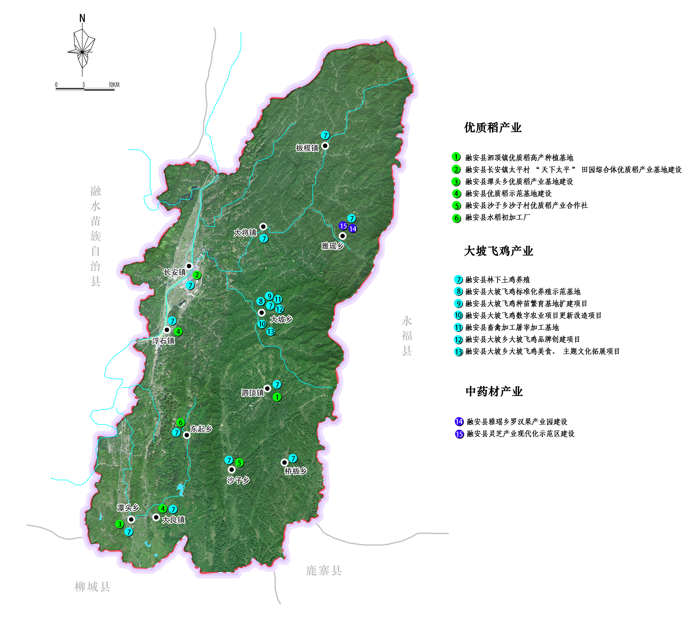

前  言

“十四五”时期是融安县全面脱贫、全面建成小康社会后，乘势而上同全国、全区、全市一道开启全面建设社会主义现代化国家新征程的第一个五年，是巩固拓展脱贫攻坚成果衔接推动乡村振兴的关键时期，也是融安县落实新发展理念引领高质量跨越式发展的关键五年。

为全面落实习近平总书记在全国脱贫攻坚总结表彰大会上的重要讲话精神，贯彻实施《农业农村部等10部门关于推动脱贫地区特色产业可持续发展的指导意见》（农规发〔2021〕3号）、《广西壮族自治区人民政府关于印发广西壮族自治区国民经济和社会发展第十四个五年规划和2035年远景目标纲要的通知》（桂政发〔2021〕11号）等文件精神，结合融安县特色产业发展情况，实化细化特色产业发展的方向、任务、路径和措施，特编制本规划。

本规划产业范围以融安县五大特色产业为主，特色产业包括融安金桔、香杉、青蒿、中药材、大坡飞鸡、优质稻等六大产业，其中青蒿作为中药材产业之一，是融安县扶贫支柱产业，范围为全县12个乡镇，规划期限为2021—2025年。

## 第一章  规划背景

“十三五”期间，融安县通过大力发展县级“5+2”（“5”即柑桔、杉、优质稻、鸡、中药材，“2”即鱼、叶菜类）、贫困村“3+1”特色产业、促进就业稳定等方式，实现贫困家庭稳定增收，如期完成脱贫攻坚目标任务，率先在柳州市实现脱贫摘帽。

### 第一节 发展成效

## 一、产业扶贫成效明显

“十三五”期间，融安金桔和香杉等特色优势产业实现高质量发展，县级“5+2”、贫困村“3+1”特色产业覆盖超过98%，在已脱贫的69155人中，有66748人通过发展产业实现增收脱贫，占脱贫人口的96.52%，已形成“县有扶贫支柱产业，村有扶贫主导产业，户有增收致富项目”的扶贫产业格局。融安特色优势产业发展为“十四五”推进巩固拓展脱贫攻坚成果与乡村振兴有效衔接奠定良好基础。

## 二、“一草一木一果”特色鲜明

融安县聚焦特色产业转型，深入推进“生态产业化、产业生态化”“两山”理论得到生动实践。其中最具特色的“融安金桔、香杉、青蒿”创下了三个第一：滑皮金桔出产量全国第一、香杉生态板材生产量全国第一、青蒿素产量全球第一，占全球产量三分之一。融安县先后获得“中国特色农产品优势区”“全国柑橘产业30强县（市）”“2019年融安金桔入选全国农产品区域公用品牌”“2019年中国最有价值的20大水果区域公用品牌”；2020年，在农业农村部全国产业扶贫公众号上，融安金桔产业作为贫困县一县一业得到了全国范围内的大力推介，2020年11月6日，融安金桔成为国家知识产权局举办的“贸易与商标品牌”论坛上全国仅有的两个特邀品牌之一。

## 三、特色产业扩面提质

融安金桔产业面积在“十三五”期间，从2.07万亩增加到19.06万亩，实现产业翻倍增长，2021年产量达16.5万吨，产值16.5亿元；融安县香杉产业种植面积139万亩，年产香杉实木生态板材90万立方米，产值超50亿元，形成了“选种—育苗—种植—加工—旅游”的全产业链现代生态产业体系，成为全国最大的香杉实木生态板生产基地；优质稻种植面积达26万亩，产量8.72万吨；大坡飞鸡年出栏156万羽；融安河边鱼2500吨；糖料蔗种植面积4.38万亩；青蒿等中草药种植面积3.2万亩，青蒿素产业年产量70吨以上，种植面积逐年提高。

## 四、三产融合发展良好

“十三五”期间，融安县建成融安金桔“大坡飞鸡”等大数据平台，实现全产业监管体系；引进加工企业达15家，推出金桔果脯、金桔茶、青蒿皂等20多个系列深加工产品。融安县通过电子商务累计带动28875户贫困户实现增收，户均收入超过5000元，带动5.2万人次创业就业。全县电子商务交易额达53.44亿元，发展各类电商企业608家，网店24056家，物流企业49家，农村电商服务站点116个，益农信息社442个，行政村覆盖率为100%，连续多年占据广西县级电子商务交易总额第一。借助“互联网+”的翅膀，融安县的特色产业实现了“加速跑”。“仙草堂药材生态产业园”成功入选广西首批中医药健康旅游示范基地，生态灵芝透明工厂获评国家级AAAA旅游景区，是柳州市率先带动繁荣三产的典范。

## 五、主体积极参与产业发展

融安县在“育主体”和“带农户”两个方面同时下功夫，支持培育了各类涉农龙头企业13家，农民专业合作社422家，家庭农场155家，62个贫困村有农民专业合作社等新型经营主体111家，建成特色产业基地80个（其中“5+2”特色产业基地78个），实现了每个贫困村有“一村一新型经营主体”或“一村一产业示范基地”。通过直接帮扶、订单生产、土地流转、生产托管、就地务工、股份合作、资产租赁等方式，新型经营主体直接带动了5999名贫困人口实现脱贫。全县337名致富带头人共带动1147名贫困户发展产业，有1116名贫困户通过“能人带贫”实现脱贫摘帽。以融安金桔为主导产业成功创建了中国特色农产品优势区、自治区现代农业产业园，累计建成现代特色农业示范区（园、点）222个（其中自治区级核心示范区4个，县级示范区8个，乡级示范园42个，村级示范点168个）。

## 六、科技支撑能力强劲

融安县在62个贫困村成立农业科技扶贫服务站和选派农业科技扶贫驻村服务员，抽调79名技术骨干组成产业技术专家团队，分成4个组分片区开展技术服务指导。培育了337名贫困村创业致富带头人，打造了一支337名产业发展指导员人才队伍，实现了“村村有指导、户户有帮扶”。2016年以来，全县共举办833期培训班，共计培训49815人次，印发培训资料10万多份（其中农业农村局2016—2020年共举办培训班772期，培训34740人次，发放培训资料8.5万份）。自2018年自治区组织开展产业指导员工作以来，全县产业指导员开展工作7398次，帮扶贫困户46417人。

## 七、政策保障体系完善

“十三五”期间，融安县共发放扶贫产业奖补资金15632.7万元，惠及59180户贫困户。全面落实耕地地力保护补贴、实际种粮农民一次性补贴、稻谷生产补贴，进一步扩大政策性农业保险覆盖面，扩大种植业、畜禽产品保险范围和承保率，开展中央政策性农业保险达7种，形成长效保障机制。

## 八、村集体经济激活振兴动能

融安县为有效推动村集体经济产业示范项目增收，一是实施“百村万亩金桔园”项目，在金桔种植项目上通过本村种植、联村种植，在每个村发展10亩以上的集体经济金桔园，2021年集体经济参与的金桔园已全部达到万亩。全县已实施“百村万亩金桔园”项目44个，涉及12个乡镇114个村，整合发展资金4800余万元，有村集体经济参与的金桔园4968亩，新种或流转土地3768亩发展金桔园，每村增收2万元至10万元，成为覆盖全县行政村最广的村集体经济项目。二是实施特色养殖项目，依托融安大坡飞鸡和河边鱼品牌，采取“党建+能人+合作社”的经营模式，统筹村集体经济发展扶持资金350万元发展河边鱼养殖及渔业观光体验旅游项目，从水下经济获取集体红利，并进一步打造了全县的垂钓中心、渔业观光体验中心，每年可获村集体收入50万元以上。利用大坡飞鸡成熟的养殖技术和销售市场，整合5个村的集体经济发展扶持资金共171万元建设繁育基地，整合7个村的扶持资金210万元建设大坡飞鸡交易市场，两个项目每年可为每村创造5万元以上收入。

### 第二节 发展环境

“十三五”期间，融安县特色产业向高质量现代农业发展迈进，为实施乡村振兴战略提供了坚实的基础。“十四五”时期，融安县特色产业仍处于重要战略机遇期，但机遇和挑战都有新的发展变化，机遇大于挑战，利于开辟特色产业发展新局面。

## 一、发展挑战

融安县产业发展基础设施建设相对薄弱，有效灌溉面积和宜机作业高标准农田占比偏低，农田水利、乡村道路、通信网络等基础设施条件有待提升。

生产组织化程度不高。融安县新型农业经营主体特别是自治区级以上农业产业化重点龙头企业数量偏少、规模偏小、实力偏弱，生产组织化程度和产业化水平较低，抗风险能力不强，真正有规模、有能力、能带动的农民合作社数量不多。

融安县特色产业发展总体上还处在成长期，产业发展质量效益不高，“一产”向后延伸不充分，仍以供应原料为主，从田头到餐桌的链条不够健全；“二产”连两头不紧密，农产品精深加工相对短缺，综合利用率不高；“三产”发育仍然不足，休闲农业、健康养生等新产业新业态发展不充分。

农业农村高素质人才缺失。融安县农业青壮年劳动力短缺，劳动力质量与农业现代化发展需求不相适应，制约了融安县特色产业快速有效发展。

## 二、发展机遇

重大战略交汇叠加提供广阔发展空间。当前我国正处于“全面建成小康社会将如期实现、第二个百年奋斗目标建设需顺期开局交汇过渡、精准脱贫任务需按期完成与乡村振兴战略有效衔接、农业供给侧结构性改革需适期深化”的关键历史节点，同时随着“一带一路”倡议实施，《区域全面经济伙伴关系协定（RCEP）》正式签署，中国（广西）自由贸易试验区、西部陆海新通道、粤港澳大湾区等战略深入实施，为广西融入国内国际双循环、充分利用两个市场两种资源提供创造了前所未有的条件，为融安县特色产业提供了新的发展空间。

乡村振兴战略全面实施带来重大发展机遇。党的十九大报告提出实施乡村振兴战略，强调必须始终把解决好“三农”问题作为全党工作的重中之重，坚持农业农村优先发展；从中央到自治区，不断加大强农惠农富农政策力度，为融安县特色产业可持续发展提供坚实的政策保障。

融安县发展面临着西部大开发、石漠化治理、新型城镇化建设和乡村振兴等多项政策改革机遇，并依托粤桂东西部协作基础，融安特色产业对西江经济带、珠三角、大湾区甚至江浙等东部发达地区的主要城市产业转移的吸引力和承接能力将进一步加强；东部资本通过实现精准对接、优势互补、共同发展，将推动融安县特色产业不断提升战略地位，为参与构建新发展格局打开更广阔的空间。

广西大力建设特色产业的发展导向明确。习近平总书记视察广西时充分肯定广西现代特色农业初具规模，要求广西立足林果蔬畜糖等特色资源，打造一批特色农业产业集群。自治区党委、政府提出十四五时期要推动产业振兴，加快建设现代特色农业强区，打造全国重要农产品保供优供基地。自治区农业农村厅等三部门联合印发《广西壮族自治区农业产业振兴三年行动方案（2021—2023年）》（核实文件全称！），为推进包括融安县在内的脱贫地区特色产业发展提供了明确的发展导向和切实的政策支持。

融安县进入“十四五”新发展阶段，特色农业产业发展稳中向好、长期向好的态势没有改变，在自治区构建新一轮特色农业产业发展格局中的战略优势将更加凸显。

## 第二章  基础条件

### 第一节  区位条件

## 一、交通区位

地理区位：融安县位于广西壮族自治区北部，东面与永福、临桂等县（区）接壤，南面与柳城、鹿寨等县毗邻，西面与融水县相邻，北面与三江、龙胜县交界；地处东经109°13′—109°47′，北纬24°46′—25°34′之间，行政区域面积为2905平方公里，东西最大横距44.5千米，南北最大纵距89千米；县城位于长安镇，是湘、桂、黔三省（区）交界中心区域和商品集散地，区位优势明显。

交通条件：融安县交通便利，公路、铁路、水路交通都十分发达，陆路距南宁约360公里，境内有一条S31省道通往湖南、贵州，有三条高速公路。融安县城设有焦柳线广西段最大客运、货运火车站新汽车客运站总占地面积8616平方米，为国家二级汽车站标准；焦柳铁路从北往南贯穿县境4个乡镇，经停融安站的列车总数达到6对，往北可直通襄阳、宜昌、张家界、吉首、怀化、重庆、成都等城市，往南可达南宁、桂林、玉林、湛江、肇庆、佛山、广州、东莞、深圳等地，铁路交通便利。融安县境内珠江水系干流融江河段长35.9公里，融江航道上可达贵州从江、榕江，下可到柳州、梧州、广州，常年可通航100—300吨级货船，水路交通发达。

## 二、社会经济

融安县是“中国金桔之乡”，是桂北农产品主产区，农产品以“一果一木一草”（即金桔、香杉、青蒿）为主。“十三五”期间，全县地区生产总值由64.76亿元上升到108.4亿元，年均增长8.47%，成功突破百亿元大关；工业总产值由57亿元上升到81.2亿元，年均增长9.2%；固定资产投资年均增长15.2%；财政总收入由4.2亿元上升到6.21亿元；社会消费品零售总额由27.36亿元上升到36.4亿元，年均增长7.4%；城镇居民人均可支配收入由25113元提升到32098元，年均增长6.3%，农村居民人均可支配收入由10622元提升到15337元，年均增长9.6%。社会经济稳步发展，经济水平不断提高。

### 第二节  自然条件

## 一、气候

融安县地处低纬度地区，属中亚热带季风气候，太阳辐射强，气候温和，年平均气温19.0℃，春季为10—20℃，夏季在22℃以上，秋季为10—22℃，冬季在10℃以下，四季温和稳定，适合金桔的培育以及各类农产品生长。雨水充沛，年平均降雨量1942.5毫米，有利于农业发展。

## 二、地形

融安县位于岭南南侧，为云贵高原延伸而来的桂北山地向桂中岩溶峰林峰丛谷地及柳州台地的过渡地带，地形复杂多变，分为中低山陡坡地 、低山缓坡地、岩溶峰丛地、沉积平原地等类型。地势东北高西南低，东北部属中山、低山及丘陵地区，东南部为岩溶峰林洼地和岩溶峰丛谷地，西南部多为岩溶孤峰平原，西北部为融江河谷小平原。

## 三、水文

全县水电资源十分丰富，有江河93条，其中主要河流20条，流域面积大于100平方千米的10条，流域面积大于50、小于100平方千米的10条，流域面积大于10、小于50平方千米的73条。河流多发源于境内，总长1184.9千米，集雨面积2796平方千米，雨季容易出现暴雨导致的洪涝灾害，对产业生产和发展有较大的影响。

## 四、土壤

融安县属于喀斯特地形地貌区，土壤酸碱度多为中性和偏酸性，有利于喜微酸性土壤的金桔农作物生长，部分地区沙土含量较高导致土壤不易蓄水，县内东北、西北部地区土壤水分含量高，东南、西南部地区土壤水分含量相对较少。部分地区土壤硒元素含量多。

### 第三节  产业条件

## 一、融安金桔产业

一是产业基础良好。融安县有“中国金桔之乡”的美称，是全国最大的滑皮和脆蜜金桔生产基地，2021年融安金桔种植面积达20.72万亩，共建成了3个金桔种植核心示范基地，标准化种植面积4.8万亩。融安金桔产业产值已达25.7亿元，产量及规模稳居国内前列。

二是发展成效显著。融安县参与制定了《金桔》国家标准和《地理标志产品融安金桔》广西地方标准。2007年融安金桔取得国家地理标志证明商标认证；2011年融安金桔获得“国家地理标志保护产品”称号，并获得中国果品流通协会授予“中国金桔之乡”称号；2018年融安县被评为“中国特色农产品优势区”“全国柑橘产业30强县（市）”；2019年融安金桔入选全国农产品区域公用品牌，荣获2019年中国最有价值的20大水果区域公用品牌；2020年融安金桔入选第二批中欧地理标志协定保护名录，在农业农村部全国产业扶贫公众号上得到了全国范围内的大力推介。

三是品牌影响有力。融安县委、县人民政府以金桔产业为媒介，连续举办了十届“融安金桔节”和两届“互联网+‘融安金桔’品牌建设”高峰论坛会，专门为融安金桔量身打造的歌曲《桔乡恋歌》和《金桔飘香的地方》，央视栏目和广西卫视专题片《融安金桔带来的甜蜜财富》《越买越贵的金桔为哪般》《金桔从这里走向世界》，广西移动电视广告片融安金桔、央视农产品区域公用品牌广告片“壮美广西、融安金桔”以及央视精准扶贫广告“融安金桔篇”，都有力推动了融安金桔品牌大广度、纵深度、多维度的发展和转型升级。同时坚持“请进来、走出去”的宣传营销策略，在农业农村部主办的“2018产业扶贫在行动——贫困地区农产品产销对接大型公益活动”中，县委书记亲自带队组织金色桔韵金桔专业合作社、深创农业发展有限公司北上进京，在全国500多个贫困县中脱颖而出（广西唯一的县份），荣登上台推介，通过中央电视台向全国宣传融安金桔，品牌优势进一步凸显。截至2021年，融安金桔品牌价值连续四年双增长，品牌价值达到19.42亿元，是全国极具品牌发展潜力的地理标志产品之一。

四是三产深度融合。建成了融安县粤桂扶贫协作产业园（农产品加工产业园），园区规划1000亩，一期用地400亩，总投资1.5亿元，引进多家精深加工企业，重点开展融安金桔茶、饼、酒、果汁、香精等金桔系列产品的深加工，年消耗金桔原料3600吨，实现了融安金桔从鲜果销售到深加工的突破。建有桂北县级最大的农产品专业电商产业园区和全国最先进专业金桔标准化云仓1座，2021年全县电商交易总额达到53.44亿元，融安金桔推促全县乡村旅游业接待游客达到309.03万人次，有力地推进旅游产业发展。

五是带动能力强劲。依托融安县金桔农业特色品牌，按照“联合经营、比例分成”的办法，通过本村种植、联村种植的形式，在每个村发展10亩以上的集体经济金桔园，到2021年有集体经济参与的金桔园达到万亩。全县已实施“百村万亩金桔园”项目44个，涉及12个乡镇114个村，整合发展资金4800余万元，有村集体经济参与的金桔园4968亩，新种或流转土地发展的金桔园3768亩，每村增收2万元至10万元，成为覆盖全县行政村最广的村集体经济项目。此外，全县共整合扶贫资金800万元，联合39个村与县农业投资开发有限责任公司等公司合作，共建标准化无病毒金桔苗木培育基地240亩，年培育无病毒金桔苗木360万株以上，每年可给每村增加2万元以上集体经济分红。

## 二、香杉产业

一是产业基础扎实。融安县是中国最具规模的香杉生态板生产基地，有着丰富的香杉资源。融安县香杉板材生产技术在国内处于领先水平，生产的香杉实木生态板材甲醛含量指标达到了E0级标准，全县产量占广西产量的45%、占柳州市产量的60%，是全国最大的香杉实木生态板生产基地，被评为“中国香杉板材之乡”。2012年，我县被自治区林业厅列为国家木材战略储备基地试点县，建设了1个香杉组培繁育中心，为香杉林提供充足的苗木保障。2021年，融安县香杉总面积139万亩，蓄积量1000万立方米，木材加工产量达到118万立方米，林业产业总产值达到120.3亿元。融安县每年可采伐香杉60万立方米以上，每年有近80万立方米木材汇集融安县，逐步形成了融安县木材流通“凹地聚集效应”。

二是产业覆盖面广。融安县共有4.2万户农户种植香杉10.98万亩，其中建档立卡户1.3万户，香杉产业覆盖率70.01%，户均增收超过3万元。

三是三产发展稳定。融安县坚持产业基地化、园区景区化，加快推进融安县·广西香杉生态工业产业园三期建设，促进要素集中、产业集聚，推动一二三产业融合、集约化发展。通过调整优化产业结构，聚力发展香杉、林业碳汇、油茶、乡土特色苗木、森林旅游（康养）、林产品精深加工、林下种养业等，优化林业重点产业布局，形成创新特色林业产业集群发展模式。一二三产业产值比例为26:57:17，形成了稳定的产业发展格局。

四是发展成效显著。2020年，融安县被评为“中国香杉板材之乡”，获得“广西林业产业发展十强县”“国家首批绿色能源示范县”等荣誉，由融安县起草制定的《香杉实木生态板》《香杉实木板芯》两个团体标准，已经发布实施，填补了国内香杉行业标准的历史空白。同时，《香杉实木生态板》团体标准被工业和信息化部评为“2018年百项团体标准应用示范项目”，是当年广西唯一入选的团体标准。同年创建自治区级融安县香杉生态产业创新孵化基地服务标准化试点，进一步提升了融安县香杉在中国香杉产业的地位。

## 三、青蒿产业

融安县是中国乃至世界最大的青蒿素生产基地，青蒿种植在广西种植具有明显优势，一是可以与农作物轮作，不占用农保田；二是种植管理可控，青蒿草质量可控；三是种植简单，可以充分利用留守中老年劳动力；四是青蒿草与玉米轮作，可以优化土壤，提高玉米收成；五是县域有全球最大的青蒿素加工企业广西仙草堂制药有限责任公司，青蒿素的产量接近全球产量的三分之一；六是融安县青蒿产业深加工水平全球领先，带动周边县区1万多户农户（其中脱贫户3000多户）种植青蒿，年均支付给种植户收购资金达5000多万元。

## 四、优质稻产业

融安县通过优化产业结构，不断优化品种结构，推广优良品种和高产栽培技术，划定建设粮食功能区，开展高标准农田建设，推进耕地地力保护，打造了一批千亩连片粮食高产示范基地。2021年，水稻传统种植区潭头乡全乡水稻播种面积3.89万亩，产量1.3万吨，占全县17.28%，水稻产能稳定，年可向市场供应1.1万吨稻谷。全县水稻生产综合机械化率达到80%以上。在大力发展优质稻基础上，支持盛丰优谷米业、红卫粮库等3家大型稻米加工企业发展，积极发展主粮加工业延伸产业链条。通过启动品牌创建，成功打造“屋背山”“绿之源”“融勤粮舍”“盛丰优谷”等品牌，外销量超过0.3万吨。

## 五、中药材产业

一是产业基础扎实。融安县位于中国亚热带季风气候区，土地、气候条件十分适合中药材种植、生长。境内野生中药材资源丰富，约有药用植物500多种，其中常用中药材150多种，有罗汉果、青蒿、山药、钩藤、黑老虎、五指毛桃、吴茱萸、佛手、灵芝、金银花、草珊瑚等道地中药材近百种。经过多年的发展，全县形成了林下经济药材种植及间作套种药材的“融安模式”。目前，融安县主要采用人工种植和野生抚育两种方式，中药材面积达3.2万亩，遍及全县12个乡镇，中药材种植农户总数达1万多户。

二是产业链条延展。融安县引进集研发、生产、营销、旅游为一体的中药材加工企业——广西仙草堂制药有限责任公司，该公司为自治区级重点龙头企业，现已建成集栽培研发、生产加工、观光旅游、科普知识、产品养生体验于一体的中草药加工厂。广西仙草堂制药有限责任公司的生态灵芝透明工厂获评国家AAAA级旅游景区，年累计接待游客53万多人次，旅游收入2000多万元，增加就业岗位100多个，示范带动能力显著。园区由种植示范基地、透明观光生产车间、灵芝科技文化馆、灵芝养生餐厅及产品展厅等部分组成，是集栽培研发、生产加工、观光旅游、科普知识、养生体验于一体的工业旅游景区，基本构建形成中药材全产业链。

## 六、肉鸡产业

一是产业基础扎实。以“大坡飞鸡”为主的肉鸡产业是融安县十大扶贫产业项目之一。大力发展“大坡飞鸡”养殖，把生态优势转化成经济发展优势，林下土鸡养殖产业驶入快车道，形成了“繁育基地—脱温场—养殖户（合作社）—销售端—餐桌”的完整产业链条，养殖高峰时期饲养1000羽以上的养殖户达300多户。2021年，全县肉鸡年出栏量达到160万羽，总产值达到9600万元，发展养鸡专业合作社35个。“大坡飞鸡”已位列新“融安三宝”之一，成为助推乡村振兴的有力抓手产业。

二是产业带动有力。肉鸡作为全县“5+2”特色产业之一，在脱贫攻坚工作中发挥重要作用。县人民政府出台产业扶贫奖补政策，构建“公司+基地+贫困户”和“合作社+贫困户”的生产经营模式，每羽补贴15元，贫困户人均入股800羽，年收入达2万余元。“十三五”期间共有5859户贫困户参与到肉鸡养殖产业中，饲养量累计超过70万羽，培育出35名农村致富带头人，助推全县特色产业发展。

三是品质保障过硬。融安县积极推动“大坡飞鸡”产业大数据平台建设，通过打造大数据应用平台，借助大数据、物联网等技术，实现“大坡飞鸡”养殖环境监测、全程质量追溯、产业预警分析，从生产源头管控“大坡飞鸡”质量，实现对“大坡飞鸡”的全程质量追溯与监管，有效保障“大坡飞鸡”的质量和安全，推动“大坡飞鸡”养殖产业升级。

四是品牌初见成效。融安县目前注册有“大坡飞鸡”“竹山花鸡”“农苑飞鸡”“柳强飞鸡”“禄局飞鸡”等5个商标。融安巾帼大坡飞鸡养殖专业合作社荣获“2018年全国巾帼脱贫示范基地”，在柳州市第三届农业博览会上获畜禽类一等奖等佳绩。2020年建成广西现代特色农业县级示范区。融安县每年都会举办“大坡飞鸡”美食文化节活动，通过抓鸡大赛、农产品展销、厨艺大比拼、百鸡宴、文化活动以及文艺表演等系列趣味活动，全面展示当地山林下养殖土鸡成果，提升“大坡飞鸡”的知名度，拓宽土鸡销售市场，“大坡飞鸡”的品牌价值不断提升。

## 七、其他特色产业

融安县因地制宜，以河边鱼、螺蛳粉原材料、桑蚕、油茶、肉牛肉羊、融安滤粉等特色产业为重点，打造各具特色的农业全产业链，将一批“小特产”打造升级为“大产业”。

河边鱼产业。融安县在发展河边鱼养殖上积极推行村民合作社与养殖能人合作方式，如浮石镇长龙村采取“党建+能人+合作社”的经营模式，由长龙村村民合作社牵头，成立融安县长龙生态养鱼专业合作社，统筹村集体经济发展扶持资金350万元，与河边鱼养殖能人联营，共同发展河边鱼养殖及渔业观光体验旅游项目，从水下经济获取集体红利，该项目共养殖河边鱼220亩，并进一步打造县垂钓中心、渔业观光体验中心，每年可获村集体收入50万元以上。

螺蛳粉原材料产业。工业化发展的螺蛳粉产业延长了相关产业链，螺蛳粉原材料产业采用“企业+基地+农户”等模式，融安县在各乡（镇）打造了一批田螺、豆角、木耳、酸笋等螺蛳粉原材料生产基地，在满足螺蛳粉产业快速发展需求的同时，让广大农民实现稳定脱贫增收。培育壮大螺蛳粉原材料加工龙头企业，打造“柳州螺蛳粉”配套产业链。

桑蚕产业。融安县利用山区资源和传统技术优势，出台产业扶持政策，积极引导农民种桑养蚕，推广小蚕共育技术，依托“公司+基地+合作社+贫困户”的发展模式，带动当地贫困群众脱贫增收。目前，融安县12个乡镇均有桑蚕产业，桑园面积达到1.8万亩，桑蚕产业成为农民增收的重要途径。

油茶产业。融安县是全区油茶重点产区，全县油茶林面积达到11万亩以上，油茶综合产值在0.67亿元以上。融安县通过优化品种结构，改种优质优良品种，提升机械化水平，推行应用统一的油茶栽培管护、施肥用药、病虫害防治、采摘、运输、储存等标准和技术规程规范，实现标准化管理，推行应用绿色高效标准化生产技术，推广应用绿色植保防控技术、套种绿肥、有机肥替代化肥等技术模式，培育一批标准化油茶种植基地，促进现代林业发展，巩固脱贫成效，为实现乡村振兴产业兴旺奠定基础。

肉牛肉羊产业。融安县通过实施特色养殖促增收工程，加速畜牧产业发展，全县肉牛肉羊出栏4.35万头。以标准化发展为基础，建立投入品管理、饲养、防疫、质量管控等全过程标准体系，打造了一批健康养殖示范场。推广高架床、“微生物+”、垫料等省力养殖模式，推进互联网、物联网、人工智能等技术与肉牛肉羊产业深度融合，打造一批现代化、智能化养殖基地。

融安滤粉产业。滤粉是融安县特色美食之一，通过充分挖掘融安滤粉品牌故事，打造融安文旅融合特色传统美食品牌，培育融安滤粉区域公用品牌，推动文旅结合，带动融安县特色美食产业发展。

## 第三章  总体思路

### 第一节 指导思想

以习近平新时代中国特色社会主义思想为指导，全面贯彻落实党的十九大和十九届历次全会精神，深入贯彻习近平总书记关于“三农”工作重要论述和对广西工作系列重要指示精神，以及自治区第十二次党代会精神，全面落实自治区、柳州市和融安县关于实现巩固拓展脱贫攻坚成果同乡村振兴有效衔接的决策部署，准确把握新发展阶段，贯彻新发展理念，构建新发展格局，坚持立农为农、政策稳定、市场导向、产业富民原则，立足融安县特色农业资源和产业发展基础，培育壮大融安县特色产业，延长产业链、提升价值链、完善利益链，拓展产业增值增效空间，促进内生可持续发展，为实现融安县巩固拓展脱贫攻坚成果同乡村振兴有效衔接提供有力支撑，加快农村农业现代化，推动县域经济高质量发展。

### 第二节 基本原则

坚持用地原则。节约集约用地，严守耕地红线，主要利用非耕地后备资源宜果荒地种果，禁止占用公益林、天然林，落实耕地“进出平衡”。

坚持因地制宜。立足当地资源禀赋，充分发挥当地独特的地理气候环境，有序扩大特色产业优良品种的产业规模，进一步优化脱贫攻坚期内形成的县级“5+2”、村级“3+1”产业并长期培育，在资金、项目、政策等方面给予集中倾斜支持，打造集中连片的特色产业集群，形成“一县一业”“一乡镇一特”“一村一品”的发展格局。

坚持市场导向。坚持市场导向，研究市场变化规律，充分发挥市场配置资源的作用，优化产业布局，充分发挥企业、专业合作社、家庭农场、种植农户的积极性和主动性，同时通过政策引导资源要素向品种培优、品质提升、品牌打造聚集，不断增强市场竞争能力。

坚持产业融合。依托丰富资源优势，立足特色产业基础，加快推进特色产业纵向延伸、横向拓展，推动特色产业与乡土文化、艺术创意、乡村旅游、市场交易、电子商务、精深加工等领域相融，延长产业链，构建一二三产业融合发展格局。

坚持科技引领。坚持“前端聚焦、中间协调、后端转化”，深入实施创新驱动发展战略，强化科技支撑与示范引领，不断优化品种，改造传统生产经营方式，稳步和增强产品的品质优势，培育核心竞争力。加快培育新型职业农民，加大基层青年创业阵地建设。着力推进机制创新、模式创新，进一步提升农业劳动生产率和经营水平，为特色产业转型升级发展提供强大驱动力。

坚持绿色发展。秉承“绿水青山就是金山银山”理念，着眼长远的原则，高效利用土地资源，做到适地适栽，用养结合，注重生产绿色协调发展，积极推广绿色生产技术标准化，合理配置资源和绿色发展的需求，确保农产品健康可持续发展。

坚持产业富民。大力推进乡村振兴，加快农业农村现代化发展，以农民群众利益为本，立农为农，切实提升农民群众发展特色产业的能力，把二三产业留在乡村，把就业创业机会和产业链增值收益更多留给农民群众，促进农民群众增收致富。

### 第三节 总体目标

坚持“农产品主产区”的基本定位，立足融安县特色农业资源和产业发展基础，以稳产保供和农民增收为主要目标任务，以农业基础设施改善提升为基础，以农业科技水平和智慧化水平提升为支撑，以现代农业园区建设为核心，以农业绿色高质量发展为主线，以全产业链发展为路径，全力做强“一草一木一果”（融安金桔、香杉、青蒿）三大农业龙头产业，做优中药材、优质稻、肉鸡等3个优势产业，做精河边鱼、油茶、桑蚕、螺蛳粉原材料、肉牛肉羊等N个亮点产业，构建融安县“3+3+N”特色产业体系，打造“一县一业”“一乡镇一特”“一村一品”的发展格局。到2025年，打造1个全产业链产值超150亿元产业（香杉），1个全产业链50亿元产业（融安金桔），3个全产业链产值超10亿元产业（中药材、青蒿、肉鸡），4个全产业链产值超5亿产业。特色产业实现“从有到优”转变，将一批“小特产”打造升级为“大产业”。

农业空间布局和产业结构全面优化。按照“3+3+N”的产业体系格局，布局建设一批标准化生产基地，空间布局由“平面分布”转型为“集群发展”，形成特色产业结构更加优化，粮经饲统筹、农林牧渔结合、种养加一体、一二三产业融合的发展格局。到2025年，全县金桔种植面积25万亩，产量30万吨；香杉林地面积140万亩，香杉改性材达到15万立方米以上；香杉人造板材年木材加工达120万立方米以上。

产业融合和规模经营水平大幅跃升。重点培育一批新型农业经营主体，扶持农业产业化联合体5个以上，每个脱贫村至少有1家新型经营主体或产业基地（园）带动。到2025年，全县农产品初加工率达到80%以上，农产品加工业总产值与农业总产值之比达到2.5:1以上。创建一批自治区级现代农业产业园、农业产业强镇和现代特色农业示范区，选择条件较好的脱贫村，重点打造一批“一村一品”专业村。全县农旅、农文、农教和产村融合明显提升，新产业新业态新经济不断壮大，农业农村经济活力和后劲显著增强。

品牌建设成效和市场知名度显著提高。优质品牌农产品供给能力明显增强，农产品品质、质量安全水平和品牌农产品占比明显提升。到2025年，融安金桔品牌价值进一步提升达到60亿元。打造一批融安河边鱼、融安滤粉等区域公用品牌，争取入选“桂字号”品牌目录。

农业绿色和可持续发展能力大大彰显。到2025年，全县农业循环经济占比到60%以上，规模畜禽养殖场粪污综合利用率达到92%，农作物秸秆综合利用率达90%，绿色食品和有机农产品占到总量的30%左右，农业绿色发展水平不断提升。

特色产业对富民强县的贡献力不断增强。融安金桔、香杉等“3+3+N”特色产业助推脱贫攻坚与乡村振兴有力衔接，对农民增收的贡献日益凸显。全县农村居民人均可支配收入年均增长10%以上。

表2—1 发展目标指标表

| 指标名称 | 单位 | 基期 2021年 | 目标期 2025年 | 指标性质 |
|---|---|---|---|---|
| 产业结构 | 粮食面积 | 万亩 | 26.96 | 26.97 | 预期性 |
| 粮食产量 | 亿斤 | 1.77 | 1.78 | 预期性 |
| 主导产业一：金桔面积 | 万亩 | 20.7 | 25 | 预期性 |
| 金桔产量 | 万吨 | 19.1 | 30 | 预期性 |
| 主导产业二：香杉面积 | 万亩 | 139 | 142 | 预期性 |
| 香杉产量 |  | 53 | 57 | 预期性 |
| 农产品加工业产值与农业总产值比值 | — | 2.3:1 | 2.5:1 | 预期性 |
| 主导产业加工转化率 | % | 56 | 80 | 预期性 |
| 技术装备 | 良种覆盖率 | % | 90 | 95 | 预期性 |
| 主要农作物耕种收综合机械化率 | % | 69.07 | 72 | 预期性 |
| 高标准农田面积比重 | % | 56% | 60 | 预期性 |
| 农业科技进步贡献率 | & | 63 | 75 | 预期性 |
| 绿色发展 | 节水灌溉面积比重 | % | 60% | 65 | 预期性 |
| 畜禽粪污资源化利用率 | % | 88% | 92 | 预期性 |
| 农产品质量安全监测合格率 | % | 99 | 98 | 预期性 |
| 绿色食品、有机产品和地理标志产品 | 个 | 16 | 30 | 预期性 |
| 经营管理 | 土地流转面积占比 | % | 23 | 50 | 预期性 |
| 示范区新型农业经营主体数量 | 个 | 224 | 232 | 预期性 |
| 其中：省级以上龙头企业数量（国家级数量） | 个 | 12 | 18 | 预期性 |
| 农民合作社数量 | 个 | 468 | 500 | 预期性 |
| 家庭农场数量 | 个 | 360 | 500 | 预期性 |
| 农户参加农民合作社比重 | % | 8 | 15 | 预期性 |
| 助农增收 | 农村居民人均可支配收入 | 万元 | 1.6825 | 2.4633 | 预期性 |

## 第四章 发展布局

围绕融安金桔、香杉、中药材、优质稻、大坡飞鸡五大优势特色产业，并把青蒿素作为主导产业之一，构建“3+3+N”农业发展体系。立足融安县域国土地形地貌特征及各乡（镇）特色农业资源条件、产业经济和社会发展现实基础，立足融安金桔为代表的特色水果及丰富的农产品资源优势，以中国供销·桂北农产品电商园为基础，以三柳高速、G209国道、焦柳铁路、融江水路等重要交通枢纽为支撑，按照“十四五”时期特色农业发展思路及功能定位要求，调整优化农业产业布局，构建“一核三区三带”特色农业发展空间格局。

### 第一节 总体布局

## 一、特色产业融合发展核

重点围绕长安镇，依托融安特色优势资源，培育提升特色化县域经济，提升承接柳州次中心城市功能转移和辐射带动乡村发展能力；打造柳州北部现代特色水果业及农产品集散中心、香杉生态产业集聚及生态产业中心、青蒿产业世界精深加工中心等，打造特色产业一二三产业融合发展样板。

## 二、三大农业龙头产业发展区

依据县域国土地形地貌特征、区域农业资源条件及产业基础，构建“一草一木一果”三大农业龙头产业发展区，即融安金桔全域发展区、南部缓丘青蒿发展区和北部杉木生态绿色发展区。

融安金桔全域发展区。即全县域所有乡镇大力发展融安金桔，构建种质资源保护、科技育种、金桔种植、精深加工等高效绿色全产业链，打造广西柑桔产业转型升级示范区。

北部杉木生态绿色发展区。即县域北部以杉木产业为重点，坚持“生态立县、特色强县、创新兴县”的发展理念，以可持续发展为目标，建设集优质良种杉种苗培育基地、工业原料林种植、农民林业致富示范及森林生态旅游为一体的绿色发展区，打造一二三产业高度融合的全产业链现代林业生产发展新模式，主要包括长安、大将、板榄、雅瑶、大坡等乡镇。

南部缓丘青蒿发展区。在县域南部丘陵地区大力发展青蒿产业，扩增种植面积、推广优质种苗、普及种植技术，打造优质青蒿产区，主要包括桥板、沙子、东起、泗顶等乡镇。

## 三、三大特色农业产业带

根据各乡（镇）农业资源条件及产业基础，打造四大特色农业产业带。即县域以G209国道及S31省道沿线为主的优质稻产业带、大坡飞鸡产业带及中药材产业带。

优质稻产业带。该产业带主要分布在长安、浮石、大良、潭头、东起、沙子等乡镇，以发展水稻产业为重点，兼顾生产蔬果、杉木、中药材。

大坡飞鸡产业带。该产业带主要分布在县域中部，以大坡乡为中心，辐射大将镇、长安镇、泗顶镇、浮石镇等乡镇，发展大坡飞鸡产业。

中药材产业带。该产业带分布于板榄镇、雅瑶乡、桥板乡、沙子乡、泗顶镇、东起乡等乡镇，以罗汉果产业为重点，兼顾发展山药产业。

图4—1  总体布局图

### 第二节  融安金桔产业布局

综合考虑各乡（镇）区位、气候、土地等因素，按照因地制宜、发挥优势、协调推进的思路，构建融安金桔全域发展格局。以长安镇、大将镇、大良镇为重点，推广优质种苗，提升产业质量，建设融安金桔主产区，打造国家农业现代产业园；将板榄镇、雅瑶乡、大坡县、泗顶镇打造为融安金桔示范区；将浮石镇、沙子乡、桥板乡、东起乡打造为融安金桔提升区；依托境内浪溪河沿岸丰富的水资源优势和交通条件，种植的环境优势，打造融安金桔融合提升发展带，促进一二三产业深度融合。打造以发展金桔产业为主的特色水果产业发展集群。

### 第三节  香杉产业布局

融安县香杉产业主要布局在板榄镇、雅瑶乡、大将镇、长安镇、大坡乡、泗顶镇、东起乡、桥板乡等乡镇，以“林海杉源”生态产业（核心）示范区、杉木加工园区为重要节点打造产业发展核心，发展香杉产业为主的高效林木产业体系。

### 第四节  青蒿产业布局

融安县青蒿产业主要布局在泗顶镇、沙子乡、桥板乡、东起乡等乡镇，推行石山地区的“玉米—青蒿”轮作模式，发展规范种植基地，保持青蒿产业核心竞争力。

### 第五节  优质稻产业布局

融安县优质稻产业布局在长安镇、浮石镇、泗顶镇、沙子乡、桥板乡、东起乡、大良镇、潭头乡等乡镇，打造融安优质水稻高质量发展产业主产区，构建县域粮食自给体系。

### 第六节  中药材产业布局

融安县中药材产业布局在长安镇、板榄镇、雅瑶乡、泗顶镇、沙子乡、桥板乡、东起乡等乡镇，以发展推进壮瑶医药振兴，打造以发展罗汉果、灵芝、淮山等道地中药材品种为主的产业集群。

### 第七节  大坡飞鸡产业布局

融安县大坡飞鸡产业主要布局在大坡乡、长安镇、泗顶镇、浮石镇、大将镇、雅瑶乡等乡镇，构建完善产业链头。

## 第五章 融安金桔产业

“十三五”期间，融安县以“半亩金桔助脱贫，一亩金桔奔小康，万亩金桔促富裕”的发展模式，大力发展金桔产业，以村集体经济减贫带贫作用为抓手，有效助力村集体经济增收。金桔已经成为融安人民的“致富果”“幸福果”，是融安县乡村振兴的支柱产业。

### 第一节 发展定位

基于融安县资源优势、产业基础、区域分工协作、产业升级、产业转移等角度，以融安金桔为主导产业，带动融安县农业产业经济迅猛发展。我县将融安金桔塑造为“中国金桔之王”“广西超级水果”等品牌形象，并定位为：中国脆蜜金桔第一县，中国金桔产业现代化标杆。

### 第二节 发展思路

以“扩规模、提品质、树品牌、塑文化、重科研、促流通”为发展思路，加大科研投入，以提高品质、提高效益为抓手，强化对融安金桔在育苗、种植、管护、采摘、加工、销售等环节科研活动的支持力度，高质量发展融安金桔全产业链，逐渐形成以融安为中心的金桔技术研发中心、品牌创建和创意创新中心、果品和物资集散中心。到2025年，金桔种植面积达到25万亩，品种结构调整进一步完善，其中，滑皮金桔8万亩、脆蜜金桔14.5万亩，油皮金桔2.5万亩，总产量达到30万吨。金桔标准化生产示范基地达到200个以上，其中金桔绿色食品生产基地50个以上，面积20万亩以上；建成融安金桔科研基地、融安金桔种质资源圃、优良品种母本园和无病毒苗圃；完成2个新品种的筛选观察和品种登记申请；融安金桔内在品质和外观质量明显提升，国标三级以上商品果率达到80%以上。面积100亩以上果园基本实现路、水、电“三通”，水肥一体化灌溉、测土配方施肥、“三避”大棚、绿色防控、质量追溯等标准化生产技术普及率达到80%以上。

### 第三节 重点任务

扩种优质品种脆蜜金桔。提升一产种植示范水平，打造一批优质金桔种植示范基地、一批融安金桔出口示范基地，提升一产竞争力。大力推广标准化生产，推广使用有机肥和防虫网、粘虫板、杀虫灯、性诱剂等绿色食品生产技术，加强农业生态环境的保护，持续提升金桔质量水平，优化奖惩机制，激发乡镇和农户种植积极性，扩种优质品种脆蜜金桔达1万亩以上。

推进脆蜜金桔种苗培育。全面加强金桔苗木生产和管理，加强融安金桔母本园纯种母本树的培育，进一步完善金桔苗木培育基地和金桔母本采穗圃建设，保证品种优良纯正；在原有100亩金桔苗圃生产基地的基础上，扩大苗圃基地面积，重点做好融安金桔营养杯大苗的培育，加快金桔产出，注册融安金桔苗商标，实施差异化奖补措施，供给县内外农户种植。

创建国家农业产业平台。继续以整县推进方式，积极争创以金桔为主导产业的国家农业现代化示范区、现代农业产业园和农业产业强镇等重大项目。

创建特色产业人才小高地。创建融安金桔产业研究院，引进高层次专业技术人才，初步形成既有基础研究、项目开发和推广应用等不同领域的创业人才团队；根据金桔产业发展区域现状，制定乡土人才培养、认定、使用制度，完善基层技术人才建设；探索金桔管理“园长制”，有针对性的对县内外融安金桔种植户进行技术指导，把融安打造成金桔种植的人才输出基地。

完善并公布金桔标准体系。制定融安金桔种苗繁育、病虫害防治、现代化种植管理和农业社会化服务标准，建立一套完整的标准体系，实现从种植、管护、采摘、储存、销售、运输全过程标准化的目标；建立统一技术、统一管理、统一质量标准、统一品牌形象、统一产品包装的规范发展产业链；修订《融安金桔》团体标准中的分级标准，增加果径大小分级指标；利用现有的《金桔大数据平台》，定期为金桔种植户推送当前金桔管理要点等农技信息；及时申报发表专利、论文等各类知识产权类作品。

筹建融安县金桔交易市场。在老火车站片区规划建设集零售、批发、电商、现代物流为一体，立足融安辐射全国，以融安金桔为主面向全国的专业化特色农产品交易市场；完善金桔一二三产业融合发展，延长金桔产业链。

建立质量安全监管追溯体系。按照与国家、国际标准接轨的要求，完善金桔产品标准体系，形成从生产、加工到仓储、物流等系列标准，加强标准的贯彻落实，做到有标必依，组织标准化生产技术和管理措施的示范推广；推行产地标识管理、产品条码制度，做到质量有标准、过程有规范、销售有标志、市场有监测；运用互联网和大数据等技术，构建政府、农产品生产经销主体、协会组织等多方力量参与的现代农产品信息化追溯平台；以绿色食品生产技术和监管标准，每个乡镇打造2至3个脆蜜金桔示范基地，推进品种选择、生产过程、终端产品高标准，把最优质的金桔生产基地建在融安。

开展融安金桔地理标志专项保护行动。加大县内市场执法力度，打击青果、滑皮金桔冒充脆蜜金桔产品的销售现象；在辖区外开展融安金桔市场整治工作，支持执法办案人员外出开展维权行动，打击普通金桔冒充融安金桔售卖行为；与平台后台沟通，在网络销售过程中实行准入许可制度，出具乡镇原产地证明，进行定期常规的检查和不定期抽查，把不法商家售假的行为逐渐清除；推动金桔生产企业和个人开具合格证与融安金桔品牌保护有机结合，推进农产品“三品一标”发展，持续加强监测评估和追溯管理。

讲好融安金桔故事。深挖金桔文化，建设金桔文化博物馆，在滑皮金桔的起源之乡大将打造金桔文化园，讲好融安金桔的故事；在国家、自治区和柳州市主流媒体上定期宣传融安金桔，积极参加国内农产品交易会，提高融安金桔的知晓度。深度挖掘融安历史文化和金桔文化，塑造融安金桔品牌文化形象，充分利用各类媒体媒介做好形象公关，扩大融安金桔文化的传播，进一步建设融安金桔文化旅游节活动项目，提高公众对融安金桔文化的认知；打造一个融安金桔文化长廊，将文化和品牌相融合，提高融安金桔公用品牌在全国市场的软实力。进一步打造金桔产品标签，提高融安金桔的知名度，为融安金桔提供强有力的文化支撑，使融安金桔在市场上具有核心竞争力。

全方位扩大品牌营销。用好融安“中国金桔之乡”名片，引进国家级品牌策划专业团队专业机构，深入开展品牌策划设计、宣传推介、市场运用、价值评估等活动，丰富融安金桔公共品牌内涵，提升品牌价值。引导新型农业经营主体打造企业品牌和产品品牌，培育融安金桔品牌入选中国果品区域公用品牌100强。打造一批直供深圳及大湾区市场的农产品示范基地。建设融安县金桔交易市场，借助中国—东盟博览会、农交会及融安金桔文化旅游节等提升品牌知名度、扩大市场占有率。在各电子商务平台打造融安金桔官方旗舰店作为电商标杆，充分利用直播带货、网红带货等新平台方式提高产品曝光率及销量。在国内大城市设立融安金桔实体专营店。支持各品牌连锁商超实施“农超对接”，推动产地与市场终端实现点对点对接，以委托生产、订单农业等形式形成长期稳定的产销关系。

| 专栏1 提质升级金桔产业重点发展项目 |
|---|
| 融安县金桔种植基地基础设施提升：每个乡镇建设2—3个示范基地，提升金桔种植基地基础设施，完善水、电、路建设，排灌设施、植保系统，在各村金桔连片产区（5000亩）进行统一“三避”技术设施、水肥一体化、植保系统建设，搭建金桔盖膜拱形支架，果园适宜机械的购置、产后处理钢架棚，数字化建设，直播平台搭建等。融安县金桔产业示范区提质升级项目：推进桔乡恋歌金桔示范园区、保江金桔示范园区、“小村之恋”等特色产业示范区机械化、现代化建设，完善建设三避棚、智能喷灌设施、无人喷药机、果园轨道机、冷藏室、数字化产地仓等。融安县金桔种质资源圃建设项目：一期建设一个20亩以上的县级金桔种质资源圃，二期形成一定基础后申请项目建设成为国家金桔种质资源圃。融安金桔数字化产地仓建设：推进融安金桔数字化产后处理中心建设，扩大生产标准化车间。融安金桔研究院创建项目：与科研单位合作共建金桔研究院，建设办公场所、试验示范基地、实验器材配套设施、产业创新展览馆、大数据平台等，推进人才引进培养项目，研究开发金桔产业新技术新产品。新建保护地试验园，新品种跟踪观察园，开展金桔黄龙病防控、绿色保果技术、日灼预防技术、裂果预防技术、“两减一增”示范技术等技术攻关。融安金桔产业技术服务平台：建设融安县金桔产业技术服务平台，新建5个基层社会化金桔产业服务站。通过服务站联结带动中小种植户，服务站技术服务的最后一公里，建设内容包括农资周转仓、金桔分选服务站、金桔电商服务中心。定期到种植基地宣传推广种植技术，委托或采购第三方服务，建设和营运微信公众号和头条账号，按照每周一期的频次发布融安金桔产业体系化的技术资料。融安金桔科普教育基地及技术推广项目：新建4个全程标准化、生态化、数字化的高品质金桔科普教育（实训）基地。建设内容包括开展生物绿色防控、黄龙病传播阻断等科技试验示范；培训场所、培训设备、培训器材、金桔文化展览展示等内容。推进金桔产业人才培养，全年分4个阶段组织培训，培训大纲、培训课件由融安金桔研究所（产业技术研究院）审定，全年培训不少于100期5000人次。融安金桔大数据平台升级项目：以覆盖园区范围的基础数据信息分析和加工，以遥感、地理信息等现代空间技术构建基础时空框架；接入农情监测、物联网等设备，建立产业种植分析、植株长势跟踪、土地种植适宜性评测等数字化服务与平台设施等。融安县农产品加工产业园二期项目：规划建设用地3109.8亩，建设内容为园区道路、工业片区、仓储物流片区、商业片区及环境配套设施等，引进金桔加工流水线，开发精深加工产品。融安县金桔交易市场：规划建设用地500亩，建设内容为园区道路、交易大楼、仓储物流片区及环境配套设施等。金桔产业农旅结合示范园标准化建设：1．三面光灌排渠道建设。2．双轨道运输车及配套农旅设施。3．金桔示范园周边环境整治及河道防护栏杆。4．旅游厕所。5．农产品电子商务综合服务中心。6．采用理化诱控技术（灯诱技术、诱虫板、捕食螨）等绿色防控技术助力推进绿色农业发展。7．依托大数据中心打造金桔产业数字化智慧农业管理，进行生产基地管理，进行技术服务、产业监管、产品追溯等农业物联网。积极拓展旅游功能，打造“产、学、研、游”相结合，“休闲农业+美丽乡村建设”为一体示范园区。融安金桔质量、标准提档升级项目：建立健全融安金桔全产业链标准化体系，提升融安金桔质量效益和竞争力，促进融安金桔产业高质量发展，购置农产品质量安全农药残留定量检测、融安金桔营养成分分析及检测车辆等设备，制定柑桔行业、团体等标准。融安县绿色食品（金桔）质量提升行动：1．购置农产品合格证打印机500台，全县12个乡镇农业服务中心、148个村委（社区）配备食用农产品合格证打印机160台。2．农业综合行政执法大队配备2台专业采样车辆共15万元。3．在全县范围内创建20家标准化农资门店。4．在全县绿色食品（融安金桔）生产基地及连片5亩以上的金桔果园总面积约20万亩，平均按每10亩设立1盏太阳能杀虫灯，共约设立2万盏太阳能杀虫灯，实现绿色防控目标，大幅度减少农药的使用，从而提高融安金桔质量安全和品质，真正使融安金桔生产走上绿色发展道路。5．新建融安金桔质量追溯平台，平台实现基地生产档案、农资进销存、技术跟踪服务、特色产品商城、实时监管监控等功能，实现生产记录、投入品溯源与农产品生产合格证签发、融安金桔地理标志运用等品牌建设有机结合。6．对标绿色食品（金桔）检验项目，提升融安县检验检测中心检验检测能力，增加检验检测设备。融安金桔品牌传播项目：全媒体广告宣传（例如针对性投放高铁/地铁/航空广告、专业市场广告、写字楼广告、央视广告、腾讯广告、抖音开屏广告等），促进融安金桔产业高质量发展。融安金桔文化博物馆：建设一个1600平方米的融安金桔文化博物馆，通过图文、实物、视频、模型等科技形式，全方位展示融安金桔的历史文化、产业发展，主要分为以下四大主题展馆：金桔文化起源（南宋韩彦直《桔录》、北魏贾思勰《齐民要术·橙》、桔与卢郎故事）、金桔历史故事（李宗仁献果司徒雷登）、融安金桔发展历史（滑皮金桔由来、产业发展历程）、融安金桔产品展销等。融安金桔文化园：在大将打造融安金桔文化园，给游客展示从农耕裁培、桔树果实养护、成果深加工一系列程序，变成消费品创造价值。展示关于柑桔的文化底蕴，建立融安金桔一条街、桔香水韵、甜蜜桔林等文旅景点，覆盖种植、采摘、观光、科普、游乐、休憩等核心功能，以及商业、餐饮、住宿接待等配套设施。融安金桔文化旅游节：1．举办融安金桔文化旅游节，打造“金桔产业+文化旅游”金字招牌，一是每年举办融安金桔文化旅游节开幕式，二是举办融安县金桔王金桔擂台赛，三是举办融安金桔遂溪分会场，联合发展融安金桔产业，四是举办全县各乡（镇）“乡镇+金桔”活动、融安金桔节“古韵骑楼”展演等。2．融安金桔金牌推荐官评选活动：配合融安金桔文化旅游节活动举办融安金桔优秀经销商/渠道商/网红评选活动，并进行通报表彰，颁发奖杯或证书。融安金桔补贴政策完善项目：推进灾害保险财政补助、金桔价格保险财政补助等产业扶持政策，每年为5万亩金桔园提供自然灾害保险财政补贴。每年为5万亩金桔园提供价格保险财政补贴，每年为融安金桔产业贷款授信5000万元提供担保。融安金桔旗舰店打造项目：建设融安金桔电商专卖店，扩建融安金桔销售渠道，在各大电商平台打造融安金桔官方旗舰店，通过合作社收购农户的金桔果品在电商平台上进行销售，同时可以在融安金桔官方旗舰店上放置其他融安特色产品进行销售，利用融安金桔的品牌影响力带动其他产业的发展，促进融安特色产业发展。 |

## 第六章 香杉产业

“十三五”期间，融安县委、县人民政府每年投入1000多万元扶持发展香杉种植，每年种植香杉2万亩以上；2021年，融安全县木材加工企业有180余家，年产值达61亿元，践行了“绿水青山就是金山银山”的生态发展理念。

### 第一节 发展定位

大力挖掘香杉产业及文化资源，与生态旅游相结合，发展森林康养、生态养生、林旅结合，发展林下经济，振兴乡村，推动一二三产业融合发展，塑造“生态香杉，健康家居”产业品牌形象，将香杉产业定位为：中国优质香杉育种苗木基地、中国香杉生态产业基地、中国香杉文化发源地。把融安打造成全国香杉全产业链样板区。

### 第二节 发展思路

围绕“存量优化、增量壮大、创新突破、提质增效”的香杉产业发展方向，推动香杉跨产业融合发展，加快形成新业态扩展、良种繁育、原料基地建设、木材加工、家具生产、资源综合循环利用、生态文化展示传播、仓储物流服务的全生态产业链和多功能香杉产业集群，到2025年，香杉年产苗木600万株，年产香杉改性材达到15万立方米以上，香杉人造板材年木材加工达120万立方米以上，全产业链产值突破150亿元。

### 第三节 重点任务

推进基地标准化。按照现代化产业发展思路，推进生产基地规范化管理，大力推广健康种苗、病虫害综合防治等先进实用技术。进一步推进创新生产经营模式，大力发展林下种植、养殖，提升土地利用效益。依托融安县林海杉源香杉生态产业核心示范区构建集种苗繁育、种植示范、加工利用、销售贸易、旅游休闲于一体的林业产业示范区，拓展香杉产业新业态，引领香杉产业蓬勃发展。

加快良种繁育自主化。以融安县西山林场国家级良种繁育基地、香杉种苗科研繁育中心等香杉良种繁育基地为抓手，建立健全融安县香杉良种育繁推一体化体系，加大优良新品种良种繁育力度，大幅提升良种供应能力。强化良种培育脱毒壮苗，强化检疫和出圃管理，保障香杉种植质量。支持香杉种苗科研繁育中心完善基地基础设施，美化环境，将其打造成为集生产、科研、教学、观光、旅游为一体的高标准化良种基地示范区。

推进产业模式创新。加大对微小企业支持力度，引导小企业、小作坊走向规范化、专业化生产。实施产业链延伸补强战略，补强香杉原料加工、家具定制、成品家居等加工产业链，补齐产品包装、仓储物流、科技服务、市场营销、会展服务等关联性产业链，推动供应链价值链升级发展。

加快产业技术创新。加快香杉领域对板材和产品的技术创新，包括生产技术模式创新，生态家居、智能家居产品创新等，使创新成为推动融安县香杉产业发展的新动力，引领香杉产业提档升级，推动香杉产业高速发展。加大对精深加工业发展的支持力度，引进杉木精油等生产企业，突破缺少精深加工的难题。

促进创新性企业集群。实施精准招商引资战略，持续优化营商环境，引进一批居区内外领先地位的大企强企，更好发挥企业龙头带动效应。以强科技行动引领强县域、强工业、强基础行动，引导科技创新资源向企业集聚，落实香杉产业奖励扶持政策，推动创新型企业集聚集群发展。搭建政银企对接平台，放宽民间资本市场准入，鼓励民间资本以各种方式投资建设公共服务事业项目。鼓励引导龙头企业带动各类经营主体组建香杉产业化联合体，培育一批“企业+农户”“企业+合作社”紧密型利益联结模式示范点，促进农民增收。实施加工集聚区建设战略，加快推进融安·广西香杉生态工业产业园建设，推进智能化加工产品研发，把融安建设成为中国香杉生态产业示范基地。

实现品牌高值化。重点打造融安县香杉公园、香杉文化展馆建设，使其成为向外宣传融安县香杉产业、文化、故事、品牌的重要标志性区域。开展融安县香杉品牌建设，扩大“融安县香杉”区域公共品牌知名度，打造融安县香杉产品品牌，将香杉产业与创意产业、旅游业、互联网技术等结合起来，开发智能家居、生态板材、旅游产品、特色手工艺品等。

| 专栏2 做优做强香杉产业重点发展项目 |
|---|
| 香杉种植产业发展项目：每年至少发展香杉造林2万亩。融安·广西香杉生态工业产业园三期建设项目：拟规划用地1205亩，其中工业用地总面积930亩，其他用地总面积275亩；建设内容包括园区道路、仓储物流片区、环境配套设施等；工程开挖回填土方、清表、破除风化岩石共计3622余万立方；建设护坡工程62409平方米，挡土墙3400米，靠山排水沟2600米，园区道路2千米，排水管网3.6千米，电缆管网0.675千米。融安县香杉品牌创建项目：建立融安县香杉产业标准体系，开展融安县香杉品牌创建工作。融安县香杉产业人才引进项目：开展香杉产业人才引进项目，出台相关人才引进优惠政策，大力引进行业优秀人才。 |

## 第七章  青蒿产业

“十三五”期间，融安县将青蒿产业列入产业精准扶贫项目，对申请种植青蒿的建档立卡贫困户免费发放种子，并每亩补助500元。青蒿产业是群众主要增收产业之一，青蒿素年产量90吨。

### 第一节 发展定位

以“世界青蒿看中国，中国青蒿看融安”为产业定位，推广青蒿产业发展，致力成为全球青蒿素最大生产基地、中国青蒿标准化生产基地、广西石漠化片区产业发展样板，把融安打造成世界青蒿之乡。

### 第二节 发展思路

做大做强青蒿产业，依托广西第一批中医药健康旅游示范基地、广西第二批中药材示范基地等现有产业基础，推进青蒿全产业链规模化深加工基地建设，新增年加工处理7000吨青蒿原料生产线，青蒿素年产量达200吨以上，年产值2.4亿元，全球市场占有率50%以上，力争把融安打造成为国内最大的青蒿规模化深加工基地。

### 第三节 重点任务

良种繁育技术和种源提升。依托国家级青蒿产业星创天地企业、自治区企业技术中心、广西青蒿工程技术研究中心现有技术平台，进一步提升科研能力；与中国中医科学院中药研究所一起引入植物组织培养技术，不断筛选出青蒿素含量高的植株，提升青蒿良种繁育推广能力，建设青蒿良种繁育示范基地，提升青蒿产量。

高标准青蒿生产基地建设。在沙子乡、桥板乡、东起乡、泗顶镇等乡镇，实施规范化种植，推行《青蒿生产技术规程》，组织农户学习新技术，通过推广良种、地膜覆盖、科学施肥、适时采收等一系列科学技术，实现青蒿优质高产的目标，达到农业增效、农民增收、农村发展、企业获利，实现青蒿产业可持续发展。

青蒿产业加工提升完善。推进广西仙草堂制药有限责任公司青蒿全产业链规模化深加工项目二期工程建设，完善青蒿提取车间等配套设施，进一步提高青蒿素产能，推进青蒿渣养殖饲料、青蒿皂、青蒿油等加工产品研发，把融安打造成广西区内最大的青蒿规模化深加工基地。

大力扶持青蒿产业发展。将青蒿产业的发展与国家乡村振兴政策结合，实施精准的青蒿产业扶持政策，给予种植农户和种植合作社适当的种植补助，提高种植积极性。让企业有优质的青蒿作为基础参与激烈的市场竞争，为青蒿产业发展提供保障。

| 专栏3 青蒿产业重点发展项目 |
|---|
| 融安县青蒿种苗研究培育项目：与中国中医科学院中药研究所继续合作研究，研发产量高含量高的青蒿种源，开发出适合广西石漠化地区种植品种，开发单株产量和含量都是全球最高的青蒿新品种，提高种植农户收入和青蒿产业效益。融安县青蒿标准化种植基地：推广良种、地膜覆盖、科学施肥、适时采收等技术，新增2000亩标准化种植基地。融安县青蒿加工废弃物循环项目：利用青蒿渣开发养殖饲料，推进产业循环。青蒿副加工产品研发项目：开发青蒿产业新产品，推进青蒿油、青蒿皂等产品研发、生产。广西仙草堂制药有限责任公司青蒿素全产业链规模化深加工基地：项目占地69.73亩，总建筑面积15219.43平方米，建设提取车间、精制车间、锅炉活化间、原料仓库、埋地罐区、包材仓库、危废仓库等，配套建设电气工程、给排水工程、环保工程、安全消防工程、绿化、中间罐区、综合楼、卫生间、单车棚、门卫室、机修间、道路等基础设施，购置相关设备共200余台（套），收购青蒿原料1.0万吨，生产青蒿素180吨。融安县青蒿加工老厂区搬迁：青蒿加工老厂区搬迁，新建提取车间1个，收购青蒿原料500吨。 |

## 第八章  优质稻产业

“十三五”期间，融安县大力推动“藏粮于地，藏粮于技”，加快实施优粮工程。形成以长安镇、浮石镇、大良镇和潭头乡等水稻主产区，推动产业集聚。

### 第一节 发展定位

坚持把稳定面积、提高单产、增加总产、提升品质、降本增效贯穿于优质稻产业发展全过程，统筹布局优质稻产业种植、加工、物流、研发、示范、休闲、服务等功能板块，提升大米质量，增强优质稻市场竞争力。以打造“优质稻现代化发展聚集区”“农业机械化发展引领区”“农旅融合发展示范区”“乡村振兴标杆区”为发展定位，着力构建以水稻产业现代化发展新格局。

### 第二节 发展思路

落实“藏粮于地、藏粮于技”战略要求，以保障粮食稳产保供为目标，深入实施粮食安全战略，抓一产源头，促二产升级，优三产营销，促进粮食产业高质量提升发展。到2025年，全县初步建成特色鲜明的现代粮食产业体系，建设高标准农田20万亩以上。优质稻面积稳定在10万亩以上，产量4.04万吨以上，全产业链产值1.2亿元以上，粮食优质品率大幅提高，力争两年内新培育“三品一标”企业4个以上，新增绿色有机产品证书3个以上。种粮农民收入持续增加，有效保障粮食安全的同时进一步满足人民对绿色优质粮食产品的需要。

### 第三节 重点任务

推进高标准农田建设。统筹推进田、土、水、路、林、电、技、管综合治理，建设一批集中连片、旱涝保收、高产稳产、生态良好、抗灾防灾能力强的高标准农田。在加大财政投入基础上，积极推动构建多元化筹资机制，推动高标准农田建设。严格落实高标准农田建后管护工作，持续提升高标准农田耕地质量，到2025年完成5万亩高标准农田建设。

推动耕地地力提升。落实耕地严保严管措施，加强耕地撂荒治理，大力发展双季稻、间作套种，努力增加粮食播种面积，确保粮食供给安全。实施耕地质量保护与提升行动，综合采取工程、生物、农艺等措施，推进石漠化耕地整治、退化耕地综合治理、污染耕地阻控修复等，实施测土配方施肥，提高土壤肥力，强化耕地保护，有效提高耕地产能。实施高标准农田建设行动，建成集中连片、旱涝保收、节水高效、稳产高产、生态友好的高标准农田，加快推动粮食生产能力提升。实施精品粮食生产基地提升创建行动，提升建设一批以粮食为主的现代特色农业示范区，高标准建设一批供应外销、大湾区、高端市场的粮食生产基地，持续建设一批富硒和绿色、有机水稻基地。

推进机械化生产发展。实施全环节绿色生态技术集成推广行动，总结推广整地、播种、育秧、栽培、管理、收获等生产环节的绿色节本高效技术。突出装备升级，实施粮食产业机械化、信息化提升行动，持续发展水稻生产全程机械化，支持植保无人机、收割秸秆还田一体化等新型高效机械。探索应用“互联网+”现代种植技术，积极发展数字农业、智慧气象等，推广“全程机械化+综合农事”“机械化+数字化”等服务新模式，提高粮食生产标准化、信息化、现代化水平。

提升优质稻加工水平。加快推动“粮头食尾”“农头工尾”。实施粮食加工业提升行动，推动发展精品大米、精制米粉等粮食产品加工业，积极引导水稻加工向螺蛳粉产业延伸，推进深加工项目。引进做强一批涉粮龙头企业、主食加工示范企业、饲料加工企业等。发展粮食产业化联合体，支持企业组建产业联盟，构建加工企业、家庭农场、合作社、农户融合发展格局。

推动优质稻产业建设。强化品种争先，实施优质种业提升计划，按照农业供给侧结构性改革要求，立足市场需求导向，加快引进、试种、推广一批高品质稻米品种，打造精品稻米产业。大力推广优质稻品种，全面提升全县稻米品质。强化“潭粮记”“潭良记”等品牌建设，聚合资源，提升打造融安区域公共粮食品牌。新增认证一批绿色、有机、富硒粮食产品。推动融安粮食品牌入选广西农产品品牌目录，策划打造融安滤粉等一批特色主粮加工产品品牌。

推进农文旅深度融合。加强产、学、研结合，支持潭头乡、大良镇等优质水稻生产基地打造成为特色农业景观，积极举办摄影大赛、油菜花踏青季、插秧节、民俗游园、丰收节等特色节庆活动。

| 专栏4 巩固提升优质稻产业重点发展项目 |
|---|
| 优质稻高产种植基地：持续推进高标准农田建设，修建水渠、基地道路、产业基地公共基础照明工程；建设优质稻机械育秧工厂，购置优质稻喷洒农药无人机设备和优质稻精深加工设施设备。推广种植富硒大米，形成品牌；引进龙头加工企业，打造优质稻高产种植基地2—3个。长安镇太平村“天下太平”田园综合体优质稻产业基地建设：建设10公里产业路、7亩综合农业体验园、5个冷藏室，购置450米连片艺术优质水稻化机械化种植及收割加工机械，打造农旅一体田园综合体。潭头乡优质稻产业基地建设：建设优质稻核心示范基地——产业振兴示范点。策划包装潭头乡西桂优质稻示范项目（以设施农业为主、农耕文化展示为辅），积极导入后盾单位广西柳州市农业科学研究中心、国家水稻产业技术体系柳州综合试验站资源，建立20亩的种源成果核心展示区；辐射300亩优质稻示范区；带动3000亩高产高质粮食样方监测基地，在潭头乡设立“产、学、研”基地。（实现水稻全程机械化，增设育秧、插秧、收割、高效植保等农机、秸秆处理、产地烘干等基础设施建设）1．推广优质、高产的品种进行大面积机械化种植。2．聘请广西农科院专家对优质稻种植进行专业指导，运用标准化生产技术进行栽培管理和病虫害防治，提高优质稻产量。3．建设烘干、仓储、加工场地，对优质稻进行深加工，打造乡土特色产品。4．设立“产、学、研”基地，与校园联合开展农耕文化科普、体验。稻谷加工综合利用项目：在全县范围内新建3个稻米加工厂房，每个5000平方米，购置烘干机、绞碎机、碾压机、稻壳分离机等设备，主要生产大米和面粉。建成3条年加工100万吨大米、3条50万吨面粉加工生产线。 |

## 第九章  中药材产业

融安境内野生中药材资源丰富，约有药用植物500多种，其中常用中药材150多种，有罗汉果、青蒿、山药、钩藤、黑老虎、五指毛桃、吴茱萸、佛手、灵芝、金银花、草珊瑚等道地中药材近百种。

### 第一节 发展定位

以罗汉果、山药、灵芝等产业为中药材产业主导品类，以打造石漠化片区中药材绿色样板区、罗汉果产业现代化发展样板区、中医药文化传承和发展区为发展定位。

### 第二节 发展思路

以“强龙头、补链条、创品牌、拓市场”为思路，加快中药材全产业链开发建设。到2025年，全县中药材种植面积达到3.6万亩以上，产量达到2.4万吨以上，全产业链产值达到15亿元以上。建成罗汉果、山药、灵芝等道地、优质药材规范化种植基地12个以上，力争3个基地通过国家GAP认证。培育一批中药材商贸龙头企业，提升全县中药材静态仓储能力。

### 第三节 重点任务

开展准化生产基地建设。一是提高生产标准，扩大基地规模，鼓励和支持重点中药企业和专业合作社发展优质中药材。引进设施农业技术以及种植药用价值高、市场价格稳的大宗道地中药材。推广精细耕作技术，对现有中药材种植基地及其生产技术实施现代化技术改造，用GAP规范标准应用于中药材生产，全面提高道地中药材质量。优化种植品种结构，突出名优中药建设，扩大融安县优势中药材罗汉果、山药、灵芝等特色品种的种植规模。研究制定道地中药材在不同区域生态条件下标准化栽培技术规程，支持开展GAP认证和绿色有机认证，带动药农实现种植标准化。支持中药材龙头企业、农民专业合作社建设种子种苗集中繁育基地，提高集约化生产繁育比例，建成优良种子繁育基地和优质中药材种苗繁育基地，保证主要中药材品种的道地性，提高药材品质。二是以市场为导向，以经济效益为中心，以大宗急需、道地、主产中药材和健康食品原料的综合开发利用为重点，兼顾濒危、稀缺中药资源的保护利用，建设一批道地药材种植基地，促进中医药和食品农业的可持续发展。加快推进中药原料产业开发，培育形成规模化的中药原料生产供应基地。

加大先进实用技术示范推广。一是重点围绕重大农产品技术推广，运用现代生物技术，与国内外中药材种植、生物制药前沿技术接轨，加强与国内一流科研院所的经济技术合作，利用融安县丰富的中药材资源，升级加工制造技术。二是重点实施好重大农产品技术推广、民生科技等中药材发展项目，引导中药材科技应用和先进技术推广。三是重点开展“林下栽培套种中药材利用技术”的试验研究，开辟中药材种植资源循环利用新途径，为中药材资源生态循环利用提供技术积累和研究成果。四是重点支持优势企业联合相关科研机构加快高端新药、中药食品和药膳的研发，支持灵芝、山药等具有新资源食品开发价值的品种进行药理及安全性评价研究，推动新产品研发。五是重点参与国家重大疾病新药开发和制造工程，将区域性主要中药材纳入国家重大疾病新药研究，拓展融安县道地中药材新药制造药源领域。六是重点扶持道地药材品种选育、野生资源驯化、栽培模式创新、病虫害防控、机械化栽种采收、储藏干燥标准等技术研究，加快科技成果转化。七是在中药材的种植技术和种植机制方面，进一步将发展环境保护与种植相结合，并在此基础上发展专业化、数字化、有机化的中药和食品资源产业。建设真正符合GAP规范的高品质中药原料种植基地，建设符合有机标准的健康食品原料基地，精心打造中药原料和健康食品原料产业品牌。

推进产地化精深加工。围绕效益好、有市场需求和全县特点的中药材开发精深加工产品，延长产业链，扩大优质精深加工产品市场占有率，改变初级产品直接上市的状况。重点支持广西仙草堂制药有限责任公司等企业开展中药材深加工和精细生产，加大中药种植、采收、加工、制造等产业链接的依存强度。强化山药、灵芝、罗汉果等重点中药材开发项目招商引资工作，引进国内知名企业投资中药材种植、生药加工和高端制药等行业，开展大宗中药深度加工和精准制造，增加中药材上游利润。延伸发展膳食配方饮片、保健茶、饮料等中药食品。

加强中药材资源保护。开展中药资源普查，建立县内道地药材种质资源库，为中药材产业发展提供科学数据。加强野生中药材的抚育保护和研究，通过增加人工繁殖和推广规范化采集等措施，建立野生中药材抚育基地。禁止滥采滥伐，建立中药材种植资源保护区，避免融安县部分常用珍贵药材物种被过度采挖造成资源枯竭，实现中药材资源可持续利用和生态保护。在现有基础上解决机构、人员编制、专项经费，尽快组建中药材资源保护监测专业机构，认真开展县域内中药材野生资源保护行政执法工作，运用技术和法律手段保护中药材野生植物资源的合理开发和利用，禁止和杜绝非法采挖、破坏中药材野生植物资源的现象。

强化质量风险防控。加强中药材生产、加工环节质量管理，严格按照质量控制标准组织生产，严厉打击制、售假药和商业欺诈行为。推进质量追溯体系建设，推广应用中药材生产信息化管理系统，实现对地产药材种植、加工、销售全过程条码追溯。支持企业申请GAP、GMP、GSP认证，搭建绿色通道，加快认证进程。加强药品、保健品质量检验和市场监管，在药材主产区集中收购市场建立质量检验点，保障质量安全。强化政府监管、行业自律，建立诚信不良记录制度。

| 专栏5 中药材产业重点发展项目 |
|---|
| 雅瑶乡罗汉果产业园建设项目。建设地点在雅瑶乡黄金村，主要内容包括：罗汉果种植基地建设项目，新建罗汉果苗圃、罗汉果示范基地100亩，配套道路和灌溉设施建设。罗汉果深加工建设项目，建设罗汉果加工车间，配套脱水烤果机、电烘烤机、果条烘烤机、包装机、洗果机、流水线等自动化加工设备，配套用电设备（1个变压器、一套后备电源发电机组）；建设产品仓库、冷库、产品研发及展示厅。罗汉果智慧种植平台和农村电商平台建设项目，主要包括智慧农业平台、展示中心、数字网络销售示范点等建设，通过建设光纤宽带互联网专线，实现WiFi无线全覆盖。雅瑶乡灵芝产业现代化示范区建设项目。在雅瑶乡新建8座灵芝种植大棚，共3200平方米，采用钢架结构、盖薄膜、配套基础设施的方式建设。 |

## 第十章 大坡飞鸡产业

自2012年县委、县人民政府开始大力扶持大坡飞鸡产业以来，规模化养殖户发展迅速，相关产业年产值已达近千万元。

### 第一节 发展定位

立足融安县农业产业发展政策、战略等优势，以“大坡飞鸡”产业为核心，统筹布局养殖、加工、物流、研发、示范、科技、服务等功能板块，以“广西家禽产业的农业现代化战略高地”为发展愿景，以“大坡飞鸡”一二三产业融合示范区、香鸡现代种业发展的样板区、种养循环绿色发展区为发展定位。

### 第二节 发展思路

加快构建现代养殖体系，完善疫病防控体系，构建现代加工流通体系，促进肉鸡产业向标准化、良种化、规模化、绿色化、数字化方向转型升级，实现肉鸡产业高质量发展。到2025年，全县年出栏肉鸡200万羽以上，力争全产业链产值10亿元；长期稳定养殖户保持在500户以上；建设壮大1—2个种鸡场，每个种鸡场存栏种鸡20000羽以上，年产雏鸡250万羽；每个种鸡场带动20户农户（脱贫户）就业。

### 第三节 重点任务

品种资源保护与开发。将地方特色品种作为发展重点，充分挖掘“大坡飞鸡”生产潜力。重点发展大坡乡、长安镇、泗顶镇、潭头乡、浮石镇等乡镇，提升保护“大坡飞鸡”品牌。加强品种资源保护与开发，支持大型养禽企业利用“大坡飞鸡”品种资源开展新品种（配套系）选育，培育在全国有影响力的优质鸡新品种。

养殖标准化水平提升。进一步扩大标准养殖基地，完善科技装备水平，推动规模生产，推广普及绿色养殖方式，引进先进的科学技术，提升生产智慧化水平、科技服务智慧化水平，重点发展林下生态肉鸡养殖，全面推行肉鸡产业标准化生产，推广畜禽清洁养殖工艺和实用技术，完善规模养殖场粪污处理设施和无害化处理设施，提高规模养殖场粪污处理设施和无害化处理设施装备配套率。构建种养结合循环农业发展模式，加快肉鸡养殖废弃物转化有机肥机制建设，加强肉鸡养殖废弃物资源化利用的技术指导和服务，多途径、多层次探索养殖粪污综合利用方式，推动畜禽粪污还田利用；积极探索益生菌生态养殖模式，确保畜禽养殖废弃物资源化利用率和设施配套率处于领先水平。

完善动物疫病防控体系。进一步加强重大动物疫病防控工作能力，加强全县兽医队伍专业水平和业务能力，提高动物疫情应急处理能力。完善基层兽医实验室基础设施建设和仪器配备，切实加强实验室的生物安全管理和实验室人员的技术培训，提高基层兽医实验室的动物疫病检测和疫情监测能力。加大动物强制免疫力度，健全完善免疫档案，依法查处拒绝免疫等违法行为，促进各项免疫政策的落实。加强高致病性禽流感疫病的监测，强化疫情排查，开展紧急流行病学调查，适时开展重大动物疫病风险评估，降低疫情发生风险隐患。

培育现代加工流通体系。建立完善肉鸡集中屠宰、冷链物流和产销对接体系，结合全县特色农产品优势区、大型畜禽集中屠宰场和农产品产地市场布局等建设基础，建设仓储保鲜设施，推进传统产地批发市场的冷链装备设施信息化升级改造，重点加强鸡肉产品预冷保鲜、清洗分级、分拣包装、烘干加工、冷藏冷冻、冷链运输等配套建设和信息化改造，延伸产业链，增加农产品附加值。鼓励引导地方和企业制定肉鸡产品分等分级、产品追溯、信息采集等各环节标准。

创建高质产品营销体系。加大对品牌建设的财政扶持力度，推进制定“大坡飞鸡”产业标准，落实农产品质量安全监管机制，重视农产品质量和品牌建设。积极引导农业企业、农业示范园区、农民合作社、家庭农场等开展“三品一标”认证工作，鼓励现有中小型农业企业挖掘自身特色产品，积极参加各大展览会，加强品牌的知名度。利用好电子商务进农村项目平台、驻村网点，加强农户乡土特色产品在农村电商平台的上行交易；打好旅游带货牌，充分利用旅游景区景点特色旅游商品展销场所，形成稳定的游客消费市场渠道。

| 专栏6 大坡飞鸡产业重点发展项目 |
|---|
| 融安县林下土鸡养殖：在全县范围推广林下养鸡3000亩，搭建标准化鸡舍、卫生防疫室、粪污处理设施设备等。融安县大坡飞鸡标准化养殖示范基地：1．新建现代化养殖基地：新建标准化养殖棚、投喂养殖设施、配套饲料粉碎设备，接入大数据中心监测设备。2．新建养殖基地产业路。融安县大坡飞鸡种苗繁育基地扩建项目：1．扩大改造繁育基地场所，新增改造鸡笼、孵化箱、喂料喂水系统、鸡粪无害化处理设备、检验检疫、病死畜禽无害化处理、环保处理设备等，提高孵化养殖产出效益。2．加大科研人员、研发技术投入，进行种苗研发。根据市场需求，研发拥有自主产权技术、消费者青睐的品种改良优质林下鸡，提升鸡类档次，提高核心竞争力。融安县大坡飞鸡数字农业项目更新改造项目：1．大数据中心养殖大数据一张图优化改造，提升可视化水平，新增数据建模、产品溯源等。2．新建可移动式的智能物联网监测设备。通过大数据可视化展示大坡飞鸡养殖基地，视频实时监控。融安县禽畜加工屠宰加工基地：新建屠宰加工基地200亩，引进精深加工流水线。融安县大坡乡大坡飞鸡品牌创建项目：1．大坡飞鸡品牌创建，进行“线上+线下”推广，通过区内外展示展销、推介活动、设点直供、文化旅游等方式提升品牌知名度和竞争力。2．品牌培育纳入“圳品”战略，发挥家禽优质食材的优势，推出具有大坡地方特色的禽类系列。大坡乡大坡飞鸡美食、主题文化拓展项目：1．举办以大坡飞鸡为主题的文化旅游美食节，展现乡土文化与乡村旅游魅力，提高品牌与地域知名度。2．打造大坡飞鸡科普示范基地，实现农业与文化、教育、休闲、创意、体验等元素相结合。 |

## 第十一章 其他特色产业

“十四五”期间，融安县因地制宜，以河边鱼、螺蛳粉原材料、油茶、桑蚕、肉牛、肉羊、融安滤粉等特色产业为重点，打造各具特色的农业全产业链，将一批“小特产”打造升级为“大产业”。

### 第一节 桑蚕产业

重点布局在浮石镇、大良镇、潭头乡等乡镇，到2025年，全县桑园面积发展到3万亩以上，蚕茧产量3300吨以上，蚕丝产量395吨以上，全产业链产值5亿元以上。创建现代特色农业示范园区1个以上，“一村一品”专业村2个以上。

以“稳量、提质、增效”为核心，以“产品、基地、园区”建设为重点，推广“公司＋基地+专业合作社”的新型示范模式，大力发展优势桑蚕品种，建设桑园小蚕共育、标准蚕房的病虫害防控系统、桑园灌溉系统和水肥一体化设施，配置桑园、小蚕共育、大蚕饲养的省力化机械装置及设施，以及蚕沙和桑条等废弃物无害处理设施，打造集约化、标准化种桑养蚕示范基地，巩固提升种植面积和鲜茧产量。

### 第二节 螺蛳粉原材料产业

重点布局在长安镇、大良镇、板榄镇、大将镇、雅瑶乡等乡镇。到2025年，全县螺蛳粉原材料种植面积发展到1.5万亩以上，产量5万吨以上，全产业链产值3亿元以上。力争打造“一村一品”专业村1—2个。螺蛳粉原材料产业采用“企业+基地+农户”模式，打造一批田螺、豆角、木耳、酸笋等螺蛳粉原材料标准生产基地，培育壮大螺蛳粉原材料加工龙头企业，打造“柳州螺蛳粉”配套产业链。依托融安电商优势，推进现代物流与电商“线上线下”联动，做大做强柳州螺蛳粉原材料产业。

### 第三节 河边鱼产业

重点布局在长安镇、浮石镇。到2025年，全县河边鱼生态养殖面积发展到0.4万亩以上，产量2550吨以上，全产业链产值3亿元以上。力争创建现代特色农业示范园区1个以上，“一村一品”专业村3个以上。

建立基本养殖水域保护制度，稳定水产养殖面积，做好水域滩涂养殖证和水产苗种生产许可证发放工作。科学引导大水面渔业发展，按照“生态优先、保护为主”的原则，在宜渔山塘、水库科学发展以滤食性鱼类为主的增养殖，培育一批标准化河边鱼养殖基地。加强养殖水质检测，强化水产养殖用饲料、兽药等投入品监管，保障产品质量以及生态环境安全。大力推广陆基养殖等现代化养殖模式，推进渔业向现代化方向发展，提高养殖规模。培育加工龙头企业，加快发展初级水产品加工业，不断延伸渔业产业链，做大做强做优“河边鱼”特色产品品牌。

### 第四节 油茶产业

深入实施油茶产业提质增量行动。以自治区实施油茶“双千”计划和加快木本油料等特色经济林产业发展为契机，坚持油茶新造林和低产林改造并举，以建设油茶“双高”示范基地为依托，逐步扩大我县高产油茶林规模。

创建油茶高产高效示范基地，以长安镇、大将镇、浮石镇、板榄镇、大良镇等油茶重点乡镇和国有林场为重点，建设一批油茶高产高效示范基地，推广示范新理念、新品种、新技术、新模式，实现油茶种植规模化、集约化、专业化、标准化。

推进低产油茶林改造。加大对已改造油茶林的管护力度，提高油茶幼林保存率和造林质量。从2022年起，平均每年计划改造低产油茶林0.2万亩，力争到2025年共改造低产油茶林0.8万亩以上。

加快高产油茶林新造。从2022年起，平均每年计划新造高产油茶林0.7万亩，力争到2025年共新造高产油茶林2.8万亩以上，全县油茶林面积14万亩以上，建成集中连片200亩以上的油茶“双高”示范基地8个以上，建成集中连片1000亩以上油茶“双高”示范基地至少1个。

### 第五节 肉牛肉羊产业

重点布局在长安镇、泗顶镇、沙子乡、桥板乡、大良镇、潭头乡等乡镇。到2025年，全县肉牛肉羊出栏6.35万头以上，肉产量1.43万吨以上，全产业链产值5亿元以上。创建肉牛肉羊现代特色农业示范园区1个以上。

以标准化为基础，建立投入品管理、饲养、防疫、质量管控等全过程标准体系，打造一批健康养殖示范场。推广高架床、“微生物+”、垫料等省力养殖模式，推进互联网、物联网、人工智能等技术与肉牛肉羊产业深度融合，打造一批现代化、智能化养殖基地。加快屠宰行业提档升级，鼓励畜禽就地就近屠宰，实现养殖屠宰匹配、产销顺畅衔接。鼓励屠宰企业建设标准化预冷集配中心、低温分割加工车间、冷库等设施，配备必要的冷藏车等设备，提高产品加工储藏和长距离运输能力。

### 第六节 融安滤粉产业

充分挖掘融安滤粉品牌故事，打造融安文旅融合特色传统美食品牌，培育融安滤粉区域公用品牌，引进加工企业，开发融安滤粉产品，推动文旅结合，带动融安县特色美食产业发展，使融安虑粉成为融安县又一崭新的地理名片。

| 专栏13  其他特色产业重点发展项目 |
|---|
| 河边鱼养殖基地建设项目：每年推进陆基圆形池循环水养殖90亩，并搭建加工厂，购置河边鱼深加工设备。油茶高产示范基地：新建设2个1000亩示范基地，12个200亩示范基地，完善示范基地内的水肥一体化设施设备，对低产油茶林进行升级改造。良种油茶基地提质升级项目：推进油茶基地低产油茶林改良，完善生产道路、立方蓄水池，铺设主管和分管管道、基地标志牌等基础设施设备。小村之恋·融安县大将镇双千油茶种植基地：项目建设规模300亩，10亩建设规划用地，项目建设包括：良种油茶文化、销售展示厅、榨油厂房、园区路网建设、轨道车建设、智慧农业建设等。生猪养殖产业基地：建设标准化肉猪养殖场，建设内容包括标准化肉猪栏舍、自动喂料、饮水、刮粪系统；配套粪污处理设施设备等。母猪综合养殖场：扩建母猪养栏舍7500平方米，建设母猪养殖栏舍相关配套设施设备，引进外二元杂猪1200头。标准化种羊养殖场：建设种羊养殖栏舍，引进种羊500只，配套种植牧草200亩，建设青贮池、购买牧草收割机、粪污处理实施设备等。桥板乡古丹村长益弄农牧休闲中心：开发长益弄500亩，改造排水沟1.2公里；分区种植牧草、观赏植物、有机作物等，结合养殖本地特色小黄牛、黑山羊；建造露营大棚。种鸭养殖产业基地项目：新建养殖栏舍40000平方米，配套建设粪污处理设施等。螺蛳粉原材料基地：1．豆角、木耳、辣椒种植基地：水肥一体化900亩、建大棚300亩、原料加工等配套基础设施建设。2．麻竹种植基地：规模1108亩，水肥一体化建设、轨道车建设、标准育苗大棚、室内培育中心、室外育苗场、智慧农业建设、科普百竹园，原料加工、路网建设等配套基础设施建设。融安县大良镇和南村蔬菜大棚建设项目：建设50亩倒U型蔬菜大棚。融安县大良镇黄金屯综合冷库项目：建设一座综合性冷库，冷库内设置包装场地、预冷功能，通过合理分间使其能同时冷藏冷冻储存不同品种果蔬、肉类。项目占地1000平方米，冷库占地500平方米，总库容2400立方米。潭头乡新桂村早脆梨基地建设：1．聘请专家每季度提供种植护理、防病虫害等技术支持。2．新建农耕休息室、农耕工具房、卫生厕所等设施。3．规划建设“微景观”“科普小学堂”“采摘体验区”等，提升农旅相结合。4．建设300亩水肥一体化滴灌设施，完善现代化科学种植设施，发挥示范引领作用，带领群众扩大种植规模。长安镇大洲村农旅产业田园综合体建设：建设约400亩农旅特色产业田园综合体，用于发展特色果蔬种植，体验式农业，无公害供现场采摘果蔬，建设2个冷藏室。雅瑶乡“五坡”旅游产业示范带：在雅瑶乡建设设施农业、观光农业、罗汉果历史观馆等一系列设施。融安县泗顶镇思美瀑布金桔观光区：通过修建硬化产业路、景区观光路等系列基础设施，融合思美瀑布与脆蜜金桔价值，打造思美瀑布—山贝村三所屯脆蜜金桔示范观光带，深入挖掘农旅结合之路。长安镇江口村农旅结合风情港基地：1．在江口屯常情洲上建设畜牧投喂园区、亲子种植园地、科研培训基地，体验式农业园（现场瓜果采摘），建立游客集散中心、停车场、水电设施、环岛步道。2．在江口屯、石其屯种植彩色水稻200亩、玉米100亩、油葵100亩、桃花100亩、豆角100亩、草莓20亩、稻螺鱼共生养殖20亩，打造农旅结合风情港基地，需建设蔬菜大棚100亩、喷灌智能设施200亩、无人喷药机、冷藏室3个、三避棚300亩。糖料蔗产业：全县推广新植糖料蔗脱毒、健康种苗面积1.07万亩，发展新扩种糖料蔗面积0.39万亩，每亩补贴300元，用桉树改种糖料蔗的，另外予以补贴250元，用桑树改种糖料蔗的另外予以补贴200元/亩。融安滤粉地理标志区域公用品牌培育申报：充分挖掘融安滤粉品牌故事，推动申报地理标志区域品牌，打造融安县文旅融合传统特色美食品牌。 |

## 第十二章  保障措施

特色产业发展是巩固拓展脱贫攻坚成果和实施乡村振兴的主要任务，须从加强党的领导、落实政策保障、建强人才队伍、加强监督评估等方面，确保规划顺利实施。

### 第一节 加强组织领导

成立融安县乡村振兴指挥部，由县委、县人民政府主要领导牵头，统筹协调县级各部门，围绕特色产业规划进行项目的编制、立项、实施，全力推动特色产业发展规划落实，整合各类项目资金支持特色产业的发展。各级各部门要落实农业农村优先发展总方针，切实加强对农业农村发展工作的领导，强化责任落实，建立党委统一领导、党政齐抓共管、农村工作综合部门组织协调、有关部门各负其责的农业农村工作领导体制和工作机制，切实提高农业农村工作领导水平。组织专门力量研究惠农政策、确定重点，分年落实行动清单。

### 第二节 加强政策扶持

加快建立财政对农业投资的长效机制，逐年提升财政支农资金占财政支出的比重。通过完善农业相关政策、整合现有资源、提高项目补贴等措施，强化农村基础设施建设。完善当前的扶持政策、制定新的扶持政策，从财政投入、融资担保、贷款贴息、税收优惠和建设用地等方面对龙头企业等农业经营主体以及新产品开发等给予政策支持。推动政策性农业保险开展，落实国家农业保险支持政策，增强企业及农户抵御自然风险的能力。

### 第三节 加强资金保障

积极构建强农惠农资金多元投入机制，加快形成以财政投入为导向、信贷资本为依托、企业（农民）投入为主体、社会资金和外资投入为补充的多元化投入格局。积极引导民间资本的投资向农业农村领域倾斜，多方筹措资金为农业农村发展建设提供强有力的资金支持。引导金融机构投资农业发展项目，扩大对农业发展项目的贷款信用额度和期限，解决农业发展贷款问题。围绕特色产业积极申报创建国家及自治区项目，争取上级补助资金。形成上级资金、财政投入、社会投入1:3:5的投入比例。

### 第四节 加强人才保障

抓好人才引进和培养，积极发挥科技型人才对农业农村发展的支撑作用，全面提高农村服务业从业人员、决策人员的业务素质，适应服务业发展要求。发挥现有农业技术推广部门等涉农部门的主渠道作用，积极开展线上线下农业专业技术人才和农村实用人才培训。加强高素质农民培育，实施乡镇农技人员定向培养，提升县级科技支撑。加快创业致富带头人、现代农民和农村实用人才培育，加强脱贫户和小农户技术培训，提升各类主体产业发展能力和生产经营水平。

### 第五节 强化考核激励

将重点发展的特色产业规划目标任务纳入领导干部推进乡村振兴实绩考核的重要内容，强化考核结果运用，建立健全奖惩机制，将特色产业发展成效同资金分配、项目安排挂钩，促进工作落实。建立党政领导班子和领导干部推进特色产业发展，巩固拓展脱贫攻坚成果同乡村振兴有效衔接的实绩综合评价体系，将规划实施成效纳入全县各级党委、政府及有关部门的年度绩效考评内容，确保各项任务按预定计划完成。

## 附表

## 融安县“十四五”特色产业发展规划重点建设项目表

单位：万元

| 序号 | 项目名称 | 建设规模、内容 | 建设地点 | 责任单位 | 实施单位 | 总投资 |
|---|---|---|---|---|---|---|
| 总计 |  |  |  |  | 367854.5 |
| 一 | 金桔产业 |  |  |  | 221602.5 |
| 1 | 融安县脆蜜金桔示范基地建设项目 | 每个乡镇建设2—3个示范基地，每个基地规模20亩以上。建设内容包含水、电、路建设、排灌设施、植保系统、“三避”技术设施、果园适宜机械的购置等。 | 各乡（镇） | 县农业农村局 | 县农业农村局 | 5000 |
| 2 | 融安县板榄镇金桔示范园建设项目 | 水肥一体滴灌1401亩，金桔盖膜拱形支架。 | 板榄镇泗安村、里鸟村、沙江村、官昔村、板榄社区、拉谢村 | 县农业农村局 | 板榄镇人民政府 | 911 |
| 3 | 融安县雅瑶乡现代农业生产（金桔）示范园项目 | 在各村金桔连片产区（5000亩）开展统一“三避”技术设施、水肥一体化、植保系统建设。 | 雅瑶乡章口村、大琴村、冠带村、福田村、车平村、雅瑶村、黄金村 | 县农业农村局 | 雅瑶乡人民政府 | 1600 |
| 4 | 融安县大将镇“小村之恋”金桔产业示范基地项目 | 15个村金桔产业基地建设，总面积约1500亩，建设内容：水肥一体化智能配套系统，基地排水沟，园区路网建设、道路硬化、“三避”技术设施以及轨道运输设备、土壤检测、农残检测、湿度检测设备、智慧农业等 | 大将镇15个行政村（社区） | 县农业农村局 | 大将镇人民政府 | 3000 |
| 5 | 融安县大良镇金桔产业示范区基础设施建设项目 | 1．在金桔园内挖井2口，解决750亩金桔园用水问题；2．在金桔园建设面积为800亩的避雨保温钢架棚，避雨保温钢架棚采用倒U型拱棚设计，建设棚宽8米、棚顶高3.8米、檐高1.7米；3．土建库和装配式组合冷库建设，共4800立方米；4．硬化2.5公里金桔园区道路，硬化道路宽3.5米、厚18厘米；5．在200亩金桔园区铺设省力化打药设施；6．在400亩金桔园建设倒U型拱棚，棚宽8米、棚顶高3.8米、檐高1.7米；7．在272亩脆蜜金桔园铺设水肥一体化设施；8．在35亩金桔园建设倒U型拱棚，棚宽8米、棚顶高3.8米、檐高1.7米；9．在35亩脆蜜金桔园铺设水肥一体化设施。 | 大良镇古兰村、良北村、和南村、龙山村 | 县农业农村局 | 大良镇人民政府 | 4020 |
| 6 | 融安县泗顶镇万亩柑桔示范基地建设项目 | 通过修建产业硬化路、蓄水池、水肥一体化、地头冷柜等项目，推动泗顶镇柑桔产业向上发展。 | 泗顶镇上洞村八赖屯、邹家屯 | 县农业农村局 | 泗顶镇人民政府 | 500 |
| 7 | 融安县绿色食品（脆蜜金桔）小规模种植示范基地建设项目 | 1．建设30亩脆蜜金桔小规模种植示范基地。通过实行3.5米×3.0米的宽行稀植，生草栽培，有机肥替代化肥，采用太阳能杀虫灯、诱虫板、捕食螨等绿色防控方式和金属“小拱棚”三避技术，达到国家绿色食品生产标准。2．建设金桔绿色食品可追溯体系。通过安装视频图像监控采集设备、物联网数据采集设备、电脑打印机等设备，开发产品质量安全追溯体系功能模块，开展设备维护、系统运营、技术服务等。 | 长安镇木樟村 | 县农业投资开发有限责任公司 | 县农业农村局 | 114 |
| 8 | 融安县桥板乡良老村中河屯金桔现代化种植设施农业示范基地项目 | 1．三避大棚300亩；2．滴灌设施；3．运输观光路硬化0.6公里，路基宽4.5米，路面宽3.5米；4．停车场100平方米；5．候车亭1个；6．拦河坝20米宽；7．宣传栏50米；8．沿河河堤步道建设1000米；9．污水处理500米。 | 桥板乡良老村 | 县农业农村局 | 桥板乡人民政府 | 650 |
| 9 | 融安县潭头乡脆蜜金桔产业基地项目 | 1．脆蜜金桔600亩；2．建设三避大棚、水肥一体化等现代农业设施；3．灌溉水渠长3公里，宽0.5米，高1米。 | 潭头乡红岭村、潭头村 | 县农业农村局 | 潭头乡人民政府 | 1100 |
| 10 | 融安县大坡乡金桔产业农旅结合示范园标准化建设项目 | 1．三面光灌排渠道建设；2．双轨道运输车及配套农旅设施；3．金桔示范园周边环境整治及河道防护栏杆；4．旅游厕所；5．农产品电子商务综合服务中心。6．采用理化诱控技术（灯诱技术、诱虫板、捕食螨）等绿色防控技术助力推进绿色农业发展。7．依托大数据中心打造金桔产业数字化智慧农业管理，进行生产基地管理，建设技术服务、产业监管、产品追溯等农业物联网。积极拓展旅游功能，打造“产、学、研、游”相结合、“休闲农业+美丽乡村建设”为一体的示范园区。 | 大坡乡岗伟村、下寨村、同仕村、治安村、星下村 | 县农业农村局 | 大坡乡人民政府 | 600 |
| 11 | 融安县沙子乡红妙村山底屯金桔产业示范基地建设项目 | 1．占地100平方米，三层的金桔产销综合楼，包含金桔商品展销、选果、存储、包装、物流、直播电商。2．金桔示范基地产业路建设，宽3.5米长3公里。3．续建水肥药一体化喷淋设备，控制台1套，每亩10套喷淋设备。4．沙子乡红妙村山底屯金桔合作社，选果机1台、包装机1台、冷鲜柜1座。 | 沙子乡红妙村山底屯 | 县农业农村局 | 沙子乡人民政府 | 650 |
| 12 | 融安县融安金桔产业基础研究项目 | 新建20亩保护地试验园，新建10亩新品种跟踪观察园，开展金桔黄龙病防控、绿色保果技术、日灼预防技术、裂果预防技术、“两减一增”示范技术等技术攻关。 | 融安县 | 县农业农村局 | 县农业农村局 | 600 |
| 13 | 融安县长安镇保江金桔示范园区机械化、现代化建设项目 | 建设200亩三避棚、建设200亩智能喷灌设施、无人喷药机。 | 长安镇保江村珠赖屯 | 县农业农村局 | 长安镇人民政府 | 500 |
| 14 | 融安县桔乡恋歌金桔示范园区机械化、现代化建设项目 | 购买果园轨道机70台、建设3000亩钢架棚、建设5000亩智能喷灌设施、10个冷藏室、数字化产地仓、无人喷药机。 | 长安镇河勒村 | 县农业农村局 | 长安镇人民政府 | 6130 |
| 15 | 融安县大将镇“小村之恋”金桔产业金桔老家及第一代改良古树保护基地建设项目 | 古树管护、园区道路、农旅结合配套设施。 | 大将镇才妙村、雅仕村 | 县农业农村局 | 大将镇人民政府 | 200 |
| 16 | 融安县金桔种质资源圃建设项目 | 一期建设一个20亩以上的县级金桔种质资源圃，二期形成一定基础后申请项目，建设成为国家金桔种质资源圃。 | 长安镇 | 县农业农村局 | 县农业农村局 | 222 |
| 17 | 融安县桔乡恋歌核心示范区金桔苗木培优项目 | 每年投入1000万用于培育脆蜜金桔70万株；建设100亩防虫网棚。 | 长安镇 | 县农业投资开发有限责任公司 | 县农业农村局 | 4000 |
| 18 | 融安县大将镇“小村之恋”金桔产业融合发展示范园项目 | 1．项目总用地面积约21458.56平方米，总建设面积约9039.90平方米。主要建设游客中心、游客配套管理用房、四级客运站、旅馆、商业房、电商办公、物流货邮、分拣中心、冷库、连廊、凉亭等，配套建设园区道路、停车场、给排水、供配电等设施。2．分拣中心1000平方米，金桔电商及文化展示中心1000平方米，物流中心800平方米。 | 大将镇大将社区 | 县农业农村局 | 大将镇人民政府 | 3600 |
| 19 | 融安县金桔数字化产地仓建设项目 | 1．建设融安金桔数字化产后处理中心，扩大生产标准化车间（分拣设备升级，标准化厂房建设，包装设备升级，冷链升级）；2．融安金桔标准化基地建设（自动控水控肥，利用大数据分析土壤数据实时监控，全园自动雾化，自动连栋大棚建设）。 | 长安镇 | 县农业农村局 | 县农业农村局 | 1100 |
| 20 | 融安县金桔交易市场项目 | 规划建设用地500亩，建设园区道路、交易大楼、仓储物流片区及环境配套设施等。 | 长安镇 | 县农业农村局 | 县农业投资开发有限责任公司 | 5000 |
| 21 | 融安县农产品加工产业园二期项目 | 规划建设用地3109.8亩，建设园区道路、工业片区、仓储物流片区、商业片区及环境配套设施等。 | 长安镇大坡村 | 县工业投资开发有限公司 | 县科技工贸和信息化局 | 162628 |
| 22 | 融安县金桔研究院创建项目 | 办公场所建设、试验示范基地建设、实验器材配套设施、产业创新展览馆建设、平台建设、项目及试验经费、人才引进培养建设、研究院常规运行费。 | 长安镇 | 县农业农村局 | 县农业农村局 | 4000 |
| 23 | 融安县金桔大数据平台升级项目 | 以覆盖园区范围的基础数据信息分析和加工，以遥感、地理信息等现代空间技术构建基础时空框架；接入农情监测、物联网等设备，建立产业种植分析、植株长势跟踪、土地种植适宜性评测等数字化服务与平台设施等。 | 各乡（镇） | 县农业农村局 | 县农业农村局 | 2000 |
| 24 | 融安县绿色食品（金桔）质量提升行动项目 | 1．全县范围内500家金桔专业合作社、家庭农场、种植业公司配备食用农产品合格证打印机500台，全县12个乡镇农业服务中心、148个村（社区）配备食用农产品合格证打印机160台。以上共660台，金额55万元。2．农业综合行政执法大队配备2台专业采样车辆共15万元。3．在全县范围内创建20家标准化农资门店共50万元。4．在全县绿色食品（融安金桔）生产基地及连片5亩以上的金桔果园总面积约20万亩，平均按每10亩设立1盏太阳能杀虫灯，共约设立2万盏太阳能杀虫灯，实现绿色防控目标，大幅度减少农药的使用，从而提高融安金桔质量安全和品质，真正使融安金桔生产走上绿色发展道路。5．新建融安金桔质量追溯平台，平台实现基地生产档案、农资进销存、技术跟踪服务、特色产品商城、实时监管监控等功能，实现生产记录、投入品溯源与农产品生产合格证签发、融安金桔地理标志运用等品牌建设有机结合。 | 各乡（镇） | 县农业农村局、县市场监督管理局、县科学技术协会 | 县农业农村局、县市场监督管理局、县科学技术协会 | 4500 |
| 25 | 融安县种植业农产品质量安全例行风险监测项目 | 农产品质量安全农药残留定量检测、融安金桔营养成分分析65万元及检测车辆1台7.5万元。 | 各乡（镇） | 县农业农村局 | 县农业农村局 | 672.5 |
| 26 | 融安县融安金桔标准、融安金桔品牌提档升级项目 | 建立健全融安金桔全产业链标准化体系，提升融安金桔质量效益和竞争力，促进融安金桔产业高质量发展。 | 各乡（镇） | 县市场监督管理局 | 县市场监督管理局 | 460 |
| 27 | 融安县金桔品牌传播项目 | 全媒体广告宣传（例如针对性投放高铁/地铁/航空广告、专业市场广告、写字楼广告、央视广告、腾讯广告、抖音开屏广告等），促进融安金桔产业高质量发展。 | 各乡（镇） | 县市场监督管理局 | 县市场监督管理局 | 2100 |
| 28 | 融安县泗顶镇思美瀑布金桔观光区项目 | 通过修建硬化产业路、景区观光路等系列基础设施，融合思美瀑布与脆蜜金桔价值，打造思美瀑布金桔—山贝村三所屯脆蜜金桔示范基地观光带，深入挖掘农旅结合之路。 | 泗顶镇山贝村三所屯 | 泗顶镇人民政府 | 县文化体育广电和旅游局 | 1000 |
| 29 | 融安金桔文化博物馆项目 | 建设一个1600平方米的融安金桔文化博物馆，通过图文、实物、视频、模型等科技形式，全方位展示融安金桔的历史文化、产业发展，主要分为以下四大主题展馆：金桔文化起源（南宋韩彦直《桔录》、北魏贾思勰《齐民要术·橙》、桔与卢郎故事）、金桔历史故事（李宗仁献果司徒雷登）、融安金桔发展历史（滑皮金桔由来、产业发展历程）、融安金桔产品展销等。 | 长安镇 | 县农业农村局 | 县农业农村局 | 500 |
| 30 | 融安金桔文化园项目 | 在大将镇打造融安金桔文化园，给游客展示从农耕裁培、桔树果实养护、成果深加工一系列程序，变成消费品创造价值。展示关于柑桔的文化底蕴，建立融安金桔一条街、桔香水韵、甜蜜桔林等文旅景点，覆盖种植、采摘、观光、科普、游乐、休憩等核心功能，以及建设商业、餐饮、住宿接待等配套设施。 | 大将镇 | 县农业农村局 | 县农业农村局 | 1500 |
| 31 | 融安县金桔文化旅游节项目 | 1．举办融安县金桔文化旅游节，打造“金桔产业+文化旅游”金字招牌。一是每年举办融安县金桔文化旅游节开幕式；二是举办融安县金桔王金桔擂台赛；三是举办融安县金桔文化旅游节遂溪分会场，联合发展融安金桔产业；四是举办全县各乡（镇）“乡镇+金桔”活动、融安金桔节“古韵骑楼”展演等。2．融安金桔金牌推荐官评选活动：配合融安县金桔文化旅游节活动举办融安金桔优秀经销商、渠道商、网红评选活动，并进行通报表彰，颁发奖杯或证书。 | 融安县 | 县农业农村局、县市场监督管理局 | 县农业农村局、县市场监督管理局 | 820 |
| 32 | 融安县金桔产业人才小高地项目 | 创建融安金桔产业人才小高地，委托第三方编写培训大纲，定期举办专题讲座，组织报名学习人员考核评价，颁发能力证书，对纳入金桔产业人才库的乡土人才开展继续教育和后继管理等工作。 | 融安县 | 县科学技术协会 | 县科学技术协会 | 80 |
| 33 | 融安县金桔产业技术社会化服务项目 | 注册成立融安县农村专业技术协会（联合会），建设60—100平方米培训场所和配套培训设施，组织开展技术服务能力。新建8个基层金桔产业农村专业技术协会（每年2个），每个协会培养1—2名技术人员，配备必要的培训和服务设施，落实融安金桔“园长”制。 | 联合会建设在长安镇，基层协会建设在各乡（镇） | 县科学技术协会 | 县科学技术协会 | 60 |
| 34 | 融安县金桔产业技术服务平台项目 | 建设融安县金桔产业技术服务平台，委托或采购第三方服务，建设和营运微信公众号和头条账号，按照每周一期的频次发布融安金桔产业体系化的技术资料，相关费用包括平台使用费、稿费和相关人员及设备费用。 | 融安县 | 县农村专业技术协会 | 县科学技术协会 | 45 |
| 35 | 融安县金桔产业技术培训项目 | 采购社会服务，组织开展金桔产业技术培训工作。全年分4个阶段组织培训，培训大纲、培训课件由融安金桔研究所（产业技术研究院）审定，全年培训不少于100期5000人次。 | 融安县 | 县农村专业技术协会 | 县科学技术协会 | 120 |
| 36 | 融安县金桔科普教育基地（实训基地）项目 | 新建4个全程标准化、生态化、数字化的高品质金桔科普教育（实训）基地。建设内容包括开展生物绿色防控、黄龙病传播阻断等科技试验示范；培训场所、培训设备、培训器材、金桔文化展览展示等内容。 | 各乡（镇） | 县科学技术协会 | 县科学技术协会 | 200 |
| 37 | 融安县金桔乡村服务站（社）项目 | 新建5个基层社会化金桔产业服务站。通过服务站联结带动中小种植户，服务站技术服务的最后一公里，也是生产资料下行配送和金桔销售电商物流的重要节点，建设内容包括50—100平方米农资周转仓、150—300平方米的金桔分选服务站、50—100平方米金桔电商服务中心。 | 各乡（镇） | 县农村专业技术协会 | 县科学技术协会、县供销合作社联合社 | 500 |
| 38 | 融安县金桔自然灾害保险财政补助项目 | 每年为5万亩金桔园提供自然灾害保险财政补贴。 | 融安县 | 县财政局 | 县财政局 | 400 |
| 39 | 融安县金桔价格保险财政补助项目 | 每年为5万亩金桔园提供价格保险财政补贴。 | 融安县 | 县财政局 | 县财政局 | 320 |
| 40 | 融安县金桔产业贷款担保项目 | 每年为融安金桔产业贷款授信5000万元提供担保。 | 融安县 | 县财政局 | 县财政局 | 200 |
| 二 | 香杉产业 |  |  |  | 92400 |
| 1 | 融安县香杉品牌创建工程项目 | 建立香杉产业标准体系，开展融安县香杉品牌创建工作。 | 各乡（镇） | 县市场监督管理局 | 县市场监督管理局 | 150 |
| 2 | 融安县香杉种苗繁育基地项目 | 深化与广西林科院、广西大学的科研合作，积极引进林业专技人才和前沿技术，引进了香杉组培快繁技术，并消化吸收和研发创新，扩建种苗科研繁育中心，打造广西乃至全国规模最大的香杉种苗繁育基地。 | 长安镇 | 县林业局 | 县林业局 | 350 |
| 3 | 融安县香杉种植产业项目 | 每年至少发展香杉造林2万亩。 | 各乡（镇） | 造林群众 | 林业局 | 13600 |
| 4 | 融安县香杉产业人才引进项目 | 开展香杉产业人才引进项目，出台相关人才引进优惠政策，大力引进行业优秀人才。 | 各乡（镇） | 县财政局 | 县财政局 | 300 |
| 5 | 融安·广西香杉生态工业产业园三期项目 | 拟规划用地1205亩，其中工业用地总面积930亩，其他用地总面积275亩；建设内容包括园区道路、仓储物流片区、环境配套设施等。工程开挖回填土方、清表、破除风化岩石共计3622余万立方；建设护坡工程62409平方米，挡土墙3400米，靠山排水沟2600米，园区道路2千米，排水管网3.6千米，电缆管网0.675千米。 | 长安镇 | 县工建投资开发有限公司 | 县科技工贸和信息化局 | 78000 |
| 三 | 青蒿产业 |  |  |  | 19200 |
| 1 | 融安县青蒿种苗研究培育项目 | 与中国中医科学院中药研究所继续合作研究，研发产量高含量高的青蒿种源，开发出适合广西石漠化地区种植品种，开发单株产量和含量都是全球最高的青蒿新品种；提高种植农户收入和青蒿产业效益。 | 长安镇 | 广西仙草堂制药有限责任公司 | 县农业农村局 | 1000 |
| 2 | 融安县青蒿标准化种植基地项目 | 推广良种、地膜覆盖、科学施肥、适时采收等技术，新增2000亩标准化种植基地。 | 长安镇、沙子乡 | 广西仙草堂制药有限责任公司 | 县农业农村局 | 800 |
| 3 | 融安县青蒿加工废弃物循环项目 | 利用青蒿渣开发养殖饲料，推进产业循环。 | 长安镇 | 广西仙草堂制药有限责任公司 | 县农业农村局 | 500 |
| 4 | 青蒿副加工产品研发项目 | 开发青蒿产业新产品，推进青蒿油、青蒿皂等产品研发，生产。 | 长安镇 | 广西仙草堂制药有限责任公司 | 县农业农村局 | 1200 |
| 5 | 融安县仙草堂青蒿素全产业链规模化深加工基地项目 | 项目占地69.73亩，总建筑面积15219.43平方米，建设提取车间、精制车间、锅炉活化间、原料仓库、埋地罐区、包材仓库、危废仓库等，配套建设电气工程、给排水工程、环保工程、安全消防工程、绿化、中间罐区、综合楼、卫生间、单车棚、门卫、机修间、道路等基础设施，购置相关设备共200余台（套），收购青蒿原料1.0万吨，生产青蒿素180吨。 | 长安镇 | 广西仙草堂制药有限责任公司 | 县农业农村局 | 14700 |
| 6 | 融安县青蒿加工老厂区搬迁项目 | 青蒿加工老厂区搬迁，新建提取车间1个，收购青蒿原料500吨。 | 长安镇 | 广西仙草堂制药有限责任公司 | 县农业农村局 | 1000 |
| 四 | 优质稻产业 |  |  |  | 8577 |
| 1 | 融安县泗顶镇优质稻高产种植基地项目 | 持续推进修建10000余米水渠，3条产业路，疏通清理1000米排洪沟，修建河堤等高标准农田建设，推广种植富硒大米，形成品牌，引进龙头加工企业，打造1千亩优质稻高产种植基地。 | 泗顶镇吉照村大路屯、古代屯、上吉照屯等 | 泗顶镇人民政府 | 县农业农村局 | 1000 |
| 2 | 融安县长安镇太平村“天下太平”田园综合体优质稻产业基地建设项目 | 产业基地产业路建设10公里、太平村开心农场农业体验、建设7亩综合农业体验园、长安镇太平村艺术农田生产路建设450米连片艺术优质水稻引入机械化农具，打造农旅一体化机械化种植及收割加工机械、建设5个冷藏室。 | 长安镇太平村太平屯 | 长安镇人民政府 | 县农业农村局 | 717 |
| 3 | 融安县潭头乡优质稻产业基地建设项目 | 建设优质稻核心示范基地——产业振兴示范点。策划包装潭头乡西桂优质稻示范项目（以设施农业为主体、农耕文化展示为辅），积极导入后盾单位广西柳州市农业科学研究中心、国家水稻产业技术体系柳州综合试验站资源，建立20亩的种源成果核心展示区；辐射300亩优质稻示范区；带动3000亩高产高质粮食样方监测基地，在潭头乡设立“产、学、研”基地。（实现水稻全程机械化、增设育秧、插秧、收割、高效植保等农机、秸秆处理、产地烘干等基础设施建设）；推广优质、高产的品种进行大面积机械化种植。聘请农科院专家对优质稻种植进行专业指导，运用标准化生产技术进行栽培管理和病虫害防治，提高优质稻产量。建设烘干、仓储、加工场地，对优质稻进行深加工打造乡土特色产品。设立“产、学、研”基地，与校园联合开展农耕文化科普、体验。 | 潭头乡潭头村西桂屯 | 潭头乡人民政府 | 县农业农村局 | 3000 |
| 4 | 融安县优质稻示范基地建设项目 | 1．优质稻产业基地道路砂石路2500米；2．优质稻机械育秧基地建设；3．优质稻烘干场地建设；4．优质稻喷洒农药无人机设备；5．200亩蔬菜简易大棚建设；6．产业基地公共基础照明工程，40盏太阳能路灯；7．优质稻精深加工设施设备建设及品牌打造。 | 大良镇、浮石镇 | 大良镇人民政府、浮石镇人民政府 | 县农业农村局 | 3000 |
| 5 | 融安县沙子乡沙子村优质稻产业合作社项目 | 1．新建优质稻生产产房1000平方米，包含大米存储，生产、包装、物流，基地占地面积2000平方米。2．大米合作社配套机械，烘干机1台，打米机1台，包装机1台。3．大米合作社生产机械，联合收割机5台，运输车10部，插秧机5台，农业无人机2台。4．优质稻基地基础设施建设，产业路3公里，渠道10公里。 | 沙子乡沙子村 | 沙子县人民政府 | 县乡村振兴局、县农业农村局、县粮食和物资储备局 | 800 |
| 6 | 融安县水稻初加工厂项目 | 机械设备厂房（250平方米） | 东起乡安太村罗洞屯 | 东起乡人民政府 | 县农业农村局 | 60 |
| 五 | 大坡飞鸡产业 |  |  |  | 4700 |
| 1 | 融安县林下土鸡养殖项目 | 在全县范围推广林下养鸡3000亩，搭建标准化鸡舍、卫生防疫室、粪污处理设施设备等。 | 各乡（镇） | 县农业农村局 | 肉鸡产业新型经营主体 | 1000 |
| 2 | 融安县大坡飞鸡标准化养殖示范基地项目 | 1．新建现代化养殖基地：新建标准化养殖棚、投喂养殖设施、配套饲料粉碎设备，接入大数据中心监测设备。2．新建养殖基地产业路硬化。 | 大坡乡 | 县农业农村局 | 肉鸡产业新型经营主体 | 700 |
| 3 | 融安县大坡飞鸡种苗繁育基地扩建项目 | 1．扩大改造繁育基地场所，新增改造鸡笼、孵化箱、喂料喂水系统、鸡粪无害化处理设备、检验检疫、病死畜禽无害化处理、环保处理设备等，提高孵化养殖产出效益。2．加大科研人员、研发技术投入进行种苗研发。根据市场需求通过品种改良，研发拥有自主产权技术、消费者青睐的优质林下鸡。提升档次、提高核心竞争力。 | 大坡乡 | 县农业农村局 | 肉鸡产业新型经营主体 | 1000 |
| 4 | 融安县大坡飞鸡数字农业项目更新改造项目 | 1．大数据中心养殖大数据一张图优化改造，提升可视化水平，新增数据建模、产品溯源等。2．新建可移动式的智能物联网监测设备。通过大数据可视化展示大坡飞鸡养殖基地，视频实时监控。 | 大坡乡 | 县农业农村局 | 大坡乡人民政府 | 600 |
| 5 | 融安县畜禽加工屠宰加工基地项目 | 新建屠宰加工基地，引进精深加工流水线。 | 大坡乡 | 县农业农村局 | 大坡乡人民政府 | 1000 |
| 6 | 融安县大坡乡大坡飞鸡品牌创建项目 | 1．大坡飞鸡品牌创建，“线上+线下”进行推广，通过区内外展示展销、推介活动、设点直供、文化旅游等方式提升品牌知名度和竞争力。2．品牌培育纳入“圳品”战略，发挥家禽优质食材的优势，推出具有大坡地方特色的禽类系列。 | 大坡乡 | 县农业农村局 | 大坡乡人民政府 | 100 |
| 7 | 融安县大坡乡大坡飞鸡美食、主题文化拓展项目 | 1．举办以大坡飞鸡为主题的文化旅游美食节，展现乡土文化与乡村旅游魅力，提高品牌与地域知名度。2．打造大坡飞鸡科普示范基地，实现农业与文化、教育、休闲、创意、体验等元素相结合。 | 大坡乡 | 县农业农村局 | 大坡乡人民政府 | 300 |
| 六 | 中药材产业 |  |  |  | 600 |
| 1 | 融安县雅瑶乡罗汉果产业园建设项目 | 1．罗汉果深加工项目：加工车间及配套产品加工机器（厂房、脱水烤果机、电烘烤机、果条烘烤机、包装机、洗果机、流水线）。配套用电设备（装1个变压器、后备电源发电机组一套）。产品仓库、冷库、产品研发及展示厅。2．罗汉果种植项目：罗汉果苗圃、罗汉果示范基地100亩、产业基地配套道路建设、产业基地配套灌溉设施。3．销售平台建设项目：建设罗汉果智慧种植平台和农村电商平台；建设光纤宽带互联网专线、无线网络覆盖、智慧农业平台、展示中心、数字网络销售示范点等。 | 雅瑶乡 | 县农业农村局 | 产业新型经营主体 | 3400 |
| 2 | 融安县灵芝产业现代化示范区建设项目 | 灵芝种植大棚建设（钢架结构，盖薄膜），8座3200平方米，以及配套基础设施建设。 | 雅瑶乡 | 县农业农村局 | 产业新型经营主体 | 300 |
| 七 | 其他特色产业 |  |  |  | 20775 |
| 1 | 融安县河边鱼养殖基地建设项目 | 每年推进陆基圆形池循环水养殖90亩；并搭建加工厂，购置河边鱼深加工设备。 | 长安镇 | 县农业农村局 | 产业新型经营主体 | 300 |
| 2 | 融安县油茶高产示范点基地建设项目 | 新建设2个1000亩示范基地，12个200亩示范基地，完善示范点内的水肥一体化设施设备，对低产油茶林进行升级改造。 | 各乡（镇） | 县林业局 | 产业新型经营主体 | 323 |
| 3 | 融安县良种油茶基地提质升级项目 | 推进油茶基地低产油茶林改良，完善生产道路、立方蓄水池，铺设主管和分管管道、基地标志牌等基础设施设备。 | 雅瑶乡、泗顶镇、东起乡、桥板乡、大坡乡 | 县林业局 | 产业新型经营主体 | 26726 |
| 4 | 融安县小村之恋·融安县大将镇双千油茶种植基地建设项目 | 项目建设规模300亩，项目建设包括：良种油茶文化、销售展示厅、榨油厂房、园区路网建设、轨道车建设、智慧农业建设等。 | 大将镇 | 县林业局 | 产业新型经营主体 | 200 |
| 5 | 融安县生猪养殖产业基地建设项目 | 建设标准化肉猪养殖场，建设内容包括标准化肉猪栏舍、自动喂料、饮水、刮粪系统；配套粪污处理设施设备等 | 潭头乡 | 县农业农村局 | 县农业农村局 | 1000 |
| 6 | 融安县母猪综合养殖场项目 | 扩建母猪养殖栏舍7500平方米，建设母猪养殖栏舍相关配套设施设备，引进外二元杂猪1200头。 | 大良镇 | 县农业农村局 | 融安县润之源综合养殖场 | 1800 |
| 7 | 融安县标准化种羊养殖场项目 | 建设种羊养殖栏舍，引进种羊500只，配套种植牧草200亩，建设青贮池、购买牧草收割机、粪污处理设施设备等。 | 潭头乡 | 县农业农村局 | 县农业农村局 | 210 |
| 8 | 融安县桥板乡古丹村长益弄农牧休闲中心项目 | 开发长益弄500亩，改造排水沟1.2公里；分区种植牧草、观赏植物、有机作物等，结合养殖本地特色小黄牛、黑山羊；建造露营大棚。 | 桥板乡古丹村 | 县文化体育广电和旅游局 | 桥板乡人民政府 | 1000 |
| 9 | 融安县种鸭养殖产业基地项目 | 新建养殖栏舍4万平方米，配套建设粪污处理设施等。 | 沙子乡古益村 | 县农业农村局 | 县农业农村局 | 650 |
| 10 | 融安县螺蛳粉原材料基地建设项目 | 1．豆角、木耳、辣椒种植基地：水肥一体化900亩、建大棚300亩、原料加工等配套基础设施建设。2．麻竹种植基地：规模1108亩，水肥一体化建设、轨道车建设、标准育苗大棚、室内培育中心、室外育苗场、智慧农业建设、科普百竹园，原料加工、路网建设等配套基础设施建设。 | 板榄镇、长安镇、泗顶镇、桥板乡、潭头乡、大将镇 | 县农业农村局、县林业局 | 县农业农村局、县林业局 | 3114 |
| 11 | 融安县大良镇和南村蔬菜大棚建设项目 | 建设50亩倒U型蔬菜大棚 | 大良镇和南村 | 县农业农村局 | 融安县红辣椒蔬菜种植专业合作社 | 100 |
| 12 | 融安县大良镇黄金屯综合冷库项目 | 建设一座综合性冷库，冷库内设置包装场地、设置预冷功能，通过合理分间使其能同时冷藏冷冻储存不同品种果蔬、肉类冻品。项目占地1000平方米，冷库占地500平方米，总库容2400立方米。 | 大良镇和南村 | 县农业农村局、县供销合作社联合社 | 柳州市皓泓农业科技有限公司粮食加工中心 | 223 |
| 13 | 融安县新桂村早脆梨基地建设项目 | 1．聘请专家每季度提供种植护理、防病虫害等技术支持。2．新建农耕休息室、农耕工具房、卫生厕所等设施。3．规划建设“微景观”“科普小学堂”“采摘体验区”等。4．建设300亩水肥一体化滴灌设施，完善现代化科学种植设施，发挥示范引领作用，带领群众扩大种植规模。 | 潭头乡新桂村 | 县农业农村局 | 潭头乡人民政府 | 500 |
| 14 | 融安县大洲村农旅产业田园综合体建设项目 | 建设约400亩农旅特色产业田园综合体，用于发展特色果蔬种植，体验式农业，无公害供现场采摘果蔬，并建设2个冷藏室。 | 长安镇 | 县文化体育广电和旅游局 | 长安镇人民政府 | 240 |
| 15 | 骑楼街创建国家AAAA级旅游景区项目 | 长安骑楼古镇为目前广西规模最大且保存最完整的骑楼街之一，经过旧城改造，公共服务设施已经初步完善，需要建设游客中心、A级旅游厕所、标识导览系统、停车场、监控、景观小品、背景音乐系统等设施。 | 县城骑楼街 | 县文化体育广电和旅游局 | 县旅游投资开发有限责任公司、长安镇人民政府 | 285 |
| 16 | 大袍苗寨创建国家AAAA级旅游景区项目 | 大袍苗寨为融安县唯一的少数民族村寨，拥有优越的自然环境，通过乡村风貌改造，苗寨外立面改造，基础设施逐步完善。需要建设游客中心、A级旅游厕所、标识导览系统、停车场、监控、水上娱乐项目、景区环境提升。 | 长安镇安宁村 | 县文化体育广电和旅游局 | 县旅游投资开发有限责任公司、西山林场、长安镇人民政府 | 187 |
| 17 | 融安县“五坡”旅游产业示范带建设项目 | 建设设施农业、观光农业、罗汉果历史观馆等一系列设施。 | 雅瑶乡 | 县文化体育广电和旅游局 | 雅瑶乡人民政府 | 5000 |
| 18 | 江口村农旅结合风情港基地建设项目 | 1．在江口屯常情洲上建设畜牧投喂园区、亲子种植园地、科研培训基地、体验式农业园，实现现场瓜果采摘，建立游客集散中心、停车场、水电设施、环岛步道。2．在江口屯、石其屯种植彩色水稻200亩、玉米100亩、油葵100亩、桃花100亩、豆角100亩、草莓20亩、稻螺鱼共生养殖20亩，打造农旅结合风情港基地，需建设蔬菜大棚100亩、喷灌智能设施200亩、冷藏室3个、三避棚300亩，购买无人喷药机。 | 长安镇 | 县文化体育广电和旅游局 | 长安镇人民政府 | 2000 |
| 19 | 糖料蔗产业项目 | 全县推广新植糖料蔗脱毒、健康种苗面积1.07万亩，发展新扩种糖料蔗面积0.39万亩，予以补贴300元/亩，利用桉树改种糖料蔗的，另外予以补贴250元/亩，利用桑树改种糖料蔗的另外予以补贴200元/亩。 | 各乡（镇） | 糖业发展服务中心 | 产业新型经营主体、蔗农 | 2940 |
| 20 | 融安滤粉地理标志区域公用品牌培育申报项目 | 充分挖掘融安滤粉品牌故事，推动申报地理标志区域品牌，打造融安县文旅融合传统特色美食品牌。 | 各乡（镇） | 融安县市场监督管理局 | 产业新型经营主体 | 80 |

## 附图

## 一、“一核三区三带”特色农业发展总体布局图

## 二、融安县特色产业发展重点项目分布图（融安金桔产业）

## 三、融安县特色产业发展重点项目分布图（香杉产业）

## 四、融安县特色产业发展重点项目分布图（青蒿产业）

## 五、融安县特色产业发展重点项目分布图（优质稻、大坡飞鸡、中药材产业）

## 六、融安县特色产业发展重点项目分布图（其他特色产业）

## 七、融安县金桔产业发展布局图

## 八、融安县香杉产业发展布局图

## 九、融安县青蒿产业发展布局图

## 十、融安县优质稻产业发展布局图

## 十一、融安县大坡飞鸡产业发展布局图

## 十二、中药材产业发展布局图

