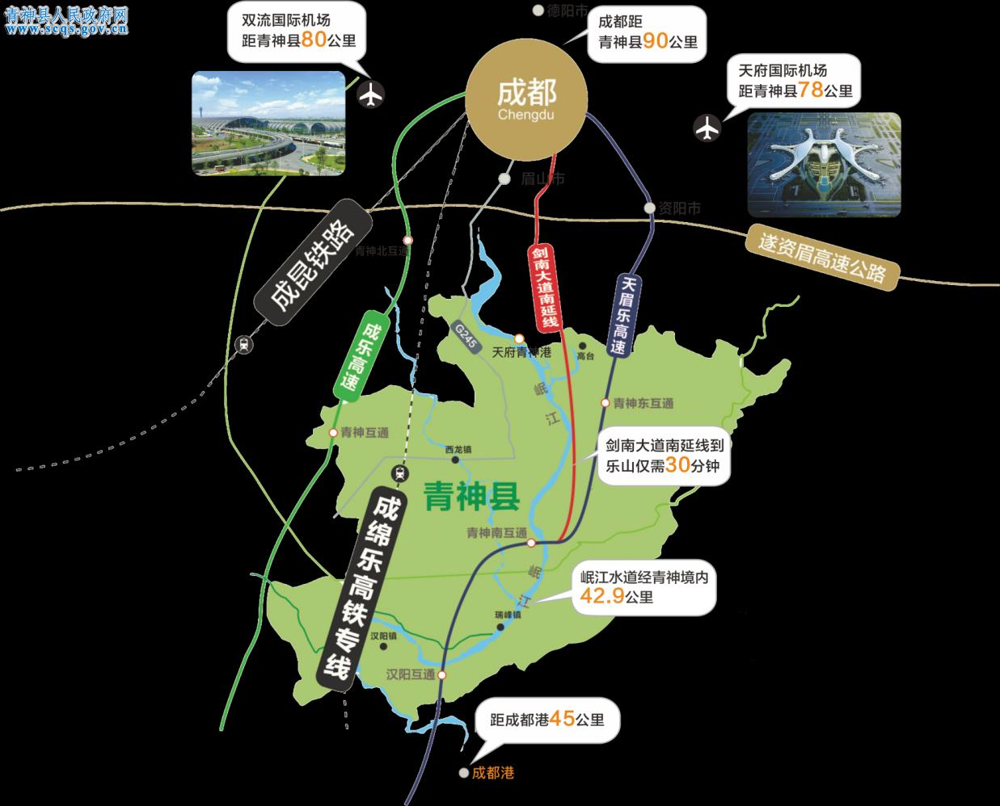

青神县“十四五”现代服务业发展规划

## 第一章 发展现状

一、发展成效

（一）服务业引擎作用逐渐突显。

“十三五”期间，青神县第三产业增加值平均增速为9.4%，持续高于GDP增速。2020年第三产业增加值为42.45亿元，对GDP增长的贡献率为46.4%，相较于2015年27.2%的贡献率大幅上涨19.2个百分点；2020年青神县三次产业结构为13.9:39.7:46.4，相较于2015年14.6:49.4:36以第二产业为主的产业结构，服务业主导作用逐渐突显。

图1-1青神县2015—2020年GDP与第三产业增加值及增长情况

图1-2青神县2015年（左）和2020年（右）三次产业增加值占比示意图

（二）服务业重点行业发展突出。

商业贸易稳步增长。“十三五”期间，万景中岩广场、财富中心等商业综合体建成并投入使用。2016—2020年，全县社会消费品零售总额年均增速为8.8%。受新冠肺炎疫情影响，2020年，青神县全社会消费品零售总额25.5亿元，同比下降1.7%，较四川省（-2.4%）、眉山市（-2.3%）降幅较小。截至2020年末，青神县共有限额以上单位37家，较2015年新增12家。

图1-3青神县2015—2020年社会消费品零售总额及增速

文化旅游发展特色鲜明。2015—2019年，青神县旅游人数和旅游收入呈稳步增长态势，2019年旅游人数达到510.08万人次，旅游总收入45.07亿元；2020年受新冠肺炎疫情影响，青神县旅游人数和旅游收入有所回落，但仍较2015年分别上涨40.6%和69.8%。“十三五”期间，青神县投资100亿元建成国际竹编艺术博览馆、国际竹文化中心、国际竹展览中心等一批重点文旅项目和旅游基础设施，荣获“国际竹编之都”“竹编艺术传承国际范例奖”称号，获评“国际竹藤组织竹产品展览基地”、国家青神竹编产业示范园区，竹编园区成为全国最大的竹产业交易博览综合体，“竹编文化”特色明显，成为青神县特色IP。青神县打造了红色西山党性教育点红色研学线和国际竹艺城绿色研学线；创立了竹里院子、兰沟村等一批文旅品牌；持续举办了东坡初恋地旅游文化节、乡村椪柑旅游文化节等文化节庆活动。

图1-4青神县2015—2020年游客数量和旅游收入一览图

电子商务成为优势产业。2020年青神县网络零售额达到16.9亿元，同比增长超过40%。“十三五”期间，青神县建成县电商孵化园1个、产业电商运营中心2个、乡镇电商公共服务中心7个、村（社区）电商服务站40个，实现电商公共服务体系县、乡、村三级全覆盖。柑橘产业园成功创建省级现代农业园区，建成四川省首个柑橘博览园，成为全国晚熟柑橘产业集群县、晚熟柑橘优势区。截至2020年末，全县共发展网店2500余家，创造就业岗位10000余个；组织开展电商专业培训400余场次，培训超过17000人次；形成了独具青神特色的竹制品、腊制品、晚熟柑橘等电商产业；积极发展“网红经济”，尝试朋友圈、短视频、直播带货等网销新模式。2019年青神县再次争取到国家级电子商务进农村综合示范项目，成为全国首批打造电子商务进农村综合示范“升级版”示范县之一，电子商务发展优势明显。

现代物流发展持续向好。“十三五”期间，冷链物流园、立白物流基地、斑布物流基地、斑布产业园仓储物流中心等一批物流节点建成投用；建成县级电商快递物流中转配送中心1个、乡镇快递物流中转配送中心7个、村（社区）快递物流配送站点40个，新增邮路2条，打通“工业品下乡、农产品进城”双向通道。截至2020年底，青神县有恒晟新物流、丰润货物托运等商贸物流企业和物流托运部8家，有水晶果业、百家椪柑专业合作社等冷链物流企业8家，有“四通一达”、顺丰、京东物流等多家快递物流企业。2020年实现快递业务收入1387.42万元，同比增长57.5%。

科技信息服务加快推进。“十三五”期间，四川青神经济开发区成功创建省级经济开发区，建成省级企业技术中心、省级工程技术研究中心、省级工程实验室、博士后流动工作站、省级孵化园、省级众创空间、全国竹产业研究中心、国际竹藤中心竹产业博士工作站、竹制品检验检测中心等一批科技创新载体；完成省级科技成果鉴定28项，获得省级科技进步奖8项、市级科技进步奖7项；培育了一批科技创新主体，包括高新技术企业12家、国家级专精特新“小巨人”企业1家。工业互联网云平台深入推广，建成农业物联网示范点10个，建立了实时、动态的全产业链数据采集体系和数据仓库，建成“益农信息社”71个，农业数字化水平显著提高。

医疗康养服务基础不断夯实。“十三五”期间，青神县对医疗卫生单位基础设施和医疗设施设备进行改造升级，基本形成了规模适宜、能级清晰、分工明确、功能互补、方便群众的医疗卫生服务体系。县人民医院创建为“二级甲等综合医院”、中医医院创建成为“二级甲等中医医院”、县妇幼保健院创建为“二级甲等妇幼保健院”、县疾控中心创建为“二级乙等”疾控中心、青神康达骨科医院创建为“二级甲等”骨科医院，医院实力普遍提升。同时，建立了青衣颐养中心、桂溪园颐养中心、利康康养中心、东成医养中心4家民办养老服务机构，养老服务供给增加。

现代金融规模稳定增长。2020年，青神县金融业增加值2.49亿元，同比增长6.4%，对GDP的贡献率为4.6%；截至2020年末，全社会存贷款余额分别为124.97亿元、65.36亿元，较2015年底分别增长63.2%、73.8%，存贷比首次突破50%，达到52.3%；县内保险公司保费收入2.87亿元，较2015年底增长114.2%。“十三五”期间，引入平安财产保险公司、中国人寿财险公司支公司，设立眉山市眉州融资担保公司分支机构；拓展了特色农业保险、生猪保险等覆盖面，更大范围惠及三农经济；组织多场“金政企”对接会。2019年德恩精工成功登陆创业板，成为眉山市第三家上市企业[0]，德鑫航空成功纳入四川省上市企业后备资源库。

（三）服务业对外交流合作加强。

“十三五”期间，青神县与成都市、峨眉山市、长宁县等周边多个县市展开合作，发起成立“大竹海”“大峨眉”川渝文旅发展联盟，成功举办“成都以南·竹乡青神”宽窄巷子青神推介月等活动。高质量举办了国际（眉山）竹产业交易博览会、国际（青神）竹产品创意设计大赛等国际交流活动，牵头成立“一带一路”竹艺发展联盟；积极参与竹藤大会、广交会、进博会、西博会等重要节会活动；加强了与国际竹藤组织、国际竹藤中心等国际机构合作，与全球40多个国家和地区、23个竹产业协会、120多家竹企业和爱马仕、香奈儿等国际知名品牌展开培训交流、跨界合作。

二、发展短板

（一）服务业产业结构不优，产业总体竞争实力较弱。

2020年，青神县三次产业结构为13.9:39.7:46.4，较2015年大幅提升了10.4个百分点，但与2020年眉山市15.7:37.1:47.2以及四川省11.4:36.2:52.4的三次产业结构来看，青神县服务业比重应进一步优化。2020年青神县服务业增加值为42.45亿元，远低于112.21的市平均增加值，其中排名第四的洪雅县服务业增加值高出青神县近30亿元，排名第一的东坡区约为青神县的6倍；服务业增速为4.8%，虽高于全省的3.4%，却低于眉山市4.9%的增速，在眉山市排名均靠后。产业细分方面，青神县批发零售、住宿餐饮、房地产、文娱体育、居民服务等传统服务业增加值占服务业增加值比重达72.3%；金融业、交通运输邮政业以及科技和信息服务业占服务业增加值的比重分别为6.2%、2%和0.4%；青神服务业内部结构不均衡，主要由传统服务业支撑，新兴服务业发展滞后，服务业总体竞争力不强。

图1-5青神县2020年服务业产值结构占比图

表1-1 2020年眉山市各区县服务业增加值及占比情况

| 对比区县 | 服务业增加值（亿元） | 服务业增加值排序 | 增速 | GDP（亿元） | GDP排序 | 增速 | 第三产业占GDP比重 | 占比排序 |
|---|---|---|---|---|---|---|---|---|
| 东坡区 | 243.74 | 1 | 4.8% | 491.47 | 1 | 4.0% | 49.6% | 2 |
| 仁寿县 | 199.56 | 2 | 4.9% | 457.38 | 2 | 4.4% | 43.6% | 6 |
| 彭山区 | 83.08 | 3 | 5.3% | 183.39 | 3 | 4.5% | 45.3% | 5 |
| 洪雅县 | 71.22 | 4 | 5.2% | 129.11 | 4 | 4.3% | 55.2% | 1 |
| 青神县 | 42.45 | 5 | 4.8% | 89.82 | 5 | 4.2% | 47.3% | 3 |
| 丹棱县 | 33.20 | 6 | 4.7% | 72.57 | 6 | 3.8% | 45.8% | 4 |

（二）生产性服务起步较晚，对产业发展支撑度不够。

科技服务、现代物流、人力资源服务等生产性服务业对产业的支撑度不够。科技服务发展相对滞后，一二产业科技含量较低，产品附加值不高，工业企业主辅分离难度大，如何依托科技服务实现机械产业、竹产业和柑橘产业转型升级、延伸产业链条成为青神县产业发展急需解决的问题；物流业通道、节点等基础设施建设较为落后，物流企业规模较小，部分农村地区物流体系建设滞后，现代物流发展尚处于起步阶段；青神县常住人口仅16.81万人，在眉山市排名倒数第二，长期存在人口外流，针对竹、机械、柑橘优势特色产业，现代物流、科技服务、文化旅游、电子商务等服务业专业技能人才缺口较大，人才供需矛盾突出。

（三）生活性服务品质不佳，对城市发展带动力不足。

商业贸易、文化旅游、特色餐饮、医疗康养等生活性服务业对城市发展的带动性不足。青神县商贸零售业态较为传统，新建商业载体缺乏商户入驻，缺乏新兴商业业态、新消费场景，消费特色和亮点较少，商业消费环境有待改善；文化旅游产品、旅游线路单一，停留在一次性观光初级阶段，商贸文旅结合不够，旅游产品吸引力不强，难以引导消费，缺乏实力文旅企业将文旅优势资源转化为高价值文旅产品；特色餐饮品牌缺乏、知名度低，缺乏美食街等发展特色美食的载体，东坡竹宴、汉阳棒棒鸡等特色餐饮仅停留在名气上，市场化运作有待进一步提升。医疗康养资源开发利用率较低，青神优质的山、水、空气等生态资源未能充分开发转化为文旅、康养等产业优势，医养结合产业项目较为缺乏。

（四）服务业发展创新不足，缺乏持续高质量发展动力。

青神作为国家电子商务进农村示范县，在发展高速期后逐步陷入瓶颈，依旧走单一的商品网上销售的电商发展道路，知名电商品牌建设欠佳，创新步伐缓慢。商务会展发展的内容、宣传模式和办会理念较为传统，会展品牌尚未完全塑造，对外影响能力有限，受到疫情影响，商务会展发展势必面临更大挑战。金融产品的创新不够，金融对农业、工业和服务业发展的支持力度有待进一步加强，金融发展环境有待优化提升。

## 第二章 发展资源

一、区位交通资源

青神县位于西南地区成都平原西南部，北接眉山东坡区，南邻乐山，东连井研，西望峨眉，是眉山市南向重要门户；是西部陆海新通道、岷江文旅经济带等通道上的重要节点，位于成渝地区双城经济圈、成都都市圈核心区、成都1小时经济圈内；是融入成都，承接川南的重要节点，未来境内将形成“七纵二横三联一环”的交通大格局。青神距离双流国际机场80公里，天府国际机场78公里；成绵乐高铁38分钟畅达成都，成乐高速、天眉乐高速、剑南大道南延线穿境而过；虎渡溪航电枢纽工程正加快建设，岷江航道未来可通航1000吨货船；天眉乐高速、成乐高速G0512等通道建设，将进一步强化青神县连接川南和西部陆海新通道的重要节点的地位。青神县凭借优越的区位条件和便捷的交通通道，将吸引一大批外来投资和外来人员旅游，有助于大幅带动商业贸易、文化旅游和现代物流发展，在城市发展和服务业能级提升方面拥有巨大潜力。

图2-1青神县综合交通现状图[1]

图2-2青神县综合交通规划图[2]

二、工业农业资源

2019年青神县工业开发区获批省级经济开发区，两家工业企业登陆资本市场；目前，西南表面处理循环经济产业园、成眉绿色铸造智慧产业园区、德恩云智造工业互联网平台等重点项目正稳步推进；截至2020年底，青神县有高新技术企业12家，国家级两化融合管理体系贯标企业4家，省级两化融合管理体系贯标试点企业3家，省级技术创新示范企业2家，省级科技成果转移转化示范企业4家。2020年青神县农业增加值12.29亿元，全年粮食产量达到6.22万吨；依托柑橘资源，青神成功创建省级现代农业园区，成为全国晚熟柑橘产业集群县、晚熟柑橘优势区和绿色防控示范区。依托青神竹编资源，成功举办第九届中国竹文化节、国际（眉山）竹产业交易博览会，2020年获评四川省首批竹林风景线建设先进县、竹产业高质量发展县。青神优良的工业、农业资源为服务业发展奠定了基础，未来应当着重发展农业生态旅游、农业休闲体验游等乡村旅游业，以及科技服务、现代物流、商务会展、现代金融等生产性服务业。

三、文化旅游资源

青神县因古蜀王蚕丛氏“着青衣教民农桑，民皆神之”而得名，是苏东坡初恋之地；享有“国际竹编之都”“中国竹编艺术之乡”“四川省革命老区县”等美誉。拥有国家AAAA级景区国际竹艺城、江湾神木园，国家AAA级景区汉阳湖景区、中岩景区和竹编、东坡、蚕丛、佛教、红色文化等众多文旅资源。有国、省保护单位6处，省级风景名胜区1处，各级非物质文化遗产35项。青神特色竹编小镇是四川省人民政府首批命名、也是全市唯一的“四川省特色小镇”，中岩村被评为省级乡村旅游重点村，兰沟村被评为国家级乡村旅游重点村；此外还有红色西山研学基地、汉阳古镇、甘家沟椪香园、万沟茶语原乡、竹里巷子、竹里荧光、竹林湿地、白塔寺等三级以上优质资源204处。有青神大酒店、竹里院子、木言兰舍、禅驿·忆村院子等高端酒店民宿，有江湾神木园酒店、悦酒店、中岩客栈、竹里人家等特色酒店民宿。“汉阳棒棒鸡”成功入选省级天府旅游美食名录，“东坡竹宴”“竹筒餐”“老丈母腊肉”等远近闻名。青神县文化旅游资源丰富，酒店、餐饮服务发展基础良好，有利于青神县建设高质量发展的国际竹艺名城，未来青神应当加快推动文化旅游、商业贸易、特色餐饮等服务业发展，以吸引更多游客。

四、生态环境资源

青神拥有良好的生态环境资源，成功创建国家生态文明建设示范区。空气方面，空气优良率92.3%，空气质量在全市率先达到国家二级标准，大气环境质量综合指数（AQI）排名全市第一，优良率连续三年全市第一。水资源方面，青神是岷江流域重要的生态屏障，拥有“一江五河三十二溪流”，岷江出境断面悦来渡口水质今年以来平均达到Ⅱ类标准，思蒙河、金牛河水质持续稳定在III类，3个乡镇集中式饮用水水源地水质达标率为100%。土壤植被方面，全县森林覆盖率达48.2%，打造了岷江水上绿色走廊、库区绿化、青神竹林湿地公园、汉阳镇水岸果香湿地公园等，建成竹里桃花、竹里海棠等72个生态类项目，竹林风景线建设成效显著，获评省级竹林风景线建设先进县。清新的空气、优质的水源、高覆盖率的植被使得青神生态优势明显，未来应当将生态优势转化为有利于本地经济的生态旅游、康养休闲等产业。

## 第三章 发展环境

一、服务业发展机遇

（一）“双循环”战略为服务业品质化发展提供新契机。

2020年5月14日，中共中央政治局常委会会议首次提出“深化供给侧结构性改革，充分发挥我国超大规模市场优势和内需潜力，构建国内国际双循环相互促进的新发展格局”。《中华人民共和国国民经济和社会发展第十四个五年规划和2035年远景目标纲要》中明确提出要坚持扩大内需这个战略基点，加快培育完整内需体系，把实施扩大内需战略同深化供给侧结构性改革有机结合起来，以创新驱动、高质量供给引领和创造新需求，加快构建以国内大循环为主体、国内国际双循环相互促进的新发展格局。青神县应充分把握国内国际双循环新格局的发展趋势，充分利用自身区位、文旅资源优势，推动服务业“软硬件”提档升级和品质化发展，为本地居民和外来游客提供便捷和舒适的生活旅游环境，助力青神打造高质量发展的国际竹艺名城。

（二）成渝地区双城经济圈战略指明新方向。

成渝地区双城经济圈建设是习近平总书记亲自谋划、亲自部署、亲自推动的国家重大区域发展战略。2021年10月21日，中共中央、国务院印发《成渝地区双城经济圈建设规划纲要》，要求唱好“双城记”，共建经济圈，合力打造区域协作的高水平样板，在推进新时代西部大开发中发挥支撑作用，在共建“一带一路”中发挥带动作用，在推进长江经济带绿色发展中发挥示范作用。四川省委十一届七次全会指出要促进成渝地区中部崛起、南翼跨越、北翼振兴，支持眉山依托天府新区建设高新技术产业集聚地、现代服务业发展示范区。青神县应抢抓成渝地区双城经济圈建设的重大机遇，充分发挥区位和产业优势，积极融入成都都市圈，接受成渝辐射，打造成渝地区服务业特色性节点城市。

（三）成都都市圈发展战略激发产业发展新动能。

2021年6月，四川省人民政府印发的《成都平原经济区“十四五”一体化发展规划》中提出，经济区将加快推进成都、德阳、眉山、资阳4市的“内圈”同城化、全域一体化。2021年11月29日，四川省人民政府印发《成都都市圈发展规划》，这是国家层面批复的中西部唯一一个规划，提出加快建设具有全国影响力的现代化都市圈，为成渝地区双城经济圈打造带动全国高质量发展的重要增长极和新的动力源提供有力支撑，为新时代推进西部大开发形成新格局作出更大贡献；同时明确青神县发展重点为建设都市圈绿色农产品供应基地。青神县势必提质发展装备制造、竹产业和农业，为与区域产业深度配套，青神县应积极推动科技服务、电子商务、现代物流等服务业发展，不断丰富青神服务业产业体系。

（四）服务业高质量发展新导向指引突破发展新思路。

2017年中共中央、国务院印发《国家创新驱动发展战略纲要》，提出以新一代信息和网络技术为支撑，积极发展现代服务业技术基础设施，拓展数字消费、电子商务、现代物流、互联网金融、网络教育等新兴服务业，促进技术创新和商业模式创新融合；加快推进工业设计、文化创意和相关产业融合发展，提升我国重点产业的创新设计能力。根据《中共四川省委四川省人民政府关于加快构建“4+6”现代服务业体系推动服务业高质量发展的意见》，四川省提出推动四大支柱型服务业转型升级，促进六大成长型服务业做大做强；根据《眉山市“十四五”服务业发展规划》，眉山市着力构建“3+5”现代服务业体系，构建“一核两翼多点”的服务业发展新格局，全面实现“服务创新增动力、产业发展聚人气、消费升级引人流、品质宜居留住人”的目标。青神县应坚持聚焦优势、补齐短板，夯实基础，调优结构，壮大规模，建立优质高效、特色鲜明、竞争力强的“543”现代服务业发展产业体系。

二、服务业发展挑战

（一）疫情对传统服务业冲击大。

2020年新冠疫情肆虐，受疫情影响，全球实体服务业活动减少，大量商贸、旅游等行业实体企业受到巨大冲击。随着防疫工作有效开展以及疫苗的普及，疫情形势逐渐好转，为实体经济复苏创造了良好基础。但由于青神县城市和经济规模较小，服务业模式大多较为传统，抗冲击能力较弱，恢复期较长。在后疫情时代，国内居民消费习惯有较大改变，对青神而言，如何适应本地居民消费习惯提振消费，顺应新兴消费习惯吸引外来消费者，将是本地服务业发展面临的巨大挑战。

（二）周边区域竞争激烈。

在与眉山市所有区县以及周边相邻的夹江县和井研县共8个区县对比中，青神县2020年服务业增加值和社会消费品零售总额均位列第7，处于靠后水平。但另一方面，青神县2020年服务业增加值增速位列第4，2020年社会消费品零售总额降幅最低。当下区县之间的竞争日益激烈，青神县服务业发展基础较弱，赶超周边区县的挑战巨大，找到跨越式发展的突围之路势在必行。

表3-1青神县周边区县2020年服务业发展排名[3]

| 所属市 | 对比区县 | 服务业增加值（亿元） | 服务业增加值排名 | 服务业增加值增速 | 增速排名 |
|---|---|---|---|---|---|
| 眉山市 | 东坡区 | 243.74 | 1 | 4.8% | 4 |
| 眉山市 | 仁寿县 | 199.56 | 2 | 4.9% | 3 |
| 眉山市 | 彭山区 | 83.08 | 3 | 5.3% | 1 |
| 乐山市 | 夹江县 | 75.75 | 4 | 2.0% | 7 |
| 眉山市 | 洪雅县 | 71.22 | 5 | 5.2% | 2 |
| 乐山市 | 井研县 | 53.20 | 6 | 1.8% | 8 |
| 眉山市 | 青神县 | 42.45 | 7 | 4.8% | 4 |
| 眉山市 | 丹棱县 | 33.20 | 8 | 4.7% | 6 |

表3-2青神县周边区县2020年社消零总额及增速排名[4]

| 所属市 | 对比区县 | 社消零总额（亿元） | 社消零总额排名 | 社消零总额增速 | 增速排名 |
|---|---|---|---|---|---|
| 眉山市 | 东坡区 | 191.43 | 1 | -2.2% | 4 |
| 眉山市 | 仁寿县 | 187.06 | 2 | -2.5% | 5 |
| 乐山市 | 夹江县 | 75.80 | 3 | -3.8% | 8 |
| 眉山市 | 彭山区 | 73.73 | 4 | -2.5% | 5 |
| 乐山市 | 井研县 | 51.05 | 5 | -2.0% | 2 |
| 眉山市 | 洪雅县 | 43.56 | 6 | -2.0% | 2 |
| 眉山市 | 青神县 | 25.50 | 7 | -1.7% | 1 |
| 眉山市 | 丹棱县 | 21.99 | 8 | -2.6% | 7 |

（三）便捷交通虹吸效应明显。

依托天眉乐高速、剑南大道南延线、成乐高速、成绵乐高铁转专线和成昆铁路，青神通往成都和乐山的时间将分别缩短为90分钟和30分钟，青神与周边城市的联系愈加紧密。便捷的交通虽然会带来游客和务工人员，但本地居民去往其他城市也将更为便利，城市交通建设带来便利的同时也将产生巨大的虹吸效应。青神县应当提前谋划，高质量发展本地服务业，紧抓当下交通变革的机遇，留住本地人口并吸引外来人口。

图3-1青神县交通干线规划示意图

## 第四章 总体要求

一、指导思想

坚持习近平新时代中国特色社会主义思想为指导，全面贯彻党的二十大、十九大和十九届历次全会会议精神，坚定不移贯彻新发展理念，以推动高质量发展为主题，以深化供给侧结构性改革为主线，以改革创新为根本动力，以满足人民日益增长的美好生活需求为根本目的，主动融入以国内大循环为主体、国内国际双循环相互促进的新发展格局，抢抓成渝地区双城经济圈建设、成都都市圈发展等重大机遇，主动融入眉山市“3+5”服务业产业体系和“一核引领、两翼联动、多点集聚”的空间布局，加快构建“543”现代服务业体系，优化形成“一核一带两区”的现代服务业发展新格局，大力推进服务业扩量提质，把青神县建设成为成都都市圈联动川南的现代服务业高质量发展示范区。

二、发展原则

夯实基础，拓展优势。依托青神商业贸易、文化旅游、电子商务、商务会展等产业基础，深挖文化旅游资源禀赋，充分开发自然生态优势，依托岷东大道、成绵乐、成绵乐客运专线等，推动商业贸易积极融入川渝大市场，创新文化旅游产品，优化电子商务发展思路和路径，推动商务会展能级提升，在巩固原有产业基础上，提升产业发展质量，壮大服务业优势产业。

问题导向，补齐短板。针对青神县服务业发展存在的问题和产业短板，推动业态模式创新发展，推动集聚集群发展，提升全县服务业供给质量，加大带动作用，积极推进产业载体建设；强化发展抓手，培育发展现代物流、科技信息、现代金融、医疗康养等产业，构建“543”现代服务业发展体系。

创新驱动，提质发展。在巩固提升传统服务业基础上，大力拓展服务业新领域，推动科技研发、检验检测和科技成果转化等服务发展，提升医疗康养服务水平，推动医疗服务能级提升，培育康养服务，加快家庭社区服务和体育健康服务的发展。鼓励发展新模式，培育新兴业态，鼓励和支持县域内服务业企业开展技术创新、产品创新、管理创新、业态创新和商业模式创新。推动现代服务业与现代农业、工业融合发展，发挥“服务+”组合效应，促进三次产业更好地协同发展。

三、发展目标

到2025年，青神县服务业发展总体实力和竞争力显著提升，全县服务业结构持续优化，产业体系不断健全，供给质量明显提升，高质量发展取得新进展，全县服务业增加值实现年均增速8%，确保总量超过66.5亿元，力争达到68亿元，新培育规模以上服务业企业9家，新引进10亿元及以上重大服务业项目1个。

表4-1 2025年青神县服务业主要规划指标一览表

| 类 型 | 指标名称 | 规划目标 |
|---|---|---|
| 总体目标 | 服务业增加值年均增长（%） | 8 |
| 三次产业占比（%） | 52 |
| 科技服务 | 有效高新技术企业数量（家） | 20 |
| 全社会研发经费支出占GDP比重（%） | 1.3 |
| 现代物流 | 物流业增加值（亿元） | 0.6 |
| 人力资源服务 | 培育人力资源服务机构（家） | 3 |
| 商务会展 | 培育规上企业（家） | 1 |
| 现代金融 | 存贷款余额年均增速（%） | 15 |
| 商业贸易 | 社会消费品零售总额年均增长（%） | 11 |
| 文化旅游 | 接待游客总人次（万人） | 400 |
| 旅游总收入（亿元） | 40 |
| 新增国家4A级旅游景区（个） | 1 |
| 新增国家3A级旅游景区（个） | 1 |
| 特色餐饮 | 建成特色餐饮街区（个） | 1 |
| 限额以上餐饮企业（个） | 5 |
| 医疗康养 | 争创三级医院（家） | 1 |
| 电子商务 | 电商网络零售额年均增长（%） | 18 |
| 家庭社区服务 | 培育入统家政品牌企业（家） | 1 |
| 每年培训家政劳务人员（名） | 150 |

展望2035年，青神县服务业对经济带动作用大幅增强，发展能级进一步提升，全面建成服务业现代产业体系，高技术创新进一步集聚，生产性服务业更加创新化、规模化、专业化、高端化；消费进一步升级，生活性服务业更加个性化、品牌化，智慧化，服务业品质显著提升，人民生活更加富裕和美好。

## 第五章 空间布局

一、总体空间布局

对接青神县城市发展战略，按照“产业集聚、特色鲜明、联动发展”的要求，结合青神自然资源分布特色、交通区位条件以及未来发展需要，统筹全县服务业产业布局，着力构建“一核一带两区”的现代服务业空间格局。其中：

一核：现代服务业创新发展引领核。

一带：康养观光发展带。

两区：生产与生活性服务业集聚发展区，特色农业与文化旅游融合发展区。

图5-1青神县现代服务业发展空间布局示意图

二、区域发展指引

（一）一核引领。

现代服务业创新发展引领核为青神县县城。提质发展商贸服务，大力推动万景国际等城市商业综合体以及东坡巷子、滨湖天街等特色商业街区的建设招商，打造城市新地标。大力发展餐饮服务，挖掘青神特色餐饮，积极推动青神特色餐饮品牌创建，打造“东坡竹宴”“竹筒餐”“老丈母腊肉”等品牌。积极发展文化旅游，依托国际竹艺城发展会展旅游，大力推进水月楼旅游度假酒店等项目建设进程。完善现代物流服务，加快经开区物流园、快递物流配送中心等重点项目建设。高质量发展商务会展，依托国际竹展览中心，加大对竹博会的宣传力度，积极承担各类国际性、全国性展会和研学会议，做响青神展会品牌。稳步发展现代金融，加强金融机构引培，推动工业基金、农村金融等金融细分领域发展。持续发展电子商务，全力做响“竹予”品牌，培育本地主播，发展直播电商，不断完善农村电商。培育发展家政社区服务，培育青神家政品牌，提升社区服务功能，试点建设智慧社区。

（二）一带聚联。

康养观光发展带是沿岷江串联各个重点乡镇和中岩寺、虎渡航电、汉阳航电、汉阳湖忆村等关键资源节点的康养度假和观光旅游产业带。因岷江优质的水资源和景观资源，饱含视觉和体感上的舒适宜人，借助岷江这一优质资源，鼓励沿岷江两岸乡镇根据自身资源和文化特色，积极发展疗养休闲、康养度假、旅游观光、水上运动训练等产业，通过高品质建设民宿、岷江绿色走廊、训练基地，建设沿河岸观景平台、码头游船等设施，带动各乡镇康养旅游产业蓬勃发展，形成具有青神特色的康养旅游产业带。

（三）两区联动。

生产与生活性服务业集聚发展区，包括青竹街道、西龙镇、高台镇和白果乡。大力发展科技服务，推动德恩精工机械企业工业互联网云智造平台建设，整合机械行业资源数据库，实现产业数据共享共通，降本增效；加快竹产业精炼研究建设，研发竹产业的新工艺、新技术；积极推动力兴机械孵化园运营，加大对本地企业的孵化。高质量发展现代物流，依托柑橘现代农业园区，大力推进冷链物流发展，形成辐射西南的柑橘冷链物流中心；加快经开区物流园、快递物流配送中心等重点项目建设。高质量发展商务会展，依托国际竹展览中心，加大对竹博会的宣传力度，积极承担各类国际性、全国性展会和研学会议，做响青神展会品牌。稳步发展现代金融，加强金融机构引培，推动工业基金、农村金融等金融细分领域发展。持续发展电子商务，全力做响“竹予”品牌，培育本地主播，发展直播电商，不断完善农村电商。品质发展文化旅游，依托西山革命老区，加快红色西山和研学基地建设，发展红色研学；依托特色农产品，推动万沟茶语原乡等项目建设；推进竹艺水乡等项目建设，推动乡村旅游发展。品质发展商业贸易，大力推动万景国际等城市商业综合体以及东坡巷子、滨湖天街等特色商业街区的建设招商；加快西龙红色文化商业街建设；推动农村商贸发展，鼓励农村商业综合体的建设，推动品质消费下乡活动。大力发展餐饮服务，挖掘青神特色餐饮，积极推动青神特色餐饮品牌创建，打造“东坡竹宴”“竹筒餐”“老丈母腊肉”等品牌。培育发展家政社区服务，培育青神家政品牌，提升社区服务功能，试点建设智慧社区。

| 专栏1 生产与生活性服务业集聚发展区重点项目 |
|---|
| 德恩精工机械企业工业互联网云智造平台，成眉绿色铸造智慧产业园区研发中心，青神县数字农业建设项目，青神县晚熟柑橘国家数字种植业创新应用基地建设项目，青神经开区物流园项目，智能仓储物流系统成套设备项目，竹编产业园区竹艺研学基地基础设施改造提升项目，青神国际竹展览中心会展功能能级提升工程，电商公共服务中心提升工程，农产品品牌培育工程，竹予村落，万沟茶语原乡项目，709三线记忆文创园项目，万景国际购物中心，唤鱼公园餐饮主体培育工程，青神特色餐饮品牌创建工程，青神县托育服务中心，智慧社区服务平台搭建工程，家政品牌培育工程。 |

特色农业与文化旅游融合发展区，包括汉阳镇、瑞峰镇、罗波乡。大力发展文化旅游，推动中岩景区和汉阳古镇的开发保护工作；依托岷江串联中岩沙河景区、天池萤火基地、瑞峰西岸、汉阳古镇等文旅资源，加快岷江水上旅游开发项目、沙河文旅综合开发项目、青神汉阳湖忆村项目、粤江水镇旅游基础设施建设项目、瑞草度假区旅游基础设施建设项目等文旅项目建设；积极发展乡村旅游，开展特色农产品生产、采摘农事体验，推动青神县全国休闲农业和乡村旅游示范县建设项目、岷江农旅融合示范带项目，打造以“产业博览、农耕文化、田园观光、养生度假、山地运动”为主题的田园综合体；深入开发其他农业旅游观光价值，打造特色休闲农业和乡村旅游精品。完善商业贸易，推动农村商贸发展，鼓励在场镇积极布局百货店、连锁便利店、大众餐饮店、洗染店、通讯店等生活性服务业态，并以农村商业综合体的建设为主；鼓励围绕汉阳古镇打造“古镇记忆”“岁月留痕”等商贸新场景；注重消费下行，推动品质消费下乡进村，对接国家、省市政策，开展家电下乡、汽摩下乡、建材下乡、手机下乡，开拓农村市场，扩大提质农村消费。

| 专栏2 特色农业与文化旅游融合发展区 |
|---|
| 青神汉阳湖忆村项目，青神县汉阳古镇保护开发项目，沙河文旅综合开发项目，青神县大中岩景区提升项目，虎渡社区文旅融合项目（缤纷庄园）、白果新城综合开发项目。 |

## 第六章 重点行业

在明晰青神县服务业发展基础、发展机遇、发展优势，并充分对接四川省“4+6”和眉山市“3+5”现代服务业体系的基础上，青神县明确了构建“543”现代服务业产业体系，大力发展科技服务、现代物流、人力资源、商务会展和现代金融5大生产性服务业，加快发展商业贸易、文化旅游、特色餐饮和医疗康养4大生活性服务业，加快发展电子商务、家庭社区服务和体育健康3大新兴服务业。

图6-1青神县服务业“十四五”产业体系规划图

一、大力发展五大生产性服务业

（一）科技服务。

1.发展目标。

青神县科技服务体系基本完善，科技创新水平再上新台阶，重点突出数字赋能，科技服务业成为助推青神经济发展的重要力量。到2025年，力争新增国家级行业单项冠军企业2家、高新技术企业达到20家、再培育国家级专精特新“小巨人”企业3家，全县实现60%以上的规模工业企业上云，全社会研发经费支出占GDP达到1.3%以上。

2.发展重点。

推动特色产业科技服务发展。重点发展机械产业科技服务。围绕青神县机械产业创新发展需求，与“双一流”高校、行业协会、重点企业共建机械产业研究院；搭建科技资源共享平台，重点打造德恩精工机械企业工业互联网云智造平台，整合机械企业资源数据库，实现产业数据共享共通；推动德恩精工等规模以上工业企业自主或联合建立研发设计机构，加快推动成眉绿色铸造智慧产业园区、西南表面处理循环经济产业园、机械产业研究服务中心、民航物流设备定制化研发设计服务平台应用示范项目建设。大力发展竹产业科技服务。瞄准市场空白、高端消费需求，与国际竹藤中心共建竹产业研究院，研发拳头争冠产品，打响“竹+”特色品牌；推动斑布竹健康产业园新建18万吨/年竹材卫品吸水芯材项目（一期）建设，加快竹编机械装备化进程，做特竹艺竹业；依托竹制品检验检测中心，聚焦竹产业发展检验检测服务需求，加快建设一体化检验检测公共服务平台，重点发展面向竹制品研发设计、生产制造等过程的分析、测试、检验、计量、认证等服务，力争生产工艺成为国家行业标准，争创国家级竹制品检验检测中心。积极发展农业科技服务。以柑橘现代农业园区为核心，加强与中国农大、四川农大、中柑所等科研院所合作，搭建产学研农业科技创新平台，推动柑橘关键技术攻关，培育推广高标准、高品质柑橘优良品种，发展良繁基地500亩以上；整合“益农社”信息平台资源，构建面向农业农村的综合信息服务体系，打造美丽乡村综合信息门户。

培育壮大科技创新主体。支持龙头企业做大做强。全面建成四川青神经济开发区、西南表面处理循环经济产业园、成眉绿色铸造智慧产业园区、斑布竹产业园、立白绿色日化和智能家居产业园、彩虹健康医药产业园、德恩云造工业互联网平台“一区五园一平台”，在引进先进机械制造业企业、产业链头部核心企业、关键环节企业和上下游配套企业上实现新突破；实施高新技术企业提质行动和国家科技型企业倍增计划，建立企业培育储备库，加快培育一批有竞争力的创新型领军企业，支持德恩精工、四川丹甫、青城机械等重点企业做大做强，带动产业提档升级。积极培育“专精特新”小微企业。通过招商引资，在创业孵化、科技研发、成果转化、检验检测等方面引进一批优质企业；鼓励创办国家级、省级中小微企业创业创新示范基地，实施中小微企业梯度培育工程，着力培育一批专业水平突出、竞争力强的“专精特新”科技型小微企业，扩大科技服务企业数量和规模。

加大科技服务要素支撑。优化科技创新环境。加大政策支持，突出科技引领，争取省市重大科技和科教基础设施在青布局；鼓励企业加大科技研发（R&D）投入，强化知识产权保护运用，支持扩大知识产权质押融资、增资扩股，加快科技成果转化和产品研发，加大对初创企业的培育和扶持力度。建设一批科技服务平台。推动政产学研用深度融合，支持高校、科研院所和企业共建研发机构，鼓励企业组建创新联合体，新建一批工程（技术）研究中心、院士（专家）工作站、企业技术中心等创新网络节点。加强人才队伍建设。鼓励企业与高校、科研院所共建合作平台，围绕技术研发、科技成果转化和检验检测等科技服务领域，通过购买服务、技术入股等模式积极招引“高精尖缺”人才来县创新创业；实施优秀企业家培育计划，加快培育一批经营型、科技型企业家，鼓励科研人才到企业兼职。

强化科技服务功能。发展创业孵化服务。优化力兴机械产业孵化园服务功能，打造经开区科技企业孵化器；依托青神电商创新创业孵化园、众创空间，加快建设集创业培训、创业孵化、创业服务为一体的示范性创业服务中心，大力发展众创、众包、众扶、众筹等新模式，营造小微企业孵化成长优质环境。发展科技中介服务。探索建立技术交易市场，培育发展知识产权保护、科技咨询、科技评估等中介服务。发展科技成果转化服务。实施一批重大科技成果转化示范项目，新建一批科技成果转化中试熟化基地，推动企业重大创新产品推广应用。

推动产业数字化。推进数字工业建设。借助5G、物联网、大数据等技术，加强机械产业全链构建和数字赋能，推动德恩精工数字化车间项目建设，推进传统工业企业设计、测试、生产、流通等全业务流程数字化、智能化，逐步实现从“青神制造”向“青神智造”的转变，争取重点行业数字化研发设计工具普及率达到70%以上。推进数字农业建设。推动青神县数字农业建设项目、青神县晚熟柑橘国家数字种植业创新应用基地建设项目实施，推进数字技术在农业生产、管理和服务等环节的集成应用，打造智慧供应链，提升农产品基础设施数字化、智能化水平。推进数字服务业建设。建设一批智慧景区、智慧酒店，重点提升国际竹艺城、江湾神木园、汉阳湖忆村等景区数字化、智能化水平，探索自然景观与虚拟现实技术的融合、提升游客体验；加快冷链物流的数字技术应用，积极发展智慧物流、智能供应等新业态；推进家庭社区智慧化建设，面向生活情景、智能感应、安防控制、绿色节能等典型应用场景，加快发展智慧社区数字服务。

3.重点项目。

表6-1 科技服务重点项目

| 序号 | 项目名称 | 项目内容 | 项目地址 | 建设年限 | 规划类型 |
|---|---|---|---|---|---|
| 1 | 德恩精工机械企业工业互联网云智造平台 | 整合机械企业资源数据库，实现产业数据共享共通。建成数字化车间，实现多家企业上云。 | 青神经开区 | 2019—2022 | 续建 |
| 2 | 成眉绿色铸造智慧产业园区 | 为入园企业提供强大的技术支撑，并向社会开放服务。重点围绕高端机械零部件的生产新技术、新工艺、新材料、3D打印技术在机械制备产业中的应用、铸件的热处理技术与工艺、铸件表面处理技术与工艺开展相关研究工作，为园区内入驻企业的技术需求、发展规划和技术创新提供咨询服务；解决园区内企业生产过程中遇到的技术难题或指导生产；指导申报国家、省、市级政府及相关机构的各类型科技项目、科技奖励等。 | 青神经开区 | 2022—2032 | 新建 |
| 3 | 机械产业研究服务中心 | 推进机械产业研究院实体化运行。组织引导开展机械产业共性技术研发、重大关键技术协同攻关及应用基础研究；组织实施机械产业先进适用技术成果的引进、转化与应用；建立项目库，为企业提供机械产业技术信息咨询服务等。 | 青竹街道 | 2022—2025 | 新建 |
| 4 | 民航物流设备定制化研发设计服务平台应用示范项目 | 搭建民航物流设备定制化研发设计服务平台，并重点开展民航物流专用新型碳纤维航空集装器、智能旅检系统设备、民航物流新能源系列电动车、基于物联网的民航物流运输设备定位装置4个关键装备技术攻关，待产品的技术和工艺进一步成熟后，可根据客户实际需求改进设备参数提供定制化服务，提升公司在民航物流设备设计的各个环节上的协同服务能力，公司的声学仿真、数据分析、工程试验等能力将达到国内领先水平。 | 青神经开区 | 2022—2025 | 在建 |
| 5 | 巴斯迪科真空泵设备研发生产项目 | 新购真空泵设备生产线，投入资金用于设备研发及生产 | 青神经开区 | 2022—2024 | 新建 |
| 6 | 斑布竹健康产业园新建18万吨/年竹材卫品吸水芯材项目（一期） | 研发成果转换项目，为尿不湿、护垫等厂家提供自主研发的卷筒绒毛浆，并提供研发成果转化服务。 | 青神县 | 2023—2024 | 新建 |
| 7 | 彩虹制药中成药生产线技改扩能项目 | 对中成药生产线进行扩产扩能，其中主要建设企业研发技术中心、研发试验楼等配套设施，提供研发生产服务。 | 青神县 | 2023—2024 | 新建 |
| 8 | 立白智能家居产业园 | 项目占地约550亩，总投资约20亿元，计划分两期建设。主要建设企业技术研发中心、工业设计中心及道路、管网等附属设施，培育引进智能家居品牌企，提供研发生产、外观设计等服务及支持，促进入驻品牌的快速成长。 | 青神经开区 | 2022—2023 | 续建 |
| 9 | 竹编特色小镇 | 打造竹产业研发孵化区（即青发展总部经济区），完善园区配套服务。 | 青竹街道 | 2023—2026 | 新建 |

（二）现代物流。

1.发展目标。

冷链物流园、经开区物流园等项目对青神现代物流业发展起到引领带动作用，到2025年，争取培育1—2家国家A级物流企业，物流业增加值达到0.6亿元以上，现代物流业综合实力明显提升。

2.发展重点。

建设“十字”型物流运输通道。“东向”推进成渝双城运输通道和岷江水运通道建设。推动天眉乐高速、成乐高速G0512和岷江航道建设，向东衔接天府机场、川渝地区。“西向”推进青藏运输通道建设。向西推动G245线青神段绕城建设，打通横向快速通道建设联系川藏铁路。“南向”推进南向陆海大通道建设。推动成绵乐城际铁路、成昆铁路连接线铁路建设，推动成乐高速G0512、天眉乐高速、G245、岷东大道S103公路建设，推动岷江航道水运通道建设，实现向南对接乐山市中区，沟通川南地区。“北向”推进青成同城化运输通道建设。推动成绵乐城际铁路、成昆铁路连接线、市域铁路S16线铁路线建设，推动成乐高速G0512、天眉乐高速、G245、岷东大道S103公路建设，实现向北连接眉山市东坡区，直通成都。

加强物流细分领域建设。不断强化冷链物流。着力健全农产品冷链物流体系，加快推进冷链物流园区项目、农产品烘干冷链物流试点县项目建设，提档升级青神柑橘现代农业园区内农产品冷链物流中心功能，推进分选包装生产线建设，不断完善基础设施配套，提升冷藏保鲜库、冷链物流车、电子交易平台等现代物流基础设施，提升仓储服务、物流服务、信息服务水平。加快发展仓储物流。积极推进青神经开区物流园项目、智能仓储物流系统成套设备项目建设，加快标准库房建设，完善水、电、气、路等相关配套设施，建成工业智能物流园区；推动青神县3万吨中心粮库项目建设，培育引进一批现代仓储物流企业，推动集聚发展，打造区域物流产业集群。积极推进快递物流。拓展现有县客运中心站、孵化园区功能，推动快递物流配送中心建设项目实施，引导当下在县城街道零散分布的快递商铺集中运营，形成服务全县的快递集散中心。大力发展多式联运。全力争取青神港至成昆铁路货运专线（园区铁路货运专线）纳入国省规划，按照先航后港，先港后铁的原则，完成青神港规划工作；以青神港为中心建设综合货运枢纽，大力发展多式联运，力争实现铁路、水路货运零的突破。

加快完善城乡一体化配送体系。全面畅通城乡交通网络。进一步完善全县农村公路，畅通城市通道、乡道、村道等域内交通，推进“四好农村路”全面提档升级，构建便捷高效的城乡交通网络。完善三级配送寄递网络。推动县、乡（镇）、村三级寄递网络完善工程建设，提升仓储、冷链、上行体系等功能基础设施，通过整合商贸、交通、邮政等系统资源，加快推进末端综合服务网点设施建设。

提升现代物流产业基础。加强现代物流主体培育。鼓励物流企业通过兼并重组、控股参股、联盟协作的方式做大做强，积极引进大中型物流企业落户青神，培养一批优质物流企业，强化物流配送能力。推动物流信息平台建设。利用物联网、云计算、大数据等现代信息技术，鼓励在经开区搭建以政府为主导的公共物流信息平台，促进专业物流信息、公共物流信息的互联互通，实现物流企业之间、企业与客户之间的物流信息和物流功能共享，采取货物拼凑、整车运输的方式，最大限度提高货运车辆的实载率，并拓展交易、结算、供应链金融等服务功能，提升物流的信息化、组织化水平。推动智慧化设施升级。鼓励物流企业对现有物流设施进行改造升级，推广智能分拣、安检、智能终端、智能仓库等设备的应用，推进设施设备机械化、自动化和标准化；鼓励推广应用自助快递箱、智能快递站等为代表的智慧末端物流设施。

3.重点项目。

表6-2 现代物流重点项目

| 序号 | 项目名称 | 项目内容 | 项目地址 | 建设年限 | 规划类型 |
|---|---|---|---|---|---|
| 1 | 县、乡（镇）、村三级寄递网络完善工程 | 建设县、乡、村寄递物流仓储站点，推动三级寄递物流仓储站点建设，提升仓储、冷链、上行体系等功能基础设施。 | 青神各乡镇（街道） | 2021—2022 | 新建 |
| 2 | 智能仓储物流系统成套设备项目 | 入驻力兴园区，新建智能仓储物流系统成套设备生产线。 | 青神经开区 | 2022 | 新建 |
| 3 | 青神县3万吨中心粮库项目 | 新建总储粮量B类一级储粮仓库和四级储油油罐及相关配套设施（低温储藏库、食用油罐、生产辅助业务用房、油泵房、低温成品库、堆场罩棚、麻袋库等以及其他辅助配套设施、室外总平工程及配套设备购置）。 | 西龙镇 | 2022—2023 | 新建 |
| 4 | 青神经开区物流园项目 | 新建标准库房，完善水、电、气、路等相关配套设施，建成工业智能物流园区。 | 机械大道西侧 | 2023—2025 | 新建 |
| 5 | 农产品烘干冷链物流试点县项目 | 建设低温储藏库，建设制冷压缩系统、烘干、冷链物流系统以及检测、化验、包装等附属配套设施。 | 青竹街道 | 2022—2025 | 储备 |
| 6 | 绿色铸造产业园仓储中心 | 100000平方米，1层，10米高。 | 青神经开区 | 2023—2024 | 储备 |
| 7 | 青神晚熟柑橘成渝现代高效特色农业带合作园区项目 | 改造建成青神晚熟柑橘成渝现代高效特色农业带合作园区。改善基础设施条件，加强标准化基地提升，建成出口基地、区域性农商集配中心，新型经营主体培育，提高融合发展能力。 | 青神县 | 2022—2025 | 储备 |

（三）人力资源服务。

1.发展目标。

人力资源服务水平得到长足提升，产业规模不断扩大，到2025年，建成立足青神、服务周边的人力资源产业园，全县新培育人力资源服务机构3家。

2.发展重点。

做强人力资源服务支撑。引进知名劳务外包企业。围绕青神经开区产业园装备制造、绿色家居、竹资源利用等产业用工需求，加快招引知名劳务外包服务机构入驻青神，发展人事外包、生产线工人外包、临时工/小时工外包服务。培育本地人力资源服务主体。积极培育一批青神本地中小微人力资源服务企业；建立青神人才供需名录，引导人力资源服务企业细化分工，通过搭建信息交流平台、定期组织考察学习、举办培训班等方式提升专业化、精细化和定制化服务能力，推进服务创新、管理创新；开展人力资源服务企业品牌建设工作，打造青神县特色品牌。推动人力资源实训和创新基地建设。围绕青神县主导产业，推动建设智能制造实训中心、竹产业实训中心和三产服务人才实习实践基地，进行专业人才的定向培养和联合培养；打造人才创新创业基地，针对自主创业群体，开展创业培训，助力青神县形成大众创业、万众创新的发展格局。

重点发展职业教育。提升本地职业学校基础设施。推动成都艺术职业大学二期项目、青神中等职业学校基础能力提升工程项目建设，完成配套基础设施建设及相关设备购置，改善青神本地职业学校办学条件；加强“双师型”教师队伍建设，促进教育教学质量提升，不断增强职业教育吸引力和办学实力。丰富教学专业。推动现有职业学校形成应用型职业教育学校，围绕青神县优势产业，积极开设机械、农产品加工、现代物流、电子商务、文化旅游、康养服务、竹编、家政服务等相关专业，探索现代学徒制试点，培育专业技术人才。加强对外交流合作、产学研合作。鼓励青神中职校和成都艺术职业大学积极开展对外交流，通过校企合作、校校联合等方式，拓展职业技能培训渠道；深化产教融合，以素质提升和能力建设为中心，探索产学研合作模式，加强重点关键领域高层次、拔尖创新人才、产业技术研发人才培养。

加强职业技能培训。提升农民职业技能。围绕本地柑橘、种养殖等农业领域，加强与农业农村、民政等部门合作，开展专项培训活动，大力培育新型农业经营主体，提升职业农民技能；加强农村劳动力职业技能培训和创业培训，提高农村劳动力就业和创业能力，鼓励本地创业和就业。提升制造业人员职业技能。围绕青神经开区产业园装备制造、绿色家居、竹资源利用等优势产业，鼓励职业培训机构根据企业用工需求开展“订单式培训”“委托式培训”，实现企业“所需”与劳动者“所能”相匹配；加大制造业高层次人才引进培养力度，培养一批既懂专业知识、掌握现代工程技术又善于经营管理的高端复合型人才；依托智能制造实训中心、竹产业实训中心，开展新知识、新技术、新工艺技能提升培训。加强培育服务业人才。依托三产服务人才实习实践基地，重点围绕青神县电子商务、文化旅游、特色餐饮、现代物流、家政服务等行业开展职业技能培训，培育一批高素质服务型人才。

3.重点项目

表6-3人力资源服务重点项目

| 序号 | 项目名称 | 项目内容 | 项目地址 | 建设年限 | 规划类型 |
|---|---|---|---|---|---|
| 1 | 四川省青神中等职业学校基础能力提升工程 | 新建宿舍楼及配套设施、综合楼，维修改造教学楼，配套基础设施建设及相关设备购置等。 | 青竹街道 | 2021—2023 | 续建 |
| 2 | 人力资源实训基地项目 | 建设智能制造实训中心、竹产业实训中心、三产服务人才实习实践基地，推动专业人才定向培养、联合培养。 | 青神县 | 2021—2025 | 新建 |
| 3 | 成艺大学二期项目 | 占地242.41亩，总建筑面积29万平方米，建设内容包括：学生公寓、教师公寓、教学楼、体育馆、综合实训楼、食堂、艺术宫、图书馆等。 | 青神县 | 2022—2026 | 新建 |

（四）商务会展。

1.发展目标。

打响青神竹编会展品牌知名度，举办各类展会活动，引导商务会展服务向专业化、规模化、国际化方向发展。到2025年，力争举办3次国际性会展，实现交易额达6亿元以上，培育1家以上商务会展规上企业。

2.发展重点。

做响青神竹编会展IP。丰富竹编会展内容。依托“一园两馆两中心三基地”[5]，发挥“青神竹编”“青神竹龙”“青神竹纸”“青神竹桶”等竹产业品牌优势，持续高标准举办竹文化节、国际竹产业交易博览会、国际（青神）竹产品创意设计大赛等商务会展活动；充分利用青神竹编研发、生产、交易全产业链优势，推动竹编产业园区竹艺研学基地基础设施改造提升项目建设，积极争取举办中国竹产业发展国际论坛、圆桌会议、竹产业发展峰会暨竹产品交易会等会议会展。打造青神竹编会展品牌。鼓励青神竹投公司实施商务会展品牌规划，充分利用国际竹艺城商务会展品牌载体，积极招引相关人才，深入了解青神竹编文化，通过设计会展名称、宣传口号、形象标志等方式创建青神竹编会展品牌。加强竹编会展品牌宣传。推动制定会展品牌宣传方案，充分利用互联网、电视、自媒体、车站机场屏幕等加强宣传推广；实施“青神竹编全球推广计划”，深化与国际竹藤组织、一带一路竹艺文化发展联盟等机构合作，提升青神竹编会展国际影响力，努力将青神县国际竹艺城打造为辐射全国、面向国际的竹编会展中心，构建“竹子联通世界”的开放发展格局。

提升国际竹展览中心服务品质。推动竹展览中心服务能级提升。重点推动青神国际竹展览中心会展功能集聚区建设，通过整合国际竹编艺术博览馆、熊猫馆等场馆资源，建成全国竹产业大市场和全球竹制品集散地；充分借鉴西博会、科博会、农博会等国家级会展，完善竹展览中心运营管理，提升展会承办能力和水平，积极发展智慧会展、云展览等新业态，建成集孵化展销、交流培训、演艺体验、研发设计等功能为一体的国际一流竹产业交易博览综合体。积极引进会展服务企业。积极引进各类商务会展配套服务企业，鼓励会计审计、法律咨询、广告策划、市场调查、会议展览策划、安全环保等企业落户青神，助力商务会展服务高效开展。加强会展人才队伍建设。积极引进商务会展服务所需的策划、设计、摄影、营销、管理等专业人才，加强商务会展专业队伍建设；开展会展高级人才培训，培养一批专业化的职业经理人，提升会展从业人员整体水平。

大力举办各类展会活动。积极招引国内外知名展会活动。推进“西博会”“科博会”“农博会”“世界竹藤大会”等大型展会到青神设立分会场，探索建立川渝协同高质量发展论坛、川南渝西汽车展、数字经济和实体经济融合发展研讨会等节会机制，打造以区域性会展为基础，国家级和国际性会展为龙头的商务会展业发展格局。举办各类服务性节会活动。深入挖掘青神县东坡文化、蚕丛文化、红色文化资源，充分发挥青神国际竹展览中心商务会展功能，积极筹办“椪柑节”“龙舟节”“萤火虫节”等一批展示青神文化特色的系列节会活动；根据居民生活所需，充分利用展馆场地资源，定期举办知识讲座、篮球比赛等文化娱乐活动。

3.重点项目。

表6-4 商务会展重点项目

| 序号 | 项目名称 | 项目内容 | 项目地址 | 建设年限 | 规划类型 |
|---|---|---|---|---|---|
| 1 | 竹编产业园区竹艺研学基地基础设施改造提升项目 | 新建竹艺生态停车场，萤火虫培育中心，竹艺廉政教育基地，对展览中心、发展馆、竹博馆基础设施进行提档升级。 | 青竹街道 | 2022 | 新建 |
| 2 | 青神国际竹展览中心会展功能能级提升工程 | 推动青神国际竹展览中心会展功能集聚区建设，提升展馆能级，推动会展经济基础能力和产业链水平不断提升。 | 青神县 | 2021—2025 | 新建 |

（五）现代金融。

1.发展目标。

优化青神县金融发展环境，加大金融支持产业发展力度，提升金融风险防控能力，力争到2025年，争取引进2—3家各类持牌金融机构，青神县金融机构存贷款余额实现年均增速15%。

2.发展重点。

加大金融支持工业发展力度。加大金融机构支持园区工业力度。创新园区投融资机制，破解园区建设资金难题；支持县内银行、保险、融资担保公司等金融机构在经开区、工业园区以及乡镇增设办理融资业务的营业网点，推动金融服务下基层、入园区、到企业。创新金融产品供给。聚焦建设全国特色先进机械制造产业聚集区融资需求，设立扶持中小企业发展专项资金，用好产业分险基金，指导企业做好市级应急转贷资金、风险补偿基金申报，实质性解决优质工业企业资金问题；落地实施“微易贷”项目，解决小微企业融资难、融资贵问题，助力中小微企业发展；丰富金融服务形式，支持金融机构开展知识产权质押融资和股权融资。

突出发展农村金融服务。健全农村金融服务体系。推动政府与农业发展银行等政策性金融机构建立合作推进机制，推广政策性农业金融服务；支持国有银行、农商行、保险公司、融资担保公司等金融机构完善在涉农地区的网点布局，加大“三农”业务支持力度。创新农村金融产品供给。加大农村金融产品创新，推进承包土地经营权和村集体经营性建设用地使用权抵押贷款试点；大力发展高效设施农业保险，提高保险业服务现代农业的能力。持续发挥乡村振兴基金作用。用好青神县乡村振兴基金，巩固脱贫成果，继续做大基金规模，加大农村金融支持力度。

优化金融发展环境。引导地方金融机构规范发展。建立健全融资性担保公司监管制度，促进融资担保公司健康稳健发展；规范县内小额贷款公司经营，提升合规经营水平。完善金融配套服务。支持本地金融机构发展，推动四川青神农村商业银行股份有限公司新综合办公楼修建项目建设；积极探索资信服务、金融咨询服务、金融信息服务、法律服务、会计审计服务等金融配套服务发展。加强金融风险防范。建立金融风险监测机制，完善青神县金融业月度、季度、年度风险监测分析制度，多角度、多层面、全方位分析县内金融机构风险敞口，形成有效的风险监控和信息报送网络，健全应急机制和金融风险防控预案，提升全县金融风险防范和风险化解能力。

3.重点项目

表6-5 现代金融重点项目

| 序号 | 项目名称 | 项目内容 | 项目地址 | 建设年限 | 规划类型 |
|---|---|---|---|---|---|
| 1 | 四川青神农村商业银行股份有限公司新综合办公楼修建项目 | 四川青神农村商业银行股份有限公司新综合办公楼建筑包含主楼、副楼、地下车库和附属工程。 | 青竹街道 | 2022—2023 | 新建 |
| 2 | 青神县农村金融服务平台建设项目 | 新建青神县农村金融服务平台1个，鼓励金融机构开展三农金融服务，推动农村金融产品创新，推进承包土地经营权和村集体经营性建设用地使用权抵押贷款试点；大力发展高效设施农业保险，提高保险业服务现代农业的能力。 | 青神县 | 2021—2025 | 规划建设 |
| 3 | 中国人寿青神县支公司办公场所提档升级项目 | 办公硬软件全面提升、办公楼内部改造装修、外墙面更新美化、安装办公电梯等。 | 青竹街道 | 2022—2023 | 提档升级 |

二、加快发展四大生活性服务业

（一）商业贸易。

1.发展目标。

顺应消费升级新趋势，打造一批新消费场景和市场引爆点，全县商贸服务显著提质，成为成都都市圈南向辐射重要商业服务节点城市。到2025年，青神县社会消费品零售总额年均增速达到5.7%以上。

2.发展重点。

推动商业载体建设运营。推动商业综合体招商运营。推进万景国际购物中心广场招商工作，引进服饰、快餐餐饮、量贩式KTV、室内游乐园、电影院等业态，并试点布局智慧商业设施，引导零售、餐饮、家政服务、美容美发、亲子娱乐、教育培训等生活服务商家至此集中经营。建设提改特色商业街。加大对东坡巷子和滨湖天街的招商力度，引入特色餐饮、休闲娱乐、本地特产展销等业态；发展茶馆、特色餐饮、咖啡厅等业态；推动滨江美食娱乐街区建设，发展特色餐饮，打造夜间消费街区；提质改造西龙红色文化商业街，在原有乡镇商业街引进红色文创精品店、红色体验、红色主题餐饮等业态，服务前往红色西山的旅游人群。提升改造农贸市场。加快推动青神县城东农贸市场建设项目建设，在其建设完成后取消现有城东农贸市场，将商家迁移至新城东农贸市场；借助原财富中心玛特隆超市载体，引入小型生鲜超市，服务周边居民。

推动社区商业发展。打造一刻钟便民生活圈。按照一刻钟便民生活圈居住人口和半径，建设社区商业中心，鼓励推进以滨湖天街为核心的社区商业中心建设；依托唤鱼公园，推进唤鱼公园岷江楼建设项目实施，发展公园商业业态。完善社区商业业态。鼓励发展社区零售超市、餐饮店、干洗店、美容美发、便利店、药店、社区银行和快递等生活服务业态，试点发展智慧超市、文创书店、健康生活馆、家庭影院、社区VR/AR创意体验中心等新业态；考虑到青神人口老龄化问题，鼓励发展日间照料中心、老年活动室等各类养老服务业态。探索社区商业全时发展模式。考虑上班族需求，鼓励有条件地区延长社区消费时长，鼓励发展24小时便利店、夜间社区文创集市、深夜食堂等，推动社区全时段消费。

推动特色竹编交易。做强竹编交易市场。依托国际竹展览中心，不断完善其功能布局，增设各类便民服务设施，加大对外宣传，做活卖场线上线下交易，打造全国最具影响的竹制品交易市场。推广“竹予”产品。深入挖掘竹文化，围绕竹编、竹雕、竹刻等技艺，积极开展文创产品研发，推出竹艺、竹藤、竹编、竹家具、竹家居、竹伴手礼等符合大众消费需求的青神特色商品，打响青神“竹予”品牌，逐步打开市场。开展特色商品售卖。开展竹文化私人订制，发展高端竹制家具、竹编画作、高端箱包、精品竹编瓷器等商品定制化服务，满足不同层次消费者需求。

推动农村商贸发展。完善农村商贸载体。围绕农村居民日常生活需求，在场镇积极布局百货店、连锁便利店、大众餐饮店、洗染店、通讯店等生活性服务业态，并鼓励以农村商业综合体的形式布局；鼓励在人口密集村落布局连锁便利店，并复合金融、电商等功能。促进农村消费提质升级。注重消费下行，推动品质消费下乡进村，对接国家、省市政策，开展家电下乡、汽摩下乡、建材下乡、手机下乡，开拓农村市场，扩大提质农村消费；促进家电家具家装消费，鼓励有条件的乡镇对淘汰旧家电家具并购买绿色智能家电、环保家具给予补贴。

3.重点项目

表6-6 商业贸易重点项目

| 序号 | 项目名称 | 项目内容 | 项目地址 | 建设年限 | 规划类型 |
|---|---|---|---|---|---|
| 1 | 青神县城东农贸市场建设项目 | 新建城东农贸市场，配套建设道路及周边配套设施。 | 青竹街道 | 2022 | 新建 |
| 2 | 东坡巷子商业街 | 依托仿古建筑和步行街道，鼓励发展茶馆、酒吧、特色美食、竹编艺术产品展销等餐饮娱乐业态，同时充分利用已建成的戏曲舞台，定期举办戏曲表演，宣传东坡文化，吸引人流聚集。打造集游、文、食、娱于一体的综合型商业街（区）。 | 万景东坡巷子 | 2021—2025 | 新建 |
| 3 | 滨湖天街商业街 | 依托周边住宅小区，鼓励发展大众餐饮、购物超市、亲子娱乐、教育培训、动感健身等业态打造生活宜居综合型商业街（区）。 | 青衣大道 | 2021—2025 | 新建 |
| 4 | 西龙红色文化商业街 | 提质改造原沿街商业，设置红色文创精品店、红色体验、红色主题餐饮等业态，服务旅游人群，打造集宣传、教育、研学、旅游、生活服务为一体的青神红色文化主题街区。 | 西龙镇锦绣大道 | 2021—2025 | 新建 |
| 5 | 万景国际购物中心 | 开展招商引资，引进食品零售、服饰零售、快餐餐饮、量贩式KTV、室内游乐园、电影院等业态，试点建设智慧商业。 | 中岩公园西侧 | 2021—2025 | 新建 |
| 6 | 唤鱼公园岷江楼建设项目 | 在唤鱼公园内新建商业建筑，引进购物、餐饮、游乐、文创业态，打造以自然体验、互动娱乐、餐饮为一体的青神城市会客厅。 | 青竹街道 | 2022—2023 | 新建 |
| 7 | 园区综合配套服务项目 | 建设人才公寓，商超，酒店等，为园区提供综合配套服务。 | 青神经开区 | 2022—2025 | 新建 |
| 8 | 工业配套服务中心 | 以便利店、超市和餐饮店为主要业态，为工业园区工作人员提供便捷生活服务，打造现代化产城融合消费新场景。 | 青神经开区 | 2022—2025 | 新建 |

（二）文化旅游。

1.发展目标。

弘扬东坡文化，打造岷江文旅融合示范带，将青神打造成为大峨眉旅游环线上的重要节点。到2025年，全县接待游客人数400万人次，实现旅游总收入40亿元。

2.发展重点。

构建“一带引领，六区串联、全域推进”旅游发展格局。以岷江旅游带为引领，新建高台农耕文化体验区、白果生态康养区、汉阳水上运动区，提升唤鱼公园城市文化展示区、竹编特色小镇融合发展示范区。串联国际竹艺景区、江湾神木园景区、中岩景区、汉阳湖景区等景区景点，深度推动文化旅游融合发展。

加快建设东坡文化重要承载地。深度挖掘历史文化资源。加强东坡文化研究，系统梳理苏东坡与中岩的历史文脉，深入挖掘苏东坡与青神相关的诗词、典故、名人题刻、遗迹遗存，丰富中岩历史人文资源，开展系统性保护利用，出版并拓展《苏母传》《东坡与竹》等文化成果。做好遗址遗迹保护修复。修编《中岩风景名胜区总体规划》《中岩风景名胜区控制性详细规划》和《中岩寺摩崖造像保护规划》。完成东坡文化旅游设施建设项目，修复中岩书院，建设中岩博物馆，有序恢复重建王家大院、程家大院、瑞草桥、唤鱼联姻等遗址遗迹。中岩景区成功创建AAAA级旅游景区。推动东坡文化研学和家风家教建设。深化与三苏祠交流合作，开设书画传习、经典诵读、传统礼仪和技艺展示等特色研学课程，打造东坡求学特色研学品牌。挖掘提炼古圣先贤嘉言懿行，建设陈希亮家风馆。依托苏母祠，系统梳理东坡家风家教脉络，常态化开展苏母家风家训诵读会等活动，争创全国全省家风家教实践基地。

聚力建设岷江文旅融合示范带。高起点谋划岷江文旅融合发展。融入长江国家文化公园和巴蜀文化旅游走廊规划，高标准编制《青神岷江旅游经济带发展规划》。聚焦八十里最美岷江、六十里翠竹长廊、两万亩生态平湖，全面彰显东坡文化，建设岷江文旅融合发展示范带。重点推进“六区”建设。围绕“东坡躬耕”主题，建设高台农耕体验区；围绕“东坡养生”主题，建设白果生态康养区；围绕“东坡初恋”主题，建设瑞峰古风宋韵体验区；围绕“东坡出川”主题，建设汉阳古镇休闲度假区；围绕“东坡家风”主题，建设青竹街道唤鱼公园城市文化展示区；围绕“东坡与竹”主题，建设青神竹编特色小镇融合发展区。开发文旅融合特色产品。实施东坡文旅业态培育行动，依托唤鱼公园，打造老河街文化旅游消费新场景。将东坡文化融入美食，开发东坡竹宴、东坡橘宴等系列产品。加大东坡文创产品开发力度，依托创意设计大赛，打造“古中岩·东坡茶”“东坡与竹”等系列文创品牌。围绕“一老一小”，发展岷江夜游、竹里萤光等夜间经济。

全域建设成都都市圈和大峨眉旅游环线重要节点。全域营造浓厚文化氛围。将东坡文化、蚕丛文化、红色文化等融入城乡建设，按照“一园一主题、一街一特色、一角一亮点”思路，实现产城、文城、景城一体发展。西龙镇注重弘扬红色文化，发展西山红色文旅融合新业态。罗波乡注重彰显生态文明，拓展农旅融合新场景。创作一批具有地方特色的舞台剧、音乐、文学等东坡题材文艺精品，推动全域形成弘扬优秀传统文化的浓厚氛围。全面推动基础设施建设。抢抓成都都市圈建设和大峨眉交旅融合先行示范区契机，建设综合立体旅游交通体系。建成岷江虎渡溪航电枢纽工程，规划建设青神港及旅游码头，串联彭祖山、三苏祠、中岩寺、汉阳、乐山大佛等旅游景点。加快推进天眉乐高速等交通干线建设，推动与大峨眉路网联网联片。依托省级“四好农村路”建设，形成“以路连景、以路兴产、以路富民”叠加效应。建设智慧文化旅游体系，建成1个以上智慧旅游综合服务平台，A级以上景区全部建成智慧旅游区。全力打造文化旅游品牌。推进旅游示范创建，成功创建省级全域旅游示范区，国际竹艺城创建省级度假区，中岩景区创建省级生态旅游示范区，汉阳湖·忆村创建AAAA级景区。积极推进天府旅游名牌创建，竹里院子创建天府旅游名宿，兰沟村创建天府旅游名村，汉阳镇创建天府旅游名镇。积极参与眉山东坡国际文化节，高水平举办中国国际竹产业交易博览会、端午龙舟赛等品牌会节活动，不断提升青神影响力。

3.重点项目。

表6-7 文化旅游重点项目

| 序号 | 项目名称 | 项目内容 | 项目地址 | 建设年限 | 规划类型 |
|---|---|---|---|---|---|
| 1 | 青神汉阳湖忆村项目 | 房地产开发建设，旅游开发建设，包括生态停车场、游客接待中心、旅游厕所、水电科普教育基地等。 | 汉阳镇 | 2017—2025 | 续建 |
| 2 | 青神县竹艺文化旅游融合发展示范项目 | 项目以城南片区旅游服务配套工程和竹里稻香项目为核心，建设竹里院子（三期）、竹里巷子（二期）、竹里萤光、竹里稻香及旅游道路工程，购置竹制品加工厂。 | 青竹街道 | 2021—2023 | 续建 |
| 3 | 虎渡社区文旅融合项目（缤纷庄园） | 建设以烟花为主题的文旅项目。 | 白果乡 | 2021—2030 | 续建 |
| 4 | 青神县滨河文化公园商业综合体项目 | 新建青神县游客接待中心，打造滨河文化、娱乐、商业街区和休闲度假区。 | 青竹街道 | 2022 | 新建 |
| 5 | 竹里巷子三期 | 新建思蒙河拦水坝文娱设施、汽车露营基地，打造生态护岸，优化河岸生态系统结构及附近民居风貌改造等。 | 青竹街道 | 2022—2023 | 新建 |
| 6 | 青神县汉阳古镇保护开发项目 | 建设汉阳游客接待中心；打造精品民宿；改造古镇民居；改造提升景区旅游道路；改造地下管网和水系；建设水上码头；购置游船及其他水上观光运动配套服务设施设备等；新建精品民宿酒店。 | 汉阳镇 | 2022—2026 | 新建 |
| 7 | 青神县国际竹艺城旅游基础设施项目 | 新建旅游咨询中心，旅游厕所，智能流量监测和安防消防、应急救援设施、景区智能化改造（智能售票系统、网上预约系统、智能解说系统）、停车场智能化改造（含加装汽车充电设施）等。 | 青神县 | 2023—2024 | 新建 |
| 8 | 沙河文旅综合开发项目 | 主要打造岷江沙河旅游景观长廊、自驾车体验区、童趣乐园、沙河主题酒店、水上民宿及相关配套设施等。 | 青竹街道、瑞峰镇 | 2021—2025 | 新建 |
| 9 | 汉阳湖水上运动训练基地 | 引进省级运动队入驻训练，主要新建训练码头（含广场）2000平方米、健身中心1000平方米、配餐中心500平方米，改扩建运动员宿舍楼1000平方米以及相关附属配套设施等。 | 罗波乡 | 2022 | 新建 |
| 10 | 万沟茶语原乡项目 | 围绕千亩白茶核心产区和现有万亩茶叶基地，发展茶产业，建设乡村地方特色餐饮，建设万沟乡村酒店、生态康养农庄、颐养中心等。 | 西龙镇 | 2021—2025 | 新建 |
| 11 | 白果新城综合开发项目 | 开发面积约80万平方米，配套建设青神旅游港1个，二甲综合医院1个，五星级酒店、康养酒店、研学酒店共约3万平方米，教育综合体1个、运动工厂、明星营地等。 | 白果乡 | 2022—2027 | 新建 |
| 12 | 709三线记忆文创园项目 | 项目依托709老三线工厂闲置资源，开发打造三线记忆特色文旅区、生态农业健康食品产业区、医美抗衰健康养生区三大功能区，力争建成川南规模最大、功能最全、环境最美、服务最优的高端健康养生文创产业园。 | 青竹街道 | 2023—2028 | 新建 |
| 13 | 青神县全国休闲农业和乡村旅游示范县建设项目 | 实现一二三产融合发展，将农耕文化传承保护和休闲观光旅游融入现代农业发展，新建农业主题公园，创建全国休闲农业重点县。 | 青神县 | 2022—2025 | 储备 |
| 14 | 岷江农旅融合示范带项目 | 打造虎渡、中岩、汉阳农旅融合示范带，开展村容村貌提升、基础设施建设、民宿、发展壮大集体经济，建设农业主题公园等。 | 白果乡瑞峰镇汉阳镇 | 2022—2025 | 储备 |
| 15 | 竹予村落 | 依托竹里院子、竹里巷子、竹林湿地公园、竹里海棠公园，建设集产、研、学一体化的现代化竹艺村落。联合中央美院、清华美院、同济大学等高校美院打造各院校竹艺文创产品研发基地，培育1—2家竹艺文创产品创新型企业；同时以竹建筑、竹构筑村落集群形式，融入创意设计大赛作品，建设竹产业综合体。 | 青竹街道 | 2023—2025 | 储备 |
| 16 | 粤江水镇旅游基础设施建设项目 | 新建游客集散中心、旅游停车场、旅游码头、旅游厕所、景观水系、景观绿地，改扩建旅游连接道路，建设给排水、燃气、电力、通信管线等。 | 高台镇 | 2023—2028 | 储备 |
| 17 | 青神县红色西山研学基地建设项目（二期） | 打造青神县中小学生综合实践暨安全应急综合楼和全省标准化青少年教育实践基地。 | 西龙镇 | 2023—2025 | 储备 |
| 18 | 青神县东坡文化旅游设施建设项目 | 将苏东坡求学、初恋地中岩文物风景名胜区打造成为国家4A级景区，新建游客中心、景区配套用房、东坡文化陈列馆，修复中岩书院。 | 瑞峰镇 | 2023—2026 | 储备 |
| 19 | 瑞草度假区旅游基础设施建设项目 | 新建游客接待中心、旅游码头、旅游厕所、景观水系、绿地、旅游道路，给排水、燃气、电力、通信管线等。改建旅游连接线，建设自来水厂、污水处理厂等。 | 瑞峰镇青竹街道 | 2023—2028 | 储备 |
| 20 | 三线机械博物馆建设项目 | 依托三线企业—原星华国营仪器厂（709）原址，建设老机械博物馆及相关配套服务项目。 | 青竹街道 | 2023—2024 | 储备 |

（三）特色餐饮。

1.发展目标。

突出青神县美食特色，着力打造东坡竹宴、汉阳棒棒鸡、竹筒餐、老丈母腊肉等特色美食品牌，到2025年，建成1条特色美食街区，力争培育限额以上餐饮企业5家。

2.发展重点。

打造特色化美食街区。加快特色美食街区建设。推进滨江美食娱乐街区项目建设，积极引进国内外知名餐饮品牌，丰富餐饮业态，引导餐饮集聚发展；建设高端生活服务区，推进老河街、万景、国际竹艺城建设，打造高品质生活服务区。提升美食街区运营水平。招引专业运营团队，统一策划、包装，打造高品质特色美食街区。完善美食街区夜景亮化工程。着力丰富美食街区夜市餐饮业态，打造深夜食堂，引导夜间餐饮消费。

发展青神特色餐饮。发掘本土优质餐饮店。积极开展餐饮名店的打造和评选工作，挖掘筛选“50年”“30年”“20年”餐饮老店，评选出老牌特色餐饮示范店。积极发展公园餐饮。依托唤鱼公园、青神竹林湿地公园，积极招引餐饮企业，壮大青神特色餐饮主体。打造青神特色餐饮品牌。紧抓“汉阳棒棒鸡”成功入选省级天府旅游美食名录的契机，打造本土美食品牌；依托东坡文化和竹编文化，积极推动“东坡竹宴”“竹筒餐”“老丈母腊肉”创建青神特色餐饮品牌。

加大青神餐饮品牌宣传。引导餐饮企业做大规模，做出特色，争创“名厨、名菜、名宴、名店”，推动“青神枕头粑”争创省级天府旅游美食名录；积极对外开拓市场，支持本地特色餐饮企业参加川菜大会、泡菜博览会等大型餐饮活动，持续提升品牌影响力。

3.重点项目。

表6-8 特色餐饮重点项目

| 序号 | 项目名称 | 项目内容 | 项目地址 | 建设年限 | 规划类型 |
|---|---|---|---|---|---|
| 1 | 唤鱼公园餐饮主体培育工程 | 积极引进国内外知名餐饮品牌，丰富餐饮业态，引导餐饮集聚发展，打造美食一条街。 | 青神县 | 2021—2025 | 新建 |
| 2 | 青神特色餐饮品牌创建工程 | 推动汉阳棒棒鸡、东坡竹宴、竹筒餐、老丈母腊肉创建青神特色餐饮品牌。 | 青神县 | 2021—2025 | 新建 |

（四）医疗康养。

1.发展目标。

到2025年，构建完善的医疗和健康养老体系，医养服务水平得到全面提升。开展老年友善医疗机构创建，全县85%的公立医疗机构建成老年友善医疗机构，新创建2个全国示范性老年友好型社区，争创1家二级甲等综合医院、1家三级乙等综合医院。

2.发展重点。

推动本地医疗服务水平提升。推动现有医疗机构提档升级。加快推动青神县人民医院提标扩能建设项目、县中医医院县域综合服务能力建设项目、青神县医养结合中心及精神病院区建设项目实施，改善现有医疗资源供给质量和提高服务水平；依托撤乡并镇工作对乡镇卫生院（含分院）进行整体搬迁或原址改扩建，提升基层医疗机构能力建设。提升医疗卫生从业人员能力。按照《执业医师法》和《护士管理条例》的要求，建立和完善医疗卫生人员的准入制度，符合条件的从业人员达到相关要求。提升医疗机构设备配置。加快青神县疾控中心实验室能力提升项目建设，严格大型医用设备审批手续，新技术、新设备、大型高档精密设备，坚持资源共享和集中使用，提高使用效益；完善县级全民健康信息平台建设，形成基本覆盖全县人口基本信息、电子健康档案和电子病历三大数据库，实现电子健康档案信息动态更新；建立远程医疗体系，运用“互联网+医疗”技术，推动远程会诊、预约诊疗、双向转诊等惠民服务，实现县域医疗资源共建共享、服务优质高效。

大力发展养老服务。打造城市15分钟养老服务圈。发展“1+N”城市养老服务模式[6]，以社区日间照料中心、居民小区为载体，建成集全托照顾、日间照料、康复理疗、休闲娱乐等于一体的中高端养老服务综合体，布局嵌入式助餐点、爱心超市等社区养老服务设施，满足青神县城区老人养老需求。增加农村养老服务供给。推进农村养老服务三级阵地建设，加快青神县敬老院服务中心公办养老机构护理能力提升改造项目建设，引导社会组织为农村留守老人提供专业服务，因地制宜设置养老服务功能。积极发展民营养老服务机构。引进社会资本运营养老服务机构，支持青衣颐养等本土企业发展壮大，培育品牌化、规模化的养老服务企业，形成多元化的养老服务供给主体，对提供日间照料、康复护理、助餐助行等服务的养老服务机构给予一定税收优惠。加强养老服务队伍建设。鼓励卫生专业技术人才、社工人才、家政服务人员、医院护工、城镇就业困难人员和农村剩余劳动力从事养老服务，定期开展养老服务从业人员技能培训。

因地制宜发展康养服务。推动中医药康养发展。推动青神县中医医养中心项目建设，开发疗养、康复、养生等功能，积极招引中医康养企业，发展中医康养服务。推动生态康养发展。依托岷江水域、竹林等生态资源，支持康养服务机构建设生态康养基地，开发生态旅居、休闲度假、养生养老等新业态新产品。推进医养融合发展。推动社区养老服务、社区医疗卫生设施同址或邻近建设，鼓励医疗机构和养老机构建立签约服务机制，重点为老年人提供定期体检、上门巡诊、社区护理、健康管理等服务。

3.重点项目。

表6-9 医疗康养重点项目

| 序号 | 项目名称 | 项目内容 | 项目地址 | 建设年限 | 规划类型 |
|---|---|---|---|---|---|
| 1 | 眉山市养老服务中心青神区域中心 | 新建养老服务中心，设计床位300张，配套相关附属设施等。 | 青竹街道 | 2021—2022 | 续建 |
| 2 | 青神县人民医院提标扩能建设项目 | 改建业务用房2000平方米及附属配套工程。购置呼吸机、除颤仪、床旁血液净化机、彩色多普勒超声诊断仪、溶栓床、心肺复苏仪、监护仪、多功能抢救床等设备共277台/套。 | 青竹街道 | 2022—2023 | 新建 |
| 3 | 青神县中医医院提标扩能项目 | 扩建业务用房3000平方米及医废、污水处理系统等附属设施；改建业务用房10000平方米，购置相关设施、设备等。 | 青竹街道 | 2023 | 新建 |
| 4 | 青神县医养结合中心及精神病院区建设项目 | 项目总投资11000万元，新建青神县医养结合中心，建筑面积25000平方米及配套附属工程，购置医养相关设备设施等。新建精神病院区业务用房，建筑面积10000平方米，购置相关设备设施等。 | 青神县 | 2022—2024 | 新建 |
| 5 | 眉山市养老服务中心青神汉阳特色产业片区分中心 | 规划建筑面积约10000平方米，设置床位数200张，其中护理型床位100张，购置相关设备。 | 青神县 | 2023 | 新建 |
| 6 | 老年养护院提升改造项目 | 提升改造县老年养护院。 | 青神县 | 2021—2022 | 新建 |
| 7 | 青神县失能照护服务中心 | 规划建筑面积约12750平方米，设置床位数300张，其中护理型床位200张，购置相关设备。 | 青神县 | 2023 | 新建 |

三、加快发展三大新兴服务业

（一）电子商务。

1.发展目标。

全力打造国家级电子商务进农村综合示范县“升级版”，擦亮青神县“全国知名电商县”名片。到2025年，电商从业人数达5500余人，全县实现网络销售额达年均增长18%以上，总量达32.3亿元。

2.发展重点。

提升电商创新创业孵化园能级。优化电商创新创业孵化园功能。抓住实施第二轮国家级电子商务进农村综合示范项目的契机，依托电商创新创业孵化园，充分发挥青神县电子商务基础优势，优化电商总部办公、电商企业孵化、农特产品品牌培育、人才培训、电商物流等服务功能；推动总部经济园电商项目建设，引导一二三产业电商公司入驻园区，打造“直播+仓储+快递”一体化园区。完善电商孵化运营服务。拓展电商创业创新孵化园、竹编和椪柑电商运营中心功能，完善策划、美工、运营、营销等专业服务，拓展产品收集、包装、代发、售后保障等“一条龙”服务，为电商创业企业提供全流程“保姆式”孵化服务。

巩固农村电商产业优势。提升农村电商产品标准化水平。培育农产品电商品牌，大力打造“三品一标”精优农产品，推动“青神椪柑”完成国家地理标志认证，提升产品质量，增强农村电商产品竞争力。提升农村电商创新水平。培育一批竹制品、腌腊制品、椪柑水果等电商龙头企业，鼓励企业打破传统电商运营思维，利用贴吧、短视频、自媒体、网络新闻等新兴媒体，打造爆款产品；推动与阿里巴巴、京东、苏宁等大型电子商务平台合作，搭建现代农业园区旗舰店，带动竹制品、腌腊制品、椪柑水果等青神特色产品入驻，抢占新生代消费群体，提升市场占有率。完善农村电商物流服务。赋能提升线上平台“邮乐购”“邮掌柜”，引导更多商贸流通企业入驻，建立农资、日化品、食品等产品的直供直销合作关系，通过线上下单，物流分销系统集中采购、统一配送，实现“购物不出村”；完善农产品冷链仓储、冷链物流等电商物流基础设施，发展智慧物流，降低农产品出村入城物流成本，实现“销售不出村”。

积极发展新型电商服务。加大直播电商服务。依托青神县电商孵化创新创业园电商直播中心，开展室内、室外直播以及相关网红活动推广青神特色产品；加强与各乡镇政府的联动，共建农产品扶贫直播间，助力电商扶贫和农产品销售。探索跨境电商服务。鼓励德恩精工、丹甫股份、环龙材料等龙头工业企业通过发展跨境电子商务、设立境外营销网络等方式建立境外销售渠道，开展网上推介，开拓东南亚和欧美等国际市场，实现产品、服务“走出去”。

促进电商企业做大做强。加大电商市场主体培育。积极引育电商龙头企业，培育本土电商企业；在竹制品、腌腊制品、椪柑等行业中挑选基础较好的电商企业，扶持其做大做强，带动其他中小电商企业发展。加强电商人才培养。加强对策划、营销、摄影、美工等高端电商人才的引进和培养；加强与成都艺术职业大学的合作，充实青神县电商人才队伍，让高校大学生进行业务实践，培育电商实战人才，鼓励大学生电商创业，实现毕业即就业，毕业即创业，提升电商队伍整体素质水平。

完善青神电商品牌。建立电商品牌体系。以青神竹编、青神椪柑区域品牌为统领，健全品牌培育、发展、保护和营销体系，培育一批全国知名的青神电商品牌。做响“竹予”系列品牌。加强农产品电商品牌培育与推广，借助青神“竹予”品牌优势，完备品牌管理和准入制度，提升品牌标准，做响竹予·青神竹编，竹予·青神椪柑、竹予·青神腊味、竹予·青神茶叶、竹予·汉阳花生5大子品牌，提升青神县电商产品品牌知名度和竞争影响力。

3.重点项目。

表6-10 电子商务重点项目

| 序号 | 项目名称 | 项目内容 | 项目地址 | 建设年限 | 规划类型 |
|---|---|---|---|---|---|
| 1 | 总部经济园电商项目 | 在总部经济园区引进多家电商企业，引导一二三产业电商公司入驻园区，建设200个电商直播间、2个2000平方米两层仓库和10间两层1000平方米仓库，通过整合资源、集中协商价格的方式，引进1家快递公司为园区所有电商企业服务，打造“直播+仓储+快递”一体化园区。 | 青竹街道 | 2023—2026 | 新建 |
| 2 | 电商公共服务中心提升工程 | 依托电商创新创业孵化园，充分发挥青神县电子商务基础优势，优化电商总部办公、电商企业孵化、农特产品品牌培育、人才培训、电商物流等服务功能。 | 青神县 | 2021—2025 | 新建 |
| 3 | 农产品品牌培育工程 | 培育农产品电商品牌，大力打造“三品一标”精优农产品，推动“青神椪柑”完成国家地理标志认证，提升产品质量。做响竹予·青神竹编，竹予·青神椪柑、竹予·青神腊味、竹予·青神茶叶、竹予·汉阳花生等5大子品牌，提升青神县电商产品品牌知名度。 | 青神县 | 2021—2025 | 新建 |
| 4 | 农村电商人才培训培育工程 | 加强对策划、营销、摄影、美工等高端电商人才的引进和培养；加强与成都艺术职业大学的合作，充实青神县电商人才队伍。 | 青神县 | 2021—2025 | 新建 |

（二）家庭社区服务。

1.发展目标。

到2025年，青神县家庭社区服务配套设施基本齐全，功能基本完善。培育1家入统家政品牌企业，每年培训家庭社区服务人员150名以上。

2.发展重点。

大力发展家庭社区服务。推动家政服务发展。培育一批多元化、多层次的家政服务示范企业，鼓励家政龙头企业向规模化、专业化、品牌化发展；支持青神县优秀品牌家政企业通过加盟经营、特许经营等方式增加服务网点，扩大服务范围，向川渝、全国输出家政服务，扩大品牌影响力。推动社区公共服务发展。以社区文体活动中心为阵地，积极开展文艺演出、影视放映、报告讲座、书籍阅读、展示展览、体育健身等系列休闲活动，丰富居民生活方式；依托互联网、云计算等新一代信息技术，搭建智慧社区服务平台，打造集生活服务和社区治理于一体的社区生活管家服务平台。推动社区物业发展。加强物业信息化管理，逐步在全县物业管理小区引进智能化物业服务平台，建立统一的物业服务企业信用信息管理平台，不断提升物业管理标准化、规范化水平。推动社区托幼发展。实施普惠托幼专项行动，依托青神县托育服务中心，积极引进社区托幼机构，增加托幼服务供给，制定服务标准并严格执行，不断提升托幼服务水平。

发展农村社区服务。搭建农村社区公共服务平台。实施“互联网+农村社区”计划，推进农村社区公共服务综合信息平台建设，推进农村社区服务规范化、标准化、信息化，推动满足群众多元需求精准对接。发展农村社区养老服务。在乡村振兴战略施行过程中，围绕农村养老需求，构建以居家为基础、社区为依托、机构为补充的多层次农村养老服务体系，增加农村失能、失独老年人养老服务基础设施，因地制宜推动青神县乡镇（街道）养老服务综合体建设项目、青神县敬老院服务中心公办养老机构护理能力提升改造项目建设，建立完善农村空巢老年人关爱服务体系。发展农村社区公共服务。发展农村社区文化服务。充分利用县文化馆、县美术馆等文化阵地，加大对农村文体团队的投入，扶持发展农村广场舞队等民间文艺社团和文化队伍，增强农村基层文化的自我发展能力，全面提升农民精神风貌。

提升家庭社区服务标准。加强行业指导。筹建青神县家政行业协会，完善行业公约、守则和相关服务管理制度，加强对家政服务行业发展的指导和管理。建立家政服务培训标准。借鉴眉山市“苏小妹”品牌标准，组织编制家政服务职业技能等级标准；鼓励县内职业技术学校开设相关家政课程，鼓励家政服务龙头企业开办家政教育培训，开展产教融合。提升家政从业人员素质。加强家政服务职业技能培训，加大岗前培训和“回炉”培训工作力度，壮大中高端家政从业人员规模，打造一批专业“育婴”“养老”和“保洁”等专业化家政服务队伍。

加快智慧社区建设。搭建社区电商。推动建设垂直电商供应链平台，促进传统销售和社区服务上线升级，支持青神县购物中心和大型商场利用互联网优化消费场景，开展社区团购、生鲜配送等服务。建设智慧生活载体。引进智慧超市、24小时智能KTV、智能健身房、文创书店等智慧生活载体，满足居民日益增长的新式体验需求。探索智慧投递。鼓励有条件的社区加强与顺丰、京东、中国邮政等平台的对接，开展智慧投递服务，提升客户服务体验。

3.重点项目。

表6-11 家庭社区服务重点项目

| 序号 | 项目名称 | 项目内容 | 项目地址 | 建设年限 | 规划指引 |
|---|---|---|---|---|---|
| 1 | 青神县托育服务中心 | 改建配套附属设施，购置相关设备设施等。 | 青竹街道 | 2022 | 新建 |
| 2 | 智慧社区服务平台搭建工程 | 依托互联网、云计算等新一代信息技术，搭建智慧社区服务平台，打造集生活服务和社区治理于一体的社区生活管家服务平台。 | 青神县 | 2021—2025 | 新建 |
| 3 | 家政品牌培育工程 | 重点推进钟点工、月嫂、婴儿照料、产后康复、养老护理等传统家政行业发展，加快形成一批优势行业品牌。 | 青神县 | 2021—2025 | 新建 |
| 4 | 青神县婚姻登记中心 | 规划建筑面积1000平方米，建设候登大厅，中式、西式颁证大厅，婚姻登记窗口，档案室，婚姻家庭辅导室，母婴室，化妆间，婚检室等实施，购置相关设备。 | 青神县 | 2022 | 新建 |

（三）体育健康。

1.发展目标。

深入落实体育强国战略，大力推进全民健身，青神县全民健身公共服务体系基本完善，市场供给增加，全民身体健康素质大幅提升。到2025年，人均体育场地面积达到2.6平方米以上，体育产业总规模上亿元。

2.发展重点。

完善全民健身公共服务体系。围绕便民惠民，抓好全民健身“六个身边”工程建设。加强城镇绿道、健身步道、自行车道、全民健身中心、社区文体广场以及足球、篮球等场地设施建设，与住宅、商业、文化、娱乐等建设项目综合开发和改造相结合，合理利用城乡空置场所、公园绿地、权属单位物业附属空间。持续做好县级公共体育馆和学校体育场馆免费开放工作，促进各类体育场地设施向社会开放，基本满足广大群众健身需求，人均体育场地面积达到2.6平方米以上，经常参加体育锻炼人数比例达到38.5%，城乡居民《国民体质测定标准》合格以上人数比例达到93%，每千人社会体育指导员达到3.2名。结合美丽宜居乡村建设，推动全民健身公共服务资源向农村倾斜，实现全县行政村农民健身工程项目全覆盖，探索发展乡村健身休闲产业。

广泛开展全民健身活动。大力发展群众喜闻乐见的运动项目，广泛开展篮球、广场舞、桥牌、游泳、龙舟赛等比赛和活动。建立群众性竞赛活动体系和激励机制，探索多元主体办赛机制。促进重点人群体育活动开展，全面实施青少年体育活动促进计划，推行实行工间健身制度。加强体育协会建设，完善覆盖城乡、规范有序、富有活力的全民健身组织网络，带动各级各类单项、行业和体育组织开展全民健身活动。

推进全民健身智慧化发展。运用5G、物联网、云计算、大数据等信息技术，促进体育场馆活动预订、赛事信息发布、经营服务统计等整合应用，推进智慧健身路径、智慧健身步道建设。探索在城镇社区、商圈等建设智慧健身中心、智慧健身馆。依托已有资源，提升智慧化全民健身公共服务能力，实现资源整合、数据共享、互联互通，加强分析应用。

加快发展体育产业。优化市场环境，鼓励社会力量投资体育场馆、体育服务、体育用品等行业发展，规范健身培训、场馆服务。拓展体育健身、体育培训等消费新空间，结合龙舟节、椪柑节、竹编艺术节、采茶节等青神传统会节开展体育活动，促进体育与文化、旅游等相关行业融合发展。加强与成渝地区双城经济圈、成德眉资的体育交流合作，积极搭建各类体育交流平台，积极承办全省橄榄球比赛项目、龙舟比赛项目、微马比赛等，鼓励丰富多样的民间体育交流。积极引进扶持体育用品业发展，促进体育彩票业健康、有序发展，指导做好体育彩票销售工作。

完善公共体育设施建设。打造“15分钟”健身圈。依托体育馆、城市湿地、城市公园等载体，鼓励社会资本以多元主体、多种方式参与体育基础设施建设；增加体育、健康等服务消费领域供给，推动县级全民健身中心项目，县级公共体育场地设施建设项目实施。提升公共体育设施覆盖率。因地制宜新建乡镇健身中心、体育公园、城市健身步道等公共体育设施，提质改造县体育场，打造设施齐全、智慧化程度较高的多功能综合性室外体育健身中心，推动优质体育服务下基层、进社区。

积极发展多元体育产业。发展体育健身休闲业。结合青神绿道、航电水域等资源，大力发展路跑、露营、自行车、皮划赛艇等富有青神特色的户外运动项目。发展体育健身培训业。支持社会力量兴办体育健身培训机构，开展健身、体育舞蹈、武术等培训，提供多元化、个性化体育健身培训服务。发展体育赛事活动。重点发展健身、游泳、龙舟、跑步、骑游等体育品牌赛事，积极举办青神龙舟赛等体育赛事活动，培育一批具有区域影响力的体育节会赛事，推动体育产业发展；引进半程马拉松等有较大影响力的赛事活动，开展新年长跑、乒乓球、篮球、足球联赛等体育活动。

推动“体育+”发展。推动“体育+旅游”融合发展。依托汉阳湖、虎渡溪航电库区资源，推进水上运动基地规划建设，积极引入水上休闲运动体验业态，丰富水上体验产品，大力发展水上运动旅游；融入“水润眉州”规划，建设汉阳湖水上运动基地，不断完善水上运动设施，开展游泳、皮划艇、赛艇、桨板、龙舟等大众化水上项目，大力推动以水上休闲运动为特色的体育旅游目的地建设，开展游遍青神、划遍青神等水上赛事活动，吸引省内外游客莅青游玩。推动“体育+文化”发展。结合龙舟节、椪柑节、竹编艺术节、采茶节等青神传统会节开展体育活动，促进体育与文化融合发展。推动“体育+互联网”发展。鼓励利用互联网整合体育资源，促进体育场馆活动预订、赛事信息发布、经营服务统计等整合应用，实现数据共享、互联互通；推进体育产品和服务线上线下融合创新，鼓励通过云赛事、云指导、云培训、云健身、云评比等方式，提升智慧化全民健身公共服务能力。

3.重点项目。

表6-12 体育健康重点项目

| 序号 | 项目名称 | 项目内容 | 项目地址 | 建设年限 | 规划类型 |
|---|---|---|---|---|---|
| 1 | 青神县全民健身设施建设项目 | 新建20000平方米集羽毛球、乒乓球、健身房等室内健身为一体的多功能综合楼；新建11人制标准足球场；新建标准400米环形塑胶跑道；配套安装智能健身设施，智能供电系统和智能开放系统；新建观众席及排水沟设施。 | 青竹街道 | 2023—2025 | 新建 |
| 2 | 青神县全民健身中心建设项目 | 新建室内健身场地约2400平方米，新建室外健身场地约13000平方米，购置体育设备设施等。 | 青竹街道 | 2023 | 新建 |
| 3 | 四川省橄榄球训练基地 | 新建橄榄球比赛场地大约10000平方米，购置体育设备设施等。 | 青竹街道 | 2023—2025 | 新建 |
| 4 | 青神县西龙镇全民健身中心项目 | 改建室内健身场地约200平方米，改建室外健身场地约1000平方米，购置体育设备设施等。 | 西龙镇 | 2023 | 新建 |
| 5 | 青神县瑞峰镇刘家场社区全民健身中心 | 改建室内健身场地200平方米，改建室外健身场地约1000平方米，购置体育设备设施等。 | 瑞峰镇 | 2023—2025 | 新建 |
| 6 | 青神县高台镇麻柳场社区全民健身中心 | 改建室内健身场地180平方米，改建室外健身场地约1000平方米，购置体育设备设施等。 | 高台镇 | 2023—2025 | 新建 |
| 7 | 青神县汉阳镇汉阳场社区全民健身中心 | 改建室内健身场地180平方米，改建室外健身场地约1000平方米，购置体育设备设施等。 | 汉阳镇 | 2023—2025 | 新建 |

## 第七章 保障措施

一、强化组织统筹保障

强化青神县现代服务业促进中心统筹协调职能，建立县领导联系指导服务业“543”重点产业推进机制。组织实施服务业高质量发展行动计划，分类分年度细化工作推进方案，明确各乡镇（街道）服务业发展目标和任务，加强形势分析，做好业务指导，落实发展举措。由县现代服务业促进中心负责目标考核和专项督导，健全绩效评价体系，完善促进服务业发展工作机制，确保规划顺利实施。

二、落实相关要素保障

加强政策扶持，积极向上争取政策优惠，对符合条件的服务业企业落实国家鼓励类服务业用水和工业同价政策、水电气价格优惠政策。加大资金扶持力度，积极争取财政资金支持，建立服务业专项引导资金，鼓励服务业企业通过多种渠道融资。加强土地政策支持，优化服务业用地，优先供给规模较大、带动力较强的服务产业用地。强化人才要素保障，制定吸引服务业专业人才的优惠政策，健全人才激励机制，大力引进高素质复合型服务业人才队伍，完善薪酬制度、持续进修、职称评定、社会保障等配套政策体系，推动服务业从业人员向职业化、专业化发展。

三、持续优化营商环境

继续推进服务业“放管服”改革，深化“最多跑一次”，缩短企业开办周期；加大服务业领域简政放权力度，对服务业领域新产业、新业态、新模式，采取包容审慎监管原则，实施市场准入负面清单制度，全面落实“非禁即入”；推进商事制度改革，试点推行新设商事主体、新建项目“容缺登记”制度；落实服务业领域减税降费措施，强化知识产权保护，加强社会信用体系建设，完善信用信息共享机制，健全守信激励和失信惩戒机制，切实为青神县服务业发展提供良好的营商环境。

四、加强环境保护管理

深入落实“碳达峰、碳中和”重大决策部署，加强服务业环境保护，在服务业发展中全面落实《中华人民共和国环境保护法》《中华人民共和国水污染防治法》《中华人民共和国环境噪声污染防治法》《中华人民共和国环境影响评价法》等环保法律法规，重点围绕“543”服务业体系，加强服务业重大项目建设的环境影响评价，推动绿色技术在服务业中广泛应用，大力发展绿色低碳循环的服务经济，推动全县服务业绿色转型发展。严格遵守《中华人民共和国安全生产法》，加强全县服务业建设项目和运营项目的安全管理。

[0] 注：前两家分别为青神县的台海核电（曾用名：丹甫股份），于2010年上市，但办公地址在山东烟台；眉山市东坡区的千禾味业，于2016年上市。

[1] 图片来自青神县“十四五”综合交通运输体系发展规划。

[2] 图片来自青神县“十四五”综合交通运输体系发展规划。

[3] 数据来自各地区2020年国民经济和社会发展统计公报。

[4] 数据来自各地区2020年国民经济和社会发展统计公报。

[5] 一园两馆两中心三基地：包括国家青神竹编产业示范园区；国际竹编艺术博览馆、熊猫馆；国际竹展览中心、国际竹文化中心；竹艺培训基地、竹业研发基地、竹企孵化基地。

[6] 中心城区建设1个城市养老服务综合体、N个养老服务站点。
