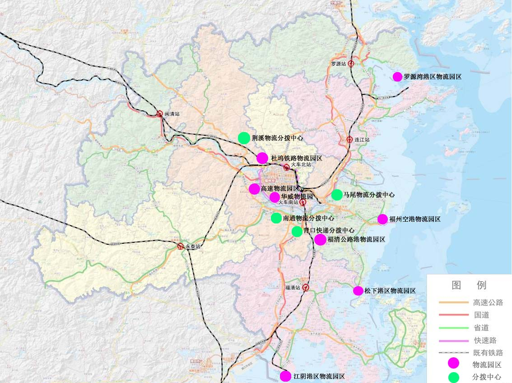

福州市“十三五”物流业发展规划

# 前 言

物流业是融合运输、仓储、货代、信息等产业的复合型服务业，是支撑国民经济发展的基础性、战略性产业。编制和实施《福州市“十三五”物流业发展规划》（以下简称规划），对深入贯彻落实科学发展观，加快发展现代物流业，全力推进福州新区开放开发，加快建设福建自贸试验区福州片区，打造21世纪海上丝绸之路战略枢纽城市，努力建设更具实力、更富活力、更有魅力的现代化新福州具有十分重要的现实意义。

本规划以《福建省促进现代物流业发展条例》《福州市国民经济和社会发展第十三个五年规划纲要》《福州市城市总体规划（2011-2020年）》《福州新区总体规划（2016-2020年）》以及《福州市中心城区邮政设施布局专项规划》为依据，与国务院《物流业发展中长期规划（2014-2020年）》《福建省加快物流业发展实施方案（2016-2020年）》和《福州市“十二五”物流业发展规划》相衔接，主要阐述规划期内市政府推进物流业发展的目标任务、重点工程和保障措施，是规划期间我市推进物流业发展的指导性文件和制定相关政策、安排物流重点建设项目投资的重要依据。

本规划期限为2016-2020年。

## 第一章 发展现状与面临的形势

## 一、发展现状

“十二五”期间，福州市贯彻落实福建省“十二五”发展规划纲要提出的把物流业培育成为主导产业的战略部署，有效实施《福州市“十二五”物流业发展规划》，物流业发展取得显著成就，初步形成“大产业、大网络、大服务”物流业发展格局。

## 1.产业规模稳步增长

2015年，福州市社会物流总额为14004.04亿元，比2010年增长70.0%；物流业务收入689.56亿元，比2010年增长69.4%；物流业增加值334.95亿元，比2010年增长61.5%，占地区生产总值的比重为7%，占服务业增加值的比重为12.4%；完成货物运输总量27109 万吨（含平潭），比2010 年增长85.28%，其中公路、水路、铁路、航空所占全社会货运量比例分别为62.6%、32.92%、4.43%、0.05%；沿海港口运输方式完成港口货物吞吐量1.14亿吨，比2010年增长60%，集装箱吞吐量237.19万标箱，比2010年增长61.3%；航空运输方式完成货邮吞吐量11.65万吨，比2010年增长46.7%；快递业务量17044.14万件，快递业务收入19.97亿元（含平潭）。

## 2.基础设施网络日趋完善

（1）交通运输基础设施网络日趋完善

2015年，福州市铁路营业里程达到345公里，江阴疏港铁路支线、可门港铁路支线建成通车，海铁联运格局初步形成；公路通车里程11109公里，其中高速公路通车里程588公里，实现县县通高速；沿海港口生产性泊位106个，其中万吨级以上深水泊位46个，5万吨级以上21个，10万吨级以上15个，闽江口内港区成为全国最大的进口水产品集散地之一，江阴港区加快建设国际集装箱主枢纽港，罗源湾港区成为全国大宗散杂货物流集散中心之一，福州港“一集一散”发展格局逐步形成，构筑了煤、油、矿石、集装箱等重要货物运输系统。福州长乐国际机场航线覆盖点日益增多，共有106条航线，其中境内航线80条、港澳台航线6条、国际航线20条航线，机场二期工作加快推进。

（2）物流运作基础设施网络日趋完善

福州市扎实推进物流节点建设，成为区域性物流节点城市、国家级流通节点城市和国家电子商务与物流快递协同发展试点城市。建成福州保税港区、高速物流园区、南通物流分拨中心等一批保税港区、物流园区、分拨中心、道路货运站场枢纽、快递分拨中心、专业化物流配送中心、快递公共投递服务站等物流实物平台，初步构建了“物流节点城市-物流园区-物流配送中心-末端配送网点”四级物流运作设施网络。目前，我市投资亿元以上的物流运作设施项目达到50多个。

（3）物流信息基础设施网络日趋完善

2015年，福州市拥有固定电话用户183.59万户，移动电话用户908.33万户，其中4G电话用户286.18万户，3G电话用户330.13万户，互联网宽带接入用户（不含手机上网）206.7万户。福建省电子口岸业务系统建设不断强化，海关电子作业系统、电子关锁、检验检疫电子闸口等业务系统得到应用。福州交通综合信息平台开通运行，跨境电商政府公共服务平台和快递服务监管平台建成使用。物流企业进一步加强物流信息化建设，80%的大、中型货运企业应用GPS 和信息化管理系统，电子单证管理率和运单跟踪率超过了95%，实现了与商贸业和制造业的信息交换和互动。

## 3.服务能力显著增强

福州市拥有一批所有制多元化、服务网络化和管理现代化的物流企业，初步形成了马尾冷链物流集聚区、南通商贸物流集聚区等具有特色的物流集聚区。传统运输业、仓储业加速向现代物流业转型，制造业物流、商贸物流、冷链物流、电子商务物流和国际物流等领域社会化、专业化物流服务能力显著增强，物流业进一步规范发展，服务水平不断提升，现代物流服务体系初步建立。2015年，拥有3A级及以上物流企业44家，其中3A级物流企业26家、4A级物流企业13家、5A级物流企业5家（5A级物流企业全省共10家）。内资物流企业注册资金大于5亿的有13家，注册资本在1亿至5亿的有44家，注册资本在1000万至1亿的有522家。年缴纳税收超过1000万元的物流企业有盛辉物流、盛丰物流、福建顺丰速运、福建中国外代、福建邮政速递、福建汇丰物流、福建中通通信物流等。

## 4.开放水平不断提升

福州市物流开放度和影响力不断增强，海港开放口岸已开辟国际班轮航线23 条（含港澳台地区），空港开放口岸共已开辟国际航线26条（含港澳台地区），航线延伸至澳洲、日本、韩国、新加坡、马来西亚、泰国、柬埔寨等“海丝”沿线国家。海港、空港和福建自贸试验区福州片区内建成融达通、利嘉、优联3个跨境电商监管中心和福州进出境快件监管中心。国际物流交流合作不断拓展深化，与新加坡合作建设经营福州青州、福州江阴集装箱码头，设立中国-东盟海产品交易所。

榕台物流业融合进一步加深，合作建设的福州港江阴港区汽车整车物流中心建成投入使用。榕台航线不断拓展，福州已开通至台北航空货运航线，航空邮货专线实现常态化运营；开通至高雄、基隆、台中等港口集装箱定期班轮航线，开通至基隆、台北、高雄、台中、花莲、布袋、金门、马祖、澎湖等散杂货不定期航线，成为大陆对台海上通航模式最多、往来最频繁的地区之一。榕台物流企业合作交流不断拓展深化，福建八方物流股份有限公司与台湾华冈物流公司共同投资组建八方华冈物流公司，福建省交通运输集团有限责任公司开设驻台湾办事处，盛丰物流、盛辉物流集团有限公司分别与华岗集团公司、台湾力氏国际股份公司签订了海峡散货对接分拨中心项目、海峡两岸海陆联运物流项目、水产品加工转口贸易及配送合作项目。

## 5.发展环境持续优化

福州市深入贯彻落实《福建省促进现代物流业发展条例》，建立了物流业发展的相关协调机制。颁布了《福州市“十二五”物流业发展规划》，出台了《福州市加快现代物流业（含快递业）发展的若干措施》《鼓励福州港口生产发展补贴及优惠政策》《拓展福州港口经济腹地推进陆地港发展意见》《福州市快递运输车辆专用标识管理办法》《福州市提前淘汰报废“黄标车”经济补偿方案》等政策措施，扶持物流业、快递业发展。物流业基础性工作扎实推进，物流行业协会积极发挥着中介组织的作用，物流业标准化建设稳步进行，人才培养培训工作进一步加强，物流技术、学术理论研究及产学研合作不断深入。

总体上看，福州市物流业已步入转型升级的新阶段。但是，我市物流业发展也面临着严峻挑战，物流业发展总体水平仍待提高，发展方式还较粗放。主要问题有：

一是社会化物流需求有待进一步扩大，多数制造企业、商贸企业尚未剥离物流业务实现“主辅分离”，企业内部物流需求社会化程度仍较低。二是专业化物流服务能力有待进一步提高，多数物流企业规模较小，参与国际分工的能力较弱，提供一体化物流服务的企业仍较少。三是综合交通运输网络有待进一步完善，沿海运输通道交通压力增大，港口集疏运系统不完善，各种运输方式衔接不顺畅，港口集散枢纽作用尚未充分发挥。四是物流运作基础设施建设有待进一步增强，物流园区规模普遍较小，集聚能力不强，服务功能不全，现代化仓储、多式联运转运等设施仍不足。五是“引进来”“走出去”力度有待进一步加强，福州“X新欧”国际铁路货运班列有待进一步拓展，“海丝”沿线国家和地区“引进来”的物流项目偏少，福州物流企业沿着“海丝”路线“走出去”打造物流基地有待突破。六是物流发展政策体系有待进一步完善，物流市场秩序不够规范，物流专业化、信息化、标准化水平不高，从业人员整体素质仍较低。

## 二、面临的形势

## 1.全球服务贸易发展的新要求

当前，服务领域是国际投资的重要方向，成为各国经济发展的重点。随着全球价值链引导供应链优化发展、国际产业转移步伐不断加快和服务贸易快速发展，全球采购、全球生产和全球销售的物流发展模式正在日益形成，迫切要求我国物流企业参与国际供应链物流分工。福州市物流业发展要顺应全球服务贸易发展新趋势，融入全球供应链物流体系，充分利用供应链升级的机会，加快产业创新升级，向高端物流和供应链服务转型，提高发展质量和效益。

## 2.我国经济新常态的新契机

我国经济在新常态下持续平稳发展，新型工业化、信息化、城镇化、农业现代化孕育着物流业巨大发展潜能，创新驱动、“互联网+”等重大举措有利于改造提升物流产业、培育发展新技术和新业态、加快形成发展新动能、增强持续增长动力。福州市物流业要以我国经济新常态为契机，加强供给侧结构性改革，实施“互联网+流通”“互联网+高效物流”，从成本要素驱动向效率提升、创新驱动转变，全面进入以转型升级为主线的发展新阶段，推动行业提质增效。

## 3.国家支持福建加快发展政策叠加的新效应

国家出台了一系列支持福建加快发展的意见、规划和方案，尤其是支持海峡西岸经济区建设以及赋予自由贸易试验区、21世纪海上丝绸之路核心区、生态文明先行示范区、福州新区、自主创新示范区建设等重大使命和任务，政策效应将进一步显现，这些政策叠加效应引领福建物流业先行先试、跨越发展。福州在国家和全省发展大局中的战略地位日益凸显，连接长三角和珠三角、带动海峡西岸经济区建设、辐射中部地区发展的枢纽作用更加突出，正在成为区域经济新增长极，物流的载体作用更加凸显，物流业加快发展的动力更加强劲。

## 4.福州市经济社会发展的新动力

“十二五”时期，福州市经济社会发展取得显著成就，经济总量持续增长，综合实力不断提升，2015年地区生产总值5618亿元，第三产业增加值2700亿元。“十三五”时期，福州市率先全面建成小康社会，努力建设更具实力、更富活力、更有魅力的现代化新福州。一是经济发展质量效益进一步提升，综合实力迈上新台阶，地区生产总值提前实现比2010年翻一番，预测到2020年地区生产总值达到9000亿元左右。二是优先发展现代服务业，做大做强现代物流、金融、商务、商贸、旅游等支柱产业，预测到2020年服务业增加值突破5000亿元。三是积极融入国家“一带一路”倡议，全力推进福州新区开放开发，加快建设福建自贸试验区福州片区和“海丝”战略枢纽城市，打造对台往来综合枢纽；四是充分发挥省会中心城市的龙头带动作用，推进福州大都市区建设，推动福莆宁岚连片繁荣、共同发展，成为带动闽东北区域发展的强力引擎。

“十三五”时期，是福州市物流业大有作为的重要战略机遇期。目前我市社会物流需求系数为2.49，即我市每单位地区生产总值产出需要2.49个单位的物流总额来支持，随着我市国民经济的发展，特别是培育形成机械装备、纺织化纤、冶金建材、轻工食品等4个产值超2000亿元，电子信息、石油化工等2个产值超1000亿元的产业集群以及20家百亿企业（集团），将进一步拉动工业品物流需求，物流量呈现大进大出格局，物流业对国民经济发展的支撑作用将进一步增强。福州“五区叠加”的独特优势，与平潭综合实验区一体化发展格局，福莆宁岚同城化步伐加快，有利于构建互联互通、互利共赢的陆海经济大通道，提升我市开放型发展新水平，为物流业发展带来众多“机会窗口”，催生物流政策、项目、资金等要素向福州汇集。

综上所述，“十三五”时期，区域经济社会发展新态势为我市物流业发展注入新潜力、激发新动力、增添新活力、拓展新空间，物流业发展迎来难得的历史机遇。

## 第二章 总体要求

## 一、指导思想

全面落实市委市政府各项决策部署，着力创新发展、协调发展、绿色发展、开放发展、共享发展，以提高物流效率、降低物流成本为重点，以市场运作、政府引导为导向，以改革开放为动力，以先进技术为支撑，积极营造有利于物流业发展的政策环境，着力建立完善现代物流服务体系，加快提升物流业发展水平，为我市全力推进福州新区开放开发，加快建设福建自贸试验区福州片区，打造“海丝”战略枢纽城市，努力建设更具实力、更富活力、更有魅力的现代化新福州提供物流服务保障。

## 二、基本原则

1.转型升级。加快传统物流业转型升级，加大物流资源整合力度，大力发展第三方物流，建立完善社会化、专业化的物流服务体系。加大物流龙头企业培育力度，引进一批跨国物流企业，推进一批物流企业“走出去”，形成一批具有国际竞争力的物流企业，进一步提升物流产业规模和发展水平。

2.创新驱动。创新物流组织方式和运营模式，引导物流集约发展，打造高效物流服务体系，发展绿色物流和低碳物流，推进“互联网+流通”“互联网+高效物流”，提高供应链管理和物流服务水平，形成物流业与制造业、商贸业、金融业协同发展的新优势。

3.开放合作。适应经济全球化趋势，推动对内对外开放相互促进。推进城市物流联盟，建立完善与周边地区的物流合作机制，促进区域物流协调发展。推动榕台物流业深度融合，拓展深化与港澳物流合作交流，加强与“一带一路”沿线国家和地区港口联系和物流合作，构筑对外开放物流战略通道，提升物流业全方位开放合作水平。

4.优化环境。充分发挥市场资源配置的决定性作用，完善要素市场建设，强化物流企业的市场主体地位，激发市场主体活力。更好发挥政府的引导作用，深化物流管理体制改革，加快形成引领经济发展新常态的体制机制，着力解决制约物流业发展瓶颈，营造物流业持续健康发展环境。

## 三、发展目标

1.总体目标

“十三五”时期，福州市物流业发展的总目标是：做强做大现代物流支柱产业。到2020年，物流的社会化、专业化水平显著提升，第三方物流比重明显提高，新的物流装备和技术广泛应用，物流基础设施及运作方式衔接更加顺畅，物流园区网络体系布局更加合理，多式联运、甩挂运输、共同配送等现代物流运作方式广泛应用，物流集聚发展的效益进一步显现，基本建立现代物流服务体系，进一步降低物流成本，提高物流效率，增强物流业对推进福州新区开放开发，加快建设福建自贸试验区福州片区，打造“海丝”战略枢纽城市的支撑和保障能力。

--“海丝”物流枢纽城市。积极融入“海丝”核心区战略、枢纽城市战略，突出物流基础设施互联互通，搭建信息共享平台，加强与“海丝”沿线国家和地区在港口码头、物流园区、物流产业之间的深度对接合作，“引进来”和“走出去”并重发展，着力打造“海丝”物流枢纽城市。

--服务周边地区发展的保税物流网络。积极融入自贸试验区战略，建设完善一批保税物流设施，提升保税物流载体功能，推进福州在江西、湖南等内陆地区“陆地港”、内陆地区在福州“飞地港”建设，着力构建以福建自贸试验区福州片区为核心，以内陆地区海关特殊监管区域为节点的保税物流网络。

--连接两岸经贸活动的重要平台。积极融入福州新区两岸交流合作重要承载区战略，加快榕台物流业深度融合，推动与台湾自由经济示范区物流业对接合作，推进两岸航运自由，打造两岸物流业对接的服务高地和成本洼地，形成支撑两岸货物和资本双向流动、经贸自由化和经济一体化的重要平台。

--国民经济的支柱产业。积极融入优先发展现代服务业战略，扩大社会化物流需求，推进物流业与制造业、商贸业、信息业协同发展。大力培育培养发展物流产业龙头，发展壮大物流集聚区，加快发展冷链物流、电商物流等专业领域物流，增强专业化物流服务能力。大力发展智慧物流，推动物流业信息化、智能化，促进物流产业创新转型，提升现代物流支柱产业地位。

2.具体目标

“十三五”期间，福州市物流产业规模和效益不断提升，社会物流总额和物流业增加值力争年均增长10%以上，到2020年，物流业增加值达到720亿元以上，占地区生产总值的比重力争达到8%左右，占服务业比重力争达到15%左右。快递业务量6亿件以上，快递业务收入45亿元以上。

到2020年，福州港（福州区域，下同）建设成为多式联运国际枢纽港，新开辟国际航线5—10条，新增周边港口喂给江阴港区内支线10条、内贸航线10条，货物吞吐量力争达到1.7亿吨以上。其中，江阴港区建设成为我国东南沿海国际集装箱运输重要枢纽和外贸整车进口重要口岸，集装箱吞吐量力争达到300万标箱以上，整车进口突破3万辆；闽江口港区建设成为全国最大的进口水产品集散地和城市物流配送基地；松下港区建设成为东南沿海地区粮油、水产品类冻品和畜牧储备中转运输基地；罗源湾港区建设成为我国沿海港口重要的大宗散货储备中转港运输基地。福州长乐国际机场建设成为“海丝”门户枢纽空港。

到2020年，创建一批国家级、省级示范物流园区，构建定位准确、类型齐全、覆盖福州五区和七县（市）的物流园区体系。建成若干个区域性、行业性物流公共信息平台，建设一批物流产业集聚区，打造一批战略性物流产业基地，有效形成物流产业集聚效应和规模优势。重点制造企业和商贸企业物流业务外包达90%，国家级、省级工业园区内企业物流业务外包达80%。

到2020年，着力推进若干家物流企业沿着“海丝”线路走出去，建设一批公共海外仓，建设经营港口码头、物流园区、集散基地和配送中心等物流运作设施，建立国际资本关系，拓展国际物流市场，培育成为跨国物流企业；着力培育物流龙头企业，新增一批4A级及以上物流企业，4A级物流企业总数力争达到25家、5A级物流企业总数力争达到10家。

## 第三章 空间布局

紧紧围绕福州新区、福建自贸试验区福州片区和“海丝”战略枢纽城市的战略部署，积极融入国家“一带一路”倡议，贯彻实施“东进南下、沿江向海”城市发展战略，强化全域统筹，进一步优化城市物流空间布局，建设“一通道、二枢纽、三中心”物流枢纽网络。

## 一、一通道：通陆达海物流通道

发挥福州市承东启西、贯通南北的区位优势，以及衔接台海、东海、南海，连接东北亚、东南亚，通联美欧、南亚、东非的海洋互联互通优势，凸显福州大都市区同城化溢出效应，突出连接长三角和珠三角、带动海峡西岸经济区建设、辐射中部地区发展的枢纽作用，提升物流节点城市的辐射带动作用，建设“一带一路”双向开发重要门户、“海丝”核心区互联互通战略枢纽、两岸经贸合作交流重要平台。一是以福建自贸试验区福州片区和福州新区为先导，打造城际快速通道网络，推动区域物流协调发展。二是加强海上枢纽和通道建设，强化航空枢纽和空中通道建设，推进陆海联运通道建设，推动信息通道建设，完善物流节点设施、集疏运体系和口岸通关功能，提升节点城市集散中转功能，推进国际物流大通道建设。三是促进物流基础设施互联互通和信息资源共享，拓展海上空中直航、“两马”航线等对台往来渠道，做大做强“台平欧”（台湾-平潭-江阴-新疆-欧洲）海铁联运班列，努力增辟福州-新疆-欧洲铁路班列，开辟跨境多式联运走廊，深化与“一带一路”沿线国家和地区的物流合作交流，加强多式联运、口岸管理、通关协作、信息互换、监管互认等方面协作，打造联通东盟、对接台湾、辐射内陆、通陆达海的物流战略通道，支撑“海丝”战略枢纽城市建设。

图1 福州市通陆达海物流通道

## 二、二枢纽：海空物流枢纽

发挥福州市海港和空港资源优势，加快构筑综合运输大通道，完善集疏运体系，推进现代综合枢纽建设，优化物流供应链，促进各种运输方式有效衔接，着力建设海空物流枢纽。

建设多式联运国际航运枢纽。大力推动福州港各港区错位发展，完善港口的铁路、公路集疏运设施，构建能力匹配的集疏运通道。拓展国（境）内外航线，推进海上合作走廊建设，加快多式联运设施建设，建立多式联运信息平台，发展海铁联运、铁水联运、公铁联运、陆空联运，重点发展大宗散货水铁联运、集装箱多式联运。完善物流园区、物流中心设施，建设港口物流产业集聚区，打造专业化港口物流基地，形成福州港“一集一散”的发展格局，提升港口规模化、集约化水平，把福州港建设成为多式联运国际航运枢纽。

建设“海丝”门户航空枢纽。大力推进以机场为核心的轨道交通、高速公路、高速铁路和快速通道建设，实现各种运输方式的无缝衔接，做大做强福州航空公司，拓展国内外航班航线，加密“一带一路”沿线国家主要城市的航班航线，构建国际多直达、国内强覆盖的航空运输体系。大力发展航空物流，力争设立福州空港综合保税区，着力发展保税物流，进一步完善物流设施，开拓空港国际中转、配送、采购和转口贸易业务，提升空港口岸功能，建设成为“海丝”门户航空枢纽。

图2 福州市国际航运枢纽和“海丝”门户航空枢纽

## 三、三中心：区域商贸物流、跨境电商物流和对台邮政中心

发挥福州市在全国、全省改革开放中的地位和功能，建设全国区域性商贸物流中心、对台邮政快递中转枢纽中心和跨境电子商务物流中心，进一步加快福莆宁岚物流同城化，凸显对台前沿作用，拓展国际物流市场，提升我市物流业全方位开放合作水平。

建设全国区域性商贸物流中心。依托我市港口、机场优势，建设进口肉类和粮食、水产品、整车进口等三大特色商品交易集散基地，培育一批电子商务平台载体，发展一批电商产业园，建设一批物流集聚区，构建区域性物流分拨配送网络，完善物流配送信息平台，推进区域物流合作，提升辐射带动功能，建设全国区域性商贸物流中心。

建设跨境电子商务物流中心。在福建自贸试验区福州片区和福州新区建设跨境电子商务物流中心，打造电商物流集聚区和跨境电商物流产业园，并在“海丝”沿线国家和地区建设一批海外仓，为福州市域以及周边地区跨境电子商务企业提供一站式的仓储配送，形成跨境电商物流集散中心。

建设对台邮政枢纽中心。提升福州长乐国际机场对台快递处理中心集散能力，推进空港综合保税区建设，榕台联合打造跨境电子商务物流服务平台，建设对台邮政枢纽中心，承接福建全省及上海、浙江、江西、广东等周边省份的对台邮件快件经转，打造对台邮件快件集散中心。

图3 福州市区域商贸物流、跨境电商物流和对台邮政枢纽中心

## 第四章 主要任务

## 一、建设物流基础设施网络

大力推进物流网络建设，建设综合交通运输网络，完善四级物流运作设施网络，提高物流信息化标准化水平，促进互联互通，进一步强化支撑现代物流业发展的三大基础设施网络，提升物流生产力和服务能力。

## 1.建设综合交通运输网络

加大机场、港口、铁路、公路等物流运输基础设施投资力度，完善对内对外综合交通体系，形成以港口为龙头、机场为门户、铁路公路运输为骨干、内河航运为辅助的综合运输网络，推进“海丝”战略物流枢纽城市建设。

（1）港口

整合我市沿海港口资源，推动福州港各港区错位发展，重点建设江阴港区及其壁头作业区、松下港区元洪作业区和牛头湾作业区、罗源湾港区可门作业区和碧里作业区，强化罗源湾港区大宗散货接卸转运能力、江阴港区集装箱运输和汽车整车进口口岸能力，加快闽江口港区外贸集装箱航线下移江阴港区。我市现有港区发展定位为：江阴港区主要发展集装箱运输，闽江口港区主要发展城市物流配送，松下港区主要发展粮油、水产肉类冻品、畜牧储备中转运输，罗源湾港区主要发展散货储备中转运输。

（2）机场

重点推进机场第二轮扩能改造工程建设，加快推进机场二期建设，做大做强福州航空，新开辟一批国内国际航班航线，力争设立福州空港综合保税区，形成集口岸通关、出口加工、保税物流、文化创意、综合服务等功能为一体的海峡西岸国际空港物流核心枢纽，加快建设“海丝”门户枢纽机场。

（3）铁路

加快启动沿海铁路福州段南接向莆、北接衢宁铁路，将沿海铁路福州段纳入全国铁路网，着力推进货运专线通道建设，进一步完善海铁公铁联运体系。改革完善铁路客货运服务体系，逐步实现沿海铁路货运、城际客运、高速客运分线运行，进一步提升铁路货运功能。

（4）公路

加快建设市域“两纵三横二环十二联”高速公路网和“四纵三横四联”国省干线公路网，大力建设罗源湾北岸、可门、黄岐等疏港道路，实现港口区域与高速网络的快速联通。

（5）半小时交通圈

推进县乡公路提级改造，完善城乡运输网络，强化中心城区道路网建设，加快建立对外连接快速、组团之间便捷、内部运行畅通的立体交通快速通道，构筑中心城区与七县(市)半小时交通圈。

（6）枢纽

全力推动交通物流融合发展，建设福州全国性大型综合交通枢纽，科学布局运输枢纽场站，健全完善铁路公路货运场站，加强城市进出口通道枢纽建设。积极发展多式联运、滚装运输、甩挂运输和驼背运输，加强城乡区域间不同货运方式的有机衔接，推进货运无缝对接。

（7）集疏运体系

围绕核心港区、综合性物流园区等重要交通物流枢纽节点，加强集疏运公路和铁路建设。加强疏港公路建设，加快莆炎高速（福州段）、长平高速、长福高速等项目建设，促使福州港通往内陆的公路交通更加通畅。加强疏港铁路建设，加快启动松下港区、罗源湾北岸疏港铁路支线建设，实现沿海核心港区铁路支线全覆盖。

## 2.完善四级物流运作设施网络

进一步优化城市物流空间格局，科学布局物流运作设施，促进多种物流运作设施顺畅衔接和高效中转，力争建设全国性物流节点，着力建设一批、现代化综合物流园区、专业化物流配送中心、快递分拨中心和共同配送末端网点，形成便捷高效的“物流节点城市-物流园区-物流配送中心-末端配送网点”四级物流运作设施网络。

（1）物流节点城市

继续提升福州作为区域性物流节点城市、国家级流通节点城市作用，把福州建设成为全国性物流节点城市，形成支撑我国东南沿海物流区域和东部沿海物流通道的重要物流枢纽节点城市。

（2）物流园区

依托物流节点城市，继续提升福州在国家物流园区布局城市中的作用，创建一批国家级、省级示范物流园区，把福州建设成为国家一级物流园区布局城市。推动物流园区资源整合，在港口、铁路和道路交通枢纽，建设以多式联运、大宗货物转运等功能为主的货运枢纽型物流园区；在大型商圈、批发市场、专业市场，建设以仓储配送等功能为主的商贸服务型物流园区；在毗邻工业园区、产业集聚区，建设以提供供应链一体化服务为主的生产服务型物流园区；在福建自贸试验区福州片区和福州新区，建设以转运、保税等功能为主的口岸服务型物流园区；在福州三环周边，规划建设以多式联运和无缝衔接等功能为主，并融合货运枢纽、商贸服务、生产服务、口岸服务等主要功能的综合服务型物流园区；在毗邻电子商务集聚区、科技园区和福州地区大学城，建设以提供仓配一体化服务为主的快递物流园区。完善南通、青口、荆溪等闽侯物流分拨中心和马尾物流分拨中心，加快建设区域性物流采购中心，构建定位准确、类型齐全、覆盖福州五区七县（市）的物流园区体系，凸显物流园区集聚效应和辐射带动作用，形成支撑物流节点城市发展的物流园区网络。

图4 福州市主要物流园区与物流分拨中心

（3）配送中心

在电子信息、机械装备、纺织化纤、冶金建材、石油化工、轻工食品等产业聚集区、商贸集散地、电子商务集中区建成一批专业化物流配送中心和快件处理中心，形成支撑产业集聚区、商贸集散地、电子商务集中区和跨境电子商务发展的物流配送中心网络，服务产业集群发展、民生消费需求。在福建自贸试验区福州片区和福州新区，打造跨境商品物流集散中心，提高进出口货物集散能力。鼓励物流企业“走出去”，在“海丝”沿线主要交通节点和港口建设一批海外仓库、物流中心。

（4）末端网点

完善城乡终端物流配送服务基础设施，推广“网订店取”配送模式，推进智能快件箱普及应用，在城市社区和村镇建成一批共同配送末端网点，打造接取送达智慧化城乡末端配送网络，形成层级合理、规模适当、需求匹配的终端物流仓储配送服务网络，破解城乡物流配送瓶颈。

## 3.提高物流信息化标准化水平

推进物流信息技术应用和标准化建设，加快统一的物流信息数据库、物流公共信息平台和物流标准服务平台建设，推动“互联网+流通”“互联网+高效物流”，推进智慧城市、智慧农村、车联网等集成应用，推动线上线下融合发展，促进物流业转型升级，提升物流服务水平。

（1）大力推广物流信息技术

鼓励物流企业广泛应用物联网、云计算、大数据、移动互联等先进信息技术，加强企业物流信息系统建设，实现商品来源可追溯、去向可查证、流程可视化。推进嵌入物联网技术的物流设施设备快速发展，促使车联网技术从传统的车辆定位向车队管理、车辆维修、智能调度、金融服务延伸。提升物流信息采集、处理、交换和服务技术，建成统一的物流信息数据库，实现企业物流信息与公共服务信息的互联互通与交换共享。

（2）互联网引领物流转型升级

一是推进“互联网+”车货匹配，支持公路港物流信息平台建设，整合线下物流资源，打造线上线下联动网络，促进车货高效匹配，拓展物流增值服务。二是推进“互联网+”运力优化，提高物流链条的协同运作水平，优化货物运输路径。三是推进“互联网+”运输协同，加快不同业务系统之间的对接，试点推广多式联运电子运单系统，培育多式联运经营主体，在重点领域探索实行“一票到底”的联运服务。四是推进“互联网+”仓储交易，建立全国性或区域性仓储资源网上交易平台，推动仓储资源在线开放和实时交易。五是推进“互联网+”物流企业联盟，整合社会分散的运输、仓储、配送等物流业务资源，推动物流企业联盟发展，优化供应链物流，提高货运组织化水平，并带动广大中小企业集约发展。六是推进“互联网+”供应链管理，鼓励物流企业向供应链上下游提供延伸服务，发展适应“互联网+”大规模定制的智能集成式物流模式，推进物流与制造业互动融合、协同发展。

（3）大力提升物流信息平台

建设统一的通关一体化公共平台，实现通关一体化，形成对接口岸监管部门、政府相关部门、服务企业的公共数据交换及通关服务的单一窗口。推动龙头物流企业搭建面向中小物流企业的信息服务平台，推动一批行业性、区域性物流公共信息平台建设，促进货源、车源和物流服务等信息的高效匹配。依托各类物流公共信息平台，形成集物流信息发布、在线交易、数据交换、跟踪追溯、智能分析等功能为一体的物流信息服务中心，促进物流信息充分共享与互联互通。

（4）大力推进物流标准化

加强物流标准的宣传、培训和推广应用，推进托盘标准化及循环共用，推广仓配一体化电子商务物流模式，开发建设物流信息标准数据库，建设标准化智慧物流配送体系，提高物流配送标准化、单元化水平。推进仓储配送设施设备标准化改造，提升标准化物流设备专业服务水平，制定实施包装、装卸、运输、配送等各类作业标准、管理标准、服务标准和物流信息标准。支持龙头物流企业参与国际标准、国家标准、行业标准和地方标准的制修订。

## 二、发展社会化专业化物流

着力发展第三方物流，加快物流需求社会化，推进物流服务专业化，培育发展物流产业龙头，发展壮大物流集聚区，提升物流企业规模化集约化水平，促进物流业社会化专业化高端化。大力发展冷链物流、电子商务物流、智慧物流，全力推进物流业与制造业、商贸业协同发展，增强物流产业竞争力。

## 1.加快物流需求社会化

鼓励制造企业、商贸企业按照分工协作的原则，分离外包物流业务，促进企业内部物流需求社会化，全面推进重点制造企业和商贸企业物流业务外包。优化工业园区、经济开发区、海关特殊监管区域、高新技术产业园区、商贸批发中心、电子商务集中区等物流资源配置，构建中小微企业公共物流服务平台，全面推进国家级、省级工业园区内企业物流业务外包，扩大社会物流需求。支持企业剥离设立的物流企业优化物流组织模式，提升专业化精益化服务水平，促进个性化物流需求发展。

## 2.提升物流服务专业化

鼓励传统仓储、运输、国际货代、快递等企业采用现代物流管理理念和技术装备，加快转型升级，提高供应链服务能力。推进物流企业与制造企业深化战略合作，全面参与制造企业的供应链管理，重点推动电子信息、机械装备、纺织化纤、冶金建材、石油化工、轻工食品行业开展制造业与物流业联动发展示范，建立与新型工业化发展相适应的制造业物流服务体系。鼓励商贸物流企业提高配送的规模化和协同化水平，新建永辉、新华都、苏宁等一批专业化仓储物流配送中心，实现大型连锁企业、品牌商业企业统一配送，建立快速便捷的城乡配送物流体系。

## 3.大力发展港口物流

依托自贸试验区、保税港区、整车进口口岸政策优势，加快临港物流园区、大宗货物分拨中心、海运快件中心、进出口商品物流分拨基地、跨境电商园区、江阴港区汽车物流园区建设，争取开辟江阴港区滚装船航线，吸引国际知名航运企业、物流企业、知名汽车经销商入驻港区，重点拓展国际贸易、采购、中转和配送业务，提升港口辐射能力，做大国际物流，对接服务临港国际商贸城、临港产业集聚，推动物流业与制造业、商贸业联动发展。引进航运产业高端环节和新型业态，重点发展国际船舶运输、国际船舶管理、国际航运经纪、船舶交易、航运咨询、信息服务等高端航运服务业。

## 4.培育发展物流产业龙头

实施产业龙头培育扶持计划和品牌战略，推动在“海丝”沿线国家和地区设立分公司，建设港口码头、物流园区、集散基地和配送中心等物流运作设施，培育若干家跨国物流企业。突出资源整合，鼓励物流企业通过参股控股、资产收购、股权置换、合资合作、协作联盟等兼并重组方式做大做强，新增一批4A级、5A级物流企业。推进龙头物流企业实施物流产业链整合，向价值链高端延伸，深化分工协作，协同发展，形成龙头物流企业引领、物流产业链延伸、物流企业集群共进的产业发展新格局。

## 5.发展壮大物流集聚区

加快物流产业集群化，推进物流集聚区建设，促进物流要素聚集，吸引培育一批物流企业，打造以集聚区物流企业为龙头的产业链，围绕价值链、产业链、创新链、资源链，有效形成物流产业集聚效应和规模优势，提升物流业核心竞争力。

（1）建设四大物流业集聚区。一是依托主要港区，建设海港物流集聚区、面向“海丝”沿线国家和地区的物流航运企业总部集聚区；二是依托临空经济区，建设航空物流集聚区；三是依托铁路货运站，建设铁路物流集聚区；依托环城高速公路，建设高速公路物流集聚区。（2）建设一批商贸物流总部集聚区。一是依托盛辉、盛丰等总部项目，加快发展物流业总部经济；二是依托厦门航空、福州航空等基地航空公司，建设空港高端商贸集聚区；依托港口优势，争取更多国际航运企业在我市挂港，吸引国际知名航运经纪人公司、大型船舶管理公司落户我市设立分支机构，发展航运总部经济。（3）建设一批跨境电商物流集聚区。依托福建自贸试验区福州片区和福州新区，建设一批保税物流、跨境电商物流集聚区。（4）着力推进仓山、晋安、福清、长乐、连江、罗源、永泰、闽清等县（市）区建设物流产业集聚区。

## 6.加快发展冷链物流

加快发展冷链物流，完善冷链物流网络，推进冷链运输物流信息化建设，大力发展共同配送、统一配送、集中配送等先进的配送组织模式，优化城市配送车辆通行管理措施，提升冷链物流服务水平。一是构建分工合作的冷链物流体系。马尾区依托自贸区政策和远洋渔获集散地优势，建设中继性冷链物流中心和面向国内外市场的水产品冷链物流基地，打造具有远洋特色的海港冷链物流城；福清市依托港口和水产品加工集散地优势，以规划中的元洪国际食品产业园为载体，建设以水产品加工为主的速冻、冷藏等冷链物流；长乐市依托空港优势，重点发展快捷高端水产品冷链物流；连江、罗源县等重点水产品养殖地利用丰富的渔业资源，大力发展初级水产品预冷、冰鲜、冻结等冷链环节，加强榕台水产品冷链物流合作，打造区域性冷链物流园区。二是支持冷链物流企业冷链技术升级改造，推广全程温度监控设备。三是深化榕台冷链物流合作，推动冷链物流示范中心、冷链物流园区业务对接，扩大榕台冷链物流产业合作。

## 7.加快发展电商物流

全力推进电子商务与物流快递协同发展，推动商贸物流和电子商务的协同发展及业务流程再造，加强物流、电子商务、快递等企业和专业化末端配送企业进行多方合作，创新“网络购物+快递高效配送”模式，建立仓配一体化服务体系。加快邮政服务网络建设，推进物流信息化标准化，拓展快递物流网络通道，优化末端配送网点布局，建立高效便捷的智慧化末端配送网络。完善电商物流公共信息平台，强化电商物流配送能力。进一步优化基础设施网络，着力建设一批快递物流分拨、处理中心和公共投递服务站，构建县、乡（镇）、村三级邮政寄递网络。推进企业“走出去”，加快建设跨境贸易电子商务快件分拨中心和海外仓网络，满足跨境电子商务的快速发展要求，着力推进电子商务物流枢纽城市建设。

## 8.大力发展智慧物流

以智慧物流为龙头，引领产业融合发展，创新驱动物流业、制造业、商贸业、信息业共创开放协同发展的新优势。建立020商业模式，开展同城短途物流配送，建立线上线下一体化流通方式，促进商贸流通创新发展。充分利用物流资源，培育“物流+商贸”“物流+金融”“物流+电子商务”等新型市场业态，发展新型众创、众包、众筹空间，打造一批物流产业链。加快推进交通、物流等领域“互联网+”行动，从要素驱动、投资驱动转变为整合发展、创新驱动，吸引更多的外部企业携资本优势跨界进入物流市场，推动向产业链上下游延伸，与上下游信息共享并协同作业。打造融合电子交易、电子支付、供应链金融等物流增值服务为一体的基础性服务平台，形成产业融合、资源共享、合作共赢、可持续发展的智慧物流生态链、产业融合发展生态圈。

## 三、拓展深化物流开放合作

依托福州新区、福建自贸试验区福州片区和“海丝”战略枢纽城市建设，强化区域物流互动合作，凸显对台前沿作用，密切榕港澳交流联系，积极参与国际供应链物流分工协作，扩大对外开放重要门户，建立更加紧密的区域、国际物流合作机制，推进设施连通、网络连通、信息连通，提高福州在全国、全省改革开放中的地位和功能，提升全方位开放合作水平。

## 1.强化区域互动合作

发挥物流节点城市辐射带动作用，建设完善物流基础设施网络，建立跨区域物流对接合作机制。统筹福建自贸试验区福州片区各类信息化平台建设，加强与周边区域对接合作。推进与平潭综合实验区一体化物流发展格局，加快福莆宁岚物流同城化步伐，增强对南平、三明物流业发展的辐射带动，建设闽东北区域物流发展的强力引擎。加强与长三角、珠三角城市物流协作，进一步凸显连接长三角和珠三角的战略物流纽带作用。积极开通我市至南昌、长沙等内陆地区的铁海联运班列，深化港口合作，大力发展海铁联运，推进与周边及内陆地区口岸通关合作，支持跨区“飞地港”“陆地港”建设，吸引更多大宗散杂货从福州港口中转，着力打造服务中西部地区对外开放的重要出海通道。

## 2.推动榕台深度融合

全面落实福州新区发展战略，推进与台湾自由经济示范区物流业的对接合作，加强对台航运中心、航空联系枢纽等建设，全力建设两岸物流交流合作重要承载区。着力推进福州港江阴港区与台湾基隆、高雄、台中等港口对接合作，引导双方航运企业增辟新航线，实现双方港口互为中转；发挥江阴港区汽车整车进口物流中心的口岸优势，联手台中自贸港区等打造海峡两岸汽车营运中心。提升“两马小三通”、黄岐至马祖客运航线服务品牌，建设琅岐对台综合码头，开辟福州港至台湾本岛海上客货运滚装快捷走廊，推动开展对台海运业试点，拓展榕台海空货运直航，发展两岸货物快捷运输通道，建成辐射华东、华南和台湾地区的海运快捷网络，打造对台往来的综合枢纽。发展对台海运快件业务，打造对台邮政枢纽中心，提升我市对台邮件集散能力。促进榕台信息互联互通，创新通关合作模式，逐步实现信息互换、监管互认和执法互助，探索建设两岸通关信息交流合作的全国示范性平台。创新榕台物流业合作模式，加强两岸物流业深度合作，鼓励双方物流企业对接合作，互为设立采购、配送和区域分拨中心，推进产业对接升级；鼓励台湾来榕投资兴业，设立电商物流企业，联合打造跨境电商物流服务平台，打造两岸产业集聚区，推动两岸货物贸易自由化。

## 3.加强榕港澳交流联系

密切榕港澳物流交流联系，积极推进榕港澳物流合作，推动榕港澳服务贸易自由化。拓展榕港澳招商平台，支持港澳物流企业在我市设立物流企业总部或建立物流中心，参与物流园区和物流中心建设。引入港澳资金、先进技术和管理经验，引导物流企业采取相互参股等方式强化企业间的联合，重点加强冷链物流服务合作，共同建设跨境物流网络。加强榕港澳物流行业协会的沟通交流，建立广泛的合作联系机制。组织赴港澳物流推介与对接，深化物流人才、科技、技术创新等领域合作，支持港澳高校、科研机构来榕设立物流研发或技术转移机构，建立技术成果转换常态化通道。

## 4.融入国家“一带一路”倡议

深化与“海丝”沿线国家和地区的物流交流合作，提升物流国际化，打造联通东盟、对接台湾、辐射内陆的战略物流枢纽城市。一是统筹海陆空建设，加快构建互联互通的对外综合交通，拓展我市至东南亚、西亚、欧洲等国际海上航线和国际空中航线，着力打造南下经马六甲海峡向西至印度洋延伸至欧洲的西线合作走廊和经印度尼西亚抵达南太平洋的南线合作走廊，以及北上经韩日延伸至俄罗斯远东和北美地区的北线合作走廊，新开至新疆、欧洲的“福新欧”国际铁路班列，建设海陆空国际物流运输网络，把福州打造成为衔接“一带一路”的重要物流战略通道。二是建设中国—东盟海产品交易所海外分中心，积极推进我市在“海丝”沿线国家和地区设立海外仓，构筑以海外仓为支点的目的国配送辐射网点，形成跨境电商海外物流平台，为福州市域和周边地区跨境电商企业提供一站式的仓储配送服务。三是依托福州港江阴港区、罗源湾港区，建设中国-印度尼西亚物流合作示范园区，推进我市与“海丝”沿线国家和地区互设共建物流园区、集散基地和配送中心等物流运作设施。四是推进“海丝”沿线国家和地区优势物流航运企业“引进来”和我市企业“走出去”，推动物流产业之间的深度合作，加快选址建设一批面向东南亚国家和地区的物流总部集聚区，把福州打造成为区域性全球供应链物流中心。五是完善口岸通关机制和互联互通，搭建面向“海丝”的跨境物流信息共享平台，开展“海丝”沿线国家和地区的关检合作，促进口岸货物通关便利化。

## 第五章 重点工程

## 一、多式联运工程

主要目标是：依托物流枢纽节点和集疏运网络，建设一批连接两种以上运输方式的多式联运、转运设施和口岸信息共享平台，提升通关区域一体化水平，提高中转联运能力，增强海陆空多式联运的运作效率，促进物流基础设施协调配套运行，实现运输资源的高效整合和运输组织的无缝衔接，加快形成服务中西部地区对外开放的重要出海港口通道。

主要支撑项目是：江西海铁联运、江阴综合物流园区、福州中外运江阴综合物流中心、福清公路港、华威物流园二期、爱马仕物流等。

## 二、物流园区工程

主要目标是：优化福州物流园区空间布局，结合区位特点和物流需求，按照节约集约用地的原则，在交通枢纽、产业集聚区合理布局建设物流园区，完善物流园区基础设施，加快现代化立体仓库和信息平台建设，提升物流园区管理和服务水平，树立一批国家级、省级示范物流园区标杆，发挥示范园区的引导带动作用，集聚一批物流企业，打造全物流产业链，逐步形成以物流园区为支撑的产业生态圈。

主要支撑项目是：普洛斯南通物流园、盛辉园中物流园、长乐翔福物流园、万集物流公共中心等。

## 三、物流信息化标准化工程

主要目标是：加快物联网、云计算等信息技术的推广应用，整合物流信息服务平台资源，建设物流公共信息平台功能，完善物流企业信息系统，形成跨行业的智能物流信息公共服务平台，促进综合运输信息、物流供需信息、大宗商品交易信息及物流企业信息系统之间实现互联互通和信息共享。建设物流标准体系，加快物流标准化进程。

主要支撑项目是：中国-东盟海产品交易所冷链物流物联网o2o信息化平台、蓝海智慧物流汽车公共服务平台、“运吧－货运网”（物流交易平台）、福州市电商物流公共信息平台、福建中外运•未名智慧物流港、永辉超市物流标准化项目、九州通医药物流标准化推广应用项目等。

## 四、物流企业培育工程

主要目标是：推进福州物流企业“走出去”，扩展境内外网络，引导传统运输仓储企业做强做大，着力引进一批国内外知名物流企业，培育一批大型综合物流企业集团和物流服务品牌，提升物流产业规模和发展水平。

主要支撑项目是：培育一批优质物流企业通过新增或升级方式进入4A级及以上行列，推动具有标杆作用的领先物流企业群体成长壮大，展示我市物流社会化、专业化、高端化水平。

## 五、制造业物流与供应链管理工程

主要目标是：支持第三方物流企业完善与制造业配套、衔接的物流设施和物流信息平台，提升供应链物流管理服务水平，为制造业企业提供供应链计划、采购物流、入厂物流、交付物流、回收物流、供应链金融以及信息追溯等集成服务，开创驱动物流业、制造业、商贸业、信息业协同发展的局面。

主要支撑项目是：长乐盛丰物流配送中心、长乐金邦物流项目、福建盛丰福清甩挂运输站场建设项目等。

## 六、冷链物流工程

主要目标是：加强鲜活农产品冷链物流设施设备建设，完善冷链物流网络，建立覆盖农产品收集、存储、加工、运输、销售各环节的冷链物流网络，构建辐射周边地区的农产品冷链物流服务体系。

主要支撑项目是：科乐通冷冻产品集散中心、汉吉斯国际大型冷链枢纽中心暨跨境电商自贸产品生产研发中心、榕金安全食品冷链物流中心、生鲜农产品微冻物流园、福州元洪国际食品物流产业园等。

## 七、电子商务物流工程

主要目标是：完善区域性仓储配送基地，集聚一批制造商、电商、快递和零担物流企业、第三方服务公司，提供仓配一体化业务，提高物流配送效率和专业化服务水平，健全跨境电商物流、通关体系，推动传统货代、快递物流企业拓展跨境电子商务服务业务，逐步形成与跨境电子商务相适应的国际快递物流体系。

主要支撑项目是：中国-东盟渔业产业合作及渔产品交易平台园区、福州苏宁物流仓储二期、高速物流电商快递园、盛荣闽台电子商务与现代物流园、易栈智慧社区服务平台、腾云社区等。

## 八、城市共同配送工程

主要目标是：建成一批专业化物流配送中心和快件处理中心，完善末端网点网络，搭建城市配送公共服务平台，加强服务网络建设，提高共同配送能力，发展城乡一体化物流配送服务体系，提升城乡物流配送能力，解决物流配送“最后一公里”“最后一百米”问题。

主要支撑项目是：永辉物流仓储中心、福建外运公司福州南通综合物流中心、万全综合物流中心、新华都总部物流中心、高速物流两岸智慧安全物流快递平台、哟客城市共同配送等。

## 九、保税物流工程

主要目标是：依托福建自贸试验区福州片区、福州保税港区、福州保税区、福州出口加工区，拟申报设立的福州空港综合保税区和福州长乐国际机场，结合跨境电子商务进口试点城市特殊政策，大力发展保税备货、保税加工和保税物流，全面整合升级我市各类海关特殊监管区，促进单一功能海关特殊监管区向多功能海关特殊监管区转型升级，增强进出口货物集散能力，扩大福建自贸试验区的转口物流规模，打造国际物流分拨配送中心，形成与周边和境外地区有效衔接的物流网络。

主要支撑项目是：福州保税港区利嘉国际物流园、中欧海贝尔（福州）保税物流园、利嘉空港物流园、翔福保税物流中心（B型）等。

## 第六章 保障措施

## 一、深化体制机制改革创新

加快推进物流管理体制改革，完善物流管理体制机制，建立统一高效的物流管理体制，推进物流业创新发展。创新管理服务，推进福建自由贸易试验区福州片区物流航运业改革创新，推出一批可复制推广的创新举措，扩大政策外溢效应。建立公平开放透明的物流市场规则，实行统一的市场准入制度，各类市场主体依法享有平等准入机会。深化落实“先照后证”改革，完善“一照一码”登记模式，全面实施“五证合一”登记制度。围绕“诚信福州”建设，建成物流市场主体信用平台，完善社会信用体系。进一步规范市场秩序，加强安全监管，改善服务环境，营造公平、有序的物流发展环境，引导和推动物流业持续健康发展。

## 二、强化政策保障

出台《福州市加快现代物流业（含快递）发展的若干措施》，进一步完善相关配套政策措施，促进我市物流业加快发展。

1.加强用地保障

强化用地供给。把物流业重要基础设施纳入城市总体规划、土地利用总体规划和综合交通设施建设规划。各级政府优先解决符合“十三五”福州市现代物流业发展规划及我市现代物流发展的重点物流项目用地，在土地利用总体规划和年度供地计划中予以合理安排；国家、省政府确定建设的电商快递物流园区等项目用地要确保落实；新建工业、商业项目和居住小区应预留物流用地和配送末端网点用地。

保障用地权益。经原批准用地的人民政府批准，对物流企业现有物流用地因公共利益需要使用土地而收回土地使用权的，给予合理补偿或按相同用途异地置换建设用地，置换用地可采取协议出让方式。

实施用地优惠。对纳入物流发展规划的物流园区、物流分拨中心、配送中心等物流项目用地以及为生产配套的仓储物流项目用地，执行工业用地相关政策。新建专业物流仓储设施，不列入结合民用建筑修建防空地下室范畴；对物流业建设项目符合法定划拨范围的，可以划拨方式供地，项目用地出让年限可在法定最高年限范围内按需设定，出让金按设定的出让年限计收。一次性缴纳土地出让金确有困难的物流企业，在依法约定的前提下，首期缴纳50%后，其余可在1年内分期缴付。鼓励各地以租赁方式供应物流业用地，允许物流企业通过租赁方式取得国有土地使用权。

鼓励集约用地。在符合城市规划、不改变土地用途的前提下，对企业利用现有厂区、厂房改造建设，增加容积率用于工业仓储、加工等生产性项目的，不再增收土地出让金。优先支持公共物流园区建设，引导城区物流企业向园区集聚，促进物流项目集中布局。

2.完善网络布局

推进物流枢纽建设。发展货运枢纽型、生产服务型、商贸服务型、口岸服务型、综合服务型物流园区和快递物流园区。在交通枢纽、工业园区、批发市场、电子商务园区周边配套建设公共物流运作基础设施。支持符合规划的物流园区、物流配送中心、快递分拨配送中心、电子商务仓配一体化项目建设。

加快终端网点建设。鼓励物流企业开展跨区域网络化经营，推行“一址多照”“一照两址”等住所登记改革。物流企业城市配送站点不对外营业、不揽件的，可免于办理工商注册登记。新建写字楼、住宅小区和旧城改造将快递服务网点纳入社区服务基础设施，同步规划、同步建设。支持建设智能信包箱、智能快件（冷藏）箱、快递综合服务站点、校园快递服务中心。

完善农村物流网络。逐步完善以农村物流枢纽站场为基础，以县、乡、村三级物流节点为支撑的农村物流基础设施网络体系，支持在乡镇、农村开辟或延伸物流运输线路，新建、改造物流营业网点，完善面向农村的综合物流信息服务和物流仓储配送体系。

拓展对外物流通道。推进自贸试验区通关便利政策在空港、海港复制，发展重点物流干线的多式联运，完善物流转运设施。积极创造条件开通班列、班轮及全货机，给予中欧、中亚铁路货运班列及航空全货机航班适当的运营补助。推动我市企业开展“海丝”物流合作项目，鼓励支持在“海丝”路线国家和地区建设经营物流园区、集散基地、配送中心和公共海外仓等。

3.培育物流市场

支持物流辅业剥离。支持工业、商贸企业剥离物流环节设立物流企业，鼓励物流企业承接制造业、商贸业企业的采购、运输、仓储、货代、流通加工、物流信息等物流服务，支持物流企业提供电商仓配一体化服务。

培育第三方物流企业。在我市新设立独立法人物流企业总部的，按福州市有关鼓励加快总部经济发展的政策落实。鼓励大型物流企业到我市新设立独立法人物流企业，支持企业兼并重组及在省外设立分支机构。

鼓励货源集聚。贯彻《福建省人民政府关于印发加快港口发展行动纲要（2014-2018年）的通知》（闽政〔2014〕31号）、《福州市人民政府印发关于促进福州港江阴港区汽车整车进口口岸发展的若干措施》（榕政综〔2015〕175号）、《福州市人民政府办公厅印发关于拓展福州港口经济腹地推进陆地港发展意见的通知》（榕政办〔2014〕3号）、《福建省人民政府办公厅关于加快电子商务发展九条措施的通知》（闽政办〔2015〕89 号）等鼓励货源集聚的有关政策。

4.提升发展水平

支持设备更新。对物流企业更新应用自动化设备、货物搬运设备和运输装备、冷链物流装备、全程温度监控设备 ，以及购置新能源汽车、应用轻量化车厢、企业自用充电桩等绿色物流装备，购置X光机等安全检查设备，实现仓储体系、配送系统智能化、自动化、安全化、节能降耗的，给予补助。

促进信息化建设。鼓励互联网+、大数据、云计算、物联网等先进技术、理念、模式在物流业中应用。对物流企业建设信息化、物流公共信息平台，经济社会效益较好的，给予一定的补助。充分发挥已建物流公共信息平台作用，对接国家、省物流公共信息平台，为物流企业提供一站式服务。支持利用信息技术提升安全监管能力，完善快递业安全监管信息平台。

支持企业规范发展。支持物流企业参加国家A级企业及星级冷链物流企业评定，鼓励企业争创国家级、省级示范物流园区、电商快递园区。推动物流信用记录建设，培育物流信用服务机构，逐步建立物流企业和从业人员信用管理试点机制。

推动标准化建设。积极宣传推广物流标准，支持物流企业、社会团体参与制订物流标准，推动物流企业、配送中心、物流园区参加国家、省级标准化试点建设。重点推动托盘、货架、传送带、运输车辆、智能信报箱、智能快件箱等设施标准化，对围绕设施标准化进行的相关配套设施设备升级改造发生的设备购置、设施建设、软件开发等予以重点扶持。

5.提供通行便利

规范城市配送车型和管理。出台城市配送车型标准，按照通行便利、保障急需和控制总量的原则，优化城市配送车辆市区通行办法，探索规范快递专用车辆城区便利通行措施，解决“最后一公里”通行难问题。

促进快速卸货、合理停靠。推广港湾式路边停车卸货作业模式和使用笼车等快速卸货技术；充分利用市区公共停车场、交通枢纽、城市综合体、社区、企事业单位的公共资源临时停靠。规划设置公共装卸点、货物集散点和货场停靠区，批发市场、生鲜超市中心店分别按每百平方米建筑面积配套0.8个车位、1.5个车位的标准设置停车位。

建设全市通关公共平台。按照一个平台、单一窗口的原则，逐步实现通关一体化，建成对接口岸监管部门、政府相关部门并提供公共数据交换服务、通关服务的单一窗口。对国际物流业务量大的物流园区和物流企业，关检部门优先派驻监管人员，提供高效便捷的服务。

## 三、强化资金保障

积极争取上级财政资金支持；市财政每年安排物流业发展专项资金，重点培育物流园区、冷链物流、电商物流、共同配送、智慧物流、产业龙头等。各县（市）区人民政府也要安排一定资金，将现代物流业列为重点扶持行业。

发展物流金融业务。推动各银行业金融机构持续加大对物流业的信贷投放力度，积极发展仓单质押、存货质押、在途货物抵押、应收账款融资等物流金融业务。支持第三方物流仓储企业对外提供仓单作为贷款抵押并提供相应担保服务。鼓励融资租赁企业为物流企业货运车辆、物流设备购置更新提供融资支持。探索支持以股权投资、建立产业基金、贷款贴息等方式对公益性、公共性、创新性强、具有示范和带动效应的项目予以扶持。

## 四、强化其他保障

强化宣传工作。积极宣传物流业作为支撑国民经济发展的基础性、战略性产业地位，着力宣传物流在产业转型升级、新型业态培育、民生保障改善、城市影响力和辐射力的作用，重点宣传“互联网+高效物流”等物流发展方式创新、商业模式创新、物流服务创新、政策服务创新，大力营造全社会高度重视物流业发展的氛围。

加大物流专业人才的培训力度。鼓励有条件的院校开设物流、快递相关专业，支持校企合作。将高级物流专业人才列入我市紧缺急需人才引进目录，引进的高级物流专业人才享受我市引进人才政策规定的相关待遇。依托院校、行业协会及相关培训机构对工商企业、物流企业在职人员及政府有关部门管理人员进行培训，提升物流技术与管理水平。加强物流领域理论研究，完善现代物流业理论体系。

强化理论研究与物流运行监测。加强物流领域理论研究，开展物流产业发展研究，积极推进产学研用结合。开展物流产业相关的指标数据采集、数据统计分析等工作，逐步实现物流产业运行状况的跟踪监测和信息发布，及时准确反映物流业的发展规模和运行效率。编写年度物流业发展报告，及时准确反映物流业发展现状，为政府宏观管理和企业经营决策提供参考依据。

更好发挥行业协会的桥梁和纽带作用。鼓励行业协会健全和完善各项行业基础性工作，做好调查研究、技术推广、标准制订和宣传推广、信息统计、咨询服务、人才培养、理论研究、国际合作等方面的工作，积极推动行业规范自律和诚信体系建设，推动行业健康发展。

## 第七章 组织实施

## 一、加强组织保障

市商务局作为物流业发展牵头部门，主动发挥综合协调职能，促进相关部门协同配合、通力合作，形成组织有序、分工合理、协调配合的制度化、常态化机制，确保本规划主要目标任务、重点工程和保障措施顺利实施。

县（市）区人民政府应将物流业发展纳入本地区国民经济和社会发展规划及年度计划，建立健全相关协调机制，协调解决物流业发展中的重大问题。

市直有关部门和各县（市）区人民政府要围绕我市物流业发展目标，编制重点领域物流发展专项规划和地区发展规划，明确发展目标、重点任务、重大项目和保障措施。

## 二、完善配套政策

市直有关部门和各县（市）区人民政府要以本规划作为政府审批核准物流重大项目、安排政府投资和财政支出预算、制定特定领域相关政策的重要依据。市直有关部门要按照本规划的任务，制定完善各项配套政策措施和工作方案；各县（市）区人民政府要按照本规划确定的工作重点和政策措施，结合本地实际制定具体落实方案，及时研究出台促进物流业发展的政策意见，确保取得实效。

## 三、注重环境保护

各级政府对涉及危险化学品等高环境危险的物流园区、仓储物流中心和交通运输枢纽等的规划布局应与居民区保持足够的环境安全距离，建立区域联动反应机制，做好环境风险防控；对涉及饮用水源保护区、风景名胜区、自然保护区等环境敏感目标的项目，应优化选址，予以避让。同时，应做好各物流园区噪声规划控制。

## 四、建立评估机制

市商务局牵头会同市直有关部门按照本规划的发展目标和工作任务，建立评估制度，期中及期末对本规划的执行进展情况及其成效进行总结评估，并对本规划建设项目实行定期跟踪和滚动管理。市直有关部门和各县（市）区人民政府部门要将本规划实施过程中出现的新情况、新问题及时报送市商务局。

# 附表： 福州市“十三五”物流业发展规划重点建设项目表

| 序号 | 项目名称 | 主要建设内容 | 总投资概算（亿元） | 建设期限 | 建设负责单位 | 项目属地 |
|---|---|---|---|---|---|---|
| 一、多式联运工程 |
| 1 | 江西海铁联运项目 | 立足赣闽，推进海铁联运发展，促进口岸大通关建设，搭建江西省及邻近内陆省份的货物通过福建省港口进出的物流业务平台为江西省及邻近内陆省份的货物进出打造一条方便快捷的海铁联运物流通道。 | 0.68 | 2014-2018年 | 福建江阴国际集装箱码头有限公司 | 江西向塘 |
| 2 | 江阴综合物流园区 | 项目总建筑面积18.9万㎡，其中仓库1.4万㎡，集装箱堆场17万㎡，建成以集装箱、整车进口、化工产品、保税产品和专业产品仓储、运输、加工为主的大型综合物流园区。 | 9.0 | 2009-2020年 | 福建八方物流有限公司 | 福州福清 |
| 3 | 福州中外运江阴综合物流中心 | 项目占地122.8亩，规划建设的各类仓库建筑面积24582.1㎡，计容建筑面积47560.8㎡，办公楼面积7252.08㎡，堆场面积29341.9㎡，配套附属设施面积166.7㎡。 | 1.3 | 2014-2018年 | 中国外运福建有限公司 | 福州福清 |
| 4 | 福清公路港（福建星泰安物流园区） | 项目占地200亩，建筑面积24.8万㎡，主要建设交易中心、运输中心、仓储中心、农村物流配送中心、冷链物流中心、快递物流中心、电子商务中心、维修中心和办公大楼，以及相关配套服务设施。 | 5.3 | 2016-2018年 | 福建星泰安物流有限公司 | 福州福清 |
| 5 | 华威物流园二期 | 项目占地261亩，总建筑面积19.73万㎡，建设公路港信息配载区、停车区、仓储配送区、零担运输区、综合配套以及综合商务区建筑与设施。 | 5.8 | 2015-2018年 | 福州华威供应链管理有限公司 | 福州闽侯 |
| 6 | 爱马仕物流 | 在福州机场建设跨境监管中心及国际快件监管中心、快递分拨中心，开通欧洲往返福州的货机航线。 | 3.45 | 2016-2017年 | 福建优购电子商务有限公司 | 福州长乐 |
| 二、物流园区工程 |
| 7 | 盛丰鼓山洋里物流园 | 项目占地54亩（租赁），建设9m钢构周转仓库2栋，面积18500㎡；办公楼1350㎡；停车场18000㎡；配有升降平台48台；并配置运输车辆、装卸设备、仓库自动化设备、信息化设备、及其他配套设备。 | 0.36 | 2016-2017年 | 盛丰物流集团有限公司 | 福州晋安 |
| 8 | 盛辉园中物流园 | 项目规划用地200亩，建设综合性现代化物流分拨中心和物流商务中心。 | 3.6 | 2017-2019年 | 盛辉物流集团有限公司 | 福州晋安 |
| 9 | 普洛斯南通物流园 | 项目占地305.97亩，一期150.04亩，建筑面积约6万㎡，建设3栋高标准仓库及2栋配套设施。 | 6.0 | 2016-2018年 | 普洛斯（福州）仓储有限公司 | 福州闽侯 |
| 10 | 东南公路港物流园 | 项目占地240亩，建筑面积13.89万㎡，建成集钢贸市场、物流零担分拨、信息配载、现代仓储、城市配送和停车住宿等多功能为一体的公共服务综合型物流园区。 | 5.38 | 2014-2017年 | 福建圆通仓储有限公司 | 福州闽侯 |
| 11 | 福建运杰物流园 | 占地153.84亩，建筑面积17.31万㎡，其中第三方物流配送中心1.8万㎡，公路港4.6万㎡，电商分销中心3.6万㎡，物流总部经济中心4.5万㎡，公共服务中心4.31万㎡。 | 4.0 | 2017-2019年 | 福建运杰物流有限公司 | 福州闽侯 |
| 12 | 万集物流公共中心 | 占地270亩的电商、仓储、配送多位一体的综合物流园，中心架构集公共物流中心、城市配送、公共物流信息平台为一体的大型专业物流配送中心。 | 5.0 | 2016-2020年 | 福建万集物流有限公司 | 福州闽侯 |
| 13 | 普洛斯连江物流园 | 项目占地319.2亩，总建筑面积约11万㎡，建设现代化立体仓库、商贸结算服务基地用房、配套资源外包基地用房等综合物流园。 | 6.0 | 2016-2018年 | 普洛斯（福州）仓储有限公司 | 福州连江 |
| 14 | 连江海西国际农产品现代物流园 | 项目用地1300亩，计划建成集加工、科研、贸易、仓储、物流、金融为一体的建设规模约80万㎡厂房的一流加工贸易区。其中一期用地330亩，拟建13幢11万吨粮食仓储区及物流仓储区。 | 30.0 | 2017-2020年 | 福建正祥集团投资有限公司 | 福州连江 |
| 15 | 长乐翔福物流园 | 项目用地600余亩，建设仓库、堆场、物流、口岸、金融和商贸服务等设施，总建筑面积52万㎡，建成大型综合性的现代国际电商物流园。园区将实现五大空间（仓储物流、电商办公、电商平台、商品展示、商业生活配套），十大服务（仓储物流中心服务、口岸与行政服务、投融资服务、智能办公服务、企业云服务、展示中心服务、人力资源服务、个性化服务、孵化服务、生活配套服务）。 | 18 | 2014-2020年 | 福建翔福物流股份有限公司 | 福州长乐 |
| 三、物流信息化标准化工程 |
| 16 | 九州通医药物流标准化推广应用项目 | 通过整合RIFD技术、条码技术、GPS/GIS技术、互联网技术等，开发物流管理信息系统，搭建信息共享平台，以供上下游客户与企业间的信息共享，通过设施设备的标准化、信息数据标准化，提升企业内部、上下游客户间的信息交流，推进设施设备的共用与周转，以托盘标准化为切入点，加快推进设施设备标准化，使企业之间相关设施设备可共同使用。同时，使用标准的设备工具、标准码识别系统，进行物流数据信息的提取与对接，通过物流信息数据交流的不断规范，推动上游客户的标准化进程，促进整个医药物流行业的标准化发展。 | 0.54 | 2016-2019年 | 福建九州通医药有限公司 | 福州马尾 |
| 17 | 永辉超市物流标准化建设项目 | 推广托盘、周转箱、拆叠筐等标准化装载单元循环共用；推动与上游供应商之间的带板运输联动。 | 0.01 | 2016-2018 | 永辉超市股份有限公司 | 福州市域 |
| 18 | 物流信息大厦及物流信息平台 | 建设企业物流、商流、信息流、资金流的平台，促进福建省各种物流信息系统之间的信息共享、系统集成以及各类物流信息通道之间互联互通。 | 3.0 | 2011-2017年 | 福建省交通运输集团 | 福州台江 |
| 19 | 福建中外运·未名智慧物流港 | 项目总占地面积约350亩，总建设面积30万㎡，规划建设国际高端农品交易中心、物流交易中心、智能化仓储配送中心、零担专线分拨中心和国际农品拍卖交易平台、福州市物流公共信息平台。 | 15 | 2017-2019年 | 福建外运公司、福建未名投资集团股份有限公司 | 福州闽侯 |
| 20 | 中国--东盟海产品交易所冷链物流物联网O2O信息化平台 | 建设冷链物流监控子平台、冷链物流服务子平台以及数据中心三个子系统。其中冷链物流监控子平台还包含智能监控终端信息接入的建设。 | 0.3 | 2015-2017年 | 东盟海产品交易所有限公司 | 福州马尾 |
| 21 | 福州市电商物流公共信息平台 | 以福建省交通物流公共信息平台（国家子平台）为支撑，以“SOA+大数据+物流o2o”为技术架构，应用物联网、云计算、移动互联网技术打造福州市电商配送系统。 | 0.1 | 2015-2017年 | 福建未名信息技术股份有限公司 | 福州闽侯 |
| 22 | “运吧－货运网”（物流交易平台） | “运吧－货运网”（www.yunba.com）是以货主企业、物流企业、卡车司机为主要服务对象，采用线上线下结合的物流o2o模式，利用云计算、物联网、移动互联网等信息技术，实现车货匹配、运单管理、在线跟踪、在线支付、金融保险等一系列增值服务，为物流方式由传统物流转型升级为“互联网＋物流”提供技术支撑与服务。 | 0.25 | 2013-2017年 | 福建未名信息技术股份有限公司 | 福州闽侯 |
| 23 | 蓝海智慧物流汽车公共服务平台 | 一是建立供应链信息服务平台（构建电子信息物流操作平台、准时化集中采购平台、准时化配送平台、准时化储运平台），实现供应链的透明化管理；二是建立物流服务管理平台，整合全国承运商资源，实现对上游集成协同（以三大主机厂为主，对外公共服务）和对下游的整合重组，实现资源利用最大化，为客户提供优质高效的服务。 | 0.20 | 2012-2020年 | 福州蓝海物流有限公司 | 福州闽侯 |
| 24 | 苏宁自动化分拣系统 | 苏宁物流基地二期引进自动化分拣系统。货架高27米，引进德国德玛泰克全套进口设备，实现自动分拣线，进货、捡选、包装、出货全自动化，成为苏宁易购开发平台中地方特色产品的第三方、第四方物流总输送中心。 | 0.36 | 2017-2018年 | 福州苏宁云商商贸有限公司 | 福州闽侯 |
| 四、制造业物流与供应链管理工程 |
| 25 | 福建盛丰福清甩挂运输站场建设项目 | 项目建设甩挂仓储设施32500㎡，装卸平台1500㎡，甩挂作业区6000㎡，停车场4700㎡。 | 1.5 | 2016-2017年 | 盛丰物流集团有限公司 | 福州福清 |
| 26 | 长乐盛丰物流配送中心 | 项目占地100亩，建设现代化标准仓库3万㎡，作为货物集散中心的货物周转库1万㎡，配套办公楼（含信息服务平台）、生活区4200㎡，并配置物流运输装卸设施设备、办公设施和信息化设施。该项目覆盖长乐、马尾、连江等地，为当地生产制造业提供一体化物流服务。 | 3.0 | 2016-2018年 | 盛丰物流集团有限公司 | 福州长乐 |
| 27 | 长乐金邦物流项目 | 项目总建筑面积24万㎡，建设纺织物流中心、快件集散中心、零担货运中心、多功能仓储中心及电子交易中心、信息平台等。 | 9.5 | 2017-2018年 | 长乐市金邦物流有限公司 | 福州长乐 |
| 五、冷链物流工程 |
| 28 | 科乐通冷冻产品集散中心 | 项目占地200.5亩，建设集港口运输、办公总部、食品包装、加工服务、常温、冷藏、超低温冷冻等多温区储存、交叉转运、订单配货、全程冷链物流配送和增值服务，提供个性化综合冷链物流管理方案和中高端冷冻冷藏食品现期货交易及信息管理等多功能、综合性的大型食品加工配送和贸易集散中心。 | 15.0 | 2017-2018年 | 福建科乐通冷链物流有限公司 | 福州马尾 |
| 29 | 汉吉斯国际大型冷链枢纽中心暨跨境电商自贸产品生产研发中心 | 项目用地80亩，建设15万吨-24℃超低温冷库，5万吨0-15℃食品级二维码自动识别定温、恒温冷库；各国农产品、海产品、世界原产地原包装食品、饮品的分装、灌装、包装、分拣、标识专业数字化生产中心、精深加工无菌出口专业生产车间、国际自贸区保税商品展示体验中心、国际新产品研发中心、电子数化中央控制管理中心、动力车间。 | 7.8 | 2016-2018年 | 福建省汉吉斯冷链物流有限公司 | 福州马尾 |
| 30 | 榕金安全食品冷链物流中心 | 项目规划用地210亩，建设冷库区、物流配送中心、办公服务、展示区，建成后将成为集物流、贸易、仓储为一体的大型综合市场，可辐射福建全省及华东片区。 | 13.2 | 2016-2018年 | 福建榕金实业有限公司 | 福州闽侯 |
| 31 | 生鲜农产品微冻物流园 | 项目用地70亩，建筑面积4.6万㎡，其中生鲜冷藏库7万m3。 | 2.5 | 2016-2018年 | 福建世纪民生食品科技有限公司 | 福州闽侯 |
| 32 | 福州元洪国际食品物流产业园 | 位于元洪投资区中南部，总规划面积约22平方公里，由“水产品冷链物流园”“食品冷链物流园”“食品加工物流园”三部分组成，分期规划、分批建设。项目以冷链物流为核心，打造“1核2链7平台”，建设成为海峡西岸经济区内，规模最大、标准最高、配套最全、功能最完善的国际水产品、国际农产品及国际食品物流加工贸易中心，对内服务于海峡西岸经济区并进一步将服务范围扩展至全国，对外面向世界开放，重点侧重于与东南亚等海上丝绸之路国家、澳洲等国在水产品、食品、农产品等领域的进出口贸易往来。 | 50 | 2017-2020年 | 福州元洪投资区管委会 | 福州福清 |
| 六、电子商务物流工程 |
| 33 | 中国—东盟渔业产业合作及渔产品交易平台园区 | 建设集海洋渔业贸易与展示平台、综合配套服务中心、海洋渔业高值化精深加工基地、海产品冷链物流基地的综合园区。规划用地800亩，预计达产后，年生产总值达57亿元，利税18亿元，出口创汇10亿美元。 | 17.0 | 2016-2020年 | 东盟海产品交易所有限公司 | 福州马尾 |
| 34 | 福州苏宁物流仓储二期 | 总建筑面积约33200㎡，投产后可提升福建苏宁线上线下销售渠道及淘宝福州地区每年约40亿元的商品销售。 | 0.83 | 2017-2018年 | 福州苏宁云商商贸有限公司 | 福州闽侯 |
| 35 | 高速物流电商快递园区 | 项目规划用地178亩，建设快递集散分拨配送中心、电子商务中心（含民生用品仓储）、创业创新（孵化基地）及其物流附属配套设施、停车场等。 | 6.8 | 2017-2018年 | 福建高速物流股份有限公司 | 福州闽侯 |
| 36 | 盛荣闽台电子商务与现代物流园 | 项目规划面积477.3亩，建筑面积72.5万㎡，建设集电子商务、实体展销、现代物流、信息金融于一体的电子商务与现代物流园。 | 25.6 | 2016-2018年 | 福建盛荣物流发展有限公司 | 福州福清 |
| 37 | 易栈智慧社区服务平台 | 以解决最后100米快递代收发为切入点，通过在物业、小区便利商超、校园和机关事业单位设置以人工+智能的服务栈点。整合社区线上线下商贸资源，建设方便快捷的智慧社区生态圈，为居民打造零距离的居家生活服务体系。 | 3.0 | 2014-2018年 | 易栈集团有限公司 | 福州市区 |
| 38 | 腾云社区 | “腾云社区”涵盖了腾云小站、腾云管家、腾云宝箱3个社区配送服务的基础元素，为广大社区用户提供“8+24”小时全方位、全天候的极致服务体验，打造综合生活服务、社区经营、物业管理、智能硬件于一体的“互联网+社区”生态体系。 | 1.0 | 2015-2017年 | 福建腾云宝有限公司 | 福州市区 |
| 七、城市共同配送工程 |
| 39 | 哟客城市共同配送 | 提供供应链管理、公共仓储、冷链配送、运输装卸、电子商务配送与代收款服务，构建最专业的海峡西岸城乡一体化配送服务网络，共同建立物流供应链合作生态体系。 | 1.0 | 2016-2019年 | 福建哟客供应链管理有限公司 | 福州市区 |
| 40 | 永辉物流仓储中心 | 项目总规划用地500亩，其中一期项目用地面积为300.72亩，建筑面积170804.16㎡（计容面积207885.64㎡）,主要规划建设食品加工厂房、冷库35224.11㎡、农产品加工配送中心22771.44㎡、农产品仓库8609.88㎡、服装配送9714.94㎡、常温配送中心49987.62㎡、粮食及资产库13627.35㎡等，打造成为立足海西、辐射全国的物流仓储中心，为永辉超市连锁网点提供有力的物流支撑。 | 12.0（其中一期5.9） | 2015-2020年 | 福建永辉物流有限公司 | 福州闽侯 |
| 41 | 盛丰海西（福州）物流集散中心 | 项目占地265亩，分两期建设，一期征地125亩，二期征地140亩。总建筑面积约150000㎡,建设自动化标准立体仓库3栋、行政办公大楼1栋、生活服务区1栋，配套停车场、修理厂，并配置货物装卸设备、仓库自动化设备、变配电和发电设备、信息化设备、生活设施、通信信息设备及其他配套设备。 | 5.05 | 2017-2019年 | 盛丰物流集团有限公司 | 福州闽侯 |
| 42 | 万全（福州）共同配送中心 | 建设轻钢结构标准干仓约4万㎡，多温层冷链仓库约1.5万㎡；办公配套区域约5万㎡，内含展示交易中心、检验检疫中心、大数据中心、智能配送服务中心、财务结算、金融服务中心；建设充电桩等清洁能源补给配套设施。建设成为我司全省网点中转仓，并作为我司业务的大数据中心、技术中心和财务结算中心。 | 6.0 | 2017-2018年 | 福建万全综合物流有限公司 | 福州闽侯 |
| 43 | 新华都总部物流中心 | 项目用地110亩，建设物流仓储配送、商品中转批发、后勤配套等设施。 | 2.2 | 2017-2018年 | 新华都（福建）物流有限公司 | 福州闽侯 |
| 44 | 高速物流两岸智慧安全物流快递平台 | 项目以大学校园内建立的“高速物流创新创业辅导中心”为支撑点，以校园安全快递为渠道，构建集两岸青年物联网创业创新、教育实践、国际性综合人才培养、校园安全快递和勤工俭学为一体的两岸智慧安全物流快递平台。 | 0.62 | 2016-2017年 | 福建高速物流股份有限公司 | 福州闽侯 |
| 45 | 康力士物流中心 | 项目占地42.69亩，建筑面积9.5万㎡，将建福清好货批发中心、农副产品批发中心和物流仓储中心，仓储物流基地配套现代化配送系统，支撑至少500家康力士单店的每月吞吐量，并且配备冷藏保鲜库，冷链配送等，并创建福建首家农特产品中加工生产线。 | 3.0 | 2015-2017年 | 福建康力士便利超市有限公司 | 福州福清 |
| 46 | 永泰商贸物流园 | 新建旅游土特产市场、小商品市场、建材市场、家具市场、仓库、电子商务、企业总部基地等及停车场等配套设施。 | 10.0 | 2017-2020年 | 福建润诚实业有限公司 | 福州永泰 |
| 八、保税物流工程 |
| 47 | 福州保税港区利嘉国际物流园 | 项目占地518亩，建筑面积达60万㎡，拟规划建设台湾文化主题仓储展示区、“海丝”主题仓储展示区、进口保税商品展示区、跨境电商产业园、标准化保税仓储等设施。 | 20.0 | 2016-2018年 | 利嘉实业（福建）集团有限公司 | 福州福清 |
| 48 | 中欧海贝尔（福州）保税物流园 | 项目首期占地面积20万㎡、总建筑面积22万㎡。主要建设跨境电商、保税仓储、物流总部、服务中心四大功能区。 | 9.0 | 2017-2020年 | 中欧海贝尔（福州）保税物流有限公司 | 福州长乐 |
| 49 | 利嘉空港物流园 | 拟选址空港综合保税区，总用地规模约1059亩，一期用地497亩、投资20亿元，主要建设国际商品展示交易中心、保税仓储物流、冷链物流、海关国检联合查检中心等。 | 20.0 | 2017-2020年 | 利嘉实业（福建）集团有限公司 | 福州长乐 |
| 50 | 翔福保税物流中心（B型） | 项目建设仓储、堆场、查验三大功能区域，及符合海关监管要求的卡口、物理围网、视频监控等软硬件设施。 | 5.0 | 2016-2018年 | 福建翔福物流股份有限公司 | 福州长乐 |
