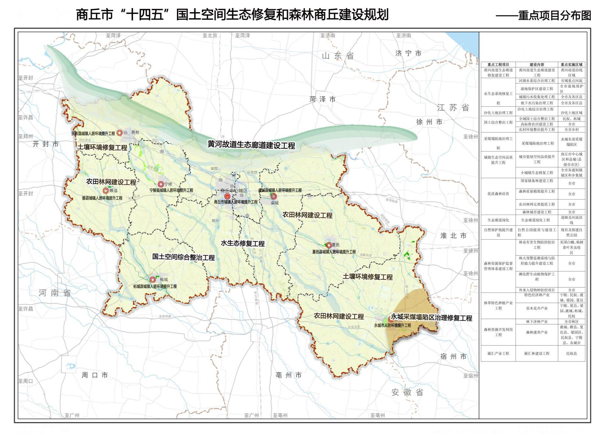

商丘市“十四五”

国土空间生态修复和森林商丘建设规划

前 言

为深入落实习近平生态文明思想，统筹和科学推进山水林田湖草沙一体化保护修复，进一步落实国家、省级生态修复和森林建设规划安排，提升商丘市国土空间生态品质和建设高质量森林城市，按照商丘市委市政府决策部署，依据《河南省“十四五”国土空间生态修复和森林河南建设规划》《商丘市国民经济和社会发展第十四个五年规划和二〇三五年远景目标纲要》《商丘市人民政府关于实施“三线一单”生态环境分区管控的通知》，编制《商丘市“十四五”国土空间生态修复和森林商丘建设规划》（以下简称《规划》）。

《规划》针对商丘市自然生态环境现状、存在的主要问题及面临的挑战与机遇，提出了商丘市“十四五”国土空间生态修复和森林商丘建设的指导思想和目标，围绕商丘市生态核心问题，明确本次国土空间生态修复和森林商丘建设工作的重点区域、重点任务、重点工程和保障措施。

《规划》覆盖商丘市境内全部国土空间，是指导全市统筹做好国土空间生态修复和林业保护发展的重要依据，是推进国土绿化行动、维护生态安全、强化农田生态功能、提升城市生态品质的指导性文件。

## 第一章 规划背景

### 第一节 现状与成效

“十三五”时期，商丘市自然资源系统围绕党中央、国务院及省委、省政府、市委、市政府重大战略部署，认真实施《森林商丘生态建设规划（2018－2027年）》《河南省“十三五”林业发展规划》《河南省露天矿山综合整治三年行动计划（2018—2020年）》《河南省矿山地质环境保护与治理“十三五”规划》，扎实推进国土空间生态修复和森林商丘建设，加强资源保护，加快生态修复，增进绿色惠民，强化基础保障，各项工作都取得了显著成效。

一、森林培育工作持续推进，林业产业快速发展

“十三五”期间，商丘市以实施国土绿化提速行动为契机，大力实施城区绿化、环城林带和城郊森林、农田林网改扩建、生态廊道、村镇绿化、经果林、花卉苗木等林业重点工程，全面巩固国家森林城市建设成果，持续提升各项绿化指标。“十三五”期间，全市参加义务植树人数达2100万人，共植树8729.67万株，国储林营造水平明显提高。同时，大力实施速生丰产林、名优经济林、苗木花卉、木材深加工、生态旅游基地建设，建成了宁陵金顶谢花酥梨、宁陵白蜡杆、民权葡萄、虞城杂果等十大名优经济林基地，形成了特色经济林产业。林业已成为商丘市农村经济发展的重要支柱产业，在促进农民增收和脱贫致富中发挥了重要作用。

二、生态修复工作持续推进、基础进一步夯实

近年来，商丘市紧紧围绕“一张蓝图保发展、一体共治建生态”的总体思路，切实履行“两统一”职责，深刻把握生态文明建设主责部门、高质量发展规划引领部门、自然资源要素配置部门的新定位，加快黄河故道生态修复，统筹构建森林、湿地、流域、农田、城市五大生态系统，努力构建良好的生态屏障，扎实推进黄河故道生态保护和高质量发展。截至2020年底，完成矿山治理恢复面积1950公顷，绿色矿山数量大于6个。“十三五”期末，永久基本农田保护面积927.46万亩，完成河南省下达的目标任务，并初步划定永久基本农田储备区9.2万亩，有效防止耕地“非农化”和“非粮化”。城镇污染防治及农村建设用地整治成效显著。商丘市统筹山水林田湖草沙综合治理，建立和完善生态修复有关政策、制度，实施机制以及流域生态补偿制度，践行绿水青山就是金山银山理念，生态修复工作格局基本形成，顶层设计逐步完善，能力逐渐提升，持续发展的基础得到有效夯实。

三、主要河湖生态环境治理有效，水土保持成效明显

“十三五”期间，商丘市政府围绕保护水资源、防治水污染、改善水环境、修复水生态等主要任务，按照全面建立河长制的“四个到位”要求，凝心聚力，积极推进河长制各项工作。截至2020年末，商丘市全面构建了市、县、乡、村四级河长体系，明确市级河长14名、县级河长181名、乡级河长1350名、村级河长3349名，共计4894名，实现了境内河流全覆盖。商丘市委市政府加大力度对中心城区的9条内河进行黑臭水体整治，将内河互相融通，形成一城活水，建成了9个带状公园，市环保水质监测断面污染指数下降78%，新建污水处理厂3座，新增规模17万吨，在建17.5万吨，强力推进黑臭水体整治，关闭市区内排污口882个，新建污水管网25公里。坚持综合施策，持续开展河湖清理整治，水土流失预防和治理工作成效显著。

四、进行系统治理，污染防治工作成效显著

2020年底，商丘市主要污染物排放总量大幅减少，生态环境质量总体改善，生态系统稳定性持续增强，生态安全屏障基本形成，生态环境治理体系和治理能力现代化取得重大进展，生态文明制度体系更加健全。大力发展清洁能源，全市已建成光电、风电装机175万千瓦。完成了一批土壤污染治理与修复示范项目，全面完成受污染耕地安全利用面积、受污染耕地治理与修复面积排查任务，全市受污染耕地安全利用率达到100%，受污染地块安全利用率达到100%，实现土壤环境质量监测点位所有县（市、区）全覆盖，重点行业重点重金属排放量较2016年下降12%。全市“十三五”完成沙化土地治理面积13530.192公顷，是规划面积9671.5公顷的140.68%。截至2020年12月22日，全市PM10、PM2.5浓度分别较2016年同期下降37.4%、32.0%，优良天数较2016年同期增加49天，“商丘蓝”已成为“常态蓝”。

五、生态状况明显改善，生态保护力度日益增强

商丘市现有国家级森林公园1个，国家级生态公园1个，省级森林公园4个，国家级湿地公园5个，国家级风景名胜区12个，商丘市湿地总面积30688.47公顷，约占国土总面积2.8%，为严格保护重要生态空间奠定了坚实基础。全面摸清野生动植物资源状况，截至2020年底，全市共有野生动物204种，国家一级重点保护动物3种，国家二级重点保护动物23种。完成全市林木种质资源普查，共记录木本植物84科、233属、671种，其中野生林木种质资源有40科、69属、95种。商丘保留的古树名木有银杏、皂荚、文冠果、木瓜、柘树等19种，377株。通过在黄河故道区域建立多个生物多样性保护区，各县（市、区）建立植物园、树木园、种子库、基因库等不同形式的保护设施使商丘市重点野生动物种群和高等植物群落类型得到有效保护，生物多样性不断丰富。同时，通过国土空间规划管控，加强了城市、乡村建设管理、耕地保护及乡村振兴、环境卫生综合整治等,使得生态环境状况均得到了明显的改善。

第%1节  形势和任务

一、人与自然和谐共生的现代化城市建设赋予自然资源新使命

习近平总书记多次指出：“要坚持山水林田湖草沙综合治理、系统治理、源头治理，统筹推进各项工作，加强协同配合，推动黄河流域高质量发展”，“开展国土绿化行动，不断扩大森林面积，不断提高森林质量，不断提升生态系统质量和稳定性”。河南省第十一次党代会提出：坚持生态优先、保护第一，统筹山水林田湖草沙综合治理、系统治理、源头治理，推动减污降碳协同增效，加快建设生态强省。全面贯彻习近平生态文明思想，深入落实省十一次党代会精神，必须统筹推进林业保护发展和生态修复工作，把绿水青山建得更美，把金山银山做得更大，为人与自然和谐共生的现代化商丘建设作出应有的贡献。

二、高质量发展提出生态保护修复新要求

党的十九大以来，习近平总书记多次强调推动高质量发展并提出一系列具体要求。探索走高质量发展新路子，必须坚持生态优先、保护优先，自然恢复为主、人工修复为辅的基本方针，以系统思维推进山水林田湖草沙一体化治理，推进森林商丘建设由数量增加向提质增效转型，发展绿色惠民产业，促进生态产业化、产业生态化，绿色循环可持续发展，为人民提供更多更好的生态产品，满足人民不断增长的良好生态需求。

三、城市建设目标明确生态修复与林业建设新任务

紧紧围绕生态城市建设目标，完善生态保护格局，持续开展大规模国土绿化，提升生态碳汇能力，加强生物多样性保护，推进农田生态系统、城市绿地等的保护和修复，优化城乡人居生态环境，全面推行林长制，为商丘生态城市建设发挥更大作用。

四、碳达峰碳中和带来生态建设新机遇

贯彻落实党中央关于“碳达峰碳中和”重大决策部署，建立生态产品价值实现机制，科学推进国土绿化和生态修复，扩大森林面积、提高森林质量，提升生态系统质量和稳定性，发挥森林、草地、湿地、土壤等要素的碳汇作用，增强生态系统的固碳能力。

第%1节  机遇与挑战

一、机遇

（一）2016年9月，财政部、原国土资源部、原环保部联合印发《关于推进山水林田湖生态保护修复工作的通知》，提出加快推进山水林田湖生态保护修复工作，中央财政将对典型重要山水林田湖生态保护修复工程给予奖补。国土空间生态修复已上升为国家发展战略高度，政策与资金扶持力度将不断加大。在国土空间生态修复成为生态文明建设的重大举措的新时期下，河南省编制的《河南省“十四五”国土空间生态修复和森林河南建设规划》于2021年11月18日通过专家评审，是《河南省国土空间规划（2020-2035年）》的重要专项规划，也是河南省“十四五”33个重点专项规划之一。

（二）“十四五”是实现“两个一百年”奋斗目标的历史交汇期，是商丘市转型发展、创新发展的重要时期，是全面实现小康迈向现代化征程的关键时期。扎实开展国土空间生态修复分区研究，编制科学有效的国土空间生态修复规划，是加快国土空间生态修复、提升国土空间承载能力、构建国土空间生态安全格局的迫切时代需求和重要保障，对促进人与自然和谐共生、推进生态文明和美丽中国建设具有重要的理论和现实意义。

二、挑战

“十四五”是商丘市由全面建成小康社会向基本实现社会主义现代化迈进的关键时期，资源环境约束加剧矛盾凸显。当前，商丘市生态文明建设正处于关键期、攻坚期、窗口期，生态文明建设还有许多短板亟待解决，任务繁重、挑战巨大。

（一）资源保护与利用存在矛盾。

商丘是豫东重要的平原生态涵养区，生态环境状况总体良好，自然资源丰富，但同时生态要素的质量总体不高，生态效益不够明显，还存在较大的优化空间。伴随着城市快速发展和建设，商丘市耕地、农用地、森林、湿地和野生动植物资源保护的任务和难度越来越大。不合理的开垦，导致森林、湿地面积减少，生态环境破碎化。不合理的开发利用活动侵占耕地或农用地、破坏野生动植物栖息地的现象时有发生。森林火灾、森林病虫害等时有发生，威胁着生态安全。城市配套的公园、绿地和人均森林拥有量达不到国家标准。同时，生态、农业、城镇空间所承载的压力不断增大，发展和保护面临一系列新的问题和挑战。

（二）森林生态系统质量亟待改善。

商丘市森林资源质量仍然不高，综合效能较低。普遍存在树种组成单一、群落结构简单、龄组结构不合理等问题，以杨树、泡桐为主的用材林占比过大，超过全市林木的80%，中、幼龄林占80%以上，大径材林木不足20%，且森林资源都遭受过不同程度的破坏，难以全方位满足经济社会发展对森林的多用途需求。市域内存在森林结构性矛盾，加上区域降水量不均匀，部分地区存在过渡的农业和工矿开发，水土流失偶有发生。同时，近年来城市开发建设对湿地自然生态系统空间造成一定的影响，局部功能出现退化，动植物资源需要加强保护。

（三）部分区域水环境质量下降，需要进行整体提升。

## 商丘市多数地区地下水供水水源地处于满负荷或超采状态，包河等河流无自然径流，基本没有生态自净能力，一些水域仍受生活垃圾污染。同时，由于历史上一些工矿企业非法排污、中心城区河道非法采砂等问题，近年来虽然进行了综合治理，但部分河流水质依然不高。部分区域城镇污水、垃圾处理配套设施不够完善，个别城镇工矿企业在生产过程中仍然存在一定污染，仍存在垃圾乱扔、污水乱排现象。

（四）生态产品价值实现机制亟待建立健全。

商丘市生态产品价值实现机制尚不健全，资金、土地、资源扶持薄弱，推进难度大。现阶段生态产品供给以政府为主，缺乏有效的市场供给机制，生态产品供给量难以满足人民群众对生态产品全方位、多层次的需求。另外，商丘市生态产品价值转化不充分，大多只考虑资源的天然价值和人工价值，需要充分挖掘商丘本土林木等资源的代际补偿价值和外部补偿价值。需要大力推动自然资源清查、确权等基础支撑性工作，推动生态产品价值核算及结果应用等技术性工作，推进生态产品产业化发展及供需精准对接，拓展生态产品价值实现形式，促进生态产品价值增值，率先走出一条生态环境保护和经济发展相互促进、相得益彰的“商丘”道路。

（五）生态保护修复治理体系尚不完善，考核评价机制仍需提升。

商丘市各部门之间、区域之间协调推进机制有待进一步完善，缺乏协调联动。治理措施整体性、系统性不足，生态保护修复考核评价机制仍需完善，生态环境协同治理能力和监管执法能力有待提升。商丘市许多生态环境问题在空间上重叠分布，相关整治工程项目在区域上相互叠加，资金投入容易重复，尚需强化统筹各类工程项目资金、增强资金使用效率。

## 第二章  总体要求与规划目标

### 第一节 指导思想

全面贯彻党的十九大和十九届历次全会精神，深入落实习近平生态文明思想，牢固树立绿水青山就是金山银山的理念，坚持自然恢复为主、人工修复为辅，遵循自然生态系统整体性、系统性、动态性及其内在规律，统筹山水林田湖草沙一体化保护修复，明确全市生态安全保护格局，科学开展国土绿化，构建国土空间生态修复和森林建设区划，谋划重点任务和重大工程，按照《商丘市人民政府关于实施“三线一单”生态环境分区管控的通知》要求，科学谋划，统筹兼顾，形成2021-2025年全市国土空间生态修复和森林建设规划目标体系，为筑牢商丘市生态安全屏障、提升生态系统质量、优化国土空间格局、服务生态文明建设和经济高质量发展提供支撑。

### 第二节 基本原则

生态优先，绿色发展。坚持尊重自然、顺应自然、保护自然，促进人与自然和谐共生。坚持绿色发展、循环发展、低碳发展，全面保护自然资源，维护生物多样性，构建生态安全新格局。

问题导向，因地制宜。立足本市自然地理格局和生态系统状况，准确识别突出生态问题，科学预判主要生态风险。因地制宜合理确定规划目标，明确需要解决的重大问题和重点任务，研究提出基于自然的生态修复途径模式和保障措施，促进森林、湿地、农田等生态系统质量和稳定性整体提升。

尊重自然，综合治理。着眼于提升商丘市各类生态系统质量，综合考虑生态、生产、生活空间等生态系统内在联系和生态修复工程实施的可行性，聚焦重点生态功能区、生态保护红线、自然保护地等重点区域，坚持节约优先、保护优先、自然恢复为主的方针，合理布设国土空间生态修复工程和森林建设工程。

统筹协调，加强衔接。统筹考虑自然生态系统各要素与农田、城市人工生态系统之间的协同性，注重系统性，突出整体效益。与国家和区域重大战略、国土空间总体规划和国家重大生态修复规划加强衔接。

政府主导，多方参与。强化行政推动、部门联合，引导公众参与，强化社会监督，提高全民生态保护意识，推进形成政府主导、多元主体参与的生态保护和修复长效机制，有序推进林业保护发展和国土空间生态修复。

### 第三节 规划目标

到2025年，森林商丘基本建成，国土空间生态修复取得重大进展。

森林生态质量持续稳步增加：全市森林资源稳步增加，森林质量显著提升，森林碳汇能力明显增强，生物多样性得到有效保护，绿色惠民产业更加兴旺，助力“碳达峰、碳中和”。

自然生态系统功能得到提升：全市森林、草地、湿地、物种资源得到全面保护，森林、草地、湿地等生态系统更加稳定、结构更加合理、功能更加完备，生态服务功能和生态承载力进一步巩固。

退化生态系统全面修复保护：全市水土流失、沙化土地等得到全面治理，退化生态系统完成修复和保护，耕地环境质量状况实现总体改善；重要生态廊道建设更加完善。

展望2035年，商丘市森林、草地、湿地、河流、绿地等自然生态系统状况、农田生态系统、城市绿色生态空间、城乡生态宜居环境实现根本好转，生态系统质量明显改善，生态服务功能显著提高，生态稳定性明显增强。

表2-1主要指标

| 指标分类 | 序号 | 指标名称 | 2020年 | 2025年 | 属性 |
|---|---|---|---|---|---|
| 生态质量类（） | 1 | 森林覆盖率（%） | 16.75 | 17.36以上 | 约束性 |
| 2 | 森林蓄积量（万立方米） | 1849 | 1849以上 | 约束性 |
| 3 | 湿地保护率（%） | 17.92 | 25.6以上 | 约束性 |
| 4 | 国家重点保护野生动植物保护率（%） | 95 | 97以上 | 预期性 |
| 5 | 自然保护地占国土面积比例（%） | 0.59 | 1.5以上 | 预期性 |
| 6 | 森林植被碳储量（万吨） | —— | 619.79 | 预期性 |
| 7 | 重要河湖水功能区水质达标率（%） | —— | 达到100 | 预期性 |
| 8 | 重要生态系统保育保护率（%） | —— | 达到100 | 预期性 |
| 9 | 城市人均公园绿地面积（平方米） | —— | 12 | 预期性 |
| 10 | 森林生态服务价值产值（亿元/年） | —— | 153.22 | 预期性 |
| 修复治理类 | 11 | 高标准农田建设面积（万亩） | 累积695 | 累积850 | 预期性 |
| 12 | 湿地修复治理率（%） | —— | 达到100 | 预期性 |
| 13 | 永久基本农田保护面积（万亩） | 927.46 | 省定目标 | 约束性 |
| 14 | 生态保护红线面积（万亩） | 9.73 | 省定目标 | 约束性 |
| 15 | 沙化土地治理率（%） | —— | 达到100 | 预期性 |

## 第三章  空间格局

依据全市国土空间开发保护格局，围绕生态修复和林业保护发展的目标任务，充分考虑区域生态功能定位，生态、农业、城镇三类空间差异和发展基础、发展需求，合理确定林业保护发展、生态修复的总体格局。

### 第一节 总体格局

依托商丘市的自然生态本底，以生态系统的整体性和连通性为基础，充分考虑区域生态安全，统筹林业发展条件、发展需求等因素，按照山水林田湖草沙一体化保护修复的要求，着力构建“一带一网两环六区多廊道”的国土空间生态修复和森林商丘建设总体格局。

“一带”为黄河故道生态带。

“一网”为农田防护林网络。重点实施农田防护林建设工程，结合高标准农田建设，完善和提升农田防护林体系。

“两环”为商丘中心城区环城林带和各县（市）环城林带闭合圈。重点以环城高速公路为框架，按照宜宽则宽、宜窄则窄的标准，建设环城林带。

“六区”为六大生态功能分区：森林及生物多样性保护生态功能区、沙化控制与水土保持生态功能区、采煤塌陷地综合治理区、河湖水系生态功能区、城市生态修复功能区、平原农业生态功能区。

“多廊道”为市域多条河流和道路绿廊等。即高铁、普铁、高速、国道、省道、县道、重要河流生态廊道建设。

图 3-1 商丘市国土空间生态修复和森林建设总体格局图

### 第二节 重点区域

围绕商丘市林业发展和生态修复的总体格局，聚焦各类生态系统存在的主要问题，科学推进林业保护发展和国土空间生态修复。

基于区域的生态功能重要性以及重要生态问题分布格局，开展生态功能重要性评价。在此基础上，分析得出生态系统功能综合性评价结论，并考虑自然地理单元的完整性，最终确定将商丘市划分为六大生态功能分区，分别为森林及生物多样性保护生态功能区、沙化控制与水土保持生态功能区、采煤塌陷地综合治理区、河湖水系生态功能区、城市生态修复功能区、平原农业生态功能区。

图 3-2 商丘市国土空间生态修复和森林建设分区图

一、森林及生物多样性保护生态功能区

本功能区位于商丘市的北部区域，区域范围包括市域北部民权县、梁园区和虞城县黄河故道沿线地区，生物多样性程度高，具有水源地保护、湿地生态保护、森林资源保育等功能，是商丘市主要的生态功能区，也是商丘市重要的生态保护屏障。

基于森林生态系统功能下降和区域河流水质有待提高等问题，在全面保护落叶阔叶林等植被的基础上，科学实施森林质量精准提升、以自然恢复为主修复林层结构，提高中林和乔林占比，提高森林质量。同时保障区域内水质安全，提高水生态系统的质量；推进自然保护地整合优化，完善自然保护地结构和空间布局；提高森林水源涵养与水土保持能力，防止水土流失。

二、沙化控制与水土保持生态功能区

本修复区包括民权县龙塘，睢县周堂，宁陵县逻岗，夏邑县杨集等乡镇，属沙化控制重要地区，要加大绿化种植，防风固沙，实施抢救性保护。

基于土地沙漠化、水源涵养能力不足等问题，强化生产建设活动水土保持监督管理，加强水源涵养、全面预防水土流失；加大水土流失治理、开展沙漠化土地生态修复与示范，加大造林绿化种植，防风固沙，抑制风沙危害。采取各种措施积极恢复与改善生态环境，防止耕地沙土化。

三、采煤塌陷地综合治理区

本区域范围位于永城市东部部分乡镇，是重要的煤炭等矿产富集地区，针对历史上不合理的矿山开采形成的较为突出的矿山环境问题，加强矿山生态修复环境治理，保护地区环境水平，提升矿产开采水平和安全生产水平。

四、河湖水系生态功能区

主要包括睢阳区商丘古城、睢县古城、夏邑古城、虞城利民古城、永城古城的城湖及其生态影响区，以及惠济河、大沙河、包河、东沙河、沱浍河河道范围及其生态影响区。严格控制河道两侧生态影响区的开发建设，加强污染防治和水源保护。

针对区域存在的河流水质破坏等问题，抓紧实施截污纳管工程，确保入河水质要达到“零污染”，大力开展清淤疏浚及垃圾清理，清理内源、面源污染源，提高河流水质；建设生态廊道和水质较好的备用水源，连通彼此隔离的生境斑块，保护生物多样性。

五、城市生态修复功能区

主要包含商丘市中心城区和各县市中心城区。城市生态空间是维持生态环境功能和生态产品再生产的空间载体。保护建设城市生态空间，是生态产品供给与城市治理的重要方式与内容。应有序扩大城市绿色生态空间，实施水系连通工程，修复城市河湖水系，改善水生态环境，推进海绵城市建设，完善城市防洪排涝体系，增强城市应对洪涝等自然灾害的韧性。

六、平原农业生态功能区

本生态功能区范围主要包括商丘市其他区域，是黄淮海平原农业区的重要组成部分，是全国的重点产粮区。应加大现代农业标准化生产基地建设，提高无公害、绿色、有机农产品的比重，大力推广生物防治、抗虫新品种等技术。以高标准基本农田建设为主攻方向，对区域生态环境进行综合整治、修复与保护。

## 第四章  全面推进国土空间生态修复

立足区域视野，统筹考虑生态系统的完整性、地理单元的连续性，明确黄河故道生态带、河流水系生态环境、平原农业生态涵养区、采煤塌陷地综合治理区及城镇空间的主要生态问题及主攻方向，为科学谋划重大工程提供依据。

### 第一节 加快建设黄河故道生态廊道

以黄河故道为重点，加快建设生态廊道，提高生物多样性，提升生态系统质量和稳定性。统筹推进黄河故道水系治理和沿线生态防护林、森林公园、湿地公园和文化景观建设，构建有机融合的生态绿廊。加强廊道内外来物种管控，增强本土物种培育栽植，提升外来有害物种入侵抵御能力，提高生物多样性，维护自然生态功能。

### 第二节 开展水系生态环境保护与修复

推进蓝网系统修复与功能提升。统筹划定全市河道蓝线、河湖库水域管理和保护范围，构建全市完整的水生态空间管控体系，提高河湖水系纵向、横向和垂向连通性。对河湖水生态空间实施分区域管控，适当扩展河湖滨缓冲空间。保障河湖生态用水，推进点源、面源、内源污染的综合治理，扩大水环境容量。修复历史水系，强化滨水空间生态修复，塑造连续滨水绿色空间和活力空间。

全面提升水生态系统质量。全面提升水生态系统质量，整治修复涡河、惠济河、沱河、黄河故道、浍河、大沙河等河流水系，大力开展河道疏浚，清理河道及河岸垃圾，建设污水处理设施。全面遏制侵占河道、改造岸线、破坏湿地、污染水体等行为，有序退出违法占用河道等各类人为活动，提高河道行洪能力和水体生态功能。

加强水资源保护，防治水源污染。加快推进水源建设，实行最严格水资源管理制度，严守水资源管理“三条红线”，做好水资源的节约、保护、开发、利用，着力解决我市水资源短缺问题。大力实施引黄灌溉、引江济淮、南水北调等“引水入商”工程，形成用水“三线三水源”保障格局。实施地下水超采区综合治理，推进饮用水地表化和城乡供水一体化。

针对全市不符合设置条件的违法入河排污口进行迁移、封堵、取缔。划定集中式引用水源保护区，综合整治水源保护区内污染源，对区域取水口上游两侧实施生态修复工程，建设水源涵养林，强化水质监测，防治水源污染。

### 第三节 综合整治农业生态涵养区

提升平原农区生态系统质量。以提高农田生态系统质量为重点，开展土地综合整治、污染水体综合治理，加强农业面源污染防治，提高水资源利用效率，持续改善农村人居环境。针对地下水超采、污染、土地沙化、农田排水设施薄弱等问题，开展沙化土地治理、严控地下水开采、完善灌排水系统。针对农田防护林、农田排水设施不完善，黄河故道土地沙化等问题，开展生态型土地整治、建设高标准农田、优化灌排水系统。

加强村庄土地综合整治和生态修复。针对部分村庄垃圾污水处理等基础设施不健全、乡村绿化美化相对滞后、“空心化”等问题，编制“多规合一”的实用性村庄规划，开展农村人居环境综合整治，加强废弃宅基地复垦和植树复绿，加大基础设施特别是环保设施建设，结合当地发展优势，发展高效农业、乡村旅游业和特色产业，通过“土地综合整治+”模式，积极发展乡村旅游、吸引游客“浸入式消费”，将生态优势转化为经济优势，激活乡村经济发展活力，保障农村持续发展，持续加强村庄及周边区域绿化美化，建设美丽乡村、森林乡村。

第%1节  推进永城采煤塌陷区综合治理

推进永城采煤塌陷区综合治理，基本消除地质灾害隐患，促进土地安全利用。综合运用挖深垫浅、削高填低、划方整平、植被复绿、生态堤岸等措施，对采煤塌陷地进行综合治理修复，宜田则田、宜水则水、宜林则林，建设高标准农田、湿地公园、现代农业示范园、生态休闲带，将采煤塌陷地劣势变为生态环境优势。

第%1节  修复提升城镇生态空间

提升城市生态空间品质。针对生态环境比较敏感、绿地结构不完善等问题，科学开展城市绿化，加大社区公园、郊野公园、通风廊道和环城市绿化带建设力度，建设宜居宜业的生态城市，让绿色融入城市血脉。结合“城市双修”和“海绵城市”建设，建设雨水花园、下凹式绿地，完善城市防洪排涝体系，增强城市应对洪涝等自然灾害的韧性，有计划有步骤地修复城镇周边被破坏的河流、湿地、植被，让城市发展更有质量、更可持续。

提高小城镇生态宜居水平。聚焦小城镇绿色空间不足、人居环境不良、生态环保设施不健全等问题，加强街区绿化，增加公共空间，完善垃圾、污水处理设施，改善水生态环境，将经济发展与生态建设、人居环境整治有机结合，提升小城镇生态宜居水平。

### 第六节 推进空间相邻或冲突区域生态修复

坚持保护耕地、保护生态原则，根据资源环境承载能力和国土空间适宜性评价结果，统筹城镇、农业、生态空间交界地带的用途管控，逐步调整优化空间用途，修复受损生态环境。科学划定城镇开发边界，避让永久基本农田，促进城镇内涵式、组团化发展。农业空间与生态空间相邻或冲突区，坚持以尊重自然、顺应自然的发展理念，坚持耕地保护优先，处理好永久基本农田与生态保护红线的关系，实现人与自然和谐共生。城镇空间与生态空间相邻或冲突区，按照生态优先、绿色发展的原则，城镇开发边界避让已划定的生态保护红线，严格控制建设用地规模，协同推动高质量发展与生态环境保护。

## 第五章  高质量推进林业保护发展

践行“绿水青山就是金山银山”的理念，保护、培育和合理利用森林资源，保障林业生态安全，优化林业生产力布局，统筹推进国土绿化行动、森林资源保护监管体系建设和绿色生态富民、碳汇、生态文化等产业发展。

### 第一节 科学开展国土绿化

科学开展国土绿化，推动我市国土绿化由规模速度型向质量功能型转变，全面提升生态系统质量和稳定性。

1、 大力推动科学绿化

精准落实绿化空间。利用未利用地、农村四旁隙地、边角地、废弃矿场、城镇腾退还绿等区域，精准开展国土绿化。注重村庄绿化，提升绿化品位，注重资源整合，有力助推行动，注重多创合一，提高绿化效率。科学规范、因害设防建设农田防护林。严格落实绿化管理，将绿化任务和成果落到数据库，实现精细化管理。

科学开展国土绿化。以统筹多途径、多方式造林，如特色经济林造林、人工更新造林和零星植树等，科学推进国土绿化。科学选用树种草种，优先使用乡土树种草种，乔灌草结合，积极营造混交林。加快退化林修复，结合高标准农田建设，形成完善的平原农田防护林体系；结合商丘市土地综合整冶、生态廊道建设、美丽乡村建设等，统筹规划安排造林地块。

推进森林城市建设。加强城市绿化，建设城市绿廊。建设郊野公园，打造市民休闲地，城市后花园。大力推广墙体、屋顶、阳台、坡面等立体绿化模式，充分利用城市可绿化空间，挖掘绿化潜力，整合绿化资源。加强城市周边绿化，疏解城市功能腾退的土地，优先调整为绿地，建设城市森林和永久性公共绿地，形成具有特色、类型丰富的森林城市格局。

加强乡村绿化美化。围绕新时代美丽乡村建设，启动新一轮“乡村林果化”五年行动，推进村庄及周边区域绿化，打造乡村绿化美化升级版，共建宜居宜业宜游美丽乡村，助推乡村振兴战略实施。持续推进森林乡村建设，创新乡村绿化机制，提高乡村绿化质量，建设森林乡村388个。

二、夯实林草种苗基础

加强种质资源保护利用。开展全市林草种质资源普查，制定乡土树种草种名录，加强重要种质资源收集保存，建立林木种质资源保存库。

加快良种壮苗培育。推进良种选育攻关工程，大力选育乔灌木良种和优良草品种，积极推广应用乡土树种草种。建立种苗质量可追溯体系。到2025年，建设林木良种基地5个，其中国家林木良种基地2个；建设保障性苗圃4个。

三、精准提升森林质量

大力培育优质林木资源。加强林木良种繁育，建设林木良种基地。加强林木种子储备和苗圃生产能力，建设林木种子储备库和保障性苗圃。选择立地条件较好的宜林地和非林地，开展速生、丰产、优质高效的国家储备林建设。到2025年，国家储备林总面积达到24.53万亩。

积极推进混交林培育。优化林种树种搭配，营造模式、层次和树种多样化的混交林。积极发展优良乡土树种，采取片状混交的模式调整树种结构，通过建立多树种、宽带状、大网格的混交林模式，提升其综合防护功能和生态功能。

高质量实施森林抚育。通过森林抚育，有效优化林种结构、功能结构、布局结构，在持续增加森林资源的基础上，科学优化树种、林种结构，提高森林质量和生产力。到2025年，中幼林抚育面积24.82万亩、新造林抚育面积15.29万亩。

科学开展退化防护林修复。针对退化防护林，采用更替改造、择伐补造、抚育改造、渐进改造等方式进行修复，科学规定林种比例，制定特定地区退化林针对性修复方案，保证生态效益，重视经济效益。到2025年，完成退化林修复面积0.5万亩。

四、科学推进沙化综合治理

开展沙化动态监测。加强沙化动态监测体系建设，获取全面动态监测指标，实行定期监测，掌握现状和变化趋势，收集保存治理前定点影像资料，及时对防治工作进展及其成效进行评价，为防治决策提供依据。

加强沙化综合治理。在民权县、睢县、宁陵县、梁园区、睢阳区、虞城县、夏邑县7个县（区）区域，治理沙化耕地，高标准建设农田林网，营建防风固沙林，形成带、片、网相结合的平原防护林体系。按照先急后缓、先易后难、保证重点的原则，在重点区域规划实施防沙治沙生态保护与修复工程。“十四五”期间完成治理面积3513.33公顷，治理率达到100%。

### 第二节 构建新时期森林资源保护监管体系

严格森林资源监督管理，用最严格制度、最严密法治保护林草资源，推行森林草地湿地休养生息，提升信息化智慧化管理水平，构建新时期森林资源保护监管体系。

一、加强有害生物综合防治体系建设

科学精准防控。推进疫情监测常态化、网格化管理。完善有害生物防治监测预警体系、检疫预灾体系、防灾减灾体系、防控服务保障体系、检疫执法体系，建设市级防控中心、县级防控示范站。

建立网格化监测预警体系。结合商丘市林业有害生物发生状况和林业有害生物监测防治主测对象，组织开展林业有害生物普查，适时开展外来生物专项调查。推进生物灾害区域联防联治和社会化防治。组织形成以点线面相结合的有害生物监测网络体系，坚决做到早发现、早治理。推进建立完善林草全要素数据库，加强有害生物风险管理。

实施森林病虫害联防联控。实行分区分级管控，加强重点区域美国白蛾、杨树食叶害虫、杨树早期落叶病防控，建立健全疫情联防联控机制。加强城市森林病虫害预测预报，完善区域合作联防联治机制。到2025年，城市森林病虫害基本遏制，达到有虫不成灾的目标。

二、构建森林草地防灭火一体化体系

健全火灾预防管理体系。强化责任，严防严控。实行各级林草部门林草防火目标管理，督促落实部门管理责任，建立约谈问责工作机制。加强森林火情预警监测能力，启动“森林智眼”防火视频监控系统建设，实现8个森林火灾Ⅲ级火险县（市、区）全覆盖。制订森林火灾应急预案，推进网格化管理，健全防火组织体系。

提高火情早期处理能力。强化森林火灾预警监测系统、通信和信息指挥系统、队伍与装备能力、森林消防、林火阻隔系统、应急道路设施设备运行维护等建设。全力推广“防火码”，加大巡护和检查力度。加强防扑火力量培训教育，开展带装巡护，强化早期火情应急处理。做到早发现、早报告、早处理，实行报扑同步，合理调配扑救力量，阻止火势蔓延。

加强基础保障能力。加强森林草地防火基础设施建设，提高综合防火能力。建立健全森林草地防火资金投入机制，保障森林草地防火工作的顺利实施。加强林火阻隔体系建设，开展森林防火道路、林区防火蓄水池、森林防火墙、生物防火林带、工程阻隔网和易燃林分改造等建设，全面提升森林防火早期处理基础设施建设水平。开展专业队伍装备、营房和训练设施建设，实现重点区域县级行政单位森林防扑火专业队伍配备率100%。

三、加强野生动植物保护体系建设

加强野生动物保护，加强重要栖息地连通生态廊道建设。加强候鸟迁徙地生态恢复与保护。开展珍稀濒危物种野化放归，加强放归后巡护管理和动态监测。加强野生动物繁育利用指导、服务和监管，严禁野生动物非法交易和食用。完善陆生野生动物疫病监测站布局，积极推进疫源疫病检测能力建设。建设陆生野生动物疫源疫病监测防控信息管理系统和主动监测预警平台。

加强野生动植物保护。加强生物多样性生态红线管控，严防野生资源人为破坏。开展野生动植物资源普查和动态监测，加强重要栖息地连通生态廊道建设。实施极度濒危野生动物和极小种群野生植物拯救保护、野生动物救护繁育，改善和扩大栖息地，开展就地、迁地、种源保护和野化放归回归。加强候鸟迁徙地生态恢复与保护。完善陆生野生动物疫病监测站布局，建设陆生野生动物疫源疫病监测防控信息管理系统和主动监测预警平台。增扩建种源培植基地，扶持珍稀濒危植物培植技术科研攻关和成果推广。建设野生植物基因库。加强珍贵中药材人工扩繁工作。

加强森林草原湿地等区域外来入侵物种治理。结合有关生态保护修复工程建设，抓好松材线虫、美国白蛾等重大林草外来入侵物种治理。实施松材线虫病防控攻坚行动等重点治理工程，坚持分区分级，推进精准治理。开展危害森林草原湿地生态系统的恶性入侵杂草综合治理。加强自然保护地外来入侵物种综合治理。推进城乡绿化区域外来入侵物种治理。依托生物多样性保护重大工程，推进生物多样性保护优先区域等重点区域入侵物种治理。

构建野生动植物监管体系。建立完善多部门信息交流与联合执法机制，加强新形势下互联网犯罪监管执法。各部门联合构建“信息互通、资源共享、协同配合”的保护管理机制，实现对野生动植物养殖、运输、加工、买卖、邮寄等各环节全链条监督管理建设覆盖。我市要建立市、县、乡、村监测点四级野生动植物监管数据系统。严格进出境管理，强化部门联动，严格野生动植物及其制品进出境审批管理，健全市场监管和服务体系。

四、推行森林草地湿地休养生息

全面加强公益林保护和森林经营。科学制定市、县、乡三级天然林保护修复规划以及实施方案，严格落实公益林保护管理责任。加强林地管理的基础性工作，开展森林资源规划设计调查。对森林资源开发利用实施全面监控，严格实行林木采伐限额管理，严厉打击破坏林地林木案件。规划2025年全市国家级公益林（补偿）管护面积1.3万亩。

严格湿地和草地资源保护管理。严格控制湿地、草地转为建设用地，加强重点生态功能区和生态环境敏感脆弱区域的湿地草原资源保护，禁止侵占湿地毁草开垦。将全市重要湿地都纳入保护范围，落实湿地面积总量管控。建立全市统一的湿地监测、评估和预警平台。完善湿地分级管理体系，实施负面清单管理，集约安全利用湿地资源。坚持全面保护、系统治理，提高草地综合植被盖度和生物量，实行严格的保护措施，恢复和增强草地生态功能。

### 第三节 大力发展绿色生态富民产业

发挥特色林果资源优势，巩固生态脱贫成果，做大做强优势特色产业，增强优质生态产品供给能力，提升林果产业富民惠民成效，推动乡村振兴。

一、大力发展优势特色产业

突出商丘特色果品优势。因地制宜扩大优质林果种植面积，以各县特色林果产业为重点，建设一批优质苹果、梨、桃等优质林果产业基地。努力推进布局区域化、经营规模化、生产标准化、发展产业化。

推动传统产业优化升级。积极参与国家级、省级展会平台和节庆活动，进一步壮大现有展销平台。着力培育区域性产业集聚中心、交易和价格信息发布中心，组织开展产销对接活动，着力搭建产业合作、经贸洽谈平台。支持木材加工、果品加工等产业绿色化升级改造，推动传统产业优化升级。

打造优质林果品牌。商丘市有近30万亩优质酥梨，“优质酥梨生产基地县”宁陵县的酥梨被评选为“国家地理标志产品”，其“梨花节”“采摘节”已颇具影响力；虞城县的红富士苹果和酥梨、黄金梨等经济林种植面积达到28万亩。梁园区、夏邑县、民权县的苹果、葡萄、酥梨、桃种植面积广泛，应在此基础上加强优质林果生产基地建设，推进产业化经营，发挥各县（市、区）传统果品优势，建设梨、桃、苹果、葡萄等生产基地，推进无公害产品、绿色、有机产品认证，加强质量监督检验，保障果品安全，培育具有全国乃至全球影响力的知名品牌。

二、助推乡村振兴战略实施

持续发挥林果生态脱贫致富优势。加快推进乡村林果化，充分发挥优质林果产业在改善城乡居民生活质量、吸纳农村劳动力就业、带动相关产业发展、缓解和消除贫困等方面的作用，实现“既要金山银山，更要绿水青山”的发展目标。

促进林果产业发展与乡村振兴深度融合。围绕优质林果基地、苗木花卉基地和林下经济基地“三基地”建设，以促进农业增效、农民增收为目标，结合“乡村林果化、庭院花园化”要求，大力发展经济林、苗木花卉和林下种植，打造林业产业基地，带动农民脱贫致富、乡村振兴和产业集群发展。

### 第四节 大力发展碳汇产业

积极落实国家应对气候变化战略部署，提升林草湿碳汇能力。

一、全面发挥碳中和林草湿效能

提升林草湿面积和质量，巩固提升碳汇能力。科学评估林草湿碳汇能力，围绕实现碳达峰、碳中和要求，推进人工商品林集约经营、人工公益林近自然经营。精准提升森林质量，提高乔木林单位面积蓄积，增强森林固碳能力。加强湿地保护与恢复，通过自然修复和人工促进等方式不断增强湿地生态系统的碳汇能力。增强林草抵御自然灾害的能力，着力降低资源破坏、森林灾害造成的森林碳排放。到2025年，森林蓄积量达到1849万立方米，森林植被碳储量达到619.79万吨。

二、积极探索发展林业碳汇产业

积极探索政策创新，建立林草碳汇行动激励机制。持续完善林草生态保护修复政策，健全生态产品价值实现的支持政策。推进建立林草生态产品价值核算评估体系，丰富林草碳汇等绿色生态金融产品。在不新增隐性债务的前提下，鼓励金融机构创新金融产品和服务方式，支持社会资本依法依规参与林草碳汇行动，调动政府、社会、企业、组织和个人参与林草碳汇行动的积极性，为林草碳汇行动建立多元化的投入机制。

优化林草碳汇计量监测体系建设。加强林草碳汇领域高层次人才培养和引进，成立林草碳汇咨询专家委员会，发挥专家咨询作用。强化地方林草碳汇人才队伍建设，围绕林草碳汇重点工作需求和短板，组织开展形式多样的林草碳汇专题培训，建立健全培训制度，实现培训工作常态化。

做好林草碳汇行动知识普及和政策解读。充分运用新闻、科普、专题报道、新媒体等宣传形式和手段，积极宣传林草碳汇科普知识，阐释林草碳汇方面的工作和实践，做好林草碳汇行动知识普及和政策解读。组织专业培训，提升从业人员的专业素养，提高全民参与应对气候变化、生态保护修复、生物多样性保护等方面的意识和行动力。激励社会各界积极投身林草碳汇行动，鼓励申报碳汇项目。

### 第五节 积极发展生态文化产业

生态文明建设促使文化产业与自然、社会、生态和谐发展。生态文明建设融入文化产业发展，可解决文化产业绿色发展和可持续发展的重大问题。我市生态文化产业尚处于成长发展的初级阶段，需大力弘扬生态文化，全面提升生态文化服务能力，满足人民群众对高质量生态文化产品的需求，为我市建设新时代文化高地提供有力支撑。

加强生态文化传承与创新发展。组织生态文化普查，结合生态文化资源调查研究，建立生态文化数据库，分类分级进行抢救性保护和修复，使其成为新时期我市发展繁荣生态文化的深厚基础。加强生态文化的开发利用和宣传推介，积极倡导尊重自然、顺应自然、保护自然的理念，营造浓厚生态文化氛围。结合我市生态特点创新性打造生态文化城镇以及生态文化村。因地制宜积极打造蕴含不同生态文化主题创意，多样化、参与性、体验性强的生态文化产品和产业品牌。推动与休闲游憩、健康养生、科研教育、地域历史等生态文化相融合的生态文化产业开发，加强基础设施建设，提升可达性和安全性。

加大古树名木保护力度。加强古树名木认定、登记、建档、公布和挂牌保护。完善古树名木监测体系，制作古树名木二维码“电子身份证”，定期维护更新古树名木管理信息数据。落实古树名木管护责任单位或责任人，加强日常养护，开展健康体检。对发现濒危的古树名木，要及时组织专业技术力量，采取切实可行的措施，尽力进行抢救。对长势衰弱的古树名木，要有步骤、有计划地开展复壮工作，逐步恢复其长势。完善古树名木保护相关制度，探索价值评估、损害赔偿、综合保险及认养机制。

拓展生态文化创建传播体验活动。加强森林文化示范建设，开展“寓教于游、寓教于乐”森林文化活动。利用城镇村周边的森林与湿地建设步道、休憩场所、“森林客厅”等基础设施，积极打造一批可供公众游赏的美丽森林共享空间。广泛开展全民义务植树活动，完善市、县、乡三级联动全民义务植树机制。不断丰富拓展义务植树尽责形式，积极开展“互联网+全民义务植树”“云端植树”“码上尽责”等基地创建，让广大公众足不出户就能履行植树义务。探索绿色公益数字化，完善树木认种认养方式，拓展公众参与渠道。建立生态文化科普场所，加强“生态智慧”建设，开展形式多样、丰富生动的生态文化传播体验活动。

第%1章  实施重大工程

坚持项目为王，问题导向、目标导向、结果导向，统筹推进山水林田湖草沙系统治理、源头治理，分阶段、分步骤组织实施国土空间生态修复、林业保护发展两类共13项重点工程，为建成生态强市奠定根基。

### 第1节  国土空间生态修复工程

坚持山水林田湖草沙系统治理理念，巩固提升国土空间生态功能,加强黄河故道生态廊道建设，重点推进河湖水系修复，加强采煤塌陷地生态修复，治理地下水超采、污染等生态问题。实施国土综合整治，提高平原农区生态质量，改善农村人居环境。提升城镇生态品质，贯通蓝绿网络，提高城市韧性。

黄河故道生态廊道修复建设工程。“十四五”期间，重点实施黄河故道生态廊道建设，提升生态系统质量和稳定性。全面增强黄河故道沿线水土保持能力、水源涵养能力，提高重要生态廊道质量和系统稳定性，构筑完善的生态廊道网络。

| 专栏 6-1 黄河故道生态廊道修复建设工程 |
|---|
| 1 | 黄河故道生态廊道建设以增加黄河故道两岸生态“绿量”、提高森林质量为主攻方向，以增强防风固沙等生态功能为重点，高标准建设河、坝、路、林、草、沙有机融合的生态体系，统筹推进生态防护林、森林公园、湿地公园和文化景观建设，改善河岸风貌，打造文化与自然融合，集生态屏障、文化弘扬、休闲观光、生态农业于一体的复合生态文化绿色旅游长廊。 |
| 2 | 黄河故道沙化土地综合治理 加强农田林网建设，提高防风固沙能力；加强退化林带修复，构建乔灌草相结合的防护林体系；实施保护性耕作和减少农田风蚀。 |
| 3 | 黄河故道湿地生态保护修复保护湿地自然岸线，提升湿地自然恢复能力，增加湿地生物多样性；科学生态补水，维护湿地系统生境的动态平衡。按照“一河七湖三湿地”优化黄河故道生态廊道布局。“一河”即黄河故道；“七湖”即任庄（鲲鹏湖）、林七（秋水湖）、吴屯（龙泽湖）、郑阁、马楼、石庄、王安庄水库；“三湿地”即民权黄河故道国家湿地公园、梁园黄河故道国家湿地公园、虞城周商永运河国家湿地公园。优化生态廊道布局，以湿地修复为主，系统开展沿线生态廊道建设。 |

水生态系统修复工程。“十四五”期间，结合全市水生态安全格局，针对河流流域的特点及存在的主要生态环境问题，统筹考虑水源保护、污染防治、河流生态修复、湿地修复建设、水系连通、地下水污染治理等重大工程部署，提升流域水生态系统服务。

| 专栏 6-2 水生态系统修复工程 |
|---|
| 1 | 统筹管理流域生态流量采取限制取水、闸坝联合调度、河湖水系连通、生态补水等措施，合理安排生态泄流水量和时段，维持河流、湖泊和湿地的基本生态用水需求，保障枯水期生态基流。推进河流生态补水及雨洪增蓄工程，系统加快河湖生态保护与修复，维护河湖健康。鼓励将城市污水处理厂再生水、分散污水处理设施尾水以及经收集和处理后的雨水用于河道、湖泊生态补水。 |
| 2 | 系统开展河湖水系综合治理严格落实控源、截污、清淤、活流措施，推进水质超标河流及交界断面的整改，全面提升流域水环境总体质量。对河流岸线进行整治修复，强化流域周边生活污水处理，完善农村分散式污水处理设施建设，提升运行管护水平。严格城市蓝线规划管理和水域岸线管控，全面清退破坏水生态的生产活动和构筑物。创新推进小微水体治理，提升人居环境水平，构建城市良性水循环系统，促进水环境提升、水生态修复，营造岸绿景美的生态河湖景观。持续推进水土流失综合治理，有效控制人为水土流失。实施地下水监测保护等工程，提升水环境质量。对地下水超采进行治理。重点推进周商永运河修复工程、大运河文化带生态环境保护修复工程和市域重点河流岸线修复整治工程。 |
| 3 | 湿地保护区建设工程重点推进商丘市日月湖、永城市日月湖、睢县中原水城国家湿地公园、虞城周商永运河国家湿地公园、夏邑县天龙湖等大型骨干湿地保护、恢复与建设工程。拟规划建设睢阳区大沙河省级湿地公园、夏邑沱河省级湿地公园、宁陵县大沙河省级湿地公园、商丘市周商永运河（君台路-郑商路）生态湿地公园等4处湿地公园，协同推进湿地小区和100处水源保护地建设。保护湿地自然岸线，提升湿地自然恢复能力；恢复湿生植被、增加湿地生物多样性；科学生态补水，维护湿地系统生境的动态平衡。 |
| 4 | 强化城镇污水收集处理加快推进新开发片区的污水处理厂新（改/扩）建工程建设，现有城镇污水处理设施，要因地制宜进行提升改造。强化城中村、老城区和城乡结合部污水截流、收集，重点打通现状断头管、改造现有老旧污水管，解决容量不足问题，完善污水主干管、重点片区雨污分流工作。现有合流制排水系统应加快实施雨污分流改造，难以改造的，应采取截流、调蓄和治理等措施。新建污水处理设施，应与配套管网建设同步设计、同步建设、同步运行。城镇新区建设均实行雨污分流，各县（市、区）要推进初期雨水收集、处理和资源化利用。 |
| 5 | 地下水污染治理实施地下水监测保护等工程，提升水环境质量。加强地下水水源地保护，实施地下水水源井改造提质，大力推动地下水污染分区管理，持续推进地下水污染分类防控。划定地下水禁采区和限采区，减少超采区面积，减少地下水污染，提高地下水质量。到2025年，地下水源头污染得到基本遏制。 |

沙化土地治理工程。开展沙化土地综合治理，遏制土地退化。加强农田林网建设，提高防风固沙能力；加强退化林带修复，构建乔灌草相结合的防护林体系。

| 专栏 6-3 沙化土地治理工程 |
|---|
| 1 | 沙化土地治理开展沙漠化土地生态修复与示范，对区域沙化控制地区，要加大造林绿化种植，防风固沙，实施抢救性保护，抑制风沙危害，采取各种措施积极恢复与改善生态环境。 |

国土综合整治工程。“十四五”期间，开展土地综合整治，推动国家级全域土地综合整治试点项目。通过农用地、建设用地整理和乡村生态保护修复，优化国土空间格局，节约集约高效利用自然资源，促进美丽宜居村庄建设。同时构建相对集中连片的耕地、林地、湿地等复合农田生态系统，复垦盘活农村宅基地、工矿废弃地等存量建设用地，有效保障乡村振兴用地空间，改善提升农村人居环境。

| 专栏 6-4 国土综合整治工程 |
|---|
| 1 | 全域土地综合整治实施市全域土地综合整治试点建设，拟推动民权县绿洲街道办事处吴庄等12个行政村和柘城县牛城乡牛城等7个行政村2个试点为国家级全域土地综合整治试点项目。统筹实施农用地整理、农村建设用地整理、工矿用地治理，优化“三生”空间布局，保护修复自然生态环境。 |
| 2 | 加强耕地资源保护按照国土空间总体规划确定的永久基本农田保护区和耕地保有量，严格限制耕地转为非耕地，强化农转用审批报备管理，落实耕地占补平衡制度。结合乡村振兴战略的实施，对有条件的地块积极推进农用地整理，补充耕地资源。严格化工、涉重金属、制革、制药、光电、危化品仓储等重点产业发展布局。 |
| 3 | 高标准农田建设根据自然资源禀赋、农业生产特征及生产主要障碍因素，因地制宜确定建设重点与内容，统筹推进田、土、水、路、林、电、技、管综合治理，建设集中连片、旱涝保收、节水高效、稳产高产、生态友好的高标准农田，实现农业生产与生态保护相协调，提升农业可持续发展能力。加快中低产田改造，推进化肥农药减量增效，促进耕地“数量、质量、生态”三位一体保护。 |
| 4 | 农村人居环境整治提升工程 结合乡村振兴战略实施，推进农村人居环境综合整治提升工程，完善农村生活垃圾处理、生活污水处理设施，建设村庄-农田生态缓冲带，开展村庄绿化，创建“四美乡村”、“五美庭院”、“美丽小镇”，建设生态宜居美丽乡村。到2025年，改造农村无害化卫生厕所30万户，厕所粪污基本得到处理；农村生活污水治理率达到45%，农村黑臭水体治理率达到40%以上；农村生活垃圾分类、资源化利用基本实现全覆盖；长效管护机制初步建立。 |

采煤塌陷地治理工程。“十四五”期间，推动采煤塌陷区综合治理，综合采煤塌陷区深度、周围环境和地表、地理等实际，探索植树种草、建设水库与生态湿地等方式，加强采煤塌陷地生态修复，改善区域生态环境，推进采煤塌陷地综合治理。

| 专栏 6-5 采煤塌陷地治理工程 |
|---|
| 1 | 采煤塌陷区生态修复工程在永城市的东部部分乡镇的采煤塌陷区，采取矿渣清理、植被修复、挖深垫浅、土地整理等手段，消除塌陷区地裂缝、沉降区地质灾害隐患，降低矿山环境破坏对周边区域性生态安全影响，促进土地可持续复合利用，基本消除地裂缝、地面塌陷区地质灾害隐患，提升区域生态系统稳定性与生态环境质量。 |

城镇生态空间品质提升工程。“十四五”期间，重点实施城市蓝绿空间品质提升、小城镇生态修复等2项工程，提高城市内外蓝绿网络的联通性和系统性，增强城镇排水防涝能力，缓解热岛效应，提升城镇生态空间品质。

| 专栏 6-6 城镇生态空间品质提升工程 |
|---|
| 1 | 城市蓝绿空间品质提升工程包括商丘市中心城区和县城（县级市市区），有序扩大城市绿色生态空间，建设社区公园、郊野公园、绿道绿廊和环城绿化带，推进立体绿化；实施水系连通工程，修复城市河湖水系，建设滨水绿化廊道、滨水广场，修复被破坏的水体，提高滨水空间品质，改善水生态环境；推进海绵城市建设，完善城市防洪排涝体系，增强城市应对洪涝等自然灾害的韧性。到2025年，城市生态环境质量得到整体性改善。 |
| 2 | 小城镇生态修复工程在全市各建制镇镇区和乡集镇实施人居空间绿化美化、环保基础设施完善等工程，健全集中固废处置设施、污水处理设施等，建设生态化人居环境，增加综合绿化空间，为居民提供生态宜居游憩场所。到2025年，实现污水管网全覆盖。 |

### 第2节  林业保护发展工程

坚持重点工程带动，积极推进平原绿化，森林城市建设、生态廊道提升，巩固扩大生态空间，科学绿化和精准提质增效。加强优质森林资源培育，重点发展国储林。加强森林保护与修复，重点开展公益林建设和森林抚育。加强自然保护地体系建设，重点开展自然保护地优化整合、完善升级，构建生物廊道和生物多样性保护生态网络体系。加强森林防火、病虫害防治等灾害监测预警能力和基础设施建设。推进绿色富民产业发展，重点发展林业特色种植产业，支持森林资源开发利用，大力发展碳汇产业，培育特色产业集群。

优质森林培育工程。“十四五”期间重点实施国家储备林建设、森林质量精准提升、农田林网完善提质和森林城市建设等4项工程，完成国家储备林总面积24.53万亩，中幼林抚育面积24.82万亩、新造林抚育面积15.29万亩，退化林修复0.5万亩。规划农田防护林工程新造总面积3.58万亩，更新2.93万亩；平原防风固沙林新造总面积2.7万亩，更新1.84万亩。

| 专栏6-7优质森林培育工程 |
|---|
| 1 | 国家储备林建设工程通过集约人工造林、现有林改培、中幼林抚育等措施，建设珍贵树种和大径级用材林等国家储备林基地。到2025年，国家储备林总面积达到24.53万亩。 |
| 2 | 森林质量精准提升工程加大森林资源培育力度，实行分区施策、分类经营，加强森林抚育和退化林修复，提高森林健康水平和单位面积蓄积量，修复森林生态系统。到2025年，中幼林抚育面积24.82万亩、新造林抚育面积15.29万亩，退化林修复0.5万亩。 |
| 3 | 农田林网完善提质工程 以沟河路渠林带为骨干，推进乔木混交、乔灌搭配的农田防护林体系建设，完善提升农田防护林网络；到2025年，规划农田防护林工程新造总面积3.58万亩，更新2.93万亩；平原防风固沙林新造总面积2.7万亩，更新1.84万亩。农田林网控制率达到95%以上；沟、河、路、渠适宜绿化地段绿化率95%以上；可治理沙化土地治理面积5.41万亩，治理率达到并稳定在100%。 |
| 4 | 森林城市建设工程积极推进省级森林城市、森林特色小镇、森林乡村建设。到2025年，基本建成2个国家级森林城市、2个省级森林城市、13个森林特色小镇，建设森林乡村388个。 |

生态廊道绿化工程。“十四五”期间，因地制宜建设生态廊道绿化长廊，留足生态缓冲空间，提升生态系统连通性，打造以水源涵养林、水土保持林、农田林网、堤岸林为主的防护林体系。利用自然生态系统的自我修复能力，促进植被恢复。

| 专栏6-8 生态廊道绿化工程 |
|---|
| 1 | 生态廊道绿化工程重点开展郑徐高铁、黄河故道、7条主要高速公路（连霍、济广、商周、商登、郑民、永登、德上）及流域面积1000平方千米以上的7条河流（涡河、惠济河、沱河、黄河故道、浍河、大沙河、王引河）的廊道绿化。到2025年，力争廊道绿化率达到95%以上。 |

自然保护地提升建设工程。“十四五”期间重点实施自然公园保护与提升工程，加强现有自然公园基础设施建设、林业资源的保护与修复、重点物种抢救性保护等，提高资源的质量和生态系统的稳定性，重点野生动物种群得到全面保护，全面促进自然保护地提档升级，新建1个国家级森林公园，3个省级湿地公园、1个市级湿地公园。

| 专栏6-9 自然保护地提升建设工程 |
|---|
| 1 | 自然公园提质与建设工程完善自然公园的基础服务设施，加强自然植被恢复、林相改造、湿地保护与修复，提高自然公园资源的质量和生态系统稳定性，提升社会、文化、美学和科研价值。提质升级现有国家级湿地公园5个，省级湿地公园1个，国家级森林公园1个，国家级生态公园1个，省级森林公园4个。新建1个国家级森林公园，4个省、市级湿地公园（拟规划建设睢阳区大沙河省级湿地公园、河南夏邑沱河省级湿地公园、宁陵县大沙河省级湿地公园、商丘市周商永运河（君台路-郑商路）生态湿地公园）。 |

森林资源保护监督管理体系建设工程。“十四五”期间重点

实施林业有害生物防控防治、林火预警监测系统与防控能力提升建设、珍稀濒危野生动植物保护和外来入侵物种防控等4项工程。实施森林病虫害防治行动，加强防灾防控预警体系建设，保护野生动物生境和迁徙通道。

| 专栏6-10 森林资源保护监督管理体系建设工程 |
|---|
| 1 | 林业有害生物防控防治工程注重城市森林病虫害的综合防治，提倡绿色防控，重点抓好美国白蛾、杨树食叶害虫、杨树早期落叶病防控，有害生物成灾率低于3.7‰。完善有害生物防治监测预警体系、防灾减灾体系、防控服务保障体系、检疫执法体系，建设市级防控中心、县级防控示范站。 |
| 2 | 林火预警监测系统与防控能力提升建设工程建设林火预警监测系统，加强专业队伍配套设施建设。加强防火检查站、防火物资储备库建设，开展重点区域站、库升级改造。 |
| 3 | 濒危野生动植物保护工程保护恢复野生动物重要栖息地及连通生态廊道，加强生物多样性生态红线管控。实施极度濒危野生动物和极小种群野生植物拯救保护、野生动物救护繁育，改善和扩大栖息地，开展就地、迁地、种源保护和野化放归回归。 |
| 4 | 外来入侵物种防控项目加强外来入侵物种防控。建设外来物种监测预警信息系统，设立外来物种防控重点实验室。 |

林草特色种植产业工程。“十四五”期间重点实施特色经济林产业、花卉种苗产业等工程。加大品牌培育力度，壮大龙头企业和产业集群，加快构建高质量的绿色富民产业体系。特色经济林新造总面积7.04万亩，改培4.39万亩。规划新建种苗生产基地达到15.07万亩。规划新发展花卉4.96万亩。

| 专栏 6-11 林草特色种植产业工程 |
|---|
| 1 | 特色经济林产业突出商丘特色果品优势，优化优质林果发展战略，因地制宜扩大优质林果种植面积。以各县特色林果产业为重点，建设一批优质苹果、梨、桃、葡萄等优质林果产业基地。到2025年，特色经济林新造总面积7.04万亩，改培4.39万亩。 |
| 2 | 苗木花卉产业加强林木种质资源保存和良种选育、优质种苗供应保障能力建设。加强月季、菊花等花卉品种选育、传统品种改良、名优品种引种驯化和扩繁推广应用、标准化栽培。到2025年，新建种苗生产基地达到15.07万亩。规划新发展花卉4.96万亩。 |

森林资源开发利用工程。“十四五”期间，重点实施林下经济产业、森林康养产业2项工程。充分利用森林资源，大力发展林下种（养）植业、森林旅游业。

| 专栏 6-12 森林资源开发利用工程 |
|---|
| 1 | 林下经济产业发挥区域优势，因地制宜，突出特色，发展特色产业集群，到2025年，林下种养面积达到166.88万亩。其中林下种植面积达到148.19万亩，林下养殖面积达到18.69万亩，林下养殖规模达到643.43万头（只）。 |
| 2 | 森林康养产业积极培育森林旅游康养产业，建设森林康养基地6个，其中睢县、夏邑县、梁园区、民权县、宁陵县、永城市各1个。新建林业产业化集群10个。 |

碳汇产业工程。“十四五”期间重点实施自然资源领域生态产品价值实现机制试点、重点区域低碳试点示范建设等工程。开发碳汇林项目，总结试点经验，探索建立碳汇计量监测和交易机制。

| 专栏 6-13碳达峰碳中和重点工程 |
|---|
| 1 | 实施碳达峰重大行动实施能源绿色低碳转型行动、节能降碳增效行动、工业行业碳达峰行动、城乡建设碳达峰行动、交通运输低碳发展行动、生态碳汇提升行动、循环经济推进行动、绿色低碳全民行动、各地区梯次有序达峰行动等。 |
| 2 | 碳汇林建设工程开展碳汇试点示范林建设，重点对民权国有林场开发林业碳汇项目，面积3万余亩，创新开发林业碳汇保险产品。 |

第%1章  保障机制

### 第1节  加强组织领导

（一）加强规划实施政府主导，落实地方责任。建立由商丘市人民政府统一领导，商丘市自然资源和规划局组织协调的国土空间生态修复和森林商丘建设项目联合执行管理机构，明确各部门职责分工，为落实国土空间生态修复和森林商丘建设规划项目管理职能提供有效的组织保障。各县（市、区）政府（管委会）、各单位要结合实际，尽快制定实施方案，明确责任主体，细化工作目标，强化保障措施，切实把各项政策措施落到实处。

（二）实行系统管理，构建国土空间生态修复管理机制。强化政府部门对山水林田湖草沙生命共同体的认识，建立部门间的协调机制和统一监管机制。建立统筹协调机制，打破部门分割现状，加强部门联动，形成管理合力，协同推进国土空间生态保护与修复工程。明确各管理部门在国土空间生态保护修复工程实施与管理中的职责权限，形成协调统一的工作机制。建立联席会议机制，研究解决管理工作中的新情况、新问题。建立统一的监管机制包括统一的监管平台、统一的评价指标体系和考核体系，对各部门责任主体实行统一评价与考核。

### 第2节  创新政策体系

（一）创新补偿标准体系。结合商丘市不同地区的经济发展

水平，加强不同地理空间的补偿等级划分和幅度选择，科学确定生态补偿指标体系、实施原则与计算方法，针对生态保护补偿应结合政府补偿和市场补偿两种机制，及环境法治多元参与的治理理念，政府补偿的高效率性和市场补偿主体的多元化、平等自愿性等优势结合，开展政策优惠、生态补偿等形式的生态保护补偿策略。完善重点生态区域补偿机制，充分考虑限制开发区和生态保护红线内的生态状况、资源禀赋和产业基础，完善测算方法。加大生态脱贫的政策扶持力度，加强生态移民的转移就业培训工作，加快农民脱贫致富进程，调动农民保护生态的积极性，从“要我保护”向“我要保护”转变。

（二）落实生态补偿政策。积极向上争取建立稳定的财政投入机制，加大重点生态功能区转移支付力度。建立受益地区与保护地区、流域上下游生态补偿制度，开展商丘市横向生态补偿，建立生态补偿基金，补偿资金来源于下游受益地区和受益企业。加快推动生态保护地区转变发展方式、提升优质生态产品供给能力。全面实行排污许可制，加快推进排污权、用能权、用水权、碳排放权市场化交易，健全环境权益交易制度和市场化机制，建立完善财政支持与生态保护成效挂钩机制。

### 第3节  加强科技支撑

积极推广使用国土空间生态修复和林业建设项目特别是开发性治理的新理论、新技术、新方法，充分利用现代科学技术方法和手段，提高生态修复项目综合能力和管理水平。

（一）积极开发高科技生态产业项目。加强国土空间生态修复和林业建设先进技术的引进、推广，与国家级科研院所、高校和河南省科研机构开展密切合作，积极开发、引进清洁生产、生态环境保护、资源综合利用和废弃物资源化等方面的各类新技术、新工艺，新产品。开展生态系统服务价值核算，探索生态产品及其价值实现的路径。加强商丘市生态产品价值、生态环境承载评估等基础理论研究，及时摸清生态本底，推动商丘市国土空间生态修复和森林商丘建设。

（二）建立健全人才引进、培养和使用激励机制。引进和培养一批在国内具有一定影响力的环保科技专家及各专业领域的学术或技术带头人，推动高级环境科技人才队伍建设，加强国土空间生态修复项目管理队伍、专业技术支撑队伍和专家咨询机构的建设，提高国土空间生态修复项目队伍的整体素质。加强农业面源污染防治队伍建设，不断提升农业面源污染治理能力。建立专项基金，给予主导产业的高端人才优惠政策，吸引生态环保建设领域所需的各类高科技人才落户；加强对从事国土空间生态修复、生态经济建设专职人员技术培训，强化政府部门工作人员培训，支持龙头企业建立培训机构，鼓励和资助企业员工参加技术再培训，培养一支懂业务、善协调、会管理的国土空间生态修复专业队伍。

（三）加强环境监测、预警、监察能力。加强环境监测软硬件建设，不断提高环境监测的质量。增加农村生态环境监测网点，建成全方位、多层次、城乡全覆盖的环境监测体系。加强商丘市生态环境局、商丘市环境监察大队队伍建设，分片区负责环境监察和环境执法任务，建成覆盖城乡的监察网络。以生态修复工作为契机，积极培养、引进科技人才，选择各行业务骨干定期学习培训，提高业务素质，使管理水平和服务质量规范化、程序化和标准化。

### 第四节 强化评估监管

（一）加强信息公开。按照“公开为常态、不公开为例外”的原则，除涉密性信息外，商丘市国土空间生态修复工程的中央财政补贴专项资金、省级补贴资金、市、县政府配套资金的使用进行公开公示，并根据资金分配管理流程，对专项资金实行全链条公开，公开内容涵盖专项资金目录、管理制度、申报指南、分配公式和因素、分配结果、绩效评价结果等，使各方面能够全面、完整地获取专项资金信息。

（二）健全监督机制。丰富生态环境保护公众监督形式，保障和拓宽公众参与渠道，健全监督举报制度和环境舆论监督制度，建立公众参与的环境后督察和后评估机制。搭建多样化的信息交流渠道和平台，以电视、网络、报刊、问卷、听证会、座谈会、走访等多种形式开展公众参与。

### 第五节 拓宽融资渠道

（一）加大各级财政投入力度，为生态保护修复和林业建设工程提供坚实保障。综合考虑商丘市生态系统特点，积极争取中央及省级专项资金，市、县将生态保护修复工程资金列入财政预算，并加大工程资金投入。加强财政政策整合统筹，集中安排，形成合力。推行政府和社会资本合作模式，建立稳定、多元的投入机制。

（二）充分发挥社会资本系统中的资源效用。加强与自然资源资产产权制度、生态产品价值实现机制、生态保护补偿机制等改革协同。统筹必要投入与合理回报，畅通社会资本参与和获益渠道，创新激励机制、支持政策和投融资模式，激发社会资本投资潜力和创新动力。鼓励和支持社会资本参与生态保护修复项目投资、设计、修复、管护等全过程，围绕生态保护修复开展生态产品开发、产业发展、科技创新、技术服务等活动。重点鼓励和支持社会资本参与以政府支出责任为主（包括责任人灭失、自然灾害造成等）的生态保护修复。对有明确责任人的生态保护修复，由其依法履行义务，承担修复或赔偿责任。

（三）健全生态保护补偿机制。坚持谁受益、谁补偿原则，建立多渠道资金筹措机制，完善流域生态补偿机制。引导生态保护地区和受益地区遵循成本共担、效益共享、合作共治的思路，通过资金补助、对口支援、产业转移、园区合作、技术分享、税收共享等方式建立跨行政区的横向生态补偿机制，共同分担生态保护任务。

（四）资金使用管理。生态修复和森林建设资金的使用，必须严格执行相关专项资金管理办法，严格按照规定的开支范围支出，建设单位要做好资金使用管理，实行专款专用，专管专用，单独核算，县级以上自然资源管理部门集体讨论，严格审批，规范财务手续，明细每一笔款项的使用状态和使用途径，保障每一笔资金的正确使用。

### 第六节 鼓励公众参与

（一）制定奖惩措施，积极引导公众参与生态文明建设。积极支持符合条件的企业、农民合作社、家庭农场、民营林场、专业大户等经营主体参与国土空间生态修复项目，引导和激发社会主体参与国土空间生态修复工作的积极性。制定相关奖惩措施，对在国土空间生态修复规划项目工作中做出突出贡献的单位和个人给予应有的奖励，鼓励公众参与，不断提高国土空间生态修复规划项目工作的全民参与度。努力回应人民关切，着力解决群众反映突出的环境问题。以环保督查问题整改为总抓手，着力解决涉及群众切身利益的突出环境问题，努力增加人民群众在生态文明建设中的获得感。

（二）加强科学普及、素质教育和技术培训工作。大力宣传、普及生态学、生态经济学、地理学、环境科学等相关科学的知识，大力宣传生态环境保护与治理的重要性，增强广大干部群众环境意识，为方案的实施创造良好的社会环境。推进共建共享，积极引导全市上下树立生态文明理念。

（三）建立健全全社会共同参与监督的渠道和机制。积极发挥新闻媒体、社会组织和公众广泛参与的监督作用，通过多方位、多层次的监督，建立统一有力的监管体系。积极组织开展生态保护的宣传教育和科学知识普及工作，加大宣传力度，创新宣传方式，调动和发挥各类组织参与生态保护与管理监督的积极性。促进各个阶层，尤其是管理者对“绿水青山就是金山银山”的理解，摒弃生态环境保护与经济发展相对立的错误观点。

附表

商丘市“十四五”国土空间生态修复和森林

商丘建设规划重点工程

| 序号 | 重点工程项目 | 建设内容 | 重点实施区域 |
|---|---|---|---|
| 1.国土空间生态修复工程 | 黄河故道生态廊道修复建设工程 | 黄河故道生态廊道建设工程 | 黄河故道沿线区域 |
| 水生态系统修复工程 | 河湖水系综合治理工程 | 市域重点河流 |
| 湿地保护区建设工程 | 全市湿地保护区 |
| 城镇污水收集处理工程 | 全市 |
| 地下水污染治理工程 | 全市 |
| 沙化土地治理工程 | 沙化土地综合治理工程 | 沙化土地区域 |
| 国土综合整治工程 | 全域国土综合整治工程 | 民权、柘城 |
| 高标准农田建设工程 | 全市 |
| 农村环境整治提升工程 | 全市乡村 |
| 采煤塌陷地治理工程 | 采煤塌陷地治理工程 | 永城东部采煤塌陷区 |
| 城镇生态空间品质提升工程 | 城市蓝绿空间品质提升工程 | 商丘市中心城区和各县城（县级市市区） |
| 小城镇生态修复工程 | 全市各建制镇镇区和乡集镇 |
| 2.林业保护发展工程 | 优质森林培育 | 国家储备林建设工程 | 全市 |
| 森林质量精准提升工程 | 全市 |
| 农田林网完善提质工程 | 全市 |
| 森林城市建设工程 | 全市 |
| 生态廊道绿化 | 生态廊道绿化工程 | 道路及河流沿线 |
| 自然保护地提升建设 | 自然公园提质与建设工程 | 现有及拟建自然公园 |
| 森林资源保护监督管理体系建设工程 | 林业有害生物防控防治工程 | 美国白蛾、杨树食叶害虫疫区 |
| 林火预警监测系统与防控能力提升建设工程 | 全市 |
| 濒危野生动植物保护工程 | 全市 |
| 外来入侵物种防控项目 | 全市 |
| 林草特色种植产业工程 | 特色经济林产业 | 宁陵、民权、虞城、梁园、夏邑 |
| 苗木花卉产业 | 宁陵、夏邑、梁园、虞城、柘城、民权 |
| 森林资源开发利用工程 | 林下济林产业 | 全市林区 |
| 森林康养产业 | 虞城、睢县、夏邑县、梁园区、民权县、宁陵县、永城市 |
| 碳汇产业工程 | 碳汇林建设工程 | 民权县 |

