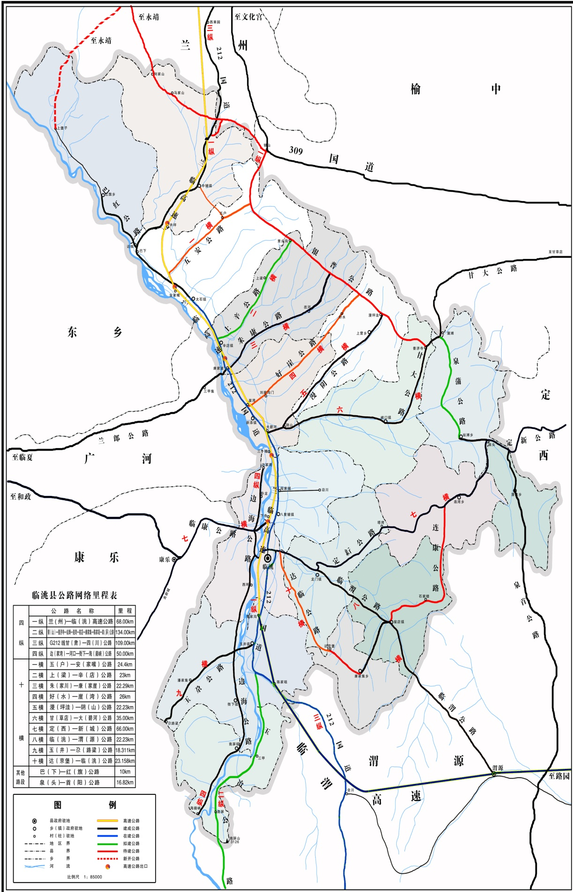

# 临洮县国民经济和社会发展第十三个五年规划纲要

## 第一章 发展环境

## 一、现实基础

“十二五”时期，在县委、县政府的正确领导下，全县上下面对宏观经济下行压力加大、各类自然灾害频发、发展改革任务艰巨的复杂局面，认真贯彻落实中央和省、市一系列关于促进发展、为民惠民的重大政策，统筹推进“稳增长、促改革、调结构、惠民生、防风险”等重点工作，深入实施“五县战略”，精心建设“六大片区”，全力推进“六大工程”，全县经济社会发展取得了新的成就，基本实现了“十二五”规划确定的目标任务，为“十三五”期间全县经济社会又好又快发展奠定了坚实基础。

（一）综合实力迈上新台阶。“十二五”末全县生产总值达到62亿元，年均增长15.8%，较2010年增长2.1倍；其中：一、二、三产增加值年均分别增长9%、16.7%和15.7%；累计完成全社会固定资产投资405.34亿元，年均增长28.73%；大口径财政收入和公共财政预算收入分别达到7亿元和4.32 亿元，年均分别增长26.05%和30.4%，较2010年分别增长2.2倍和2.8倍；金融机构存贷款余额分别达到130亿元和85亿元，较2010年增长2.7倍和3.6倍，存贷比提高19个百分点；实现社会消费品零售总额19.05亿元，年均增长13.8%,较2010年增长2.1倍；城镇居民可支配收入和农民人均纯收入分别达到18909元和5560元，较2010年分别增加8314元和2658元。

图1-1 经济总量变化示意图

（二）投资规模实现新提升。抢抓“新丝绸之路经济带”、生态文明先行示范区、华夏文明传承创新区、《关于进一步支持甘肃经济社会发展的若干意见》等重大政策机遇，按照“3341”[4]项目工程和“千亿元大招商”行动的总体部署，谋划实施了一批拉动投资快、综合效益好的重大项目，累计安排前期费5000万元，论证储备各类项目1473个；争取各类项目799个、资金42.93亿元；开工建设重点项目764个，其中定临二级公路改造、城区集中供热、城投公司综合楼、椒山初中等695个重点项目全面建成。积极推行招商引资项目引荐奖励制，引进总投资 281.14亿元的合同、协议项目146个，新建和续建项目累计到位资金 108.44亿元。

（三）扶贫攻坚取得新成就。扎实推进“联村联户、为民富民”和“1236”[5]扶贫攻坚行动，全面落实“1+19+5”精准扶贫实施方案。累计实施整村推进项目53个、连片开发项目2个、整乡推进项目3个；累计完成渠道衬砌625.73公里，改造、新建提灌工程65处，全县有效灌溉面积达到32.78万亩；认真实施东峪沟、北部、引洮一期等重点饮水安全工程，解决了20.35万人的饮水安全问题。推进农村电网改造，全县无电户全部通电，自然村三相动力电覆盖面达到95.6%。建成“一池三改”户用沼气池20036户。实施道路交通项目202个，油化硬化农村道路1554公里。完成农村危房改造6500套，易地搬迁贫困群众4440户2.6万人，新建集中安置点38个。累计减少贫困人口13.07万人，贫困面下降到6.9%。

（四）结构调整达到新目标。三次产业结构由2010年的32:30.4:37.6调整到2015年的23.6:31.6:44.8。累计发展设施农业2.7万亩，推广旱作农业185.9万亩，粮食总产量达到23.51万吨，较2010年增加2.13万吨；马铃薯、蔬菜、中药材种植面积累计达86万亩，占农作物播种面积的65.15%。花木种植面积累计达到7万亩，培育花木生产企业42家。发展规模养殖小区49个，培育省、市级重点养殖企业10家。“一区三园”累计完成基础设施建设投资5.3亿元；入驻企业达到39家、完成投资53.8亿元、上缴利税1.54亿元。全县规模以上工业企业达到28家，规上工业增加值达到7.22亿元，年均增长16.8%，较2010年增长2.2倍。西北金泽物流城、甘肃南部商品交易集散中心等重点项目相继实施，电子商务、现代物流产业快速发展，商贸流通市场日趋活跃。实现旅游综合收入6.87亿元，接待国内（外）游客159.4万人（次），第三产业增加值年均增长19.9%。

(1)“十二五”末三产比 (2)“十一五”末三产比

图1-2 “十二五”末三次产业结构示意图

（五）城乡面貌发生新变化。编制完成了县城和15个乡镇总体规划、100个村庄规划，新建改建北大街、公园路等城市道路26条26公里，硬化城区小巷道60多条，实施房地产开发项目8个，新建保障性住房3573套25.6万平方米，累计完成配售2085套，建成洮河城区段疏浚工程，新增水域面积100万平方米，累计完成城建工作量80多亿元，县城建成区面积达到17.68平方公里，城市化率达到31.5%，获评“省级卫生城”和“省级园林城”。城区集中供热工程全面运行，供热面积达500万平方米，管道天然气工程上马建设，重点小城镇建设取得实质进展，成功入围全国中小城市综合改革试点县范围。大力实施洮河堤防治理、小型农田水利重点县项目，洮河及其主要支流堤防达到60.72公里。定临路、韩水路、边海路建成通车，水罐路、临渭高速上马建设，临洮军民合用机场、兰州至天水城际铁路前期工作取得实质性进展。加快推进“7.22”、“4.15”灾后恢复重建工作，实施灾后重建项目94个，累计完成投资4.2亿元。

（六）社会事业得到新发展。累计实施各类教育项目 428 个，新建、改扩建校舍27.88万平方米；学前教育三年毛入园率和九年义务教育巩固率分别达到84%、96.27%，高考二本上线人数累计达10311人，较“十一五”期间增加5315人，“两基”达标通过国家验收。实施县、乡卫生项目26个，建成村卫生室166所，县、乡、村三级卫生网络逐步健全。城乡居民合作医疗参合率和基本养老保险参保率分别达到97.96%、95.64%。认真落实各类计生政策，全县总人口达到55.13万人。确立了“5313”[6]的文化产业发展战略，引进卧龙湾水镇、体育训练基地等项目19个，文化产业增加值达到6733万元，增长37.6%。不折不扣落实各类救助政策，累计发放城乡低保金4.5亿元、各类救助金7389.67万元。扎实开展双拥共建活动，荣获“全省双拥模范县”八连冠。新增城镇就业2万人，多渠道安置高校毕业生3292人，劳务输转56.16万人（次），创收72亿元。

（七）生态建设获得新成效。完成“面山”绿化、人工造林、封山育林、生态恢复等工程10152公顷。稳步推进巩固退耕还林成果基本口粮田建设和坡改梯工程，实施国家水土保持重点建设工程峡口项目和全国坡耕地水土流失综合治理试点工程，共计治理水土流失面积320.82平方公里，其中新修高标准梯田18132.63公顷，造林5571.09公顷，种草596.67公顷，封禁治理7782.34公顷，森林覆盖率达到8.9%。节能减排成效明显，化学需氧量、氨氮排放量、二氧化硫排放量、氮氧化物排放量分别控制在5056.33吨、286.76吨、3635.05吨和839.22吨，万元GDP节能降耗率控制在2.5%以内。建成了中铺工业园污水处理厂和城区、中铺、新添等3个生活垃圾填埋场。

（八）改革开放焕发新活力。推进简政放权，行政审批事项大幅精简，先后调整、取消和下放行政审批事项207项。严格执行“三张清单一张网”工作要求，制定出台了公共安全、生态安全、落后产能、产能过剩等领域的负面清单。建成以县政务服务中心为龙头、乡镇和村级便民服务中心为支撑的三级便民服务体系。加强政府管理金融机构职能，全县设立助农取款服务点496个，网点覆盖率达85%。法治政府、责任政府和服务型政府建设全面推进。县委确定的28项“微改革”全面推进，有效激发了发展活力。社会信用体系逐步建立，商事制度改革全面推进。深入推进预算管理和国库集中支付制度改革，公务卡制度全面推进，预算执行管理进一步加强。预决算公开工作全面开展，政府债务管理进一步规范。认真实施教育、卫生、文化等方面改革内容，社会事业发展的活力进一步增强。

表1-1 临洮县“十二五”规划指标完成情况总体评价表

| 主要指标 | 单位 | 2010年 | 规划目标 | 完成情况 | “十二五”平均增速（%） |
|---|---|---|---|---|---|
| 2015年 | 年均增长（%） | 2015年 |
| 一、生产总值 | 亿元 | 29.82 | 57.48 | 8.5 | 62 | 15.8 |
| 第一产业增加值 | 亿元 | 9.55 | 14.63 | 5.8 | 14.63 | 9 |
| 第二产业增加值 | 亿元 | 9.06 | 19.59 | 11 | 19.6 | 16.7 |
| 第三产业增加值 | 亿元 | 11.21 | 23.26 | 8.5 | 27.77 | 15.7 |
| 二、大口径财政收入 | 亿元 | 2.2 | 6.2 | 12 | 7 | 26.05 |
| 三、粮食总产量 | 万吨 | 21.38 | 24 |  | 23.51 | 1.92 |
| 四、社会消费品零售总额 | 亿元 | 9.12 | 17.48 | 12 | 19.05 | 13.8 |
| 五、规模以上工业增加值 | 亿元 | 3.32 | 7.22 | 12 | 7.22 | 16.8 |
| 六、城镇居民人均可支配收入 | 元 | 10595 | 18909 | 10 | 18909 | 12.28 |
| 七、农民人均纯收入 | 元 | 2902 | 5560 | 13 | 5560 | 13.89 |
| 八、全社会固定资产投资 | 亿元 | 33.94 | 111 | 19 | 111 | 26.74 |

发展充满艰辛，成就来之不易。“十二五”期间，临洮发生了令人鼓舞的巨大变化，综合实力大幅提升、社会事业全面进步、人民生活明显改善。这五年，是不断深化县情认识、积极探索科学发展路子的五年，是经受严峻考验、努力开拓创新的五年，也是临洮历史上综合实力提升最快、城乡面貌变化最大、人民群众得到实惠最多的五年。科学分析和系统总结五年来经济社会发展的经验和启示，对于我们在新的更高起点上，全面建设特色经济强县具有重要意义。

——科学谋划发展思路，是经济社会发展的根本保证。思路决定出路，定位决定方向。县委、县政府于2009年提出了“文化兴县”战略，2010年确立了“生态立县”战略，逐步完善形成了“五县战略”，成为指导全县经济社会发展的总体思路。同时，结合临洮实际提出了“六大片区”布局和“六大工程”计划。实践证明，这些思路完全符合党的十七届六中全会、十八大和十八届五中全会精神，符合临洮的实际，已成为全县上下的广泛共识和行动指南。

——探索创新改革举措，是经济社会发展的永恒动力。改革创新是发展的不竭动力，也是经济转型的核心内容。“十二五”期间，县委、县政府坚持问题导向，以破解瓶颈、促进发展为目的，在认真落实中央和省、市重大改革事项的同时，结合实际提出了28项“微改革”，取得了显著成效，提供了不竭动力。实践证明，只有突破思想观念束缚和体制机制障碍，不断解放思想，深化改革，才能有效破解发展难题，才能使发展活力更足、步伐更快。

——抢抓利好政策机遇，是经济社会发展的关键所在。紧盯西部大开发战略、华夏文明传承创新区建设、《关于进一步加快甘肃经济社会发展的若干意见》、生态文明先行示范区建设、“新丝绸之路经济带”等重大政策机遇和战略部署，科学谋划目标定位、空间布局和重大项目，办成了一批大事、实事，临洮发展实现新跨越。实践证明，只有抢抓历史机遇，自觉地把全县的发展置于全国、全省、全市发展大局之中，增强机遇意识，提高主观能动，才能把机遇变为发展优势、发展成果。

——推进扶贫攻坚行动，是经济社会发展的核心内容。结合“联村联户、为民富民”行动和“1236”扶贫攻坚计划的深入实施，整合各类资源，强化要素保障，加快推进以基础设施、产业发展、民生保障为主的扶贫项目建设，贫困群众的生产生活条件显著改善，自身发展能力不断增强，为全面小康建设奠定了坚实基础。实践证明，只有动员全社会力量参与扶贫攻坚行动，有效提高发展能力，全面促进发展共享，才是贫困地区经济社会发展的核心。

——坚持以人为本理念，是经济社会发展的根本目的。坚持以人为本、执政为民，把为民、惠民、富民放在各项工作的首位，大力发展社会事业，不断拓宽增收渠道，努力增进群众福祉，在改善民生上取得了显著成效。实践证明，只有尊重群众意愿，顺应群众期盼，真心实意为民谋利，使改革发展成果更多地惠及人民群众，才能充分激发和调动广大群众的积极性，经济发展才有持久动力，社会进步才有牢固基础。

——全面加强党的建设，是经济社会发展的坚强保障。扎实开展科学发展观和群众路线教育实践活动，以及干部作风建设年活动，党员队伍的思想政治素质不断提高，党组织的创造力、凝聚力、战斗力不断增强。深入推进党风廉政建设和反腐败斗争，认真解决损害群众利益的突出问题，党风、政风和社会风气进一步好转。实践证明，只有坚持党的领导，党的政治优势和组织优势才能得到充分展示和有效转化，真正成为推动发展的强大力量。

## %1、 环境分析

## （一）发展机遇

——战略机遇。“十三五”期间，国家将继续深入推进西部大开发战略，全省将全力打造“丝绸之路经济带”甘肃黄金段，稳步推进“华夏文明保护传承创新区”建设，积极构筑国家生态安全屏障。临洮是丝绸之路经济带甘肃黄金段重要的节点城市，也是黄河文化的重要发祥地之一。同时，定西市是全国首批生态文明先行示范区。抢抓这些重大战略机遇，充分利用得天独厚的资源优势和区位优势，对临洮加快产业转型升级、推进生态文明建设将起到积极的推动作用。

——政策机遇。按照十八届五中全会精神，“十三五”期间国家将在创新驱动、城镇化建设、市场调控、为民惠民等方面出台一系列重大政策，以刺激消费，继续保持经济的中高速增长，特别是提出了脱贫攻坚和全面小康的的宏伟目标。同时，省委、省政府将着力推进“6873”[7]交通行动计划、“6363”[8]水利保障行动计划、“1236”扶贫攻坚行动计划。借助这些重大政策机遇和资金投入，将进一步改善我县的发展条件，加快脱贫攻坚步伐。

——机制机遇。临洮被确定为全国中小城市综合改革试点县之一，将在要素聚集、产城融合、规划引领、机制创新等方面探索可复制、可推广的成功经验。同时，市委要求我县要创造出“定西模式”，为全市中小城市发展提供可借鉴的经验。县政府也确定了“33665”[9]的重点工作，通过顶层设计的引领指导和重点工作的全面落实，将有效激发全县经济社会发展的活力和动力，为增强经济社会发展综合实力奠定坚实的基础。

——地缘机遇。目前，全省正在谋划“大兰州”经济圈建设。临洮是省会兰州的南大门，是“兰州一小时”经济圈内重要节点城市，作为“大兰州”经济圈的重要组成部分，临洮县将借助“大兰州”经济圈交通贯通、服务均衡等统一规划，加快推进基础设施建设、生态环境治理、基本公共服务、城乡统筹发展等一系列重点任务，这是临洮发展的有利地缘机遇。

## （二）面临挑战

——精准脱贫时间紧迫，全面小康任务艰巨。按照省、市要求，我县要于2016年实现整体脱贫，摘掉贫困县帽子，2017至2020年在巩固提高的基础上，建成全面小康社会，精准脱贫的时间相当紧迫。目前全县尚有144个贫困村、9万贫困人口；贫困人口人均纯收入较全县平均水平低2198元。贫困人口多、贫困程度深的形势仍未从根本上改变。“十三五”期间，充分利用国家关于精准扶贫、精准脱贫的系列政策，实现脱贫目标，达到全面小康，这是我们多年来的梦想，也是全县上下面临的最大挑战。

——经济环境复杂多变，发展形势不容乐观。受后金融危机影响，世界经济仍处于深度调整和缓慢复苏之中；我国经济面临“三期”叠加的矛盾仍然十分突出，经济发展进入新常态，经济下行压力依然较大，需求弱化的影响惯性延续，产业发展新旧动力转换艰难，部分领域风险隐患凸显。全省由于整体需求不足与产能过剩问题并存，经济周期调整和产业结构矛盾交织，工业产品价格持续下跌，经济仍处于低位增长态势。国内外经济整体形势及省内环境变化将持续影响我县今后经济增长的稳定性。

——城乡差距逐渐拉大，基础条件亟待改善。长期以来，由于二元经济结构体制尚未从根本上发生改变，收入分配格局依然整体向城市倾斜，对农村、农业和农民依然是“多取”、“少予”；农村改革滞后于农业、农村经济的发展，导致农村又产生和积压了一些新矛盾和问题，城乡结构总体上仍处于较为严重失衡的“不和谐”状态。广大群众对城乡差距之间的意见越来越大，对共享改革发展成果的要求越来越强。

——公共服务水平不高，共享发展迫在眉睫。“十二五”期间，全县公共服务财政支出比重和基本公共服务水平仍然较低。优质基本公共服务配置向城镇倾斜，在城乡间以及不同群体间分布不均等。人口信息管理制度不完善，流动人口在就业、教育、社保、住房、医疗等公共服务方面共享程度不高。公共服务覆盖面较小、专业技术人员不足、均等化水平较低等问题亟需解决。同时，随着老龄化社会的加速和“两孩”政策的实施，人口老龄化和生育高峰期相互交织，群众在基本公共服务方面的要求将更加突出。

——资源环境矛盾突出，制约因素亟需解决。随着城镇化、工业化步伐的加快，我县环境资源承载力方面的问题日益显现。经济结构调整和环境保护面临前所未有的压力，主要污染物排放量持续增加，大气污染形势严峻。饮用水源地保护工作难度加大，洮河流域滥采乱挖，毁坏严重。农村环境脏乱差现象突出，农业面源污染亟待治理。土地资源开发利用不合理，生态环境日益恶化。全社会参与环境治理的机制不健全，发展与保护的矛盾进一步凸显。

——改革开放仍需深化，竞争发展形势逼人。县域经济总量小、经济实力不强、经济增长的质量和效益有待进一步提高。经济结构亟待调整，深层次矛盾特别是结构性矛盾仍然突出。主导产业不够突出，科技含量高的重大龙头企业较少，短时间内难以集聚爆发力，形成支撑点；服务业占全县经济中的比重较低，对全县经济的促进作用未充分发挥。周边县区在你追我赶、争先创优的时代大潮中，区域竞争日趋激烈，不进则退形势逼人，加快发展的压力越来越大。

## （三）阶段特征

综合判断，“十三五”时期，我县发展机遇和挑战并存，总体仍然处于大有可为的重大战略机遇期。

一是全面建成小康社会的决胜期。党的十八大明确提出要在2020年全面建成小康社会，“十三五”时期是实现这一目标的最后决胜阶段，我们必须不折不扣地全面完成小康社会建设各项任务。

二是经济发展的转型期。当前，我国经济发展进入新常态，积极顺应经济结构转型升级的客观趋势，推动全县产业结构性调整，已成为主动适应经济发展新常态的必然选择。

三是生态建设的黄金期。绿色发展理念为生态脆弱地区构筑生态安全屏障、改善生存环境提供了新的契机，大力推进生态文明建设，将成为全县经济社会发展的主要任务之一。

四是深化改革的攻坚期。全面深化改革向纵深方向推进，行政管理体制、国有企业、农业农村、财税体制、金融体制等重点领域和关键环节的改革将全面加快，改革创新将更具有复杂性和艰巨性。

五是依法治县的加速期。全县经济社会正处于扶贫攻坚、转型跨越的关键阶段，面对的各种困难和风险挑战前所未有，深入推进依法治县已成为化解社会矛盾纠纷、实现社会和谐稳定的迫切需要。

六是全面从严治党的关键期。从严治党已成为新常态，是脱贫攻坚和全面建设小康社会的根本保证。我们必须牢牢把握这六个方面的基本趋势，切实增强机遇意识、忧患意识和责任意识，趋利避害、主动作为，不断开创各项事业发展的新局面。

## 第二章 总体要求

根据中央和省、市的重大战略部署，紧盯与全国全省一道全面建成小康社会的目标，县委准确把握“十三五”发展环境和发展基础，科学谋划确立了全县“十三五”时期经济社会发展的指导思想、发展原则、发展定位、主要目标、空间布局和发展战略。

## 一、指导思想

高举中国特色社会主义伟大旗帜，全面贯彻落实党的十八大和十八届三中、四中、五中全会精神，以邓小平理论、“三个代表”重要思想、科学发展观为指导，深入学习贯彻习近平总书记系列重要讲话精神，紧紧围绕“五位一体”总体布局和“四个全面”战略布局，牢固树立创新、协调、绿色、开放、共享的发展理念，以脱贫攻坚为核心、转型升级为重点、深化改革为动力、富民强县为目的，深入实施“六县”战略，全面建设“六大片区”，确保打赢脱贫攻坚战，到2020年与全国全省一道全面建成小康社会。

## 二、基本原则

（一）坚持创新发展原则。必须把发展基点放在创新上，形成促进创新的体制架构，塑造更多依靠创新驱动、更多发挥先发优势的引领型发展模式。必须把创新作为引领发展的第一动力，把人才作为支撑发展的第一资源，加快形成以创新为主要引领和支撑的经济体系和发展模式。必须培育发展新动力、拓展发展新空间、构建产业新体系、构建发展新体制。

（二）坚持协调发展原则。必须立足县情，坚持全面、协调、可持续发展，深化改革，扩大开放，着重处理好速度与结构、质量与效益、内需与外需、投资和消费之间的关系，挖内力发展和借外力发展的关系，促使发展中的各个方面、主要环节相互适应，互促互动，良性循环。

（三）坚持绿色发展原则。必须坚持节约资源和环境保护的重大政策，坚持可持续发展，积极创建生产发展、生活富裕、生态良好的文明发展道路。必须依据主体功能区规划，综合考虑资源环境承载力和环境容量，坚持资源低消耗，环境低污染，成本低投入。要按照全县大循环、园区小循环、企业微循环的思路，努力实现经济效益与生态效益有机统一，和谐发展。

（四）坚持开放发展原则。开放 是繁荣发展 的必由之路，封闭只会窒息自己的生机。必须紧盯“大兰州”经济圈建设，切实加强与周边县市，特别是兰州市的协作，在招商引资、园区建设等方面，与兰州、临夏及周边县区建立协作机制。必须按照“六大片区”的产业布局，加强各乡镇之间的融合发展，探索协同推进、产业融合、联合治理方面的机制和模式。

（五）坚持共享发展原则。必须坚持以人民为中心的发展思想，把增进人民福祉，促进人的全面发展作为发展的出发点和落脚点，多措并举争收入、补短板、兜底线，扎牢民生保障网。通过切实改善民生，调节收入分配，扩大消费需求，带动经济增长，彰显社会公平正义，充分调动人民的积极性、主动性、创造性，推动我县朝着富民、强县、稳定、和谐的方向不断迈进。

## 三、发展目标

统筹考虑机遇和挑战，分析环境和特征，兼顾发展和需求，“十三五”期间，要在全面建成小康社会的基础上，努力实现以下新的目标要求。

## （1） 总体发展目标

根据中央和省、市的重大战略部署，紧盯与全国全省一道全面建成小康社会的目标，综合考虑“十三五”发展环境和我县发展基础，努力将临洮打造成为全省重要的农畜产品生产基地、最大的花木生产基地、最佳的养老休闲度假基地和兰州经济圈内最具发展潜力的产业聚集平台，主要实现以下目标。

表2-1 临洮县“十三五”期间国民经济和社会发展主要指标预期表

| 主要指标 | 单位 | 2015年 | 2020年 | 年均增长(%） |
|---|---|---|---|---|
| 经济发展指标 | 地区生产总值 | 亿元 | 62 | 91.1 | 8 |
| 人均生产总值 | 元 | 12113 | 15949 | —— |
| 第一产业增加值 | 亿元 | 14.7 | 19.58 | 6 |
| 第二产业增加值 | 亿元 | 19.6 | 25.13 | 5.11 |
| 第三产业增加值 | 亿元 | 27.77 | 46.39 | 10.8 |
| 第三产业增加值占GDP比重 | % | 44.8 | 50.9 | 15 |
| 规模以上工业增加值 | 亿元 | 7.22 | 12.72 | 12 |
| 全社会固定资产投资 | 亿元 | 111 | 223.26 | 15 |
| 社会消费品零售总额 | 亿元 | 19.05 | 33.57 | 12 |
| 大口径财政收入 | 亿元 | 7 | 11.27 | 10 |
| 社会发展指标 | 总人口 | 万人 | 55.13 | 58 | —— |
| 人口自然增长率 | ‰ | 3.58 | ≤7 | —— |
| 城镇化水平 | % | 31.5 | ≥40 | —— |
| 幼儿教育入学率 | % | 84 | ≥90 | —— |
| 九年义务教育巩固率 | % | 96.27 | ≥95 | —— |
| 高中毛入学率 | % | 91.49 | ≥95 | —— |
| 人民生活指标 | 农民人均纯收入 | 元 | 5560 | 10244 | 13 |
| 城市居民人均可支配收入 | 元 | 18909 | 30453 | 10 |
| 农村合作医疗参保率 | % | 97.96 | ≥95 | —— |
| 城乡居民基本养老保险参保率 | % | 95.64 | ≥95 | —— |
| 城镇登记失业率 | % | 4 | ≤4 | —— |
| 资源环境指标 | 单位GDP能耗 | 吨标准煤/万元 | 0.73 | ≤0.84 | —— |
| 城市污水集中处理率 | % | 90 | 100 | —— |
| 工业固体废弃物综合利用率 | % | 85 | ＞90 | —— |
| 饮用水源水质达标率 | % | 100 | 100 | —— |
| 建成区绿化覆盖率 | % | 28.2 | 40 | —— |
| 水土流失治理率 | % | 45.81 | 62 | —— |
| 空气优良天数比率 | % | 83.3 | ≥80 | —— |
| 森林覆盖率 | % | 8.9 | 12.9 | —— |

## （二）主要发展目标

——脱贫攻坚目标。贫困群众收入大幅提升，基本生产生活所需水、电、路、房等问题全面解决，贫困群众均衡享有基本公共服务，贫困村面貌大为改观。到2016年全县实现整体脱贫重点乡镇7个、重点贫困村144个，减少贫困人口8万人，贫困面下降到4%以下。

——经济发展目标。全县经济继续保持中高速增长，生产总值达到91.1亿元，年均增长8%；其中：一产增加值达到19.58亿元，年均增长6%；二产增加值达到25.13亿元，年均增长5.11%；三产增加值达到46.39亿元，年均增长10.8%。规模以上工业增加值达到12.72亿元，年均增长12%。全社会固定资产投资达到223.26亿元，年均增长15%。大口径财政收入达到11.27亿元，年均增长10%。

——城乡建设目标。县城规划控制面积达到25.16平方公里，建成区面积达到17.68平方公里，城区新增集中供热面积260万平方米。完善城市公共服务体系建设，推进城区地下管廊、地下停车场、污水改造工程等基础设施建设。依托中心镇发展和棚户区改造项目，加快实施易地搬迁，搬迁农户32067人，全县城镇人口达到29万人左右，城镇绿化率达到40%以上。

——社会发展目标。全县九年义务教育巩固率、高中毛入学率、幼儿入园（班）率分别达到95%、95%和90%以上。深化医药卫生体制改革和农村新型合作医疗机制改革，新农合参保率保持在95%以上。保障就业岗位，调查失业率控制在国家、省、市下达指标以内。加快推进城乡居民社会养老保险全覆盖，实现城镇居民和新型农村养老保险制度的并轨。2020年全县总人口达到58万人以内，人口自然增长率控制在7‰以内，农村计划生育率达到90％以上。

——资源环境目标。社会生产方式和人民生活方式绿色、低碳水平上升，主体功能区布局和生态安全屏障基本形成。森林覆盖率和水土保持综合治理率分别达到12.9%和 62%，城镇和农村生活垃圾无害化处理率分别大于90%、30%，工业固体废物综合利用率大于90%。万元GDP能耗和取水量、二氧化硫排放量、化学需氧量、主要污染物排放量分别控制在指标以内，集中式水源地饮用水达标率为100%，地表水洮河临洮段水质达到II类标准，工业用水重复利用率高于50%。城区空气质量好于Ⅱ级标准的天数占全年天数的80%以上。

——人民生活目标。居民生活水平和生活质量稳步提高，城镇居民人均可支配收入和农民人均纯收入年均分别增长10%和13%，分别达到30453元和10244元。粮食总产量稳定在24万吨左右。城镇居民人均住房使用面积达到28平方米，农村居民人均生活用房面积达到30平方米。居民营养状况、健康水平等指标达到新的水平，全社会消费品零售总额达到33.57亿元，年均增长12%。

## 四、空间布局

按照“优化布局、统筹发展、提升功能、凸现特色”的原则，以及“北融南扩、抓点成线、两岸互动、全面推进”的思路，根据资源环境承载能力和经济社会发展潜力，统筹城镇、产业、生态分布，形成“一心一带两极六片”空间布局。

——“一心”。即县城中心，是临洮经济社会发展的核心区。依托“全国中小城市综合改革试点”，按照生活空间宜居适度、生产空间集约高效、生态空间山青水秀的目标，优化发展布局，完善服务功能，提升形象品位，增强辐射能力，打造成为县域核心。

——“一带”。即沿洮经济产业带，是临洮经济社会发展的主轴线。发挥洮河沿线南屏至红旗10个乡镇的自然资源、交通区位和人文资源优势，大力发展现代农业、新型工业、文化旅游、康体养生、现代物流等产业，建成一批各具特色、功能互补的重要节点，通过以点连线、以线带面，把洮河长廊打造成为最具发展活力的经济增长带。

——“两极”。即中铺工业发展极和南屏生态旅游发展极。中铺工业发展极：依托中铺工业园，着力发展建筑建材、金属冶炼、机械及装备制造、化工等产业，努力建成全省循环经济示范基地和兰州产业梯度转移承接基地。南屏生态旅游发展极：依托南屏山生态屏障和海甸峡、三甲电站水库，建设国家级湿地公园，着力发展生态度假、休闲观光、康体养生等绿色产业，努力打造全县生态旅游示范区。

——“六片”。即中铺工业集中区、太石休闲养生区、康家崖农副产品集散加工区、洮阳文化体验区、南屏生态旅游区、东部特色农业生产区。

图2-1 临洮县“十三五”期间空间布局图

## 五、重大战略

实现“十三五”时期发展目标，全县上下必须认真坚持创新、协调、绿色、开放、共享的发展原则，全面推进“六县战略”。

——“生态立县”战略。牢固树立生态文明、绿色发展的理念，以实施生态保护和修复工程为载体，扎实开展全民绿化行动，构建全民参与生态环境建设机制，全力打造以“一河两屏障”为重点的生态战略平台，努力开创全县生态环境建设新局面。

——“产业富县”战略。把农业特色优势产业开发作为富县、富民的重要支撑，围绕提高农村劳动生产率、土地产出率和资源利用率，加快转变农业发展方式，发展多种形式的适度规模经营，不断提升马铃薯、畜草、蔬菜、花木、中药材等优势产业综合效益，大力发展食用菌、油用牡丹、百合等特色产业，努力拓展促进农民增收的产业空间。

——“工业强县”战略。把做大工业作为调结构、促转型的战略任务，加快推进中铺工业集中区和康家崖农副产品集散加工区两大工业发展片区建设，坚持改造传统产业与培育新兴产业并重，大力发展循环工业经济，健全完善新型工业发展体系，着力提升工业产业整体竞争力，为推动县域经济转型跨越发展夯实基础。

——“商旅活县”战略。依托近临兰州、连接临夏的区位优势，抢抓国家实施“一带一路”战略和省上建设“丝绸之路经济带”黄金段的机遇，大力发展商贸物流业。依托洮阳文化体验区、太石休闲养生区和南屏生态旅游区“三大”主体功能区，规划建设一批富有影响力的旅游景点景区，发展壮大休闲度假、观光旅游、康体养生等旅游产业，培育全县经济发展新的增长点。

——“文化兴县”战略。以打造全省教育名县为目标，以实施名师名校工程为抓手，大力提高教育教学质量，实现城乡教育均衡发展。以华夏文明传承创新区建设为载体，深入实施“5313”文化产业发展战略，以沿洮文化产业带和重点文化产业项目为支撑，推动文化产业集群发展。依托丰富历史文化资源，大力推进文化旅游融合发展。

——“依法治县”战略。以建设法治临洮为目标，以法治示范创建和平安创建为载体，扎实推进依法行政、公正司法、依法用权、全民普法和依法治理，提升运用法治思维和法治方式规范社会行为、调节利益关系、协调社会关系、解决社会问题、化解社会矛盾的水平，着力营造公平公正、依法诚信、规范有序的发展环境。

## 第三章 主要任务

“十三五”期间，必须以全面建成小康社会为统揽，全力实施“8333” [10]主要任务，即抓好“八项重点任务”，实施“三大工程”、深化“三大行动”、落实“三大计划”，努力推动经济社会转型跨越发展，着力在八个方面取得突破。

## 一、实施脱贫攻坚行动，全面建成小康社会

坚持把脱贫攻坚作为全面建成小康社会的重中之重，以精准扶贫精准脱贫为主攻方向，以双联行动为有效载体，全面落实“1+19+5”精准扶贫政策措施，创新扶贫工作机制，整合各类力量资源，紧盯整体脱贫标准，实现精准“滴灌”，强化“造血”功能，坚决打赢脱贫攻坚战，全面建成小康社会。

## （一）改善生产生活条件

1.基础交通扶贫。加快推进以断头路、连网路、产业路为主的农村道路建设，全面打通农村通行“最后一公里”。到2017年实现“乡有等级站、村有汽车停靠站、村村通客车”的农村客运目标。“十三五”期间实施农村路网改善工程3192公里，全面解决群众出行难问题，通班车比例达到100%，全县农村公路基础设施网络基本完善。

2.安全饮水扶贫。争取实施农村饮水安全提质增效工程，统筹饮水安全工程配套、改造、升级、联网等措施。坚持水资源的合理开发、优质配置、高效利用和节约保护，全面推行水务一体化管理体系。大力实施农村饮水巩固提升项目，到2020年底，全面解决全县群众的饮水不安全问题，使全县农村饮水安全比重达到100%，自来水入户率达到90%以上。

3.精准电力扶贫。以满足农村农业生产和工业发展需求为目标，重点完善农村电力配套设施，提高主网供电能力。专项进行治理低压电、供电瓶颈自然动力电改造升级工程，加快农网升级改造。到2020年，新改建农网线路300公里，配电变压器500台，户表改造8万户。全面解决自然村动力电覆盖问题，全县行政村和自然村动力电覆盖率达到100%。

4.危房改造扶贫。落实危房改造补助资金差异化补助政策，严格控制建设标准，合理确定分类补助标准，确保农村危房改造精准到村到户，达到基本建设要求。2016—2018年每年实施1700户，2019年实施1608户，全面完成全县建档立卡的农村贫困户危房改造任务，彻底解决贫困群众的安全住房问题。

5.电子商务扶贫。推进农村电商发展，到2016年，每个贫困村至少建成网店2个以上，利用电子商务销售当地特色产品，交易额年均增长20%以上。2017年到2020年，全县贫困村逐渐普及电子商务应用，实现“三有一能”目标，即县有农村电子商务服务中心，乡有电子商务服务站，村有电子商务服务点，贫困户能通过电子商务销售自产产品、购买生产生活资料，交易额年均增长30%以上。

## （二）培育富农增收产业

1.马铃薯产业扶贫。整合实施马铃薯高产创建、脱毒种薯全覆盖、“一分田”原种繁育、贮藏窖建设、旱作农业、基层农技推广补助、测土配方施肥等项目，加强金融扶持力度，拓宽营销渠道，完善良繁体系，使贫困村马铃薯良种覆盖率达95%以上，新增贮藏能力6000吨以上。

2.中药材产业扶贫。在玉井镇岚观坪村建成东垣中药材专业合作社260亩观察圃，引进28种新品种试验种植，通过种植积累数据，筛选出适宜于我县推广种植的中药材新品种，向贫困村推广种植，提高产量和质量，增加贫困户收入。

3.蔬菜产业扶贫。着力打造食用百合、胡萝卜、韭菜、葱蒜等四大品牌特色蔬菜和高原夏菜基地，整合实施高原夏菜标准园、农产品产地初加工蔬菜冷藏库、基层农技推广补助、农业产业化蔬菜保鲜库以奖代补等项目，打造蔬菜品牌。引导贫困村农户与恒德源、绿洲、宏兴等企业和合作社发展订单农业。

4.畜草产业扶贫。培育发展规模养殖示范户2400户、养殖小区及规模养殖场40个，推广种植多年生优质牧草28000亩，新建饲草料配送点10个，在新添、太石、衙下集镇分别新建1个乡级生猪定点屠宰点，申报注册“临洮冷鲜肉”、“狄道猪排”、“狄道肉羊”品牌，引导贫困村农户与县畜禽定点屠宰场、华商清真食品有限公司等企业发展订单畜牧业。

5.花木产业扶贫。整合实施花木产业、经济林果、林下经济发展等项目，在贫困村发展木本油料基地3500亩，核桃、苹果、软儿梨等经济林果3000亩。积极发展大丽花、紫斑牡丹、芍药等地方特色花卉鲜切花培育，加大景观苗木和盆栽苗木的种植繁育。通过在贫困村发展花木产业，调整农业产业结构，增加贫困户收入。

6.劳务产业扶贫。整合实施劳务品牌培训、创业培训等项目、开展新型职业农民培育工程，在各乡镇和有条件的村社逐步建立“农民夜校”。不断拓宽就业渠道，提升劳务经济质量，做大做强劳务产业。劳务输转产业村输转人数达到全村富余劳动力总数的40%以上，劳务收入占到该村农民人均纯收入的30%以上。

7.旅游产业扶贫。整合实施休闲旅游、观光旅游、体验旅游等项目。以卧龙寺、石景峡、南屏山、玉井峰、紫松山等景区景点建设为抓手，充分发挥民间力量，完善景区旅游服务功能，依托民间传统庙会、节庆等大型活动，带动35个贫困村发展特色旅游，增加3000人就业，人均收入增加1000元以上。

8.光伏发电扶贫。探索建立集中联建模式，通过招商引资，在有条件的地区建设1-2个25兆瓦地面光伏电站，每个村级集体每年从光伏产业中获得收益6万元以上,有效解决村级集体经济收入“空壳”问题。在全县120个贫困村建成分布式光伏发电站1000户（每户3000瓦），全县分布式光伏电站总户数达到1400户。

## （三）提升公共服务水平

1.教育事业扶贫。按照国家和省、市有关政策，对建档立卡扶贫户学生优先进行资助，全面做好教育扶贫工作。普通高中学生国家助学金按在校学生40%的比例予以资助，做到有贷款需求的建档立卡户贫困大学生“应贷全贷”，率先从建档立卡的家庭经济困难学生实施普通高中免除学杂费，逐步分类推进中等职业教育免除学杂费；对建档立卡户中的孤儿、残疾儿童及父母丧失劳动能力的幼儿、烈士子女、农村绝对贫困家庭幼儿按在园人数的10%予以资助，对在当地接受学前教育的建档立卡户幼儿免除保教费。

2.卫生服务扶贫。在实现贫困村卫生室标准化建设全覆盖的同时，提高贫困村乡村医生待遇，强化乡村医生培养培训。充实乡村卫生技术人员，加强贫困乡村订单定向医学生免费培养计划。提高贫困人员新农合住院费用和大病保险报销比例。以逐步完善群众健康档案、提供免费健康体检和强化随访管理为抓手，推行“13885”[11]健康促进模式改革，进一步保障群众身体健康。

3.文化事业扶贫。完成全县地面数字广播电视农村覆盖网工程建设，使覆盖率达到97%以上。完善乡镇公共文化站、农家书屋、文化宣传科普长廊等公共文化服务体系建设。通过政府采购方式，在贫困村积极开展文化演出、图书下乡、电影放映、体育比赛、共享工程服务等活动。加大文化扶贫力度，重点实施传统文化挖掘传承和乡村旅游培育工程，将文化与旅游有效融合，带动贫困村产业转型发展。

4.基本养老扶贫。加大政府代缴和补贴力度，确保农村社会养老保险制度的落实，对农村居民中一、二级重度残疾人、五保户等特困群体和计划生育“两户”家庭（独生子女领证户和二女节育户），由政府为其代缴全部或部分最低缴费标准的养老保险费；经组织任命或民主选举产生的村干部建立健全农村基层干部养老保险激励和保障机制。

5.社会保障扶贫。逐年提高农村低保标准和一、二类对象补助水平，对农村低保三、四类对象，坚持“输血”与“造血”并举，做到精准救助与精准扶贫相衔接，使其通过扶贫支持和社会救助两条路径实现脱贫致富。通过“基本医保+大病保险+医疗救助”的路径，提高救助水平，缓解农村贫困家庭就医难和因病致贫、因病返贫的问题。完善农村社会养老保险制度，有效解决贫困村老人养老问题。

6.农业科技扶贫。为每个贫困村派驻1名科技特派员，指导贫困村应用先进实用技术；每个贫困村培育2-3个农业科技示范户，开展新品种引进、试验、示范和技术培训工作。筹措资金为贫困村和有上网条件的贫困户建设“农业科技网络书屋”，加强“12316”三农服务热线建设，为贫困户提供快捷的农业生产技术、市场信息、富民政策等咨询服务。

7.技能提升扶贫。实施农民职业技能提升计划，有效增强农民就业创业、发家致富的能力。立足彻底阻断贫困代际传递，重点对“两后生”、外出务工人员和农村劳动力实施精准培训，实现“一人长期就业、全家稳定脱贫”的目标。对务工人员，整合扶贫、人社、农牧等部门培训资源，启动实施职业技能培训工程，重点围绕陶艺、厨艺、建筑等工种，开展菜单式技能培训。对农村劳动力，采取“1+X”精准培训模式，通过开办“农民夜校”集中强化培训，切实提高职业技能。

| 专栏1：三大计划之一农民职业技能提升计划: 立足彻底阻断贫困代际传递，重点对“两后生”、外出务工人员和农村劳动力实施精准培训。对新增“两后生”，依托甘肃农业大学现代农业技术学院和县内职业技术学校，对全县新增的“两后生”开展中长期职业技术培训，帮助其掌握专业技能，实现“一人长期就业、全家稳定脱贫”的目标。对务工人员，整合扶贫、人社、农牧等部门培训资源，启动实施职业技能培训工程，重点围绕马家窑陶艺工、味道临洮厨艺工、狄道鲁班建筑工和种养花木技术工等工种，开展菜单式技能培训。对农村劳动力，采取“1+X”精准培训模式，从乡镇筛选一批种养能手、种养大户、农业科技示范户等具有一定技术基础和潜力的农民进行集中强化培训，引导其依托产业基地、示范园区培训周边群众，扩大农民培训效应。 |
|---|

## （四）创新精准脱贫机制

1.金融扶贫。抢抓临洮县被列为全省“金融扶贫试点县”的机遇，创新推进金融支持扶贫开发工作。按照“村内互助，有偿借用，滚动发展”原则，发展以合作社或龙头企业为承贷主体的统贷统还、农户使用的贷款模式，有效解决农户融资无担保难题。同时，稳妥推进“三权”抵押贷款，认真实施中和农信、双联惠农、妇女小额等贷款项目，有效缓解贫困群众发展资金短缺问题。大力健全金融网点，逐步增加乡镇及以下网点数量，提高服务覆盖面。

2.社会扶贫。积极与定点帮扶单位中国银监会衔接，每年计划争取帮扶资金300万元以上，巩固提升扶贫成效。积极与北京西城区衔接，实现精准扶贫深度融合，建立定向劳务输转机制、开展教育医疗帮扶等方式，每年计划争取3000万元以上帮扶资金。积极与省、市、县“双联”单位协调联系，每年为联系村争取帮扶资金2000万元以上。做好民生银行帮扶资金实施项目的扫尾工作。大力引导和组织全县非公经济、社会组织、爱心人士，开展爱心捐赠、结对帮扶和公益消费等扶贫活动，营造“大扶贫”格局。

3.项目扶贫。加快整村推进项目建设，按照重点村的范围编制规划，对尚未扶持的27个重点贫困村列入整村推进规划进行扶持，大力改善贫困村生产生活条件。继续推进易地搬迁项目，积极探索以“四种模式”为主的易地扶贫搬迁工程新路子，对具有不同需求的困难群众进行分类安置。争取到“十三五”末，全县搬迁农村贫困人口规模达到7573户32067人。

## 二、优化产业经济结构，培育富民多元产业

以建设沿洮经济产业带为重点，大力转变农业发展方式，推进工业转型升级，培育壮大文化旅游和商贸物流产业，着力发展循环经济，大力实施富民产业工程，推动粮经饲统筹、农林牧渔结合、种养加一体、一二三产业融合跨界发展，全力打造兰州经济圈内最具发展潜力的产业聚集平台。

## （一）大力发展现代农业

1.做大做强特色产业

——马铃薯产业。积极引进丰产性好、抗病性强、商品性优、加工性能优良的马铃薯产业新品种、新原种，建立脱毒种薯繁育质量检测和病毒监测品系。大力发展现代生物组培快繁技术，建成脱毒苗、脱毒微型原中心，加快鲜薯销售向良种生产转变进程，健全完善马铃薯市场体系和营销网络体系。建立高淀粉型良种繁育、粮菜兼用型良种繁育、地膜覆盖优质粮菜兼用型生产、加工型专用薯良种繁育等基地。到2020年，全县马铃薯种植面积稳定在50万亩以上，总产量达到100万吨以上，马铃薯淀粉生产量达到5万吨，贮藏能力达到40万吨。

——蔬菜产业。按照“科学规划、区域布局、集中连片、规模经营”和“一乡一业、一村一品”的总体要求，以洮河沿线水川区乡镇为主阵地，以乡镇中心村和种植大村为重点，以乡镇基础条件较好的村为节点，建设百里蔬菜瓜果长廊。全县以高原夏菜为主的蔬菜面积达到30万亩以上，总产达到40万吨以上。积极引进蔬菜品种，扩大全县良种蔬菜种植面积；进一步加大日光温室、塑料大棚等设施农业种植规模，增加蔬菜冷藏保鲜库容量。加大绿色认证和有机认证力度，打造一批全省知名的蔬菜品牌。整合资源实施尾菜处理利用项目，有效解决尾菜乱抛、乱堆等环境问题。

——中药材产业。积极提高中药材产业种植水平，不断提高中药材的产量和品质。建立GAP基地，加快推进中药材标准化药源基地和种子种植繁育基地建设步伐，建设以玉井、衙下、南屏三镇为主的南部党参标准化生产基地；以窑店镇为主的东部党参标准化生产基地；以连湾乡为主的东北部党参标准化生产基地；以康家集乡为主的东南部当归标准化生产基地；以玉井、窑店为中心的药材育苗基地；以八里铺、峡口、辛店为主的甘草、黄芪生产基地等六大中药材生产基地。全县中药材种植面积稳定在15万亩，标准化药源生产基地达到8万亩，中药材种子育苗基地稳定在1万亩以上，中药材种植保险面积达到10万亩以上。

——畜草产业。加快畜牧业现代化的建设步伐，推动粮经饲统筹发展，加快养殖小区和畜禽规模养殖场的发展和秸秆的转化利用，推进畜牧业科技进步，促进畜牧业增长方式转变，抓好畜牧业环境保护和循环经济建设。引导金融资本支持畜草产业发展，不断扩大人工种草面积。加快规模饲养发展和良种引进，稳固全县牛、羊、猪、禽的饲养量和出栏量，提高肉类、禽蛋、水产品等农畜产品总产量，畜牧生产与畜产品加工比重达到1:1。

——花木产业。以临洮紫斑牡丹等地方特色花卉生产为突破口，大力发展乡土花卉品种，扩大种植面积。引导扶持龙头企业提升花木质量、延长产业链条、扩大经营规模，带动区域经济综合发展、良性循环。建成“三大育苗基地”和“五个育苗示范基地”，积极推进种苗产业结构调整。到“十三五”末，各类特色花卉和引进培育的反季节花卉种植面积达到2万亩，全县育苗面积保持在6万亩以上。

2.努力提升发展能力

——大力培育龙头企业。认真实施“龙头企业培育计划”，加快推进农产品加工业结构升级，特别是培育壮大一批成长性好、带动力强的农产品精深加工骨干龙头企业，重点做强蔬菜产后保鲜、加工等生产环节，力争到2020年，全县培育发展各类蔬菜产加销龙头企业30家，年保鲜、贮藏、加工能力达到30万吨。

——发展多种经营主体。组织开展农民专业合作示范社建设行动，加强对合作社人员培训，支持合作社开展技术信息、仓储、运销、培训等服务，引导合作社完善内部组织结构，健康规范发展。每年规范提升50个农民专业合作社，提高农业经营的组织化程度。

——提升机械应用水平。围绕药材和马铃薯等特色优势产业，重点发展大中型农机具，推广应用先进适用的新型农机具和新技术。积极落实国家农业政策，不断加大对农机器具的补贴力度。大力扶持农机服务专业合作社、农机服务公司和农机大户加快发展，提升农业机械化作业水平。

——加快科技推广步伐。加强旱作节水技术、抗旱栽培技术的综合组装应用和技术创新升级，力争2020年使旱作集流抗旱节灌技术成为全县农业增收新的技术支撑。抓好大棚和节能日光温室建设，推广蔬菜嫁接、喷、滴、微灌和渗灌、秸秆生物反应堆、无土栽培和立体化种植等技术，提高产量和效益。减轻土壤污染，发展优质无公害农业和有机农业。

3.探索特色发展道路

——建设现代农业园区。实施科技创新驱动发展战略，加快全县现代农业产业技术体系建设，争取组织实施全省“十百千万”工程，壮大平长现代农业科技示范园、跃雅森现代农庄等企业发展规模，积极创建国家级现代农业示范区和省级现代农业示范园，增强农业科技园区科技成果转化的示范引领作用，积极探索现代农业发展新模式，进一步提升现代农业发展水平。

——推进跨界融合发展。着力建设好两个市场。一方面，抓有形市场建设，完善农产品流通体系。加快农产品批发市场、冷链物流中心等专业市场建设，改造提升乡镇农贸市场，完善农产品仓储、冷链、物流等设施，建成康家崖农副产品集散加工园和中铺金泽物流园。另一方面，抓无形市场建设，加快发展农村电子商务。继续实施农业信息化示范工程，利用电子商务平台，制订政策支持发展农产品直销、配送等新型流通业态，努力实现农产品销售线下与线上同步发展、互联互通。

## （二）着力壮大工业规模

1.有效增强园区集聚能力。以“一区三园”为总体发展目标，持续加大财政投资力度，拓宽投融资渠道，增强土地集约利用效率，着力完善开发区道路、给水、亮化、污水、垃圾等基础设施，力争全面实现“四通一平”。建立健全银行、邮政、电信、移动等营业网点，提供优质高效的服务。重点引进建筑建材、化工生产、机械制造、农副产品集散精深加工、现代物流等有利于产业集群发展的链条延伸项目。重点在转型升级、提升效益上下功夫，推进临洮经济开发区循环化改造步伐，发展循环经济，优化产业结构。力争到2020年，开发区生产总值、工业增加值、上缴利税额分别达到10.28亿元、10.03亿元和6206万元以上，年均分别增长12%以上；从业人员达到5500人以上。

%1. 科学建立工业发展体系。按照“工业强基”战略总体部署，以培育壮大有色金属冶炼、建筑建材、农畜产品加工、装备制造、中医药、物流信息产业等主导产业为重点，加大优势产业整合力度，不断延长产业链条，提升主导产业整体竞争力，着力推动主导产业发展壮大，形成新兴工业发展体系。

——传统优势工业。进一步发挥中铺工业园对工业化的载体作用，力促招金贵金属难处理金精矿冶炼项目达产达标，加快氯化提金工业项目建设步伐。加快顾地塑胶、鸿盛岩棉等项目建成进度。抓好洮河拖拉机公司“出城入园”整体搬迁项目及大马力拖拉机、系列农机具的开发。大力推进铝电一体化发展，扶持临铝公司加快实施临洮铝业公司10万吨/年电解铝产能置换二期项目，积极论证6万吨电解铝深加工和铝箔、板、带等下游产品开发项目。同时，积极引进各类建筑建材加工和化工类产业链延伸项目，在保持传统建材业发展的基础上，加快新型建材业发展。

——战略新型工业。以新能源产业为牵引，主攻高载能产业和低碳经济，加大传统产业改造提升和节能降耗力度，大力推广太阳能光伏电源系列、高效低排放生物质炉具、秸秆固化成型设备、聚光型移动式太阳能灶等新型节能设备。继续加大光电产业的论证谋划和争取力度，积极发展农副产品加工业，改造提升矿产品加工业，逐步实现工业发展动力从资源消耗为主向创新驱动为主转变，企业经营方式从粗放经营为主向集约经营为主转变。

——特产发展工业。马铃薯加工。以薯界淀粉公司等万吨级淀粉加工企业为依托，加快变性淀粉等淀粉深加工项目建设。肉制品加工。在扶持华商清真食品公司、畜禽定点屠宰厂做大做强的同时，新建具有较大影响力的肉制品精深加工企业，在等级分割、冷藏保鲜、熟食调制和生物成份提取上取得突破。蔬菜加工。发挥恒德源公司行业引领作用，大力发展速冻蔬菜、脱水蔬菜、蔬菜汁、蔬菜粉、蔬菜脆片和保健蔬菜及野生特色蔬菜加工。乳品加工。重点实施好康源乳品公司年处理20万吨生鲜乳系列产品项目、德鑫源乳业公司2000吨/年天然奶油加工项目。中药材加工。加快引进国内百强医药企业来临洮投资或整合重组当地制药企业。积极发展以道地中药材为主原料的中药饮片、配方颗粒等药品制造，大力支持华安、众友、瑞康、恒康、鑫泰等医药企业做大做强。

## （三）培育壮大文旅产业

1.加强历史文化保护。开展各级各类文物普查，建立文物资料数据库，加强对历史文化遗产的保护。规划建设马家窑彩陶博物馆，做好辛店文化遗址、寺洼文化遗址、战国秦长城重点段、古汉墓群、三国姜维点将台、哥舒翰纪功碑等历史遗迹的保护和修复。实施岳麓山、南屏山、玉井峰古建筑维修与历史文化恢复项目，加大城隍庙、文庙、佛归寺、卧龙寺、石景峡的修缮，提升文化内涵和品位，使其成为传播和弘扬临洮传统文化的窗口与基地。建设“李氏文化”宗祠和八思巴大寺，提升临洮文化的影响力和知名度。

2.加大传统文化传承。规划建设 “洮河文化博物馆”、“貂蝉文化非物质文化遗产保护基地”和“花卉之乡临洮民俗文化生态保护区”，保护性开发临洮花儿、拉扎节、傩舞、彩陶复制、皮影戏等地方传统文化，加大宣传力度，延伸产业链条。深度开发貂婵传说、海巅峡传说、佛归寺传说、石景峡传说、洮水流珠等非物质文化遗产的保护和开发。做好传统文化和技艺的传承工作，营造良好氛围，加强政策扶持，广泛发掘和保护非物质文化遗产的专家和传承人，建立传习所，培养接班人。

3.加快文旅资源开发。依托临洮文化底蕴悠久、区位优势明显、交通条件便捷、人居环境良好的资源禀赋，高起点谋划整合历史文化资源和自然生态资源，以洮阳文化体验区、太石休闲养生区和南屏生态旅游区“三大”主体功能区和沿洮文化产业带为平台，谋划建设文化体验、生态旅游、休闲度假、健康养老等一批重点文化旅游产业开发项目。加快马家窑文化产业园、卧龙湾水镇、洮河景观工程、南屏山国家湿地公园等项目的建设和争取力度，着力打造全省最佳的养老休闲度假基地。

4.培育发展旅游产业。着力发挥临洮旅游资源优势，主动承接兰州产业转移，加快融入兰州都市文化旅游圈步伐。大力开发中医药康体养生养老旅游区，重点建设沿洮文化产业带，加大景区景点项目的开发力度，完善配套设施，提升服务水平。构建以县城为中心的“1小时旅游交通网”，打造现代化的旅游交通网络。全力推进旅游信息平台建设，精心打造“文化+旅游”产业融合模式。全面加强旅游人才培养，大力开拓观光旅游产品、度假旅游产品、专项旅游产品。

| 专栏2：三大工程之一文化资源开发和保护工程: 加强对马家窑文化、寺洼文化、辛店文化等历史文化的研究，形成在全国有影响力的文化研究中心。启动实施马家窑遗址公园、战国秦长城起首公园等历史文化遗址开发项目，实现文化资源保护开发的可持续。 |
|---|

## （四）着力发展商贸物流

1.加快发展现代物流。按照将临洮打造成为“新丝绸之路经济带”重要流通节点服务城市的定位，大力发展货物仓储、物流配送、信息配载等现代物流业，扶持壮大中铺物流园、甘肃南部商品交易集散中心和隆晟物流园，并争取纳入国家“一带一路”大物流网，推动物流企业规模化发展。重点建设东部洋芋市场、窑店中药材市场等15个专业市场。加快中铺物流园、奇乐商贸等现代物流、恒康医药物流中心和鑫泰中药材物流中心建设。基本建成统一供货、统一包装、统一发货的现代物流体系，努力形成开放、畅通、高效的商贸流通新格局，使我县成为辐射本地和周边地区的商贸中心。

2.创新发展电子商务。依托便捷的交通优势和突出的区位优势，深入落实国家“互联网+”和大数据资源行动计划，大力发展电子商务，实现对传统产业的升级换代。聚焦临洮优势名特优产品，重点扶持本地网商、服务商。结合临洮特色美丽乡村“触网”行动，搭建农产品“线下线上”交易平台，网上交易与配送深入农村地区，完善交通与电子商贸协同发展，实现物流运输对乡镇全覆盖。推动农村电子商务的发展，倡导“互联网+现代农业”、“互联网+医疗”、“互联网+教育”等农村电子商务模式。

## 三、完善重大基础设施，增强发展支撑能力

积极适应经济发展新常态，贯彻落实六盘山片区扶贫攻坚举措，全面实施“6873”交通突破行动和“6363”水利保障计划，加快能源、信息等方面重大基础设施建设，优化基础设施布局，破解基础瓶颈制约，提升基础设施对经济社会发展的支撑能力。

## （一）构筑立体交通网络

以“四纵十横”[12]为基本框架，加快推动综合交通、智慧交通、绿色交通和平安交通，完善综合交通运输体系。积极论证建设临洮军民合用机场，建设兰州-临洮-渭源（临洮段）、定西-临洮-康乐-和政（临洮段）两条铁路。加大高速公路建设力度和其他国省道干线公路及县乡道路升级改造步伐，建设定西至临洮高速公路和兰州至临洮快速通道，实施G310线、S229线、S230线等三条公路临洮段的二级改造。完成17条县道、38条乡道改造升级建设，提高农村客运班线的安全运行水平。积极推进“千村美丽”示范村道路建设，重点解决“断头路”、“连网路”，打通农村通行“最后一公里”。加快发展客货运、物流配送、邮政快递、码头等新型交通体系，确保发展外向型经济所需的高质量交通需求基本得以保障。

图3-1 临洮县“四纵十横”交通网格图

## （二）加强水利设施建设

重点实施洮河支流、大碧河等中小河流、改河沟等山洪沟道的治理工程，加快推进抗旱应急水源项目，解决干旱地区季节性用水短缺问题。在县域内主要交通道路片区建设面山绿化上水泵站60座，全面解决临洮县山坪区面山绿化水源问题。加快洮河大型灌区续建配套与节水改造工程，提高水利用效率和供水管理水平。综合治理洮河沿岸滩涂地、盐碱地，改善灌溉面积5万亩，全面改善农业灌溉条件，扩大高效节水灌溉面积。

## （三）积极发展现代能源

坚持开发节能并举，加大新能源建设，强化节能改造，提高能源综合利用效率，稳步推进太阳能、风能、生物质能等可再生能源发展。积极争取光伏扶贫项目和风力发电项目，建成三益村20MW光伏并网发电项目，建设连儿湾梁30MW风力发电项目。深入推广固化成型、沼气利用、垃圾发电、秸秆气化、生物柴油等方式的生物质能利用，逐步改变农村燃料结构，改善农村生活环境。大面积推广太阳能热水器和节能灯具，大力推进工业及生活用锅炉节能改造，逐步推广城市公共照明使用太阳能、风能灯具。加快天然气管网建设，实现城区及工业园区天然气全覆盖。

## （四）完善现代信息系统

培育信息产业新业态，着力抓好云计算[13]数据中心和“智慧城市”建设。落实省政府与阿里巴巴集团签订的《战略合作框架协议》，加快建设高科技、低成本、绿色节能的云计算数据中心。完善信息基础设施，进一步发展无线电通讯和互联网，实现城乡通信、网络普遍服务。大力发展下一代互联网，完善双向数字化广播电视网络，建成4G移动通信网和新一代无线接入网，形成无缝结合的信息传输网络。到2020年，基本建成覆盖面广、先进实用的信息基础设施体系，实现“三网”融合。

## （五）提升电力保障能力

全面加强电力基础设施建设，到2020年，实现未售电量21亿千瓦，线损率7%，供电率可靠率达99.9%。不断夯实安全生产基础，重点开展线路故障跳闸集中整治，做好防汛、秋检及重大节假日保电工作，做好变电站二次保护、输配电线路通道专项隐患排查治理，确保居民用电安全稳定。全面完成12项电网建设总项目，解决易地搬迁、三相动力电覆盖自然村、低电压治理等突出问题。针对中铺工业园区及地方建设项目开通“绿色通道”、特事特办、急事急办，加大“气改电”推广工作。

## %1、 推进城乡发展步伐，破解瓶颈障碍制约

着眼城乡一体化发展，注重城镇建设、产业发展、土地利用、交通发展等各类规划相互衔接，推进“多规合一”，完善城乡空间规划体系。加快改善人居环境，引导人口适度聚集，提升新型城镇化水平。

## （一）科学编制城乡规划

统筹经济社会发展规划、土地利用规划和城乡规划，着眼于城乡经济社会、人与自然统筹协调发展，着眼于工业支持农业、城市带动农村，做好城乡统筹发展的顶层设计，充分发挥规划龙头引领和基础性作用，注重城镇建设、产业发展、土地利用、交通发展、新农村建设等各类规划相互衔接，提高规划的系统性、前瞻性、科学性和约束性，合理安排城镇建设、农田保护、产业集聚、村落分布、生态涵养等功能空间。开展多规合一，临洮县总体规划、控制性详细规划、各乡镇控制性详细规划、村镇规划实现全覆盖。

## （二）有效提升县城品位

按照“显山、露水、彰文”的理念，围绕“丰富城市内涵、提升城市品位、增加城市亮点、完善城市功能”的思路，推进生态型现代新兴城市建设进程。完成城区路网改造升级、城市绿化亮化等城市配套设施建设工程。 加快实施城市居住条件提升工程，形成以保障性住房、棚户区改造、高档商品房等形式为一体的住房保障体系，同步实施便民服务设施建设，大幅度提高城市居住质量。加大城区容貌环境整治工程，营造良好人居环境。推进城市配套设施一体化建设和网络化发展，建成城中商贸综合体，建设地下管廊和城市停车场，增强县城承载能力，全面提升城市综合功能。

## （三）全面加快城镇建设

健全完善小城镇建设体系规划，突出商贸型、农贸型、交通型、旅游型等特色小城镇建设。加快新添、中铺、太石、辛店等乡镇城镇化步伐，形成北部现代产业集聚区；着力打造以洮阳、八里铺为主的商贸文化休闲发展区；建设玉井、衙下集、南屏为中心的南部生态旅游集聚区和窑店、连儿湾、站滩等东部特色农业产业带，带动和辐射沿线各乡镇小城镇建设。加快农业转移人口市民化步伐，按照“因地制宜、适度集中”的原则，引导农民向乡镇中心和中心村集中，每个乡镇建成一个城乡一体化示范点。强化城镇产业支撑，有效拓宽增收渠道，增强小城镇综合实力。创新管理机制，加强综合治理，加快城镇化进程。

## （四）全力打造美丽乡村

按照“生产发展、生活宽裕、乡风文明、村容整洁、管理民主”的要求，因地制宜、注重实效，以产业化提升农业效益，拓宽农民增收渠道，不断开创农村建设新局面。进一步加大农村文化建设，丰富农民物质文化生活，提高农民科技文化素质。认真实施农村环境综合整治项目，完善农村基础设施建设，重点建设河口村、王家咀村、王家磨村等一批环境整洁优美、公共服务配套齐全、社会管理民主和谐、农民生活文明健康、精神风貌奋发向上的美丽乡村。

## （五）探索建立农村社区

把新型农村社区建设与移民搬迁相结合，与美丽乡村建设相结合，按照群落式布局、节点式推进、特色化发展的原则，推进新型农村社区建设步伐，激活新型农村社区发展活力，加快产业调整，提高公共服务能力，建立和完善社区综合服务网络，精心建设一批布局合理、建筑美观、设施完善、管理先进、经济繁荣、环境优美的新型农村社区。到2020年建成80个新型农村社区，成为全县新型城镇化的战略基点。

## （六）努力促进产城融合

调整优化城镇产业结构、空间布局、产业分工和资源配置，做大做强城镇特色优势产业，提高城镇经济发展的规模效应和聚集效应，扩大中心城镇和镇域经济总量。加快中铺等城镇经济发展和城镇产业培育，吸纳农业转移人口就近就业。中心乡镇要因地制宜发展特色资源开发型和劳动密集型相结合的产业，大力发展农村二、三产业。继续推进餐饮服务、金融保险、现代物流、交通运输等服务业的同时，积极培育扶持电子商务、文化传媒、旅游、社区服务等劳动密集型产业，实现服务业城乡一体化。

## %1、 改善生态环境质量，建设山川秀美家园

以建设国家生态文明先行示范区为抓手，加大生态建设保护和资源环境治理力度，实现绿色发展、循环发展、低碳发展，打造“天蓝、地绿、水清”的生态临洮。

## （一）加大生态建设保护力度

1.严格划分生态区域。树立绿色发展理念，进一步筑牢全县生态安全屏障，大力提升东北部水土保持林区、洮河川坪区经济林区、马啣山生态屏障林区和南部水源涵养林区的生态功能。严格划定饮用水源保护区，切实保护好饮用水源地，以水资源的可持续利用保障广大群众的饮水安全需求、防洪安全需求、经济发展用水需求和生态环境用水需求。到2020年基本建立健全生态保护建设和补偿的长效机制，积极改善生态环境质量，形成主体功能区布局合理、生态环境明显修复、水土流失有效控制的健康循环生态体系。

2.实施生态修复工程。推进全民绿化行动，按照“人均5棵树”的任务要求，动员全县干部群众积极开展植树造林，逐步实现消灭荒山目标。以生态环境保护为重点，着力构建以森林植被为主体的国土生态安全体系，大力推进生态屏障修复、面山绿化工程，继续实施好退耕还林、天然林保护、三北防护林体系建设等国家重点工程。争取实施以衙下、南屏为核心的南部坡耕地治理，重点实施淤地坝建设，力争实施完黄土高原淤地坝建设试点及广丰小流域坝系剩余淤地坝工程建设，争取储家沟坝系立项建设。实施“母亲河——洮河”保护行动，深入开展河道采砂专项治理行动，加快建设以洮河为核心，覆盖东峪沟、大碧河等各级支流的河道综合治理工程体系，有效发挥河道带动县域经济发展，促进经济社会与生态环境协调发展的综合功能。

| 专栏3：三大工程之一、三大行动之一生态保护和修复工程: 通过封山禁牧、植树造林等举措，重点恢复和保护以马啣山、南屏山等为主的生态屏障，不断提升主要生态功能区生态调节和水源涵养功能。坚持以“保护美丽洮河”为主题，深入开展河道采砂专项治理行动，加快建设以洮河为核心、覆盖东峪沟等各级支流的河道综合治理工程体系。全民绿化行动: 认真贯彻落实中央关于开展大规模国土绿化行动的重大部署，以全面落实县人大常委会《关于开展全民义务植树运动的决议》和县政府《全民义务植树管理办法》为抓手，按照“人均5棵树”的任务要求，动员全县干部群众积极开展植树造林，逐步消灭荒山。积极推进苗木繁育基地建设，充分发挥干部义务植树基金的作用，依托县花木公司建立规模化、标准化育苗示范基地，为全民义务植树提供苗木保障。 |
|---|

3.加快重点项目建设。坚持生态产业化和产业生态化发展思路，走林业产业化发展路子，积极开展森林资源综合开发利用，努力提升种苗专业化、标准化发展水平，促进全县花木产业快速健康发展。“十三五”末，全县苗木种植基地达到6.0万亩，建设临洮洮河国家级湿地公园341.5公顷；南屏山森林公园800公顷。大力发展经济林果产业，以辛店、太石、红旗等乡镇为主建立核桃、苹果、杏、桃、枣等地方特色经济林果基地。以列入国家生态文明先行示范区为契机，加大核桃、油用牡丹等优势产业发展规模。

## （二）合理利用保护资源环境

1.强化水土流失治理。对于不同区域的治理开发，坚持因地制宜、综合治理的原则。巩固东北部丘陵山地水土流失治理成果，加快小流域综合治理，推进马啣山封育治理、南屏山四荒地治理，加大坡面径流调控力度和沟道淤地坝建设。逐步推进北部梯田建设和林草植被建设，加快南部二阴地区退耕还林（草）、坡改梯建设。推进洮河、东峪沟等河谷地段的滩涂地开发治理和湿地建设。加快洮河及其主要支流护岸工程建设力度，有效保护各流域生态环境。进一步完善水土保持预防监督体系，加强监督执法，严格生产建设项目水土流失全过程监督，督促生产建设单位认真落实水土保持三同时制度，做好水土流失防治措施，全面控制人为造成新的水土流失。

2.践行资源节约法则。创新节约模式，提高资源利用效率。积极推进再生资源的资源化利用，逐步建立全社会的资源利用体系。加强国土资源管理，有效提高土地科学利用效率。加强对矿产资源和旅游开发的环境监督，建立健全资源节约保障机制。实施节能技术改造、工业固体废物综合利用、农林废弃物综合利用等节能环保重点工程，逐步淘汰落后产能，提高高新技术、新兴产业和现代服务业比重。建设以低碳排放为特征的工业、建筑和交通体系，大力推进农村户用沼气和规模化养殖场大中型沼气工程建设。提倡健康文明、有利于节约资源和保护环境的生活方式与消费方式，鼓励使用绿色产品，积极创建一条资源节约、低碳经济的发展道路。

3.开展环境整治行动。加大马啣山采矿行为治理力度，有效保护东北部生态资源和水源涵养资源。深入开展农村环境污染防治攻坚行动，继续推行“群众每月1元钱，政府每村1万元”的投入模式，引进社会资本参与农村环境治理，积极防治农村面源污染和突然污染。严格控制工业水污染排放量，改善流域水环境质量。严格执行新建项目环境影响评价和“三同时”制度，实行污染物排放总量控制，巩固“一控双达标”成果。加快城市和城镇生活污水处理设施和生活垃圾收集转动站建设，鼓励实施政府补贴，群众参与的体系，强化环境保护的投入力度，提高环境监管能力，加大环境保护执法力度。到2020年末，城镇生活垃圾处理工程实现全覆盖，无害化处理率大于90%，农村生活垃圾收集处置率大于30%。

| 专栏4：三大行动之一农村人居环境整治行动: 认真落实省委、省政府改善农村人居环境行动计划，按照“县财政每村补贴1万元、群众人均每月筹资1元”的筹资方式，大力推行农村垃圾处理承包模式，探索建立以政府引导为主、全民共同参与的农村环境卫生治理长效工作机制，彻底解决农村环境卫生脏乱差的问题。扎实开展农村环境污染防治攻坚，统筹推进农村饮水安全、改水改厕、规模养殖场大中型沼气建设等工程，从源头上减少环境污染。 |
|---|

## （三）大力推进循环经济发展

1.循环型农业体系建设。结合临洮县农业发展实际，以种植业为基础，精品蔬菜、中药材为重点，把有机农业、绿色农业、节水农业和设施农业作为高效循环农业的基础，融入教育示范、休闲观光、展览展示、采摘体验等多种功能，建成一批兼具生产和旅游休闲的设施农业示范园区。通过推进集约化种植和设施农业，培育和完善农业循环产业链，逐步实现农业生产过程的清洁化、无害化，提高农业生产系统资源综合利用率。

## 2.循环型工业体系建设。按照国家产业政策和环保法规，坚决淘汰高污染、低效益企业。以中铺产业园为载体，重点围绕产业向集约化、自动化、一体化发展，对符合国家产业政策和环保要求、符合发展循环经济要求、市场前景好的特色农产品加工、优势工业，实行优惠扶持政策，鼓励其联合重组，扶持其做大做强。以屠宰加工、中药材加工为主，通过上下游产业联动，带动其周边上游果品种植、养畜、牧草等产业的发展，促进其下游饮料工业、食品工业、生物制药工业的发展。大力发展饲料业、医药业等，利用果渣生产饲料蛋白、果胶等产品。以“减量化、再循环、再利用”为原则，进行清洁生产审核和节能监察，努力发展一批“三废”循环利用的“零排放”企业。

3.循环型社会体系建设。针对临洮县商业、餐饮服务业、交通运输业、旅游业等行业发展迅猛，引起资源大量消耗、污水、固体废弃物产量大等资源环境问题，以培育和践行循环型服务业体系为主要抓手，推进社会层面循环经济发展。通过完善再生资源和垃圾分类回收体系，培训服务人员业务素质，充分发挥服务业在引导树立绿色低碳循环消费理念、转变消费模式方面的作用，推行绿色建筑和绿色交通行动。

## （四）构筑防灾减灾救灾体系

继续推进县乡村三级灾情信息报送机制建设，实现从传统救灾模式向现代救灾模式转变。完善城乡减灾设施，开展“减灾示范社区”活动、减灾宣传和演练等各项工作，提高城乡减灾能力建设。加强自然灾害应急指挥系统和抢险救灾专业队及志愿者队伍建设，规划应对突发性自然灾害的紧急疏散通道和避险场所，配备必要的避险救生设施。健全气象灾害预测预警发布体系，提高气象灾害监测预报预警能力和公共气象服务水平。建设应急物品储备网络，举行灾情信息员专业培训，增强核灾、查灾、救灾能力；推进应急指挥技术、灾情速报和应急救灾基础数据库建设，为自然灾害应急工作提供有力的技术和信息保障。

## 六、提升公共服务水平，促进发展成果共享

围绕与全国一道全面建成小康社会总目标，把基本公共服务作为公共产品向全民提供。着力保障城乡居民生存发展基本需求，推进社会基本公共服务体系建设。加强对特定人群特殊困难的帮扶，推进基本公共服务均等化。

## （一）优先发展教育事业

1.优化教育资源布局。在城区“三高三初九小八园”办学格局的基础上，新建3所小学、4所幼儿园，有效解决城区学校“大班额”和幼儿入园难的问题；在乡镇，按照“一初中一小学一幼儿园和中心小学辐射教学点”的办学格局，加强农村寄宿制学校建设和行政村幼儿园建设。“十三五”期间，在全县有实际需求的村镇新建幼儿园216所，推进学前教育资源向行政村延伸。

2.加快改善办学条件。继续实施全面改薄项目和教师周转宿舍项目，全面改善学校办学条件。大力推进教育信息化，特别是将优质教育资源便捷高效地向农村和边远山区扩散。进一步加大“三通两平台”建设，实现“宽带网络校校通”“优质资源班班通”、“网络学习空间人人通”，加快推进教育资源公共服务平台和教育管理公共服务平台建设力度，运用现代信息技术，共享优质教育资源，缩小城乡、校际差距。提高教师运用信息技术的能力，创新教育理念和教学模式，提高教育质量，以教育信息化全面推动教育现代化。

%1. 提升教育发展质量。提升教育发展水平。全面加强教师队伍建设，继续加大优秀人才引进力度，基本配齐音乐、美术、体育等专业教师，合理配置各学段教师学科结构。深入实施“临洮名师”工程，加大教师培训力度，加强教师心理健康教育，探索形式多样的继续教育培训模式。加强乡村教师队伍建设，进一步加大对乡村教师优惠政策的倾斜力度，逐年提高乡村教师生活补助标准，积极推进城乡教师交流制度的落实。

%1. 推动职业教育发展。努力构建现代职业教育体系，大力提升职业教育办学质量。整合职教资源，优化布局结构，进一步增加中职院校“双师型”教师数量，强化职业学校骨干专业和实训基地建设，打造临洮职教特色和品牌，到2020年，将临洮县建成省级“开放共享实训平台”之一。依托临洮农校谋划成立甘肃农业大学应用技术学院，争取项目支持，优化办学条件，努力达到本科院校办学标准。重点建设1所国家级重点中等职业学校—临洮县职业技术教育中心，使其达到国家示范校标准。

5.加快发展特殊教育。发挥特殊教育学校承载功能，提升特殊教育教学水平。巩固提高残疾儿童少年义务教育普及水平，广泛动员6-15周岁适龄残疾儿童少年依法接受义务教育，对受家庭条件、身体状况约束不宜到特殊教育学校就读的残疾儿童，灵活采取到普通学校随班就读或送教上门的方式，切实保障适龄残疾儿童平等接受义务教育。积极创造条件，探索医教结合、保教结合的形式，全面提高残疾儿童少年接受义务教育的覆盖面和普及率。确保到2020年，全县适龄三类残疾儿童少年入学率达到87%以上。

## （二）全面发展卫生事业

1.加大基础设施建设力度。严格按照《临洮县医疗卫生服务体系规划(2015-2020年)》，合理设置医疗机构，鼓励有实力的企事业单位、个人等社会力量举办医疗机构。在继续完善、提升县中两院基础设施的同时，完成临洮县第二人民医院项目建设任务。确保农村卫生厕所覆盖率达到85%。乡镇卫生院按照填平补齐原则，业务用房、职工周转房、附属设施全部建设到位，彻底消除危房。村卫生室按照每个行政村建设一所的原则，“十三五”末，将未建设的112所村卫生室全部按照三室分开的标准建设到位。

2.健全公共卫生服务体系。免费为城乡居民提供12项基本公共卫生服务项目，减少主要健康危险因素，有效预防和控制主要传染病及慢性病，提高公共卫生服务和突发公共卫生事件应急处置能力。加强医疗机构产科、儿科建设和管理，提高围产期保健和产科服务水平，规划建设综合性妇幼保健医院。努力转变群众的婚育观念，全面实施一对夫妇可生育两个孩子政策，大力开展生殖保健。到2020年，甲、乙类传染病报告发病率控制在450/10万以内、病死率控制在0.15%以内。城乡居民健康档案规范化电子建档率达到75%以上，高血压、糖尿病等慢性病规范化管理率达到60%以上。

3.提升医疗卫生服务水平。以“健康临洮”建设为目标，探索推动医疗联合体建设，强化医德医风和内涵建设，不断提升县人民医院危急重症、疑难病症和县中医院中医诊疗服务能力，加强急救医学科、重症医学科等专科建设，全面推开县、乡、村医疗卫生服务一体化管理模式。建立有效的合作医疗管理机制，贯彻落实新农合制度及新医改政策，“十三五”期间，新农合参保率稳定在96%以上，新农合政策范围内住院医疗费用支付比例均达到75%以上。到2020年，每千人拥有卫生资源数分别达到卫生技术人员3.5名、执业（助理）医师1.6名、注册护士数1.2名、病床数4张。

## （三）完善社会保障体系

1.提高就业保障能力。千方百计促进创业就业，不断完善市场就业机制，统筹促进城乡就业，突出重点群体就业。加大对高校毕业生的就业服务和政策支持，鼓励和支持高校毕业生自主创业。健全创业服务体系，构建创业带动就业的孵化模式。积极创建国家级创业型城市，争创省级返乡创业示范县，推进返乡创业和失地农民创业，促进大众创业、万众创新。加强就业和社会保障信息化建设，提高政府就业服务能力。全面实行劳动合同制度，健全劳动保障监察体系和劳动争议仲裁机制，依法维护劳动者合法权益。建立覆盖各类人员的失业登记制度，完善用人单位招聘人员录用备案和就业登记制度。

2.完善社会保障体系。“十三五”期间，全县社会保障事业在坚持全面协调可持续发展的同时，不断发展、完善和健全社会保障体系，促进实现社会的公平、正义、稳定与和谐。

——养老事业。紧盯兰州市300万人口的养老市场，加快养老服务设施规划建设，建立全省最佳的养老基地。以临洮县金太阳综合服务中心为依托，打造养老服务信息平台。通过建设“老年大学”，丰富老年人文化生活，积极营造老年人休闲娱乐良好大环境。积极开展“银龄行动”和“候鸟迁徙”模式，吸引更多周边省市乃至全国的老年人入住临洮。“十三五”末，达到每个乡镇都有养老院目标，实施集中供养的养老模式。老年人接受社会化服务覆盖率达到90%，为7%的老年人提供居家养老服务，为3%的老年人提供机构养老服务，每千人老人拥有床位35-40张。积极推进机关、事业单位养老保险制度改革，实施渐进式延迟退休年龄政策，发展职业年金、企业年金、商业养老保险，进一步加大老干部养老政策的落实力度，积极开展应对我县人口老龄化问题。

——社会福利。不断健全完善城乡低保、城乡医疗救助和城乡居民临时生活救助制度，重点加大对流浪乞讨人员和残疾人救助力度，扎实做好孤残儿童基本生活保障工作，逐步扩大妇女儿童福利保障范围，进一步加快社会福利体系建设，推动社会福利由补缺型向适度普惠型转变。全面开展医保关系转移接续、异地就医结算。大力发展慈善事业，发挥慈善组织在社会救助保障体系的重要补充作用。完善双拥优抚安置保障体系，深化城镇退役士兵安置改革，保障退役士兵合法权益。

——社会保险。建立更加公平、更可持续的社会保障体系，实施全民参保计划和机关事业单位养老保险制度，基本实现法定人员全覆盖。巩固和完善社会保险市级统筹，积极做好向全省统筹过渡的基础准备工作。加强社会保险基金监管，提高服务管理水平。到2020年形成覆盖城乡居民的社会保障体系，全县基本养老保险覆盖面达到95%以上，失业保险覆盖面达到96%，工伤和生育保险覆盖面达到95%以上，城市低保标准提到380元/月.人，农村低保标准提高到2860元。

——低保五保。围绕精准扶贫精准脱贫的重大部署，重点对无经济来源、生活特别困难或因病、因残、因老、因学、因家庭变故而导致生活比较困难的家庭倾斜照顾，提高城市、农村低保和五保供养标准，实现应保尽保。到2020年城市低保月保障标准提高到500元，月人均补助水平提高到405元；农村低保年保障标准提高到5530元，月人均补助水平提高到225元；农村五保集中供养年供养标准提高到10244元，分散供养年供养标准提高到8195元。

——社会团体。积极扩大工会工作覆盖面，使工会真正成为值得信赖的“职工之家”。实施紧缺中高级技能青年人才培训计划和复合型青年人才拓展计划，建设青少年综合服务平台。全面贯彻实施新一轮妇女儿童发展规划，继续实施好妇女小额担保贷款财政贴息政策，大力扶持妇女创业发展。积极争取完成残疾人集中托养机构建设，健全残疾人基本公共服务体系和权益保障制度。加强全民国防教育和后备力量建设，密切军政军民团结。全面落实知识分子、民族、宗教、侨务等政策，深入开展民族团结进步教育活动，充分发挥民主党派、工商联、无党派和宗教人士参政议政作用。

| 专栏5：三大工程之一公共服务建设和共享工程: 按照城乡一体化发展和共享发展理念要求，紧盯全面建成小康社会目标，切实加强农村幼儿园、标准化学校、乡镇卫生院、综合文化站、敬老院和行政村（社区）标准化卫生室、乡村舞台等公共服务设施建设，推动全民平均受教育年限、每千人口拥有执业医师数、有线广播电视入户率、人均拥有公共文化体育设施面积等重点指标达到或接近小康标准，让更多群众享受改革发展成果。 |
|---|

## （四）丰富群众精神文化

1. 推动公共文化普惠。努力构建城区“15分钟文化服务圈”，实现县有文化馆、图书馆，乡镇有综合文化站，行政村（社区）有文化活动中心、文化活动室；优化公共文化资源配置，形成覆盖城乡、结构合理、功能健全、实用高效的公共文化设施网络。确保到2018年，全县所有行政村建成标准化村级文化活动室和“乡村舞台”。积极发展农村服务点，逐步提高基层文化活动机构提供数字化文化信息服务的能力。推进“农家书屋”工程建设，完善公益性电影放映体制。加快体育项目建设，全县建成5个以上笼式足球场，建成一流的综合体育馆和健身馆，积极发展城乡体育健身场所和健身休闲用品市场，开展新型户外运动、极限运动等项目的经营活动。

2. 弘扬时代精神文化。积极培育和践行社会主义核心价值观，扎实开展社会主义核心价值观进机关、进社区、进企业、进学校和“文明临洮、人人行动”、“诚信临洮”主题实践活动，巩固临洮人民团结奋斗的共同思想基础。大力弘扬定西“三苦”精神,不怕困难、崇尚实干、顽强拼搏,体现群众观点,彰显苦干务实作风。建设柴生芳纪念馆，发扬柴生芳信念坚定、一心为民的公仆精神，并赋予新的时代内涵。深入挖掘“洮惠渠”精神等干事创业、敢为人先的临洮精神，共同构筑新时代“临洮梦”，汇集建设新临洮的强大正能量。

| 专栏6：三大行动之一社会主义核心价值观践行行动: 大力实施社会主义核心价值观“24字人知人晓”工程，充分发挥各类阵地和媒介的积极作用，通过开办专栏、制作宣传牌、建立“文化墙”和“主题街”等多种方式，深入宣传社会主义核心价值体系，扎实开展社会主义核心价值观进机关、进社区、进企业、进学校和“文明临洮、人人行动”、“诚信临洮”主题实践活动，使公民个人层面的“爱国、敬业、诚信、友善”社会主义核心价值观更加深入人心、家喻户晓，汇集起推动我县经济社会转型跨越发展的强大正能量。 |
|---|

## 七、推进各项改革举措，释放体制机制红利

改革事关发展大局，事关事业成败。围绕中央和省、市关于全面深化改革的决策部署，全县上下必须敢于啃硬骨头，敢于涉险滩，坚定信心、凝聚共识、统筹谋划、协同推进，全面深化各项改革举措，破除妨碍改革发展稳定的思想观念和机制弊端，确保质量效益有效提升，改革红利有效释放。

## （一）建立区域创新开放体系

深入实施创新驱动战略，立足资源禀赋和要素优势制定符合我县实际的《创新驱动战略计划》，做大做强优势产业，培育壮大战略新兴产业，改造提升传统产业，促进产业组团发展。加强高端技术、科研装备和研究人才等创新资源的引进、流动、共享，促使创新成果和经济发展相融合、经济动能逐步转向创新驱动。主动融入“兰州一小时”经济圈，争取纳入兰州核心交通圈，谋划建设兰州至临洮“快速通道”项目，争取将中铺工业园纳入兰州新区保税区范畴。借助“兰洽会”、“中国丝绸之路博览园”等平台，加强与“丝绸之路”沿线省、市、县的交流合作，扩大对外开放领域，培育外贸出口产业。牢固树立“来了就是临洮人”的理念，锁定特定区域、特定产业，搭建邀商招商平台，建立招商根据地，积极引导龙头企业在延伸链条、完善生产上寻求合作伙伴、加强产业对接。

## （二）深化行政管理体制改革

加强政府自身建设，深化政府机构改革，完善机构设置，实现政府权责明晰，健全行政决策机制，提高行政效能。进一步转变政府职能，持续推进简政放权、放管结合、优化服务，推进政府权力清单、责任清单和负面清单管理制度改革。深化行政审批制度改革，做好“接、管、放”工作。创新行政管理方式，强化政务公开、绩效管理和行政问责，提高政府执行力。抓好综合执法改革，规范行政管理行为。稳妥推进事业单位改革，完善事业单位管理体制和运行机制。推进政企、政事和政资分开，健全政府信息公开、重大事项社会公示和社会听证制度，增强公共政策制定的透明度，提高政府执行力和公信力。加快推进依法行政，规范行政执法行为；建立健全行政审批运行、管理和监督长效机制，推进政府系统行政审批和服务事项“一站式”办理和“全流程”监管。

## （三）全面深化农业农村改革

建立健全归属清晰、权责明确、保护严格、流转顺畅的现代农村产权制度，建设农村集体“三资”信息监管平台，健全完善县、镇两级农村产权交易平台。引导农村土地经营权有序流转，建立土地经营权流转市场和服务平台，允许农村集体经营性建设用地出让、租赁、入股，实行与国有土地同等入市，同权同价。推进农村宅基地和集体建设用地使用权确权登记发证工作，统筹解决新型城镇化建设中的土地问题。探索建立农村土地承包经营权、林权、宅基地使用权收储中心。深化集体林权制度综合配套改革，推进国有林场、国有林区改革。探索开展政策性农业保险，发展商业险农业保险。全面深化供销合作社改革。完成水务一体化改革。

## （四）深化财税金融体制改革

以新预算法为指引，完善政府预算体系，加大政府性基金预算、一般公共预算的统筹力度。积极盘活财政存量资金，规范权责发生制核算和财政专户管理，进一步提高财政资金使用效益。财政分配更加关注基本公共卫生服务方面的支出，继续加大在脱贫攻坚方面的投入力度。清理甄别核实政府存量债务数据，建立以政府债券为主的地方政府举债融资机制。全面推进“营改增”等税制改革，积极落实结构性减税各项政策。大力发展普惠金融，健全金融服务体系，实施金融服务“村村通”工程。推广政府与社会资本合作（PPP）模式，通过特许经营、资本注入、设立基金等方式，鼓励社会资本参与城市公用设施建设和运营。支持以建筑企业为主的民营企业，在现代农业、休闲旅游、文化体验、健康养老等方面转型发展。探索政府购买服务改革，在基本公共服务领域先行试点。

## （五）不断深化金融体制改革

健全政府融资平台，做大做强县级国资营运平台，通过发行企业债、银行贷款、信托等方式为政府重大项目进行融资。鼓励县域涉农企业上市，引导转型企业利用债券融资渠道，满足中长期资本需求。全面建立诚信担保体系，组建信用担保公司，积极协调为信誉度高、诚信度好的企业和个人发放贷款。有效发挥临洮民营企业多的优势，引导资信等级高、经济实力强的龙头企业投资建设重点项目。积极开展农村金融服务综合改革试点工作，加大土地承包经营权、林权和宅基地使用权“三权”抵押贷款业务推行力度，探索特许经营权、商标抵押权贷款等新型贷款方式。

## （六）逐步健全现代市场体系

围绕市场在资源配置中起决定性作用和更好发挥政府作用，深化市场配置要素改革，建立统一规范、竞争有序、公平诚信的现代市场体系和公平竞争保障机制。分类推进国有企业改革，加快完善现代企业制度，健全内部治理结构和经营管理机制。深化商事制度改革，营造有利于大众创业、万众创新的良好政策环境和市场环境推进政府权利清单、责任清单和负面清单管理制度改革，大力拓展非公经济发展空间。鼓励和引导金融机构针对中小微企业特点创新研发金融产品，推动金融网点向批发市场、商贸集市等中小微企业集中地区延伸。

## （七）推进社会事业领域改革

探索城乡互补机制，推进区域教育协调发展。逐步建立健全个人学习账号和学分累计制度，深化考试招生制度改革，推进初高中学业水平测试和综合素质评价改革。有效解决进城务工人员子女、留守儿童教育问题，推进特殊教育发展。加快公立医院管理体制、运行机制和监管机制改革，落实政府办医责任，统筹推进医疗、医保、医药改革，促进优质医疗资源纵向流动。全面实施一对夫妇可生育两个孩子政策。帮扶存在特殊困难的计划生育家庭。加快提升公共文化服务能力，深入实施重点文化惠民工程，推动公共文化资源向农村倾斜。积极争取政策扶持，有效整合各类资源，培育扶持文化企业，推动文化与旅游、科技融合。鼓励各乡镇因地制宜发展文化产业。

## （八）不断深化28项“微改革”

## 结合中央和省、市全面深化改革的重点任务，创新推进“28项”微改革，探索可复制、可推广的成功经验，实现从“微”到“巨”转变，走出一条适合临洮发展、全面深化改革的新道路。同时，围绕事关群众切身利益的现实问题和制约临洮发展的突出问题，紧盯补齐经济发展短板、破解农民增收难题、转变农业发展方式、破除体制机制障碍四个方面，坚持问题导向、有的放矢，不断拓展“微改革”覆盖领域和范围，确保“微改革”在基础设施建设、主导产业培育、环境卫生治理、社会化服务、能力素质提升等方面实现新突破，以“微改革”释放大活力、推动大发展。

## %1、 提高依法治县水平，营造良好发展环境

全面坚持党的领导，坚持人民主体地位，加强法制政府建设，健全民主法制体系，转变政府职能，提高依法行政水平，加强社会公共安全管理，稳步推进法制社会建设。

## （一）推进民主法治建设

1. 提高全民法治意识。实施全民法治意识提升计划，营造全民尊法、知法、懂法、守法的社会环境。加强法治政府建设，研究制定法治政府建设实施规划，进一步完善法律顾问制度，聘请法律顾问团进入政府决策程序。突出法治引导，大力加强校园普法宣传和党员干部、法律工作者和群众的法治教育，提高全民法治意识。

| 专栏7：三大计划之一全民法治意识提升计划：深入开展法律知识进机关、进乡村、进社区、进学校、进企业、进单位、进宗教场所“七进”活动，营造全民尊法、知法、懂法、守法的社会环境。高度重视群众普法宣传教育，强化执法机关普法责任，通过组建法律宣讲团和法律服务队、开展免费法律咨询活动等方式，深入基层宣讲与群众生产生活密切相关的法律法规，形成办事依法、遇事找法、解决问题用法、化解矛盾靠法的良好氛围。 |
|---|

2.加强法治政府建设。坚持依法执政，推行政府权力清单，清理规范行政处罚、行政审批、行政执法自由裁量权，扩大司法、社会、舆论监督的广度和深度。促进司法公正，落实行政机关依法出庭应诉制度，建立健全司法权力运行机制，倡导阳光司法，确保审判机关、检察机关、侦查机关依法独立行使职权。完善党委领导、政府主导、社会协同、公众参与、法治保障的社会治理体制，推进社会治理精细化，构建全民共建共享的社会治理格局。

## （二）提高法制建设水平

1.推进平安临洮建设。扎实推进平安临洮创建工作，加强治安防控体系建设，提升社会治安综合治理能力，依法打击各类违法犯罪活动。完善人防、物防、技防结合的立体化社会治安防控体系，巩固提升视频监控全覆盖工程建设应用水平，建立健全反恐维稳长效机制，依法加强宗教事务管理，保持宗教领域和谐稳定。依法严厉打击暴力恐怖、涉黑犯罪、邪教组织和黄赌毒等违法犯罪活动。严厉打击严重经济犯罪活动，最大限度地减少经济犯罪对国家、集体和个人财产造成的损失，最大限度地减轻经济犯罪对本地区经济安全带来的危害。建立网络舆情安全保障体系，严厉打击网络谣言和利用网络进行违法犯罪活动，维护网络环境安全。

2.完善社会信用制度。抢抓定西市被列为甘肃省社会信用体系建设综合性试点市的有利机遇，加大以政务诚信、商务诚信、社会诚信、司法公信为主的信用体系建设，制定出台《临洮县社会信用体系建设实施方案》和《诚信“红黑榜”发布制度》，逐步建立各领域信用记录，健全市场主体准入前信用承诺制度。全面建立和落实守信激励和失信惩戒措施。加快发展信用服务机构和信用服务市场。推动在行政管理、公共服务和经济社会各领域广泛运用政务信用信息和社会信用信息。开展诚信企业、信用居民等各类诚信模范评选活动，形成以道德为支撑、产权为基础、法律为保障的社会信用制度。

3.解决群众合理诉求。规范信访举报程序，积极推动信访举报工作规范化、法治化、科学化。按照“三转”要求，切实规范信访举报程序，提高受理办理效率。健全利益表达、利益协调、利益保护机制，引导群众依法行使权力、表达诉求、解决纠纷。注重群众解释宣传，按照反腐倡廉建设总体部署，把握受理信访范围，畅通信访举报及时、便捷受理群众投诉举报渠道，将涉法涉诉信访问题纳入法治轨道解决，认真化解群众矛盾纠纷，进一步完善司法调解程序，引导群众正确行使权利，以理性合法方式，通过正规渠道反映合理诉求。

## （三）完善公共安全体系

1.加大社会治安管理。扎实推进平安临洮创建工作，加强治安防控体系建设，提升社会治安综合治理能力，依法打击各类违法犯罪活动。按照“网格化”管理模式，以1-5平方公里为基准划分责任区，加强街面巡控、村居管控、单位自控、卡点布控、立体监控五大网络建设，以“一城两路六桥”为重点。建立“主体在县、管理在乡、延伸到村”的管理体制和工作机制，全县按照一个乡镇设置一个交警中队、每个交警中队不少于5人的标准建立健全公安交警队伍，依托农村基层综合服务平台建设，在农村设立警务室139个，在城区12个社区全部设立警务室，切实强化治安防控体系建设。

2.保障食品药品安全。以强化“四品一械”安全监管为核心，着力提升市场监管能力和监管综合协调能力，实现食品药品监管工作科学化、事业现代化、队伍建设专业化，保障人民群众饮食用药安全有效。到“十三五”末，食品药品安全信息监测覆盖面达到90%；食品生产企业、餐饮服务单位、学校及工地食堂等100%建立原料进货索证索票制度；食品生产加工企业、大中型超市商场和食品批发企业、中型以上餐饮业、学校食堂电子追溯平台应用率和出票率均达到100%；餐饮服务安全事故大幅度降低。

3.加强安全生产监管。重点加强安全检测与监控系统、应急决策指挥系统、安全控制系统和生产管理系统建设。对安全生产重点领域、重点行业、重点部位，组织开展全方位安全隐患排查。重点完成安全生产规划监管能力建设，建成乡镇安全生产视频会议系统和乡村道路视频监控系统。在各乡镇主要街道、重点部位、繁华地段、交通路口安装摄像头，形成全方位的道路交通事故技防网络，真正形成安全责任的全覆盖、无缝隙监管责任体系，不断提高安全生产的基础性水平。筑牢安全防线，促进全县安全生产形势持续稳定好转。

4.强化信息网络安全。建立完善党政机关云计算服务安全管理制度，建立健全云计算安全态势感知、安全事件预警及应急处理机制。支持推广基于云计算、电子签名的互联网可信身份认证服务，进一步健全网络与信息安全管理制度，提高管理人员工作技能，做到人防与技防结合。梳理信息系统及办公基础网络的基本信息，明确门户网站、办公OA等信息系统的安全。加强技术和管理防护措施，切实提高防病毒、防攻击、防篡改、防瘫痪、防窃密能力，预防和减少重大信息安全事件的发生。

## 第四章 支撑项目

加大固定资产投资力度，抓好重大项目建设，是“十三五”规划顺利实施的重要支撑。共确定精准脱贫攻坚、“三农”发展提升、社会事业共享、生态建设保护、城镇基础完善、自主创新驱动等6大类项目，总计791项，总投资1154.34亿元。

## 一、精准脱贫攻坚项目

谋划项目20项，总投资27.51亿元。主要包括易地搬迁工程、整村推进项目、富民产业培育支持计划项目、临洮县光伏扶贫项目等。

## 二、“三农”发展提升项目

谋划项目89项，总投资229.01亿元。主要包括全省现代农业示范县建设项目、奶牛养殖基地建设项目、良种肉蛋鸡养殖基地、旱作农业技术推广工程、农作物病虫害机防体系建设项目。

## 三、社会事业共享项目

谋划项目275项，总投资160.53亿元。主要包括农村幼儿园（学前班）基本建设项目、妇幼保健院项目、村级计生服务室和社区服务中心建设项目、综合体育馆和笼式足球场建设项目、战国秦长城起首公园建设项目、大王庄休闲旅游度假养生养老基地建设项目、南屏山景区基础设施建设项目、陇右革命纪念场馆建设项目、乡镇敬老院建设项目等。

## 四、生态建设保护项目

谋划项目61项，总投资36.34亿元。主要包括国家生态文明先行示范区生态环境治理项目、面山绿化上水泵站建设项目、乡镇生活垃圾填埋场项目、医疗废水处理工程、乡镇污水处理厂项目等。

## 五、城镇基础完善项目

谋划项目252项，总投资531.56亿元。主要包括军民合用机场改扩建项目、兰州—天水城际铁路（临洮段）建设项目；省级高速公路（S309、S311临洮段）建设项目、东部农村引洮供水工程、洮河灌区续建配套与节水改造工程；城区给水厂扩建工程、城市综合体、地下管廊和城市停车场建设项目、乡镇集中供热站等项目。

## 六、自主创新驱动项目

谋划项目94项，总投资169.39亿元。主要包括马铃薯耕作机械研发推广应用项目、MTBE制异丁烯、丁基橡胶项目、有机肥加工厂建设项目、电子商务服务产业园项目、甘肃南部商品交易集散中心、西北金泽物流城、药材市场建设等项目。

## 第五章 保障措施

建立健全规划实施机制是确保“十三五”规划目标顺利实施的重要条件。要进一步发挥市场在资源配置中的决定作用，探索建立与新常态相适应的体制机制，形成“十三五”规划实施的有力保障。

## 一、坚持全面解放思想，形成统一广泛共识

把解放思想放在推动发展的首位，不断创新发展理念，完善发展思路。努力将资源优势转化为经济优势，将后发优势转化为现实优势，大力发扬艰苦奋斗精神，全力抓好各项工作，不断提高自我发展能力，推动经济社会全面发展。在扩大开放上，破除招商引资怕困难、对外合作怕吃亏、落实政策怕减收的狭隘意识，积极拓展思路，真抓实干，从更高层次上推进对外开放。在体制创新上，不断创新体制机制，增强敢为人先、敢于创新的胆识和勇气，进一步激发发展活力。在优化环境上，树立强烈的优化投资环境意识，以优越的环境吸纳客商投资、促进全民创业热潮。在抓实项目上，树立不达目的绝不罢休的信心，抓大项目、大抓项目，实现重大项目有较大飞跃，不断强化发展支撑。

二、推进人才队伍建设，完善智力支持机制

加快建立有利于优秀人才脱颖而出、人尽其才的有效机制，形成尊重知识、尊重人才、鼓励创业的社会氛围。进一步深化干部人事制度改革，实行公开招聘、竞争上岗制度，建立能上能下、能进能出的用人机制。加强干部培训教育，不断更新知识结构，提高创新能力。坚持“不求所有，但求所用”的原则，大胆引进高层次技术人才，建立联系自由、来去自由、作用显著的外地人才引进使用机制。立足临洮实际，加强与省内外高等院校、科研院所和企业集团的联合、协作，建立一批产学研相结合的研究、试验、开发基地，实现生产要素的优化组合，促进人才、技术、资金的有效聚集和多层整合。

| 专栏8：三大计划之一干部能力素质提升计划：坚持推行干部终身教育培训制度，通过集中培训、下派锻炼、离职进修、多岗交流、赴外考察等多种方式，持续加大干部教育培训力度，着力解决干部实践经验不足、服务能力不强、工作水平不高等突出问题，切实提高干部业务能力和综合素质。 |
|---|

## 三、建立健全工作机制，加强规划监督评估

《纲要》是全县经济社会发展的总体战略部署，是制定其他各类规划、年度计划、财政政策等宏观政策的重要依据。全县各级部门要把《纲要》作为推进经济社会发展各项工作的行动指南，完善工作机制，强化组织领导，狠抓组织实施，严格监督检查，确保规划的顺利实施。各乡镇、各部门和各单位要切实加强组织领导，明确工作责任，按照《纲要》提出的目标任务，提出贯彻落实的具体目标、思路措施和步骤，强化目标管理，责任到人，严格考核，确保各项任务深入落实。同时加强规划衔接，按照下级规划服从上级规划，专项规划服务总体规划的要求，确保规划目标顺利实现。

“十三五”规划是全县经济社会未来五年繁荣发展的指导性文件，是全县广大干部群众的共同行动纲领。全县上下要坚持以科学发展观为指导，按照“五位一体”总体布局和“四个全面”战略布局，扎实工作，锐意进取，与时俱进，开拓创新，为实现国民经济和社会发展的第十三个五年规划和全面建成小康社会的宏伟目标而努力奋斗！

# 注 释

[1]“四个全面”：全面建成小康社会、全面深化改革、全面推进依法治国、全面从严治党。

[2]“五位一体”：经济建设、政治建设、文化建设、社会建设、生态文明建设。

[3]“一带一路”：“丝绸之路经济带”和“21世纪海上丝绸之路”的简称。

[4]“3341”项目工程：省委、省政府提出的重大决策，即打造以兰州新区开发建设和循环经济示范区建设为重点的经济战略平台、以华夏文明传承创新区建设为重点的文化战略平台、以国家生态屏障建设保护与补偿试验区为重点的生态战略平台“三大战略平台”，实施交通提升、信息畅通、城镇化“三大基础建设”，瞄准战略新兴产业、特色优势产业、富民多元产业、区域首位产业“四大支撑产业”，力争到2016年全省固定资产投资规模达到1万亿元以上“一个总目标”。

[5]“1236”扶贫攻坚行动：省委、省政府确定的扶贫攻坚行动战略部署，即紧扣持续增加收入“一个核心”，做到不愁吃、不愁穿“两个不愁”，落实义务教育、基本医疗和住房“三个保障”，实现基础设施建设、富民产业培育、易地扶贫搬迁、金融资金支持、公共服务保障、能力素质提升“六大突破”。

[6]“5313”战略部署：县委、县政府提出的文化产业发展战略，即建设“五个一”精品工程（一条文化产业带、一座生态水城、一个产业园区、一条文化休闲街区、一个文化创意中心）、坚持“三大抓手”（资源驱动、品牌运作、融合发展）、打造“十三板块”（文物保护、大遗址保护、非物质文化遗产保护与传承、历史文化名城名街名区保护、文艺精品创作、红色文化弘扬、文化旅游融合、文化品牌打造、学术研究和典籍整理、文化产业发展、城乡文化一体化发展、文化人才队伍建设、节会赛事会展）。

[7]“6873”交通行动计划: 省政府提出的交通突破行动，即：从2015年起用6年时间，完成投资8000亿元以上，建成公路、铁路70000公里以上，实现全省对内对外公路畅通、铁路连通、航路开通三大突破，从根本上解决交通发展不足的问题。

[8]“6363”水利保障行动计划: 省政府确定的水利事业发展计划，即： 2015年至2020年6年投资3000亿元，构建区域协调的水资源配置体系等“六大体系”，实现供水安全、防洪安全、水生态安全“三大目标”，推动国家生态安全屏障综合实验区、丝绸之路经济带甘肃黄金段建设。

[9]“33665”核心工作：县政府确定的我县全国中小城市综合改革主要任务，即健全金融服务体制、信用临洮体系和区域协同机制“三项制度”；加快行政审批制度、户籍管理制度、综合执法试点“三类改革”；促进农村集体土地所有权、土地承包经营权、集体建设用地使用权、宅基地使用权、集体土地上房屋所有权、小型农田水利工程所有权为主的“六权流转”；抓好易地搬迁、棚户区改造、特色产业、商贸流通、绿色能源、智慧临洮“六大工程”；提升规划引领、项目带动、产城融合、就业创业、公共服务能力“五种能力”，达到空间布局合理、城镇功能完善、发展特色鲜明、治理体系健全、各类要素聚集、以城带乡明显的目标。

[10] “8333”主要任务：县委确定的“十三五”期间主要工作任务,即打赢脱贫攻坚战、调整优化经济结构、全面加强基础建设、统筹推进城乡建设、推进生态文明建设、协调发展社会事业、全面深化改革创新、全面推进依法治县等八项重点任务；实施生态保护和修复、文化资源开发和保护、公共服务建设和共享三大工程；深化全民绿化、农村人居环境整治、“二十四字”社会主义核心价值观践行三大行动；落实全民法治意识提升、干部能力素质提升、农民职业技能提升的三大计划。

[11]“13885”健康促进模式：定西市医疗精准扶贫的有效模式，“1”即围绕预防为主、减少疾病“一个目标”；“3”即用好基本公共卫生服务、村级“三件事”普及、爱国卫生运动“三个平台”；“8”即整合医院、疾控、卫生监督、妇幼、中医、计划生育、爱国卫生、健康教育8支队伍；“8”即开展政策宣传、健康教育、环境卫生、中医保健、优生优育、体检排摸、健康管理、签约服务等8项工作；“5”即建好健康社区、健康家庭、健康医院、健康学校、健康机关5个阵地。

[12] “四纵十横”：指目前临洮已形成的主干道路网结构。“四纵”指国道212线、兰临高速、普银路、边海路；“十横”指五安路、上辛路、朱康路、好崖路、漫阴路、甘大路、定临路、连康路、玉尕路、达临路。

[13] “云计算”：指通过网络以按需、易扩展的方式获得所需的资源(硬件、平台、软件)。提供资源的网络被称为“云”。

抄送：县委、县人大常委会、县政协、县人武部。

临洮县人民政府办公室 2016年1月7日印发
