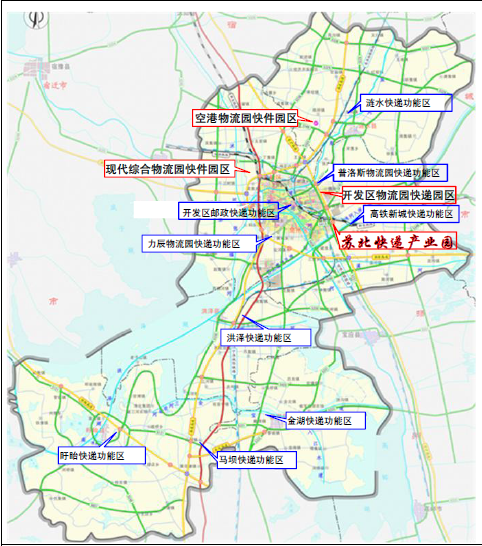

# 淮安市“十三五”邮政业发展规划

1 绪论

邮政业包括普遍服务、快递服务和邮政监管，是国家重要的社会公用事业，为经济社会提供邮递（寄递）服务，既包括满足社会普遍需求的寄递（邮递）服务，也包括多层次、多样化的快递等竞争性服务。随着市场经济的发展和世界经济一体化进程的加快，我国邮政业面临着前所未有的发展机遇，也面临着更加严峻的挑战。为率先构建起先进完备的邮政普遍服务体系、快递服务体系和现代邮政监管体系，推动强业惠民走在前列，特制定本规划。

1.1 规划背景

邮政业是现代服务业的重要组成部分，邮政网络是国家重要的通信基础设施，邮政业承担着通政、通民、通商的重要职能，“十三五”时期，邮政业进入转变发展方式、建设现代邮政业的关键时期，为率先构建起先进完备的邮政普遍服务体系、快递服务体系和现代邮政监管体系，依据《中华人民共和国邮政法》、《江苏省十三五邮政业发展规划》，按照《淮安市国民经济和社会发展第十三个五年总体规划纲要》和淮安市其他相关“十三五”发展规划的总体安排，结合我市邮政业改革和发展实际，特制定本规划。本规划是指导“十三五”时期淮安市邮政业科学发展的纲领性文件。

1.2 规划范围

本次规划编制范围为淮安市全市范围，以淮安市的清江浦区、淮阴、淮安3区的城区部分为主，涉及三县及洪泽、淮阴、淮安3区的农村部分。

1.3 规划期限

本次规划年限为 2016年—2020年。

1.4 规划依据

本次规划的依据包括：

——《中华人民共和国邮政法》（2015修正版）；

——国务院《物流业调整和振兴规划》（国发〔2009〕8号）；

———国务院《关于促进快递业发展的若干意见》（国发〔2015〕61号）；

——国务院《关于大力发展电子商务加快培育经济新动力的意见》（国发〔2015〕24号）；

——国务院《关于积极推进“互联网+”行动的指导意见》（国发〔2015〕40号）；

——国务院办公厅《关于促进跨境电子商务健康快速发展的指导意见》（国办发〔2015〕46号）；

——国家邮政局《快递服务“十二五”规划》；

——国家邮政局《 长江三角洲地区快递服务发展规划》；

——国家邮政局《关于促进邮政服务创新发展的若干意见》；

——国家邮政局《邮政普遍服务规划》；

——国家邮政局、商务部《关于推进“快递向西向下”服务拓展工程的指导意见》（国邮发〔2015〕107号）；

——国家邮政局《邮政行业“十三五”规划编制工作要求》，2015 年；

——江苏省政府《江苏省服务业提速计划》，2010年；

——《江苏省“十三五”现代服务业发展规划》；

——《江苏省“十三五”物流业发展规划》；

——《江苏省邮政条例》（2013年11月29日江苏省第十二届人民代表大会常务委员会第六次会议修订）；

——江苏省政府《关于促进快递服务业发展的若干意见》（苏政办发〔2014〕85号）；

——江苏省政府《关于加快淮安苏北重要中心城市建设的意见》（苏发〔2011〕23号）；

——《江苏省“十三五”邮政业发展规划》（2016年4月版）；

——淮安市政府《关于加快现代物流业发展的意见》（淮政发〔2015〕175号）；

——中共淮安市委、淮安市政府《关于加快发展“4+3”服务业特色产业的实施意见》（淮发〔2015〕12号）；

——淮安市政府《关于加快电子商务产业发展的若干意见》（淮政办发〔2015〕155号）；

——淮安市商务局《淮安市城市共同配送规划（第四稿）》，2014 年；

——淮安市规划局《淮安市城市总体规划（2009-2030）》；

——《淮安市“十三五”电子商务发展规划》；

——《淮安市“十三五”交通运输发展规划》；

——《淮安物流业及物流园区发展规划（2015-2025）》。

2 “十二五”期间邮政业发展现状

2.1 我国、我省邮政服务业发展现状

2.1.1 我国邮政业发展现状

“十二五”以来，我国邮政业规模持续扩大，但是邮政普遍服务业务持续下滑，快递业务快速增长，快递业务收入在行业中占比继续提升（详见表2-1）。“十二五”末快递业务收入占行业总收入的比重为68.8％。

表2-1：“十二五”期间全国邮政业发展情况表

| 指标名称 | 单位 | 2011年 | 2012年 | 2013年 | 2014年 | 2015年 | 年均增长（%） |
|---|---|---|---|---|---|---|---|
| 一、邮政行业业务收入 | 亿元 | 1561.5 | 1980.9 | 2547.8 | 3203.3 | 4039.3 | 20.9 |
| 其中:快递业务收入 | 亿元 | 758 | 1055.3 | 1441.7 | 2045.4 | 2769.6 | 29.5 |
| 二、邮政行业业务总量 | 亿元 | 1607.7 | 2036.8 | 2725.1 | 3696.1 | 5078.7 | 25.9 |
| 其中:函件 | 万件 | 738000 | 707000 | 634000 | 561000 | 458141.1 | -9.1 |
| 包裹 | 万件 | 6880.6 | 6874 | 6924.8 | 6024.2 | 4243.4 | -9.2 |
| 快递 | 万件 | 367000 | 569000 | 919000 | 1396000 | 2066636.8 | 41.3 |
| 订销报纸累计数 | 万份 | 1817000 | 1902000 | 1943000 | 1911000 | 1880467.4 | 0.7 |
| 订销杂志累计数 | 万份 | 108000 | 113000 | 114000 | 108000 | 100093.7 | -1.5 |
| 汇兑 | 万笔 | 26000 | 23000 | 19000 | 13000 | 8271.2 | -20.5 |

2.1.2 “十二五”期间我省邮政服务业发展情况

表2-2“十二五”期间江苏省邮政业发展情况表

| 指标名称 | 单位 | 2011年 | 2012年 | 2013年 | 2014年 | 2015年 | 年均增长（%） |
|---|---|---|---|---|---|---|---|
| 一、邮政行业业务收入 | 亿元 | 134.42 | 178.75 | 233.1 | 299.5 | 407.2 | 24.8 |
| 其中:快递业务收入 | 亿元 | 70.87 | 103.41 | 143.0 | 201.1 | 290.7 | 32.6 |
| 二、邮政行业业务总量 | 亿元 | 154.10 | 205.74 | 269.6 | 359.0 | 516.0 | 27.34 |
| 其中:函件 | 万件 | 94526.12 | 89465.01 | 76123.6 | 62648.0 | 48768.9 | -12.4 |
| 包裹 | 万件 | 422.14 | 415.58 | 407.19 | 326.57 | 153.03 | -18.4 |
| 快递 | 万件 | 38508.96 | 63870.50 | 98415.5 | 148435.2 | 229047.7 | 42.8 |
| 订销报纸累计数 | 万份 | 167189.7 | 170928.06 | 171967.2 | 166298.2 | 155594.1 | -1.4 |
| 订销杂志累计数 | 万份 | 8225.59 | 8244.22 | 7938.6 | 7409.6 | 7224.4 | -2.6 |
| 汇兑 | 万笔 | 1963.2 | 1651.99 | 1251.6 | 943.1 | 664.6 | -19.5 |

2.2 “十二五”期间淮安市邮政业工作回顾

表2-3 淮安市“十二五”期间邮政业发展情况表

| 指标名称 | 单位 | 2011 | 2012 | 2013 | 2014 | 2015 | 年均增长（%） |
|---|---|---|---|---|---|---|---|
| 一、邮政行业业务收入 | 亿元 | 3.43 | 4.56 | 5.94 | 7.80 | 10.39 | 24.8 |
| 其中：快递业务收入 | 亿元 | 1.03 | 1.50 | 2.07 | 3.49 | 5.59 | 40.25 |
| 二、邮政行业业务总量 | 亿元 | 3.16 | 4.22 | 5.53 | 9.38 | 14.21 | 35.1 |
| 其中：函件 | 万件 | 1267.98 | 1207.75 | 1027.80 | 1055.24 | 906.24 | -5.7 |
| 包裹 | 万件 | 6.01 | 5.92 | 5.79 | 5.78 | 3.12 | -12.7 |
| 快递 | 万件 | 547.34 | 907.81 | 1398.94 | 3291.71 | 5851.05 | 60.6 |
| 定销报纸累计数 | 万份 | 10216.41 | 10445.26 | 10507.93 | 9511.78 | 8859.29 | -2.82 |
| 定销杂志累计数 | 万份 | 355.69 | 356.51 | 343.32 | 290.38 | 272.44 | -5.2 |
| 汇兑 | 万笔 | 84.71 | 71.28 | 68.31 | 54.03 | 41.93 | -13.2 |

注：1．数据来源：2011、2012年数据根据淮安市GDP占江苏省GDP比重

结合当年江苏邮政业经济运行数据计算得出； 2013、2014、2015

年数据来源于淮安市邮政管理局网站。

2．由于“十二五”快递统计口径及统计企业数等原因，快递业务收

入及快递业务量指标“十二五”前期不完整，年均增长率不能反映真实情况。

表2-4 淮安市“十二五”期间邮政业发展在全省所占份额对比表

| 指标名称 | 单位 | 2011 | 2012 | 2013 | 2014 | 2015 | 年均增长率对比 |
|---|---|---|---|---|---|---|---|
| 一、邮政行业业务收入 | % | 2.55 | 2.55 | 2.55 | 2.6 | 2.55 | —— |
| 其中：快递业务收入 | % | 1.45 | 1.45 | 1.45 | 1.74 | 1.92 | +7.65 |
| 二、邮政行业业务总量 | % | 2.05 | 2.05 | 2.05 | 2.61 | 2.75 | +7.76 |
| 其中：函件 | % | 1.35 | 1.35 | 1.35 | 1.68 | 1.86 | +6.7 |
| 包裹 | % | 1.42 | 1.42 | 1.42 | 1.77 | 1.42 | +5.7 |
| 快递 | % | 1.42 | 1.42 | 1.42 | 2.22 | 2.55 | +17.8 |
| 定销报纸累计数 | % | 6.11 | 6.11 | 6.11 | 5.72 | 5.69 | -1.4 |
| 定销杂志累计数 | % | 4.32 | 4.32 | 4.32 | 3.92 | 3.77 | -2.6 |
| 汇兑 | % | 4.31 | 4.31 | 4.31 | 5.73 | 6.3 | +6.3 |

2.2.1 邮政体制改革顺利实施

根据国务院《邮政体制改革方案》，2012年末，省级以下邮政监管机构批准成立，淮安市邮政管理局正式挂牌，依法履行行业管理职能，在保障邮政普遍服务、规范邮政市场秩序、维护寄递安全方面发挥了重要作用。邮政企业正式更名为江苏省邮政公司淮安分公司（现已更名为中国邮政集团公司淮安市分公司），各县区邮政局更名为县区邮政分公司，加快了向现代企业转型的步伐，在机构、人事、财务、经营等方面实施了一系列改革。信息流、资金流和物流“三流合一”的现代邮政服务体系逐步建立，普遍服务和特殊服务由邮政企业一家承担，竞争性业务多家主体共同经营的行业格局已经形成。

2.2.2 行业发展环境显著改善

“十二五”期间，修订后的《中华人民共和国邮政法》等一系列邮政法律法规和行业标准相继颁布实施。江苏省制定出台了《江苏省邮政条例》及《省政府办公厅关于促进快递服务业健康发展的实施意见》（苏政办发〔2014〕85号）。淮安市政府也相继出台了鼓励邮政快递业发展的政策和意见。淮安市邮政管理局以多种形式和方式开展送法进企业活动，向企业宣贯《邮政法》、《江苏省邮政条例》、《快递市场管理办法》等法律法规，全市邮政行业发展环境显著改善。

2.2.3 邮政普遍服务能力不断提高

“十二五”期末，全市邮政普遍服务营业网点达到173个。与市民政局联合印发了《关于推进我市邮政便民服务进社区工作的意见》，邮政便民服务站（村邮站）达到1421个，已经实现全市村邮站全覆盖，超额完成建设计划，为邮政、快递企业延伸服务到社区、在社区打造邮政行业综合服务平台提供了政策依据，为实现邮政公共服务的均等化和解决快递服务末端投递问题创造了条件。机要通信连续多年实现零事故运营，党报党刊发行等特殊服务得到有效保证。

2.2.4 快递服务迅猛发展

“十二五”期末，全市取得快递业务经营许可证的企业达到107家。快递服务网络覆盖面不断扩大，多家快递企业在淮安市建立了区域总部和快件集散（分拨）中心。推进淮安电子商务现代物流园转型升级，多家品牌转运中心入驻集聚，已形成一定规模，为建设苏北快递产业园区奠定了基础。邮政EMS通过公司化改革进一步增强竞争能力，民营快递企业保持了较高的增幅并形成一批具有一定规模的品牌企业。2013年，淮安市快递行业协会成立，在促进行业自律、服务企业发展方面发挥了积极作用。

2.2.5 科技化水平快速提升

“十二五”期间，全市邮政企业初步建成了集数据、语音、视频等多媒体通讯为一体的邮政综合网，邮政业务信息化覆盖率接近100%，涵盖了函件、包裹、集邮等传统邮务类业务。11185客户服务中心和183电子邮政服务平台相继投入使用。邮件处理机械化、自动化和信息标识条码化、封发容器化程度进一步提高。信息技术在快递服务中得到普遍应用，大部分快递企业实现了订单实时跟踪与查询。手持终端（PDA）、无线传输系统、车辆运输定位系统、自动分拣系统等一系列技术手段逐步得到应用和推广。

2.2.6 行业加速融入地方

近年，行业加快了融入地方的步伐，取得了明显的成效。市分管领导分别就快递产业发展与末端运输投递、村邮站建设与运营情况进行了专题调研，实地考察圆通、中通等苏北区域分拨中心；破解快递服务“最后一公里”难题；主持召开村邮站建设专题座谈会，就村邮站发展提出要求。联合市公安局、国安局、文广新局、淮安海关强化寄递渠道安全保障工作。联合四部门成立了淮安市寄递渠道安全监管办公室，与相关部门形成联动机制。

2.2.7 行业监管力度进一步强化

开展法定业务、机要通信服务、邮政业“扫黄打非”等专项整治活动；规范普遍服务相关行政处罚工作；完成全国、省内、本市邮件寄递时限监测工作；加强邮票发行监督管理工作。完成了全市快递企业普查，建立了快递企业基本数据库及网络拓扑图，形成了快递企业发展的“成长档案”，有力地夯实了行业监管基础。抓好行业安全监管，联合市公安等部门严厉打击寄递危险化学品的违法行为。

“十二五”时期，淮安市邮政业取得了显著成就，但与经济社会发展和人民群众快速增长的用邮需求相比，仍然存在一定差距，主要表现在：行业规模偏小，在全市国民经济中所占比重偏低；邮政基础设施仍然比较薄弱，邮政普遍服务长效补偿机制尚未建立；快递企业整体实力不强，快递服务水平有待提升；邮政监管体系有待完善，行业管理需要进一步加强。这些问题有待于在“十三五”期间着力加以解决。

2.3 “十三五”淮安市邮政业发展形势

“十三五”时期，我国经济发展将步入“新常态”，邮政业将进入历史上发展最快、变革最大、市场化程度最高的关键时期，也是邮政业面临深刻变革的重要时期。

2.3.1 快递行业发展前景广阔

近年来我国电子商务的飞跃发展，尤其以天猫、淘宝网等为代表的B2C飞速发展，为快递行业的高速发展奠定了坚实基础。淮安作为苏北重要中心城市，正在积极打造新型工业城市，如此广阔的市场前景为快递产业的进一步发展创造了良好的机遇。

2.3.2 国家相继出台利好政策

近年来国家出台了许多促进快递业发展的扶持政策，2015年10月，国务院印发《关于促进快递业发展的若干意见》，提出促进快递业健康发展，进一步搞活流通、拉动内需，服务大众创业、万众创新，培育现代服务业新增长点。

2.3.3 淮安得天独厚的区位优势

淮安市作为一个历史文化古城，地处苏北腹地，是区位优势明显的重要交通枢纽，凸现了淮安在江苏乃至全国的交通枢纽地位。苏北快递产业园于2015年8月获批，全国各大快递公司纷纷在淮安布点，建设区域中转中心，辐射苏北、鲁西南、豫东南地区，淮安的快递产业集聚效应初具规模。

2.3.4 淮安电子商务产业发展迅猛

近几年，淮安市电子商务产业飞速发展，交易规模逐步扩大。目前，淮安正在创建国家电子商务示范城市，着力打造区域性电子商务综合物流中心、电商专业服务中心、电商人才孵化中心，这对于本土的快递企业是一次难得的发展机遇。

2.3.5 民营企业自身的发展优势

与国有快递企业、外资快递企业相比，民营快递企业经营方式更加灵活，服务时间和方式较为机动。民营快递企业具有较强的本土化优势，当地的服务人员更了解顾客的价值观念和消费行为，更容易和消费者对接沟通。

2.3.6 物流新技术给邮政业带来发展机遇

物流新技术在邮政企业的应用，进一步扩展到全程时限监控，随着技术成本降低，邮政各环节以及终端渠道的管理等应用，对信息采集、分析和提高运作效率将会发挥越来越重要的作用。

3 淮安市“十三五”邮政业发展规划指导思想、原则与发展目标

3.1 指导思想

贯彻落实党的十八大及十八届三中、四中、五中、六中全会精神，紧紧围绕到2020年要建成与小康社会相适应的现代邮政业目标和“四个全面”战略布局，加大供给侧改革力度，秉持创新、协调、绿色、开放、共享发展理念，按照淮安市委、市政府关于“苏北重要中心城市和全面小康社会”的目标定位，全面落实国家邮政局、江苏省邮政管理局工作部署，按照稳中求进的总基调，主动适应经济新常态，坚持依法治邮，坚持安全为基、发展为要、服务为上，加快“五个邮政”的建设。加大供给侧结构性改革力度，着力推动我市邮政行业创新发展，进一步优化产业结构；着力推动行业转型升级，进一步转变发展方式；着力完善依法行政，进一步加快依法治邮进程；着力促进与地方融合，进一步完善产业联动，加快推动全市邮政业科学发展步伐。

3.2 规划原则

面对新形势、新任务和新要求，我们要准确审视邮政行业的发展变化，围绕中心工作狠抓深入推进，进一步解放思想，坚持合作共赢，同进同退，攻坚克难，努力工作，共同努力推动淮安邮政业快速发展。

市场主导。遵循市场发展规律，进一步开放国内快递市场，用市场化手段引导快递企业整合提升，鼓励企业持续提高服务能力和服务质量。进一步简政放权，发挥法律法规、规划、标准的规范引导作用，形成有利于快递业发展的市场环境。

安全为基。进一步强化安全生产红线意识，加强寄递安全制度体系建设，落实企业主体责任，夯实快递业安全基础。依靠科技手段创新管理方式、提升监管能力，保障寄递渠道安全。

创新驱动。鼓励不同所有制资本在快递领域交叉持股、相互融合，激发市场主体活力和创造力。支持快递企业加快推广应用现代信息技术，不断创新商业模式、服务形式和管理方式。

协同发展。推动快递业加快融入生产、流通和消费环节，充分发挥服务电子商务的主渠道作用，联通线上线下，实现与先进制造业、现代农业、信息技术等产业协同发展。

3.3 发展定位

中央提出邮政业是现代服务业的关键产业，是替代传统流通模式、刺激消费升级的重要产业，是物流业的先导产业。新定位对邮政业改革发展提出了新要求，淮安市邮政业正处于“把淮安建设成为辐射苏北腹地2000万人口的区域性中心城市”，构建淮安市“4+3”现代服务业体系的关键期，针对淮安地处苏北区域地理中心位置、全省高速公路枢纽以及历史文化、旅游资源十分丰富的特点，结合国际国内邮政业发展形势和特征，将淮安市“十三五”邮政业发展定位为：大力扶持发展快递物流，打造区域快递集散中心，创建国家级快递物流园，形成辐射苏北及鲁南、豫东、皖北，影响长三角快递物流集散区，成为快速崛起的新兴快递业集聚高地。

3.4 发展目标

针对当前我市邮政行业发展还不能适应经济社会发展需要及人民群众日益提升的用邮需求，邮政普遍服务保障与群众期盼还有差距，服务品质和速度需进一步提升；快递服务质量不高，城乡服务水平不均衡等状况，这些都亟需我们进一步转变观念，优化发展思路，主动适应新定位提出的新要求，加快建设普惠邮政，推进邮政服务换档升级。

——深化邮政改革。加大供给侧结构性改革力度，通过改革发挥市场的资源配置作用，消除阻碍邮政业生产力发展的体制和机制性障碍，进一步转变政府职能，激发企业活力。

——完善发展机制。完善由国家保障、企业承担的邮政普遍服务和特殊服务发展机制，完善由市场主导、公平开放的竞争性业务发展机制。完善社会共享、便民高效的城乡邮政普遍服务设施使用机制，打造邮政综合服务平台。

——转变发展方式。加快体制和机制创新，推动邮政业向生产性服务领域拓展，向电子商务、制造业、信息业、金融业等紧密联合发展，推动与综合交通运输体系深度衔接、协同创新，实现产业转型升级。支持和包容业态创新，鼓励多元资本加速进入，推进快递市场对外开放。

——优化发展环境。加强邮政法制建设，发挥规划引领作用，加大政策扶持力度，完善行业监管，构建面向企业的全程监管体系，为邮政业的发展创造良好的外部环境。

——提升服务水平。大力推进公共服务均等化，构建覆盖城乡、可持续发展的邮政普遍服务体系；努力满足人民群众多层次、多样化的用邮需求，构建便捷高效、服务优质的快递服务体系。

3.4.1 淮安市“十三五”邮政业发展规模目标

“十三五”期末，淮安市邮政业综合实力进一步提升，经济社会效益明显提高，业务总收入在“十二五”基础上翻一番以上，对国民经济的贡献率明显提高，成为国民经济发展新的增长点。邮政普遍服务和特殊服务得到有效加强，快递服务水平明显提升，较好地满足经济社会发展和人民群众用邮需求。

根据我市邮政行业经济发展趋势，我市“十三五”规划规模发展目标：

表3-1 淮安市“十三五”邮政业发展总体目标

| 指标 | 2015年 | 规划目标 |
|---|---|---|
|  | 2020年 | 年均增长 |
| 一、邮政业业务收入 | 10.39亿元 | 21亿元 | 15% |
| 其中：快递业务收入 | 5.59亿元 | 15亿元 | 22% |
| 二、邮政业业务总量 | 14.21亿元 | 31亿元 | 17% |
| 其中：快递业务量 | 5851.05万件 | 17800万件 | 25% |
| 包裹 | 3.12万件 | 6.2万件 | 15% |
| 函件 | 906.24万件 | 1000万件 | 2% |
| 订销报纸量 | 8859.29万份 | 9500万份 | 1.4% |
| 订销杂志量 | 272.44万份 | 300万份 | 2% |
| 日均快递转运量 | 182.6万 | 509.8万 | 22.8% |
| 快递转运量峰值 | 238.9万 | 672.3万 | 23% |

注：由于“十二五”快递统计口径及统计企业数等原因，年均增长率不能反映真

实情况，“十三五”快递增长指标，是在考虑淮安实际情况及调研测算后提

出的。

邮政普遍服务总体发展水平保持稳定，机要通信确保万无一失，快递服务满意度稳中有升，快递人才实现2千人次在职培训目标，邮政监管力度进一步加强。

3.4.2 普遍服务

邮政普遍服务要基本实现与经济社会发展相匹配、与人民群众需求相适应的基本公共服务均等化。到2020年，我市的邮政普遍服务初步形成权责统一、激励有力、约束有效、配置合理的邮政普遍服务保障监督体系。实现邮政普遍服务发展换挡升级，充分发挥服务新业务、新业态的先导作用。

服务能力

提升邮政普遍服务终端能力，自办邮政服务网点电子化比重达到99.5%。推进城镇居民楼信报箱建设，有效提升信报箱覆盖水平，城市住宅楼房信报箱安装率达到80％以上。重点加强农村邮政设施建设，继续保持农村给据邮件投递到户、农村平常邮件80%妥投到户，进一步创新拓展村邮站服务功能，推动普遍服务与农村电商协调发展。近年来，中国邮政集团公司正在逐步对其包裹业务优化组合，服务种类和质量将有所提高，预计未来包裹业务量将有所增长，预计2020年包裹量将会在6.2万件左右。预计2020年函件业务量在1000万件左右。继续加强党报党刊发行工作，加快党报党刊传递速度，市内城市党报党刊当日见报率达98%。未来五年内报纸、杂志业务量会稍有回落，考虑到其目前业务主要集中在党报、党刊，不管市场如何萎缩，其业务量仍能够得到保障，预计2020年订销报纸业务、订销杂志业务将分别稳定在9500万份、300万份左右。

服务水平

——提升整体服务水平，保持全国领先地位。

——市区平均1.5-2公里服务半径或1.5-3万人口，设置一个邮政局所；县城平均2-5公里服务半径或2万人口，设置一个邮政局所；农村地区主要人口聚居区平均5-10公里服务半径或1-2万人口，设置1个邮政局所。

——市区平均1.5-2公里服务半径，设置一个邮筒（箱）；县城平均2-2.5公里服务半径，设置一个邮筒（箱）；乡、镇人民政府所在地主要人口聚居区平均5公里服务半径，设置1个邮筒（箱）。

——城市实现插箱到户，郊区投交村邮站，农村通邮率实现100％。

——邮件准时投递率达98%以上；

——营业、投递规范服务达标率95%以上；

——用户投诉回复率达到95%以上，用户服务满意度居全行业领先水平。

3.4.2.1 优化邮政普遍服务网络布局。以提升普遍服务能力、实现服务均等化为目标，创新网络共建共享，统筹优化网络布局，集成建设邮政基本公共服务平台。实现我市航空、高铁等邮运通道、邮件转运中心等设施的建设，推动邮件转运中心等基础设施与民航机场、高铁站点等交通枢纽的同步建设、顺畅衔接，充分利用综合交通运输资源提升邮运能力。

3.4.2.2 统筹邮政网点建设，推动邮政普遍服务均等化。服务新型城镇化发展战略，有序推进邮政网点分等分级管理，分等级、分层次、分区域实施“网点加密”工程，推动邮政普遍服务均等化进程。实现城乡间服务水平的基本均衡。在普遍服务的主要内容上实现信函到包裹的转变。适应需求变化在速度和便捷性上有所提高。继续推进在社区、商厦、校园、车站等公共服务设施建设邮政便民服务站，扩展服务功能，提高网点覆盖深度和广度。进一步完善邮政网点布局，丰富网点功能，推动建设邮政基本公共服务平台。进一步加强以“村邮户箱”为重点的邮政普遍服务城乡终端服务体系建设。推动村邮站与农村地区公共服务平台结合建设，实现村邮站建设和运行社会化，为服务农村网络经济，实现邮件直接投递到建制村提供重要支撑。推广智能包裹柜试点、推广和普及，加大城市写字楼、社区投递点建设。设置新型智能信报箱，推动老旧小区信报箱补建、新建小区信报箱设置，实现新建小区信报箱安装率100%。建设农村电商邮政业寄递骨干网，提升信息化水平，完善电子商务服务功能，提升电子商务邮政业配送能力。

3.4.2.3 培育发展壮大新兴服务业态。打造“互联网+邮政业务”模式，发挥邮政普遍服务在新型流通体系的先导作用、基础作用。抓住电子商务的发展机遇，整合邮政网络资源，充分发挥邮政信息网、实物网、金融网三网合一的优势，积极发展繁荣邮政小包等新兴业务、新兴业态。继续发挥在国际跨境电商的优势地位，加强与主流电商平台紧密合作，整合国际寄递业务资源，做强跨境电商服务品牌，满足碎片化的跨境网购需求。

3.4.2.4 创新邮政普遍服务有效供给。鼓励邮政服务设施对外开放共享，推动邮政基础设施资源的综合利用，面向电子商务企业、快递企业、增值服务商，打造邮政普遍服务基础网络平台，形成综合邮政快递服务商、专业化邮政快递服务商、普遍服务平台运营商等多层次商业模式协同发展的局面，提高邮政基础网络利用效率，提升邮政普遍服务运行水平。

3.4.2.5 促进行业转型升级协同发展。促进邮政服务与地方经济发展深度融合，积极承接政府公共服务项目，推动邮政普遍服务向产业上下游延伸发展供应链服务、电子商务配送等业务，与电子商务、制造业、信息业、交通运输等紧密协同发展，集成金融服务平台，推动邮政网点开展“普惠金融”支付结算平台建设，争取提供电子商务第三方支付服务，促进普遍服务转型升级。

3.4.3 快递服务

未来五年，淮安市快递服务业发展的总体目标是：充分发挥苏北快递产业园等物流园区的产业集聚优势，着力打造立足苏北，辐射鲁南、豫东、皖北地区，服务长三角的快件陆路集散中心，强化与航空、高铁等运输方式的衔接，实现邮件快件处理资源的有效共享和邮政快递运输系统的大幅提升，构建行业综合集聚发展平台；充分推动邮政快递业与上下游产业融合发展，强化与特色制造业、特色农业、电子商务、物流仓储等多行业交叉协同发展，推动快递企业与传统产业园区、物流集聚区、专业市场、电商集聚区、制造业之间的深度合作，建成长三角北翼具有一定竞争力的新兴快递业集聚高地。

3.4.3.1 快递行业规模迈上新的台阶。至2020年，快递业务收入达到15亿元，年均增长22%以上，与2015年相比实现业务收入增长270%；快递业对经济社会发展贡献逐步增强。

3.4.3.2 快递服务能力显著提升。

——规模以上快递企业全部采用手持终端（PDA）设备，主要品牌邮政快递转运中心全部实现机械化作业。

——主要品牌邮政快递企业积极运用互联网、物联网、大数据、云计算等先进技术，通过精确、动态、科学的管理和信息共享，不断提升供给能力、运行效率、安全性能和服务质量。

3.4.3.3 快递服务空间布局更趋合理。结合我市产业布局，整合现有仓储、运输等物流基础设施，至2020年，形成层次清晰、衔接有序的快递业服务三级网络布局。淮安市快递业配送空间布局打造为“1核3园9快递功能区多端点”，即：“1个高集聚度、高分拨等级的核心集散中心——苏北快递产业园；3个园区级的一级快件转运中心——现代综合物流园快件转运中心、空港物流园快件转运中心、开发区物流园快件转运中心（含保税物流园和金网物流园）；9个快递功能区——①高铁新城快递功能区；②力辰物流园快递功能区；③普洛斯物流园快递功能区；④开发区邮政快递功能区；⑤涟水快递功能区；⑥洪泽快递功能区；⑦金湖快递功能区；⑧马坝快递功能区；⑨盱眙快递功能区；多个末端配送网点”：在市区社区、学校、商务区等处建设末端服务网点或公共智能自提柜。在农村地区借助现有邮政普遍服务网络，以满足农村电商服务的需求。

3.4.3.4 快递服务水平与质量大幅提升。快递产品结构和服务质量不断优化，至2020年，快递限时产品比例达30%以上，同城当天达比例达90%以上，与省内90%市县实现快递“当日达”或“次日达”，快递末端投递服务水平全面提升。全面实现快递车辆统一标识、专用号段，快递企业全面实行承诺服务、标准服务、流程服务，快件延误率不超过万分之三、损坏率不超过十万分之三、丢失率不超过百万分之三，投诉处理率达100%，用户满意度达80分以上。

3.4.3.5 全面提升快递行业信息化水平。快递行业信息化、自动化、标准化服务水平全面提升，至2020年，快递企业全部建立快件跟踪查询系统，全部实现与快递市场监管信息系统联网，快件信息入网采集度达100%；规模以上快递企业集散中心和转运中心的标准化、机械化作业比例达100%，分拣处理准确率和运行效率明显提高；快递智能便民柜全面推广，基本实现快件无人交接智能平台全覆盖。

3.4.3.6 加速快递服务创新升级。推动快递服务与电子商务、制造业、信息业、金融业等紧密联合发展，推动与综合交通运输体系深度衔接、协同创新。适应区域经济一体化新形势和“一路一带”战略，促进寄递服务与跨境电商联动发展，优化企业“走出去”的国际环境。

3.4.3.7 快递人才培养取得较大突破。加强快递专业人才培养，重点联合省内市内高等院校开设一个以上快递人才教育与在职培训专业，至2020年，实现2千人次在职培训目标，从业人员平均受教育程度明显提高；快递人员岗前和在职培训全面加强，规划期末实现90%以上快递业务员持国家职业资格证上岗。“十三五”期内将建成一个以上省级邮政业人才培训基地。

3.4.4 邮政监管

3.4.4.1 优化环境，推进改革。充分发挥规划、政策对快递业发展的引领作用，做好与快递业总体规划和关联产业规划的协同衔接，用规划引领促进重大工程项目的建设。积极推动企业供给侧改革，最大限度释放发展活力，在稳步发展中调结构、提质效，启动质量品牌提升行动，强化能力和标准化建设，推动对同一工商登记机关管辖范围内企业实施“一照多址”模式，推动快递末端备案管理工作，积极推动“绿色快递”建设。

3.4.4.2 提升行业安全保障能力。健全企业主体、政府监管、属地管理三个责任体系，全面强化安全监管基础建设，建立健全安全保障制度体系，着力推动行业安全监管工作由被动向主动转变，确保寄递渠道安全畅通。推进企业安全生产标准化建设，完善企业组织制度建设、物资设备配备、隐患排查整治、从业人员教育、应急处置机制等各个环节。充分发挥联动机制作用，按照“常态联动、问题牵引、优势互补、责任共担”的原则，推动安全管理制度、安全检查排查、安全宣传教育等多个方面寻求突破。重点推进“绿盾工程”建设，推进“收寄验视＋实名收寄＋过机安检”三项安全制度落实，全力做好实名收寄和企业安检机配置工作，加强安全监管和应急保障建设。

3.4.4.3 强化行业服务质量建设。落实《国务院关于促进快递业发展的若干意见》重点任务，着力开展好各项示范工程建设，以点带面、重点突破，积极推动服务创新、拓展发展空间；鼓励快递企业兼并重组，推动企业强化品牌建设；加快推进营业网点、末端投递环节布局，推进快递服务方式转型升级，加快形成一批支撑我市快递行业发展的龙头企业；深入推进“三向”工程，推动“上机上车”工程，推进“三进”工程，抓好产业联动拓展工程。切实贯彻行业标准和操作规范，提升收寄、分拣、运输、投递等各环节服务能力，有效减少消费者申诉投诉；加强从业人员教育培训，综合运用科技化信息化手段，推动行业服务质量有效提升，营造更为良好的行业发展环境。

3.4.4.4 推进行业整合融合发展。推动重点物流快递园区建设和主要快递品牌在转运中心的集聚；发展多级联运，强化与航空、高铁等运输方式的衔接，实现邮件快件处理资源的有效共享和邮政快递运输系统的大幅提升；拓展邮政快递服务网络，推动快递网络与邮政基层网络的无缝衔接，打造便利、快捷、高效的城乡一体化快递体系；充分推动邮政快递业与上下游产业融合发展，强化与特色制造业、特色农业、电子商务、物流仓储等多行业交叉协同发展，推动快递企业与传统产业园区、物流集聚区、专业市场、电商集聚区、制造业之间的深度合作，建设快递配送中心,为运营商家提供仓储、分装、分拨、配送、代收货款等一体化服务；吸引一批国内外大型快递企业区域性总部、枢纽中心落户淮安，做大做强本土品牌快递企业，培育形成3-5家快递领军企业。

3.4.4.5 加快行业诚信体系建设。不断加强行业诚信体系建设，构建企业诚信评价体系，建立健全企业、从业人员和消费者的诚信记录和评价。加强宣传动员，营造诚信环境，通过“放心消费”、“青年文明号”、“最美快递员”评比等一系列活动不断提升行业发展软环境，不断提高社会对行业发展的认可度。加大诚信企业、从业人员和消费者的示范宣传力度，通过行业自律，营造“守信光荣、失信可耻”的氛围，建立良性的运行秩序，推动构建服务社会的文明形象。

3.4.4.6 推动行业人才质量提升。充分吸收整合文化教育资源，推动行业人才队伍建设，定期组织企业负责人及从业人员接受有关企业管理、安全管理、服务标准等方面的业务培训，强化校企合作，与有关院校合作推进邮政快递专业学历教育与在职教育，积极培养中高级人才，推动企业从业人员参加快递业务师资格认定，对进城务工、下岗人员参加快递技能培训、享受社会保障等方面提供支持，切实推动行业人才质量提升，为行业现代化科学化发展提供坚实的人才基础。

3.4.4.7 加强信息化建设。推动信息平台建设，建立快递信息系统的统一标准，推动各快递企业信息系统的互通互联；建立快递行业从业人员数据库，设立“行业黑名单”，强化对快递从业人员动态管理；深入提升行业信息技术应用能力，深化邮政快递企业自动化、信息化、网络化建设应用。综合利用互联网、物联网、大数据、云计算等先进技术，通过精确、动态、科学的管理和信息共享，全面提升行业供给能力、运行效率、安全性能和服务质量，加强行业智能化建设与科技创新，推动行业从传统的劳动密集型产业向技术、劳动密集型产业转变。

3.4.4.8 促进快递环保化发展。在行业内践行低碳环保，有效减少收寄、分拣、运输、投递等各个环节对环境的污染和资源消耗。推广环保技术材料，鼓励企业采用清洁生产技术，使用可循环利用的包装材料及可降解的物料辅料，大力降低原材料和能源消耗，积极推动新能源环保车辆应用于邮政快递行业，推动运输节能减排，从而实现邮政快递业“低污染、低消耗、低排放、高效能、高效率、高效益”发展。

3.4.4.9 依法治邮，强化监管，提升监管水平。以提升依法监管能力为着力点，创新监管模式，丰富监管手段，切实强化事中事后监管，规范市场运行秩序，有效管控服务质量，推动市场监管水平与快递业发展相适应。突出做好“三张清单一张网”落实工作，依法开展许可管理工作，以开展“双随机”检查工作和“双整”专项活动为抓手创新市场监管工作模式，加强集邮和用品用具市场监管。

4 主要任务

4.1 推动邮政企业发展创新，完善“三流合一”的邮政服务体系

深化邮政主业改革，实现普遍服务业务和竞争性业务分业经营、分账核算，实行透明合理的邮政普遍服务成本核算与补贴制度。按照建立现代企业的发展方向，转换机制，调整结构，整合资源，降本增效，持续提升邮政企业的发展规模、运行质量和经济效益。依托和强化邮政“三流合一”的资源优势，加强对邮政实物网、信息网、金融网关键领域和核心环节的投入，提升企业核心竞争能力。以函件业务为重点、突出发展邮务类业务，做大做强、稳中求好地发展邮政速递物流业务，立足城乡、快中求好地发展邮政金融业务，不断完善“三流合一”的现代邮政服务体系。

4.2 健全邮政普遍服务保障机制，提升邮政普遍服务能力和水平

建立邮政普遍服务长效补偿机制，加强对邮政普遍服务的监督检查，完善“国家保障、政府监管、企业承担”的邮政普遍服务发展机制。以邮政基础设施建设为重点，加大对邮政普遍服务的投入，确保邮政普遍服务内容不缺失、网络不削弱、水平不降低，与地方经济社会发展和人民生活水平的提高相适应。补建农村空白网点，优化局所布局，提高设施设备水平，改善部分农村地区邮政普遍服务落后的面貌。发展农村邮政物流，健全邮政服务“三农”长效机制。持续推进“快递下乡”。加强农村快递基础网络建设，提高乡镇网点覆盖率和覆盖密度，积极构建优质特色农产品配送网络，有效降低渠道成本。加快快递与农村电子商务协同融合发展，推动精准扶贫、精准脱贫落地生根。推进城镇居民楼信报箱建设，实施局所网点改造，将邮政设施建设纳入城市发展规划统筹协调，不断提高城市地区邮政普遍服务标准和水平。完善机要通信独立生产作业体系，提升机要通信保障能力。

4.3 推动快递服务转型升级，提高快递服务整体水平

大力发展快递服务，以机制创新、技术进步带动快递服务产品升级和增长方式转变。推动邮政业与电子商务融合协同发展，促进快递服务与电子商务协同发展，提高快递服务对电子商务的支撑能力。发展便民利商新业态，延伸服务领域，延伸服务链，融入产业链，提高价值链。鼓励快递企业创新服务模式，整合企业功能，加快向综合型快递物流服务运营商转型，推动寄递业与先进制造业协同发展，积极拓展智能制造、个性化定制、订单末端配送等服务新领域。鼓励企业进驻制造业集聚区和工业园区，为制造企业提供一体化供应链服务，加强与制造企业信息对接，积极开展代收货款等末端投递增值服务。加强新技术的开发和应用，提高快递服务“便捷化、信息化、标准化”水平，鼓励企业之间资源共享，优势互补，通过资产重组等方式提高产业集中度，提升整体竞争优势。

4.4 加强行业管理，完善邮政监管体系

贯彻落实以《邮政法》为核心的各项邮政法律法规，全面加强行业管理。强化对邮政普遍服务和特殊服务的监督检查，建立普遍服务综合评价和考核体系，保障邮政普遍服务和特殊服务落实到位。依法实施快递市场准入制度，规范快递企业经营行为，维护公平竞争、有序发展的市场秩序。强化安全监管，督促邮政、快递企业落实寄递安全制度，保障寄递渠道安全。加强邮政管理机构组织建设，创新监管方式，积极发挥行业协会作用，完善“政府监管、行业自律、社会监督”三位一体的邮政行业监管体系。

4.5 加强行业技能培训，提升从业人员素质

积极推行快递业务员国家职业资格证书制度，提高快递行业从业人员整体素质。建立以政府为主导、企业为主体、院校为支撑的人才培养体系。引导快递企业重视人才培养和引进，全面提升企业管理水平。鼓励企业与研究机构、高等院校开展合作，积极培养与吸纳专业人才。通过共同参与项目研发、技术攻关和提供科技咨询、技术服务、人才培训等多种方式，扩大行业专业人才队伍。做大产业规模，吸纳更多就业人员。

5 重点工程

5.1 邮政网络优化工程

以增强邮政网络运营能力为目标，提升邮件传递、内部处理、搬运装卸的机械化、集装化、自动化水平，实现信息资源全程共享，形成层次清晰、功能明确、作业科学、运行高效的邮政实物网络传递平台。

——邮政运输网络。实施淮安邮件转运中心提升改造工程，做好与新建高铁站场、航空产业园的衔接，实现邮件高效、现代化转运。启动信函分拣机和扁平件分拣机改造工程，对已有包裹分拣机实施更新。推进新能源快递揽投车辆试点工作，联合公安、运管等有关部门制定新能源快递揽投车辆的管理办法与保障措施，力争推动快递行业践行环保理念，实现快递企业节本增效。

——邮政营业网络。推进营业渠道优化工程，调整网点布局，优化网点结构，推进邮政网点的科学分布和功能完善。努力打造集生产生活资料和农副产品分销配送、金融服务、信息服务、物流服务为一体的现代农村邮政综合服务平台。按照《淮安市邮政便民服务站建设实施方案》，推动村邮站与农村地区公共服务平台结合，做好邮政、快递企业延伸服务到社区，更新改造城镇居民楼、住宅区标准信报箱10万个，解决“最后一公里”投递难题。建立财政与邮政企业共同承担，各级财政分担的建设投入机制。

——邮政信息网络。优化和完善邮政金融网和综合网平台，开发邮政新业务和增值业务，开发电子商务类新业务，拓展11185综合服务平台和183电子商务网站的服务功能，为社会提供高层次、多渠道、多手段的优质邮政服务。

5.2 村邮户箱建设工程

按照统一标准、区域突破、分步实施的原则，加快城镇信报箱和村邮站建设，解决城乡账单投递不到位、报刊收订难入户、挂号邮件通知难等问题。

——村邮工程。充分利用已全面建成的全市行政村村邮站作用，努力拓展其服务能力与水平，以满足农民邮政通信需求及新型村邮站或邮件转接点服务农村、农民的作用，基本实现邮件投递到户，妥投率达到100%。做到：有村邮站工作用房、有办理邮政业务所需用品用具、有统一的村邮站标识牌、有条件的应配备必要的交通工具；定地点、定人员、定职责、定协议；能够实现接收和投送报刊邮件，实现村邮站服务农村电商等功能。

——户箱工程。开展城镇居民楼信报箱的建设和补建工作，加强对新建住宅信报箱的日常维护和验收管理。新建住宅楼信报箱安装率达到100%，基本完成全市城区老旧住宅楼房信报箱的补建工作。引导、推动信报箱智能化升级改造工程。

5.3 邮政物流区域农资仓储配送中心建设工程

结合农村邮政发展特点和农村发展需求，完善农村邮政物流布局。到“十三五”期末，全市所有区县和半数以上的乡镇建立不同规模的多功能邮政物流区域农资仓储配送中心。以此为依托，开展与农技推广部门、交通部门、各类农民专业合作社和供销社的合作，实现优势互补、资源整合、共同发展，不断扩大经营范围。在配送中心的支持下，已有的邮政“三农”服务网点逐步成为集农资、邮政、电信、报刊、金融服务、非处方药品、小型家电、农村日用消费品、科技信息、文化娱乐等多类产品经营为一体的农村社会化综合服务平台。邮政企业配送能力不断提高，配送范围逐步扩大，成为淮安市“三农”服务中第三方物流企业的主要力量。

5.4 快件转运中心建设工程

推进苏北快递产业园（淮安电子商务现代物流园）发展。在淮安电子商务现代物流园已批准为国家电子商务示范基地基础上，努力将园区打造成省内外陆路快件集散中心及苏北快递产业园，并服务于苏北、鲁西南、皖北等地，并将逐步辐射全国各地，将其建成为高集聚度、高分拨等级的快递物流园区，以进一步引导快递企业及其上下游产业形成集聚，整合快递产业资源，为全市快递行业集聚发展搭建平台。

积极推进淮安航空高铁快运发展。抓紧调研，掌握淮安航空和高铁快件的基本数据，充分了解机场货运、高铁快运的现状及发展前景，依托淮安涟水机场和“十三五”期间建成的高铁快运干线，筹建淮安邮政集散中心（园区），统一规划邮政、快递企业用地，实现邮政设施集约化、运作共同化和设施空间布局合理化。集散中心（园区）形成后，将有效保障邮政快递企业生产用地，缓解城市主干道交通拥挤，减轻环境压力，解决各相关企业处理场地分散等问题。

5.5 邮政公共服务信息平台建设工程

本着公开、便民、高效的原则，建设全市邮政公共服务信息平台。建立行政许可、诚信管理、安全管理、时限监测、消费者申诉、公众满意度评价、邮政资费查询、名址信息等公共服务子系统。逐步实现与工商、公安、商务、金融、税务、海关、检验检疫、交通运输、铁路运输等部门之间的信息共享。完善管理和服务手段，提高行业管理、公共服务和社会应急的信息化和一体化水平。充分发挥企业、协会、物业、高校、电商等发展主体的积极性与创造性，联合市商务局做好城乡配送中心试点工作，形成适合区域发展的快递末端公共服务平台。

5.6 城市末端公共配送站点建设工程

本着城市共同配送设施公共性的原则，借助淮安市城市共同配送规划的实施和淮安市政府公共工程的落实，在“十三五”的第一年（2016年）建成淮安市城市末端公共配送站点，在主城区人口密集区域（机关、高校、小区）建设100个末端配送点（智能柜自提点）。在此基础上，2017-2020年期间，根据城市发展需要继续布点或对现有站点的改造，继续争取财政补贴，最终形成320-400个末端配送点。

6 政策措施

6.1 强化措施保障，确保“十三五”规划有效实施

加强组织领导。规划实施过程中，要加强领导，明确权责，重点抓好重大项目、重大工程、重大政策的落实，建立分工协作机制，制定详细实施计划，并强化与交通、商务、发改、经信等部门的协调，确保规划确定的各项目标和任务有序推进。

建立规划实施机制。正确处理好政府与市场的关系，努力建立分类指导的实施机制。加强规划实施的跟踪，及时把握邮政业发展中出现的新情况、新问题，适时调整规划和相关政策，进一步增强规划的指导性。

加大规划宣传力度。着力推进规划实施的信息公开，进一步完善规划实施公众参与和民主监督机制，健全政府与企业、社会的信息沟通和交流机制，形成全社会关心邮政发展、参与规划实施和共同做好监督的良好氛围。组织对规划进行系统学习，自觉践行规划理念，共同完成目标任务。

加大项目实施力度。以规划带动项目建设，以项目促进规划落实。加强重点项目前期工作，健全重点项目储备库，形成谋划一批、启动一批、竣工一批、储备一批的年度项目滚动机制。

加强项目实施的资金保障。进一步争取省级资金加大对苏北欠发达地区邮政基础设施建设的投入。加大淮安市级财政投入力度，对于公益性邮政项目的资金投入建议纳入政府公共财政体系，统筹安排，重点扶持。推进多元化筹资机制创新，积极推进邮政基础设施建设的市场化进程，对经济效益相对较好、有一定偿还能力的邮政基础设施，积极争取民间资本和外商投资，减轻政府筹资压力。加大招商引资力度，组织专题招商活动，推进重点快递园区的招商工作。在招商引资方向上，结合淮安快递发展现状及企业发展规模，分步实施。

6.2 加强宏观管理，引领淮安邮政业快速发展

树立正确发展理念。要根据十八届五中全会的要求，认真贯彻“五大发展理念”，引领淮安市“十三五”邮政业“创新、开放、协调、绿色、共享”发展。

推进邮政法制建设。全面贯彻实施《邮政法》等法律法规，结合淮安市实际，完善本地区邮政普遍服务保障机制和邮政市场监管机制。

发挥规划引领作用。科学编制全市邮政业发展综合规划和各项专门规划，加强邮政业规划与地方综合规划、城市建设规划、交通规划等相关规划的衔接，做到统筹规划、协调发展。

完善行业统计调查制度。建立科学、统一、全面、协调的行业统计调查制度，完善统计调查方法和指标体系，建立政府统计和行业统计互为补充的统计调查体系，健全行业信息发布制度。

完善工作协调机制。推进由市政府牵头、邮政管理部门和相关职能部门共同参与的工作协调机制，研究解决邮政业发展中的重大问题，落实促进淮安市邮政业发展的各项政策措施。推动省政府办公厅出台的《关于促进快递服务业健康发展的实施意见》在淮安落地实施，结合本地实际，调研推动淮安市快递服务业健康发展实施意见出台，为快递企业创造良好的发展环境。

6.3 强化邮政普遍服务扶持政策，支持邮政企业做强

加大邮政普遍服务政策扶持力度。推动各级政府持续对邮政普遍服务给予财政补贴，争取延续现有的财政补贴政策，加强对邮政普遍服务资金使用的专项监督，建立稳定的财政补贴长效机制。落实邮政建设用地划拨、税收减免、邮政车辆通行费减免等优惠政策。继续关注营改增政策后淮安企业的税负变化，了解企业困难，给予明确的操作指导。建立邮政基础设施保障机制，将邮政营业场所、邮件处理场地、信报箱（筒）、村邮站等基础设施建设纳入城乡建设规划统筹安排，并在选址、征地、建设投资等方面给予支持。大力推动农村邮政物流发展，建立邮政服务“三农”长效机制。

支持邮政企业加快发展、增强实力。深化邮政主业改革，支持邮政速递物流上市，推进邮政企业管理科学化现代化，适应市场竞争和转型升级的需要。鼓励邮政企业增强自主创新能力，不断进行管理创新、服务创新和产品创新。进一步完善邮政网络，提升应用效益。力争“十三五”期间完成全部建设任务，推动已建成的村邮站积极拓展服务功能，支持邮政业务的发展和新型业务的开发，充分发挥邮政企业在金融、营销和物流等方面的综合优势。促进邮政基础业务与竞争性业务协调互助发展，在强化普遍服务的基础上，不断增强市场竞争能力，开发新的邮政服务业务，满足社会经济发展的需要，发挥邮政企业在行业发展中的主力作用。

6.4 加快快递产业培育，推动产业转型升级

加大对快递服务的政策支持力度。将快递企业用地和设施建设纳入地方政府土地利用总体规划、城市建设发展规划和综合交通规划，对快递企业用地实行优惠政策，解决快递企业征地难问题。制定保障快递车辆便捷通行的具体实施办法，逐步在全市范围实行，改善快递车辆通行难、停靠难现状。推进落实快递企业在用水用电与工业同价政策，合理减轻快递企业负担。

推动快递企业转型升级、做大规模。一方面，鼓励企业进行横向整合，支持有实力的企业通过参股、控股、兼并、重组、合作等多种形式进行资产重组，提高产业集中度。另一方面，鼓励企业进行纵向整合，推动建立快递与电子商务、制造业联动发展机制，引导快递企业发展分销配送、供应链服务和一体化物流。通过整合资源，提升行业整体实力。

加快重点园区建设。抓住淮安电子商务现代物流园区入选为国家级电子商务示范基地的契机，加快电子商务企业集聚和第三方物流资源整合，争取把园区打造成立足淮安、服务苏北、鲁西南、皖北，乃至全国的高集聚度、高分拨等级的电子商务现代物流园区，以带动快递企业更快更好发展。

6.5 加大行业监管力度，促进行业规范有序发展

加强邮政普遍服务监管。完善邮政服务监督网络和评估体系，加强对邮政企业遵守《邮政法》以及《普遍服务标准》情况的监督检查，加大对违规行为的处罚力度，增强邮政普遍服务监管的权威性和严肃性。开展邮政普遍服务综合绩效考核，将邮政普遍服务综合绩效考核结果纳入各级邮政企业及企业负责人绩效考核体系。

加强邮政市场监管。开展快递服务质量评价，建立快递企业等级评定和快递企业信用管理制度，加强对违法违规行为的查处，规范市场秩序。加强行业安全监管，强化邮政、安全、公安、海关等部门之间的协作机制，打击利用邮路违法犯罪活动。指导企业建立严格的收寄验视制度和应急保障制度，保障寄递渠道安全。

6.6 发挥区位优势，打造邮政快递枢纽地位

发挥淮安市的地位优势和综合交通优势，吸引更多的快递企业在淮安投资建设，将淮安建设成华东地区乃至全国性的邮件快件集散中心。依托交通大平台，积极推动邮政行业与综合交通运输体系的顺畅对接。在公路、铁路、航空客货运枢纽的布局中，推动邮政和快递服务网点、处理中心及作业枢纽设施的同步配套，促进综合交通平台的集约利用。鼓励邮政、快递企业与运输企业合作，开展公路客运班线代运邮政试点，研究推进在铁路客货运中加载邮件和快件车厢，提前运筹研究利用高铁运递邮件和快件。推动快递企业与民航企业信息互联互通，开辟航空快件绿色通道。

6.7 依托丰富教育资源，完善人才培养体系

依托淮安市丰富的教育资源，积极培养行业专业人才，满足行业发展需求。鼓励企业与研究机构、高等院校开展合作，建立人才培养基地、开展人员培训，参与项目研发、提供技术服务。组织邮政专业技术论坛，定期在中高等院校举办专场招聘会。研究制定人才引进保障制度，重点引进复合型经营管理人才、高级专业技术人才和营销人才。健全邮政行业人才统计指标体系，建立科学、规范和可行的人才统计调查制度。严格落实职业技能鉴定制度，逐步将各类市场主体从业人员统一纳入职业技能鉴定范围。推进企业科学管理，加强职业技能培训，提升快递从业人员的整体素质。

6.8 支持行业协会发展，促进行业自律

充分重视行业协会的作用，积极支持淮安市快递协会的发展，将协会建设成为能够真正代表行业利益、反映企业诉求、提供中介服务、规范企业行为的行业组织。加强协会的行业自律功能，充分发挥协会在行业协调、政策研究、行规行约制定等方面的作用，规范行业行为，维护行业秩序，协调会员利益，促进公平竞争，保障快递服务健康发展。组织开展快递服务质量达标、服务标准等级评定等活动，促进快递企业不断优化操作流程、规范经营行为，提升快递服务水平。组织协会会员之间进行学习交流，实现优势互补、互利共赢。密切联系淮安市现代物流学会、淮安市交通运输协会等社会组织，共同举办发展论坛、学术研讨、职业培训等活动，针对企业需求，提供定制化服务，促进企业良好发展。

附图：

附图1 淮安快递业务收入历年变化图

附图2 淮安快递业务量历年变化图

附图3 淮安快件转运量预测图

附图4 淮安快递干线网络体系

附图5 淮安市快递业配送空间布局总体框架

## 抄送：市委各部委办，市人大常委会办公室，市政协办公室，市法院，

## 市检察院，淮安军分区。

## 淮安市人民政府办公室2016年11月11日印发
