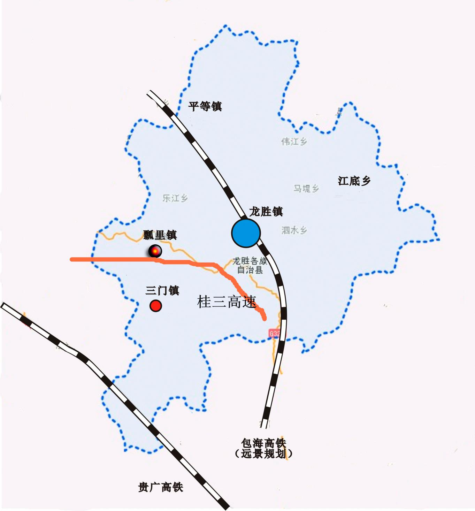

龙胜各族自治县

“十三五”特色加工业发展规划

龙胜各族自治县工业和信息商贸局

桂林市工业设计研究院

二〇一七年七月

前 言

“十三五”时期是我国工业适应新常态、应对新挑战的五年，是实现“四化”融合发展的关键时期，根据县委、县政府确定的“生态立县、绿色崛起”发展战略和“生态、旅游、扶贫”三位一体发展思路以及“做精做优新型工业”总体要求，在总结龙胜各族自治县“十二五”工业发展经验的基础上，编制《龙胜各族自治县“十三五”特色加工业发展规划》（以下简称《规划》）。

本《规划》按照县委、县政府的统一部署，依据《龙胜各族自治县国民经济和社会发展第十三个五年规划纲要》及《龙胜各族自治县工业和信息化发展“十三五”规划》等文件进行编制，是未来五年龙胜各族自治县特色加工业发展的工作指南。

目 录

## 第一章   发展基础和发展环境  5

- 一、发展基础 5

- 二、发展环境     11

## 第二章   发展思路和发展目标     23

- 一、指导思想     23

- 二．发展原则     23

- 三、主要目标     24

## 第三章   重点产业及布局     27

- 一、重点产业     27

- 二、重点产业布局     28

## 第四章   产业载体建设     30

- 一、园区建设     30

- 二、企业发展     30

## 第五章   原料基地建设     32

- 一、罗汉果种植基地布局     32

- 二、无公害蔬菜基地布局     32

- 三、猕猴桃生产基地项目布局     33

- 四、优质杂柑基地布局     33

- 五、食用菌生产基地布局     33

- 六、畜牧产品生产基地布局     33

## 第六章   政策措施     35

- 一、强化组织实施     35

- 二、落实完善政策 2 9

- 三、优化发展环境     36

## 第一章 发展基础和发展环境

## 一、发展基础

（一）主要经济指标完成情况

2015年全县工业总产值57.3亿元、工业增加值25.4亿元，工业企业实缴税金1.95亿元；全社会固定资产投资完成49.49亿元，其中工业投资完成12.9亿元，其中技术改造投资9.09亿元，制造业投资3.08亿元。

（二）主要特色加工业发展情况

2015年，全县规模工业总产值54.13亿元，规模工业增加值24.15亿元；全县形成了滑石开采加工、水力发电、木材加工、铁合金冶炼四大支柱产业，四大支柱产业工业总产值53.10亿元，占全县规模工业总产值98%；主要特色加工业主要为滑石开采加工、木材加工、铁合金冶炼，工业总产值40.03亿元，实现工业增加值16.15亿元。

1.滑石行业完成产值20.71亿元、工业增加值9.66亿元。2015年滑石块产量51.83万吨，滑石粉加工产量44.67万吨；

2.木材行业完成产值14.40亿元、工业增加值6.02亿元。2015年木材行业完成桌椅框架78.58万件，木材加工产量62.5万立方米，其中人造板15.7万立方米，松木杂锯材28.23万立方米，松木指接板7.19万立方米，杉木直拼板6.5万立方米，床板2.9万立方米 。

3.冶炼行业完成产值4.92亿元、工业增加值0.47亿元。2015年铁合金冶炼产量6.0929万吨，硅锰合金产量39277吨，硅21652吨。

4.水电行业完成产值13.07亿元、工业增加值7.35亿元。2015年发电总量304650万千瓦/小时，供电总量157660万千瓦/小时。

5.2015年生态食品业完成产值1.89亿元、工业增加值0.51亿元，其中：茶叶行业完成产值840万元、工业增加值268万元；龙脊辣椒行业完成产值1000万元、工业增加值300万元，产量6000亩（以种植规模计）；罗汉果行业完成产值12000万元、工业增加值3352万元。

（三）工业集中区发展情况

飘里工业集中区是全县唯一的工业集中区，龙胜各族自治县瓢里工业集中区位于龙胜县城西部，距县城23公里,集中区始建于2007年7月，总体规划占地面积约1100亩，首期开发611亩。2015年，飘里工业集中区开发面积611亩，入驻企业8家，总投资2.53亿元，2015年完成工业总产值6.46亿元，工业增加值2.81亿元。该工业集中区紧邻321国道二级公路，距离即将开通的桂三高速公路出口仅1公里，交通便利。生产、生活用电及自来水全部进入园区，各项配套设施齐全。

（四）重点企业发展情况

1.滑石行业： 桂广“K牌”、龙广的“桂花牌”、华美的“金猴牌”滑石系列产品是国家著名商标，出口免检产品，在国内外具有较高的知名度。

广西龙广滑石开发股份有限公司是由广西龙胜各族自治县滑石矿有限公司、广西壮族自治区南宁矿粉厂、（香港）桂林投资有限公司、桂林汉栋投资有限公司共同投资组成，并由广西龙胜各族自治县滑石矿有限公司控股的具有雄厚经济实力的股份制企业。龙广股份公司的生产基地位于“山水甲天下”的桂林市龙胜县境内，是亚洲著名的“滑石之乡”，是中国三大滑石生产和出口的主要基地，该基地滑石资源丰富、储量大，露天开采，现已形成年生产滑石块20～30万吨、生产滑石粉15～20万吨规模，是集采矿、精选、粉体加工、运输、销售一体化的股份制企业。公司现有员工850人，有中层以上管理人员48人。有大专以上学历223人，其中在职研究生学历10人，全日制研究生1人。有中级以上职称32人，其中高级职称1人，有注册会计师1人。生产部门有：古坪矿区、粮仓坪矿区、第一滑石粉厂、第二滑石粉厂、精细化工厂，龙威公司、龙威粉厂、防城港粉厂、汽车队等。公司现生产2个系列38个品种的滑石产品，广泛应用于医药、食品、化妆、造纸、塑料、橡胶、陶瓷、农药、饲料和防水材料等行业。公司生产的“桂花牌”滑石产品系列曾多次荣获广西区优质产品称号、广西名牌产品称号、广西著名商标称号等。龙广滑石开发公司工业总产值8.72亿元，工业增加值4.06亿元，滑石总产量45.7万吨，其中滑石块产量26.67万吨、滑石粉产量19.03万吨；

桂林桂广滑石开发有限公司（以下简称公司）成立于1988年，是广西桂林滑石发展有限公司与香港恒达、广达公司成立的中外合资企业，其中广西桂林滑石发展有限公司占股70%，是集滑石采矿、选矿、运输、加工及销售一体化的综合性企业，是中国南方重要的滑石生产、加工和产品出口基地。公司在龙胜县三门镇境内拥有世界上少有的特大型优质露天滑石矿山，自然天成，质地纯正，品位高，储量大，经科学检测论证，不含石棉等对人体有害的元素，滑石洁白细腻，润滑感极强，化学成化稳定，烧失量和磨耗度低，离散性好，在国际国内市场享有很高声誉。公司生产加工基地位于临桂区临桂镇龙门路，目前拥有员工800多人，总资产约2.3亿元，具备年开采滑石25万吨，回收粉渣尾矿3万吨，加工滑石粉15万吨的生产能力。公司生产的200目-3000目滑石粉，广泛应用于医药、食品、化妆品、造纸、油漆、涂料、橡胶、工程塑料等九大系列40多个品种，产品远销欧美、日本和东南亚等20多个国家和地区，销往全国30个省、市、区，是箭牌、强生等世界500强企业的主要原料供应商。

广西龙胜华美滑石开发有限公司目前拥有员工600余人，资产总值2.7亿元，集滑石开采、精选、加工、运输、销售为一体的中外合资企业。2015年完成工业总产值7.85亿元，工业增加值3.73亿元，滑石总产量35.46万吨，其中滑石块产量19.94万吨、滑石粉产量15.52万吨；三门滑石矿2015年完成工业总产值2.05亿元，工业增加值0.98亿元，滑石总产量9.22万吨，其中滑石块产量5.22万吨、滑石粉产量4万吨。

2.冶炼行业： 全龙铁合金公司工业总产值0.75亿元，工业增加值0.16亿元，锰铁合金产量1.7188万吨；合信硅业公司工业总产值1.6亿元，工业增加值0.26亿元，硅产量1.165万吨；宏发硅业公司工业总产值1.1亿元，工业增加值0.18亿元，硅产量1万吨。

3.木材行业：县木材公司工业总产值7.97亿元，工业增加值3.03亿元，木材产量15.7万立方米，其中人造板163708立方米，松木杂锯材326075立方米；柏亿木业有限公司工业总产值2.04亿元，工业增加值1.08亿元，木材产量7.20万立方米，杉木直拼板65113立方米；桂林鲁一木业有限公司工业总产值1.93亿元，工业增加值1.02亿元，木材产量6.50万立方米，松木指接板60543立方米。

4.生态食品：农产品以发展“两茶一果”为主，即茶叶、茶油和罗汉果。

（1）茶叶：目前上规模的茶叶加工企业有龙脊十三寨茶业有限责任公司、龙胜县龙脊茶文化旅游产业有限公司、龙胜泓文生态农林科技贸易有限公司3家。

龙脊十三寨茶业有限责任公司坐落于广西桂林龙胜县龙脊景区内，是一家集茶业种植、加工、研发、经营于一体的专业企业。

公司以有机茶叶资源及龙胜旅游为依托，以茶叶专业合作社和茶叶种植户为纽带，开发古树茶、野生茶，创有茶叶品牌、提高茶业企业效益和茶农收入为目标，不断提升茶叶加工技术，开拓茶叶市场，严格按照 IS9001和ISO14000的标准要求，从种植到加工均精心管理，确保产品安全、緑色。2014年公司通过了国家食品安全认证；注册了“龙脊十三寨”“十三寨”商标。2013年底公司合作社被评为广西农民专业合作社先进示范社；2014年被评为全国农民专业合作社先进示范社示，荣获第七届广西名特优农产品交易会银奖产品。

龙胜县龙脊茶文化旅游产业有限公司前身是桂林龙胜县明珠茶厂，改制后于2007年7月在龙胜县工商行政管理局注册成立，注册资金70万元。公司坐落在广西桂林龙胜县龙脊镇“世界一绝”之称的龙脊梯田景区境内，是一家专业从事茶叶加工、销售、茶文化体验并获得了国家QS认证的民营企业，目前，公司拥有茶园种植示范基地280亩、百年以上龙脊古茶树5000棵，茶叶加工厂房占地面积5亩，龙脊茶文化生态体验区占地20亩。公司于2000年就已经注册了“龍脊”牌茶叶商标。产品曾出口日本，通过日本的产品质量检验标准。获得“广西乡镇企业优质产品”、为“农业部TQC达标认证企业”、“消费者最信赖放心品牌”、桂林市首届评茶大会“红茶金奖、”“绿茶金奖”、“茶艺大赛冠军”、等一系列荣誉称号。

（2）罗汉果：目前有上规模的罗汉果加工企业2家，即龙脊罗汉果加工制品厂、桂林天成科技发展有限公司龙胜晶品罗汉果加工厂。

龙脊罗汉果加工制品厂目前厂区占地面积2500平方米，其中有干果仓库1000余平方米，可存放干果1200万个，烘烤房7个，烤房一次容量为80万个，年加工（3-4个月）能力2000万个以上，产值近千万元。

%1. 石材加工：包括花岗岩石和鸡血玉石。

现有花岗岩石材加工企业1家，即鑫辉石材有限责任公司。公司成立于2011年10月，是集开采、加工、销售为一体的大型石材加工企业，产品主要销往桂林、柳州及贵州、广东一带。鑫辉石材加工厂房位于伟江乡布弄村花界，占地约20亩，拥有大型切割机6台，红外线切边机5台，半自动切边机1台，手摇切边机2台，喷砂机1台，磨光机1台，叉车3部，装载机1部，挖掘机1部，运输车8辆。原材料开采厂位于甘甲村长滩坪组，可开采年限20年，2015年开采量为6000立方米，产值1500万元。

全县鸡血玉石储量20万吨，有开采企业4家，大小切割加工厂300余家，雕刻工艺厂15家，2015年开采加工鸡血玉石3万吨，总产值3亿元。

## 二、发展环境

龙胜各族自治县位于广西壮族自治区东北部，地处越城岭山脉西南麓的湘桂边陲。界于东经109°43′至110°21′，北纬25°29′至26°12′之间。东临兴安、资源县，南接灵川县、临桂区，西南与融安、三江县为邻，北毗湖南省城步县，西北与湖南通道县接壤。面积2538平方公里。

桂林国际旅游胜地建设纵深推进，贵广高铁建成通车，出省连市、县的桂三高速公路即将建成，国家明确龙胜县为国家西部生态示范区、国家重点生态功能区、全国滑石精细加工基地、风能发电基地等发展功能定位，龙胜县的生态工业和生态农业崭露头角；龙胜县具有国家生态文明、西部开发、乡村旅游、民族政策、精准扶贫等方面政策叠加优势，新常态下发展理念、发展方式、发展战略和发展动力机遇凸显，经济发展更加注重质量的提升，在建设龙胜南岭山地森林及生物多样性国家重点生态功能的战略任务下，资源环境约束趋紧，土地要素供需矛盾突出，发展经济的环境容量小，门槛高，产业内部结构高级化的压力大，影响全产业链的形成。

（一）资源情况

1.农产品：2015年全县农林牧渔业地区生产总值达到16.79亿元，粮食作物播种面积16.5万亩，粮食总产6.74万吨；水果总面积7.65万亩，水果总产量8.16万吨；蔬菜总面积10.95万亩，蔬菜总产量12.21万吨；生猪出栏9.05万头，牛出栏1.7万头, 羊出栏2.05万只，家禽出笼194.07 万只；肉类总产量1.23万吨，水产品总产量708吨。

2.林业：2015年底，全县森林覆盖率为79.12%，全县活立木蓄积量1426.2万立方米。

3.矿产资源：龙胜各族自治县矿产资源丰富，迄今已发现有滑石、金、铅锌、铜、磷、钒、钨、镍、铁、锑、锰、石煤、石棉、粘土、高岭土、地热、辉绿岩、花岗岩、大理岩、石英石、建筑用砂、建筑石料用灰岩、鸡血玉（暂定名）、观赏石等25种矿产。

截止2015年底，保有资源储量滑石2637.07万吨、铅20033.83吨、锌13187.23吨、金3354.56千克。新增加滑石矿矿产资源储量（122b）矿石量1158.37万吨，铅锌矿资源/储量（332＋333）矿石量168.53万吨，金矿资源量（332+333）矿石量542507.36吨，建筑用辉绿岩资源储量（333）矿石量10233万吨，饰面石材用大理岩（鸡血玉）资源储量（333）矿石量7314万立方米，饰面石材用花岗岩资源储量（333）矿石量6532万立方米。

矿产资源开发利用状况：龙胜县已开发利用的矿种有：铅、锌、金、滑石、建筑用砂、高岭土、陶粒用粘土、饰面辉石岩，建筑用辉绿岩，饰面大理岩，千枚岩，鸡血玉等十余个矿种，已开发利用的矿产地43处，有矿山企业39家。其中大型矿山3家，中型矿山1家，其余为小型矿山和民矿，从业人员2966人。

（二）主要产业市场分析

2.1滑石产业市场

2.1.1国内产业需求分析

近几年，滑石粉在造纸工业作为填料逐渐被碳酸钙取代，但在特种纸张中，仍然采用滑石作为树脂控制剂。聚合物和涂料工业均需要高白度的滑石产品，市场需求均呈上升趋势，同时，小规模市场如化妆品和制药领域对滑石粉的需求也呈现上涨趋势。亚洲地区，尤其是中国和印度仍将是滑石粉消费的最大增长区域，欧洲消费也在增长，东欧比西欧增长多一些，但增幅不大，预计东欧地区滑石粉消费将进一步增长。

我国滑石粉主要消费领域有造纸、油漆、涂料、塑料以及陶瓷等工业。近几年来塑料和涂料工业的应用市场稳中有涨，造纸用滑石粉量持续的减少，但是目前造纸仍然是我国滑石的主要消费领域。

（1）造纸行业

高纯度的滑石粉多用于涂料、油漆、医药、化妆、塑料等行业。近年来，纸张产量的快速增长，带动了滑石在造纸业的消费，造纸至今仍是滑石最大的消费领域，造纸所用滑石可占国内市场滑石消费量的50%左右。近年来，随着国内滑石的开发利用，以及中性施胶技术在造纸业的普及，使滑石在造纸业的消费有所下降，但总量仍保持年均100万吨以上。目前滑石在造纸业的应用情况和发展趋势倍受行业关注。

目前滑石粉在造纸行业中的应用主要使用在特种纸中，由于我国特种纸起步晚，生产技术相较于发达国家还有一定的差距。而特种纸应用广泛，且我国仍然有诸多的特种纸依赖进口，特种纸产量在世界特种纸产量中所占比例较低，使得我国的特种纸仍然有一定的发展空间。具体见图2-3。

图2-3 特种纸及纸板2006年至2015年生产及消费量

我国特种纸一直保持着稳步的增长，近年来随着技术的不断进步，产能不断的扩大，2015年特种纸及纸板生产量达265万吨，消费量217万吨。2006年～2015年生产量年均增长率10.26%，消费量年均增长率5.77%。因此滑石粉在特种纸张中的应用市场仍然有着提升的空间。

（2）塑料工业

随着塑料工业的发展，滑石粉的应用领域越来越广，作为功能性填料主要用于聚丙稀改性，生产汽车工业和家电业的塑料，也有少量滑石用于聚苯乙烯、尼龙、聚乙烯和PVC。滑石作为填料不但能节省树脂的使用量，还能显著地提高产品的刚度、冲击度、抗蠕变性、硬度、抗表面划伤、耐热性、和提高热变形温度。对于应用于汽车和家电的聚丙稀塑料改性，滑石的性价比是其他任何非金属矿材料所无法比拟的。

国家统计局数据，“十二五”塑料制品产量由2011年的5474.31万吨增加到2015年的7560.82万吨（汇总统计7226个企业），年均增长为8.41%，“十二五”塑料加工业规模以上企业由2011年的12963个增加到2015年的14763个，年均增长3.3%。《塑料加工业“十三五”发展规划指导意见》提出2016-2020年规模以上塑料制品企业产量年均增长率达到4%；争取到2025年，塑料加工业主要产品及配件能够满足国民经济和社会发展尤其是高端领域的需求的目标。

（3）涂料工业

由于滑石具有润滑性、抗黏、助流、耐火性、抗酸性、绝缘性、熔点高、化学性不活泼、遮盖力良好、柔软、光泽好、吸附力强等优良的物理、化学特性，在涂料中的应用主要体现为：在涂料中，滑石粉作为填料，可起到骨架作用，降低制造成本同时提高涂料的漆膜硬度。主要能增加产品形状的稳定，增加张力强度，剪切强度，绕曲强度，压力强度，降低变形，伸张率，热膨胀系数，白度高、粒度均匀分散性强等特点。

滑石粉可应用于多种工业涂料中，尤其是底漆。钢材结构用底漆可全部或部份用滑石粉，可改进涂料的沉淀性、涂膜的机械力以及再涂覆性。许多制品和闪烘底漆和运输工具用漆优先选用滑石粉。包括滑石在内的片状硅酸镁因其能提高打磨和抗水性能，所以适用于金属底漆，其中抗水性能可能源自片状粒子延伸了湿气通过涂膜的途径。

近年来我国涂料涂料总产能稳步增加，根据涂料工业协会的统计数据，近年来我国涂料总产量快速增长，年均增速达10%以上。据国家统计局最新统计数据显示，2016年5月全国规模以上企业涂料产量153.38万吨，同比增长了7.4%；1-5月累计670.06万吨，同比增长了7.2%。随着我国城市不断的扩张，各行业对涂料的需求广泛，涂料工业将保持稳定的增长。

（4）其他行业

化妆品级滑石粉可以应用于各种润肤粉、美容粉、爽身粉等。化妆级滑石粉被添加进化妆品中，能提高产品的滑爽性，使产品易于涂敷均匀，并让产品触摸起来更加柔软光滑。

医药级滑石粉还可以使用在应用在医药行业用于生产：医药片剂、医药散剂（如阿咖酚散）糖衣、痱子粉和中药方剂、食品添加剂、隔离剂等。

食品级滑石粉，允许添加在膨化食品、小麦粉制品等食品中，用于调节膨化食品的膨化度和小麦粉制品的口感

2.1.2 进出口市场分析

（1）2011年至2015年滑石粉进出口量及金额统计

全球滑石贸易比较活跃，但总量基本趋于平稳，国际市场滑石粉年交易量约为250～280万吨，约占世界总产量的30%。

根据海关进出口统计2011年至2015年我国滑石粉的出口量每年均保持在40万吨以上，2015年出口量为43.02万吨，出口美元11436.88万美元；2011年至2015年滑石粉的进口量稳定在2万吨左右，有小幅增长。详见下图2-5和图2-6。

图2-5 2011-2015年滑石粉进出口情况

图2-6 2011-2015年滑石粉进出口金额情况

（2）滑石粉出口国别统计

根据海关统计2015年我国滑石粉的出口总量为43.02万吨，主要出口国有韩国、泰国、日本等，产销国排名前十的国家及具体出口数量见下表2.7：

| 表2-7 2015年滑石粉主要出口国及出口量统计 （单位：万吨） |
|---|
| 产销地区 | 韩国 | 泰国 | 日本 | 印度尼西亚 | 马来西亚 | 菲律宾 | 澳大利亚 | 墨西哥 | 英国 | 台湾地区 |
| 出口数量 | 9.05 | 8.87 | 7.21 | 4.38 | 2.33 | 2.27 | 0.88 | 0.85 | 0.71 | 0.70 |
| 占比 | 21% | 21% | 17% | 10% | 5% | 5% | 2% | 2% | 2% | 2% |

从统计图表可以看出韩国、泰国、日本、印尼及马来西亚占据了出口总量的74%，是我国滑石粉的主要出口地。

2.1.3 小结

近几年，造纸填料级滑石粉用量逐年下滑，但由于特殊和高端产品仍然需要高品质滑石粉，滑石粉在该领域仍然有一定的机会，在欧美国家，虽然滑石在替代滑石粉用于填料和涂料中形成了一定的竞争，但从世界范围来看，滑石粉用于造纸和涂料工业作为树脂控制剂仍有一定市场，由于纸张回收率增加，树脂控制剂对滑石粉需求将会增长，近两年亚洲市场情况与欧美市场相似。

目前全球滑石粉的主要生产商都非常关注用于塑料混配中的特殊微粉级滑石粉，需求形式正在发生变革。汽车用塑料是滑石工业最为关注的领域，自2011年起，汽车工业的增长拉动了滑石粉工业。

预计接下来五年，世界滑石粉的需求将以每年2.3%的速度增长，增长主要来自塑料、涂料、食品加工和技术陶瓷市场，这些领域的增长可能会抵消造纸市场下滑的影响。预计到2020年，塑料工业将超过造纸工业成为滑石粉最大的消费领域。

2.2竹木加工行业

随着国民经济持续增长以及人民生活水平的不断提高，尤其是进入新世纪以来，房地产装饰装修热在全国范围内居高不下，大大拉动了人造板的市场需求。据中国林产工业协会不完全统计， 2015年1～10月，全国共生产人造板3.18亿立方米，同比增长5.67%，全国人造板行业2015年1-9月销售收入近5000亿元，利润总额约300亿元。预计到2020年，纤维板产量将突破9000万立方米。

随着时代的进步，经过对消费者的长期教育和引导，消费者环保家装，健康家居的意识日益增强，生态、环保人造板产品升级换代成为趋势所在，潜在的生态、环保人造板产品市场需求将出现快速增长，无甲醛、无公害的环保家装产品将成为行业发展趋势。在近十年的发展过程中，由于人们对建筑物外观质量和内在要求的不断提高，使装饰装修的比重在工程造价中不断提升，在高档建筑建设中，装饰装修已占工程造价的40%以上。与此同时，建筑装饰材料行业随着房地产、建筑装饰业的发展得到了快速发展。

按照《中国人均住房的发展规划》的要求，2020年城镇人均占有住宅应达到32㎡，也就是说2003-2020年的城镇住宅竣工面积将达到140亿㎡。加上目前存量住宅11亿㎡进入维修期，以及写字楼、商铺、酒店及老房改造装修等，建筑装饰市场规模将继续扩大。

2.3生态食品

在“健康中国2030”规划纲要战略下，营养与健康已成为食品产业发展的共识。天然具有“营养、健康”基因的生态食品契合了这一发展趋势。

根据国家统计局发布数据显示，2015年，我国食品工业总产值达到10.01万亿元，比2010年翻了一番，其中粮油类成交额3588.72亿元、肉禽蛋类成交额3575.86亿元、蔬菜类成交额6924.87亿元。干鲜果品类6146.34亿元，。“民以食为天”，食品工业已经成为造福百姓健康、引领GDP走向的国民经济支柱产业。“十三五”期间，中国食品工业将要实现由大到强的转型升级，转型的基础是产业的优化，转型的方向就是营养健康。为此，生态食品成为消费市场最具可持续发展潜力优势产业。

截止2015年绿色生态食品基地面积已达120万公顷，据有关机构预测，绿色生态食品类全球销售额在今后10年内将从现在的5100亿美元增至10000亿美元，国内绿色生态食品在未来10年内也有望达到20-30%的市场份额，绿色生态食品规模将继续扩大。

## （三）有利条件

桂林国际旅游胜地建设纵深推进、贵广高铁以及一批出省连市、县高速公路项目开工建设（含桂三高速公路龙胜段），国家明确龙胜县为国家西部生态示范区、国家重点生态功能区、全国滑石精细加工基地等发展功能定位，龙胜县的生态工业和生态农业崭露头角，工业发展转方式调结构不断催生新动力，为本县特色加工业发展带来历史性机遇。

龙胜县资源独特，物产丰富稀特，境内有丰富的滑石、鸡血玉、紫龙玉、金矿等矿产资源，其中滑石储量居全国第二、品质为全国第一；全县森林覆盖率79.12%,盛产茶油、茶叶、罗汉果、毛竹、龙脊辣椒、三木药材、龙胜凤鸡、翠鸭等绿色有机生态农产品，多种农产品获地理标志认证和品牌认证，龙胜凤鸡还被列为国家级畜禽遗传资源保护名录。

## （四）约束条件

4.1土地

龙胜县全境平均海拔约700米，35度以上的陡坡占土地面积的一半，适宜开辟为工业用地的土地资源极为稀缺。龙胜地处珠江上游，系珠江上游水源涵养林保护区，是典型的生态脆弱区，同时又有国家授予的生态县称号，也是桂林市大旅游圈的重要一环，这些因素成为县域工业布局、产业选择上的约束性硬件。土地集约利用水平偏低，无法解决大工业所需要的大块平地。

4.2能源、交通

龙胜县距桂林市87公里，有桂三高速公路及321国道二级公路贯穿，可转接湘桂铁路及航线，陆路接转湖南、四川、贵州、广州、柳州等线，西向三江县60公里，转接枝柳铁路；南北走向与209国道相连，由于地理位置较偏僻，物流交通成本较高。

4.3科技、人才

龙胜县地处西部山区，工业经济以资源型为主，人才资源缺乏，尤其是技术创新人才以及高层次、复合型人才严重短缺，难以支撑传统主导产业的产业链延伸和特色新兴产业进一步培育发展。近年来，人才队伍在质量和数量上虽然有了一定的增长，但在总量上还严重短缺，特别是高层次人才，成了制约工业经济发展的一个突出问题。

4.4资金

龙胜县经济在于企业发展缺乏技术创新、缺乏新的增长引擎，企业多以传统工业居多，科技型企业少，企业品牌意识不够强，企业产品处在价值链中低端，在企业经营困难普遍、实现利润大幅降低的情况下，产业转型升级、产业链延伸缺乏资金和技术支持，因此大多数工业企业都面临“去库存化”和“去产能化”的双重压力，传统产业产品加工持续走低，企业经营困难加大，投资意愿和能力不足。

## 第二章 发展思路和发展目标

## 一、指导思想

深入贯彻党的十八大和十八届二中、三中、四中全会精神，全面贯彻自治区、桂林市各项决策部署，树立创新、协调、绿色、开放、共享发展理念，贯彻落实“生态立县，绿色崛起”战略，以“生态立县”为本、“有机开发”为主线、“绿色制造”为根本，坚持走龙胜特色新型工业化道路，以龙胜特色资源为基础，以培育新优势为突破，加快推进信息新技术在研发、生产、供应、销售、售后等方面的应用，培育优势企业，着力打造一批特色加工业优势企业和知名品牌，构筑特色加工业工业体系。

## 二．发展原则

（一）绿色可持续发展

为适应新常态发展下的新要求，必须继续坚持绿色可持续的发展原则。把握以生态建设为方针，以绿色、低碳、可持续为发展理念的原则。健全激励与约束机制，大力整合资源，正确处理保护与开发关系，降低污染，发展绿色、低碳、循环、生态经济。加快工业经济从粗放型发展方式向集约型、环境友好型发展方式转变，构建绿色产业体系，实现经济与生态双赢。

（二）坚持推进特色品牌发展原则

集中精力研究和实施品牌营销战略，以品牌带动产业、以品牌开拓市场，提高企业知名度，提升企业质量信誉，做到创建一批品牌、提升一批品牌。

（三）坚持深度融合发展原则

充分发掘工贸一体化与信息化、农业化与信息化、城镇化与信息化等相互融合进程中蕴含的巨大机会和潜力。借助电商的大数据分析，实现特色“加工产品+品牌+电商物流”新的销售模式。

## 三、主要目标

## 1.总量目标

——特色加工业经济总量发展平稳健康。到2020年，全县特色加工工业总产值达到80.4亿元，年均增长7%以上；工业增加值增速达到5%以上，税收总额2.73亿元。

——产业结构优化。到2020年，全县特色加工业累计完成固定资产投资16.5亿元，技术改造11.6亿元，每年完成投资超过千万元重点工业技改项目不少于2个。

——技术创新突出特色。“十三五”期间，新建市级技术中心1家，培育高新技术企业2家以上。到2020年，特色加工业规模以上工业企业用于研发的投入占主营业务收入的比例达到2％以上，其中高新技术企业达到5％以上。

1.产业发展目标

到“十三五”末，全县滑石产业总产值达到36亿元，实现工业增加16.6亿元值，主要滑石产品产量77万吨；竹木加工产业总产值达到23亿元，实现工业增加值9.6亿元，主要木材产品产量99万立方米；生态食品产业总产值达到10.8亿元，实现工业增加值2.9亿元，其中茶叶产量75吨，龙脊辣椒产量30万吨，茶油产量1000吨，罗汉果产量3.35亿个，纯净饮用水产品产量2万吨。

1.园区发展目标

| 类别 | 指 标 | 单位 | 2015年 | 2020年 | 属性 | 备注 |
|---|---|---|---|---|---|---|
| 数量发展 | 工业总产值 | 亿元 | 57.3 | 80.4 | 预期 | 年均增速7% |
| 工业增加值 | 亿元 | 25.4 | 32.5 | 预期 | 年均增速5% |
| 税收总额 | 亿元 | 1.95 | 2.73 | 预期 | 年均增速7% |
| 累计完成固定资产投资 | 亿元 | 12.9 | 16.5 | 预期 | 年均增速5% |
| 引进企业家数 | 家 | 5 | 10 |  |  |

2.企业发展目标

到2020年，全县特色加工业规模以上工业企业总数超30家，其中年销售收入过亿元的企业11家。

3.质量品牌目标

到2020年，积极申请龙胜黑木耳有机产品申报农产品地理标志，培育5个广西著名商标，2个全国驰名商标。

4.原料生产和加工目标

原料基地建设目标：建设罗汉果基地10万亩，龙脊辣椒基地10万亩，龙脊茶叶基地10万亩，油茶基地35万亩。

农产品加工目标：罗汉果本地精深加工率达到70%，龙脊辣椒本地精深加工率达到80%，龙脊茶叶本地精深加工率达到100%，油茶本地精深加工率达到100%。

5.社会效益目标

重点发展罗汉果、皇金菊等特色农产品，着力发展植珍稀中药材金线莲、杜仲、凹叶厚朴、姜黄、银杏等优势品种药材加工，培育发展蔬菜（笋）罐头、干笋、速冻菜、脱水菜，实现农民户均农产品收入3.55万元左右，实现脱贫人口3000人。

## 第三章 重点产业及布局

## 一、重点产业

（一）滑石产业

加大整合力度，对优质滑石资源实行保护性开发，提高滑石企业的服务年限，推进企业资产重组和要素的优化配置，重点扶持龙头企业，通过带动力强、技术含量较高的项目，构筑滑石在工业、医药、塑料等不同类型的产品开发和价值链条。

加大对滑石、杂石产品研发、技术创新和技术改造投入，引入以滑石精深加工产品的市场用途来对精深加工技术装备及生产工艺进行技改的体系，最大程度的提高滑石产品对市场的贴合度，提高滑石产品的市场占有度及附加值，重点推进微细粉母粒新材料等项目，拓展滑石粉体改性剂造粒及制成品项目，实现规模绩效，打造“世界滑石之都”，推进滑石企业多元融资步伐，促使滑石产业结构升级。

（二）竹木加工产业

加大产品开发及品牌建设，以绿色、环保为导向，拓宽思路，加大新产品开发和技术改造，提供产品加工深度，大力发展实木板，实木复合板和竹制品，着重发展实木家具等高端消费品，重点发展高附加值的指接板、模压装饰板等竹木集成环保产品，同时开发多功能人造板产品。充分利用竹木加工的边角料、废料等剩余物，引进企业开展中密度板、塑木等产品的开发及生产，充分开发利用竹木副产品。

（三）生态食品产业

突出“绿色食品”、“有机食品”理念，提升食品质量品牌，充分发挥资源优势，发展“拳头”优势产品，形成集聚效应。以罗汉果、龙脊辣椒、茶油、猕猴桃、黑木耳、优质杂柑、龙脊茶叶、皇金菊以及水资源等为依托，重点开发有机速食食品、旅游土特产品、大健康产品，扶持特色农副产品企业的发展，着力培育具有龙胜特色农副产品生态食品、母婴护理产品、老龄化大健康产品品牌。围绕龙胜县优良的水资源、优质农产品的保健功能，加大市场营销推广力度，培育以茶油、茶叶等有机农产品为依托的“小、特、专、精”的新型电商快消品小微企业，同时引入国内知名食品饮料生产企业，开发绿色食品和天然果汁类饮料，发展新型功能性食品和保健食品。

## 二、重点产业优化布局

滑石产业依托瓢里镇、三门镇工业发展基地，重点在瓢里镇规划大云、六漫、思陇工业可用区域，发展滑石精深加工；整合竹木加工产业资源，将原来分散的企业集中入飘里工业集中区，培育龙头企业；积极盘活存量用地，提高土地利用率，优化土地利用结构。

重点产业布局图

## 第四章 产业载体建设

## 一、园区建设

进一步推进瓢里工业集中区基础建设，重点推进园区标准厂房建设，实现园区“多通一平”，分梯次、有步骤引导园区实施标准化管理；大力推进清洁生产和绿色制造，并按照“减量化、再利用、资源化”的原则，构建循环经济产业链，建设资源节约和环境友好型的生态企业、生态工业和新型产业体系，着力打造绿色制造基地。不断强化现代物流、商务服务、研发、信息咨询和中间服务等生产性服务业，建立完善的产业支撑服务体系，以促进现代制造业与现代服务业的融合发展。强化园区内部功能分区，明确功能定位，加强专业化分工，实行错位竞争,实行部门专业化和产业间分工。增设配套环境保护设施建设，改善投资环境。

利用新媒体建立“政府-服务机构-园区企业”多方对话平台；对园区企业分类，探索搭建园区之间、行业之间、供需之间的对接平台。依托飘里镇现有学校、社区，建设邻里社区。

## 二、企业发展

引入电商物流企业，培育竹木加工产业龙头企业三家，生态食品加工业、大健康产品龙头企业四家，培养滑石综合利用龙头企业一家。

滑石行业重点推进广西龙胜华美滑石开发有限公司滑石杂石综合利用项目、工业用高端滑石母粒项目等一批具有前瞻性项目，培养滑石精加工及综合利用龙头企业。

竹木加工行业着重培育实木加工为主的龙胜县奔牛木材有限责任公司发展中高端实木门、实木地板产品；积极推动具有环保、绿色贴面指接板、家居绿色健康板产品及技术优势的桂林市龙胜县源恒杉川木业有限公司做大做强。

## 第五章 原料基地建设

## 一、罗汉果种植基地布局

在海拔700米以下区域，包括瓢里镇、乐江乡、三门镇（花坪大地除外）、泗水乡（潘内村除外）、龙胜镇（上孟、岭田村除外），平等镇庖田、广南、平等、龙坪、平熬、半河、新元、固洞、蒙洞、甲河、隆江村，龙脊镇和平、白水、摆岭、岳武、大柳、金江村，江底乡泥塘、江底、围子、李江村，建设10万亩罗汉果种植基地。

## 二、无公害蔬菜基地布局

西红柿主要布局在海拔700米以上地区，包括伟江乡，平等镇小江、城田、太平、硬州、寨枕、琉璃、东社、昌背，马堤乡东升、里市、龙家、牛头等村；朝天椒沿河至高山都可以种植，主要布局在江底乡、乐江乡、泗水乡、平等镇、三门镇、瓢里镇；龙脊辣椒主要布局在龙脊镇、龙胜镇、泗水乡潘内村等；茄子主要布局在马堤乡；高山夏秋萝卜布局在南山，所属村包括甘甲、洋湾、太平、城田、小江；上海青等大批量早秋冬菜，主要布局在马堤乡以芙蓉村为中心，乐江乡地灵片区等，建设20万吨生态蔬菜基地。

## 三、猕猴桃生产基地项目布局

## 优先在交通条件好，海拔稍低的区域发展。如瓢里镇，乐江乡，龙脊镇和平、摆岭、白水、大柳等村，龙胜镇都坪、平野、勒黄、双洞、拐江、山东等村，泗水乡，江底乡江底、泥塘、李江、围子等村，平等镇广南、庖田、平等、龙坪等村，三门镇洪寨、安康、花桥、双朗等村，建设猕猴桃基地3万亩。

## 四、优质杂柑基地布局

主要布局在瓢里镇、三门镇、乐江乡、泗水乡等柑桔主产区。

## 五、食用菌生产基地布局

有机产品黑木耳主要布局在龙胜镇平野、都坪、双洞等村；袋装香菇栽培主要布局在马堤乡马堤、百湾、张家等村；椴木食用菌主要布局在龙胜镇金车、上孟、岭田，瓢里镇大云，乐江乡金坪等村。

## 六、畜牧产品生产基地布局

在龙胜县畜禽规模养殖禁养区范围外，设生猪、肉牛、肉羊、凤鸡、翠鸭规模化特色养殖区。

1、生猪优势区域布局

生猪生产布局主要在龙胜镇、龙脊镇、泗水乡、瓢里镇等二级公路经过的乡（镇），交通较为便利，可以大力发展生猪规模养殖。

2、肉牛优势区域布局

重点布局在南山牧场等七大草场，同时在各乡（镇）发展圈养规模养牛场。

3、肉羊优势区域布局

重点布局在龙胜七大草场和已划定基本草地的乡（镇），同时在各乡（镇）发展舍饲半圈养山羊。

4、凤鸡、翠鸭优势区域布局

凤鸡、翠鸭优势区域布局。以龙胜凤鸡育种有限公司、龙胜翠鸭保种场为中心，向各乡（镇）辐射，在全县大力推广龙胜凤鸡、翠鸭养殖，做好保种和商用品系的选育工作，扩大养殖规模，形成特色产业。

引进龙胜南山肉牛、肉羊良种繁殖场建设项目，建设肉牛、肉羊良种繁育场1个，其中：建设牛舍25000㎡，引进种牛1200头，年产犊牛1000头；建设羊舍400㎡，围栏11000㎡，引进种羊300只，年产羊犊1000只。同时配套建设仓库、加工房、兽医室、青贮窖，并购置铡草机、交通运输车，购建水电、环保设施等。建设龙胜畜禽产品深加工生产基地项目，新建3条2000吨级的肉鸡、肉牛、鱼生加工生产线。

## 第六章 政策措施

## 一、强化组织实施

建立特色加工业工作领导小组，规范和强化飘里工业集中区内部机构的管理。统筹各方资金，集中有限资源，对要引导发展的特色重点行业和推进转型升级的重大项目进行倾斜性支持。完善领导联系企业、项目责任制度，开展跟踪服务，解决项目推进中遇到的问题，对重点建设项目特别是重大产业项目，在用地指标、发展资金等方面给予政策扶持。

二、完善政策措施

研究制定鼓励企业增资的扶持政策。加大特色工业品牌建设的政策支持，在财税支持、商标培训、科研孵化等方面给予倾斜。完善对龙胜特色新兴企业扶持的相关政策，帮助企业推动科技成果转化。进一步推进“抓大、壮优、扶微”，落实扶持企业发展的优惠政策措施和领导干部挂点联系企业制度，着力破解企业资金、用工、土地、环保等企业生产要素瓶颈问题。

建立健全工业企业人才引进政策支撑体系，加大制造业引智力度，引进领军人才和紧缺人才；充分发挥人才中介作用，采取组团参加各类人才招聘会等措施，帮助企业引进各类人才。积极构建多层次企业培训平台，引导企业积极开展多层次、全方位的人才培训，鼓励企业与学校合作，培养制造业急需的科研人员、技术技能人才与复合型人才。建立科学的社会化的人才评价体系，制定以业绩为核心，品德、知识、能力三要素有机结合的评价标准，从而有效评价人才、激励人才；完善分配激励机制，鼓励资本、技术参与收益分配；结合促进非公有制经济发展，将非公有制企业人员的职称评定、人才奖励等纳入全县人才工作范围，营造非公有制经济各类人才成长、发展、使用的良好环境。

结合龙胜资源优势、产业优势，注重项目的包装和推介；要千方百计地创造良好的环境，提供一流的服务；要转变观念，积极进取，创新招商引资思路和方式，充分利用龙胜的资源，全方位、多层次、宽领域地开展招商引资活动，增强针对性、实效性；注重“组团招商、产业招商”等招商方式，不断延伸招商链条，扩大招商覆盖面。不断优化投资服务环境，秉承“政府创造环境、市场配置资源、企业发展经济”的理念，为企业投资落户龙胜提供优质的服务与保障。

## 三、优化发展环境

优化经济发展环境，继续加大放权力度，最大限度的精简、优化审批事项，进一步在取消行政审批、推进网上审批、清理涉企收费取得进展，瓢里镇、三门镇出台有利于企业健康发展的措施和政策，为企业提供良好、优质的生存空间和发展环境。
