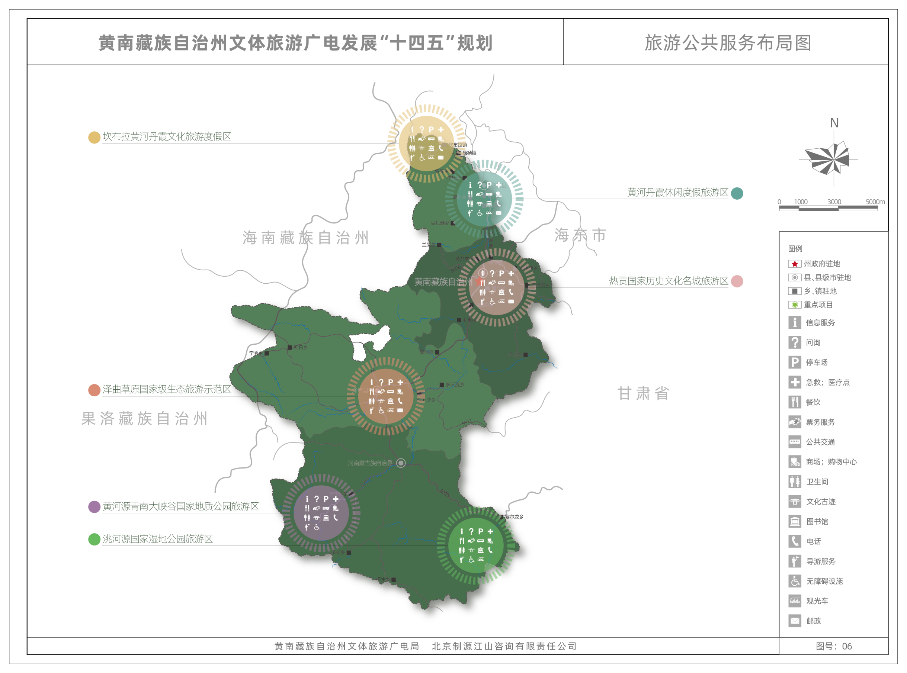

黄南州“十四五”文体旅游广电发展规划

一、发展基础与发展环境

“十三五”以来，我州文体旅游广电全面快速发展，社会主义核心价值体系建设不断巩固和拓展，文化引领风尚、教育人民、服务社会、推动发展、优化环境的作用充分彰显，文化软实力、核心竞争力、综合影响力、服务能力显著提升。旅游业规模稳步扩大，旅游产业竞争力不断增强，文化和旅游融合发展，竞争力大幅提升，群众体育、竞技体育、体育产业深入协调发展，广播电视事业和产业发展迈上新台阶，为推动“十四五”高质量发展打下坚实基础。

（一）“十三五”发展回顾

1. “十三五”发展成就。

（1）文化自信不断提升，实现文化自强。

文艺精品创作成果丰硕。“十三五”时期，我州坚持把文艺精品创作生产作为推动全州文艺事业繁荣发展、提升全州文化影响力和竞争力的重要抓手，鼓励、引导广大文艺工作者深入挖掘热贡文化、藏文化、红色文化、河湟文化、民俗文化等，坚持守正创新、勇于开拓，使我州文艺创作活力不断迸发、文艺作品质量稳步提升，各艺术门类都涌现出一批优秀作品。成功编排《松赞干布》《意卓拉姆》及文旅情景剧《热贡音画》，通过争取国家艺术基金项目，组织两台大型藏戏剧目在国内开展近200余场次的巡演并受到了强烈反响。举办首届青海•热贡民俗文化旅游节开幕式、第二届中国藏戏艺术周、第二届安多民歌大赛、“那达慕”盛会、世界唐卡之都千名艺人绘制唐卡暨万幅唐卡展示、草原游牧民俗文化旅游节、“民族团结•五彩神箭杯”第五届中国青海国际民族传统射箭精英赛等36项大型系列活动，以及176项市（县）、乡、村各级各类文旅活动和群众性文体活动，创造“最大规模的唐卡展示”“最多人同时画唐卡”两项吉尼斯世界纪录，认证“世界最大手写金书”的世界纪录。

公共文化服务体系建设成效显著。“十三五”时期，我州大力完善文化公共服务设施，丰富文化公共服务产品供给。针对“十三五”期初全州文化缺少延伸、缺少包装、缺少服务、缺少全民参与的现实问题，积极争取国家投资，整合项目资源，推进州图书馆、州群艺馆、州科技馆、黄南剧院、州博物馆和非物质文化遗产博物馆等重大文化基础设施服务项目建设。编制《黄南州文化艺术中心规划》，打造以黄南州文化艺术中心为支撑的标志性建筑集群。不断提升老城区风貌，推进隆务河景观打造、热贡文化广场升级改造等项目，提高城镇文化“颜值”。黄南州于2017年被列入第一批国家文化消费试点城市，全州文化消费总体规模持续增长，带动相关领域消费不断升级，文化消费拉动经济增长的作用逐步增强。陆续实施黄南州传媒中心、州县电视台升级改造、州体育场升级改造、县乡文化活动中心、群众文化体育场馆、健身步道等项目。“十三五”时期，全州累计建成33个乡镇综合文化站、261个农牧家书屋、155个村级综合性文化服务中心等，并提前两年实现乡镇和行政村、寺院公共文化活动场所、健身器材全覆盖，进一步提升了全州各族群众的幸福感和获得感。

（2）文旅融合成绩显著，达到全新高度。

文化和旅游产业规模不断壮大。“十三五”时期，我州文化和旅游产业实现稳步增长，旅游接待人次、旅游总消费、旅游业占GDP比重逐年提升，增速较快。截至2020年底，全州共有A级景区4家，其中4A级1家，3A级1家，2A级2家。新培育2家国家级文化产业示范基地、10家省级文旅产业示范基地，8家省级非遗保护传承基地，新增21个文化产业法人单位，1个规上法人单位，培育四星级乡村旅游接待点3个，推出了十条旅游自驾游精品路线、十大黄南美景和十佳农家乐。组织旅游企业参加2017年大美青海旅游商品大赛，3家旅游企业获得优秀奖。初步形成了以热贡艺术、石刻技艺、文创产品、民族特色手工艺品、乡村文旅体验点为主体的文旅产业群体。“十三五”期间共接待游客量3204.95万人次，实现旅游总收入98.21亿元。其中，2020年共接待国内外游客737.96万人次，比上年增长20.5％。旅游收入25.88亿元，比上年增长10％。

表1-1 “十三五”期间旅游业主要指标完成情况

| 年份指标 | 2016年 | 2017年 | 2018年 | 2019年 | 2020年 | 十三五期间年均增长率（%） |
|---|---|---|---|---|---|---|
| 国内旅游人数（万人次） | 427.6 | 556.55 | 672.44 | 810.4 | 737.94 | 13.64 |
| 入境旅游人数（万人次） | 0.3 | 0.55 | 0.28 | 0.3 | 0.02 | —— |
| 旅游总人数（万人次） | 427.9 | 557.1 | 672.71 | 810.7 | 737.96 | 13.63 |
| 旅游总收入（亿元） | 13.22 | 16.07 | 19.52 | 23.52 | 25.88 | 12.21 |
| 同期GDP（亿元） | 74.65 | 79.01 | 88.33 | 100．95 | 109.39 | 6.22 |
| 旅游总收入占GDP比重（%） | 17.71 | 20.34 | 22.10 | 23.30 | 23.66 | 5.64 |

文化旅游基础设施更加完善。“十三五”时期，我州积极推动文旅基础设施建设，全州累计完成旅游投资50多亿元，推进坎布拉景区29项重点项目、热贡文化旅游区及沿黄走廊、沿隆务河、沿G213三条旅游带基础设施建设和公共服务建设。打造了一批国家级文化产业示范基地、文化旅游名镇、名村和新农村样板，同仁市隆务镇(热贡唐卡)、年都乎乡(热贡堆绣)、同仁市(热贡艺术)、尖扎县(五彩神箭)先后被原文化部命名为中国民间文化艺术之乡。

文旅融合发展成绩显著。“十三五”时期，我州依托文化遗产、资源和要素优势，以文促旅、以旅章文，文化和旅游融合发展成绩显著。全力推进省级文化旅游融合发展示范区建设，于2017年编制并评审通过《黄南州文化旅游融合规划》，以“四个注重”：注重保护传承并重，弘扬民族文化；注重培育特色文化，提升产业水平；注重改善基础条件，优化文化环境，注重加快培养人才，提供智力支撑，打造世界独一无二的热贡文化产业高地、全球藏文化休闲体验高地、世界唐卡艺术中心、世界精细化艺术传习圣地、国家文化产业示范基地、青藏高原文化旅游名州、文化旅游融合发展示范区。于2019年3月，签订《青海省文化和旅游厅 黄南州人民政府合作共建黄南州省级文化和旅游融合发展示范区框架协议》，实现厅州共建省级示范区。整理挖掘村镇产业、民俗、工艺、建筑等区域文化资源，打造了德吉乡村旅游点、热贡唐卡特色小镇、石雕艺术村、传统射箭之乡等一批特色文旅小镇，形成产业、城镇、旅游、生态“四位一体”的新型文化旅游与相关产业融合发展的新局面。

文化旅游品牌创建及宣传推介成效明显。“十三五”时期，我州积极开展旅游宣传推广和文化对外交流。2018年确立“西域胜境•神韵黄南”的全新文旅品牌形象，并通过市场营销和宣传推介逐步提升了品牌影响力和号召力。先后参加6省24个城市专题旅游宣传推介活动，向500多家旅行社、新闻媒体进行旅游宣传推介。在西宁机场、火车站、高速公路沿线设置了热贡艺术主题宣传展厅、旅游资源宣传牌和旅游宣传站点，在《中国自驾游》《东方之旅》等国内知名杂志开设专栏进行宣传，通过中央人民广播电台《城市新跨越》栏目向听众和网友直播推介宣传黄南收到良好效果。完成央视《魅力中国城》栏目录制工作，获得“年度魅力文化景区”“年度魅力主题线路”“年度文旅扶贫城市”等三项荣誉。成功举办“相约北京”首届国际唐卡艺术展暨世界唐卡艺术大会，牢牢掌握我州在唐卡艺术领域的话语权。

文旅行业管理水平和服务质量不断提升。“十三五”时期，我州不断加强文化和旅游市场监管，取得显著成效。突出抓好旅游安全生产，强化旅游旺季和五一、端午、国庆等节假日期间的执法检查工作，每年对各景区、宾馆、农家乐等人员密集场所、重点部位进行联合检查，有力维护旅游市场秩序。整合各县培训资源，举办了宾馆饭店服务员、景区讲解员培训班，率先在同仁市推行讲解员、导游竞争上岗，组织旅游行政管理人员参加旅游规划研修、旅游统计培训班。通过深化市场秩序整治，加大从业人员培训力度，旅游服务质量和管理水平得到提升，游客满意度不断提高。

文化旅游扶贫工作扎实开展。“十三五”时期，我州坚持用文化的理念发展旅游，以旅游的方式传播文化，把民族文化的发展融入新农村新牧区建设和乡村振兴战略中，找准黄南文化旅游发展需求与民生期盼的结合点，挖掘村镇生态资源、历史古迹、传统习俗和风土人情等优势资源，加快“热贡唐卡艺术风情小镇”“坎布拉休闲康养小镇”等特色风情城镇建设，着力打造了一批乡村旅游示范点。同仁市立仓村和扎毛村被评为全国美丽宜居村庄、全国改善农村人居环境示范村；尖扎县德吉村被评为2018年中国美丽休闲乡村，初步形成了产业、城镇、旅游、生态“四位一体”发展格局。

（3）体育事业加快发展，促进体育强州。

体育基础设施建设水平持续提升。我州深入落实“全面健身”国家战略，通过整合文化、民宗、旅游等部门项目，全力推进全民健身基础设施建设，不断完善州、县、乡镇（街道）、村（社区）四级公共体育健身设施网络。2016年总投资1950万元，建成同仁市射箭场和3个乡镇足球场；2017年总投资3900万元，建成泽库县民族体育场和9个乡镇足球场；2018年总投资7998万元，实施3个县级全民健身中心、10个乡镇足球场及2个体育场升级改造；2019年总投资2100万元，实施11人制足球场、同仁市百万公里健身步道、尖扎县民族体育场升级改造项。2020年总投资2.26亿元进行坎布拉运动休闲特色小镇13个项目建设和全州40个各类足球场建设项目。截止2020年底，全州共有业余体校1个，室内体育场馆7个，公共体育场4个，乡镇体育活动站点32个，村级农牧民体育健身工程全覆盖。

全民健身体育氛围基本形成。“十三五”时期，全州经常参加体育锻炼的人数逐年增加，人均体育场地面积显著增加，公共体育健身设施、体育社会组织、全民健身赛事和活动显著丰富，各市县、各乡镇街道每年举办形式多样、内容丰富、主题突出、特色鲜明的群众体育活动，全民健身氛围基本形成。截止2020年底，全州经常参加体育锻炼人数达15万人，行政村健身工程覆盖率达到100%，人均体育场地面积2.3平方米，全州注册成立体育社团49个，每万人体育社会组织2个，全州社会体育指导员225人，每千人公益社会体育指导员达1个，每年举办大型群众性体育赛事40余场次。

（4）广电事业蓬勃发展，提升城市品质。

舆论引导力和影响力显著提升。“十三五”时期，全州舆论宣传主阵地持续加强，新闻宣传不断创新，舆论引导能力显著增强。全州4座县级广播电视台新获批呼号，州县广播电视节目制作、播放能力不断提升，节目覆盖水平大幅提高。共开办了包括普通话、藏语在内的公共广播节目4套，公共电视节目5套，IPTV集成播控平台、移动客户端（APP）等新媒体建设初见成效。创办贴近百姓喜爱、关注民生、服务大众的民生新闻栏目。开设了“加快推进‘四个转变’奋力建设新黄南”“新春走基层”“民族团结进步在黄南”“美丽黄南 绿色发展”“生态文明建设”“聚焦重点工程建设”“精准扶贫”“喜迎十九大 砥砺奋进的五年”“十九大代表风采”“十九大精神在基层”等10个新闻专栏进行了深度报道、连续报道，引导群众关注社会热点，了解政策走向，突现了媒体宣传舆论导向作用。每年共播出各类新闻2500条以上，省台播出各类黄南新闻80条以上，播出各类宣传标语60余条，公益广告10条，安全播出各类影视剧120部。

广电基础设施与公共服务体系加快升级。“十三五”时期，我州狠抓项目的衔接、上报和争取工作，广播电视基础设施及服务能力建设取得了明显成绩。先后投资2172余万元建成四县数字化影剧院，投资3889.9万元中央广播电视节目无线数字化覆盖升级改造工程全面完成，进一步提高了全州广播电视的公共服务能力，实现了广播电视节目无线覆盖由模拟到数字的转换，播出节目套数由原来的3套提升到16套，收听收看效果更佳，覆盖范围更大。投资1800万元的河南县中波发射台已全面建成并投入使用。投资600万元实施了黄南州电视台演播室修缮改造及配套设备购置工程，进一步提高电视台的电视宣传质量和水平创造了条件，采编播设备数字化水平进一步提高，电视节目从采编、制播、发射业务流程及设备逐步向高清化转变应用。投资1698.94万元实施了州县两级应急广播项目。为广播电视事业更好更快发展打下了坚实的基础。到2020年底，全州广播综合人口覆盖达到98.49%、电视综合人口覆盖率达到98.47%。

2. 存在不足。

文化资源的旅游活化不足。“十三五”时期，文化产业收入不断提高，形式不断丰富，对经济贡献率超过10%，文化品牌、市场主体、从业人员、文创产品等逐年丰富，但文化资源的活化程度仍然不足。热贡非遗及其他民俗非遗大多以文化传承、文化保护的形式存在，旅游活化发展存在滞后。

高品质文旅产品供给不足。目前全州精品景区数量较少，仅有1家4A级旅游景区（热贡国家级历史文化名城旅游区），1家3A级旅游景区（河南县瀞渡水生态旅游景区），2家2A级旅游景区（阿尼格日佛景区，泽库县麦秀国家森林公园）。

广电惠民工程建设有待完善。广电基础设施仍显不足，四市（县）在演播大厅、标清直播卫星接收设备、无线发射台站机房等领域仍然不足，存在设备老化缺乏资金更新等问题；应急广播建设面临财政资金紧张，应急广播体系尚未健全；缺乏安全可靠的信息来源，导致应急广播可播报的信息有限。传统媒体和新兴媒体融合不高，传统媒体转型升级任务较重。

全民健身活动城乡发展不平衡。人均全民健身事业费偏低。我州地方财政困难，全民健身经费投入较少，各项工作推进难度大；室内健身场所不足。室内外健身场所已不能满足人民群众的健身需求；由于受思想观念和生活环境的影响，农牧区开展全民健身活动还比较少，特别是农牧民参与活动的人数偏少。

（二）“十四五”发展形势

1. 发展优势。

（1）区位优势。我州区位优势明显，在国家和青海省许多开放发展战略中具有非常重要的地位。我州地处省会西宁和“大九寨”经济圈的过渡地带，是连接我省与西南经济圈的重要通道和桥梁；位于新丝绸之路经济带中部地带，处于贯穿南北丝绸之路的桥梁和纽带、中国联通南亚国家的重要走廊和通道；位于青川甘三省五地旅游经济黄金圈，地处藏羌彝文化产业走廊重要节点，处于西宁—九寨沟旅游走廊，是青海省连接以成都为中心的西南大市场的战略通道，具有积极融入“一带一路”合作交流和国际陆海贸易新通道建设，积极参与沿黄河流域省区交流协作的重要区位优势。

（2）生态优势。我州处于三江源地区东侧及黄河流域腹地，位于“中华水塔”三江源地区的东侧边缘地带，地处黄河、隆务河、洮河、泽曲河的源头，位于九曲黄河第一弯，是黄河眷恋的地方，是黄河两次流经的州市。拥有三江源麦秀国家级自然保护区、洮河源国家级湿地自然公园、河南吉岗山省级地质自然公园、尖扎坎布拉国家级地质自然公园、同仁兰采省级森林自然公园、泽库和日国家级沙漠自然公园、泽库泽曲国家级湿地自然公园等重要自然保护地，有夏日河水源地、泽库县第一水源地、泽库县第二水源地、扎毛水库水源地、达日宗沟水源地、大雪朵水源地等重要水源地。在青海打造国际生态旅游目的地的重大战略机遇，我州将持续加强文化、自然生态高品质产品建设、建成国际生态旅游目的地的东南生态门户。

（3）资源优势。山水林草丰富多样的自然资源。我州特色资源组合形成优质环境和独特景观，孕育丰富物产和众多动植物，黄河丹霞、热贡河谷、泽曲地貌、黄河第一峡谷、坎布拉国家森林公园等独特资源，拥有冰川美景地质奇观，泽曲草原藏区最丰美的牧场，三江源国家级自然保护区麦秀分区，拥有藏羚羊、雪豹、白唇鹿、冬虫夏草、大黄、雪莲等众多野生动植物资源。色彩鲜明且富集璀璨的人文资源。我州是中国西部地区拥有国家级文化旅游桂冠最多的地区之一，是青海省非物质文化遗产和古文化遗存最为集中、文化旅游资源最具多样性的地区之一。全州现有旅游景点和文物保护单位287处，全州目前拥有人类非物质文化遗产代表作名录2项（热贡艺术、黄南藏戏）、国家级非物质文化遗产6项（热贡艺术、热贡“六月会”、黄南藏戏、土族“於菟”、和日石刻技艺、同仁刻版印刷技艺），热贡是青海乃至西北地区非物质文化资源最富集的地区，其文化结构具有多层次性，文化内涵具有多样性，文化主体具有多民族性。以“六月会”“於菟”等节庆仪式为文化载体，以藏族、土族等民族的风俗礼仪为文化旨趣，以宗教精神和民间信仰为文化蕴涵，形成了以宗教性、地方性、民族性、艺术性为特征的文化资源库。

2. 发展面临的机遇和挑战。

纵观内外形势，经过“十三五”时期的长足发展，全州文体旅游广电产业基础、规模、品质有了较大提升，基础条件极大改善，发展空间不断拓展，处于重要战略机遇期和历史性窗口期，面临新的机遇和挑战，但机遇和挑战都有新的发展变化，机遇大于挑战。

从有利因素看，“十四五”时期，我国发展仍然处于重要战略机遇期，已转向高质量发展阶段，以国内大循环为主体、国内国际双循环相互促进的新发展格局逐步形成。中央深入实施“一带一路”战略，推动西部大开发形成新格局、黄河流域生态保护与高质量发展、兰西城市群、乡村振兴、对口援青和省委“一优两高”“四种形态”“五个示范省”“七个新高地”等系列重大发展战略，全省开启文化和旅游强省、高原体育强省建设新征程，全面打造国际生态旅游目的地，推动广电事业高质量发展，国家和省上的各种政策红利继续叠加释放，互联互通重大基础设施项目加快实施，省上积极支持我州加快建设文旅融合发展示范区、特色文化生态旅游目的地，州委州政府提出“全面建设山水黄南、高质量推进三区建设，打造共同富裕的黄南样板”，发展思路更加清晰，发展基础不断夯实，发展空间不断拓展，这些必将为我州推动文体旅游广电高质量发展、提升文体旅游广电综合实力，打造特色文化生态旅游目的地创造有利条件。

从不利因素看，外部环境复杂多变，国外疫情防控乏力，全球疫情仍在加速蔓延，国内外文化旅游业很难在短期内完全复苏；周边地区发展迅速，环西宁自驾、环青海湖骑行、海东民俗体验、海北观光休闲、海西特色盐湖等精品生态旅游产品蓬勃发展，藏羌彝文化产业走廊各节点特色产品不断更新，客观上给我州在吸引投资、市场营销、产业体系打造等方面造成较大竞争压力。我州文体旅游广电基础设施投入不足、经费来源单一，公共文化服务效能不高、文化产业结构层次偏低，体育基础设施、竞技体育综合竞争力不足，人才短板等问题依然存在。

综合判断，“十四五”时期，我州文体旅游广电发展将处在融合化发展的深化期、品质化发展的越坎期，数字化变革的拓展期、融合发展更加深入，模式变革更加深刻，区域竞争更加激烈，数字应用更加广泛，我州应准确把握战略机遇期内涵的深刻变化，牢记省委省政府“建设文旅融合发展示范区”、州委州政府“山水黄南、三区建设”的战略要求，坚决践行国际生态旅游目的地东南门户的使命担当，用担当践行使命、用实干创造未来，持续擦亮“热贡文化”“金色河谷”“黄河坎布拉”“最美草原”等金字招牌，全面加强区域文化交流交往和旅游协作互动，加快体育广电高质量发展，努力在全州开启“共同富裕的黄南样板”建设新征程中体现文化支撑、精神动力和示范作用。

二、“十四五”发展总体要求

（一）指导思想

高举习近平新时代中国特色社会主义伟大旗帜，贯彻落实党的十九大和十九届二中、三中、四中、五中、六中全会精神，全面贯彻党的基本理论、基本路线、基本方略，统筹推进党中央“五位一体”总体布局和“四个全面”战略布局，全面落实习近平总书记对青海工作提出的“三个最大”省情定位、“四个扎扎实实”重大要求和“四地两体系”建设目标等重要指示，全面贯彻“创新、协调、绿色、开放、共享”的发展理念，聚焦落实青海省“一优两高”战略、“五个示范省”“七个新高地” 建设目标，围绕落实州委州政府全面建设“山水黄南”、高质量推进“三区建设”、奋力打造共同富裕黄南样板的战略任务，加快实现文化体育旅游强州建设，推动广电事业高质量发展，努力推动文体旅游广电成为我州国民经济重要支柱性产业和人民群众更加满意的现代服务业，为全面建设富裕文明和谐美丽的社会主义现代化黄南提供强大的精神动力和文化支撑。

（二）基本原则

品质发展，效益优先。顺应高品质旅游需求快速增长的新趋势，紧抓青海国际生态旅游目的地建设契机，以高质量统揽文体旅游广电发展全局，推动质量变革、效率变革、动力变革，持续推动基础设施更新换代、产品创新和项目升级，不断提升文旅品牌影响力，加快高端优质文旅产品供给，实现产业发展的质量、结构、规模、速度、效益、安全相统一，建设文化特色鲜明的生态旅游目的地。

因地制宜，突出特色。立足我州文体旅游广电发展现状、资源环境禀赋，突出文化保护、生态安全、健康体验、生物多样性、国家公园、摄影爱好者、交往交流交融、天人合一，推动文体旅游的特色化、品牌化、差异化发展，构建高品质、多样化生态旅游目的地产品支撑体系。

文旅融合，创新发展。坚持以文塑旅、以旅彰文、宜融则融、能融尽融的原则，深化文化和旅游各要素的融合发展。推进文化和旅游产业与农业、工业、科技、体育、康养等“文旅+”“+文旅”的融合，优化现代服务业体系，增强文体旅广电发展新动能。

凝聚合力，富民共享。凝聚文体旅游广电发展合力，把发展文体旅广同提高市民生活品质更紧密结合，发挥文旅综合带动作用，广泛调动各市（县）、各部门、各行业，各类市场主体、社会组织，广大农牧民和游客的积极性，同向发力，持续增进广大市民的获得感、幸福感、安全感，打造一流的“游客与市民共享”的消费环境，让全民共享文体旅广发展成果。

（三）主要目标

2035年远景目标：展望2035年，全州文艺创作全面繁荣，公共文化服务水平全面提升，现代文化产业体系全面建立，文化软实力充分凸显，旅游产业和业态全面升级，旅游综合影响力和国际化程度大幅提高，体育竞争力显著增强，广电现代化水平显著提高，全面建成文化强州、旅游强州和体育强州。

“十四五”时期主要目标：到2025年，新时代中国特色社会主义思想和社会主义核心价值观更加深入人心，全州人民文化自信更加坚定，社会文明程度不断提高，全州文化和旅游、体育、广电高质量发展体系基本形成，文化事业更加繁荣昌盛，优秀传统文化传承体系得到完善，文化遗产保护和利用水平明显提高，公共服务体系更加健全，文艺精品力作不断涌现，文化和旅游产业规模持续壮大、产业整体水平显著提升、产业核心竞争力明显增强，文旅现代综合治理体系进一步完善。竞技体育水平进一步提升，体教融合与青少年体育工作得以深化，高原特色体育项目进一步丰富，体育事业规模和品质明显提升，智慧广电融媒体深入发展，文化强州和旅游强州建设取得新进展，建成青海省一流的自驾车旅游目的地、国家级文化生态旅游目的地和国家级全域旅游示范区。

——社会文明程度更高。社会主义核心价值观深入人心，中华民族共同体意识更加牢固，中国梦黄南篇章更加绚丽。人们思想道德素质、科学文化素质和身心健康素质明显提高，各民族团结奋斗、守望互助，各民族像石榴籽一样紧紧抱在一起，凝聚力进一步增强。基层群众精神文化生活更加丰富，优秀传统文化有效传承和弘扬。

——文化遗产保护传承利用水平进一步提升。积极组织申报一批全国重点文物保护单位、省级文物保护单位。文物、非物质文化遗产和古籍基本实现系统性保护，全国重点文物保护单位“四有”标准达到95%以上，非物质文化遗产保护体系与传承机制基本健全。

——文艺精品创作登“高原”攀“高峰”。繁荣发展新时代文艺事业，文艺原创力得到提升，巩固、培育和打造一批艺术演艺品牌项目，培养一批演艺人才，艺术创作题材不断丰富，围绕重大主题谋划创作选题，扶持展现党史军史上的重大事件、重要人物的艺术作品创作；鼓励生动反映改革开放、社会主义现代化建设、全面建成小康社会的现实题材作品创作。打造一批思想精深、艺术精湛、制作精良的文艺精品力作，培养一批热贡艺术、黄南藏戏及非遗传承人等创作优秀人才。

——现代文旅产业体系基本建立。到2025年，文化和旅游产业规模持续增长，国内旅游人数突破1200万人次，入境旅游人数达到3万人次以上，旅游业总收入超过60亿元，文化和旅游产业对全州GDP的综合贡献率达到20%。旅游产业规模力争跃居青海中上游，国内外知名度进一步提升。重点推进黄河国家文化公园（黄南州段）建设，积极建设热贡历史文化名城国家5A级景区，新增省级旅游度假区1家、国家4A级旅游景区2家、国家3A级旅游景区8-10家。

——高品质公共服务体系基本形成。到2025年，全州现代公共文化服务体系更加健全，基层综合性文化服务中心建设水平持续提升，完善州、市（县）、镇、村文化信息共享工程。村综合性文化服务中心覆盖率达到50%以上，公共图书馆图书人均藏量达到0.5册，新增10座城市书房，8个以上群众文化活动（示范）基地。旅游公共服务体系得到进一步完善，文化和旅游集散中心服务效率得到提高，智慧文旅服务体系基本建成，持续推进旅游厕所建设改造工程；建设千里藏羌彝文旅风景大道，培育藏羌彝文化旅游产业走廊、青甘川自驾大通道的重点区段。强化文化和旅游服务提质工程建设，营造友好型文化旅游服务氛围。

——文旅现代综合治理体系进一步完善。到2025年，文化和旅游市场现代化治理能力进一步提升，文化和旅游市场繁荣有序，市场在文化和旅游资源配置中的作用得到更好发挥。建立文化和旅游市场主体信用评价动态管理制度，提升文化旅游市场监管现代化、智能化水平。文化和旅游市场监管和安全机制得到完善，市场监管能力不断提高。

——文旅品牌传播与交流合作得以进一步强化。到2025年，将“西域胜境•神韵黄南”培育成国家级生态文化旅游目的地的引领品牌，打造“热贡文化”“山水黄南”“黄河丹霞”“最美黄南草原”“藏地蒙县”“高原体育运动胜地”等文旅品牌，培育一批文化艺术及节庆赛事品牌。积极配合参与青海省层面开展的与世界各国和国际组织的政府间文化交流。积极参与中国文化年、海外“欢乐春节”等重大文化交流活动，展现黄南风采、讲好中国故事，全面树立黄南文旅形象。

——全民健身与体育公共服务水平进一步提升。到2025年，基本建成覆盖全人群、全生命周期、全健身过程的现代化全民健身公共体育服务体系，基本实现区域、城乡公共体育服务均等化，服务保障能力明显增强，人民生活水平和体质普遍提高，国民体质测定标准达到合格水平以上的城乡居民比例达到85%以上。

——竞技体育实力全面提升。优势项目更为突出，全民健身与训练水平得以加强，体育竞技水平进入我省前列。巩固民族武术、押加、拔河项目训练，恢复同仁市骑马点火枪优势项目，拓展摔跤、拳击、滑雪等热点项目。深入推进体教融合，转变培养模式，提高青少年体育训练水平，培养、输送一批高水平优秀后备人才，切实增强体育可持续发展能力。

——智慧广电融媒体深入发展。重点加强智慧广电和广电5G一体化发展，积极推动州级融媒体中心建设，提升广播电视传输覆盖水平和内容供给能力，着力实现更高质量的广播电视公共服务均等化、智慧化、精准化水平。推进广播电视高清化专业化建设，推动具有地方特色优秀视听制作传播。

——文化和旅游引领乡村振兴开创新局面。围绕黄河沿线、隆务河沿线，沿高铁、高速、国省干道、对外交通县道，重点旅游景区、新兴旅游度假区、传统村落区、现代农牧业园区等美丽乡村片区，发挥文化和旅游、体育、广电在乡村振兴战略中兴文化、活产业、展形象、传精神、强体质的作用，推动色藏地区乡村振兴路径的摸索。

表 2-1 “十四五”发展核心指标

| （一）文化发展核心指标 |
|---|
| 序号 | 指标 | 单位 | 2025年规划值 |
| 1 | 文化产业增加值占GDP比重 | % | 20 |
| 2 | 村综合性文化服务中心覆盖率 | % | 50 |
| 3 | 城市书房 | 个 | 10 |
| 4 | 公共图书馆图书人均藏量 | 册 | 0.5 |
| 5 | 全国重点文物保护单位“四有”标准 | % | 95 |
| 6 | 县级图书馆、文化馆和乡镇（街道）综合文化站设施基本达标，每个行政村（社区）有综合性文化服务中心 | % | 100 |
| 7 | 非遗传承人群研修研习培训 | 人次 | 5000 |
| 8 | 培育重点文化产业园区（基地） | 个 | 3 |
| 9 | 州级文化产业示范基地 | 个 | 2-3 |
| 10 | 省级文旅产业示范基地 | 个 | 1-2 |
| 11 | 高端文化人才（包括优秀文化经营管理人才、藏戏艺术人才、工艺美术大师等） | 名 | 100 |
| 12 | 技术监管与服务平台、文化旅游市场信息数据库 | 个 | 1 |

| （二）旅游发展核心指标 |
|---|
| 指标性质 | 指标 | 单位 | 2025年规划值 |
| 规模指标 | 1.旅游总人次 | 万人次 | 1200 |
| 2.旅游总消费 | 亿元 | 50 |
| 3.入境游人数 | 万人次 | 2 |
| 质量指标 | 4.A级景区总数 | 个 | 20 |
| 5.4A级景区总数 | 个 | 3 |
| 6.旅游度假区 | 个 | 1-2 |
| 7.省级生态旅游示范区 | 个 | 1-2 |
| 8.旅游休闲街区 | 个 | 1 |
| 9.夜间文化和旅游消费集聚区 | 个 | 1 |
| 10.星级乡村旅游区 | 个 | 8 |
| 11.四星级以上酒店 | 个 | 4 |
| 12.省级乡村旅游示范村 | 个 | 5-8 |

| （三）体育发展核心指标 |
|---|
| 一级指标 | 二级指标 | 单位 | 2025年规划值 |
| 体育锻炼参与 | 1.每周参加1次及以上体育锻炼的人数 | 万人 | 25 |
| 2.经常参加体育锻炼的人数和比例 | 万人和百分比 | 20/71% |
| 体质健康水平 | 3.《国民体质测定标准》总体合格达标率（不含学生） | 百分比 | 85% |
| 4.学生《国家学生体质健康标准》优秀达标率 | 百分比 | 5.0 |
| 体育健身设施 | 5.人均体育场地面积 | 平方米 | 2.3 |
| 6.每万人体育社会组织 | 个 | 2 |
| 7.行政村农民体育健身工程覆盖率 | 百分比 | 100% |
| 8.各级体育社团及协会总数 | 个 | 20 |
| 9.乡镇（街道）健身设施建成率 | 百分比 | 100% |
| 10.15分钟健身圈在城市社区的覆盖率 | 百分比 | 90% |
| 11.公共体育设施免费或低收费开放率 | 百分比 | 90% |
| 体育赛事及基地 | 12.每年举办具有国际影响力的体育赛事 | 项 | 1-2 |
| 13.户外运动基地 | 个 | 5-8 |

| （四）广电发展核心指标 |
|---|
| 序号 | 指标 | 单位 | 2025年规划值 |
| 1 | 市、县级应急广播体系 | 个 | 4 |
| 2 | 高清/超高清电视发展 | 个 | 4 |

三、“十四五”时期发展总体思路

（一）文化和旅游发展总体思路

文化和旅游业高质高效融合发展。深化省级文化和旅游融合发展示范区建设，稳步推进国家级热贡文化生态保护区建设，加强核心文旅资源保护利用。推进建立一批免费旅游景区景点，打造生态良好、环境美好、人文友好的生态旅游示范州。加强文化和旅游领域改革创新工作，进一步推动“放管服”，出台一系列支持文化和旅游业改革发展的政策举措。以智力、智能、大数据、互联网等数字科技手段加强行业管理和市场监管，主动将文化和旅游业融入生态保护、乡村振兴、民族团结等重大战略工作当中，打造成为朝阳产业、民生产业和幸福产业。

文化事业全面提升。坚持以人民为中心，以社会主义核心价值观为引领，加大文艺精品创作力度，繁荣新时代文化艺术，全面提高公共文化服务水平，做好公共文化服务机构免费开放工作，全面推进基本公共文化服务标准化、均等化，加强文化遗产保护研究利用，加大文物保护和考古工作力度，进一步加强非物质文化遗产保护、传承和弘扬。

文化产业快速发展。加大文化产业规模和效能，促进文化资源向文化产业转化，促进文化产业结构优化升级，优化区域文化产业布局，打造文化产业新经济，培育健全各类市场主体，培育一批文化产业园区（基地），加快发展数字文化产业，鼓励和引导社会资本进入文化产业，扩大和引导文化消费，推动文化产品知识产权特别是版权交易发展。

旅游产业集聚发展。强化旅游资源有效利用和产业集聚布局，围绕青海国际生态旅游目的地建设的大目标，重点发展生态旅游、文化创意、红色旅游、乡村旅游及研学、自驾、避暑、中藏蒙医康养、特色体育、和城市文化休闲等新业态和新项目，打造涵盖旅游观光、休闲度假、生态体验等主要产品类型的旅游产品集群，努力创建高等级旅游景区和旅游度假区，积极提振我州文化和旅游消费水平，加快建设文化和旅游消费示范城市，积极推动红色旅游、乡村旅游等提质升级，正确处理发展生态旅游和保护生态环境关系，促进旅游与生态保护双生共赢。

（二）文化和旅游发展总体布局

坚持“生态优先、空间优化、重点突出、融合发展”的理念，紧紧围绕“山水黄南”“三区建设”的总体部署，立足文旅融合和全域旅游两大基础，强化生态圈层和文化圈层、产业基础对于文化和旅游发展空间布局的支撑作用，立足“点—线—面”的空间构成，构建“两核三廊道八大板块”大尺度空间布局。

建设热贡艺术生态文化旅游核。依托国家级热贡文化生态保护区，以推动热贡历史文化名城旅游区创建国家5A级旅游景区为重要抓手，强化文旅融合、景区体系构建、产业培育、品牌打造、活动节庆等全面发展，突出文旅产城一体化发展，将该区域打造为沉浸式热贡文化体验区，热贡艺术生态文化和旅游融合发展的景区群，持续扩大热贡文化旅游节、热贡六月会、“雅顿”藏戏艺术节的品牌影响力，建设世界唐卡艺术之都，建成具有国际影响力的文化生态旅游目的地。

建设坎布拉景区旅游核。持续用力盘活坎布拉景区，立足其作为“黄南大门、黄河明珠”的天然优势，以建设国家4A级旅游景区、坎布拉运动休闲小镇为抓手，升级道路交通、游览设施及服务设施，布局空中览胜线路，构建水陆空立体游览体系，辐射带动周边李家峡水利风景区、万仞圣山后弘文化园、坎布拉森林公园、尕吾昂山地运动基地、藏民人家文化宿集等项目建设，积极创建世界地质公园、国家级旅游度假区，打造以“黄河丹霞”为品牌和文化内涵的旅游核。

建设黄河黄金水岸廊道。以打造具有国际影响力的黄河文化旅游带为目标，深入挖掘黄河国家文化公园黄南段文化价值、景观价值和精神内涵，以昂拉-德吉黄河休闲旅游区为重点区域，做好黄河文物和文化资源的保护传承与研究挖掘，推动黄河文化遗产系统保护与生态保护，建设黄河风景道、黄河运动小镇、黄河公共文化空间，积极发展文化体验、生态休闲、康养度假、科普研学、演艺娱乐等文旅业态，建成富有黄河文化底蕴的黄金水岸廊道。

建设金色谷地廊道。以隆务河谷为载体，以热贡文化为内核，推动沿线景区、城镇、森林、乡村集聚发展，强化文化旅游基础设施和服务设施的升级，建设旅游风景廊道，依托国家级传统村落集中连片示范州项目，打造一批传统村落旅游集中连片体验区，激活传统村落旅游市场活力，形成具有较高认知度和影响力的传统村落品牌。推动非遗的保护传承与活化展示，打造一批非遗手工作坊，建设一批集创作、展示、文化体验、旅游观光于一体的热贡艺术传习创作销售基地，进一步推动乡村振兴，助力共同富裕示范区建设，将“金色谷地”打造成具有较高知名度的文旅体验廊道。

建设青海最美草原廊道。依托泽库、河南沿线河曲草原景观资源，以建设青海最美草原自驾体验旅游风情线为目标，加快推进旅游环线、基础设施、服务设施、景区景点等建设，完善自驾服务体系，建设沿途观景平台、生态停车场、汽车营地、黑帐篷营地等，形成以自驾车旅游、户外运动旅游、农牧业文化体验等文旅产业为驱动力的发展廊道，积极打造麦秀森林公园、和日石刻文化公园、石经山、和日国家沙漠公园、幸福山生态人文景区、隆化河源、黄河源青南大峡谷、黄河小三峡、柯生乡黄河谷地、西部马都•河曲马文化体验旅游区、瀞度水生态旅游区等沿线景区景点，丰富景区景点文化内涵。积极扩大夏季那达慕、冬季那达慕、蒙古族美食节等品牌节庆影响力，围绕全省有机农牧业示范区建设，推动文旅+农业的高效融合发展，拓展瀞度矿泉水、河曲马、苏呼欧拉羊、雪多牦牛等农牧业资源的旅游开发，促进农牧民持续增收增富。对草原生态承载力分区与管控进行严格把控，依据各区域资源禀赋与生态环境敏感性分布特征，明确各区域开发强度，促进自然资源的合理科学利用，实现自然生态系统良性循环，对沿线城乡景观、景区风貌建设引导。建设智慧草原廊道生态环境监测、负氧离子监测和发布系统、智慧安全救援系统。建成最具草原风情的自驾公路旅游目的地。

建设八大板块。围绕高质量建成全省文化旅游融合发展示范区目标，推动“文旅+”“+文旅”深度融合发展，重点建设世界非遗之旅、坎布拉度假休闲游、黄金水岸观光游、古镇古堡古村游、游牧文化体验游、宗教文化探秘游、健康保健养生游、自驾徒步健康游等八大板块，加快构建文旅融合发展新格局。

（三）体育和广电发展总体思路

体育特色化发展。继续深入落实“全民健身”战略，全面提升我州体育整体实力，深入推进体教结合，推动体育产业特色化发展，构建政府主导、市场化运营的赛事运营模式，加强体育文化旅游融合发展，努力形成体制机制灵活、人才结构合理、场地设施优良、群众体育普及、体育产业繁荣、赛事活动丰富、体育社团活跃的体育事业发展新局面，塑造“高原体育运动胜地”特色品牌，为建设高原特色体育强州奠定基础。

广电精细化发展。牢牢把握坚持旗帜鲜明讲政治不动摇，坚持以人民为中心的工作导向不动摇，坚持贯彻新发展理念不动摇，坚持高质量发展不动摇。推动州级融媒体中心内容平台搭建等工作，让传播更精准。加强大数据智能化的运用，构建全媒体传播体系，打造新型主流媒体，掌握舆论引导主动权和主导权，增强内容供给的精准性、契合度，提供更多个性化、特色化新闻信息产品，不断提高宣传质量和水平。统筹好广播电视和网络视听、网上和网下、内宣和外宣、党建和业务、发展和安全，聚焦新一代信息技术在广电的综合创新应用，着力打造更高格式、更新应用场景、更美视听体验的新产品新服务新业态。

四、“十四五”时期主要任务

（一）促进和提升社会文明

以社会主义核心价值观引领文化、体育、旅游和广电工作，推进文化铸魂、文化赋能，丰富人民精神世界，增强人民精神力量，推动形成适应新时代要求的思想观念、精神面貌、文明风尚、行动规范。

1. 弘扬社会主义核心价值观。把社会主义核心价值观融入文艺作品创作、文化产品和旅游产品供给全过程，加强爱国主义、集体主义、社会主义的宣传展示教育，引导人们树立正确的历史观、民族观、国家观、文化观，弘扬主旋律，壮大正能量。广泛运用文艺作品、艺术展演、群众性文化活动和重大节庆等开展优秀传统文化教育普及活动和各类精神文明创建活动，活跃社会文化生活，提高人民群众文明素养和审美水平。深入发掘和宣传代表我州先进文化形象的历史事件、重要人物、人文景观、文化传统和民间艺术，进一步讲好黄南故事，弘扬黄南精神，展现黄南形象。通过文艺作品、文化活动、文旅体验、公共服务等，倡导科学、文明、健康的生活方式，引导群众自觉破除陈规陋习，树立文明新风。严格落实意识形态工作责任制，加强文艺作品、文化活动的内容审查，坚持正确价值导向。扎实推进诚信建设制度化建设。

2. 提升人民群众文明素养和审美水平。丰富人民群众的社会文化生活，大力开展文化下乡、文化惠民演出、高雅艺术进校园、非遗进社区等活动，为人民群众提供健康丰富的精神食粮，将文化扶志与扶智相结合，送文化和种文化相结合。加强全民艺术普及，积极利用文化场馆开展艺术展演，普及艺术知识、加强艺术培训， 广泛开展群众性文化活动，提高人民群众的艺术鉴赏能力、艺术修养和审美水平。大力推进文明旅游，积极开展文明景区、文明旅行社、文明导游、文明示范岗等活动创建，树立黄南州文明旅游新形象。

（二）繁荣新时代艺术创作

坚持以人民为中心的创作导向，大力弘扬社会主义核心价值观，按照抓重点、出精品、出人才、促传播的发展思路，全力实施文艺作品质量提升工程，积极承办和举办大型文艺活动，改革创新艺术发展平台机制，培养一批热贡艺术、藏戏艺术及非遗传承人等创作优秀人才，涌现一批思想精深、艺术精湛、制作精良的文艺精品力作。

1. 加大艺术精品创作力度。

（1）坚持正确的创作导向。以习近平总书记关于文艺工作的重要论述为指导，引导广大文艺工作者坚持“二为”方向、“双百”方针，坚持创造性转化、创新性发展，坚持与时代同步伐、以人民为中心、以精品奉献人民、用明德引领风尚。加强现实题材创作生产，不断推出反映时代新气象、讴歌人民新创造、彰显黄南特色的文艺精品。完善文艺作品内容审核制度，落实正确的历史观、民族观、国家观、文化观。

（2）认真谋划艺术创作选题。坚持选题关口前移，深入挖掘热贡文化、河湟文化、藏文化、民族文化、红色文化、民俗文化等文化内涵，建立艺术创作重点选题库。推动舞台艺术精品工程，围绕中国共产党成立100周年、中华人民共和国成立75周年等重大历史时间节点、重大主题谋划创作选题，扶持展现党史军史上的重大事件、重要人物的艺术作品创作；鼓励生动反映改革开放、社会主义现代化建设、全面建成小康社会的现实题材作品创作。

（3）努力打造艺术精品力作。把创作优秀作品作为文艺工作的中心环节，强化集体创作、专家论证、持续打磨的创作机制，打造一批剧本、剧目、美术精品。从创作源头抓起，加强对剧本创作的扶持，实施剧本征集和剧本孵化计划，为舞台艺术创作储备剧本资源，形成“创作一批、提升一批、储备一批”的创作格局。突出抓好现实题材、爱国主义题材、重大革命和历史题材、青少年题材等的创作生产，推出一批讴歌党、讴歌祖国、讴歌人民、讴歌英雄的舞台艺术精品，创作推出一批紧扣时代脉搏、讴歌美好时代、关注社会需求、反映人民心声的美术精品。

| 专栏1 文艺精品创作“等高原”“攀高峰”工程 |
|---|
| 重点精品项目：建党100周年主题文艺系列作品，中宣部、文旅部“庆祝中国共产党成立100周年舞台艺术精品创作工程”重点扶持剧目、国家民委、文旅部“第六届全国少数民族文艺会演”《意卓拉姆》，新中国成立75周年主题文艺系列作品，省委宣传部、省文旅厅重点扶持现实题材剧目《爸爸》，大型历史剧《金城公主》，旅游歌舞情景剧《热贡音画》，精品综合歌舞《山水黄南》。创新艺术作品：同仁市金色热贡民俗风情大型歌舞剧，“探秘热贡”大型写生创作，尖扎县藏族民间诗集，“走近黄河”“走近丹霞”主题写生作品。河南县蒙古民俗风情歌舞剧，河南县蒙古族民间诗集出版，河南县蒙藏文化融合艺术精品创作。持续开展文化名家暨“四个一批”人才工程：培养一批具有广泛社会影响的思想理论家、名记者、名编辑、名主持人、优秀作家、优秀艺术家、高级文化经营管理人才和文化专门技术人才。培育一批文化领军人才和高素质文艺人才：培育一批知名热贡唐卡艺术家、藏戏艺术家、民间手工艺人等。培养引进一批名优秀文化经营管理人才、文化科技人才。积极设立文化名家工作室：积极设立一批风格独特，有影响力、感召力的“文化名家工作室”。 |

2. 推动群众文化事业繁荣发展。

（1）推动全民艺术普及。设立全民艺术普及月，举办群众艺术节，打造一批有影响力的全民艺术普及品牌。推动各地以文化馆为主导，联合社会艺术培训机构，搭建文艺普及推广平台，把各级文化馆打造成为城乡居民的终身美育学校。支持发展群众文艺团队，加强群众文化艺术培训，普及艺术知识。支持各地因地制宜推动教育与公共文化服务融合发展，建设一批中小学生课外美育基地，开展文化艺术普及课程。

（2）深入开展全民阅读活动。建立支持开展全民阅读活动的机制，依托各级公共图书馆，面向不同群体，开展经典诵读、阅读分享、大师课等体验式、互动式的公共阅读活动；利用世界读书日，积极推动青少年阅读和家庭亲子阅读，持续开展全民阅读活动。加强保障特殊群体基本阅读权益，提高数字化阅读质量和水平，组织引导社会各方力量共同参与和加强全民阅读宣传推广。推动各级文化主管部门、各级各类公共图书馆创新打造一批群众阅读活动知名品牌。

（3）广泛开展群众性文化活动。繁荣群众文艺创作、推出优秀群众文艺作品、促进群众文化事业繁荣发展、提升全民文化艺术素养、激发各民族文化创造活力，打造一批富有浓郁生活气息的群众文艺精品。推动州、市（县）两级广泛组织广场舞展演、大众合唱节、市民文化节、乡村村晚等群众喜闻乐见的文化活动，搭建群众乐于参与、便于参与的文化活动平台。与互联网平台合作，创新广场舞等群众文化活动管理和服务手段。积极推介优秀文艺作品参加省级、国家级“云上群星奖”评比。

（4）丰富乡村群众文化生活。加大对农村地区、交通不便地区群众文化活动支持力度，引导各类文化活动、文化服务向基层倾斜。整合优质资源与力量，继续推进“文化进乡村”“戏曲进乡村”等文化进乡服务。组织农村中小学生到热贡艺术博物馆、州图书馆、热贡民族文化宫、州热贡画院、民族博物馆、州科技馆等开展研学实践活动。研究建立扶持政策，支持乡土文艺团队、文化大院、文化户蓬勃发展。鼓励乡村文艺团队入驻乡村文化设施，参与管理运营和服务，激活基层文化阵地。

（三）加强文化遗产保护传承利用

深化文化资源挖掘整理，强化文物科技创新，加大保护力度。激发博物馆活力，全面推进博物馆事业高质量发展，建设文化遗产保护传承利用体系。加快文化资源开发转化，改造提升传统文化业态，创新发展新型文化业态，培育重点门类文化产业，着力健全现代文化产业体系，提升文化产业整体实力和竞争力。

1. 深化文化资源挖掘整理。

（1）建设全州文化资源数据库。在现有文化资源普查成果的基础上，持续开展全州文化资源调查、认定与实地勘验，摸清文化资源底数。加强未公布、未定级文化资源的调查和登记，全面掌握现有文化资源的数量、分布、特征及保护情况，以及周边自然和人文环境情况，重点建设文物资源、非遗资源、黄河文化资源、热贡文化资源、特色资源等5个基础性数据库，为产业化开发奠定基础。健全文化资源登录制度和动态管理制度，对名录和档案进行及时更新和动态调整，加强各级各类文化资源的互联互通、资源和服务的共建共享，促进资源共享和转化利用。

（2）实施文化挖掘整理工程。对我州文化资源进行有计划、有步骤、全面系统地解读和研究，进一步加强对热贡文化、黄河文化、民族文化、红色文化等文化脉络的挖掘阐释和系统研究，深入挖掘文化价值和内涵，整理各类文化承载的重大事件、重点人物、重要故事，推出文史书籍、学术论文、研究报告等一批有重要影响的原创性成果和标志性成果，并在线上线下平台进行推广、传播和利用。

（3）系统开展热贡文化研究。继续开展热贡文化研究，提炼总结价值突出、内涵丰厚、文化特征显著的重要文化IP，推介成为国家文化地标和精神标识。继续推进热贡文化与旅游深度融合，凝聚国内外专家、学者力量深入开展文化价值研究，形成更广泛的研究成果。

2. 提高文物保护研究利用能力。

（1）加强文物考古发掘和保护利用。推动符合条件的文物保护单位级别升格。强化文物资料整理归档，加大文物价值挖掘、研究和宣传，提升影响力。活化利用文物资源，推进文物合理利用。强化文物安全监管工作。健全文物安全长效机制，加大文物安全保护工程投入，推动提高防护能力，加强文物执法和文物安全监管工作，严厉打击文物违法犯罪行为。加强对游客的文物保护安全教育。配合青海省实施文物平安工程，推动建立健全州、市（县）、镇、村四级文物保护管理机制，逐级落实文物安全责任。

| 专栏2 重点文物保护提升建设工程 |
|---|
| 文物保护单位升级项目：尖扎县德钦寺、泽库县多杰宗寺、尖扎县全国重点文物保护单位申报规划编制。文物本体保护项目：同仁隆务寺及属寺维修及展示、同仁保安古屯田寨堡古建筑群保护维修、同仁市保安古屯田寨堡群古建筑群——保安古城民清兵营修缮、同仁热贡名人故居修缮、尖扎县12处省级文物保护单位保护修缮、泽库县石经墙及旧经堂遗址保护、泽库县多杰宗寺抢险修缮、泽库和日寺院墙修缮、泽库和日寺文物遗址保护加固、河南县藏区重点文物保护抢救修缮。文物三防项目：尖扎县省级文物保护单位安防与消防设施、泽库县多杰宗寺防洪排涝、泽库县多杰宗寺岩体加固、多杰宗寺防雷消防安防、河南县博物馆文物预防性保护。文物保护单位环境整治项目：尖扎昂拉千户府环境整治、泽库县和日寺及石经墙展示利用、泽库县和日寺风貌整治与环境改造、泽库宗玛日寺环境风貌整治、泽库西卜沙寺环境风貌整治。 |

（2）推动博物馆事业做优做强。优化博物馆发展体系。推动形成以国有博物馆为主体、非国有博物馆为重要补充，综合性、专题特色型、行业博物馆共同发展格局。重点提升已建成的州博物馆、热贡艺术博物馆、州民族博物馆等展示水平。支持生态博物馆、数字博物馆等新形态博物馆建设，充分动员社会力量发展博物馆事业。建立健全馆藏文物管理制度。完善藏品档案、备案制度。加强馆藏文物展示利用，加强展陈内容策划设计，全面展示黄南历史文化脉络。收集整理历代文物精品，丰富文物的展陈形式。发挥博物馆社会教育功能，讲好黄南历史文化故事，提高馆藏文物利用率。推进线上博物馆建设。完善线上博物馆管理、研究、展示和宣教等功能，围绕热贡文化、黄河文化、民族文化、红色文化等举办主题鲜明、内容丰富、特色突出的展览、推介活动，进一步发挥博物馆、纪念馆在弘扬爱国主义、倡导科学精神、普及科学知识、传播传统文化、推动社会文明进步等方面的重要作用。

（3）加强文物古籍保护。开展古籍文献普查、保护工作，掌握我州古籍的数量、价值、分布、保存状况等基本情况，加快建立古籍综合信息数据库。引进古籍研究专业人才，提高古籍修复水平，加强古籍的整理、出版和研究利用。通过讲座、展览、培训等方式宣传古籍保护知识，促进古籍利用，发挥古籍在保护传承黄河文化、热贡文化、联结中华民族情感方面的重要作用。

3. 强化非遗保护传承。

（1）开展非遗资源大普查与研究工程。在现有“十三五”时期非物质文化遗产资源集中普查取得丰硕成果的基础上，继续开展日常性的非物质文化遗产资源普查，运用文字、录音、录像、数字化多媒体等各种方式，对非物质文化遗产进行真实、系统和全面的记录，摸清家底。按照“全面普查、广泛采集、确立重点、建档立卡、分类制作、图文并茂”的工作要求和统一格式，有序推进非物质文化遗产普查成果和保护成果的出版工作，同时，建立健全各项制度，妥善保管实物资料，防止损毁和缺失。实施热贡文化生态保护区非遗资源大普查工程，对列入各级非物质文化遗产名录的项目，进一步加强管理，加大保护力度，根据不同类别、不同项目的实际情况，制定非物质文化遗产名录项目分类保护的规范标准，通过以点带面的方式，加强对不同类别非物质文化遗产保护工作的指导。加强非遗理论研究，推动实施藏医药研究和利用、热贡藏戏提升与开发、尖扎非遗传承人（民间艺人、工艺美术大师）保护项目。

（2）推动实施“百家传统手工作坊”工程。继续加强代表性传承人的保护，研究制定代表性传承人保护的政策，继续做好代表性传承人的认定、命名工作，为代表性传承人开展传习活动创造良好条件，包括提供必要的传承场所，资助传习经费，支持其开展教学、交流活动等。加强对传统技艺的保护与传承。实施推动黄河流域“百家传统手工作坊”保护与发展，建设热贡文化生态保护区综合传习中心与群众活动馆，强化非遗传承与体验。

（3）优化非遗展示与体验。支持非遗工坊、传统工艺大师工作室及重点工美产品创新和技术研发中心建设发展，加强非遗产业人才培养。优化我州非遗博物馆陈列展示内容，建设州安多文化博览园、州热贡文化生态保护区非遗展示馆，加快实施热贡文化生态保护区非遗旅游融合项目，推动非遗活化展示。

（4）构建非遗保护理论研究体系。加快建设州热贡文化理论研究与人才培养基地，组织开展全州非遗理论研究整合提振工程，以非遗科研项目为支撑，以成果应用为拓展，以人才培养为关键，着力解决全州非遗理论研究力量分散、有影响的研究成果少、研究成果转化缓慢等问题，对全州非遗理论研究力量进行有效整合。积极发挥州热贡艺术研究院、州热贡画院、州仁俊泥塑传习院、同仁市热贡龙树画苑等机构的研究力量优势，与国内高等院校、科研机构联合进行科研攻坚，加强横向课题研究，推出一批具有权威性、学理性、前瞻性、应用性的优秀非物质文化遗产科研成果。设立热贡文化专业职业学校，将理论研究与人才培养相结合。

（5）扩大非遗保护传播与对外交流。积极利用每年的“文化和自然遗产日”，开展形式多样、内容丰富的非物质文化遗产展览、演出、讲座、论坛以及咨询服务等活动，建设同仁市国家级非遗综合展演中心。组织开展非物质文化遗产博览会等示范性展示宣传活动；利用传统节日，组织开展丰富多彩的节日文化活动，积极推动非物质文化遗产进校园、进课堂、进教材，在中小学开设非物质文化遗产相关课程，建立一批非物质文化遗产传播、教育基地。积极参与文化和旅游部、青海省政府组织的非物质文化遗产对外交流与合作；创造有利条件，鼓励优秀的非物质文化遗产项目、传承人开展对外文化交流；积极推荐项目参与文化和旅游部组织的联合国教科文组织“人类非物质文化遗产代表作名录”和“国家级非物质文化遗产名录”的评审工作；定期举办非物质文化遗产保护巡展活动，加强宣传，使优秀非物质文化遗产走出青海、走向国际，提升热贡文化的国际影响力。

（6）加强非遗知识产权保障。针对我州非物质文化遗产丰富、非遗传承人数量多的特殊情况，在热贡文化的传承发展上要特别重视知识产权保护工作的开展。简化知识产权申报流程，降低知识产权保护成本，加快知识产权审批速度，出台激励政策，鼓励文化艺人积极参与知识产权申报。成立州热贡文化知识产权保护联盟，组建相应维权律师团，帮助中小旅游企业和参与旅游经营的手艺人进行知识产权保护的维权工作。完善现有的热贡艺术品等级评价与质量检验检测工作和热贡唐卡质量追溯体系、唐卡二维码身份识别信息设置工作，将已有经验系统整理并运用到热贡艺术的其他领域。

| 专栏3 非遗研究传承展示及数字化 |
|---|
| 非遗普查与理论研究项目：州热贡文化生态保护区非遗资源大普查、州热贡文化理论研究与人才培养基地、藏医药研究和利用项目、州热贡文化生态保护区藏戏提升与开发项目、尖扎非遗传承人（民间艺人、工艺美术大师）保护项目。非遗传承项目：黄河流域“百家传统手工作坊”保护与发展项目、热贡文化生态保护区综合传习中心与群众活动馆、州热贡文化生态保护区生产性保护园区、尖扎县藏纸制作技艺传承保护基地、尖扎县五谷画制作技艺传承保护基地、尖扎五彩神箭综合非遗传习中心、尖扎拉毛德欠寺羌姆舞传承展示院、尖扎县神箭制作传习中心、尖扎南宗尼姑诵经乐传习中心、尖扎康杨花儿传习中心、尖扎刺绣传习中心、尖扎民间藏戏及寺院法舞保护传承中心、泽库县和日石刻技艺传习中心、泽库县藏戏传习中心、泽库县龙藏神舞传习中心、泽库县黑帐篷制造技艺传习中心、泽库县藏式点心传习中心、河南县非遗蒙古包技艺传习中心、河南县苏合泽非遗技艺传习中心、河南蒙古牛羊皮具非遗生产作坊、河南蒙古牛羊毛手工编织生产作坊、河南县非遗传承保护体验中心、河南县藏戏非遗传习中心、河南县“那达慕”传习中心。非遗展示体验项目：州非物质文化遗产博物馆陈列展示、州安多文化博览园、州热贡文化生态保护区非遗展示馆、州热贡文化生态保护区非遗旅游融合项目、同仁市非遗体验馆、同仁热贡六月会民俗体验演艺中心、同仁刻板印刷技艺传承展示中心、同仁市年都乎‘於菟’传承展演中心、同仁热贡民间藏戏汇演中心、隆务寺佛教音乐传承展示中心、同仁保安社火传承展示场所、同仁苯教法舞传承展示中心、同仁热贡嘛呢调传承展示场所、同仁热贡马术传承展示场所、同仁获康祭祀活动传承展示场所、同仁热贡皮革技艺传承展示中心、同仁清真老八盘传承体验中心、尖扎县非遗产品陈列展示馆、尖扎昂拉果馍切展示中心、泽库县和日石刻艺术展示中心、泽库县非物质文化遗产展示利用中心、泽库县民间优秀非遗演绎中心、泽库和日镇石雕工艺文创开发中心、泽库县石刻艺术博物馆、泽库县非遗体验中心、河南县蒙藏文化非遗文创中心、河南县那达慕非遗体验中心、河南蒙古奶制品体验中心、河南县群众非遗文化艺术活动交流中心、河南县蒙藏文化非遗体验中心。非遗数字化工程项目：州非遗数据库、州热贡文化生态保护区非遗与信息技术融合、尖扎县宗咔大藏经金汁手写数字化博物馆、泽库县非遗名录及传承人数字库、河南县非遗数字化智能展示中心。非遗扶贫项目：州热贡文化生态保护区非遗扶贫项目、河南县非遗脱贫攻坚就业工坊。文化生态保护区建设：加强国家级热贡文化生态保护区建设，积极参与国家级河湟文化生态保护实验区建设。 |

（四）健全文旅公共服务体系

1. 提升文化公共服务水平。

（1）争取国家和青海省重大文化设施和文化项目。加强统筹谋划，围绕兰州-西宁城市群发展、藏羌彝文化走廊建设、热贡文化生态保护区建设、黄河流域生态保护和高质量发展、黄河国家文化公园建设及其他国家级重点文化旅游项目，积极向有关部委争取政策、项目、资金等方面的倾斜支持，推动国家和省级重大文化旅游设施和项目在我州落地。

（2）建设一批县级重大公共文化设施。规划建设一批与新时期发展要求相适应、与我州文化定位相匹配的重大文化设施项目，高标准、高质量推进州热贡艺术研究院、同仁市博物馆、同仁市歌舞剧院、尖扎县博物馆、泽库县博物馆、泽库县剧场、河南县博物馆升级改造、河南县剧场等重点项目建设，加快完成州公共文化场所升级及设备更新工程、河南县博物馆升级改造、河南县文化图书馆及“方舱医院”改造提升，推进形成较完备的州级文化设施网络。

（3）提升城乡公共文化设施建设水平。建立公共文化服务体系示范区动态管理机制，带动提升公共文化服务设施网络建设水平。坚持重心下移，积极推动将公共文化设施建设纳入县城城镇化补短板强弱项项目，推动县级公共图书馆和文化馆达标工作，实施乡镇（街道）综合文化站建设和村（社区）综合性文化服务中心质量提升工程。到2025年底，市（县）级公共图书馆、文化馆达到文化和旅游部三级以上评估标准，乡镇（街道）综合文化站90%达到国家建设标准（建筑面积不低于300平米、功能室不少于5个），着力推进基层综合性文化服务中心标准化建设，乡镇（街道）综合文化站达标率90%。加快健全上下联通、结构合理、服务优质、有效覆盖的文化馆、图书馆总分馆体系。推进公共图书馆分馆向景区延伸，全州4A级以上旅游景区和50%以上的3A级旅游景区建立图书馆分馆。在旅游集散中心、A级景区、文旅购物商圈等场所，创新打造一批公共文化空间。建成贴近群众、布局合理、配套齐全、运营高效的公共文化服务设施体系。

（4）扩展城乡公共文化服务设施利用空间。按照规模适当、布局科学、业态多元、特色鲜明的要求，在县城商圈、自然人文景区、文化创意园区等，引入社会力量，创新打造一批集阅读、展览、文化沙龙、互联网服务、轻食餐饮、休闲娱乐等于一体的“城市书房”“文化驿站”等公共文化空间，依托各级文化馆（群艺馆），将符合条件的行政村、各类艺术培训机构发展为群众文艺辅导基地，到2025年，全州总共建成“城市书房”和“文化驿站”10座，建成群众文艺辅导基地20个。

2. 提升旅游公共服务水平。

（1）持续提升旅游公共环卫水平。持续推进旅游厕所建设改造工程，“十四五”时期，全州新建、改造提升A级及以上旅游厕所20座以上。到2025年实现主要旅游景区、旅游集散中心、旅游休闲娱乐场所、旅游风景道沿线旅游厕所数量充足、干净无味、使用免费、管理有效。提升旅游厕所建设品质，以彰显人文关怀、科技生态、特色文化新内涵为方向，推动增加母婴专用卫生间、残障人士专用卫生间、第三卫生间等，使用生态环保材料，打造节能环保“生态厕所”，尊重地域文化差异，鼓励各旅游区进行差异化、主题化打造。推进旅游厕所管理可持续，完善旅游厕所管理服务平台，实现厕所智慧智能。探索“以商建厕、以商管厕、以商养厕”的厕所管理新模式。推动各市（县）成立旅游厕所开放联盟，倡导旅游区周边餐饮企业、酒店等厕所向游客免费开放，推动开发旅游厕所服务地图。

（2）完善建设文化旅游集散中心。依托主要交通站、出入口、乡镇、景区等，设立“1+3+N”文化旅游集散中心。其中：一级文化旅游集散中心：衔接高铁、高速等主要来黄南的交通方式，提供集“智慧旅游”平台、游客综合服务、文化旅游宣传推介、旅游交通集散、车辆租赁、智能停车场、旅游商品展示、旅游产品体验为一体的综合智能化旅游服务中心。二级文化旅游集散中心：建设旅游服务、旅游客运、散客服务、景区车辆换乘、假日旅游服务平台的旅游基础设施平台、停车场等配套服务。三级文化旅游集散中心：提供旅游咨询服务及短途的旅游换乘服务，设置停车场、各乡镇，景区集散中心可根据实际情况设置特色的形象展示、休闲服务区等配套服务。

（3）营造友好型旅游服务氛围。提升旅游行业服务品质，积极争做文明旅游的传播者。通过开展导游业务培训、酒店员工礼仪培训、乡村旅游从业者培训等，提高旅游从业人员的服务质量和服务意识，实现全州旅游服务质量和管理水平大提升。完善全州旅游志愿者工作制度，规范旅游志愿者招募、注册和培训等工作，加强志愿者服务管理，推行旅游志愿者评价和激励制度，建立弹性用人机制和柔性流动机制。加强旅游公益宣传教育，培养全民旅游服务意识。以旅游全民共建共享为抓手，加强旅游公益宣传教育，营造“全民推介黄南，人人都是导游”的良好氛围，重点培养百名政务旅游讲解员，实现旅游软环境的整体提升。

（4）提升智慧旅游服务水平。建设“云上黄南”旅游云数据中心。作为全州智慧旅游建设的核心数据资源系统，包括目的地基础信息、客源动态信息、旅游吸引物信息、旅游设施和机构信息、旅游产品信息、指南与参考信息、重要实时信息等，完善与交通、气象、安全、工商、林业、水利、食品等相关部门的信息共享机制，实现统一采集、集中存储，交换发布使用。建设“互动共享”三大智慧旅游平台。智慧旅游产业运行监管平台：搭建集产业信息资源汇总、产业运行监测、应急调度快速反应于一体的综合平台，包括游客统计分析系统和景区、旅行社、酒店等旅游企业的运行监管系统，对全州旅游产业运行情况进行实时信息收集、传递、分析处理和使用。智慧旅游公众信息服务平台：按照国家智慧旅游公共服务平台的建设标准，整合全州现有旅游网站集群、旅游服务热线和终端应用系统，扩大服务覆盖面，为游客提供随时随地的公共信息服务。智慧旅游营销互动平台：建设基于我州云数据中心的旅游营销宣传系统，为国内外网络营销平台、OTA（如携程、途牛、同程等）、旅游产品供应商、智慧旅游服务商建立长期合作的互联平台，实现旅游产品数据的共享，拓展多元化营销宣传渠道。推进“融智升级”智慧旅游示范工程。实现主要旅游场所提供免费WIFI服务、通讯信号全覆盖。实现4A级（含）以上旅游景区、省级以上度假区、重点乡村旅游区等视频监控覆盖，并提供二维码导览讲解或其他智能导游、电子讲解服务。建设“一部手机游黄南”智慧旅游平台。建立集交通、气象、治安、客流信息等为一体、互联互通的旅游信息数据平台。

| 专栏4 旅游公共服务提升工程 |
|---|
| 提升旅游区（点）服务水平：完善、细化、落实 A 级旅游景区、旅游度假区和生态旅游示范区复核和退出机制。全面落实景区流量控制，推行景区门票实名制购票和网上预约制度，及时发布客流预警信息。优化住宿餐饮服务：强化星级饭店评定复核工作，联合相关部门对卫生、食品安全、消防安全等重点环节开展抽查，建立动态监管机制。对服务单位进行量化评分，开展美宿、餐饮名店、名厨等评选活动。旅行社服务升级：全面开展旅行社等级评定与复核行动，规范旅行社经营活动，推动服务信息透明化，防范旅行社领域系统性经营风险，培育一批理念新、实力强、服务好、信誉度高的转型升级示范企业。提升中高级导游员在导游队伍中的比重，不断提升导游和领队文化底蕴、理解能力、表达能力和外语能力。开展应急培训和演练，增强应急处置、沟通协调和风险防控能力。在线文旅经营服务规范：严格依法对在线文旅经营服务实施监督检查，打击违法违规经营行为。引导和支持在线文旅企业成立行业组织，加强行业自律、倡导诚信经营，提升服务质量。服务质量提升系列培训活动：充分发挥政府和行业协会的引领作用，推动文旅企业开展以职业道德、文明素养、礼仪礼貌、服务标准、服务技能、安全意识、法律知识等为重点的从业人员大培训、大竞赛活动，推出一批群众认可、顾客点赞、游客满意的文化和旅游行业服务之星。 |

3. 构建公共数字文旅服务体系。

（1）推进公共文化云平台建设。对接青海省文化和旅游云平台，建设完善黄南文化云平台。推动各市（县）文化和旅游部门在当地智慧城市平台和政务云框架下，建设本级公共文化云平台。统一数据接口和安全认证，实现各级公共文化云平台互联互通、数据共享。通过在不同云平台之间互开端口、互设界面和统一认证，建设集成化管理及服务导航系统，提供便捷高效的管理后台，为群众提供“一站式”服务。

（2）建设示范性智慧文化场馆。加速云计算、大数据、人工智能等新一代信息技术、智能技术在场馆设施建设和运营管理中的应用，实现智慧分析、智慧评估、智慧告警和辅助决策等功能。增强公共图书馆信息采集、协同感知及知识聚合能力，形成知识仓储，通过图书文献信息的智能互联，推动公共图书馆智慧化升级和服务效能提升。提升热贡艺术博物馆、州群艺馆的云端数据挖掘和分析能力，为群众提供个性化、定制化服务，拓展服务空间，打破地域限制和馆际限制，最大限度实现资源共享。运用人机交互、虚拟现实、全息影像等现代信息技术，增强服务的趣味性和吸引力，促进群众参与，扩大服务群体。

（3）加强公共文化数字资源建设与推广。统一公共文化服务数字资源对接标准，对分散的、多元的、孤立的数字资源进行整合，打造基于云端的分级分布式数字文化资源库群。建设地方特色数字资源库。公共图书馆完善馆藏资源在线展览、线上阅读功能，联合在线出版社、网络运营商、读书平台等，创新数字资源推广模式，开展“码上阅读”“在线共读”“听书打卡”等活动，引领群众阅读新时尚。文化馆（群艺馆）加大在线资源开发，生产并提供更加丰富的文化艺术演播、艺术教育、艺术传承等数字资源产品。推动在互联网视频平台开设全民阅读、全民艺术普及专题，鼓励基层文化骨干通过微视频、直播等方式展示原创数字资源及文艺作品。

（4）创新公共数字文旅服务。大力发展基于5G等新技术应用的数字服务类型，建设支持多业务形态、多屏互动、基于安全可控操作系统的数字服务移动终端和应用场景，广泛采用“订单式”“菜单式”“预约式”服务模式，让群众在“掌上”“指尖”提出需求、获取服务、评价效能。鼓励各级公共文化机构利用互联网、新媒体手段，开展远程辅导培训及网络文化活动，丰富群众精神文化生活。鼓励开展文化场馆与互联网评价平台等合作开展群众预约和评价工作。支持公共文化机构打造有影响力的自媒体公众号，培养具有高黏性的“粉丝”文化社群。鼓励与企业合作，探索创新有声图书馆等新型文化服务方式。

4. 构建立体旅游交通体系。

（1）完善对外旅游交通。重点优化对外铁路交通，逐步丰富航空线路，提升旅游可进入性。加快推进外部大交通航空、高铁、高速的建设项目，积极对接张汶高速（G0611）同仁至赛尔龙段、同仁至贵德高速、G1816乌玛高速河南至玛沁段、同仁至夏河高速等在建高速，统筹考虑旅游集散、门户形象展示、旅游交通引导标识、旅游休闲购物等旅游产业发展需求。积极与在建的同仁市、尖扎县、泽库县、河南县四大通用机场衔接，推动在坎布拉、德吉村等重点旅游区建设通用机场，积极开发我州低空旅游航线。

（2）优化内部旅游交通。依托我州“一纵三横”高速公路网，加快完善内部旅游交通网络，推动内部交通规划项目建设，提升解决内部旅游点交通通达和便捷性以及与外部大游线的互动。以国道G213为主要载体，整合升级打造“黄南一号风景大道”，完善沿线公路服务区、旅游厕所、驿站、景观体系、景观标志物、观景点、解说体系等配套设施，建成藏羌彝文旅大道、青南自驾公园大通道。加快推进同仁至夏河国道316升级改造为一级公路。利用现有国省道，进行主题化景观升级和主题化服务设施升级，建设秘境黄南全域自驾廊旅游风景廊道、黄河户外休闲景观道旅游风景廊道、热贡艺术形象展示风景道。利用有条件的县乡道路建设乡村旅游风景道，推动建设和日沙漠公园步道、洮河源景区步道、黄河源青南大峡谷步道、德吉村乡村旅游区黄河步道，建设坎布拉旅游度假区、德吉旅游度假区游船码头。建设一批生态停车场、充电桩、新能源汽车营地，推广电瓶车、混合动力车等交通方式，推动旅游交通绿色化。

（3）构建全域旅游自驾服务体系。围绕打造青海省一流自驾车旅游目的地的目标，按照自驾母港+自驾营地+休闲营地的建设模式，全面构建我州旅游自驾体系。主要依据青海省《自驾车旅游营地建设规范DB1724-2018》建设标准，以保护动植物及其生存环境为选址的前提，选择周围风景优美，环境质量好，远离易发生自然灾害的地域，远离泥石流、雷区、火灾、滑坡、巨浪、洪水、高压线、有害动植物等易发自然灾害的安全场所，具备电力、电讯、通讯等基础设施配备。积极规划建设新能源房车基地、补给驿站，并积极与省内外房车基地联动，共同打造青甘大环线自驾房车营地体验一体化服务网络。

| 专栏5 重点文旅公共服务设施建设 |
|---|
| 重点公共文化设施：州热贡艺术研究院、同仁市博物馆、同仁市歌舞剧院、同仁市图书馆、同仁市村级文化活动广场、同仁市新华书店、尖扎县博物馆、尖扎县昂拉乡民俗文化服务中心、尖扎县村级文化活动室、坎布拉运动休闲特色小镇图书馆、尖扎县康杨镇文化馆、尖扎县城市文化广场百姓大舞台、尖扎县新华书店实体店、泽库县博物馆、泽库县乡镇文化广场、泽库县剧场、泽库县文化流动服务站、河南县博物馆升级改造工程、河南县六乡镇文化站基础提升工程、河南县文化图书馆及“方舱医院”改造、河南县剧场、河南县群众文化交流活动室、河南县乡镇文化广场等。重点旅游集散中心：同仁市旅游集散中心、尖扎县马克塘镇旅游集散中心、泽库县泽曲镇旅游集散中心、河南县优干宁镇旅游集散中心。重点自驾车营地：热贡体验自驾车营地、瓜什则草原乡村自驾车营地、热贡国家4A级旅游景区自驾游基地。尖扎县康杨镇、昂拉乡、马克唐镇、贾加乡、尖扎滩乡、当顺乡、能科乡等重点旅游乡镇自驾游营地、尖扎县河东易地搬迁扶贫旅游项目自驾车营地。泽库县阿尼措更圣湖自驾游营地、泽库县和日国家沙漠公园自驾游营地、河南县洮河源国家湿地公园自驾营地、河南县双鱼湖自驾游营地、河南县优干宁镇自驾游营地、河南县草原自驾游营地。 |

（五）健全现代文旅产业体系

推动全域旅游示范州建设，推进黄河国家文化公园（黄南州段）建设，建设国家级旅游休闲城市和街区，建设热贡历史文化名城国家5A级景区，创新发展红色旅游，大力发展乡村旅游，丰富高品质旅游产品供给，推动旅游业高质量发展，更好满足人民美好生活需要。

1. 加快发展优势文化产业。

（1）大力推动文博文创产业。对传统文化进行深入挖掘和解读，推动优秀传统文化和文化创意为全产业链增值赋能。推进文化创意设计与文博展览、制造业等对接，发展富有文化内涵的文化生活消费品和文创产品。积极延伸文博文创产业链，以“文创产业化、产业文创化”为方向，推动文博文创与一二三产融合发展，增强文博文创产业渗透力、辐射力和带动力。全面激发文博文创开发活力，支持文化创意园区、文化创意设计中心、文创空间、写生基地建设，加强人才培训。持续推动一年一度的“黄南州非遗文创和旅游产品设计大赛”，鼓励文化创意和旅游产品企业、文旅设计公司、非遗传习中心和设计师、发明人、专利持有人、工艺美术师、手工艺品制作者积极参赛。培育一批以文化资源开发为主营业务的龙头企业、知名设计机构，形成富有热贡文化内涵的文博文创产业体系。

（2）加快发展数字文化产业。加快发展数字传媒、在线演出等产业，提升文化产业创新链、价值链。着力构建数字文化产业发展体系，重点发展数字出版、数字融媒与传播、数字文化内容、数字影视、数字文化装备及终端、智慧体育健身、智慧文旅娱乐等领域。着力发展数字传媒业，积极构建多屏互联传播网络，推动黄南藏戏、热贡艺术、黄南非遗等与数字化结合，加强网络创作、网络演出、网络影视、数字音乐、网络综艺、短视频等数字内容创作生产，积极举办网络文学大会、新媒体影视节等活动。到2025年，培育1-2家数字文化产业骨干企业和原创产品品牌，建成1个数字文化网络传播平台，推动数字文化产业与数字经济、实体经济实现深度融合发展。

（3）全面振兴工艺美术产业。促进工艺美术与现代设计、现代生活、时尚消费相结合，向特色化、集群化、品牌化发展。实施传统工艺振兴计划，支持非遗工坊、传统工艺大师工作室及重点工美产品创新和技术研发中心建设发展，加强非遗产业人才培养。提升工美产品文化科技附加值，开发适应现代审美和市场需求的文创产品和文化服务，展现非遗文化魅力和时代价值。活跃热贡文化艺术品交易市场，大力发展电子商务与唐卡区块链等技术，支持艺术品交易平台和电商平台建设。到2025年，建设1-2个工艺美术产品创新和技术研发中心。

（4）整合升级文化制造产业。巩固地方绘画、石刻、木雕、泥塑、特色家具、用具、陈设品制作等特色文化制造业的优势，打造唐卡、石刻、牛羊毛织品等细分行业的龙头企业，进一步提升热贡唐卡在全国的知名度和文化影响力。支持传统文化制造业与工业互联网、工业云和智能服务平台的对接，推动传统制造业向智能制造转型，加快攀上产业链、价值链高端。鼓励可穿戴设备、智能硬件、先进舞台设备等高端智能装备的生产和应用。

（5）繁荣发展演艺娱乐产业。发挥国家级历史文化名城品牌效应，打造既有艺术性又有上座率的旅游演艺精品。打造一批沉浸式新演艺，培育一批黄南文化的新IP，让游客实现“坐着看”到“边走边看”的旅游演艺新体验。鼓励发展美术、音乐、曲艺、文学艺术创作、剧目、舞美设计、演出经纪等艺术产业，重点扶持艺术精品和展现热贡 文化的经典剧目展演，以演艺产业促进其他相关产业发展，鼓励文化娱乐行业转型升级，大力发展民族演艺及节庆赛事，培养一批“热贡六月会”“黄南藏戏”等领军型企业。出台“文化主题民宿”“文化休闲街区”相关建设标准及鼓励措施。

（6）全面升级艺术培训产业。积极整合非遗传承基地、各大画苑、艺术培训机构，加强与内地经济发达地区学校、团体、机构联系，广泛开展艺术培训产业，吸引内地学生、学员到黄南开展热贡艺术、黄南藏戏、自然写生等艺术培训。推动艺术培训与广电网络融媒体结合，进行网络教学直播，网络布置作业，网络授课等等方式，充分利用5G时代的技术条件，实现艺术培训产业数字化升级。

2. 加快推进国家全域旅游示范区创建。贯彻“一优两高”战略，强化创建导向、市场驱动、文旅融合、多区共建，以“热贡、黄河、泽曲、多元文化”为特色，推动全域旅游基础设施和服务设施完善，推动全域旅游产品打造，培育集观光、体验、休闲度假、特种旅游等功能于一体，立足青甘川、面向全国、走向世界的全域旅游示范区。力争到2022年，创建省级全域旅游示范区；到2025年底，创建国家级全域旅游示范州。

（1）提升全域旅游基础设施。紧紧抓住国家支持涉藏地区发展、推动共建“一带一路”高质量发展，开创黄河流域生态保护和高质量发展新局面，建设黄河国家文化公园的历史性机遇，全面提升我州全域旅游基础设施。加强隆务古街历史水系整治、环境整治，优化各景区线路及断头路改造，保安古屯田寨堡群环境整治，建设双朋西丹霞地貌配套基础设施，建设重点景区之间的骑行旅游步道，如河南县国道沿线游客停靠点；强化隆务寺、宁秀石经山、和日国家沙漠公园、幸福山生态人文景区、泽曲国家湿地公园等重点景区基础设施建设。

（2）提升景区度假区建设水平。适应新时代高质量发展要求，完善景区功能，提升建设水平，推动景区实现更高质量发展，加强补短板建设。在现有发展规划基础上，要深入研究各景区度假区功能提升工作。完善停车、公厕、旅游服务中心等基础设施和服务设施建设，进一步提升景区的旅游功能。研究景区度假区文化底蕴，大力提升景区文化承载功能。围绕完善景区体育功能，加快自行车、健身步道循环体系建设，大力发展旅游+体育。

（3）加强顶层策划规划引领。积极推动《热贡国家级历史文化名城5A级旅游景区规划编制项目》《热贡国家级历史文化名城5A级旅游景区发展规划》《年都乎村旅游开发详规》《保安古城旅游综合开发规划》《郭么日古堡旅游综合开发规划》《坎布拉创国家级旅游度假区规划》《隆务老街国家级旅游休闲街区专项规划》等重点景区度假区街区规划编制工作；编制《同仁市全域旅游规划》《同仁市智慧旅游规划》等专项规划；同时重点编制特色旅游名镇、名村、示范区的系列规划，加强规划的实际指导意义，确保各景区景点健康可持续发展。

3. 优化旅游产业要素完善。

（1）提升旅游住宿设施。推动住宿体验品质化，以城市型星级酒店及藏族文化主题精品民宿为突破口，基于我州住宿现状，重点增加中高端住宿，鼓励发展特色文化主题酒店，适当引导自驾车营地、露营地、蒙古包营地等新业态，打造特色旅游度假村，最终形成分布合理、具备高中经济型不同档次的多元化复合型的旅游住宿接待体系。“十四五”期末，争取达到四星及以上精品酒店4家，五星级营地2家，每个乡村旅游村至少培育2-3家精品民宿。

（2）打造特色旅游餐饮。以特色鲜明、布局合理为原则，突出多民族特色及绿色有机餐饮特色，创新饮食传统做法，以饮食+文化融合为重要卖点，塑造“黄南风情、有机绿食”一系列美食产品，逐步形成高中低结合、饭店类型齐全、区域布局合理的旅游餐饮体系。重点扶持一批餐饮龙头企业，发挥其龙头带动作用，培育精品特色民族特色餐饮。重点在城区、景区、特色乡村、高速服务区完善餐饮设施，构建城区美食街+景区美食地+特色乡村美食点+服务区美食打卡地的全域旅游美食分布体系。

（3）发展特色旅游娱乐。强化品牌民族活动引擎驱动下旅游休闲全时化。以民族活动“热贡六月会”“黄南藏戏”为品牌引领，突出节庆赛事、常态化演艺、专项活动的综合带动作用，同时逐步培育城市休闲经济，逐步形成黄南热贡艺术、民族演艺、宗教法会、节庆赛事、城市休闲为代表的休闲娱乐产业体系。推动民族歌舞事业的发展，建设圣雪莲藏戏传习中心。

（4）发展特色旅游购物。培育热贡艺术、黄南民俗、非遗工艺旅游消费商品，以热贡艺术为IP，引入文创产业及上新创意研究中心，研发设计热贡品牌系列周边产品及商家合作的联名产品，构建由文创商品、绿色有机土特产品、旅游纪念品等。整体形成购物中心、购物街区、景区购物点（含特色乡村）、购物驿站四个购物设施层级。以文创精品店、黄南品牌特产店、体验工坊、售卖亭等多种形态，丰富黄南藏族自治州旅游购物供给。

4. 推动文旅多元化融合发展。坚持“以文塑旅、以旅彰文、宜融则融、能融尽融”，积极推动“文旅+”“+文旅”工程，推进文旅与其他领域融合互促，培育融合发展新业态，构建主客共享新空间，完善融合发展新机制，不断提高发展综合质量和效益。

（1）推动文旅+农牧融合发展。结合全国休闲农业与乡村旅游示范点市（县）建设，以旅游业为带动，提升传统农业附加值，大力发展休闲农业、农副产品等，通过休闲农牧业示范点（基地）的打造推动绿色农牧业发展，培育产业融合集群，推动6个休闲农牧业产业园区（含产业休闲基地）建设：泽库西部高原生态农牧业科技示范园、河南县有机畜牧业示范园、泽曲草原河曲马游牧文化旅游产业园区、阿木乎欧拉羊产业园（含羊驼园）、同仁市产业融合发展园、尖扎县产业融合发展园，积极建设省级生态农牧旅游示范区。

（2）推动文旅+教育融合发展。立足“热贡艺术”、非遗民俗等文化品牌优势及黄河丹霞、三江源生态基础，以热贡画院、中小学研学课程、艺术院校实践教育为抓手，突出“专业培训、校景互动、非遗传习、宗教朝圣”为特色的黄南州生态文化研学教育产业。建成国家研学教育示范基地。形成“政府/寺管会支持引导+专业团队/企业合作”的具有稳定市场吸引的产品课程设计、线路制定、客源运营对接、要素配套等涵盖培训各方面的大产业构建。

（3）推动文旅+水利融合发展。以水域（水体）或水利设施为依托，以《青海省水利风景区发展总体规划(2016—2030)》为指引，引导具备条件的水利景区开展观光、娱乐、体验、休闲、度假、养生养老等旅游和科学、文化、教育等活动，打造省级水利风景区示范基地。强化水利风景区景观风貌协调，保护利用结合。建成坎布拉国家黄河丹霞水利风景区。

（4）推动文旅+林草业融合发展。根据《国家绿色旅游示范基地标准》，重点打造森林型、沙漠型、湿地型生态旅游示范区，规范潜力生态景区的生态开发。针对州内草原、森林公园等生态林草基础，重点培育生态休闲、生态科普、草原活动体验等产品。打造绿色生态旅游示范区。

（5）推动文旅+藏医药融合发展。立足我州作为西宁近程目的地的及西部自驾关键节点的区位优势、山水城的生态资源，打造医药康养休闲目的地。培育藏医药康养、养生养老项目，逐步完善健康医疗服务设施，培育养生养老项目，拓展稳定度假客源。建成中医藏药康养旅游示范区。推动藏蒙医药走出河南、泽库，进入4A、5A级景区，省级以上度假区，开展特色藏蒙医药体验项目。

（6）推动文旅+互联网融合发展。应对互联网及人工智能的迅猛发展，强化互联网技术对于旅游及景区的发展推动；以智慧景区、智慧餐饮住宿、智慧交通、智能终端（手机APP）为重点，实现双向融合发展；以智慧旅游促进智慧城市的发展，以及互联网服务业的发展。放大有机农牧产品及特色工艺品品牌运营主体，作为我州旅游产业输出的重要突破方向。

（六）建设国际生态旅游目的地

围绕共同建设“青海国际生态旅游目的地”的大目标大战略，把发展生态旅游作为我州“十四五”时期文化和旅游业首要任务。依托我州优势生态旅游资源，加快对标升级，完善生态旅游基础设施，打造一批重点生态旅游景区，构建黄南特色生态旅游线路，丰富生态旅游产品体系，提升生态旅游服务水平，将绿水青山转换为金山银山，加快建设具有黄南特色的文化生态旅游目的地。

1. 建设重点精品生态旅游景区。落实青海省有关打造国际旅游目的地的主要任务、重点工程、创建标准、管控要求，构建涵盖国家公园、自然保护区、自然公园、一般自然型景区、人文生态景区等类型重点生态旅游景区体系，在保护基础上科学开发利用，打造丰富的生态旅游新产品、新场景、新业态，形成特色鲜明、类型多样、可满足不同群体需求的生态旅游产品体系，把潜在的生态价值合理有效转化为现实发展优势。

2. 加强生态旅游资源保护。建立健全生态旅游环境保护制度、环境督察制度、责任追究制度，实施最严格的生态环境保护措施。保护传承民族文化，保护原有文物、古建筑和古民居，深入推进热贡国家级文化生态保护区建设。在自然保护区、自然公园及其他类型自然保护地内，采取不规则边界、点状分布、预留空间等办法合理确定或调整生态红线边界，保障生态旅游活动空间，制订分类、分级、分区和有序的旅游活动管理制度，划分优先生态旅游发展区和有序生态旅游发展区。建立游客容量调控制度，科学合理确定游客承载量，严格限定游客数量、开放时段和活动规模，健全资源管理、环境监测等其他保护管理制度，严格评估游客活动对景区环境的影响，规范景区工作人员和游客行为。

3. 构建生态旅游公共服务体系。加强公路两侧绿化，注重生态恢复设计，实施动物通道、湿地联通生态保护工程。建设生态停车场、充电桩、新能源汽车营地，推广电瓶车、混合动力车等交通方式，推动旅游交通绿色化。实施“绿色饭店”“低碳民宿”“生态农家乐”创建工程，在星级饭店培育一批节能减排、低碳发展的示范企业。开发利用特色民族饮食文化旅游资源，倡导餐饮设施与餐饮消费的生态化，积极加强第三卫生间、旅游生态厕所建设，在保证实用性的基础上，展现特色文化和主题形象，构建包括讲解员、解说标牌、自导式解说资料、游客中心、生态科普馆以及景区外辅助解说系等在内的生态旅游解说体系。

4. 构建生态旅游线性产品体系。积极建设并融入大区域生态旅游精品线路。依托我州生态旅游资源优势，对接青海“一环两廊六区多点”的生态旅游总体布局，打造黄河丹霞户外运动、热贡艺术文化体验、最美草原自驾、摄影观光、文化生态、高原湖泊、高山森林体验、低空飞行等生态旅游精品线路。积极融入青海大环线、青甘川三省观光休闲旅游线、夏都避暑旅游环线、环大美青海红色旅游环线、藏羌彝文化生态走廊等跨区域合作线路。打造生态旅游风景道。以国道、省道为基础，加强各类生态旅游资源的有机衔接，打造黄金水岸、金色谷地、最美草原等生态风景道，加强生态风景道沿线资源环境保护，营造景观空间，完善游憩服务设施，完善道路沿线的旅游标识标牌、旅游厕所、观景台、摄影点等配套服务，建立安全救援体系，优化交通管理，实现道路从单一的交通功能向交通、美学、游憩和保护等复合功能的转变。

5. 加强生态旅游环境宣传教育。将生态旅游作为生态文明理念的传播途径，把生态旅游环境价值观和道德观教育纳入社会主义精神文明建设体系，提升环境教育质量，培养生态旅游者尊重自然、顺应自然、保护自然的意识。在重点生态旅游景区，建设研学基地、生态旅游宣教中心、科普教育场所和生态文明体验教育基地，利用自然教育教材、现代科技手段及网络平台，向游客普及景区生态环境与科普知识，加深游客环境认知，保护好草原、湿地、森林、野生动植物、地质地貌等生态资源。对生态旅游导游和团队强化生态文明、环境保护、生态价值、科普知识、安全生产等方面教育培训，实行高于常规旅游的管理标准，积极打造生态旅游示范品牌。

6. 发展生态旅游新经济新业态。鼓励发展生态绿色餐饮，以资源效率最大化、环境影响最小化为目标，从就餐环境、食材选取、烹饪加工等各个环节入手，提升餐饮供给的生态化，为游客提供规范、便利、优质的餐饮服务。因地制宜布局生态旅游住宿设施，住宿设施的选址应充分考虑与周边环境的协调性，做好环境影响评价，建筑设计体现人与自然和谐共生理念，充分考虑节能节水和废弃物排放，建设施工过程中应配套完善各项环保举措，鼓励酒店、民宿、自驾车营地等住宿设施减少使用一次性设施设备，对游客开展节能节水减排宣传。推动生态旅游绿色交通建设，将城市公交服务网络延伸到周边主要生态旅游景区和乡村旅游点，积极推广环保车辆、新能源车辆交通服务，景区停车场逐步配套新能源汽车充电桩，完善生态旅游交通信息化网络体系。依托全省有机农牧业示范区建设，推出以绿色有机农畜产品为主的特色商品，强化绿色有机农畜产品的认证和推广，打造一批具有生态特色的“黄南礼物”。

7. 推动生态旅游产业融合发展。大力培育生态旅游衍生的自然教育、生态研学、康养度假、文化创意、旅游装备制造等关联产业，形成具有广泛市场影响力和竞争力的生态产业体系，积极推进生态旅游与文化、交通、农林、工业、商贸、金融、体育、医药等产业融合发展，催生新业态，形成新产能。统筹构建生态旅游产品线路与形象品牌，联合开展生态旅游市场营销、产品开发、环境保护等活动，推动生态旅游和环境保护协调发展。

8. 完善生态旅游社区参与机制。完善生态旅游社区参与机制，明确外来企业在生态旅游发展过程中对当地生态环境和社区居民的责任，鼓励企业将收益以一定形式返还当地居民。景区内经营性设施的特许经营，在同等条件下优先考虑当地居民和企业，聘用管护人员等职工时，在同等条件下优先安排当地居民。支持社区居民组织利益共同体，建立投资风险共担、投资收益共享的良性发展机制。重视生态旅游的扶贫带动作用，依托乡村旅游富民工程，探索符合地方实际的生态旅游扶贫模式。积极开展生态旅游教育培训，提升社区居民素质和从业技能，增强参与生态旅游发展的能力。

| 专栏6 打造国际生态旅游目的地 |
|---|
| 生态旅游资源保护利用工程：重点在以自然公园为主体的各类自然保护地内，实施生态旅游资源保护监测、展示利用及道路、水电、信息咨询、综合服务基础设施建设。在三江源麦秀国家级自然保护区、三江源中铁军功国家级自然保护区、洮河源国家级湿地自然公园、河南吉岗山省级地质自然公园、尖扎坎布拉国家级地质自然公园、同仁兰采省级森林自然公园、泽库和日国家级沙漠自然公园、泽库泽曲国家级湿地自然公园，打造生态观光、科普教育、科考探险等旅游产品，配备保障旅游基本需求的设施，建设生态停车场、环保厕所及旅游标志、指示、解说系统。交通配套服务工程：完善航空、高铁、高速公路等立体化旅游交通体系，增设景区停车点和专用停车场，配建停车场、加油站、充电桩、观景台、休憩点等设施，提质升级景区生态游步道。加快城区、景区（点）无障碍通行设施建设，构建“功能完善、安全舒适、绿色低碳、立体便捷”的多样化慢行交通体系，建立和发展自驾车风景道、营地及租赁服务，打造独具特色的自驾车服务系统，积极推广“一站式”汽车租赁服务，建设一批房车露营基地，打造交通便捷、设施齐全、功能多样的房车营地体系。公共服务保障工程：密切衔接青海省“一环两廊六区多点”的生态旅游总体布局，围绕我州“两核三廊道八大板块”生态旅游发展总体布局，建成“1+3+8”生态旅游集散中心，即在同仁市打造游客咨询服务中心和数字化展示中心。在尖扎县马克塘镇、泽库县泽曲镇、河南县优干宁镇打造3处生态旅游集散中心。依托坎布拉黄河丹霞文化旅游度假区、麦秀森林公园、热贡艺术国家旅游文化旅游区、泽曲草原生态旅游示范区、黄南大峡谷国家地质公园旅游区、吉岗神山圣湖高原生态旅游区、阿尼玛卿-黄河谷地国家旅游度假区、洮河源国家湿地公园等重点景区打造8处生态旅游服务体验点。重点生态景区建设工程：支持重点生态旅游景区到交通干线的连接路，景区内的道路、步行道、停车场、厕所、供水供电设施、垃圾污水处理设施、消防设施、安防监控设施、解说教育系统、应急救援设施、游客信息服务设施以及环境整治等。积极推动黄南麦秀国家森林公园、同仁历史文化名城等国际生态旅游目的地省级实验区，积极建设坎布拉黄河丹霞文化旅游度假区、黄南大峡谷国家地质公园旅游区、吉岗神山圣湖高原生态旅游区、洮河源国家湿地公园等一批生态旅游景区。乡村旅游富民工程：大力支持一批国家乡村旅游重点村、省级乡村旅游重点村、四星级以上乡村旅游接待点及重点乡村旅游景区基础设施改造提升项目，重点打造一批乡村旅游示范点。通过实施‘三改一整’工程（即改厨、改厕、改房间、修整院落），增加停车场、解说牌、道路标识牌，推动乡村旅游智慧化、增加民宿数量、提升民宿质量、开展周边环境综合整治等措施，提升乡村文化旅游接待条件，推动乡村旅游发展提质升级。生态旅游智慧化工程：对接青海国际生态旅游目的地智慧平台，建立黄南智慧生态旅游服务平台，包括网络预约、安全监控、智能预警、信息播报、应急救援等功能的生态旅游智慧安全保障体系，提升保障游客安全和应急处理能力，并在各级自然保护地建设相应智慧平台，不断提升智慧旅游服务水平。生态旅游环境保护与环境教育工程:对重点生态旅游景区，进行集中环境整治和修复，恢复生态系统完整性，实施生态旅游环境监测工程、游客容量调控工程和生态旅游景区环境保护设施建设工程，实施生态旅游环境教育示范项目和生态文明理念宣传教育工程。进一步突出生态旅游的体验与教育功能，积极打造生态文明体验教育综合体、生态文明体验教育基地。生态旅游融合发展工程：推动生态旅游＋农牧、体育、科技、文化、林草、服务业等产业融合发展，发展一批观光农业、休闲农业、体验农业、生态农业等休闲农牧业产业园区。加快发展房车自驾车、户外运动等体育旅游产品，积极推动新能源房车基地建设。依托藏药蒙药等民族医药资源，积极发展中藏蒙医药体验等特色生态康养旅游，依托我州丰富的非物质文化资源，建设一批非遗旅游体验基地。旅游应急救援基地工程：对接青海省生态旅游应急救援体系，在空域条件好的坎布拉景区、德吉旅游度假区，以及条件适宜的重点景区建立旅游应急救援基地。生态旅游人才队伍建设工程：积极开展生态导游及志愿者的分级分类培训工作，包括技术技巧能力、安全能力、组织能力、讲解能力、应变能力等，培养一批生态旅游专门人才。 |

（七）打造特色文旅品牌和产品

1. 做强“西域胜境•神韵黄南”品牌。以“西域胜境•神韵黄南”为统领品牌，构建以目的地旅游形象品牌为支撑、以精品旅游线路为保障、以城市品牌、产品品牌、文化品牌、体育品牌、服务品牌、交通品牌、节庆品牌、企业品牌为链接的旅游品牌体系。重点培育“热贡六月会”“河南县那达慕大会”“青海•尖扎黄河国际铁人三项邀请赛”等节会赛事品牌，提升我州非遗文创和旅游产品设计大赛影响力，创新落地黄河乡村文化旅游节等品牌。加大旅游品牌推广力度，构建旅游品牌推广合力，全面提高旅游品牌的知名度、美誉度和影响力。

2. 打造六大文旅品牌。围绕“西域胜境•神韵黄南”主品牌，打造热贡文化、山水黄南、黄河丹霞、最美黄南草原、藏地蒙县、高原体育运动胜地等六大文旅品牌。热贡文化：依托国家级热贡文化生态保护区，以创建热贡国家级历史文化名城旅游区AAAAA级景区为重要抓手，加快建设热贡艺术传承、设计、加工、教学培训和多元民族文化展示、文化旅游等为基本内容的热贡艺术多元民族文化旅游区，加快推进热贡艺术题材系列文创产品研发，拓展黄南热贡艺术文化旅游产品的美誉度，建成具有国际影响力的热贡文化生态体验目的地。山水黄南：践行“绿水青山就是金山银山”发展理念，围绕建设“青海国际生态旅游目的地”大目标，立足黄南河流、湿地、湖泊、草原、森林公园及特色文化等优势生态资源，打造一批重点生态旅游景区，构建特色生态体验旅游线路，建设热贡探秘、黄河文化、河谷度假、草原自驾、洮河溯源等特色生态旅游产品，充分彰显黄南生态价值和生态潜力，建成文化特色鲜明的生态旅游目的地。黄河丹霞：依托坎布拉“最美黄河丹霞”品牌资源，以创建国家AAAA级旅游景区、国家级旅游度假区、世界地质公园为抓手，建设坎布拉国际运动小镇，建设陆地游线、水上游线、缆车游线、低空飞行等多元化游览观光体系，充分彰显黄河丹霞的独特魅力，水库观光、打造集聚工业旅游、水上体验、自然观光、民宿度假等特色体验产品。最美黄南草原：依托丰富的泽曲草原景观资源，以打造泽曲国家湿地公园、麦秀森林公园等生态景区为抓手，积极建设草原沿线景区景点，完善风景道自驾服务、旅游服务、住宿服务等服务体系，串起青海最美草原风景线，建成国际生态旅游目的地最美草原公路旅游第一品牌。藏地蒙县：依托河南县“青海唯一蒙古族自治县”的品牌优势，积极开发特色鲜明的歌舞、美食、节会、住宿等蒙古族文化产品，持续扩大那达慕大会的影响力，积极开展蒙医药健康养生游，加快推进藏蒙文化融合产品开发力度，将河南县建成藏地蒙古族文化体验第一品牌。高原体育运动胜地：依托国家高原赛艇基地、皮划艇训练基地、五彩神箭、铁人三项等高原特色体育资源，积极发展低空飞行、射箭、赛艇、皮划艇，新建一批体验性强的体育运动基地，发展一批具有号召力的体育运动俱乐部，进一步做大“中国民族射箭运动之乡”品牌，放大青海•尖扎黄河国际铁人三项挑战赛（海拔最高的铁人三项）的影响力，建成全国知名的高原体育运动胜地。

3. 培育三大精品线路。

（1）黄河丹霞户外运动游线。打通坎布拉黄河丹霞文化旅游度假区、智合金刚崖文化休闲旅游区、公伯峡滨水休闲旅游区、昂拉千户红色休闲旅游区、青春瀑布文化休闲区、五彩神箭民族体育公园、尖扎滩国际高原户外运动基地。

（2）热贡艺术文化体验游线。打通热贡艺术走廊、热贡艺术国家文化旅游区、八大神洞、扎毛乡国家原生态藏乡风情、措日更圣湖、泽曲幸福山、和日安多藏族文化旅游区、优干宁镇、吉岗神山圣湖高原生态旅游区。

（3）草原游牧生态休闲游线。打通瓜什则乡、瓜什则/多哇草原国家旅游度假区、多哇乡、隆务河源泽库湿地公园、草原花海旅游区/泽曲草原国家级生态旅游示范区、阿尼玛-卿黄河谷地国家旅游度假区/洮河源国家湿地公园/黄河源青南大峡谷国家地质公园。

（4）积极发展红色旅游。重点围绕昂拉千户府、亲王府、幸福山十世班禅宣传党的民族政策等红色资源，提升完善革命纪念馆、爱国人士故居及其他红色遗址遗迹，营造红色氛围、丰富红色体验、促进红色旅游与研学旅游、乡村旅游、生态旅游、文化创意、实景演艺等融合发展。重点建设昂拉千户院红色景区，以庄园为主体，通过展陈、讲解、场景打造等方式，丰富昂拉千户红色故事展示体验，展示以“昂拉千户”为代表的同仁地区解放历史，打造为一处红色研学、政务培训的基地；建设河南县亲王府红色文化旅游区，提升改造红色教育基础设施，增设陈列馆、红色教育展厅等设施，提升红色旅游的硬件设施，景区铺装修缮、停车场、红色教育展示解说等；建设泽库幸福山生态人文景区，丰富藏生态文明展示馆、广场铺装升级、爱国主义教育基地、景区道路等，建成民族团结示范景区。

（5）大力发展乡村旅游。大力推进和实施文化铸魂、文化赋能、旅游为民、旅游带动，发挥文化和旅游在乡村振兴战略中兴文化、活产业、展形象的作用，助推乡村振兴。加强乡村振兴的文化引领。深入挖掘乡村文化内涵，加强乡村传统文化的传承保护与利用，建设乡村文化阵地，用乡土文化培育乡风文明，提高乡村社会文明程度。以乡村非遗传承、百家手工作坊、百家手工酸奶坊、乡村创客基地等推动乡村文旅微创新，以乡村旅游激活乡土文化复兴，重塑乡村文化自信。完善乡村旅游厕所、乡村停车场、旅游标识牌、游客中心等公共服务设施建设，提升公共文化旅游服务能力和水平，把乡村建设成为生态宜居、富裕繁荣、和谐发展的美丽家园。建设一批乡村旅游重点村。围绕黄河沿线、隆务河沿线，沿高铁、高速、国省干道、对外交通县道，重点旅游景区、新兴旅游度假区、传统村落区、现代农牧业园区等美丽乡村片区，打造生态休闲型、文化体验型、康养度假型、特色产业型、景区服务型等特色主题村落（牧村）。推动马克唐镇、能科乡、双朋西乡、当顺乡等示范引领文旅休闲小镇建设强化重点旅游镇村的示范引领作用。

| 专栏7 文旅助力乡村振兴工程 |
|---|
| 乡村旅游重点村（镇）建设：同仁市扎毛乡、曲库乎乡、牙浪乡、双朋西乡、瓜什则乡等市域特色乡村旅游重点村镇进行基础设施提升、扎毛乡和日乡村旅游示范点。尖扎县德吉村乡村旅游区、尖扎贾加乡贾加村、坎布拉乡德洪村、泽库县宁秀智格日村、泽库县和日村全国乡村旅游休闲基地、泽库县恰科日措日更村、泽库县麦秀镇龙藏村乡村旅游示范点、河南县草原蒙藏文化体验观光旅游度假村。农文旅深度融合示范项目：同仁市乡村旅游产业带综合开发、尖扎县直岗拉长村、康杨镇宗城上村、当顺乡古什当村、拉德村，能科乡德乾村，泽库县拉格日村全国生态旅游示范基地、河南县赛尔龙乡牧家乐综合体、河南县智和茂村牧家乐综合体、河南县宁赛村牧家乐集聚区、河南县双鱼湖牧家乐集聚区、河南县洮河源牧家乐服务点、河南县仙女湖牧家乐服务点、河南县吉岗山牧家乐服务点、河南县宁木特牧家乐服务点、河南县阿木乎牧家乐综合体、河南县尕庆青龙滩牧家乐集聚区。 |

（八）建设现代文旅市场体系

有效激发文旅市场主体活力，不断健全现代文旅市场体系，促进金融、空间、人才等各类要素资源高效配置，深化“放管服”改革，加强行业管理和服务，促进区域协作和市场一体化建设，加快构建以信用为基础的文化和旅游市场新型监管机制。深入推进文化市场综合执法改革，完善执法机制，规范市场秩序。推动有效市场和有为政府更好结合。

1. 培育各类市场主体。

（1）做大做强重点文化产业园区基地。支持重点文化产业示范园区、创新实验区、文化与科技融合示范基地发展壮大。支持争创国家级文化产业示范园区基地。重点扶持和发展热贡文化产业园区、州安多文化产业园、尖扎县藏羌彝文化创意产业园、泽库县民俗文化产业园、泽库县和日石雕创意文化产业园、河南蒙藏文化产业园、河南县草原生态文化产业园等。到2025年，建成2-3个州级文旅产业示范基地、1-2个省级文旅产业示范基地，争取新增1个以上国家文化产业示范基地或园区。

（2）创新文化投资模式。创新文化投资模式，壮大文化市场主体，持续完善文化投融资服务体系，鼓励文化金融机制创新，优化财政资金支持模式。设立黄南州文化和旅游发展基金，鼓励银企合作、建立平台、贷款贴息、融资担保、培育上市、设立基金等复合化文化产业投融资服务体系，促进文化企业融资成功率不断提升，依据国家、青海省相关政策，对小微初创的文化企业提供房租支持。

（3）扶持中小微文化企业。鼓励中小文化企业向“专、精、特、新”方向发展。拓宽中小微企业融资渠道，积极向各金融机构推介成长性好、发展潜力大的企业，利用全州担保平台，解决企业流动资金困难的问题。扶持文化领域创新创业，完善企业孵化器、众创空间、公共服务平台建设，支持互联网创业平台、交易平台等新型创业载体发展，拓宽小微文化企业创业发展渠道，形成富有活力的文化企业集群。

（4）加强文化人才培养和引进。积极推动设立热贡文化专业职业学校，并在争取将其升级为大专院校，实现文化人才培养的专业化、职业化。积极推动热贡文化“领军人才”“示范户”“示范基地”“示范企业”的评定和评比，并给予相应的资金支持。继续加强代表性传承人的保护，研究制定代表性传承人保护的政策，继续做好代表性传承人的认定、命名工作，为代表性传承人开展传习活动创造良好条件，包括提供必要的传承场所，资助传习经费，支持其开展教学、交流活动等。加大引智力度，实施文化领域高层次人才引进和培养计划，积极引进文博专业和文化产业方面懂经营、善管理的高层次人才，广泛吸引国内外知名艺术家、经纪人、企业家来黄南创业。实施文化专才特聘制度，对优秀和有特长的文化人才，在住房、职称评定、家属安置、小孩入托入学等方面给予政策支持和照顾。

| 专栏8 现代文化产业项目 |
|---|
| 文化产研学一体化项目：热贡艺术学院、热贡文化艺术研究院、黄南州热贡文化产学研工程。文化创意产业集聚区：尖扎文化创意产业园、尖扎县青春瀑布现代高原生态文学艺术创作基地、河南县蒙藏文化产业园区、黄南州蒙藏医药康养平台经济工程。文化旅游创意园区（小镇）：双朋西根敦群培文化特色小镇、同仁市唐卡艺术小镇、同仁市年都乎“堆绣”小镇、泽库县和日石刻艺术品开发中心、泽库县和日石雕创意文化产业、河南县文化旅游创意研发产业园。打造一批研学旅游示范基地：同仁市朱仲禄纪念馆、热贡唐卡修复中心、同仁市宗喀巴大师启蒙经师法王端智仁钦出生地纪念馆。 |

2. 构建新型监管机制。

（1）全力促进文化和旅游市场监管融合。牢固树立文化和旅游融合发展理念。各县市文化市场行政部门和综合执法机构要认真学习贯彻党中央国务院、省委省政府、文化和旅游部关于推动机构改革、加快文旅融合、深化文化市场综合执法改革的决策部署，不断更新发展理念、服务理念和监管理念，打破文化和旅游行业边界，统筹考虑文化市场、旅游市场监管。不断创新文化旅游市场融合监管的方式方法。实施包容审慎监管，创新监管手段，积极构建以信用监管为核心的新型监管制度，强化信用约束和部门联合惩戒，研究融合监管新思路。

（2）加强文化和旅游市场事中事后监管。持续推进文化旅游领域“放管服”工作。持续开展“减证便民”行动，确保文化旅游行政审批工作更加规范、高效、透明、便民、利民。加强对新业态、新主体、新群体的引导、服务和管理。随着技术的更新与发展，沉浸式娱乐、虚拟游戏场所、轰趴馆、电竞网咖、抓娃娃机等新型文化业态要密切关注，及时纳入视野，监管审慎跟进。加强文化旅游市场准入管理。切实把牢文化旅游市场准入关，对日常监管中存在不良记录和失信的经营主体，其投资人新设立文化旅游经营单位的，必须加强审查。严格文化旅游经营主体资质管理，落实退出机制。全方位发现和掌握文化旅游市场问题线索。加强投诉分析、网络舆情监控和市场暗访暗查，鼓励和支持广大群众及游客通过投诉举报电话、12318和12301等服务平台反映情况，第一时间发现和收集各类文化旅游违规违法线索，多渠道、多途径、全方位掌握市场秩序综合情况。加强文化和旅游市场监管巡查工作。持续加强对文化、文物、出版、广播电视、电影、旅游市场等领域开展现场巡查，全面推行对经营主体的“双随机”抽查。针对游戏游艺场所、营业性演出票务、新兴文旅业态等重点难点问题实施源头治理。持续开展文化和旅游市场暗访暗查活动。组织专业力量和第三方队伍，把投诉举报、负面舆情集中的经营单位作为暗访暗查重点，对文化旅游市场中存在的违法违规、安全隐患、管理秩序、服务质量等问题分类建立台账清单，下发整改通报，强化跟踪检查，实施问题闭环管理。对投诉率居高不下、造成严重社会不良影响、安全隐患突出等问题的经营单位进行公开督办。提升文化旅游市场监管现代化、智能化水平。依托全国文化市场技术监管与服务平台和移动执法系统，进一步完善文化市场主体基础数据信息，积极对接省网上政务大厅、省发改委、省工商局等部门，努力争取数据共享共通，不断提高监管效能。探索利用人工智能、大数据等技术手段，主动查找违法违规线索。高效利用全国旅游监管服务平台，实现旅行社在线审批、电子导游证、在线投诉举报、旅游团队电子合同一体化管理。

（3）构建文化旅游市场监管长效机制。优化文化旅游市场联动监管机制。加强与市场监管、交通、公安、卫生、教育等部门的沟通协作，进一步拓展文化旅游案件受理、转办、移交渠道，实现文化旅游投诉举报联合处置、协同互动常态化。对在线旅游消费、旅游餐饮、旅游购物、演艺场所、游艺娱乐领域出现的顾客、游客投诉和群众举报，及时进行处置，把欺诈消费、强买强卖等问题消灭在萌芽状态，坚决杜绝重大负面舆情发生。推动强化文化旅游行业自律机制。指导文化旅游行业协会建设，充分发挥行业协会组织在贯彻法律法规、促进行业自律、提升服务技能等方面的桥梁纽带作用，维护文化旅游市场正常秩序。建立文化和旅游企业诚信评价动态管理制度。依据舆情监控平台和12301投诉、暗查暗访、网络舆情等情况，构建旅行社、酒店、乡村旅游客栈、农家乐、旅游客运等旅游企业的诚信评价体系，搭建旅游企业信用管理平台，实时记载和掌握旅游经营企业的诚信动态，及时向社会发布其诚信经营情况，引导游客消费。

3. 加强行业管理和服务。

开展平安文化市场建设。完善文化产品和服务内容审核机制，加强线上线下内容审核及动态监测，加强演出、艺术品、网络表演、网络音乐、游戏游艺、歌舞娱乐行业内容源头治理，发展积极健康的网络文化。建立旅游行业动态管理机制。建立旅行社动态管理机制，健全旅游住宿业标准的监督实施机制，规范在线旅游经营服务，对在线旅游等新兴业态坚持包容审慎监管。完善应急体系，开展行业安全培训和应急演练。健全旅游安全预警机制，加强旅行安全提示。大力倡导文明旅游。大力倡导文明旅游，开展文明旅游主题实践活动，推动文明旅游示范单位评定。发挥行业自律作用，指导行业协会加强自身建设，积极参与行业治理。紧抓疫情常态化防控和文旅安全运行。遵循人员到位、设备到位、物资到位、能力到位的原则，有针对性地实施外防输入、内防反弹举措，指导景区、文化场馆等落实预约常态化机制，加强交通、住宿、餐饮、游览和购物场所等领域的疫情防控，推进文化旅游市场安全运行。

（九）深化文化交流合作和旅游推广

加强与周边地区文化交流合作，积极推动文明交流互鉴，深化区域间旅游合作，强化旅游市场营销，彰显“西域胜境•神韵黄南”新魅力，拓宽宣传渠道，创新营销模式，建设文化和旅游对外开放的新高地。

1. 积极开展对外文化和旅游交流与资源共享。服务国家外交大局，配合青海省大力开展与世界各国和国际组织的政府间文化交流。积极参与中国文化年、海外“欢乐春节”等重大文化交流活动，派员参加青海省文化艺术人才与国外同行的交流学习，弘扬优秀、传统、民族文化，打造提升“西域胜境•神韵黄南”对外文化交流活动品牌，展现黄南风采、讲好黄南故事，全面树立黄南文旅形象。

2. 参与推进与“一带一路”沿线地区文化和旅游合作发展。服务国家“一带一路”战略部署，探索建立与双边和多边文化和旅游合作伙伴关系，完善文化和旅游合作发展机制。参与对外交流团、文化展、动漫游戏展、美术展、摄影展、文物展等大型艺术节庆活动。积极推动我州重点项目参与文化和旅游部年度“一带一路”文化产业和旅游产业国际合作重点项目。拓展对“一带一路”国家进行文化交流和旅游推介的新内容、新平台、新方式，提高黄南黄河文化与热贡艺术的知名度。

3. 推动对外文化贸易繁荣发展。积极推动文化产品和服务参与国际竞争，鼓励企业开发既符合国外受众特点、又具有黄南风格的文化产品。实施重点企业海外发展扶持计划，重点推动阐释中国梦、传播当代中国价值观、展示中国优秀传统文化的演艺、动画等进入国际主流市场。扶持文化出口重点企业和重点项目。引导文化企业境外投资，拓展海外文化市场。参与境外艺术节、文艺演出、文化遗产展示等国际文化活动，扩大文化产业和文化服务贸易出口。依托中国华侨国际文化交流基地，扩大热贡艺术及优秀传统文化对外交流，推动文化和旅游产品对外贸易。

4. 广泛开展旅游合作。一是加强与周边地区旅游合作。充分利用我州位于新丝绸之路经济带中部地带、青甘川交界区域、藏羌彝文化产业走廊重要节点、九曲黄河第一弯的区位优势，推动我州与“一带一路”沿线城市或地区进行旅游营销合作，与大九寨、大香格里拉、大黄河沿线景点进行营销合作，组建公平竞争、互惠互利文化旅游营销联合体，重点加强与青甘川旅游大通道的合作营销，开展文化旅游主题会议论坛，推进大区域文化旅游营销协同共赢。二是开发跨区域精品旅游线路。立足于交通基础与区位优势，联动三江源、青海湖、祁连山等青海省特色旅游资源和景区景点，打造三条外部大环线、一条内部大环线及三条内部主题旅游线。

| 专栏9 品牌旅游线路 |
|---|
| 1.连接青海大环线：连接西宁、海东、果洛州、玉树、格尔木、海西州、青海湖、祁连草原、西宁，融入青海生态旅游大环线。2.连接青甘川三省观光休闲旅游线：立足于区位优势，联动甘南、阿坝州、西宁、敦煌，打造青甘川三省观光休闲旅游线。主要连接敦煌莫高窟、大柴旦、茶卡盐湖、青海湖、西宁、夏河县、若尔盖、唐克、九寨沟、成都等。3.连接夏都避暑旅游环线：立足于“环夏都旅游圈”区位优势，联动西宁周边城市，打造夏都避暑旅游环线：连接西宁、海东、海南州、海北州，构筑夏季避暑黄金游线。4.连接环大美青海红色旅游环线：依托尖扎县昂拉千户府等红色资源，连接西宁-青海湖-茶卡-格尔木-不冻泉-曲麻莱-玉树-花石峡-玛沁-班玛-久治等，串联乌兰莫河骆驼场历史陈列馆、格尔木将军楼、索南达杰保护站、玉树抗震救灾纪念馆、果洛藏族自治州建政纪念碑等，共同构建环大美青海红色旅游环线。 |

5. 强化旅游营销和市场推广。

（1）强化国内旅游市场营销推广。基于我州文化和旅游发展现状和资源优势，做好客源市场分析，细分国内外旅游市场，建立完善的品牌营销体系。有效利用节事活动营销、新媒体营销、社会化营销和区域合作营销等方式，加大文化和旅游品牌和产品的宣传力度，扩大我州在国内外文化和旅游市场上的影响力。以关中城市群、兰西城市群、成渝城市群为营销的一级目标市场，发挥核心城市的扩散带动效应并辅以高覆盖度宣传手段，重点通过完善自驾游配套设施，与自驾游俱乐部、协会等建立广泛联系，在客源地投放广告等途径开拓自驾型客源。以长三角区域、珠三角区域、京津唐地区、长江中游城市群区域、中原城市群区域、山东半岛城市群区域为营销的二级目标市场，通过构建旅行社渠道，参与目标客源地旅游交易会，建立战略合作关系等途径进行市场拓展。以国内其他地区为营销的三级市场，针对国内三级客源地，主要采用网络营销的方式进行市场拓展，在三级客源地的地方网站上发布与我州文化旅游相关的信息。

（2）强化入境旅游市场营销推广。积极拓展以中国香港、中国澳门、中国台湾地区，日本、美国、德国、韩国、东南亚国家为入境一级市场，扩大与入境一级客源市场地国家和地区的交流，向这些国家和地区派出热贡艺术代表团对外宣传热贡文化，寻找旅行中介等合作单位，长期对外展示热贡艺术等。

（十）发展高原特色体育业

落实“全民健身”国家战略，提升体育公共服务水平，建立长效发展的竞技体育模式。抓好科学选材，强化体教融合与青少年体育人才培养。坚持开放办体育，扩大体育消费，发展健身休闲、户外运动等体育产业，打造高原体育运动胜地。

1. 提升群众体育服务水平。

（1）继续提升体育基础设施建设。结合城乡发展，统筹规划、合理布局体育设施建设，推进城乡四级公共体育设施建设，社区体育设施达100%全覆盖，乡镇、行政村体育设施100%全覆盖，形成量大面广的体育产业消费基础。充分利用各县城（市区）公共空间和公园，建设休闲绿道、笼式足球场、笼式篮球场等场地设施。加快推进行政、企事业单位体育设施向社会开放。加快推进学校体育场馆经适应性改造后向社会开放并逐年提升开放率，鼓励社会力量参与适应性改造工程，并参与课外时间的场地运营管理，提高学校体育场馆、场地和设施的运营水平。制定推动体育场馆设施开放的线路图和时间表，将开放情况定期向社会公开。重点实施农牧民体育健身工程。重点建设一批便民利民的中小型体育场馆、公众健身活动中心、体育公园、户外多功能球场、健身路径等场地设施，包括尖扎县沿黄健身步道、尖扎国际搏击格斗训练中心、泽库县赛马场、泽库县民族体育场、泽库县室内射箭场、河南县游泳馆、河南县冰雪运动馆等。

（2）营造体育健身氛围。加大体育公益栏目和广告投放力度，利用电视、网络、报刊杂志、广播等多种媒体普及科学健身知识，倡导健康生活方式，营造体育健身和消费环境。各县市行政机关、企事业单位、社会团体全面恢复工间操制度，倡导每天健身一小时。组织实施《国家体育锻炼标准》，完善国民体质监测制度，建设国民体质监测中心，为群众提供体质监测服务，定期发布国民体质监测报告。依托社区大力发展老年人体育，全面提升老年人科学健身和体育服务水平。

（3）推动全民健身事业繁荣发展。丰富全民健身公共服务供给，积极倡导民众每周参加健身活动不少于2次、每次保证1小时中等强度以上，结合机关、企事业单位职工工作特点，广泛开展全民健身活动。利用双休日创新办好职工五人制足球、排球、篮球等项目联赛。大力开展足球、篮球、羽毛球等覆盖面广、群众参与性高的球类运动项目；利用节假日、那达慕大会、五彩神箭民族传统射箭赛、热贡六月会等时间节点，广泛开展健身跑（走）、广场舞、摔跤、射箭比赛等群众喜闻乐见、简便易行的健身活动；鼓励支持各行各业举办本行业、系统、区域的全民健身运动会，积极主办、承办各类体育健身活动。

2. 提升竞技体育水平。

（1）巩固和提升竞技体育优势。培育有发展潜力的竞技体育项目。创新竞技体育激励保障机制，进一步完善竞技体育管理制度，激励运动员、教练员在省内外重大体育比赛中取得优异成绩，为国家培养输送更多优秀体育后备人才，完善青少年竞技体育强队、强项、强人的体制机制，提升业余训练质量，加强教练员、运动员的科学管理，以制度促项目发展，全面开展各项目训练工作，巩固民族武术、押加、拔河项目训练，新增摔跤、拳击、滑雪等项目训练。优化竞技体育发展方式。结合本地实际与优势，针对性突出发展优势项目，稳步提升有潜力项目。建立以州、市县为主，州群众体育服务指导中心为辅、州企、协会共办竞技体育的模式。采取科学训练方法，协同省内与国内竞技体育资源，采取委培与引进并进创新运动员培养模式，确保在青海省少数民族传统体育运动会总成绩有所突破。贯彻三大球改革政策，提升篮球、足球参与度和竞技水平。推动部分竞技体育与群众体育、体育产业的融合发展，提升竞技体育选材，增加训练、比赛的关注和参与的手段，逐渐形成相辅相成的协同发展机制。提升竞技体育成绩成效。遵循竞技体育训练、比赛、保障、管理规律。在坚持传统竞技体育训练成绩的基础上，增加科学训练的综合投入与支持。加强运动员训练、比赛数据的采集规范和管理，通过科学分析，指导训练与参赛工作。引进国际先进的科学训练体系与资源，在运动员综合能力提升与教练员执教能力再提升层面，创造持续的有力支撑。强调“以赛代练”的思维模式，增加投入，加强定期与省内外体育强市之间的训练比赛交流，对于阶段性训练成果进行有效的验证与调整。对重点项目加大投入，经费与绩效相关联，制定各项目教练员与运动员、团队人员的绩效评估办法。加强各个项目“运动能力筛查”与“综合体能训练”的投入，充分考虑训练成绩提升与比赛成绩提升的必然关系。

（2）推动体教融合发展，提升青少年体育发展水平。促进“体教融合”健康发展。实施青少年体育强基行动，筑牢青少年健康和体育后备人才基础。不断提升全州青少年体质健康水平，促进青少年身心健康全面发展。贯彻落实各级有关学校体育、运动员文化教育的政策法规，推动各县市群众体育服务指导中心与当地普通小学、中学共建联办，开创体教融合的新型局面。加强州群众体育服务指导中心建设，发挥其在青少年、儿童竞技训练的龙头带动作用。完善教练员与文化课教师岗位均衡激励考核机制。积极开展各级运动会，充分发挥州运会、州中（小）学生运动会、州中小学生体育联赛、河南县那达慕草原运动会等竞赛杠杆作用，丰富完善青少年赛事体系。加强学校体育工作，创新竞技体育人才培养、选拔、激励保障机制。加大训练网点建设工作。推进州体育运动队校办（共建）基地建设，努力实现“把运动队办到学校，让优秀运动员从校园走出”的体教融合目标，全州争取建设4个以上“州队校办基地”。不断扩大青少年体育后备人才基地规模，提升体育后备人才储备数量和质量。健全完善考核激励机制。建立科学的考核、激励等体制机制，充分调动运动训练积极性，不断壮大体育教师、教练员、裁判员、竞赛管理人员等人才队伍。广泛开展青少年体育活动。制定实施青少年体质健康促进计划，建立完善青少年体育活动体系，基本实现青少年熟练掌握1项以上体育运动技能，推进体育项目进校园，大力普及校园足球运动。加强青少年体育组织和队伍建设。大力支持体育传统项目学校、青少年体育俱乐部、青少年户外体育活动营地等发展，规范各级青少年体育组织管理。积极改善青少年体育场地设施条件，促进青少年体育场地设施建设标准化，推动公共体育场地设施和符合开放条件的学校体育设施向青少年免费开放或低收费开放，开发适应青少年特点的运动器械、锻炼项目和健身方法。丰富青少年体育赛事活动，建立分学段、跨区域的青少年体育赛事体系。形成一批具有较大影响的青少年精品赛事活动，重点培育篮球、排球、足球、田径项目赛事的举办，充分考虑体教融合与竞技体育人才选拔的关系。加大运动员选材输送力度，巩固后备人才基础。完善青少年体育后备人才培养体系，加大科学选才力度，做好后备人才输送工作，加强与上级运动队沟通对接，争取每年向上级运动队输送20名以上后备人才。推进竞技体育综合实力稳步提高，加强科学训练管理，参加全省运动会成绩取得突破。全州青少年体育后备人才队伍保持在500人以上。

（3）加强竞技后备人才培养。形成运动员与教练员双向培养机制，建立运动员选拔、教练员聘用的体系化标准。在具备条件的重点项目上，吸引国内外优秀教练和竞技体育专家合作。加强教练员、运动员思想政治和文化教育，抓好赛风赛纪，严格执行反兴奋剂工作。以州群众体育服务指导中心为龙头，以各县群众体育服务指导中心支撑。在全州域范围内规划布局区域性、特色化的训练中心和基地，吸纳高校等社会优质资源参与建设竞技体育后备人才培养基地。

3. 促进多元融合发展。

（1）积极承办体育赛事，发展体育产业对外交流合作。以举办五彩神箭民族传统射箭赛、尖扎黄河国际铁人三项邀请赛、那达慕大会、摔跤节为契机，创新赛事运行机制，构建政府主导、市场化运营模式，大力发展户外运动旅游，形成一系列户外运动基地。依托沿黄河、沿江、高原山地等优势，大力建设山地运动基地、户外拓展基地、沿隆务河休闲绿道等，丰富户外运动旅游产品，开发体育度假旅游产品。发展特色体育休闲旅游，举办有影响力的赛事活动。依托现有赛事，以高水平的观赛产业带动休闲体育产业在策划、运营、服务、营销等环节的全产业链提升。

| 专栏10 体育基础设施与全民健身 |
|---|
| 体育基础设施项目：黄南州体育中心综合体育场馆、同仁市多哇镇赛马场基础设施、同仁市健身步道与骑行道、同仁市乡镇综合体育馆、同仁市乡镇笼式足球场、同仁市游泳馆、同仁市射箭场、同仁市城北新区体育中心、尖扎县沿黄健身步道、尖扎县加让沟湿地公园体育公园、尖扎县国际搏击格斗训练中心、尖扎县全民健身广场、尖扎县足球场、尖扎县公共体育场、尖扎县体育健身中心、泽库县综合体育场馆、泽库县民族体育场二期工程、泽库县西部民族体育场、泽库县县全民健身中心、河南县游泳馆、河南县综合体育馆、河南县冰雪运动馆。体育产业及体旅融合项目：同仁阿米德合隆户外营地、隆务河漂流、同仁夏琼雪山国际滑雪场、同仁市羊直沟攀岩、同仁市阿米德合隆户外营地、同仁市夏琼雪山户外营地、牙浪卡图沟景区开发和滑雪场建设项目、瓜什则低空滑翔（俱乐部）基地、尖扎县坎布拉运动休闲特色小镇、尖扎县国家高原水上训练基地综合开发、尖扎县当顺乡攀岩运动设施、申宝山探险旅游、泽库县赛马场、泽库县体育公园、泽库县冰雪运动体育场、河南县航空营地设施、河南县赛马基地、河南县冰雪旅游体验中心。 |

（2）发展“体育+”工程，推动体育旅游融合。推动体育产业与旅游、健康养老养生、文化创意和设计服务、影视传媒、培训、信息工程、建筑、会展等产业的融合发展，延伸产业链、扩大产业规模、扩张产业边界、创造新型业态，推动体育资源在更大范围内进行合理配置。加强科学健身指导，体卫结合，推广“运动处方”健身咨询和调理服务，开展高血压、糖尿病、肥胖症等慢性病运动干预，发挥体育锻炼在疾病防治和健康促进等方面的积极作用。鼓励社会资本开办康体、体质检测和运动康复等各类机构。鼓励和扶持创作体育文化影视和演艺作品，设立体育频道并打造若干体育娱乐栏目。

（3）强化优势体育项目，打造特色体育品牌。通过建设同仁夏琼雪山国际滑雪场、尖扎滩国际高原户外运动基地、坎布拉黄河丹霞峡谷山地运动基地、五彩神箭特色小镇、和日沙漠公园运动基地、格尔沟户外运动区等体育运动项目，强化五彩神箭民族传统射箭赛、尖扎黄河国际铁人三项邀请赛、那达慕大会、神箭大赛、摔跤节等体育节庆的影响力，打造特色体育旅游品牌。大力发展河南县赛马基地项目，着力将河南县打造成全国知名的“赛马之乡”，形成完善的马文化旅游产业链。

（4）扩大体育产品和服务供给。以全民健身大会、冰雪运动会为引领，广泛开展群众性体育赛事活动激发体育消费行为，增强体育消费粘性，推动品牌赛事举办主体积极创新，建立专业与大众相结合的办赛模式，推动各单项体育协会构建运动项目产业链条，积极打造涵盖职业、商业和群众性赛事的多层次、多样化体育赛事体系，大力发展“三大球”、路跑、冰雪、自行车、徒步等具有消费引领特征的体育项目，支持行政机关、企事业单位、社会团体和学校等单位广泛举办各类群众健身活动，拓展体育健身、体育观赛、体育培训、体育旅游等消费新空间，促进健身休闲、竞赛表演产业，发展特色体育用品制造业。

（十一）推动广播电视高质量发展

坚持以人民为中心，牢牢把握正确的政治方向、舆论导向和价值取向，在把方向、抓导向、管阵地、强主体、深改革、促发展等方面聚焦精准发力，深化广播电视与新一代信息技术融合创新为重点，推进智慧广电建设和媒体深度融合发展，构建现代化广播电视公共服务体系，加强广播电视和网络视听宣传管理，努力开创新时代全州广播电视工作新格局。

1. 提升新时期广播电视宣传水平。牢牢把握正确的政治方向，强化价值引领。加强广电与网络视听管理，提升舆论引导力，坚持“二为”方向、“双百”方针，创造具有我州特色的广电与网络视听内容，着力营造清朗的文化环境和健康的精神空间，促进行业良性健康发展。

（1）推动舆论主流阵地建设。以习近平新时代中国特色社会主义思想为指导，坚持正确的政治方向和舆论导向，牢牢把握党在意识形态领域的领导权、话语权。全面增强阵地意识，进一步强化做好新形势下广播电视宣传工作的责任感、紧迫感、使命感，自觉承担起“举旗帜、育新人、兴文化、展形象”的使命任务，弘扬主旋律，唱响新时代最强音，持续提升广播电视宣传舆论引导实效，努力增强广播电视传播力、引导力、影响力、公信力。

（2）强化新闻节目栏目管理。筑牢意识形态阵地，加强舆论引导力建设，充分发挥广播电视和网络新闻节目、栏目引导作用，把握正确导向，坚持新闻立台理念。将新闻变成舆论引导的重要工具，严格新闻信息的筛选和过滤，打造品牌特色，科学地引导新闻舆论。创新新闻理念，改变传统传播方式。加快媒体转型，增强议题设置能力，做好重大突发事件新闻报道和权威信息发布，把握舆论引导的时度效。

2. 推动广电与网络视听精品创作。

（1）推动优秀视听节目制作传播。充分发挥各级广播电视台作为视听节目制作主力军的作用，建立健全专业化的节目制作机构，推动节目创作生产对接党政服务、对接民生关切、对接市场需求，完善投入机制，提升各级广电媒体节目制作能力和水平。鼓励和支持各类广播电视节目制作经营机构面向市场开展视听节目的创作生产，支持人工智能、4K超高清、VR/AR等技术与内容创意、创作的深度融合，丰富内容形态，满足社会新需求。持续做好广播电视优秀作品推优推播、主题电视短片大赛、短视频创摄大赛等活动的作品推送，建立健全专家论证评议、创新创优培训、联合采风采访等正向引导机制，激励生产思想性、艺术性、观赏性相统一的优秀作品。

（2）提升智慧内容制播能力。积极利用人工智能（AI）、虚拟现实（VR）、混合增强等新技术创新影视节目与新闻节目形态，加快4K超高清节目内容拍摄、制作、交易与版权保护等全链条技术体系与生态体系建设，加快推进声音广播从单声道、立体声向环绕声、沉浸声演进。提升全州各级广播电视台智慧内容制播能力，解决节目内容单一、质量不高的问题。

（3）打造视听节目精品力作。坚持正确政治方向、创作导向、价值取向，推出一批思想精深、艺术精湛、制作精良的视听节目精品力作，宣传贯彻习近平新时代中国特色社会主义思想，弘扬社会主义核心价值观，引领社会文明风尚。树立以人民为中心的创作导向，推进讴歌党、讴歌祖国、讴歌人民、讴歌英雄等重大主题创作。抓好全面建成小康社会、建党100周年、中华人民共和国成立75周年等重点选题的创作，以重点突破带动整体发展。加强广播电视和网络视听节目创新创优的扶持引导，建立健全精品项目扶持引导和综合评价机制，规范作品扶持项目管理，努力创作生产更多讴歌新时代的精品佳作。每年推出1-2部在青海有影响力的广播电视精品（包括电视剧、纪录片、动画片、广播剧等）；每年打造2-3个有较高质量、较大影响力的优秀广播电视节目，打造1-2部网络视听精品佳作；引导创作一批优秀广播电视公益广告作品。

3. 提升广电惠民服务能力。

坚持创新发展理念，践行以人民为中心的发展思想，按照区域协调发展、乡村振兴、智慧广电等战略部署，聚焦人民群众听好看好用好广播电视，以标准化建设为引领，以均等化享有为基础，以提高覆盖面和适用性为关键，以推进转型升级为方向，补短板、强弱项、提质量、增效能,加快构建现代广播电视公共服务体系，不断提升人民的获得感、幸福感和安全感。

大力推进“智慧广电+公共服务”，加强智慧广电公共服务平台和网络建设，拓展服务内容和方式，以全国有线电视网络整合和广电5G一体化发展为依托，创新广播电视公共服务业务承载形式，推动广播电视公共服务由功能型向智慧型转型升级。深入实施广播电视重点惠民工程，加强基层广播电视播出机构服务能力建设，增强少数民族语言节目制作、译制和传播能力，加强涉农节目供给，推动省级卫星高清节目入驻直播卫星，进一步提升广播电视数字化、网络化、高清化传输覆盖能力。建设州、县（市）级应急广播平台，完善我州应急广播体系，实现应急信息分类分级、高效可靠发布。建立健全广播电视运行维护体系，重点完善面向农牧区群众的公共服务网络，加强政府购买公共服务力度，引导市场主体积极参与广播电视公共服务工作。

（1）推进智慧广电云建设。按照云计算的三层架构设计，建设智慧广电云平台。打造智慧广电+县级广播电视公共服务支撑平台,为提升广播电视公共服务数字化、高清化、智能化水平以及开展监测监管、应急管理、指挥调度等管理工作提供平台支持。提升广播电视公共服务和媒体融合传播管理水平。拓展“广电云”应用场景。使智慧广电网络成为数字经济建设、文化传播和社会信息服务的主要基础网络，搭载党员教育、“雪亮工程”、应急广播、数字农家书屋、视频会议、农村电商等服务，成为可管、可控、可靠、安全、便捷的全州政用、民用、商用高速信息网络和重要服务平台。

（2）加快广电5G网络建设及示范应用。根据国家、青海省关于广电5G发展一体化的部署，加快广电5G基站建设，到2025年，基本建成覆盖全州重点地理区域的广电5G网。加快推动广电5G赋能公共服务转型升级，推动有线无线、广播通信、大屏小屏协同发展。充分发挥广电企业媒体平台、内容资源和广电网络传输特色，挖掘广电5G应用场景，开展基于5G的智慧广电应用试点，重点在广播、超高清视频、智慧文旅、智慧医疗、智慧教育、智慧安防等领域拓展广电5G的创新和应用。

（3）推动各级广播电视台高清化智能化建设。根据省广播电视局实施“数字青海”建设的要求，按统一标准、分级预算、分级负责的原则，采用政府补助为主、媒体自筹为辅的资金筹措方式，支持全州各级广播电视台主要电视频道、有线电视网络、无线传输高清化改造，为全州人民提供高质量的电视节目供给。“十四五”时期，州广播电视台全频道实现高清播出，鼓励有条件的县级广播电视播出机构进行高清化改造；广电网络完成全网高清化改造，普及高清终端，满足各市（县）广播电视台高清节目入网播出要求。积极利用人工智能（AI）、虚拟现实（VR）、混合增强等新技术创新影视节目与新闻节目形态，加快4K超高清节目内容拍摄、制作、交易与版权保护等全链条技术体系与生态体系建设，加快推进声音广播从单声道、立体声向环绕声、沉浸声演进。提升全州各级广播电视台智慧内容制播能力，解决节目内容单一、质量不高的问题。

（4）提升民族语广播电视节目供给能力建设。完善各级广播影视机构译制制作设备及配套设施，鼓励引导各制作机构加强民族语广播电视节目制作，围绕民族团结进步、乡村振兴发展等题材，拍摄制作各族群众喜闻乐见的民族语广播电视节目。

（5）完善全州应急广播体系建设。充分利用现有的广播电视传输网络及相关应急基础设施，持续推进应急广播平台、网络、终端系统的建设改造。逐步建成州、市（县）、乡、村四级贯通的应急广播体系，实现统一联动、安全可靠、平战结合，发挥应急广播在政策宣传、社会动员、风险预警、应急救灾等方面的作用。

4. 打造安全可靠的全媒体融合传播网。

（1）继续提升和完善广电基础设施建设。持续推动各市县广播电视大楼、演播大厅、标清直播卫星接收设备、无线发射台站机房、演播室等基础设施，对现有老化设备进行更新，推进各级广播电视台高清化智能化建设，利用人工智能、虚拟现实、混合增强等新技术，推进4K超高清节目全链条体系建设，使电视节目具有更好的视听效果，声音广播从立体声向环绕声、沉浸声演进，各级广播电视台形成节目内容生产智能便捷、品质优良、产品丰富的良好局面。大力推进全州数字影院建设，建立标准统一、形式多样、满足市县乡镇不同层次需求的数字电影放映格局。

（2）加强地方广播电视设施的建设。构筑在城市以社区、在农村以村级公共服务中心为依托，覆盖城乡、便捷高效的广播电视公共服务体系，在全州加大建设村级台站广播电视无线发射台站，推进无线发射台站标准化规范化建设，全面提高农村广播电视公共服务水平。

（3）深入实施智慧广电工程。紧紧抓住国家、青海省实施大数据、人工智能战略的重大机遇，推动智慧广电工程建设，充分发挥网络资源、用户资源、视听资源等优势，依托有线、无线、卫星、互联网等多种手段，以大数据、云计算、物联网、人工智能等新一代信息技术为支撑，以满足政用、民用、商用需求为导向，积极扩展智慧广电业务领域，开辟新空间、开发新市场、培育新动能，更好地把内容优势、资源优势转化为巨大社会效益和经济效益，推动多元化产业的良性循环发展。

（4）做强做大新型主流媒体。开创媒体融合新格局。深入推进宣传创新，继续深化宣传习近平新时代中国特色社会主义思想，强化头条建设，精心策划推出一批重点报道和新闻评论，切实加强广播电视公益广告制作展播力度。加强主流媒体能力建设，充分发挥其在国际重大公共事件新闻舆论导向方面的重要作用。大力推进广播电视与网络视听一体化发展，推进融合媒体云平台建设，提升平台的智慧化服务水平，推进县级融媒体中心建设，鼓励各市（县）电视台利用媒体云平台进行高清节目制作和播出。进一步推进媒体深度融合，建立与媒体融合发展相适应的采编播发流程和运行机制。推动广播电视与新媒体融合。完善和建设黄南广播电视网络和手机平台，建设网上及电信移动客户端发布互动系统、广播电视与新媒体一体化采编播系统，打造广播电视与新媒体发展的全媒体传播平台。

| 专栏11 智慧广电及融媒体工程 |
|---|
| 智慧广电基础设施：黄南州新闻传媒中心、同仁市广播电视台基础设施、同仁市广播电视无线发射台基站、村级广播室、同仁市高山台、尖扎县广播电视台业务综合楼、尖扎县西加吾具广播电视转播台基础设施建设、国标地面数字电视一体化机房铁塔建设改造、尖扎县自办藏语电视节目设备改造、尖扎县直播卫星户户通标清设备更新工程、泽库县广播电视台广播电视节目译制中心、泽库县广播电视台高清融合制作系统、泽库县广播电视台高清设备采购项目、泽库县乡镇广播室、泽库县户户通标清设备更新工程、泽库县演播大厅、泽库县广播电视台西部中波台及设备购置、泽库县广播电视发射台、河南县广播电视硬件升级改造、河南县广播电视大楼、河南县广播电视演播大厅。融媒体及广电惠民工程：同仁市12个乡镇放映点、同仁市数字电影院、尖扎县融媒体中心、尖扎县无线数字化覆盖工程乡镇补点补建、尖扎县乡镇电影院、泽库县融媒体中心业务用房、泽库县融媒体数据中心、泽库县乡镇电影放映点、河南县融媒体中心、乡镇电影放映点。 |

5. 加强智慧广电监管体系建设。

（1）不断完善行业治理体系。推进行业治理体系和治理能力现代化，完善广电行业治理体系。把提高治理能力作为新时代干部队伍建设的重大任务，确保党和国家重大决策部署、重大工作安排在行业落地实施、探索。广播电视和网络视听要实现高质量发展，必须不断夯实基础，完善治理体系，提升治理能力。完善广播电视和网络视听节目管理体制与运行机制，促进广播电视和网络视听融合发展与协同发展，作为改革主攻方向，不断激发高质量发展内生动力。运用大数据、云计算技术，深挖行业数据应用，创新对重点领域实施分类精准监管，加强行业地方标准化建设，推进行业科技研究，不断提升行业治理能力。

（2）加大执法监管力度。坚持网上网下统一导向、统一标准、统一尺度，加强网络视听监管，守好守住主阵地，营造清朗网络空间。深入开展广播电视和网络视听领域的执法，重点整治泛娱乐化、唯收视率点击率、违规播出广告、违规接收境外节目等问题，维护意识形态安全。

（3）积极落实广播电视法治工作。依法全面履行政府职能，深化“一事通办”改革，加强权责清单规范化建设。完善依法行政制度体系，加强行政规范性文件监督管理。推进行政决策科学化、民主化、法治化，坚持严格规范公正文明执法，强化对行政权力的制约和监督。建立健全法治政府建设责任落实督察机制，加强跟踪督查。综合运用广播电视和网络视听各类形态、多种载体，深入开展尊崇宪法、学习宪法、维护宪法主题宣传和法律法规宣传。落实媒体公益普法制度，组织好“4•26”世界知识产权日、“12•4”国家宪法日等重要时间节点的法治宣传活动，开展广播电视宣传周活动，推动法治建设深入行业深入人心。指导媒体依法宣传报道，规范媒体对案件的报道，防止舆论影响司法公正，推动全社会树立法治意识，营造理性的舆论氛围。

五、发展保障

围绕建设文化强州、旅游强州、体育强州，推动智慧广电高质量发展，必须坚持党的全面领导，强化政策保障，深化改革创新，形成推动发展的强大合力。健全政策协调和工作协同机制，完善规划实施监测评估机制，推进文化和旅游、体育、广电治理体系和治理能力现代化，确保高质量实现“十四五”发展目标。

（一）强化组织领导

坚持文化和旅游、广电、体育发展的正确方向，推动文化事业、文化产业、旅游业、广电事业和体育业发展纳入各级党委政府重要议事日程，与经济社会发展任务统一部署、规划和实施。切实加强宏观指导和管理，建立健全政府组织实施、各级文化和旅游、体育、广电部门具体落实、政府相关职能部门密切配合的协同推进工作机制，充分发挥部门职能和工作积极性，形成推动文化和旅游广电体育发展的强大合力。加强规划谋划，将发展目标、重点任务纳入对各地党委、政府领导班子和领导干部的考核体系，明确工作责任、目标任务和进度要求，加强督导推进，推动规划任务落地落实。

（二）深化机制改革

深化文化体育旅游和广电体制机制改革，强化文化体育旅游和广电融合发展与统筹协调机制，完善公共服务融合机制，健全文化企事业单位体制机制，推动文旅相关国有企业混合所有制改革，开展国有文艺院团文旅融合改革试点。完善文化遗产保护、传承和利用机制，推动文物保护和非遗资源数字化管理，加强对非遗传承项目和传承人的动态管理，建立完善的非遗传承机制。建立乡村发展协作机制，联合有关部门在休闲乡村建设、旅游公路建设、智慧广电工程建设、乡村基础设施建设等方面进行协作。深化以在文体旅游广电领域落实《中共中央 国务院关于构建更加完善的要素市场化配置体制机制的意见》（2020年3月30日）为重点的体制机制改革，推动文化体育旅游广电项目用地、人才、科技等要素市场化改革。

（三）完善政策法规

设立文旅发展专项资金。完善财政、金融多元化投入机制，建立文旅发展专项资金，并保持每年10%的递增率。统筹用于支持全域旅游发展，重点支持旅游公共服务设施建设、规划编制、宣传营销、人才培训、品牌创建、旅游商品开发等项目。建立州级文化和旅游投融资优选项目库。设立州级文化旅游投融资优选项目库，推出一批起点高、带动作用强的重点投资项目，筛选充实项目储备库，加大项目储备，分门别类确立大中小、高中低端旅游产业招商引资项目，供企业备选。建立多元化产业投融资体系。探索政府和社会资本合作模式，吸引社会资本进入文化和旅游领域，在政府投资和财政资金引导下，社会资本积极参与成立各类产业基金，促成产业政策导向和市场运作优势的有机结合。着力构建多层次、多渠道、多元化的产业投融资体系，着力解决文化企业融资难、融资贵问题。实施奖励补助政策。实施旅游发展奖励补助政策，发挥资本金杠杆作用，撬动金融机构和民间资金投入文化旅游发展。充分发挥青海热贡文化股份有限公司的投融资主体作用，积极扶持公司上市融资，支持旅游企业、旅游项目开发融资，出台贷款贴息政策，或者按照其缴纳税款的一定比例给予返还等，吸引外来企业来投资开发建设。出台客源市场开发奖励办法，不断激发文化和旅游发展动力。探索设立文化旅游专营银行。在信贷支持、投贷联动上为黄南州文旅企业发展提供贴身服务；对全州重点文旅项目、重点文旅企业（集团）及产业链相关企业提供全方位金融和信息咨询服务；积极探索通过银行下设的投资子公司，成立黄南州文化产业和旅游产业投资发展基金，培育一批具有竞争力的文旅企业。

（四）强化人才支撑

推进专家智库、行政队伍、专业人才队伍建设、基层和乡土人才队伍等“四个队伍建设”，提升人才发展服务、人才交流服务和人才宣传服务等“三个人才服务水平”，研究制定更加积极开放有效的人才政策，创新人才引进机制，探索建立人才引进绿色通道，积极解决人员编制、待遇、评职等实际问题，吸引高端人才、紧缺人才来我州发展。努力打造一支适应文化和旅游高质量发展的高素质人才队伍。制定人才培养计划。积极发挥黄南州热贡艺术研究院、黄南州热贡画院、黄南州仁俊泥塑传习院、同仁市热贡龙树画苑等热贡艺术研究及文化人才培育基地的师资力量，实现文化人才培养的专业化、职业化。完善人才激励制度。确立热贡文化领军人才、示范户、示范基地、示范企业的评定和评比，并给予相应的资金支持；定期开展职业技能比赛、“唐卡新秀”优秀人才评选活动，以活动促学习，以典型促提升。对优秀从业者的奖励同外出观摩学习相结合，并通过地方电视台、报纸等媒体进行宣传，并聘请为黄南州旅游年度形象代表人物。为了使该项活动在人才培养方面产生较强影响力，颁奖典礼可邀请黄南州州委书记、州长亲自颁奖。在3A级及以上景区、各客流密集地段，设橱窗展示优秀从业者形象。大力发展教育培训。设立热贡文化专业职业学校，并在“十四五”时期升级为大专院校。在各市县设立人才教育培训基地，每年资助若干艺术或文旅专业高校学生，实行定向培养，培育一批热心文旅事业、懂经济、善经营、会管理的文化旅游高级专门人才，形成人才兴文兴旅的长效机制。联合本地高校并与西宁、兰州、成都等地的院校合作设置定点、定制化培训基地，设置旅游标准化系列培训班，定期邀请国内外知名专家学者、文化和旅游相关部门领导，针对来自饭店、旅行社、景区、民宿等不同部门的管理层以及一线员工进行培训，不断推广旅游服务标准化，提升黄南州旅游的服务标准化水平。州域内各市县需至少设一处旅游人才教育培训中心，要求旅游管理、服务工作人员每年至少进行一次文化素养提升方面的培训，而文化工作者也每年须至少进行一次旅游服务意识和服务水平方面的培训。加强与天津市旅游培训中心联动，每年派出文化旅游从业人员100-200人到天津市参加服务技能、企业经营管理能力、文化产品创意设计等方面的培训。积极推动平台引智。充分利用黄南州州域范围内的高校、文化研究机构等，引进具备文化产业、旅游服务、休闲养生、商业运营等方面经验的专业人才，提升黄南州旅游在项目开发、经营管理、市场策划方面的综合实力；组建专家咨询委员会，聚集专家智慧，为州域建设与发展的思路创新、政策制定、决策部署、规划修订和项目实施提出咨询意见和建议；建立健全旅游专业人才市场和信息库，沟通供需渠道，促进人才交流互动，调整人才结构，实现旅游人才的专业化管理；积极利用援建地区天津市的力量，每年从京津冀地区引进设计、艺术、营销、管理等相关人才。

（五）强化监督考核

实施规划评估。各级相关部门做好规划任务分解和督查落实，制定实施方案，强化监督，明确责任主体。明确重大工程和重大项目的责任主体和实施进度。对规划实施情况进行动态监测和跟踪分析，加强年度评估、中期评估、终期评估，及时发现并解决问题，确保圆满完成规划预定目标。建立考评机制。建立发展目标任务考评机制，把绩效考核结果作为评价各级部门主要领导干部实绩的参考；对推进文化体育旅游广电发展贡献突出、成绩显著的部门和个人，按照相关规定给予表彰奖励。

附件：1. 文旅发展空间结构图

2. 重点文旅项目布局图

3. 重点广电项目布局图

4. 重点体育项目布局图

5. 旅游交通系统布局图

6. 旅游公共服务布局图

7. 黄南州文体旅游广电发展“十四五”规划重点项目表

附件7

附件7

黄南州文体旅游广电发展“十四五”规划重点项目表

| （一）公共文化服务类 |
|---|
| 序号 | 项目名称 | 细分类别 | 建设地点 | 建设性质 | 建设内容及规模 | 拟开工时间 | 拟建成时间 | 拟申报资金来源（渠道） | 总投资（万元） | 项目责任单位 |
| 1 | 黄南州公共文化场所升级及设备更新工程 | 公共文化 | 四县市 | 提升 | 继续加大政府对公共文化设施和旅游服务设施的投入，提高设施覆盖率，对破损部分更新改造。以公共图书馆、文化馆、乡镇（街道）综合文化站、村（社区）综合性文化服务中心为重点，以流动设施和数字设施为补充，完善州、 县（市）、乡镇（街道）、村（社区）三级公共文化设施网络。加强流动服务点建设，配备流动服务设备器材，推动流动服务常态化。县级公共图书馆、文化馆达到国家建设标准，村（社区）综合性文化服务中心全域覆盖。 | 2021.5 | 2022.12 | 中央预算内投资 | 6000 | 黄南州文体旅游广电局 |
| 2 | 黄南州热贡艺术研究院建设项目 | 公共文化 | 同仁市 | 新建 | 建设占地6000㎡的办公用房及配套附属设施，预设院长办公室、副院长办公室、财务室、院办公室、唐卡艺术研究室、藏戏艺术研究室、综合艺术研究室、《热贡艺术研究》编辑部、图书资料室、学术报告厅、库房等以满足研究院新形势发展的需要，同时配备建设规模所需要的县级研究机构专业设备及器材。 | 2021.5 | 2022.12 | 中央预算内投资 | 4000 | 黄南州文体旅游广电局 |
| 3 | 同仁市社区群众文化活动室建设项目 | 社区群众文化广场 | 同仁市 | 新建 | 建设九个社区文化活动室，建设面积共2700平方米。 | 2021.5 | 2022.12 | 中央预算内投资 | 1350 | 同仁市文体旅游广电局 |
| 4 | 同仁市图书馆建设项目 | 文化图书馆配套 | 同仁市 | 新建 | 建设占地3000㎡的市级公共图书馆，包括成人阅览室、少儿阅览室、地方文献室、多功能报告厅、展览厅、盲人阅览室、业务培训室及配套设施和设备、配备建设规模所需要的数字化计算机通信、多媒体技术设备。 | 2021.5 | 2022.12 | 中央预算内投资 | 1800 | 同仁市文体旅游广电局 |
| 5 | 同仁市村级文化活动广场建设项目 | 社区群众文化广场 | 同仁市 | 新建 | 72个行政村各600平方米广场及附属设施。 | 2021.5 | 2022.12 | 中央预算内投资 | 1500 | 同仁市文体旅游广电局 |
| 6 | 同仁市图书馆总馆及村级图书室建设项目 | 文化图书馆配套 | 同仁市 | 新建 | 建设10640平方米的总馆及村级图书室。 | 2021.5 | 2023.5 | 中央预算内投资 | 4700 | 同仁市文体旅游广电局 |
| 7 | 同仁市博物馆 | 博物馆 | 同仁市 | 新建 | 总建筑面积4000平方米及附属设施等。 | 2021.5 | 2022.12 | 中央预算内投资 | 2000 | 同仁市文体旅游广电局 |
| 8 | 同仁市歌舞剧院建设项目 | 公共文化设施 | 同仁市 | 新建 | 建设占地4000㎡的歌舞剧院及其相关配套设施。 | 2021.5 | 2023.5 | 中央预算内投资 | 2900 | 同仁市文体旅游广电局 |
| 9 | 同仁市新华书店建设项目 | 文化图书馆配套 | 同仁市 | 新建 | 建设占地800平方米的书店业务用房、仓库及相关配套设施设备，并配送流动售（送）书车1辆。 | 2021.5 | 2022.12 | 中央预算内投资 | 1000 | 同仁市文体旅游广电局 |
| 10 | 尖扎县博物馆 | 博物馆 | 尖扎县 | 新建 | 总建筑面积4000平方米及附属设施等。 | 2021.5 | 2022.12 | 中央预算内投资 | 2000 | 尖扎县文体旅游广电局 |
| 11 | 尖扎县康杨镇、坎布拉镇文化广场 | 公共文化服务 | 尖扎县 | 新建 | 建设面积6000平米，广场及附属设施。 | 2021.5 | 2022.12 | 中央预算内投资 | 3000 | 尖扎县文体旅游广电局 |
| 12 | 尖扎县昂拉乡民俗文化服务中心 | 公共文化服务 | 尖扎县 | 新建 | 展览馆、游客服务中心及附属设施。 | 2021.5 | 2022.5 | 中央预算内投资 | 580 | 尖扎县文体旅游广电局 |
| 13 | 尖扎县村级文化活动室 | 公共文化服务 | 尖扎县 | 新建 | 建设57个村级文化活动室，每个活动室建设100平米活动用房和1000平米广场。 | 2021.5 | 2022.5 | 中央预算内投资 | 2565 | 尖扎县文体旅游广电局 |
| 14 | 坎布拉运动休闲特色小镇图书馆建设项目 | 文化图书馆配套 | 尖扎县 | 新建 | 拟建坎布拉运动休闲特色小镇图书馆一座，建筑面积3500平方米，配套完善其他附属设施。 | 2021.5 | 2021.12 | 中央预算内投资 | 1000 | 尖扎县文体旅游广电局 |
| 15 | 尖扎县康杨镇文化馆建设项目 | 文化图书馆配套 | 尖扎县 | 新建 | 拟建康杨镇乡镇文化馆2500平方米及其附属设施。 | 2021.5 | 2021.12 | 中央预算内投资 | 800 | 尖扎县文体旅游广电局 |
| 16 | 尖扎县乡镇文化大礼堂建设项目 | 文化图书馆配套 | 尖扎县 | 新建 | 新建9个乡镇文化大礼堂，建筑面积18000平方米。 | 2021.5 | 2022.12 | 中央预算内投资 | 4500 | 尖扎县文体旅游广电局 |
| 17 | 尖扎县城市文化广场百姓大舞台建设项目 | 文化广场 | 尖扎县 | 新建 | 新建4个乡镇文化广场百姓大舞台，建筑面积720平方米。 | 2021.5 | 2021.12 | 中央预算内投资 | 400 | 尖扎县文体旅游广电局 |
| 18 | 尖扎县新华书店实体店建设项目 | 文化图书馆配套 | 尖扎县 | 新建 | 新建9个乡镇新华书店实体店，建筑面积1800平方米。 | 2021.5 | 2021.12 | 中央预算内投资 | 1000 | 尖扎县文体旅游广电局 |
| 19 | 泽库县博物馆 | 博物馆 | 泽库县 | 新建 | 总建筑面积4000平方米及附属设施等。 | 2021.5 | 2022.12 | 中央预算内投资 | 2000 | 泽库县文体旅游广电局 |
| 20 | 泽库县乡镇文化广场建设项目 | 文化广场 | 泽库县 | 新建 | 在泽曲镇、麦秀镇、宁秀镇、王家乡、和日镇、西卜沙乡、多禾茂乡各5000平方米文化广场。 | 2021.5 | 2023.5 | 中央预算内投资 | 3500 | 泽库县文体旅游广电局 |
| 21 | 泽库县38个易地搬迁点文化服务站建设项目 | 文化服务站 | 泽库县 | 新建 | 建设文化活动室包括电子阅览设备、文化活动设备、健身广场及健身器材。 | 2024.5 | 2024.12 | 中央预算内投资 | 7600 | 泽库县文体旅游广电局 |
| 22 | 泽库县剧场 | 文化服务 | 泽库县 | 新建 | 建设规模：2200平方米，建设内容：剧场及附属设施。 | 2021.5 | 2022.5 | 中央预算内投资 | 2000 | 泽库县文体旅游广电局 |
| 23 | 泽库县多功能流动文化服务站 | 文化服务 | 泽库县 | 新建 | 泽库县多功能流动文化服务车购置项目。 | 2023.5 | 2023.12 | 中央预算内投资 | 400 | 泽库县文体旅游广电局 |
| 24 | 河南县博物馆升级改造工程 | 公共文化服务 | 河南县 | 改扩建 | 对现有博物馆7000平方米场所进行“方舱医院”或应急避难场所功能改造提升工程。 | 2021.5 | 2022.12 | 中央预算内投资 | 1000 | 河南县文体旅游广电局 |
| 25 | 河南县六乡镇文化站基础提升工程 | 文化图书馆 | 河南县 | 新建 | 对现有6个乡镇文化站基础设施提升改造，夯实基层文化设施水平。 | 2022.5 | 2023.5 | 中央预算内投资 | 1200 | 河南县文体旅游广电局 |
| 26 | 河南县文化图书馆及“方舱医院”或应急避难场所建设项目 | 文化图书馆 | 河南县 | 新建 | 新建3000平方米文化图书馆（功能含“方舱医院”或应急避难场所）。 | 2021.5 | 2022.5 | 中央预算内投资 | 2000 | 河南县文体旅游广电局 |
| 27 | 河南县剧场项目 | 文化服务 | 河南县 | 新建 | 建设2200平方米剧场及附属配套设施。 | 2021.5 | 2022.12 | 中央预算内投资 | 2000 | 河南县文体旅游广电局 |
| 28 | 河南县群众文化交流活动室项目 | 社区群众文化广场 | 河南县 | 新建 | 建设6个社区文化活动室，1800平方米。 | 2021.5 | 2022.12 | 中央预算内投资 | 900 | 河南县文体旅游广电局 |
| 29 | 河南县乡镇文化广场项目 | 文化广场 | 河南县 | 新建 | 建设6个乡镇文化广场百姓大舞台及配套设施。 | 2021.5 | 2022.12 | 中央预算内投资 | 900 | 河南县文体旅游广电局 |
| （二）艺术创作类 |
| 序号 | 项目名称 | 细分类别 | 建设地点 | 建设性质 | 建设内容及规模 | 拟开工时间 | 拟建成时间 | 拟申报资金来源（渠道） | 总投资（万元） | 项目责任单位 |
| 1 | 重点扶持剧目《意卓拉姆》 | 舞台艺术精品创作项目 | 黄南州 | 新建 | 大型传统藏戏《意卓拉姆》入选中宣部、文旅部“庆祝中国共产党成立100周年舞台艺术精品创作工程”之“百年百步”传统精品复排作品，国家民委、文旅部“第六届全国少数民族文艺会演”。 | 2021 | 2021 | 中央预算内投资 | 200 | 州民族歌舞剧团 |
| 2 | 现实题材剧目《爸爸》 | 舞台艺术精品创作项目 | 黄南州 | 新建 | 现大型现代藏戏《爸爸》创作人员深入西宁、黄南、果洛、玉树等地进行剧目采风活动，在“十四五”时期，挖掘黄南民族文化地域特色，用艺术的手段再现中国共产党红色文化记忆，聚焦正能量，为中国共产党建党100周年献礼。 | 2021 | 2021 | 中央预算内投资 | 200 | 州民族歌舞剧团 |
| 3 | 大型历史剧《金城公主》 | 舞台艺术精品创作项目 | 黄南州 | 新建 | 该剧准备申报2021年度国家艺术基金资助项目，现已完成剧本编写，将组织省内专家学者对该故事进行反复论证修改、提升。在“十四五”时期，进入正式排练并进行首演。 | 2021 | 2023 | 中央预算内投资 | 500 | 州民族歌舞剧团 |
| 4 | 旅游歌舞情景剧《热贡音画》 | 舞台艺术精品创作项目 | 黄南州 | 新建 | 精排优秀剧目大型旅游歌舞情景剧《热贡音画》，以全新角度打造热贡文化旅游品牌而努力。 | 2021 | 2023 | 中央预算内投资 | 300 | 州民族歌舞剧团 |
| 5 | 精品综合歌舞《山水黄南》 | 舞台艺术精品创作项目 | 黄南州 | 新建 | 以抢救、继承、发展民族民间歌舞、曲艺为目的，创作精品综合歌舞《山水黄南》。 | 2021 | 2023 | 中央预算内投资 | 300 | 州民族歌舞剧团 |
| 6 | 十部民间经典藏戏剧目 | 舞台艺术精品创作项目 | 黄南州 | 新建 | 为了有效保护藏戏艺术，进一步推广藏戏，将优秀的经典藏戏剧目进乡村，带给更多的观众。我团在“十四五”期间，深入基层民间藏戏团，计划编排十部民间藏戏。 | 2021 | 2023 | 中央预算内投资 | 500 | 州民族歌舞剧团 |
| 7 | 同仁市金色热贡民俗风情大型歌舞剧 | 舞台艺术精品创作项目 | 同仁市 | 新建 | 制作2部以法舞、春耕、转经、六月会、於菟、唐卡制造及骑马点火枪等为内容的大型歌舞剧。 | 2021 | 2023 | 中央预算内投资 | 3000 | 同仁市文体旅游广电局 |
| 8 | 热贡艺术学院建设项目 | 艺术人才培养 | 同仁市 | 新建 | 建设以唐卡、堆绣、雕塑、刻板印刷等热贡艺术品为主要内容的教学、展示、销售功能的热贡艺术学院，项目占地40亩，建设校园办公区、教学区、产品展示区及相关附属设施等。 | 2021.5 | 2023.5 | 中央预算内投资 | 3500 | 同仁市文体旅游广电局 |
| 9 | 尖扎县藏族民间诗集出版项目 | 民间文学创作 | 尖扎县 | 新建 | 搜集、整理、编写、印刷出版《尖扎县藏族民间诗集》 | 2021.5 | 2021.12 | 中央预算内投资 | 100 | 尖扎县文体旅游广电局 |
| 10 | 河南县蒙古民俗风情歌舞剧 | 舞台艺术精品创作项目 | 河南县 | 新建 | 制作2部以上展现蒙古风情、“那达慕”情景剧目。 | 2021.5 | 2023.12 | 中央预算内投资 | 1000 | 河南县文体旅游广电局 |
| 11 | 河南县蒙古族民间诗集出版项目 | 民间文学项目 | 河南县 | 新建 | 收集、整理、印刷出版河南县蒙古族民间诗集。 | 2021.5 | 2023.12 | 中央预算内投资 | 200 | 河南县文体旅游广电局 |
| 12 | 河南县蒙藏文化融合艺术培训基地 | 艺术人才培养 | 河南县 | 新建 | 建设以展现蒙藏文化融合发展为主要内容的艺术人才培训、展示、研学、体验、传习的培训基地及附属设施。 | 2021.5 | 2023.12 | 中央预算内投资 | 3000 | 河南县文体旅游广电局 |
| （三）文物保护利用 |
| 序号 | 项目名称 | 细分类别 | 建设地点 | 建设性质 | 建设内容及规模 | 拟开工时间 | 拟建成时间 | 拟申报资金来源（渠道） | 总投资（万元） | 项目责任单位 |
| 1 | 隆务寺及属寺维修工程 | 文物本体保护 | 同仁市 | 维护修缮 | 对隆务寺、夏日仓活佛囊谦、郭么日寺院大门、印经院、显宗学院大经堂进行保护性修缮。 | 2021.5 | 2022.5 | 中央预算内投资 | 2400 | 同仁市文体旅游广电局 |
| 2 | 保安古屯田寨堡古建筑群保护维修工程 | 文物本体保护 | 同仁市 | 维护修缮 | 对26户旧民居保护维修、古城墙维修。 | 2021.5 | 2022.5 | 中央预算内投资 | 3000 | 同仁市文体旅游广电局 |
| 3 | 同仁市保安古屯田寨堡群古建筑群——保安古城民清兵营修缮工程 | 文物本体保护 | 同仁市 | 维护修缮 | 对同仁市保安镇古城民清兵营40间约800㎡进行保护性修缮 | 2021.5 | 2022.5 | 中央预算内投资 | 700 | 同仁市文体旅游广电局 |
| 4 | 热贡名人故居修缮项目 | 文物保护利用 | 同仁市 | 维护修缮 | 根敦群培、嘉木样三世、夏嘎巴、夏日仓一世、花儿王朱仲禄、国家级工艺美术大师夏吾才让等故居进行保护性修缮，建设配套旅游基础设施，设立展示厅、制作标识牌等。 | 2021.5 | 2022.5 | 中央预算内投资 | 790 | 同仁市文体旅游广电局 |
| 5 | 尖扎县12处省级文物保护单位保护修缮项目 | 文物本体保护 | 尖扎县 | 维护修缮 | 保护修缮12处省级文物保护单位文物本体，修缮面积约7200平方米。 | 2021.5 | 2022.12 | 中央预算内投资 | 8000 | 尖扎县文体旅游广电局 |
| 6 | 尖扎县省级文物保护单位安防、消防设施建设和项目 | 文物三防 | 尖扎县 | 维护修缮 | 对12处省级文物保护单位的安防、消防进行全面完善。建设消防水池、拓宽消防通道等。 | 2021.5 | 2022.12 | 中央预算内投资 | 2000 | 尖扎县文体旅游广电局 |
| 7 | 尖扎县德欠寺申报全国重点文物保护单位项目 | 文保单位环境整治 | 尖扎县 | 维护修缮 | 规划设计、寺院整体环境综合整治、寺院庙堂修缮保护。 | 2021.5 | 2022.12 | 中央预算内投资 | 2000 | 尖扎县文体旅游广电局 |
| 8 | 尖扎县全国重点文物保护单位申报规划编制项目 | 文保单位环境整治 | 尖扎县 | 维护修缮 | 委托编制昂拉千户府和德千寺申报 文本。 | 2021.5 | 2022.12 | 中央预算内投资 | 640 | 尖扎县文体旅游广电局 |
| 9 | 尖扎县省级文物保护单位修缮项目 | 文物本体保护 | 尖扎县 | 维护修缮 | 对尖扎县省级文物保护单位实施文物抢救、保护修缮。 | 2021.5 | 2022.12 | 中央预算内投资 | 8000 | 尖扎县文体旅游广电局 |
| 10 | 昂拉千户院环境整治项目 | 文保单位环境整治 | 尖扎县 | 维护修缮 | 建设游客中心1500平方米、停车场2000平方米、星级旅游公厕1座，红色教育主题展览馆800平方米。修缮建筑360平方米，围栏1000米，围墙240米，护坡1000米等。 | 2021.1 | 2021.12 | 中央预算内投资 | 2000 | 尖扎县文体旅游广电局 |
| 11 | 泽库县多杰宗寺防洪排涝项目 | 文物三防 | 泽库县 | 新建 | 多杰宗寺内文物本体修缮及周边防洪排涝项目。 | 2022.5 | 2022.12 | 中央预算内投资 | 1800 | 泽库县文体旅游广电局 |
| 12 | 泽库县石经墙及旧经堂遗址保护工程 | 文物本体保护 | 泽库县 | 维护修缮 | 对和日寺文物本体实施日常保养维护，完善石经墙的日常监测工作。完善文物防护设施的日常维护工作。实施佛塔遗址的保护工作。 | 2023.5 | 2024.12 | 中央预算内投资 | 3000 | 泽库县文体旅游广电局 |
| 13 | 泽库县多杰宗寺抢险修缮项目 | 文物本体保护 | 泽库县 | 维护修缮 | 因2017年地震影响，多杰宗寺内大经堂、渡母殿、赤干活佛囊谦等建筑需维护修缮，包括建筑周边其他影响本体及人员安全的修缮项目。 | 2023.5 | 2024.5 | 中央预算内投资 | 500 | 泽库县文体旅游广电局 |
| 14 | 泽库县多杰宗寺岩体加固项目 | 文物三防 | 泽库县 | 维护修缮 | 多杰宗寺周边岩体加固及防洪排涝项目，防止因山体滑波排水不畅影响文物本体。 | 2022.5 | 2023.5 | 中央预算内投资 | 1500 | 泽库县文体旅游广电局 |
| 15 | 多杰宗寺防雷、消防、安防项目 | 文物三防 | 泽库县 | 维护修缮 | 多杰宗寺防雷设施、消防设施及安全防护设施项目。 | 2023.5 | 2024.5 | 中央预算内投资 | 1000 | 泽库县文体旅游广电局 |
| 16 | 和日寺院墙修缮项目 | 文物三防 | 泽库县 | 维护修缮 | 和日寺大经堂莲花殿四周院墙墙体修缮及加固及院内地面青石铺装。 | 2023.5 | 2024.5 | 中央预算内投资 | 1000 | 泽库县文体旅游广电局 |
| 17 | 泽库县和日寺及石经墙展示利用工程 | 文保单位环境整治 | 泽库县 | 维护修缮 | 新建和日石经及墙游览栈道，导向牌。完善和日寺的展陈设施、游客服务设施和解说导览系统。 | 2024.5 | 2025.5 | 中央预算内投资 | 2300 | 泽库县文体旅游广电局 |
| 18 | 和日寺文物遗址保护加固项目 | 文物三防 | 泽库县 | 维护修缮 | 对和日寺遗址进行保护加固。 | 2021.5 | 2022.5 | 中央预算内投资 | 600 | 泽库县文体旅游广电局 |
| 19 | 泽库县和日寺环境改造项目 | 文保单位环境整治 | 泽库县 | 维护修缮 | 根据新规定的保护范围设置防护围墙。对和日村内风貌不协调建筑实施风貌改造。对周边道路环境实施环境整治工程。 | 2022.5 | 2022.12 | 中央预算内投资 | 1000 | 泽库县文体旅游广电局 |
| 20 | 宗玛日寺环境风貌整治项目 | 文保单位环境整治 | 泽库县 | 维护修缮 | 对宗玛日寺周边环境风貌不协调建筑实施风貌改造。对周边道路环境实施环境整治。 | 2024.5 | 2025.5 | 中央预算内投资 | 500 | 泽库县文体旅游广电局 |
| 21 | 西卜沙寺环境风貌整治项目 | 文保单位环境整治 | 泽库县 | 维护修缮 | 对西卜沙寺周边环境风貌不协调建筑实施风貌改造。对周边道路环境实施环境整治。 | 2024.5 | 2025.5 | 中央预算内投资 | 900 | 泽库县文体旅游广电局 |
| 22 | 和日寺风貌整治项目 | 文保单位环境整治 | 泽库县 | 维护修缮 | 对和日寺内风貌不协调建筑实施风貌改造，对周边道路环境实施环境整治。 | 2021.5 | 2022.5 | 中央预算内投资 | 600 | 泽库县文体旅游广电局 |
| 23 | 河南县博物馆文物预防性保护工程 | 文保单位环境整治 | 河南县 | 维护修缮 | 新建文物库房，改造展柜、展厅灯光，更加符合文物展览展示、增强展示的多元化。 | 2022.5 | 2024.5 | 中央预算内投资 | 3800 | 河南县文体旅游广电局 |
| 24 | 河南县藏区重点文物保护抢救修缮工程 | 文物三防 | 河南县 | 维护修缮 | 对全县4处重点文物保护单位文物本体进行修缮加固保护，并进行消防、安防、防雷工程、环境整治等。 | 2021.5 | 2023.5 | 中央预算内投资 | 8000 | 河南县文体旅游广电局 |
| （四）非遗传承、展示 |
| 序号 | 项目名称 | 细分类别 | 建设地点 | 建设性质 | 建设内容及规模 | 拟开工时间 | 拟建成时间 | 拟申报资金来源（渠道） | 总投资（万元） | 项目责任单位 |
| 1 | 黄南州热贡文化生态保护区非遗资源大普查 | 非遗传承 | 黄南州 | 新建 | 通过全州大规模的非遗资源普查，挖掘和整理非遗资源，对非遗项目进行记录和保存，建立和完善“四级”非物质文化遗产项目名录和基本档案，按濒危程度实施非遗保护。 | 2021.03 | 2022.12 | 中央预算内投资 | 600 | 黄南州文体旅游广电局 |
| 2 | 黄南州非物质文化遗产博物馆陈列展示项目 | 非遗展示 | 黄南州 | 新建 | 黄南州非物质文化遗产博物馆于2019年开工建设，建筑面积11992.51平方米，地上四层主体建筑，框架剪力墙结构，将在2020年末竣工交付使用。拟对该博物馆进行整体陈列设计与布展、装饰装修、多媒体硬件及系统集成、导览系统、暖通、消防、水电、智能化、安全防护系统等配套设施，非遗实物征集。 | 2021.03 | 2022.12 | 中央预算内投资 | 4000 | 黄南州文体旅游广电局 |
| 3 | 黄南州“安多文化博览园”建设项目 | 非遗展示 | 黄南州 | 新建 | 安多文化园基础设施建设；安多文化重要文献和相关实物的征集和展示；安多文化名人的资料搜集和展示；安多文化数字化保护；黄南州“四级”非遗名录项目的展演展示，以及相关实物的出售；新建演艺中心，安多文化演艺节目；创意研发中心，进行安多文化创意研发、工艺品制作、展示和销售；安多地区著名微缩景观和非遗主题雕塑群建设；视频监控、环卫、水电路等基础建设及附属设施。 | 2021.03 | 2022.12 | 中央预算内投资 | 51500 | 黄南州文体旅游广电局 |
| 4 | 黄南州黄河流域“百家传统手工作坊”保护与发展项目 | 非遗传承与展示 | 黄南州 | 新建 | 在全州非遗项目覆盖的村庄扶持一定规模的传统手工作坊，支持非遗保护传承，进行非遗衍生品和旅游纪念品研发，建立非遗衍生品和旅游纪念品电商体系和质量追溯体系建设，达到非遗保护利用目的，促进文旅融合发展。 | 2021.03 | 2022.12 | 中央预算内投资 | 1000 | 黄南州文体旅游广电局 |
| 5 | 黄南州热贡文化理论研究与人才培养基地建设项目 | 非遗传承 | 黄南州 | 新建 | 加强黄南州热贡文化研究院建设，统筹发挥理论研究资源，对热贡文化理论进行系统研究，并出版研究成果。新建研究基地，依托基地建设，开展热贡文化人才培养，建立热贡文化人才智库，逐步培养壮大热贡文化人才队伍，为热贡文化研究提供理论和人才支撑。 | 2021.03 | 2022.12 | 中央预算内投资 | 6500 | 黄南州文体旅游广电局 |
| 6 | 黄南州藏医药研究和利用项目 | 非遗传承 | 黄南州 | 新建 | 以挖掘、传承、弘扬黄南州藏医药文化、促进藏医药科技创新及成果转化为重点，建设藏医药制剂中心、藏医药展示、药浴、健康养生体验等以为主的藏医药保护传承利用体系建设。 | 2021.03 | 2022.12 | 中央预算内投资 | 10200 | 黄南州文体旅游广电局 |
| 7 | 黄南州非遗数据库建设项目 | 非遗传承 | 黄南州 | 新建 | 新建黄南州非物质文化遗产数据库，在州县建立非遗数据库中心，配备非线性编辑系统、电脑、摄像机、数码相机等设备，并开展技术人员培训，对黄南州国家级、省级、州级非遗项目及代表性传承人建立数字化数据库。 | 2021.03 | 2022.12 | 中央预算内投资 | 1000 | 黄南州文体旅游广电局 |
| 8 | 黄南州热贡文化生态保护区综合传习中心、群众活动馆建设项目 | 非遗传承 | 黄南州 | 新建 | 对保护区弱势项目，政府投资建设非遗传习场所，开展非遗传习活动，壮大弱势项目的传承人群，提升弱势项目的经济效益和社会效益；在黄南州热贡文化生态保护区33个乡镇建设非遗群众活动馆。 | 2021.03 | 2022.12 | 中央预算内投资 | 6900 | 黄南州文体旅游广电局 |
| 9 | 黄南州热贡文化生态保护区非遗展示馆建设项目 | 非遗展示 | 黄南州 | 新建 | 新建非遗展示馆，将保护区内所有非遗名录项目进行集中实物展示和技艺展示。 | 2021.03 | 2022.12 | 中央预算内投资 | 3000 | 黄南州文体旅游广电局 |
| 10 | 黄南州热贡文化生态保护区生产性保护园区建设 | 非遗传承展示 | 黄南州 | 新建 | 新建热贡文化园区，形成集作品研发、人员培训、非遗衍生品销售等一体园区。 | 2021.03 | 2022.12 | 中央预算内投资 | 3000 | 黄南州文体旅游广电局 |
| 11 | 黄南州热贡文化生态保护区藏戏提升与开发项目 | 非遗传承展示 | 黄南州 | 新建 | 藏戏创作、编排、设计、出版，面向市场、面向大众加强宣传，让藏戏进一步融入群众生活，促进藏戏传承与发展相结合。 | 2021.05 | 2022.12 | 中央预算内投资 | 1500 | 黄南州文体旅游广电局 |
| 12 | 黄南州热贡文化生态保护区非遗扶贫项目 | 非遗传承 | 黄南州 | 新建 | 提升低收入群众培训力度，加强非遗衍生品研发投入，扩大销售渠道，提升非遗衍生品的销售水平，带动群众增加收入。 | 2021.05 | 2022.12 | 中央预算内投资 | 2000 | 黄南州文体旅游广电局 |
| 13 | 黄南州热贡文化生态保护区非遗旅游融合发展项目 | 非遗展示 | 黄南州 | 新建 | 非遗景点建设、非遗衍生品开发、非遗饮食以及非遗表演等建设内容。 | 2021.05 | 2022.12 | 中央预算内投资 | 1500 | 黄南州文体旅游广电局 |
| 14 | 黄南州热贡文化生态保护区非遗与信息技术融合项目 | 非遗传承展示 | 黄南州 | 新建 | 运用信息技术，将非遗保护、传承、发展的各环节进行全面记录，方便受众进行全环节相关信息的查询了解，促进非遗保护和传承人受益。 | 2021.05 | 2022.12 | 中央预算内投资 | 1500 | 黄南州文体旅游广电局 |
| 15 | 同仁市非遗体验馆建设项目 | 非遗展示 | 同仁市 | 新建 | 建设占地6000㎡的热贡文化体验点、小型管理用房，各项目展示展演及相关实物，模型、数字化展示展演、安装视频监控设施、环卫设施。 | 2021.05 | 2022.12 | 中央预算内投资 | 3000 | 同仁市文体旅游广电局 |
| 16 | 热贡六月会民俗体验演艺中心建设项目 | 非遗展示 | 同仁市 | 新建 | 修建停车场、看台、演艺舞台、相关道具、服装、标识标牌等。 | 2021.05 | 2022.12 | 中央预算内投资 | 3250 | 同仁市文体旅游广电局 |
| 17 | 同仁刻板印刷技艺传承展示中心建设项目 | 非遗传承展示 | 同仁市 | 新建 | 建设规模约2100平方米的刻板印刷技艺传承展示中心，建设地点选择在同仁市郭么日村内。该区域交通便利、区位优势突出，距4A景区、西域圣境隆务大寺仅5公里。 | 2021.05 | 2022.12 | 中央预算内投资 | 3000 | 同仁市文体旅游广电局 |
| 18 | 同仁市年都乎‘於菟’传承展演中心建设项目 | 非遗传承展示 | 同仁市 | 新建 | 建设规模约3000平方米的於菟传承展示中心，建设地点选择在同仁市年都乎乡年都乎村。 | 2021.05 | 2022.12 | 中央预算内投资 | 1500 | 同仁市文体旅游广电局 |
| 19 | 热贡民间藏戏汇演中心建设项目 | 非遗展示 | 同仁市 | 新建 | 在扎毛、江什加、双朋西、兰采、浪加、双处6个村建设面积约为1000平方米的藏戏传习汇演中心及给排水设施和管线建设及改造、电力设施建设及线路改造、垃圾收集中转设施、消防设施、服装道具、音响设备、灯光设备、公厕80㎡、停车场1200㎡等。 | 2021.05 | 2022.12 | 中央预算内投资 | 3900 | 同仁市文体旅游广电局 |
| 20 | 隆务寺佛教音乐传承展示中心建设项目 | 非遗传承展示 | 同仁市 | 新建 | 在隆务寺建设规模约1000㎡的隆务寺佛教音乐传承展示中心及修缮老化严重的建筑及排水设施和管线的建设及改造，电力设施建设及线路改造，购置相关乐器、搜集整理乐谱、垃圾收集中专设施、公厕80㎡、停车场1200㎡、消防设施等。 | 2022.05 | 2023.12 | 中央预算内投资 | 800 | 同仁市文体旅游广电局 |
| 21 | 保安社火传承展示场所建设项目 | 非遗传承展示 | 同仁市 | 新建 | 在保安村建设面积约为1000㎡表演场地，修缮老化严重的建筑及排水设施和管线的建设及改造，电力设施建设及线路改造，垃圾收集中专设施、公厕80㎡、停车场1200㎡、消防设施等。 | 2022.05 | 2023.12 | 中央预算内投资 | 1500 | 同仁市文体旅游广电局 |
| 22 | 苯教法舞传承展示中心建设项目 | 非遗传承展示 | 同仁市 | 新建 | 在旺加寺和麻巴群吾村、吉仓村、黄乃亥建设规模约各4000平方米的苯教法舞传承展示中心及修缮老化严重的建筑及排水设施和管线的建设及改造，电力设施建设及线路改造，垃圾收集中专设施、停车场、公厕、消防设施等。 | 2022.05 | 2023.12 | 中央预算内投资 | 1260 | 同仁市文体旅游广电局 |
| 23 | 热贡嘛呢调传承展示场所建设项目 | 非遗传承展示 | 同仁市 | 新建 | 在热撒村、群吾村、阿吾村、日贡麻村、日秀麻村、俄毛村、东切村等建设3600㎡的热贡嘛呢调传承活动帐篷，7套影像设备及排水设施和管线的建设及改造，电力设施建设及线路改造，垃圾收集中专设施、停车场、公厕、消防设施等。 | 2022.05 | 2023.12 | 中央预算内投资 | 1260 | 同仁市文体旅游广电局 |
| 24 | 热贡马术传承展示场所建设项目 | 非遗传承展示 | 同仁市 | 新建 | 在牙浪乡建设规模约1000㎡的传习中心及赛马跑到，排水设施和管线的建设及改造，电力设施建设及线路改造，垃圾收集中专设施、公厕、停车场、消防设施等。 | 2023.05 | 2023.12 | 中央预算内投资 | 1100 | 同仁市文体旅游广电局 |
| 25 | 获康祭祀活动传承展示场所建设项目 | 非遗传承展示 | 同仁市 | 新建 | 保安下庄村、尕队村、东干木村建设面积约为各2000㎡表演场地，修缮老化严重的建筑及排水设施和管线的建设及改造，电力设施建设及线路改造，垃圾收集中专设施、公厕、停车场、消防设施等。 | 2023.05 | 2023.12 | 中央预算内投资 | 1200 | 同仁市文体旅游广电局 |
| 26 | 热贡皮革技艺传承展示中心建设项目 | 非遗传承展示 | 同仁市 | 新建 | 曲库乎乡江什加村建设面积约为各3000㎡传承展示中心建筑及排水设施和管线的建设及改造，电力设施建设及线路改造，公厕、停车场、消防设施等。 | 2023.05 | 2023.12 | 中央预算内投资 | 1800 | 同仁市文体旅游广电局 |
| 27 | 清真老八盘传承体验中心建设项目 | 非遗传承展示 | 同仁市 | 新建 | 隆务老街建设面积约为各1300㎡传承展示中心建筑及排水设施和管线的建设及改造，电力设施建设及线路改造，公厕、停车场、消防设施等。 | 2023.05 | 2023.12 | 中央预算内投资 | 1300 | 同仁市文体旅游广电局 |
| 28 | 尖扎县非遗产品陈列展示馆建设项目 | 非遗展示 | 尖扎县 | 新建 | 建设3000㎡陈列展示馆一座及其附属设施。 | 2021.05 | 2022.12 | 中央预算内投资 | 1500 | 尖扎县文体旅游广电局 |
| 29 | 尖扎县藏纸制作技艺传承保护项目 | 非遗传承 | 尖扎县 | 新建 | 1.藏纸原材料采购。 2.培训。 3.制作技艺记忆工程。 | 2021.05 | 2022.12 | 中央预算内投资 | 500 | 尖扎县文体旅游广电局 |
| 30 | 尖扎县五谷画制作技艺传承保护项目 | 非遗传承 | 尖扎县 | 新建 | 1.材料采购。2.培训、制作、宣传。3.扩建展厅、增找员工。4.组织巡展、推介产品。5.建立建档数据库。 | 2021.05 | 2022.12 | 中央预算内投资 | 800 | 尖扎县文体旅游广电局 |
| 31 | 尖扎县宗咔大藏经金汁手写数字化博物馆建设项目 | 非遗传承 | 尖扎县 | 新建 | 对中华大藏经金汁手写书籍进行再挖掘，组织专业人员，运用数字化的方式全面对非遗项目进行记录、保存。 | 2021.05 | 2022.12 | 中央预算内投资 | 3000 | 尖扎县文体旅游广电局 |
| 32 | 五彩神箭综合非遗传习中心建设项目 | 非遗传承 | 尖扎县 | 新建 | 对五彩神箭文化艺术系列弱势记忆和环节，加强政府投资建设非遗传习场所，开展非遗传习活动，壮大弱势项目的传承人群，提升弱势项目的经济效益和社会效益。 | 2021.05 | 2021.12 | 中央预算内投资 | 600 | 尖扎县文体旅游广电局 |
| 33 | 昂拉果馍切展示开发项目 | 非遗展示 | 尖扎县 | 新建 | 非遗景点建设、非遗衍生品开发、非遗饮食以及非遗表演等建设内容。 | 2021.05 | 2021.12 | 中央预算内投资 | 600 | 尖扎县文体旅游广电局 |
| 34 | 拉毛德欠寺羌姆舞传承展示院建设项目 | 非遗传承展示 | 尖扎县 | 修缮 | 对尖扎县能科乡拉毛德欠寺建设规模约各4000平方米的寺院羌姆舞的传承展示中心及修缮年久失修的建筑及排水设施和管线的建设及改造，停车场、公厕、消防设施等。 | 2021.05 | 2021.12 | 中央预算内投资 | 500 | 尖扎县文体旅游广电局 |
| 35 | 尖扎县神箭制作传习中心建设项目 | 非遗传承 | 尖扎县 | 新建 | 1.材料采购。2.培训、制作、宣传。3.扩建展厅。4.组织巡展、推介产品。 | 2021.05 | 2021.12 | 中央预算内投资 | 500 | 尖扎县文体旅游广电局 |
| 36 | 南宗尼姑诵经乐传习中心建设项目 | 非遗传承 | 尖扎县 | 新建 | 在南宗尼姑寺建设规模约1000㎡的南宗尼姑诵经乐传习中心建设项目及排水设施和管线的建设及改造，电力设施建设及线路改造，购置相关法器、搜集整理古乐谱。 | 2022.05 | 2022.12 | 中央预算内投资 | 500 | 尖扎县文体旅游广电局 |
| 37 | 藏戏进景区项目 | 非遗传承展示 | 尖扎县 | 新建 | 结合文旅融合大发展契机组建和扩建藏戏表演团队、定制服装、道具、乐器进行编排古老八大藏戏及创作新剧目。 | 2022.05 | 2022.12 | 中央预算内投资 | 500 | 尖扎县文体旅游广电局 |
| 38 | 康杨花儿传习中心项目 | 非遗传承 | 尖扎县 | 新建 | 建设2000平方米的基础设施及配套相关设施设备。 | 2022.05 | 2022.12 | 中央预算内投资 | 500 | 尖扎县文体旅游广电局 |
| 39 | 尖扎刺绣传习中心建设项目 | 非遗传承 | 尖扎县 | 新建 | 建设2000平方米的基础设施及配套相关设施设备。 | 2022.05 | 2022.12 | 中央预算内投资 | 1000 | 尖扎县文体旅游广电局 |
| 40 | 民间藏戏及寺院法舞保护传承项目 | 非遗传承 | 尖扎县 | 新建 | 藏族八大藏戏米拉日巴、大威德金刚法舞等。 | 2021.05 | 2022.12 | 中央预算内投资 | 500 | 尖扎县文体旅游广电局 |
| 41 | 民间艺人、工艺美术大师、非遗传承人保护项目 | 非遗传承 | 尖扎县 | 新建 | 位于马克唐镇，主要保护民间文化、口传文学、手工技艺等项目。 | 2021.05 | 2022.12 | 中央预算内投资 | 500 | 尖扎县文体旅游广电局 |
| 42 | 泽库县和日石刻技艺传习中心 | 非遗传承 | 泽库县 | 新建 | 石刻传习中心一栋建筑面积为1999.77平方米，并配建室外给排水、供暖、供电、道路地坪等设施。 | 2021.5 | 2022.5 | 中央预算内投资 | 1600 | 泽库县文体旅游广电局 |
| 43 | 泽库县和日藏戏大剧院建设项目 | 非遗展示 | 泽库县 | 新建 | 新建3500平方米和日藏戏大剧院基础设施及附属设施、业务用房、生态停车场及附属设施设备等。 | 2022.5 | 2023.12 | 中央预算内投资 | 2700 | 泽库县文体旅游广电局 |
| 44 | 泽库县综合性非遗馆建设项目 | 非遗展示 | 泽库县 | 新建 | 主要建设展演剧场、排练厅、传习、技艺展示等业务用房3000平方米及附属设施，停车场1000平方米及附属设施设备，库房200平方米，辅助用房300㎡。 | 2022.5 | 2023.12 | 中央预算内投资 | 3000 | 泽库县文体旅游广电局 |
| 45 | 泽库县和日石刻艺术展示中心 | 非遗展示 | 泽库县 | 新建 | 接待中心、旅游公测、道路、石刻艺术展示中心、旅游基础设施建设项目。 | 2023.5 | 2024.5 | 中央预算内投资 | 1500 | 泽库县文体旅游广电局 |
| 46 | 泽库县藏戏传习中心 | 非遗传承 | 泽库县 | 新建 | 建设格萨尔史诗研究基地业务用，建设格萨尔文化展示中心及八十大将雕塑像，建设格萨尔演艺中心。 | 2023.5 | 2024.5 | 中央预算内投资 | 2400 | 泽库县文体旅游广电局 |
| 47 | 泽库县非物质文化遗产展示利用中心 | 非遗展示 | 泽库县 | 新建 | 新建非物质文化遗产展示中心业务用房及附属设施。 | 2023.5 | 2024.5 | 中央预算内投资 | 1000 | 泽库县文体旅游广电局 |
| 48 | 泽库县民间优秀非遗演绎中心 | 非遗传承 | 泽库县 | 新建 | 建设规模：2100平方米，建设内容：剧场及附属设施。 | 2021.5 | 2024.5 | 中央预算内投资 | 1000 | 泽库县文体旅游广电局 |
| 49 | 和日乡石雕工艺文创开发中心建设项目 | 非遗传承 | 泽库县 | 新建 | 厂房建设及附属设施。 | 2022.5 | 2023.5 | 中央预算内投资 | 1800 | 泽库县文体旅游广电局 |
| 50 | 泽库县石刻艺术博物馆建设项目 | 非遗展示 | 泽库县 | 新建 | 场馆建设及设备购置，展览大厅和艺术品加工场地建设。 | 2024.5 | 2025.12 | 中央预算内投资 | 7400 | 泽库县文体旅游广电局 |
| 51 | 非遗名录及传承人数字库建设 | 非遗展示 | 泽库县 | 新建 | 建设县内国家级、州级、县级非遗项目及非遗传承人、工艺大师数字库工程。 | 2021.5 | 2022.5 | 中央预算内投资 | 800 | 泽库县文体旅游广电局 |
| 52 | 泽库县非物质文化遗产体验中心 | 非遗展示 | 泽库县 | 新建 | 新建非遗文化体验中心及非遗文创产品销售点 | 2021.5 | 2022.5 | 中央预算内投资 | 500 | 泽库县文体旅游广电局 |
| 53 | 泽库县龙藏神舞传习中心建设项目 | 非遗传承 | 泽库县 | 新建 | 新建龙藏神舞传习基地及附属设施 | 2023.5 | 2024.5 | 中央预算内投资 | 600 | 泽库县文体旅游广电局 |
| 54 | 泽库县黑帐篷制造技艺传习中心建设项目 | 非遗传承 | 泽库县 | 新建 | 新建黑帐篷制造技艺传习中心及附属设施 | 2023.5 | 2024.5 | 中央预算内投资 | 600 | 泽库县文体旅游广电局 |
| 55 | 泽库县藏式点心传习中心建设项目 | 非遗传承 | 泽库县 | 新建 | 新建藏式点心传习基地及附属设施 | 2023.5 | 2024.5 | 中央预算内投资 | 300 | 泽库县文体旅游广电局 |
| 56 | 河南县蒙藏文化非遗文创中心 | 非遗传承展示 | 河南县 | 新建 | 建设2500平方米的基础设施及配套相关设施设备 | 2021.5 | 2022.5 | 中央预算内投资 | 1800 | 河南县文体旅游广电局 |
| 57 | 河南县那达慕非遗体验中心 | 非遗展示 | 河南县 | 新建 | 建设2000平方米的基础设施及配套相关设施设备 | 2021.5 | 2022.5 | 中央预算内投资 | 1600 | 河南县文体旅游广电局 |
| 58 | 河南县非遗蒙古包技艺传习中心建设项目 | 非遗展示 | 河南县 | 新建 | 建设2000平方米的基础设施及配套相关设施设备 | 2021.5 | 2022.5 | 中央预算内投资 | 1000 | 河南县文体旅游广电局 |
| 59 | 河南县苏合泽非遗技艺传习中心 | 非遗传承 | 河南县 | 新建 | 建设1000平方米的基础设施及配套相关设施设备 | 2022.5 | 2022.12 | 中央预算内投资 | 600 | 河南县文体旅游广电局 |
| 60 | 河南蒙古牛羊皮具非遗生产作坊 | 非遗传承 | 河南县 | 新建 | 建设1000平方米的基础设施及配套相关设施设备。 | 2022.5 | 2022.12 | 中央预算内投资 | 600 | 河南县文体旅游广电局 |
| 61 | 河南蒙古牛羊毛手工编织生产作坊 | 非遗传承 | 河南县 | 新建 | 建设2000平方米的基础设施及配套相关设施设备。 | 2021.5 | 2022.12 | 中央预算内投资 | 1000 | 河南县文体旅游广电局 |
| 62 | 河南蒙古奶制品体验中心 | 非遗展示 | 河南县 | 新建 | 建设1000平方米的基础设施及配套相关设施设备。 | 2021.5 | 2021.12 | 中央预算内投资 | 600 | 河南县文体旅游广电局 |
| 63 | 河南县非遗传承保护体验中心 | 非遗传承展示 | 河南县 | 新建 | 建设2000平方米的基础设施及配套相关设施设备。 | 2021.5 | 2022.12 | 中央预算内投资 | 1000 | 河南县文体旅游广电局 |
| 64 | 河南县非遗脱贫攻坚就业工坊 | 非遗传承展示 | 河南县 | 新建 | 建设2000平方米的基础设施及配套相关设施设备。 | 2022.5 | 2023.5 | 中央预算内投资 | 1000 | 河南县文体旅游广电局 |
| 65 | 河南县藏戏非遗传习中心 | 非遗传承 | 河南县 | 改建 | 改造1000平方米的基础设施及配套设施。 | 2022.5 | 2022.12 | 中央预算内投资 | 500 | 河南县文体旅游广电局 |
| 66 | 河南县非遗数字化智能展示中心 | 非遗展示 | 河南县 | 新建 | 建设2000平方米的基础设施及配套相关设施设备。 | 2022.5 | 2022.12 | 中央预算内投资 | 1000 | 河南县文体旅游广电局 |
| 67 | 河南县群众非遗文化艺术活动交流中心 | 非遗展示 | 河南县 | 新建 | 建设2000平方米的基础设施及配套相关设施设备。 | 2023.5 | 2023.12 | 中央预算内投资 | 1000 | 河南县文体旅游广电局 |
| 68 | 河南县蒙藏文化非遗体验中心 | 非遗展示 | 河南县 | 新建 | 新建2500平方米非遗体验中心及配套设施。 | 2021.5 | 2022.12 | 中央预算内投资 | 2000 | 河南县文体旅游广电局 |
| 69 | 河南县“那达慕”传习中心建设项目 | 非遗传承 | 河南县 | 新建 | 购置“那达慕”传习中心业务用房300平方米及装修、设备购置等配套设施。 | 2023.5 | 2023.12 | 中央预算内投资 | 330 | 河南县文体旅游广电局 |
| （五）现代文化产业 |
| 序号 | 项目名称 | 细分类别 | 建设地点 | 建设性质 | 建设内容及规模 | 拟开工时间 | 拟建成时间 | 拟申报资金来源（渠道） | 总投资（万元） | 项目责任单位 |
| 1 | 黄南州热贡文化产学研工程 | 文化产业 | 黄南州 | 新建 | 通过青海大学、天津工业大学等知名高校合作，在热贡文化企业中筛选一批龙头企业，创建一些热贡文化产学研基地，联合高校培养创新创意人才，实施产学研工程，有效研发、推广、销售热贡文创产品。 | 2021.5 | 2023.12 | 中央预算内投资 | 5300 | 黄南州文体旅游广电局 |
| 2 | 黄南州蒙藏医药康养飞地经济工程 | 文化产业 | 黄南州 | 新建 | 以建设蒙藏医药康养为重点，加强黄南州藏医药产业与省外加强合作交流，以及实施蒙藏康养“飞地经济”工程，将黄南州蒙藏医药产业龙头企业赴北上广等知名城市或气候较好的藏区城市，设立蒙藏医药康养中心和产品展示点。 | 2021.5 | 2023.12 | 中央预算内投资 | 5000 | 黄南州文体旅游广电局 |
| 3 | 同仁市热贡历史文化产业街区打造工程 | 文化产业 | 同仁市 | 新建 | 对隆务寺附近城区街道打造文化一条街、热贡特色产品一条街。 | 2021.5 | 2023.12 | 中央预算内投资 | 2600 | 同仁市文体旅游广电局 |
| 4 | 热贡艺术学院建设项目 | 文化产业 | 同仁市 | 新建 | 建设以唐卡、堆绣、雕塑、刻板印刷等热贡艺术品为主要内容的教学、展示、销售功能的热贡艺术学院，项目占地40亩，建设校园办公区、教学区、产品展示区及相关附属设施等。 | 2021.5 | 2023.12 | 中央预算内投资 | 3500 | 同仁市文体旅游广电局 |
| 5 | 同仁市热贡文化艺术研究院建设项目 | 文化艺术研究 | 同仁市 | 新建 | 总占地面积10亩，建筑面积10760平方米，建设唐卡制作中心、展示厅、办公室、中心装修、采暖工程建设等相关配套设施。 | 2021.05 | 2022.12 | 中央预算内投资 | 14800 | 同仁市文体旅游广电局 |
| 6 | 同仁市热贡文化产业园区 | 文化产业园 | 同仁市 | 新建 | 重点建设主体酒店、民宅民宿、开发旅游纪念品、人才培养基地、热贡艺术工作室、产学研示范基地、文化创意工作室等产业集群，以及文化广场、会展中心、演艺中心、旅游服务站等场所，将同仁市热贡文化产业园区打造为国家级文化产业示范园区。 | 2021.05 | 2023.12 | 中央预算内投资 | 13000 | 同仁市文体旅游广电局 |
| 7 | 同仁市双朋西根敦群培文化特色小镇建设项目、根敦群培纪念馆 | 文化小镇 | 同仁市 | 改扩建 | 根敦群培文化整理，建设根敦群培文化馆、广场、村貌整治、维修故居、发展产业等。建设占地2000㎡的根敦群培纪念馆及配套附属设施。 | 2021.05 | 2023.12 | 中央预算内投资 | 8600 | 同仁市文体旅游广电局 |
| 8 | 同仁市唐卡艺术小镇建设项目 | 文化小镇 | 同仁市 | 改扩建 | 项目分区为文化展示区、艺术创作区、商业休闲区。其中文化展示区主要建设内容为热贡文化广场、热贡艺术会展中心、热贡文化主题酒店、游客服务中心、热贡文化演艺中心、原料服务站。艺术创作区主要建设内容为唐卡艺术庄园、雕塑艺术庄园、堆绣艺术庄园、壁画艺术庄园和金塔。商业休闲区主要建设内容为藏地风情商街、热贡客栈、民俗演艺广场、藏式运动场等。 | 2021.05 | 2023.12 | 中央预算内投资 | 79400 | 同仁市文体旅游广电局 |
| 9 | 同仁市年都乎“堆绣”小镇建设项目 | 文化小镇 | 同仁市 | 改扩建 | 实施建设排污管道、绿化、标识系统、生态停车场。 | 2021.05 | 2023.12 | 中央预算内投资 | 10000 | 同仁市文体旅游广电局 |
| 10 | 同仁市朱仲禄纪念馆 | 文化基础设施 | 同仁市 | 改扩建 | 建设占地2000㎡的朱仲禄纪念馆及配套附属设施。 | 2022.05 | 2023.12 | 中央预算内投资 | 2000 | 同仁市文体旅游广电局 |
| 11 | 热贡唐卡修复中心建设项目 | 文化基础设施 | 同仁市 | 新建 | 对损毁唐卡、旧唐卡等进行修复。建筑面积2000平方米。 | 2022.05 | 2023.12 | 中央预算内投资 | 1500 | 同仁市文体旅游广电局 |
| 12 | 同仁市宗喀巴大师启蒙经师法王端智仁钦出生地纪念馆 | 文化基础设施 | 同仁市 | 新建 | 建设占地4000㎡的宗喀巴大师启蒙经师法王端智仁钦出生地纪念馆及配套附属设施。 | 2022.05 | 2023.12 | 中央预算内投资 | 5000 | 同仁市文体旅游广电局 |
| 13 | 尖扎县青春瀑布现代高原生态文学艺术创作基地 | 创作基地 | 尖扎县 | 新建 | 跌水、大门、停车场、厕所、民宿木屋10座、诗歌广场、百米诗歌墙、二公里玻璃水滑道、木栈道、石踏步。（其中：跌水和木屋、石踏步、木质栈道已在垫资施工过程中）。 | 2021.5 | 2021.12 | 中央预算内投资 | 1000 | 尖扎县文体旅游广电局 |
| 14 | 民间歌舞扶持项目 | 文化创作 | 尖扎县 | 新建 | 组建民间演艺队、创作研究民间歌舞、发表民间歌舞集作品。 | 2021.5 | 2021.12 | 中央预算内投资 | 200 | 尖扎县文体旅游广电局 |
| 15 | 国家藏羌彝文化产业走廊尖扎文化创意产业园 | 文化产业 | 尖扎县 | 续建 | 民俗文化村商业中心，入口景观区、布达拉宫风格建筑群、古格王朝风格建筑群、雍布拉康风格建筑群落、康巴风情建筑群落、安多民俗建筑群落、四川羌寨风格建筑群、民俗村商业步行街、游客服务中心、滨河娱乐休闲设施建设。 | 2022.5 | 2023.12 | 中央预算内投资+招商引资 | 20000 | 尖扎县文体旅游广电局 |
| 16 | 泽库县和日石刻艺术品开发中心 | 文化产业 | 泽库县 | 新建 | 石刻艺术品销售市场、石刻艺术培训基地及基础配套设施。 | 2022.5 | 2023.12 | 中央预算内投资 | 2000 | 泽库县文体旅游广电局 |
| 17 | 泽库县和日石雕创意文化产业 | 文化产业 | 泽库县 | 新建 | 新建会展中心、演艺中心、石刻文创工作室等。 | 2022.5 | 2023.12 | 中央预算内投资 | 5000 | 泽库县文体旅游广电局 |
| 18 | 泽库县和日石刻艺术品开发中心 | 文化产业 | 泽库县 | 新建 | 进一步完善和制定和日景区旅游规划和文化创意规划，重点建设以牧民合作社为单位的产业园区基础设施，开发石雕艺术旅游纪念品和文创产品，设立会展中心、演艺中心，以及石刻文创工作室等产业集群，将其打造为国家级文化产业示范基地。 | 2022.5 | 2023.5 | 中央预算内投资 | 2000 | 泽库县文体旅游广电局 |
| 19 | 河南县蒙藏文化产业园区 | 文化产业 | 河南县 | 新建 | 以生态游牧文化的保护利用为重点，在县城新建蒙藏文化产业园区，重点建设民族手工艺品、藏医药、牛羊毛编织及文创产品等产业基地，将其打造为省级文化产业示范园区。 | 2021.5 | 2023.12 | 中央预算内投资 | 5600 | 河南县文体旅游广电局 |
| 20 | 河南县文化旅游创意研发产业园 | 文化产业 | 河南县 | 新建 | 围绕河南县民俗、民族服饰、民族特色工艺、非物质文化遗产，新建多功能楼、培训室、创意产业孵化基地、创意设计区、视觉艺术展示销售中心等基础设施。 | 2021.5 | 2023.12 | 中央预算内投资 | 8750 | 河南县文体旅游广电局 |
| （ 六）全域旅游示范区基础配套建设 |
| 序号 | 项目名称 | 细分类别 | 建设地点 | 建设性质 | 建设内容及规模 | 拟开工时间 | 拟建成时间 | 拟申报资金来源（渠道） | 总投资（万元） | 项目责任单位 |
| 1 | 黄南一号风景大道 | 基础设施 | 四县市 | 新建 | 以省道203为主要载体，提升道路通行质量，集中提升沿线的道路标识系统，完善沿线的公路服务区、旅游厕所、驿站等，提升沿线景观体系，每个县布局不少10处的景观标志物（摄影点）、观景点。 | 2021.5 | 2023.12 | 中央预算内投资 | 8000 | 黄南州文体旅游广电局 |
| 2 | 隆务古街历史水系整治建设项目 | 基础设施 | 同仁市 | 提升 | 主要建设恢复古街历史水系，靠近隆务河岸边古街的沿河风貌整治打造、街区的绿化等。 | 2021.5 | 2023.12 | 中央预算内投资 | 9000 | 同仁市文体旅游广电局 |
| 3 | 国家级历史文化名城隆务古街环境整治卫生建设项目 | 基础设施 | 同仁市 | 提升 | 环境整治、风貌整治、绿化整治，垃圾收集中转设施、公厕、消防设施等。 | 2021.5 | 2023.12 | 中央预算内投资 | 6800 | 同仁市文体旅游广电局 |
| 4 | 同仁市全域旅游集散服务区建设项目 | 服务设施 | 同仁市 | 新建 | 分别为同仁段北高速路出口南侧和南高速路出口建设用地约30亩的全域旅游集散服务区，含旅游引导区、设计性旅游主题酒店、便利超市、餐饮楼、咖啡厅、茶吧书吧、名优特产区、儿童娱乐区、急救服务站、加油加气站及配套服务设施。 | 2021.5 | 2023.12 | 中央预算内投资 | 9000 | 同仁市文体旅游广电局 |
| 5 | 同仁市特色旅游小镇基础设施建设一期项目 | 基础设施 | 同仁市 | 新建 | 对同仁市隆务镇隆务老街进行整体风貌艺术化提升改造、恢复古城墙及古城门、整治出小广场、修缮圆通寺、整治清真大寺周边风貌，集中展示各民族特色美食、设随机灵活的小型民族歌舞表演，对民主街民宅进行装饰改造及修建停车场、环卫设施等基础设施。 | 2021.5 | 2023.12 | 中央预算内投资 | 249000 | 同仁市文体旅游广电局 |
| 6 | 双朋西丹霞地貌配套基础设施建设项目 | 基础设施 | 同仁市 | 新建 | 建一处旅游客服中心，恢复、修缮根敦群培故居，建设配套旅游基础设施，设立展示厅、制作标识牌。修建同循公路至修关神洞旅游道路5公里两侧绿化等附属设施。 | 2021.5 | 2023.12 | 中央预算内投资 | 13000 | 同仁市文体旅游广电局 |
| 7 | 国家级历史文化名城星级酒店建设项目 | 接待服务 | 同仁市 | 新建 | 在同仁市城中心地段建一五星级国际酒店，在市城北、市城南各建一座三星级酒店，集休闲娱乐、特色餐饮、商贸等于一体，满足游客需求。 | 2021.5 | 2024.12 | 中央预算内投资 | 40000 | 同仁市文体旅游广电局 |
| 8 | 同仁市各景区线路及断头路改造项目 | 基础设施 | 同仁市 | 新建 | 对隆务寺、年都乎寺、吾屯上、下寺、郭麻日寺等景区道路及断头路进行改造。 | 2021.5 | 2022.5 | 中央预算内投资 | 2800 | 同仁市文体旅游广电局 |
| 9 | 中国历史文化名村——郭么日古堡保护与利用项目 | 服务设施 | 同仁市 | 新建 | 在古堡及佛塔处各建观景台一座；在景观门处设客服中心（票务、导服、餐饮、旅游纪念品销售点等）；建设郭么日与吾屯景区间的断头路，寺院内道路、古堡内道路；建设景区环卫设施、标示标牌、佛塔景观灯等附属设施；同时对承包内外、寺院周边环境、河道进行整治，开辟古堡精品游线路；重点对古堡内的民居进行保护修缮，成为游客吃、住、行、游、购、娱、行的场所，同时在古堡附近设立民俗展示馆、多功能广场、唐卡制作销售点等，从而满足游客需求，推动生态游，把同仁建成全国藏区一流的旅游地。 | 2021.5 | 2022.5 | 中央预算内投资 | 12000 | 同仁市文体旅游广电局 |
| 10 | 同仁市AAAA级旅游景区标识标牌及环卫设施建设项目 | 服务设施 | 同仁市 | 新建 | 在隆务寺、郭麻日寺、年都乎寺、吾屯上下寺、旺嘉寺、保安古城、保安铁城山、郭麻日古堡、曲库乎温泉、兰采景区、双朋西丹霞、根敦群培故居等13处主要景点交通要道处设置带有地方特色的景物介绍牌、道路导向指示牌、警示关怀牌、服务设施名称标识等大、中、小、微型标识牌3000个，安装垃圾箱、水冲式公厕等。 | 2021.5 | 2022.5 | 中央预算内投资 | 3000 | 同仁市文体旅游广电局 |
| 11 | 隆务寺及古城旅游景区服务设施建设项目 | 服务设施 | 同仁市 | 新建 | 隆务寺服务设施工程：实施度母广场停车场工程及安装特色路灯40个，设置休闲座椅8条、标示牌10个，进行道路翻新2400㎡、电力线路改造1800㎡、新建变电室2座、铺设电信线路1800米、安装电话596门。古城景区服务设施工程：新建旅游服务中心和景区环境治理中心各1座、地上停车场1处、三星级公厕2座，对景区大门进行修缮，安装特色垃圾箱40个、休闲座椅40个、景区地图及方向标志牌20个、景区特色路灯80个，实施古城管网铺设工程（实施给水、排水、供电、供热工程各2000平米）。 | 2021.5 | 2023.12 | 中央预算内投资 | 8000 | 同仁市文体旅游广电局 |
| 12 | 热贡国家级历史文化名城AAAAA级旅游景区规划编制项目 | 服务配套 | 同仁市 | 新建 | 提升AAAAA编制《热贡国家级历史文化名城AAAAA级旅游景区发展规划》、《年都乎村旅游开发详规》《保安古城旅游综合开发规划》《郭么日古堡旅游综合开发规划》。 | 2021.5 | 2023.12 | 中央预算内投资 | 2000 | 同仁市文体旅游广电局 |
| 13 | 同仁市全域旅游规划编制项目 | 服务配套 | 同仁市 | 新建 | 编制《同仁市全域旅游规划》、《同仁市智慧旅游规划》。 | 2021.5 | 2023.12 | 中央预算内投资 | 3000 | 同仁市文体旅游广电局 |
| 14 | 同仁市旅游纪念品开发项目 | 服务设施 | 同仁市 | 新建 | 在市城内建2—3个热贡艺术旅游纪念品开发公司。 | 2021.5 | 2023.12 | 中央预算内投资 | 1390 | 同仁市文体旅游广电局 |
| 15 | 夏琼山户外基地建设项目 | 服务设施 | 同仁市 | 新建 | 新建售票房、景区管理办公室、电子票务系统、旅游景观、观景台、停车场、接待中心、迎宾门、公厕等。 | 2021.5 | 2023.12 | 中央预算内投资 | 6000 | 同仁市文体旅游广电局 |
| 16 | 热贡旅游人才培训基地建设项目 | 服务配套 | 同仁市 | 新建 | 建设培训基地综合教学楼一栋及附属设施。 | 2021.5 | 2023.12 | 中央预算内投资 | 710 | 同仁市文体旅游广电局 |
| 17 | 热贡国家4A级旅游景区“八大神洞”徒步游基地建设项目 | 服务配套 | 同仁市 | 新建 | 以热贡西公圣地、德合龙圣地、江格拉泽圣地、丹布知噶日圣地、他日木宗麻日圣地、贡姆格康圣地、贾干奶莫圣地、卡刚圣地为主体，完善项目地配套接待服务设施，建设徒步旅游游客接待站、徒步旅游咨询指导服务中心及医疗急救网络及交通联结网络，配备旅游专用车辆，开发富有特色的旅游线路等。 | 2021.5 | 2023.12 | 中央预算内投资 | 8600 | 同仁市文体旅游广电局 |
| 18 | 同仁市公路交通干线及各景区旅游公厕建设项目 | 基础设施 | 同仁市 | 新建 | 在全市公路主要交通干线及各景区（点）建设五星级旅游公厕10座、四星级公厕20座、三星级公厕50座、旱厕100座。 | 2021.5 | 2023.12 | 中央预算内投资 | 5000 | 同仁市文体旅游广电局 |
| 19 | 热贡旅游环线精品线路电瓶观光车项目 | 服务设施 | 同仁市 | 新建 | 购置含双人车、四人车、六人车、十人车以上等不同规格车辆30辆，在市城入口处建停车场1处，并推出旅游精品线路等。 | 2021.5 | 2022.12 | 中央预算内投资 | 1000 | 同仁市文体旅游广电局 |
| 20 | 保安古屯田寨堡群环境整治基础设施建设项目 | 基础设施 | 同仁市 | 新建 | 主要实施保安古屯天寨堡群文物保护管理设施、文物风貌改善及周边环境整治，建设标识系统、文物展示房、游客管理服务中心、生态停车场、内外部道路及给排水设施和管线建设改造、电力设施改造、垃圾收集中转设施、公厕及配套设施。 | 2021.5 | 2023.12 | 中央预算内投资 | 3500 | 同仁市文体旅游广电局 |
| 21 | 热贡国家4A级旅游景区景点售票处、景区旅游服务中心建设项目 | 服务设施 | 同仁市 | 新建 | 在全市各景区景点建立售票处及景区旅游服务中心共20处。 | 2021.5 | 2023.12 | 中央预算内投资 | 2000 | 同仁市文体旅游广电局 |
| 22 | 国家级历史名城隆务古街管廊建设项目 | 基础设施 | 同仁市 | 新建 | 主要对隆务古街供热供电、供排水、电缆，入地管廊建设，总长2.6公里。 | 2021.5 | 2023.12 | 中央预算内投资 | 31200 | 同仁市文体旅游广电局 |
| 23 | 隆务寺周边街区管廊建设项目 | 基础设施 | 同仁市 | 新建 | 主要对隆务寺周边街区建设供热供电、供电缆、供排水，入地管廊建设，总长2公里。 | 2021.5 | 2023.12 | 中央预算内投资 | 24000 | 同仁市文体旅游广电局 |
| 24 | 同仁市景区监测服务系统建设项目 | 服务设施 | 同仁市 | 新建 | 在隆务寺、郭么日村、吾屯村等市域重点景区景点建设门票预约系统、景区入口门禁设施、视频监控设施、应急救援与指挥调度系统，建设资源展示设施、游客解说教育设施及游览安全设施等。 | 2021.5 | 2023.12 | 中央预算内投资 | 2000 | 同仁市文体旅游广电局 |
| 25 | 隆务寺及附属寺院环境整治基础设施建设项目 | 基础设施 | 同仁市 | 新建 | 主要对隆务寺及4个附属寺院及周边文物进行风貌改善及环境整治，建设护坡、挡土墙、标识系统、游客管理服务中心、内外部道路及给排水设施和管线建设改造、电力设施改造、垃圾收集中转设施、公厕及配套设施。 | 2021.5 | 2023.12 | 中央预算内投资 | 2500 | 同仁市文体旅游广电局 |
| 26 | 隆务寺文物保护利用设施建设项目 | 基础设施 | 同仁市 | 新建 | 接待中心、公厕、环卫设施、环境整治、晒佛台、停车场、标识标牌。 | 2021.5 | 2022.12 | 中央预算内投资 | 1500 | 同仁市文体旅游广电局 |
| 27 | 雅玛扎西其寺户外露营基地建设项目 | 服务设施 | 同仁市 | 新建 | 以双朋西乡丹霞地貌和雅玛扎西其寺为主体，打造露营地公园并进行后期运营、管理，其功能主要以露营为主，搭配部分餐饮、娱乐、户外体验项目等内容。 | 2021.5 | 2022.12 | 中央预算内投资 | 3800 | 同仁市文体旅游广电局 |
| 28 | 双朋西摄影基地建设项目 | 服务设施 | 同仁市 | 新建 | 建设集拍摄、后期处理、展览为一体的大众摄影基地，分为接待服务区、拍摄区、后期加工处理区、展览区等四个部分。 | 2021.5 | 2022.12 | 中央预算内投资 | 2100 | 同仁市文体旅游广电局 |
| 29 | 隆务河滨河东西路景观休闲街建设项目 | 服务设施 | 同仁市 | 新建 | 建设集水岸景观、小品、休闲酒吧民俗风情街及停车场、环卫等附属设施。 | 2021.5 | 2022.12 | 中央预算内投资 | 15000 | 同仁市文体旅游广电局 |
| 30 | 尖扎县游客服务中心 | 服务设施 | 尖扎县 | 新建 | 占地面积3800 平米游客服务中心及附属设施。 | 2021.5 | 2022.12 | 中央预算内投资 | 1200 | 尖扎县文体旅游广电局 |
| 31 | 尖扎县旅游景点星级厕所建设项目 | 服务设施 | 尖扎县 | 新建 | 拟在主要景点和沿黄观景台共建设星级厕所20个。 | 2021.5 | 2022.12 | 中央预算内投资 | 1000 | 尖扎县文体旅游广电局 |
| 32 | 尖扎县景区道路建设项目 | 基础设施 | 尖扎县 | 新建 | 1.建设阿哇寺石刻千佛殿景点道路5公里。2.马克唐至智合寺景点旅游公路建设项目4公里。3.昂拉乡至德欠寺景点道路18公里。 | 2021.5 | 2022.12 | 中央预算内投资 | 2700 | 尖扎县文体旅游广电局 |
| 33 | 尖扎县智合寺综合旅游开发项目 | 服务设施 | 尖扎县 | 新建 | 1、建设景区集散广场、停车场、接待中心、景观绿地，配置景点水冲式旅游厕所、环卫垃圾箱及垃圾清运车。2、智合寺景点连接道路实施改造扩建，完善景点标识指示系统。 | 2021.5 | 2022.12 | 招商引资 | 18000 | 尖扎县文体旅游广电局 |
| 34 | 尖扎县古浪堤青春瀑布户外攀岩攀冰基地建设项目 | 基础设施 | 尖扎县 | 新建 | 建设旅游专用道路和桥梁，人行步道栈道、木质观景平台、凉亭、瞭望平台、训练营地、百米诗歌墙、诗歌广场、停车场及附属设施等。 | 2021.5 | 2022.12 | 招商引资 | 21000 | 尖扎县文体旅游广电局 |
| 35 | 尖扎县旅游商品购物一条街建设项目 | 基础设施 | 尖扎县 | 新建 | 旅游商品购物街房建及附属设施。 | 2021.5 | 2022.12 | 招商引资 | 1300 | 尖扎县文体旅游广电局 |
| 36 | 尖扎县民俗风情表演馆建设项目 | 服务设施 | 尖扎县 | 新建 | 民俗风情街房建及附属设施。 | 2021.5 | 2022.12 | 中央预算内投资 | 800 | 尖扎县文体旅游广电局 |
| 37 | 尖扎县旅游纪念品研发创作展销中心建设项目 | 服务设施 | 尖扎县 | 新建 | 旅游纪念品研发展销中心房建及附属设施。 | 2021.5 | 2022.12 | 中央预算内投资 | 1400 | 尖扎县文体旅游广电局 |
| 38 | 西成铁路沿线旅游综合开发 | 服务设施 | 尖扎县 | 新建 | 依托西成铁路和阿同高速公路，在县城马克唐建设医疗急救服务中心和救援中心，辐射黄南境内重点景区；发挥尖扎县特殊的区位优势，建设好城镇特色商业街区、专业超市、旅游景区购物场所、旅游产品加工销售园区、乡村购物点、酒店配套购物点、交通集散区购物场所；建设铁路（公路）到附近景点的连结公路。 | 2021.5 | 2022.12 | 中央预算内投资 | 24560 | 尖扎县文体旅游广电局 |
| 39 | 尖扎县沿黄旅游专用道路建设项目 | 基础设施 | 尖扎县 | 新建 | 建设4km滨湖观景栈道，长寿巷口至沿黄河、沿麦什扎大桥接环北路；延伸600米兴隆街道路；黄河东段一民中至原黄河大桥800米。 | 2021.5 | 2022.12 | 中央预算内投资 | 3780 | 尖扎县文体旅游广电局 |
| 40 | 尖扎县沿黄观景台建设项目 | 服务设施 | 尖扎县 | 新建 | 建设12处观景台，包括旅游栈道、观景台、旅游公厕等。 | 2021.5 | 2022.12 | 中央预算内投资 | 3600 | 尖扎县文体旅游广电局 |
| 41 | 坎布拉东入口旅游专线建设项目 | 基础设施 | 尖扎县 | 新建 | 总长11公里，按旅游公路标准从德龙尖巴沟至尕吾昂建设隧道6公里，引道5公里。 | 2021.5 | 2023.12 | 中央预算内投资 | 70000 | 尖扎县文体旅游广电局 |
| 42 | 坎布拉牛滩至秋歌滩，县城至昂拉千户府自行车旅游步道建设项目 | 基础设施 | 尖扎县 | 新建 | 建设宽3米、长18.6公里的自行车步道。 | 2021.5 | 2022.12 | 中央预算内投资 | 3000 | 尖扎县文体旅游广电局 |
| 43 | 坎布拉景区水污染防治项目 | 基础设施 | 尖扎县 | 新建 | 建设景区各景点及4村废水集中处理。 | 2021.5 | 2023.12 | 中央预算内投资 | 5000 | 尖扎县文体旅游广电局 |
| 44 | 尖扎县康杨镇游客服务中心建设项目 | 服务配套 | 尖扎县 | 新建 | 游客服务中心2800㎡、停车场、道路等。 | 2021.5 | 2021.12 | 中央预算内投资 | 1500 | 尖扎县文体旅游广电局 |
| 45 | 尖扎县古日羊麻乡村旅游游客服务中心项目 | 服务设施 | 尖扎县 | 新建 | 新建移民示范村古日羊麻村游客服务中心3000平方米及其配套设施。 | 2021.5 | 2021.12 | 中央预算内投资 | 1000 | 尖扎县文体旅游广电局 |
| 46 | 泽库县和日寺及石经墙旅游景点基础设施项目 | 基础设施 | 泽库县 | 新建 | 文创中心、旅游公厕，垃圾中转站、木栈道、石板路、建筑物外立面改造、景区内配套停车场、景区内配套绿化、景区内配套垃圾箱、景区内配套给排水管网、景区内配套电力管线、景区内配套水处理设备等。 | 2021.5 | 2023.12 | 中央预算内投资 | 3300 | 泽库县文体旅游广电局 |
| 47 | 泽库县和日石特色旅游小镇基础设施项目 | 基础设施 | 泽库县 | 新建 | 文创中心、石板路、建筑物外立面改造、景区内配套绿化、景区内配套垃圾箱、景区内配套给排水管网、景区内配套电力管线、景区内配套水处理设备等。 | 2021.5 | 2022.12 | 中央预算内投资 | 5300 | 泽库县文体旅游广电局 |
| 48 | 泽库县和日国家沙漠公园基础设施建设项目 | 基础设施 | 泽库县 | 新建 | 游客服务中心、停车场、观光栈道、沙地拓展运动体验区等。 | 2021.5 | 2022.12 | 中央预算内投资 | 2000 | 泽库县文体旅游广电局 |
| 49 | 泽库县泽曲国家湿地公园基础设施建设项目 | 基础设施 | 泽库县 | 改扩建 | 观光栈道、观景台、停车场、标识牌、导览图、环卫设施等。 | 2021.5 | 2022.12 | 中央预算内投资 | 3000 | 泽库县文体旅游广电局 |
| 50 | 泽库县幸福山生态人文景区基础设施建设项目 | 基础设施 | 泽库县 | 新建 | 景点开发及道路、给排水、路灯、环卫设施、停车场等。 | 2023.5 | 2024.12 | 中央预算内投资 | 2000 | 泽库县文体旅游广电局 |
| 51 | 泽库县宁秀石经山景区基础设施建设项目 | 基础设施 | 泽库县 | 新建 | 基础设施建设、配套服务体系建设、景观步道建设等。 | 2024.5 | 2025.12 | 中央预算内投资 | 2000 | 泽库县文体旅游广电局 |
| 52 | 泽库县黑帐篷基地基础设施提升项目 | 基础设施 | 泽库县 | 新建 | 黑帐篷构造客房和餐饮包间、停车场、景区休息亭、木桥等附属设施、旅游纪念品销售点、锅庄广场等。 | 2022.5 | 2023.12 | 中央预算内投资 | 1500 | 泽库县文体旅游广电局 |
| 53 | 泽库县城旅游基础设施建设项目 | 基础设施 | 泽库县 | 新建 | 综合游客集散中心、停车场及基础设施配套建设。 | 2022.5 | 2023.12 | 中央预算内投资 | 2200 | 泽库县文体旅游广电局 |
| 54 | 泽库县旅游景区景点环卫设施建设 | 基础设施 | 泽库县 | 新建 | 县城区、景区建环保型公厕20座，垃圾收集点12处，购置各种环卫车辆5辆等。 | 2023.5 | 2024.12 | 中央预算内投资 | 3600 | 泽库县文体旅游广电局 |
| 55 | 泽库县文化旅游园区建设项目 | 基础设施 | 泽库县 | 新建 | 新建文化旅游产业业务用房、石雕及唐卡传习楼和宿舍楼，四星级宾馆及藏餐餐饮楼、以及房内游泳池和健身房等建设，占地面积达150亩。 | 2025.3 | 2025.12 | 中央预算内投资 | 5000 | 泽库县文体旅游广电局 |
| 56 | 草原特色文化主题摄影基地建设项目 | 基础设施 | 泽库县 | 新建 | 以泽库特有的草原资源为依托，建设草原摄影基地。 | 2024.5 | 2025.12 | 中央预算内投资 | 3000 | 泽库县文体旅游广电局 |
| 57 | 泽库县西部生态旅游景区建设项目 | 基础设施 | 泽库县 | 新建 | 主要建设游客服务中心1500平方米，厕所100平方米，木栈道3000米，生态停车场2000平方米。 | 2024.5 | 2025.12 | 中央预算内投资 | 3000 | 泽库县文体旅游广电局 |
| 58 | 泽库县中藏药材种植观光及康养体验项目 | 基础设施 | 泽库县 | 新建 | 藏药种植景观及旅游基础设施，康养体验场馆建设，健身步道。 | 2024.5 | 2025.12 | 中央预算内投资 | 7000 | 泽库县文体旅游广电局 |
| 59 | 多禾茂乡湿地鸟岛基础设施建设项目 | 基础设施 | 泽库县 | 新建 | 接待中心、展销中心、餐饮、管理用房、游步道、游牧体验区及医疗服务站等总建筑面积13589.6平方米。 | 2024.5 | 2025.12 | 招商引资 | 2000 | 泽库县文体旅游广电局 |
| 60 | 中国石雕艺术之乡迎宾大门建设项目 | 基础设施 | 泽库县 | 新建 | 在西久公路王家段、泽同公路宁秀段、阿赛公路麦秀龙藏段、阿赛公路泽库河南界段新建迎宾大门四个。 | 2022.5 | 2023.12 | 中央预算内投资 | 2000 | 泽库县文体旅游广电局 |
| 61 | 泽库县景区内配套道路建设项目 | 基础设施 | 泽库县 | 新建 | 新建A级景区内配套道路8公里。 | 2021.5 | 2022.12 | 中央预算内投资 | 3200 | 泽库县文体旅游广电局 |
| 62 | 河南县旅游环线停靠点建设项目 | 基础设施 | 河南县 | 新建 | 在国省道阿赛公路、河玛公路旅游沿线建设6处停靠点，建设游客服务点、生态停车场、旅游厕所及配套设施。 | 2021.5 | 2022.12 | 中央预算内投资 | 1800 | 河南县文体旅游广电局 |
| 63 | 河南县蒙藏医药健康养身旅游中心 | 服务设施 | 河南县 | 新建 | 新建2000平方米蒙藏医药健康养身中心及配套设施。 | 2022.5 | 2022.12 | 中央预算内投资 | 2000 | 河南县文体旅游广电局 |
| 64 | 河南县文化旅游宣传活动中心 | 服务设施 | 河南县 | 新建 | 新建3000平方米文化旅游宣传活动中心及配套设施。 | 2022.5 | 2023.5 | 中央预算内投资 | 3000 | 河南县文体旅游广电局 |
| 65 | 河南县国道沿线游客停靠点6处 | 服务设施 | 河南县 | 新建 | 在国道阿赛公路、河玛公路沿线新建6处游客停靠点配套相关设施。 | 2022.5 | 2023.5 | 中央预算内投资 | 3000 | 河南县文体旅游广电局 |
| 66 | 河南县旅游景区游客服务基础设施 | 服务设施 | 河南县 | 新建 | 在双鱼湖景区、英雄山景区、尕海景区、虎头山景区、代富桑景区、宗格尔峡谷景区、荷日恒景区、香扎寺、达参寺、拉卡寺、曲格寺景区修建游客服务中心及配套设施。 | 2022.5 | 2023.5 | 中央预算内投资 | 11000 | 河南县文体旅游广电局 |
| 67 | 河南县游客服务中心亮化、绿化、洁化项目 | 基础设施 | 河南县 | 新建 | 对县域内游客服务中心停车场、游客中心等进行亮化、绿化、洁化及配套设施。 | 2021.5 | 2022.5 | 中央预算内投资 | 1000 | 河南县文体旅游广电局 |
| 68 | 河南县赛尔龙乡特色文化旅游小镇 | 基础设施 | 河南县 | 新建 | 建筑物立面改造民族特色及水电路基础设施及新建文化旅游中心及配套。 | 2023.5 | 2025.5 | 中央预算内投资 | 30000 | 河南县文体旅游广电局 |
| 69 | 河南县泽曲河旅游休闲健身大道 | 基础设施 | 河南县 | 新建 | 修建休闲健身大道、配套设施及购置设备等。 | 2023.5 | 2024.12 | 中央预算内投资 | 3000 | 河南县文体旅游广电局 |
| 70 | 河南蒙旗“藏羌彝”文化走廊风情旅游廊道 | 基础设施 | 河南县 | 新建 | 新建草原生活体验及双鱼湖、仙女湖、仙女洞、亲王府、草原风光旅游点建设风情旅游廊道260KM及配套设施。 | 2024.5 | 2025.12 | 中央预算内投资 | 7200 | 河南县文体旅游广电局 |
| （七）智慧文旅数字化建设 |
| 序号 | 项目名称 | 细分类别 | 建设地点 | 建设性质 | 建设内容及规模 | 拟开工时间 | 拟建成时间 | 拟申报资金来源（渠道） | 总投资（万元） | 项目责任单位 |
| 1 | 黄南智慧旅游 | 旅游数字化 | 黄南州 | 新建 | 黄南州文化旅游大数据平台、智慧调度系统，全州旅游景区VR智能化、票务宾馆服务全网预定等 | 2021.5 | 2023.12 | 中央预算内投资 | 10000 | 黄南州文体旅游广电局 |
| 2 | 同仁市智慧旅游建设项目 | 智慧旅游 | 同仁市 | 新建 | 智慧旅游相关配套设施 | 2021.5 | 2022.5 | 中央预算内投资 | 500 | 同仁市文体旅游广电局 |
| 3 | 黄河南历史巨幅唐卡数字化保护利用工程 | 唐卡数字化 | 河南县 | 新建 | 对博物馆300米巨幅唐卡进行数字化应用保护，采用3D等技术，实现巨幅唐卡数字化展示保护，为今后文创研发、历史文化学术提供重要的数字化数据 | 2023.5 | 2023.12 | 中央预算内投资 | 1000 | 河南县文体旅游广电局 |
| 4 | 河南县博物馆智慧博物馆工程 | 智慧博物馆 | 河南县 | 新建 | 依托互联网技术，搭建网上虚拟博物馆，采用3D技术实现数字化藏品在线展示，实现博物馆智慧化管理系统。 | 2023.5 | 2023.12 | 中央预算内投资 | 2000 | 河南县文体旅游广电局 |
| 5 | 河南县旅游电子服务平台中心项目 | 智慧旅游 | 河南县 | 新建 | 指示牌、APP、短信提醒、APP后期维护费 | 2023.5 | 2023.12 | 中央预算内投资 | 400 | 河南县文体旅游广电局 |
| （八）景区建设 |
| 序号 | 项目名称 | 细分类别 | 建设地点 | 建设性质 | 建设内容及规模 | 拟开工时间 | 拟建成时间 | 拟申报资金来源（渠道） | 总投资（万元） | 项目责任单位 |
| 1 | 隆务河谷·热贡艺术国家文化旅游区 | 景区提升 | 热贡文化生态保护区、同仁市 | 续建 | 隆务古城景观风貌与业态提升，隆务寺、隆务古街、五教街、热贡博物馆（创4A）等景点提升，年都乎古村风貌改善及景观提升、唐卡艺术风情小镇景区、郭麻日古堡景区提升、保安古城景区提升、隆务河景观风貌提升 | 2021.5 | 2023.12 | 中央预算内投资 | 20000 | 热贡文化生态保护区管委会、同仁市文体旅游广电局 |
| 2 | 保安镇花儿沟景区 | 景区提升 | 同仁市 | 续建 | 花儿音乐文化馆、地质科普馆、研学基地、观光索道、森林木栈道、河道景观整治、精品民宿、滑雪场等 | 2021.5 | 2023.12 | 招商引资 | 15000 | 同仁市花儿沟景区开发公司 |
| 3 | 同仁市热贡文化产业园滨河区开发建设项目 | 景区提升 | 同仁市 | 改扩建 | 围绕郭么日古堡开发和热贡文化产业园区，建设以文化观光、艺术休闲、民俗体验等多功能的滨河休闲度假区。 | 2021.5 | 2023.12 | 中央预算内投资 | 16000 | 同仁市文体旅游广电局 |
| 4 | 同仁市游乐场建设项目 | 游乐场 | 同仁市 | 新建 | 占地340亩，拟建设集旅游休闲、体育运动场馆、儿童游乐、风情演艺等为一体的附属设施完备的综合性游乐场。 | 2021.5 | 2023.12 | 招商引资 | 16000 | 同仁市文体旅游广电局 |
| 5 | 保安古城·中国花儿之都景区建设项目 | 景区建设 | 同仁市 | 新建 | 改造老街两侧民居布局为上宅下店，集吃、住、行、游、购、娱于一体，恢复修建都司衙门，完善铁城山基础设施建设。同时设客服中心、文博馆，在保安莲花山下建一花儿演出广场，恢复修建朱仲禄故居等，丰富都司衙门服务项目。 | 2022.5 | 2024.12 | 中央预算内投资 | 31000 | 同仁市文体旅游广电局 |
| 6 | 端智仁青大师故里旅游建设项目 | 景区建设 | 同仁市 | 新建 | 新建端智仁青大师纪念馆、维修纪念宝塔、夏卜浪寺院部分殿堂、景区标识标牌20个。 | 2022.5 | 2023.12 | 中央预算内投资 | 5000 | 同仁市文体旅游广电局 |
| 7 | 国家级历史文化名城隆务古城建设项目 | 景区建设 | 同仁市 | 新建 | 对古民宅改为上宅下店布局，集接待、购物、民族餐饮、文化展示等于一体。设立大型民俗村，建唐卡制作基地、冬春夏草交易中心等。 | 2022.5 | 2024.12 | 中央预算内投资 | 42000 | 同仁市文体旅游广电局 |
| 8 | 热贡文化旅游生态风情园项目 | 景区建设 | 同仁市 | 新建 | 在年都乎乡年都乎村邻近阿赛公路，建设游客接待中心、陈列馆、展销厅、演艺厅、账房、赛马场及相关附属工程。 | 2022.5 | 2023.12 | 中央预算内投资 | 4000 | 同仁市文体旅游广电局 |
| 9 | 同仁古城堡开发建设项目 | 景区建设 | 同仁市 | 新建 | 恢复铁吾村、年都乎村、郭么日村、保安镇古城传统风貌，对古堡的特色文化、风俗、建筑等核心卖点进行总体规划，集观赏、休闲、度假、购物、餐饮于一体，进行基础设施及景点建设、接待服务设计、建设民俗馆等，向游客提供电子查询、出售旅游纪念品等特色服务。制作安装景点介绍牌。 | 2022.5 | 2023.12 | 中央预算内投资 | 4200 | 同仁市文体旅游广电局 |
| 10 | 卡图沟自然景区建设项目 | 景区建设 | 同仁市 | 新建 | 新建景区道路3公里，游客服务中心，栈道3公里、观景台5处、停车场1处、攀岩设施改造1处、休闲宾馆1座、人工湖泊1处、标识标牌30个。 | 2022.5 | 2023.12 | 中央预算内投资 | 4000 | 同仁市文体旅游广电局 |
| 11 | 兰采温泉开发项目 | 景区建设 | 同仁市 | 新建 | 新建温泉宾馆、夏琼雪山观景台、游客服务中心、游览栈道2公里、景区标识标牌30个、基础索道。 | 2023.5 | 2024.12 | 中央预算内投资 | 8000 | 同仁市文体旅游广电局 |
| 12 | 隆务河畔自然景区综合开发建设项目 | 景区建设 | 同仁市 | 新建 | 开发建设隆务河漂流项目，并建相应配套设施，在其东侧建酒吧街，西侧以隆务老街为支撑开发商贸街，并建景点标识标牌、环卫设施、客服中心、小品小件等。同时以东山和隆务寺为依托，建水上公园等，以此丰富古城同仁的旅游产品，打造精品线路。 | 2021.5 | 2024.12 | 中央预算内投资 | 23000 | 同仁市文体旅游广电局 |
| 13 | 年都乎热贡艺术之乡景区建设项目 | 景区建设 | 同仁市 | 新建 | 建设民俗风情园，主要以当地的特色服饰、节庆活动道具、文物展示为内容。对於菟品牌着力进行打造，建客服中心，堆绣、唐卡制作展销基地，寺内道路建设与多功能演出场地、於菟场地连接间的断头路建设，并建景点标识标牌、环卫设施、客服中心、小品小件等。 | 2021.5 | 2023.12 | 中央预算内投资 | 16000 | 同仁市文体旅游广电局 |
| 14 | 曲库乎温泉建设项目 | 景区建设 | 同仁市 | 新建 | 将通往温泉的4级沙路建成3级油路，全长2.6公里。在温泉处建接待服务中心、浴室、娱乐室及接待用房25间、公厕4座、山庄围墙5000米、人工造林5亩。规划用地为温泉周边约1平方公里。 | 2021.5 | 2023.12 | 中央预算内投资 | 28500 | 同仁市文体旅游广电局 |
| 15 | 同仁市隆务古城生态园建设项目 | 景区建设 | 同仁市 | 新建 | 在隆务古城建设陈列馆、展销厅、演艺厅及相关附属工程、旅游接待基础设施等。 | 2021.5 | 2023.12 | 中央预算内投资 | 1260 | 同仁市文体旅游广电局 |
| 16 | 扎毛乡国家3A级原生态藏乡风情景区开发建设项目 | 景区建设 | 同仁市 | 新建 | 积极申请国家3A级旅游景区，同时依托西成高铁和牙同高速等交通优势及周边自然风光、人文资源打造以旅游接待中心、停车场、乡村酒店、乡村滑雪、水上娱乐设施为主的休闲避暑观光旅游度假区。 | 2021.5 | 2023.12 | 中央预算内投资 | 3000 | 同仁市文体旅游广电局 |
| 17 | 江龙沟景区 | 景区建设 | 同仁市 | 新建 | 依托周边自然风光、人文资源打造西宁、兰州周边独具特色的、以乡村酒店和乡村滑雪为主的休闲观光旅游度假区。 | 2023.5 | 2024.12 | 中央预算内投资 | 5000 | 同仁市文体旅游广电局 |
| 18 | 坎布拉通用航空旅游项目 | 特色旅游 | 尖扎县 | 新建 | 主要建设内容有直升机停机库、起降平台、移动通道、指挥航站楼及气象台、油料存放保障库、消防医疗保障中心、直升机科技展示、参观培训馆、游轮码头。配套建设内容有办公室、职工宿舍、道路及停车场、食堂、卫生间、绿化工程等。 | 2021.5 | 2023.12 | 招商引资 | 100000 | 尖扎县文体旅游广电局 |
| 19 | 智合寺金刚崖文化旅游区 | 文化旅游 | 尖扎县 | 新建 | 古寺、新村、金刚崖景观、木栈道、观景平台、乡村民宿等。 | 2021.5 | 2023.12 | 招商引资 | 3000 | 尖扎县文体旅游广电局 |
| 20 | 古浪堤青春瀑布景区 | 文化旅游 | 尖扎县 | 新建 | 游客服务中心、诗歌文化馆、木栈道、休闲平台等。 | 2021.5 | 2023.12 | 招商引资 | 3000 | 尖扎县文体旅游广电局 |
| 21 | 泽曲-幸福山国家级生态旅游示范区 | 景区提升 | 泽库县 | 续建 | 泽曲湿地观光游览系统，湿地科普教育、湿地运动休闲、黑帐篷民俗文化商贸产业园区，青藏生态文明展示馆、广场铺装升级、爱国主义教育基地、景区道路等 | 2021.5 | 2023.12 | 招商引资 | 13000 | 泽库县文体旅游广电局 |
| 22 | 泽曲草原国家级生态旅游示范区建设项目 | 景区建设 | 泽库县 | 新建 | 游客中心、观光中心、露营基地、生态科普馆、服务驿站 | 2024.5 | 2025.12 | 中央预算内投资 | 6000 | 泽库县文体旅游广电局 |
| 23 | 麦秀国家森林公园 | 景区提升 | 泽库县 | 续建 | 按照国家4A级景区标准，建设登山步道、观景平台、自然科普馆、解说系统等 | 2021.5 | 2023.12 | 中央预算内投资 | 3000 | 泽库县文体旅游广电局 |
| 24 | 和日国家沙漠公园 | 景区提升 | 泽库县 | 续建 | 建设景区服务中心、沙漠科普馆、观光栈道、沙漠休闲运动体验基地、沙漠露营基地、标识解说系统等 | 2022.5 | 2023.12 | 招商引资 | 5000 | 泽库县文体旅游广电局 |
| 25 | 黄河源青南大峡谷国家地质公园 | 景区提升 | 河南县 | 续建 | 游客中心、地质科普馆、村庄改造、山地运动基地等 | 2021.5 | 2023.12 | 中央预算内投资 | 1000 | 河南县文体旅游广电局 |
| 26 | 亲王府红色文化旅游区 | 红色旅游 | 河南县 | 续建 | 提升改造红色教育基础设施，增设陈列馆、红色教育展厅等设施，提升红色旅游的硬件设施，景区铺装修缮、停车场、红色教育展示解说等 | 2021.5 | 2023.12 | 中央预算内投资 | 5000 | 河南县文体旅游广电局 |
| 27 | 瀞渡水生态旅游景区 | 景区升级 | 河南县 | 续建 | 建设参观步道、水产品展示厅、交互体验中心 | 2021.5 | 2023.12 | 招商引资 | 5000 | 河南县文体旅游广电局 |
| 28 | 河南县蒙古文化旅游景区 | 景区升级 | 河南县 | 续建 | 主要建设游客服务中心2000平方米及附属设施，旅游厕所80平方米及附属设施，生态停车场2000平方米及附属设施设备，消防设施、供电设施、给排水设施等 | 2021.5 | 2022.12 | 中央预算内投资 | 1130 | 河南县文体旅游广电局 |
| 29 | 洮河源文化旅游景区 | 景区升级 | 河南县 | 续建 | 新建洮河源景区内地图导向LED显示屏、保护区科学宣讲系统、广播系统、监控系统、智慧停车系统（含充电桩）、智慧旅游数据平台、导视系统等 | 2021.5 | 2022.12 | 中央预算内投资 | 1000 | 河南县文体旅游广电局 |
| 30 | 河南县河曲马文化旅游体验基地 | 景区建设 | 河南县 | 新建 | 建设民族马术体验馆、马文化展示、育马基地、赛马场等设施 | 2021.5 | 2022.12 | 中央预算内投资 | 15000 | 河南县文体旅游广电局 |
| 31 | 河南县神山圣水文化旅游体验基地 | 景区建设 | 河南县 | 新建 | 新建神山圣水深度体验基地及配套设施 | 2023.5 | 2024.12 | 中央预算内投资 | 5000 | 河南县文体旅游广电局 |
| 32 | 河南县草原蒙古大营体验中心 | 景区建设 | 河南县 | 新建 | 新建草原蒙古大营体验中心及配套设施 | 2023.5 | 2024.12 | 中央预算内投资 | 3000 | 河南县文体旅游广电局 |
| （九）旅游度假区 |
| 序号 | 项目名称 | 细分类别 | 建设地点 | 建设性质 | 建设内容及规模 | 拟开工时间 | 拟建成时间 | 拟申报资金来源（渠道） | 总投资（万元） | 项目责任单位 |
| 1 | 坎布拉黄河丹霞文化旅游度假区 | 度假区提升 | 坎布拉景区管理委员会 | 续建 | 度假区道路及基础设施，水上游线，李家峡水利博物馆、后弘文化园、坎布拉森林公园游览及服务设施、尕吾昂山地运动基地、藏式民宿群 | 2021.5 | 2023.12 | 中央预算内投资 | 30000 | 坎布拉管委会、尖扎县文体旅游广电局 |
| 2 | 昂拉-德吉黄河休闲旅游区 | 红色旅游、度假区 | 尖扎县 | 续建 | 昂拉千户红色故事展示体验，休闲沙滩、休闲假酒店、观光栈桥、休闲广场、码头、自驾游营地、帐篷营地、水上游乐、婚纱摄影基地、休闲垂钓、百亩花海、果品农事体验园、民宿集群等 | 2021.5 | 2023.12 | 中央预算内投资 | 20000 | 尖扎县文体旅游广电局 |
| 3 | 瓜什则-多哇草原国家旅游度假区 | 度假区 | 同仁市 | 新建 | 景区道路升级、游客服务中心、观景栈道、服务驿站、自驾营地等 | 2021.5 | 2023.12 | 招商引资 | 3000 | 同仁市文体旅游广电局 |
| 4 | 省级热贡乡村旅游度假区建设项目 | 度假区 | 同仁市 | 新建 | 以扎毛蝴蝶谷为主体，依托扎毛水库资源，建设集自然风光、民俗文化、手工艺产业于一体的省级乡村旅游度假区，共分为运动休闲区、生态观光区、健康疗养区三个部分。运动休闲区建设高山滑雪场、野外拓展训练基地、水上乐园等项目；生态观光区建设民俗及手工艺术陈列馆、采摘园、花卉基地、餐饮区等项目；健康疗养区建设度假酒店、休闲度假别墅、藏族、土族民俗特色村落等项目。 | 2021.5 | 2023.12 | 中央预算内投资 | 22000 | 同仁市文体旅游广电局 |
| 5 | 曲库乎温泉疗养度假藏寨建设项目 | 度假区 | 同仁市 | 新建 | 依托周边景观，进一步开发温泉，打造乡村旅游别墅，完善旅游基础设施。 | 2021.5 | 2023.12 | 招商引资 | 3000 | 同仁市文体旅游广电局 |
| （十）乡村旅游区 |
| 序号 | 项目名称 | 细分类别 | 建设地点 | 建设性质 | 建设内容及规模 | 拟开工时间 | 拟建成时间 | 拟申报资金来源（渠道） | 总投资（万元） | 项目责任单位 |
| 1 | 同仁市乡村旅游建设项目 | 乡村旅游 | 同仁市 | 新建 | 在同仁市扎毛乡、曲库乎乡、牙浪乡、双朋西乡、瓜什则乡等市域特色乡村旅游重点村镇进行基础设施提升，主要实施景区到交通干线的连接路，景区内的道路、步行道、停车场、厕所、供水供电设施、垃圾污水处理设施、消防及安防设施、应急救援设施以及环境整治等。建人文景观台、接待中心、悬空栈道、观景平台、停车场及配套附属设施。 | 2021.5 | 2023.12 | 中央预算内投资 | 9400 | 同仁市文体旅游广电局 |
| 2 | 同仁市乡村旅游产业带综合开发项目 | 乡村旅游 | 同仁市 | 新建 | 在全市各重点景区（点）及阿赛公路沿线两侧、同夏公路沿线村庄设置带有地方特色的景物介绍牌、设置垃圾箱、环保及星级旅游公厕12座；以乡村旅游扶贫重点村为分布点，建设占地1600平米、能容纳50辆自驾车辆的停车场11处，观景台8处，对6处大型观景台内设立民俗文化产品网点、特色农畜产品销售网点等；建设乡村旅游游客管理咨询中心一处，进行基础设施及景点建设、接待服务设计、建设民俗网点等，向游客提供电子查询、出售旅游纪念品等特色服等。 | 2021.5 | 2023.12 | 中央预算内投资 | 8600 | 同仁市文体旅游广电局 |
| 3 | 扎毛乡和日乡村旅游示范点建设项目 | 乡村旅游 | 同仁市 | 新建 | 在扎毛乡和日村打造乡村旅游示范点（新建一座乡村旅游接待点、游客集散中心、停车场、旅游公厕、木栈道、标识标牌、观景台、自驾游营地；打造和日村特色藏寨）。 | 2021.5 | 2023.12 | 中央预算内投资 | 5000 | 同仁市文体旅游广电局 |
| 4 | 宁秀智格日村乡村旅游示范点建设项目 | 乡村旅游 | 泽库县 | 新建 | 接待中心、展销中心、餐饮、管理用房、游步道、停车场及医疗服务站等总建筑面积12178.7平方米 | 2022.5 | 2023.12 | 招商引资 | 2600 | 泽库县文体旅游广电局 |
| 5 | 和日村全国乡村旅游休闲基地建设项目 | 乡村旅游 | 泽库县 | 新建 | 接待中心、展销中心、餐饮、管理用房、游步道、停车场及医疗服务站等总建筑面积11752.9平方米 | 2021.5 | 2022.12 | 中央预算内投资 | 3500 | 泽库县文体旅游广电局 |
| 6 | 恰科日措日更村乡村旅游示范点建设项目 | 乡村旅游 | 泽库县 | 新建 | 接待中心、展销中心、餐饮、管理用房、游步道、停车场及医疗服务站等总建筑面积18755.4平方米 | 2022.5 | 2023.12 | 招商引资 | 2700 | 泽库县文体旅游广电局 |
| 7 | 拉格日村全国生态旅游示范基地建设项目 | 乡村旅游 | 泽库县 | 新建 | 接待中心、展销中心、餐饮、管理用房、游步道、停车场及医疗服务站等总建筑面积21785.6平方米 | 2022.5 | 2022.12 | 中央预算内投资 | 3000 | 泽库县文体旅游广电局 |
| 8 | 麦秀镇龙藏村乡村旅游示范点建设项目 | 乡村旅游 | 泽库县 | 新建 | 接待中心、展销中心、餐饮、管理用房、游步道、停车场及医疗服务站等总建筑面积9785.5平方米 | 2024.5 | 2025.12 | 招商引资 | 2000 | 泽库县文体旅游广电局 |
| 9 | 河南县草原蒙藏文化体验观光旅游度假村附属设施项目 | 乡村旅游 | 河南县 | 新建 | 游客服务中心，蒙藏特色接待点，民族文化展示演艺厅，停车场、体验区及配套附属设施 | 2023.5 | 2023.12 | 中央预算内投资 | 1000 | 河南县文体旅游广电局 |
| 10 | 河南县赛尔龙乡牧家乐综合体 | 乡村旅游 | 河南县 | 新建 | 占地面积约157亩，新建蒙古特色接待点1445平方米，藏式接待点268平方米，木屋180平方米，敖包1座，门楼1座，服务用房、旅游公厕等配套设施 | 2023.5 | 2023.12 | 中央预算内投资 | 1000 | 河南县文体旅游广电局 |
| 11 | 河南县智和茂村牧家乐综合体 | 乡村旅游 | 河南县 | 新建 | 占地面积约250亩，新建室内戏水乐园7974平方米，自然教室80平方米，绿乐园动物饲养150平方米，敖包1座，门楼1座 | 2023.5 | 2023.12 | 中央预算内投资 | 1000 | 河南县文体旅游广电局 |
| 12 | 河南县宁赛村牧家乐集聚区 | 乡村旅游 | 河南县 | 新建 | 占地面积约65亩，新建蒙古特色接待点397平方米，藏式接待点163平方米，木屋120平方米，敖包1座，门楼1座，服务用房、旅游公厕等配套设施 | 2024.5 | 2024.12 | 中央预算内投资 | 600 | 河南县文体旅游广电局 |
| 13 | 河南县双鱼湖牧家乐集聚区 | 乡村旅游 | 河南县 | 新建 | 占地面积约283亩，新建蒙古包918平方米，藏式接待点226平方米，木屋60平方米，敖包1座，门楼1座，服务用房、旅游公厕等配套设施 | 2024.5 | 2024.12 | 中央预算内投资 | 600 | 河南县文体旅游广电局 |
| 14 | 河南县洮河源牧家乐服务点 | 乡村旅游 | 河南县 | 新建 | 占地面积约283亩，新建蒙古特色接待点362平方米，藏式接待点56平方米，木屋120平方米，敖包1座，门楼1座，服务用房、旅游公厕等配套设施 | 2024.5 | 2024.12 | 中央预算内投资 | 600 | 河南县文体旅游广电局 |
| 15 | 河南县仙女湖牧家乐服务点 | 乡村旅游 | 河南县 | 新建 | 占地面积约32亩，新建蒙古包362平方米，藏式接待点56平方米，木屋120平方米，敖包1座，门楼2座，服务用房、旅游公厕等配套设施 | 2024.5 | 2024.12 | 中央预算内投资 | 600 | 河南县文体旅游广电局 |
| 16 | 河南县吉岗山牧家乐服务点 | 乡村旅游 | 河南县 | 新建 | 占地面积约20亩，新建蒙古特色接待点362平方米，藏式接待点56平方米，木屋120平方米，敖包1座，门楼2座，服务用房、旅游公厕等配套设施 | 2024.5 | 2024.12 | 中央预算内投资 | 600 | 河南县文体旅游广电局 |
| 17 | 河南县宁木特牧家乐服务点 | 乡村旅游 | 河南县 | 新建 | 占地面积约32亩，新建蒙古包362平方米，藏式接待点56平方米，木屋120平方米，敖包1座，门楼2座，服务用房、旅游公厕等配套设施 | 2024.5 | 2024.12 | 中央预算内投资 | 600 | 河南县文体旅游广电局 |
| 18 | 河南县阿木乎牧家乐综合体 | 乡村旅游 | 河南县 | 新建 | 占地面积约200亩，新建蒙古特色接待点4000平方米，藏式接待点196平方米，敖包2座，门楼1座，服务用房、旅游公厕等配套设施 | 2024.5 | 2024.12 | 中央预算内投资 | 1000 | 河南县文体旅游广电局 |
| 19 | 河南县尕庆青龙滩牧家乐集聚区 | 乡村旅游 | 河南县 | 新建 | 占地面积约42亩，新建蒙古特色接待点1077平方米，藏式接待点283平方米，木屋180平方米，门楼1座，服务用房、旅游公厕等配套设施 | 2024.5 | 2024.12 | 中央预算内投资 | 600 | 河南县文体旅游广电局 |
| （十一）自驾车营地 |
| 序号 | 项目名称 | 细分类别 | 建设地点 | 建设性质 | 建设内容及规模 | 拟开工时间 | 拟建成时间 | 拟申报资金来源（渠道） | 总投资（万元） | 项目责任单位 |
| 1 | 热贡体验自驾车营地建设项目 | 自驾营地 | 同仁市 | 新建 | 在同仁市城北区新建热贡文化体验基地、自驾车露营地、房车营地、接待中心、演艺中心等。 | 2021.5 | 2022.5 | 中央预算内投资 | 800 | 同仁市文体旅游广电局 |
| 2 | 瓜什则草原、乡村自驾车营地建设项目 | 自驾营地 | 同仁市 | 新建 | 在同仁市瓜什则乡（夏河自驾车通道入口）处建设草原露营区、民族体育竞技场、露天影院、篝火场、综合性服务区等。在瓜什则乡力吉滩草原格桑花田内建设占地1600平方米、含120个停车位的特色乡村旅游观景台一处。 | 2022.5 | 2023.12 | 中央预算内投资 | 1460 | 同仁市文体旅游广电局 |
| 3 | 热贡国家4A级旅游景区自驾游基地建设项目 | 自驾营地 | 同仁市 | 新建 | 括停车库建设、汽车旅馆建设、汽车维修、自驾车服务中心、医疗与救援中心等。 | 2022.5 | 2023.12 | 中央预算内投资 | 4500 | 同仁市文体旅游广电局 |
| 4 | 尖扎县旅游景区自驾车营地建设项目 | 自驾营地 | 尖扎县 | 新建 | 拟在康杨镇、昂拉乡、马克唐镇、贾加乡、尖扎滩乡、当顺乡、能科乡各建设自驾游营地一处 | 2022.5 | 2024.12 | 中央预算内投资 | 7000 | 尖扎县文体旅游广电局 |
| 5 | 尖扎县河东易地搬迁扶贫旅游项目河滨沙滩景观工程（自驾车营地）建设项目 | 自驾营地 | 尖扎县 | 新建 | 总面积7000平米，主要建设射箭场、沙滩、景观、旅游公厕和管理用房等。 | 2021.5 | 2021.12 | 中央预算内投资 | 450 | 尖扎县文体旅游广电局 |
| 6 | 泽库县阿尼措更圣湖自驾游营地项目 | 自驾营地 | 泽库县 | 新建 | 新建旅游接待中心，停车场，旅游基础设施建设等 | 2021.5 | 2022.12 | 中央预算内投资 | 2600 | 泽库县文体旅游广电局 |
| 7 | 泽库县和日国家沙漠公园自驾游营地建设项目 | 自驾营地 | 泽库县 | 新建 | 游客接待中心、旅游基础设施等 | 2021.5 | 2023.12 | 中央预算内投资 | 1600 | 泽库县文体旅游广电局 |
| 8 | 洮河源国家湿地公园自驾营地 | 自驾营地 | 河南县 | 新建 | 自驾营地、观光木栈道、摄影展示馆、服务驿站等 | 2022.5 | 2023.12 | 中央预算内投资 | 5000 | 河南县文体旅游广电局 |
| 9 | 河南县双鱼湖自驾游营地 | 自驾营地 | 河南县 | 新建 | 主要建设游客服务中心2000平方米及附属设施，自驾车营地10000平方米（含充电桩），供电设施，给排水设施等 | 2021.5 | 2022.12 | 中央预算内投资 | 1500 | 河南县文体旅游广电局 |
| 10 | 河南县优干宁镇自驾游营地 | 自驾营地 | 河南县 | 新建 | 主要建设游客服务中心2000平方米及附属设施，自驾车营地10000平方米（含充电桩），供电设施，给排水设施等 | 2021.5 | 2022.12 | 中央预算内投资 | 1500 | 河南县文体旅游广电局 |
| 11 | 河南县草原自驾游营地项目 | 自驾营地 | 河南县 | 新建 | 新建自驾营地、停车场、修理厂、服务区及基础设施 | 2023.5 | 2024.12 | 中央预算内投资 | 5600 | 河南县文体旅游广电局 |
| （十二）广电基础设施 |
| 序号 | 项目名称 | 细分类别 | 建设地点 | 建设性质 | 建设内容及规模 | 拟开工时间 | 拟建成时间 | 拟申报资金来源（渠道） | 总投资（万元） | 项目责任单位 |
| 1 | 黄南州重大主题宣传项目 | 视听节目制作 | 黄南州 | 新建 | 围绕州委、州政府中心、重点工作，组织策划一批我州破解发展难题，厚植发展优势，全面建成小康黄南的重大主题宣传。每年预算50万。 | 2021 | 2025 | 中央预算内投资 | 250 | 黄南州广播电视台 |
| 2 | 开辟新栏目 | 视听栏目创新 | 黄南州 | 新建 | 开办一批反映黄南坚持创新发展、协调发展、绿色发展、开放发展、共享发展的专题栏目。 | 2021 | 2025 | 中央预算内投资 | 160 | 黄南州广播电视台 |
| 3 | 拍摄制作3部宣传片 | 视听节目制作 | 黄南州 | 新建 | 摄录一批反映黄南文化、景点风光、民俗民风的宣传片，为建设幸福黄南、加快黄南发展提供强大的舆论支持。 | 2021 | 2025 | 中央预算内投资 | 300 | 黄南州广播电视台 |
| 4 | 黄南州新闻传媒中心配套建设项目 | 智慧广电 | 黄南州 | 新建 | 黄南州新闻传媒中心建设项目于2019年8月28日在同仁城北新区正式开工建设，该项目占地24068.35平方米，项目概算总造价为14443万元，建成后，将成为城北新区的标志性地标建筑之一，其中迁址配套重建建设项目包括发射塔、配套机房、播控设备，无线数字电视、广播发射及监控、光缆传输等系统建设，全面提升广播电视无线信号安全播出和传输能力。 | 2021 | 2025 | 中央预算内投资 | 150 | 黄南州广播电视台 |
| 5 | 采编播设备全高清化升级项目 | 智慧广电 | 黄南州 | 新建 | 建设高清摄录编系统、硬盘播出系统，更新改造演播厅灯光、音响、导播系统，实现黄南广播电视由数字标清向数字全高清升级，提高广大观众听众收视收听质量 | 2021 | 2025 | 中央预算内投资 | 360 | 黄南州广播电视台 |
| 6 | 广播电视与新媒体融合平台建设项目 | 融媒体 | 黄南州 | 新建 | 完善和建设黄南广播电视网络和手机平台，建设网上及电信移动客户端发布互动系统、广播电视与新媒体一体化采编播系统，打造广播电视与新媒体发展的全媒体传播平台。 | 2021 | 2025 | 中央预算内投资 | 230 | 黄南州广播电视台 |
| 7 | 基础设施更新升级项目 | 智慧广电 | 黄南州 | 新建 | 进一步加强广播电视安全播出保障体系建设，更新改造供配电设备（UPS电源）、安保监控、消防报警、中央空调及控制系统，供配电系统运行存在隐患，解决没有备用电源问题，确保重要保障期安全播出工作。 | 2021 | 2025 | 中央预算内投资 | 80 | 黄南州广播电视台 |
| 8 | 少数民族语言影视剧片源补助项目 | 视听节目制作 | 黄南州 | 新建 | 中央财政安排资金对少数民族语言影视剧片源给予补助，让广大少数民族群众听好、看好广播影视节目，共享广播影视发展的文化成果。 | 2021 | 2025 | 中央预算内投资 | 100 | 黄南州广播电视台 |
| 9 | 专业人才培训项目 | 人才培养 | 黄南州 | 新建 | 加强专业人才队伍建设，实施重点人才培养工程，全面规划、系统培养领导人才、经营管理人才、专业技术人才，特别是复合型人才与行业急需紧缺人才 | 2021 | 2025 | 中央预算内投资 | 100 | 黄南州广播电视台 |
| 10 | 购置采访车、直播车及设备更新项目 | 智慧广电 | 黄南州 | 新建 | 车辆需要更新，我台现有车辆已到报废时限，无修理价值，如继续使用，将耗费更多的费用，年久锈蚀导致气压不足，致使刹车不灵敏，存在的重大安全隐患，因此，申请将现有车辆报废，根据业务需要尽快购置采访车和直播车。更新摄像机、编辑机、三脚架、电池、卡、采访话筒等。 | 2021 | 2025 | 中央预算内投资 | 240 | 黄南州广播电视台 |
| 11 | 同仁市广播电视台基础设施建设项目 | 智慧广电 | 同仁市 | 新建 | 建设占地4200㎡的基础设施用房（演播室1间、采编室4间、播控式1间、机房1间）、管理用房（办公室7间、财务室1间、会议室1间）、仓库、铁塔用地200平米及配套基础设施等。 | 2021.5 | 2022.5 | 中央预算内投资 | 1800 | 同仁市文体旅游广电局 |
| 12 | 同仁市广播电视无线发射台基站建设项目、村级广播室建设项目 | 智慧广电 | 同仁市 | 新建 | 在兰采乡还曲乎村、瓜什则乡西河来村、曲库乎乡索乃合村等33个村建设广播电视无线发射台站机房、道路、给排水、围墙等基础设施。在同仁市各乡镇实施建设60个村级广播室及附属设施（每座2万元）。 | 2021.5 | 2022.5 | 中央预算内投资 | 3920 | 同仁市文体旅游广电局 |
| 13 | 同仁市高山台建设项目 | 智慧广电 | 同仁市 | 新建 | 在同仁市建设四个广播电视无线发射台基础设施建设。 | 2021.5 | 2022.5 | 中央预算内投资 | 800 | 同仁市文体旅游广电局 |
| 14 | 尖扎县西加吾具广播电视转播台基础设施建设 | 智慧广电 | 尖扎县 | 续建 | 拆除原有1984年修建的二层楼房，新建二层400㎡生活用房，包括宿舍、厨房、餐厅、健身室、洗浴室等。新建2间一层100㎡柴油发电机房。200米院墙、大门，40米铁塔围墙、大门建设。5公里专用道路硬化建设、边渠工程等。从化隆县德恒隆乡亚曲村接通15公里自来水管道，引入生活用水。拆除1984年建设的36米旧铁塔1座，新建60米铁塔1座。马克唐镇前端机房到西加吾具广播电视转播台20公里24芯光缆及水泥杆杆路架设。6套数字加模拟调频广播，4套数字电视设备更新，包括附属天馈线系统，UPS稳压电源设备，工业空调设备等。 | 2021.5 | 2022.5 | 中央预算内投资 | 1860 | 尖扎县文体旅游广电局 |
| 15 | 国标地面数字电视一体化机房铁塔建设改造项目 | 智慧广电 | 尖扎县 | 新建 | 完成4座国标地面数字电视一体化机房铁塔建设。 | 2021.5 | 2022.5 | 中央预算内投资 | 1500 | 尖扎县文体旅游广电局 |
| 16 | 尖扎县自办藏语电视节目设备改造项目 | 智慧广电 | 尖扎县 | 新建 | 更新采、编、播设备，逐步实现数字化改造 | 2021.5 | 2022.5 | 中央预算内投资 | 400 | 尖扎县文体旅游广电局 |
| 17 | 尖扎县广播电视台业务综合楼 | 智慧广电 | 尖扎县 | 新建 | 房建工程、设备购置购置及附属设施建设 | 2021.5 | 2022.5 | 中央预算内投资 | 2400 | 尖扎县文体旅游广电局 |
| 18 | 尖扎县直播卫星户户通标清设备更新工程 | 智慧广电 | 尖扎县 | 续建 | 全县现有基站定位的标清直播卫星接收设备18000多套，因技术更新，需更换为卫星定位的高清接收设备18000至20000套。 | 2021.5 | 2022.5 | 中央预算内投资 | 1200 | 尖扎县文体旅游广电局 |
| 19 | 泽库县广播电视台广播电视节目译制中心 | 智慧广电 | 泽库县 | 新建 | 新建700广播电视台广播电视节目译制中心 | 2021.5 | 2022.5 | 中央预算内投资 | 2000 | 泽库县文体旅游广电局 |
| 20 | 泽库县广播电视台高清融合制作系统建设项目 | 智慧广电 | 泽库县 | 新建 | 广播电视台高清融合制作系统建设项目 | 2022.5 | 2023.5 | 中央预算内投资 | 1000 | 泽库县文体旅游广电局 |
| 21 | 泽库县广播电视台高清设备采购项目 | 智慧广电 | 泽库县 | 设备购置 | 采购高清摄像机、照相机、航拍等高清设备及配套设备 | 2023.5 | 2023.12 | 中央预算内投资 | 3000 | 泽库县文体旅游广电局 |
| 22 | 泽库县乡镇广播室建设项目 | 广电基础设施 | 泽库县 | 新建 | 在全县64个行政村新建面积各50平方米的村级广播室及附属设施 | 2023.5 | 2023.12 | 中央预算内投资 | 960 | 泽库县文体旅游广电局 |
| 23 | 泽库县户户通标清设备更新工程 | 智慧广电 | 泽库县 | 设备购置 | 20000套标清设备更换为卫星定位高清设备 | 2022.7 | 2022.12 | 中央预算内投资 | 600 | 泽库县文体旅游广电局 |
| 24 | 泽库县演播大厅建设项目 | 智慧广电 | 泽库县 | 新建 | 新建1000平方米演播大厅一座，配套附属设施及设备配套设施 | 2022.5 | 2022.12 | 中央预算内投资 | 700 | 泽库县文体旅游广电局 |
| 25 | 泽库县广播电视台西部中波台及设备购置 | 智慧广电 | 泽库县 | 新建 | 建设中波台、非线性编辑系统等 | 2024.5 | 2025.5 | 中央预算内投资 | 4000 | 泽库县文体旅游广电局 |
| 26 | 泽库县广播电视发射台建设项目 | 智慧广电 | 泽库县 | 新建 | 发射系统、天馈线系统、传输系统、自动化系统 | 2025.5 | 2025.12 | 中央预算内投资 | 4000 | 泽库县文体旅游广电局 |
| 27 | 河南县广播电视硬件升级改造项目 | 智慧广电 | 河南县 | 改造 | 购置4K摄像机4台、4K高清编辑设备3台、高清播出设备、购置数字转播车1辆及设施采购等 | 2021.5 | 2021.12 | 中央预算内投资 | 400 | 河南县文体旅游广电局 |
| 28 | 河南县广播电视大楼建设项目 | 智慧广电 | 河南县 | 新建 | 建设广播电视大楼1200平方米及基础配套设施 | 2021.5 | 2022.5 | 中央预算内投资 | 1000 | 河南县文体旅游广电局 |
| 29 | 河南县广播电视演播大厅建设项目 | 智慧广电 | 河南县 | 新建 | 建设演播大厅1000平方米及基础设施、配套设施设备 | 2021.5 | 2022.5 | 中央预算内投资 | 1500 | 河南县文体旅游广电局 |
| （十三）融媒体及惠民工程 |
| 序号 | 项目名称 | 细分类别 | 建设地点 | 建设性质 | 建设内容及规模 | 拟开工时间 | 拟建成时间 | 拟申报资金来源（渠道） | 总投资（万元） | 项目责任单位 |
| 1 | 同仁市12个乡镇放映点建设项目 | 惠民工程 | 同仁市 | 新建 | 建设占地3000㎡的放映厅1座及配套设施及设备。 | 2021.5 | 2022.5 | 中央预算内投资 | 2000 | 同仁市文体旅游广电局 |
| 2 | 同仁市数字电影院建设项目 | 惠民工程 | 同仁市 | 新建 | 建设占地2000㎡的数字放映厅5—7个及配套设施及设备。 | 2021.5 | 2022.5 | 中央预算内投资 | 1500 | 同仁市文体旅游广电局 |
| 3 | 尖扎县融媒体中心建设项目 | 融媒体 | 尖扎县 | 新建 | 新建四层2000平方米业务、办公用房。演播室装修、办公用品等。4K（8K）超高清采、编、播设备采购。新闻采访等业务用车4辆 | 2021.5 | 2022.5 | 中央预算内投资 | 3800 | 尖扎县文体旅游广电局 |
| 4 | 尖扎县无线数字化覆盖工程乡镇补点补建项目 | 惠民工程 | 尖扎县 | 续建 | 目前无线数字化覆盖工程覆盖全县93%的人口。补建6至10个乡镇补点建设后，人口覆盖率将达到99%以上。 | 2021.5 | 2022.5 | 中央预算内投资 | 800 | 尖扎县文体旅游广电局 |
| 5 | 制作非物质文化遗产长篇电视片项目 | 视听作品创作 | 尖扎县 | 新建 | 拍摄、录音和制作以南宗尼姑寺“诵经乐”为主的长篇电视片 | 2021.5 | 2021.12 | 中央预算内投资 | 100 | 尖扎县文体旅游广电局 |
| 6 | 尖扎县乡镇电影院建设项目 | 惠民工程 | 尖扎县 | 新建 | 9个乡镇建设影剧院，包括附属设施 | 2021.5 | 2022.5 | 中央预算内投资 | 2700 | 尖扎县文体旅游广电局 |
| 7 | 泽库县融媒体中心业务用房建设项目 | 融媒体建设 | 泽库县 | 新建 | 新建融媒体中心业务用房2500平方米及附属设施 | 2021.5 | 2022.5 | 中央预算内投资 | 1800 | 泽库县文体旅游广电局 |
| 8 | 泽库县融媒体数据中心建设项目 | 融媒体建设 | 泽库县 | 新建 | 主流舆论阵地、社区信息枢纽、综合服务中心 | 2021.5 | 2024.12 | 中央预算内投资 | 2000 | 泽库县文体旅游广电局 |
| 9 | 泽库县乡镇电影放映点建设项目 | 惠民工程 | 泽库县 | 新建 | 在7个乡镇新建面积各1000平方米放映厅一座及配套附属设施和放映设备 | 2023.5 | 2023.12 | 中央预算内投资 | 4200 | 泽库县文体旅游广电局 |
| 10 | 河南县融媒体中心建设项目 | 融媒体建设 | 河南县 | 新建 | 建设融媒体中心2000平方米及相关配套设施设备 | 2021.5 | 2022.12 | 中央预算内投资 | 1500 | 河南县文体旅游广电局 |
| （十四）体育基础设施与全民健身 |
| 序号 | 项目名称 | 细分类别 | 建设地点 | 建设性质 | 建设内容及规模 | 拟开工时间 | 拟建成时间 | 拟申报资金来源（渠道） | 总投资（万元） | 项目责任单位 |
| 1 | 黄南州体育中心综合体育场馆建设项目 | 体育基础设施 | 同仁市 | 新建 | 建设城北体育场、看台、综合体育馆、游泳馆等基础设施项目 | 2021.5 | 2023.5 | 中央预算内投资 | 20000 | 黄南州文体旅游广电局 |
| 2 | 多哇镇赛马场基础设施建设项目 | 体育基础设施 | 同仁市 | 新建 | 修建跑道、看台等基础设施 | 2021.5 | 2023.5 | 中央预算内投资 | 1100 | 同仁市文体旅游广电局 |
| 3 | 同仁市健身步道、骑行道建设项目 | 体育基础设施 | 同仁市 | 新建 | 修建健身步道、骑行道及附属设施 | 2022.5 | 2023.12 | 中央预算内投资 | 15000 | 同仁市文体旅游广电局 |
| 4 | 同仁市乡镇综合体育馆 | 体育基础设施 | 同仁市 | 新建 | 建设篮球馆、羽毛球场等。 | 2022.5 | 2023.12 | 中央预算内投资 | 7200 | 同仁市文体旅游广电局 |
| 5 | 同仁市乡镇笼式足球场 | 体育基础设施 | 同仁市 | 新建 | 于十二个乡镇各修建600平米笼式足球场。 | 2022.5 | 2022.12 | 中央预算内投资 | 720 | 同仁市文体旅游广电局 |
| 6 | 同仁市游泳馆建设项目 | 体育基础设施 | 同仁市 | 新建 | 建设1500平方米游泳馆及配套设施。 | 2022.5 | 2022.12 | 中央预算内投资 | 1500 | 同仁市文体旅游广电局 |
| 7 | 同仁市射箭场建设项目 | 基础设施 | 同仁市 | 新建 | 在同仁市隆务镇维哇村、吾屯下庄村、四合吉村；同仁市扎毛乡牙什当村、玛什当村、和日村；同仁市黄乃亥乡日秀玛村、羊直沟村、奴让村；同仁市牙浪乡牙浪村、阿庄村、阿宁村、娘洛村；同仁市多哇镇直跃村、曲日那村；同仁市保安镇双处村、下庄村、东干木村；同仁市曲库乎乡多哇村、索乃亥村、瓜什则村、木合沙村、江龙农业村；同仁市加吾乡吉仓村；同仁市兰采乡土房村；同仁市双朋西乡双朋西村、环主村、宁他村各新建长度为80米，宽度为20米的射箭场及配套设施。 | 2022.5 | 2023.12 | 中央预算内投资 | 1600 | 同仁市文体旅游广电局 |
| 8 | 同仁市城北新区体育中心建设项目 | 基础设施 | 同仁市 | 新建 | 新建足球场、室内篮球馆、室内游泳馆、羽毛球馆、室外大型停车场、公共卫生间及配套设施 | 2022.5 | 2023.12 | 中央预算内投资 | 160000 | 同仁市文体旅游广电局 |
| 9 | 文旅特色乡村东干木村体育健身休闲基地项目 | 全民健身 | 同仁市 | 新建 | 建设健身步道、赛马场、射箭场、攀岩等体育设施。 | 2021.5 | 2022.5 | 中央预算内投资 | 1000 | 同仁市文体旅游广电局 |
| 10 | 尖扎县沿黄健身步道建设项目 | 全民健身 | 尖扎县 | 新建 | 新建县城马克唐镇至昂拉乡11.5千米健身步道和新建坎布拉镇至坎布拉镇红旗社16千米健身步道。 | 2021.5 | 2022.5 | 中央预算内投资 | 3500 | 尖扎县文体旅游广电局 |
| 11 | 尖扎县加让沟湿地公园体育公园建设项目 | 全民健身 | 尖扎县 | 新建 | 新建体育公园6500平方米，配套完善体育公园各类体育器材及设施。 | 2021.5 | 2022.5 | 中央预算内投资 | 5000 | 尖扎县文体旅游广电局 |
| 12 | 尖扎国际搏击格斗训练中心 | 全民健身 | 尖扎县 | 新建 | 新建搏击格斗器材及设施。 | 2021.5 | 2023.5 | 中央预算内投资 | 15000 | 尖扎县文体旅游广电局 |
| 13 | 尖扎乡镇灯光球场建设项目 | 体育基础设施 | 尖扎县 | 新建 | 全县9个乡镇建设标准灯光篮球场及包括附属设施。 | 2021.5 | 2023.5 | 中央预算内投资 | 1620 | 尖扎县文体旅游广电局 |
| 14 | 尖扎县滨河新区自行车道建设项目 | 体育基础设施 | 尖扎县 | 新建 | 建设10公里沿黄河健身自行车道及附属设施。 | 2021.5 | 2023.5 | 中央预算内投资 | 4000 | 尖扎县文体旅游广电局 |
| 15 | 尖扎县社区体育健身站点建设项目 | 全民健身 | 尖扎县 | 新建 | 全县8个社区建设体育健身站点，包括健身广场、健身路径和便捷、实用的体育健身设施等。 | 2021.5 | 2022.5 | 中央预算内投资 | 800 | 尖扎县文体旅游广电局 |
| 16 | 尖扎县全民健身广场建设项目 | 全民健身 | 尖扎县 | 新建 | 全县9个乡镇各建1000平米体育健身广场和420平米灯光球场及看台、灯光及体育健身器材等附属设施。 | 2021.5 | 2022.5 | 中央预算内投资 | 1700 | 尖扎县文体旅游广电局 |
| 17 | 尖扎县村级射箭场建设项目 | 体育基础设施 | 尖扎县 | 新建 | 全县50个行政村建设集射箭、休闲、健身为一体的村级射箭场地。每个场地面积5000平米。 | 2022.5 | 2023.12 | 中央预算内投资 | 5000 | 尖扎县文体旅游广电局 |
| 18 | 尖扎县足球场建设项目 | 体育基础设施 | 尖扎县 | 新建 | 贾加乡等5个乡镇建设标准足球场。 | 2022.5 | 2023.12 | 中央预算内投资 | 1500 | 尖扎县文体旅游广电局 |
| 19 | 尖扎县公共体育场建设项目 | 体育基础设施 | 尖扎县 | 新建 | 拟在尖扎滩乡、坎布拉镇、康杨镇、昂拉乡、贾加乡、措周乡建设公共体育场各一个。 | 2022.5 | 2023.12 | 中央预算内投资 | 4000 | 尖扎县文体旅游广电局 |
| 20 | 尖扎县乡镇农民健身广场 | 体育基础设施 | 尖扎县 | 新建 | 拟在为建设文化体育广场的行政村和社区建设健身广场30个。 | 2022.5 | 2023.12 | 中央预算内投资 | 1800 | 尖扎县文体旅游广电局 |
| 21 | 尖扎县沿黄乡镇拼装式游泳池建设项目 | 体育基础设施 | 尖扎县 | 新建 | 拟在坎布拉镇、康杨镇、马克唐镇和昂拉乡建设拼装式游泳池各一个。 | 2022.5 | 2023.12 | 中央预算内投资 | 3200 | 尖扎县文体旅游广电局 |
| 22 | 尖扎县滨河公园配套体育设施项目 | 体育基础设施 | 尖扎县 | 新建 | 拟在滨河公园建设一处建身馆，配套完善健身设施等。 | 2022.5 | 2023.12 | 中央预算内投资 | 800 | 尖扎县文体旅游广电局 |
| 23 | 尖扎县体育健身中心 | 体育基础设施 | 尖扎县 | 新建 | 建设面积1800平方米体育中心。 | 2022.5 | 2023.12 | 中央预算内投资 | 800 | 尖扎县文体旅游广电局 |
| 24 | 泽库县基层室内球场建设项目 | 体育基础设施 | 泽库县 | 新建 | 7个乡镇，各建1500平方米室内球场。 | 2024.5 | 2025.5 | 中央预算内投资 | 3500 | 泽库县文体旅游广电局 |
| 25 | 泽库县综合体育场馆建设项目 | 体育基础设施 | 泽库县 | 新建 | 新建室内体育场馆3000平方米、游泳馆、看台。 | 2021.5 | 2022.5 | 中央预算内投资 | 5000 | 泽库县文体旅游广电局 |
| 26 | 泽库县30个村全民健身场地建设项目 | 全民健身 | 泽库县 | 新建 | 30个村各新建全民健身广场800平方米及健身器材购置。 | 2023.5 | 2024.5 | 中央预算内投资 | 2400 | 泽库县文体旅游广电局 |
| 27 | 泽库县9个乡镇射箭场建设项目 | 体育基础设施 | 泽库县 | 新建 | 分别在西卜沙乡、巴滩牧场、王家乡、泽曲镇、和日镇、宁秀镇、麦秀镇、多禾茂乡、恰科日社区建设射箭场及附属设施。 | 2022.5 | 2023.5 | 中央预算内投资 | 900 | 泽库县文体旅游广电局 |
| 28 | 泽库县10个城镇社区全民健身活动场所建设项目 | 全民健身 | 泽库县 | 新建 | 业务用房、广场、室外篮球场等。 | 2022.5 | 2023.5 | 中央预算内投资 | 1500 | 泽库县文体旅游广电局 |
| 29 | 泽库县民族体育场二期工程 | 体育基础设施 | 泽库县 | 新建 | 1000米赛马跑道、30亩射箭场、马厩及附属设施等。 | 2021.5 | 2022.5 | 中央预算内投资 | 1500 | 泽库县文体旅游广电局 |
| 30 | 泽库县西部民族体育场建设项目 | 体育基础设施 | 泽库县 | 新建 | 新建标准民族体育场。 | 2022.5 | 2023.12 | 中央预算内投资 | 1500 | 泽库县文体旅游广电局 |
| 31 | 泽库县县域室内射箭场建设项目 | 体育基础设施 | 泽库县 | 新建 | 室内射箭场及附属设施。 | 2023.5 | 2024.12 | 中央预算内投资 | 600 | 泽库县文体旅游广电局 |
| 32 | 泽库县原体育馆维修改造项目 | 体育基础设施 | 泽库县 | 改扩建 | 维修室内设施等。 | 2021.5 | 2022.05 | 中央预算内投资 | 300 | 泽库县文体旅游广电局 |
| 33 | 泽库县城及7个乡镇体育馆建设项目 | 体育基础设施 | 泽库县 | 新建 | 建设县城及7个乡镇体育馆建设项目。 | 2022.5 | 2023.12 | 中央预算内投资 | 3200 | 泽库县文体旅游广电局 |
| 34 | 泽库县健身步道建设项目 | 全民健身 | 泽库县 | 新建 | 主要建设健身步道300公里。 | 2023.5 | 2024.12 | 中央预算内投资 | 24000 | 泽库县文体旅游广电局 |
| 35 | 泽库县全民健身中心装饰装修及设备采购项目 | 全民健身 | 泽库县 | 改扩建 | 主要对全民健身中心内部进行装饰装潢及健身器材、办公设备采购。 | 2021.5 | 2022.05 | 中央预算内投资 | 300 | 泽库县文体旅游广电局 |
| 36 | 河南县黄河、洮河、泽曲河健身步道建设项目 | 全民健身 | 河南县 | 新建 | 建设300公里健身步道、自行车道、观景台。 | 2021.5 | 2023.05 | 中央预算内投资 | 30000 | 河南县文体旅游广电局 |
| 37 | 河南县游泳馆建设项目 | 体育基础设施 | 河南县 | 新建 | 建设2000平方米的游泳馆及配套设施。 | 2021.5 | 2023.05 | 中央预算内投资 | 1000 | 河南县文体旅游广电局 |
| 38 | 河南县综合体育馆建设项目 | 体育基础设施 | 河南县 | 新建 | 建设5000平方米综合体育馆及配套设施。 | 2021.5 | 2023.05 | 中央预算内投资 | 5000 | 河南县文体旅游广电局 |
| 39 | 河南县39个村委会笼式足球场建设项目 | 体育基础设施 | 河南县 | 新建 | 39个村委会修建笼式足球场。 | 2021.5 | 2023.05 | 中央预算内投资 | 1950 | 河南县文体旅游广电局 |
| 40 | 河南县6个乡镇、4个社区、39个村委会民族射箭场 | 全民健身 | 河南县 | 新建 | 河南县6个乡镇、4个社区、39个村委会民族射箭场个1个。 | 2021.5 | 2023.05 | 中央预算内投资 | 4900 | 河南县文体旅游广电局 |
| 41 | 河南县冰雪运动馆建设项目 | 全民健身 | 河南县 | 新建 | 建设3000平方米冰雪运动馆及配套设施。 | 2021.5 | 2023.05 | 中央预算内投资 | 2000 | 河南县文体旅游广电局 |
| （十五）体育产业及体旅融合项目 |
| 序号 | 项目名称 | 细分类别 | 建设地点 | 建设性质 | 建设内容及规模 | 拟开工时间 | 拟建成时间 | 拟申报资金来源（渠道） | 总投资（万元） | 项目责任单位 |
| 1 | 同仁阿米德合隆户外营地建设项目 | 体旅融合 | 同仁市 | 新建 | 建设接待中心、栈道休闲娱乐区、停车场等基础设施。 | 2021.5 | 2022.12 | 中央预算内投资 | 5000 | 同仁市文体旅游广电局 |
| 2 | 同仁夏琼雪山国际滑雪场 | 体旅融合 | 同仁市 | 新建 | 建设接待中心、滑道、练习区、休闲娱乐区、索道、宿舍楼、停车场等基础设施。 | 2022.5 | 2023.12 | 招商引资 | 20000 | 同仁市文体旅游广电局 |
| 3 | 同仁市羊直沟攀岩建设项目 | 体旅融合 | 同仁市 | 新建 | 建设攀岩及配套设施。 | 2022.5 | 2023.12 | 中央预算内投资 | 1000 | 同仁市文体旅游广电局 |
| 4 | 同仁市阿米德合隆户外营地建设项目 | 体旅融合 | 同仁市 | 新建 | 建设基础设施、救助点、基本接待设施等。 | 2022.5 | 2023.12 | 中央预算内投资 | 1200 | 同仁市文体旅游广电局 |
| 5 | 同仁市夏琼雪山户外营地建设项目 | 体旅融合 | 同仁市 | 新建 | 建设基础设施、救助点、基本接待设施等。 | 2022.5 | 2023.12 | 中央预算内投资 | 1600 | 同仁市文体旅游广电局 |
| 6 | 牙浪卡图沟景区开发和滑雪场建设项目 | 体旅融合 | 同仁市 | 新建 | 开发牙浪卡图沟景区，建设以滑雪为主，包括休闲娱乐、运动保健、自然观光、农家食宿等活动为一体的综合性滑雪场。 | 2022.5 | 2023.12 | 招商引资 | 6000 | 同仁市文体旅游广电局 |
| 7 | 隆务河漂流项目 | 体旅融合 | 同仁市 | 新建 | 利用同仁市隆务河河段进行夏季漂流、冬季滑冰场旅游项目开发。项目内容主要包括漂流设施建设、冬季滑冰场设施建设、景区基础设施建设、人文景点建设及其它配套设施建设等。 | 2021.5 | 2022.12 | 中央预算内投资 | 6400 | 同仁市文体旅游广电局 |
| 8 | 瓜什则低空滑翔（俱乐部）基地建设项目 | 体旅融合 | 同仁市 | 新建 | 建设宽10米、长1000米的绕场起降跑道2条，观测站、滑翔俱乐部、指挥塔台各1座及相关娱乐设施等。 | 2021.5 | 2023.12 | 中央预算内投资 | 11500 | 同仁市文体旅游广电局 |
| 9 | 坎布拉运动休闲特色小镇 | 体旅融合 | 尖扎县 | 续建 | 赛马场建设项目、游泳馆建设项目。 | 2021.5 | 2022.12 | 中央预算内投资 | 4500 | 尖扎县文体旅游广电局 |
| 10 | 国家高原水上训练基地综合开发 | 体旅融合 | 尖扎县 | 续建 | 完善国家高原水上训练基地旅游功能，开展赛艇、皮划艇、沙滩摩托体验游。 | 2021.5 | 2022.12 | 中央预算内投资 | 2000 | 尖扎县文体旅游广电局 |
| 11 | 尖扎县当顺乡攀岩运动设施建设项目 | 体旅融合 | 尖扎县 | 新建 | 建设攀岩运动基地，完善基础设施建设。 | 2021.5 | 2022.12 | 中央预算内投资 | 1500 | 尖扎县文体旅游广电局 |
| 12 | 尖扎县体育产业开发建设项目 | 体育产业 | 尖扎县 | 新建 | 拟成立体育产业开发公司，建设活动中心、体育产业营销、策划、培训中心等。 | 2021.5 | 2022.12 | 中央预算内投资 | 6000 | 尖扎县文体旅游广电局 |
| 13 | 申宝山探险旅游项目 | 体旅融合 | 尖扎县 | 新建 | 旅游营地、停车场及附属设施。 | 2021.5 | 2022.12 | 招商引资 | 8000 | 尖扎县文体旅游广电局 |
| 14 | 泽库县游客参与性赛马场项目 | 体旅融合 | 泽库县 | 新建 | 赛马场场地平整、土建工程、赛马场跑道、看台、辅助建筑物、马圈及相关设备。 | 2022.5 | 2023.5 | 中央预算内投资 | 1500 | 泽库县文体旅游广电局 |
| 15 | 泽库县体育公园 | 体旅融合 | 泽库县 | 新建 | 主要新建体育公园一座及附属设备购置及附属设施建设。 | 2024.5 | 2025.12 | 中央预算内投资 | 5000 | 泽库县文体旅游广电局 |
| 16 | 泽库县冰雪运动体育场 | 体旅融合 | 泽库县 | 新建 | 主要建设30000平方米冰雪运动场一座，500平方米业务用房及设备购置。 | 2022.5 | 2023.5 | 中央预算内投资 | 6000 | 泽库县文体旅游广电局 |
| 17 | 河南县航空营地设施建设项目 | 体旅融合 | 河南县 | 新建 | 建设1个标准化航空营地及配套设施。 | 2022.5 | 2023.5 | 中央预算内投资 | 1000 | 河南县文体旅游广电局 |
| 18 | 河南县赛马基地 | 体旅融合 | 河南县 | 新建 | 建设10000平方米赛马基地及配套设施。 | 2021.5 | 2023.5 | 中央预算内投资 | 10000 | 河南县文体旅游广电局 |
| 19 | 河南县冰雪旅游体验中心 | 体旅融合 | 河南县 | 新建 | 建冰雪馆、室外冰雪场、游客服务中心及配套设施。 | 2021.5 | 2022.12 | 中央预算内投资 | 5000 | 河南县文体旅游广电局 |
