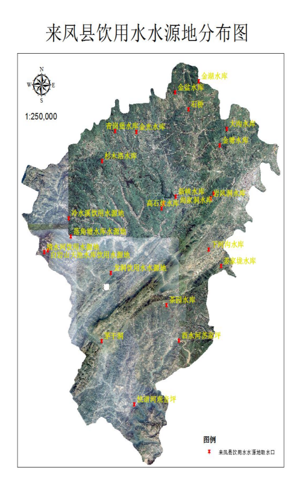

# 前 言

随着经济的快速发展，资源约束趋紧、环境污染严重、生态系统退化等问题日渐凸显，建设生态文明是中华民族永续发展的千年大计，关系民生福祉，功在当代、利在千秋。“十四五”时期，是我国由全面建设小康社会向基本实现社会主义现代化迈进的关键时期，“两个一百年”奋斗目标的历史交汇期，也是全面建设美丽中国的重要期。党的十九届五中全会对“十四五”国民经济和社会发展作出重大战略部署，核心要义集中体现在“三个新”，即把握新发展阶段、贯彻新发展理念、构建新发展格局。制定本规划，旨在指导全县“十四五”生态环境保护工作，坚持“绿水青山就是金山银山”的发展理念，把生态环境保护挺在前面，坚决贯穿“五位一体”发展的各个方面和全过程。在长江经济带、乡村振兴等建设中，把控高质量发展生态环境保护这个重要方向，走出一条绿色、生态、可持续的发展道路。要坚持方向不变、力度不减，延伸深度、拓展广度，继续深入打好污染防治攻坚战，在关键领域、关键指标上实现新突破，顺利完成“十四五”生态环境环保护目标，确保全面建成小康社会，为实现社会主义现代化打下坚实基础，为美丽中国建设提供有力支撑。加快构建现代环境治理体系，深入推进“放管服”改革，强化激励约束政策供给，形成导向清晰、决策科学、执行有力、激励有效、多元参与、良性互动的“大环保格局”，更好地发挥生态环境保护的支撑保障作用。

## 第一章 总体思路

## 一、指导思想

坚持以习近平新时代中国特色社会主义思想为指导，深入贯彻党的十九大、十九届二中、三中、四中、五中全会和习近平总书记视察湖北重要讲话精神，以实现“两个一百年”奋斗目标的决心。从远景目标来看，2020年到2035年，在全面建成小康社会的基础上，再奋斗15年，基本实现社会主义现代化。生态环境保护方面，到2035年，要达到“生态环境根本好转，美丽中国目标基本实现”的目标。为确保生态环境远景目标的实现，来凤县要全面落实党中央和省委、州委决策部署，坚持新发展理念，坚持稳中求进工作总基调，坚持紧扣“五位一体”总体布局，坚持协调跟进“四个全面”战略布局，着力打好“三大攻坚战”。牢固树立和贯彻落实新发展理念，做好“绿色发展、生态修复、环境保护”三篇文章，实施“生态立县、生态兴县”，充分挖掘来凤生态环境和自然资源比较优势，统筹区域经济社会发展和资源环境关系，着力优化空间格局和产业布局，持续改善生态环境，培育生态文化，大力促进经济生态化和生态经济化，走生产发展、生活富裕、生态良好的生态文明发展道路。

## 二、编制依据

《中华人民共和国环境保护法》

《中华人民共和国环境影响评价法》

《中华人民共和国水污染防治法》

《中华人民共和国大气污染防治法》

《中华人民共和国固体废物污染环境防治法》

《中华人民共和国环境噪声污染防治法》

《中共中央国务院关于加快推进生态文明建设的意见》

《建设项目环境保护分类管理名录》

《湖北省打赢蓝天保卫战行动计划(2018～2020年)》

《湖北省土壤污染防治条例》

《省人民政府关于发布湖北省生态保护区线的通知（鄂政发〔2018〕30号）》

《省环保厅省发改委关于湖北省生态保护红线划定方案的通知》（鄂环发〔2018〕8号）

《长江经济带生态保护和绿色发展总体规划》（鄂发[2017]8号）

《湖北生态省建设规划纲要（2014～2030年）》

《湖北省生态文明建设示范区（湖北省环境保护模范城市）管理规程（试行）》（鄂环委〔2018〕1号）

《恩施州酉水河保护条例》

《来凤县国民经济和社会发展第十四个五年规划和二〇三五年远景目标纲要》

## 三、规划原则

（一）坚持推进绿色发展、改善环境质量

坚持经济建设、政治建设、文化建设、社会建设、生态文明建设“五位一体”，推进经济绿色转型，使社会经济发展与环境保护相协调。以环境质量改善为主线，实施环境分区管治和分类管理，推进多污染源综合治理，以大工程、大投入带动大治理、大修复，使部分区域、城市环境质量得到明显改善，努力实现生态环境全面改善。

（二）坚持环保法制管理、环境监管监督

贯彻十九届二中、三中、四中、五中全会精神，以《环境保护法》实施为龙头，加快完善生态环保法规体系，强化生产者环境保护的法律责任，用严格的法律制度保护生态环境。加强环境司法建设，实行最严密的法治监督，对污染源、排放过程和环境介质依法统一监管，锻造向污染宣战的有力武器，促进生态文明建设。

（三）坚持环境信息公开、全民共同防治

加强政府和企事业单位环境信息公开，以公开推动建设，以建设推动落实。明确政府、企事业单位、社会公众的责任和义务，引导社会公众参与环境决策、环境治理和环境维护，倡导绿色生活生产方式，知行合一，建成环境保护统一战线。

（四）坚持环保制度创新、深化生态文明体制改革

把生态文明体制改革作为重点，按照“源头严防、过程严管、后果严惩”的总体思路，标本兼治，理顺体制机制，建立最严格的源头保护制度、绩效评价制度、损害赔偿制度、责任追究制度，完善环境治理和生态修复制度，形成系统完整的生态文明制度体系，用制度保护生态环境。

（五）坚持“三个治污”方针，坚持问题导向，补齐短板弱项，确保“精准科学依法”，在新阶段有新举措。

## 四、规划基准年及水平年

“十四五”生态环境保护规划基准年为2019年，规划采用2019年、2020年主要数据资料，规划水平年为2025年，以2025年为规划期限。

## 五、总体设想

来凤县“十四五”环境保护工作将在省级生态文明示范区的基础之上，进一步紧抓改善环境质量、削减污染物总量、保护生态环境、促成城乡共治、建立现代化治理体系、防范环境风险作为六个着力点，即以环境要素为切入点，以削减污染物总量为重要抓手，着力形成有效的运营机制体制，在实现环境形势趋好的同时，严格防范环境风险，保障环境安全，切实改善民生,加快推动绿色、循环、低碳发展，使绿色发展成为常态；构建产业生态化和生态产业化为主体的生态经济体系，形成生态价值观念为准则的生态文化体系，促进工业文明向生态文明转型，实现环境、经济和社会共赢；提升生态文明领域治理体系和治理能力现代化水平，完善“自然资源资产产权制度、国土空间开发保护制度、空间规划体系、资源有偿使用和生态补偿制度、环境治理体系、环境治理和生态保护市场体系、生态文明绩效评价考核和责任追究制度”；大力发展生态产业和生态经济，培育“绿芯”有效解决产业空心化和经济低端化问题，有效改善人民群众反映强烈的污染问题，明显提升生态环境质量，形成人与自然和谐共生，实现生态崛起。推进美丽乡村等城乡一体化发展模式，将来凤打造成国家级生态文明示范区。

## 第二章 “十三五”环境保护情况

## 一、环境质量现状

（一）大气环境质量

## 2019年空气质量优良天数达到347天，PM2.5、PM10年均浓度分别为31ug/m3、46ug/m3，均达到环境空气质量二级标准，空气质量优良率达到95.9%，省内排名第七。

（二）水环境质量

## 2019年，全县水环境质量稳定达标。酉水河龙凤大桥、龙嘴峡断面、百福司跨境断面、城乡饮用水源地水质达标率均为100%。

（三）声环境

## 1.2.3类噪声功能区昼、夜声级达到国家声环境质量标准中的相关规定。

（四）土壤环境质量

## 全县土壤环境质量总体保持稳定，农用地和建设用地土壤环境安全得到基本保障，土壤环境风险得到基本管控。

（五）污染物排放

## “十三五”期间是我县经济发展较快的五年，重点企业主要是建材、农副产品加工、矿产品加工等行业。根据2019年环境统计，全县废水排放总量605.8万吨，其中工业废水排放量为7.6万吨，城镇生活源598.2万吨，集中式治理设施0.06万吨。废水中化学需氧量排放量1958.8吨，其中工业源16.5吨，城镇生活源1936.3吨，集中式治理设施61吨。废水中氨氮排放量252.3吨，其中工业源2.7吨，城镇生活源249吨，集中式治理设施0.5吨。废气中二氧化硫排放总量为1085.4吨，其中工业源254.9吨、城镇生活源830.5吨；氮氧化物排放量为1109.7吨，其中工业源1016.5吨、城镇生活源93.2吨；烟（粉）尘排放量611.2吨，其中工业源排放量393.9吨，城镇生活源排放量217.4吨。

## 二、工作落实情况

（一）重点项目实施情况

“十三五”期间，我县共规划了16个环境保护项目，其中饮用水源地保护项目3个，河坝梁饮用水源地和乡镇饮用水源地整治已完成，新峡水库饮用水源地部分完成；水污染治理项目5个，生活污水处理厂污泥处置工程未完成，其他项目基本完成；循环经济及清洁生产项目2个，均已完成；大气污染治理项目4个，来凤宏发钡盐有限责任公司废气治理工程未完成（计划搬迁）；土壤污染防治项目2个，均未完成。

| 项目名称 | 主要工程内容 | 投资估算（万元） | 完成情况 |
|---|---|---|---|
| 新峡水库饮用水源地保护工程 | 划定新峡水库水源保护区，对水源地一级、二级及准保护区进行治理。 | 2000 | 部分完成 |
| 河坝梁饮用水源保护工程 | 对县城集中式饮用水水源地一级、二级及准保护区进行治理。工 | 1800 | 已完成 |
| 各乡镇饮用水源地保护工程 | 划定各乡镇政府所在地集中供水水源保护区对保护区实施治理。 | 4000 | 已完成 |
| 酉水河环境综合整治工程 | 酉水河沿线环境综合整治，包括生活污水治理、生活垃圾治理、畜禽养殖污水治理、工业废水治理等方面 | 8000 | 基本完成 |
| 蓝河综合整治工程 | 蓝河城区段综合整治，包括生活污水治理、生活垃圾治理、河底清於、两岸绿化等方面 | 2000 | 基本完成 |
| 规模化畜禽养殖污染控制工程 | 全县所有规模化畜禽养殖污染治理 | 1500 | 基本完成 |
| 工业水污染治理工程 | 三丰时代、佳佳生物等公司废水治理 | 800 | 未完成 |
| 生活污水处理厂污泥处置工程 | 对污泥进行无害化处理 | 1200 | 基本完成 |
| 来凤凯迪生物质能源循环经济生产项目 |  | 1000 | 已完成 |
| 来凤县腾升香料化工有限责任公司清洁生产建设项目 |  | 800 | 已完成 |
| 油气回收治理工程 | 区域内加油站、储油库、油灌车油气回收治理 | 2000 | 已完成 |
| 来凤宏发钡盐有限责任公司废气治理工程 | 脱硫脱硝 | 600 | 未完成 |
| 来凤县金凤建材有限责任公司废气治理工程 | 低氮燃烧 | 400 | 已完成 |
| 城区燃煤锅炉治理 | 城区所有燃煤锅炉治理、改造 | 800 | 已完成 |
| 翔凤镇活水村土壤治理与修复 | 对重金属土壤进行治理和修复 | 2400 | 未完成 |
| 三胡乡土壤治理与修复 | 对重金属土壤进行治理和修复 | 2800 | 未完成 |

“十三五”环境保护项目完成情况一览表

（二）主要指标完成情况

十三五期间，我县如期完成了污染总量控制、工业污染防治、城市环境保护等主要环境保护目标，具体完成情况如下：

1.主要污染物总量控制指标完成情况

1.1 废水中的化学耗氧量、氨氮排放量在2015年的基础上分别下降水3%、3%；主要减排项目有：城镇生活污水处理、湖北天之力优质猪育种公司关停等15个减排项目，共削减化学耗氧量401.4吨；氨氮50.8吨，在2015年的基础上分别下降10.8%、10.5%。

1.2 废气中二氧化硫、氮氧化物排放量在2015年基础上分别下降水12%、10%；主要减排项目有：来凤县金凤建材工业有限责任公司脱销工程、来凤康洁洗涤有限公司燃煤锅炉关停等14个减排项目，共削减二氧化硫258.3吨，氮氧化物941吨，在2015年的基础上分别下降15.2%、46%。。

2.工业污染防治目标

2.1 工业废水排放达标率达到60%；主要为来凤县三丰时代农业开发有限责任公司、来凤县孚瑞矿业公司等对污水进行了处理。该项目标基本完成。

2.2 工业烟尘排放达标率达到60%；主要是全县20蒸吨以下燃煤锅炉全部淘汰或者改为生物质锅炉，金凤新型建材工业有限责任公司达标排放。

2.3 城镇固体废弃物处理率＞80%。2006年，我县建成了日处理100吨的垃圾处理场，目前处理率已达到100%。

3.城市环境保护目标

3.1 县城集中式饮用水源水质达标率＞95%，经监测，我县两个县级饮用水源地水质达标率为100%。

3.2 酉水河流域城区段水质稳定在Ⅲ类标准以上。经监测，我县三个段面水质在Ⅲ类标准以上。

3.3 到2020年，确保1.2.3类噪声功能区昼、夜声级达到国家声环境质量标准中的相关规定。经监测，城区1.2.3类噪声功能区昼、夜声级达到国家声环境质量标准。

3.4 新建项目环评执行率＞95%。我县所有新建项目均进行了环境影响评价，环评执行率100%。

（三）“十三五”取得的成就

1.生态环境质量持续提高。一是大气环境质量持续改善。十三五期间，区域空气环境质量持续改善，2017年、2018年、2019年、2020年空气质量优良天数分别达到325天、318天、347天、342天；PM2.5、PM10年均浓度均达到环境空气质量二级标准，空气质量优良率达到95%以上，省内排名前十位。二是水环境质量稳定达标。我县酉水河干流国控、州控断面、城乡饮用水源地水质功能区达标率均为100%。三是声环境质量不断改善。十三五期间，我县区域环境噪声、交通干线环境噪声、功能区环境噪声均有所下降，声环境质量不断提高。四是生态环境质量保持稳定。根据国家重点生态功能区县域生态环境质量考核，来凤县综合考核结果均保持在基本稳定，生态环境质量良好。

2.生态制度建设更加完善。一是高度重视，压实责任。来凤县委、县政府高度重视生态文明建设示范县创建工作，成立了以县委书记任组长、县长任第一副组长的来凤县生态文明建设示范县创建工作领导小组，高位推进生态文明建设工作。县委、县政府将生态文明建设工作纳入党政领导干部实绩考核范围，生态文明建设工作在党政实绩考核占比高达28%。加强党政干部生态文明知识培训，我县党政领导干部参加生态文明培训人数比例达100%。同时，全面建立领导干部自然资源资产离任审计和生态环境损害责任追究制度。二是科学规划，有序推进。编制了《来凤县创建生态文明建设示范县规划（2016-2022）》，并制定年度生态文明建设实施方案，明确了创建工作重点和方向，2019年7月通过省级生态文明示范县专家组验收。截止2019年底，建成百福司镇、绿水镇等5个省级生态乡镇和7个州级生态乡镇，以及48个省级生态村、22个州级生态村。三是统筹协调，强化落实。县委、县政府在统筹抓好生态文明建设的同时，将生态文明建设和大气污染防治、水污染防治等工作有机结合，确保每一项工作任务有序推进，落到实处。

3.生态空间格局不断优化。一是严守耕地红线。实行最严格的耕地保护制度，全县基本农田稳定在37.3858万亩，耕地保有量保持在51.5407万亩，守住了耕地红线。二是严守生态红线。严格执行“三线一单”制度。全面开展生态红线优化工作，按照上级要求并结合全县生态特征完成生态红线区域优化调整，来凤县共划定生态红线面积589.6平方千米，占辖区面积比例为43.93%；划定环境管控单元10个，其中，优先保护单元4个，面积857.3平方公里；重点管控单元3个，面积530.4平方公里；一般管控单元3个，面积224.7平方公里。三是加强重点生态功能区保护。建立了百福司省级地质公园、永灵山省级森林公园、古架山古杨梅群落州级自然保护区、老板沟州级自然保护区、兴隆坳南方红豆杉自然保护小区、栏马山马褂木自然保护小区等生态保育基地。深入实施并圆满完成“绿满荆楚”三年提升行动，全县湿地保护率达95.7%，受保护地区占国土面积比例达82.6%。

4.生态经济发展成效显著。一是大力发展生态农业。积极开展无公害、绿色食品、有机食品和农产品地理标志申报认证、续证。我县认证有效“三品”数18个，地理标志产品种植面积20.4850万亩，“三品一标”种植面积占农作物种植比例达58.59%。二是大力发展生态旅游业。编制完成《来凤县全域旅游发展规划》，2016-2018年成功创建“湖北旅游强县”，成为全省“5.19”中国旅游日活动第一个县级承办地，多次成功举办杨梅文化旅游节暨河钓大赛、来凤旅游推介会等系列活动，连续三年接待游客人次涨幅20%以上，旅游收入涨幅24%以上，生态旅游业保持良好的发展态势。三是大力发展生态工业。着力实施“四大工程”，培育新兴产业，加快发展新型工业，依托龙头企业促进产业融合发展，强力推进藤茶产业园、油茶产业园、医药材产业园、静脉环保产业园、大数据产业园“五大产业园”建设，加快产业结构调整，努力转变经济发展方式，淘汰落后产能企业。严格市场准入实施效能评价，实施重点节能工程。

5.基础设施建设不断加强。一是“美丽乡村”建设步伐加快。大力开展“美丽乡村”建设，根据省州“四个三重大生态工程”行动的总体部署，强力推进“厕所革命”工作。截止2020年我县完成农户无害化厕所改建44236口，完成改建任务的100%。二是城镇污水处理能力不断增强。我县城区污水处理厂日处理污水达15000吨，污水处理厂提标升级改造已于2020年10月开工建设，县城生活污水处理率达到100%。各乡镇污水处理厂均已正式运行。三是乡村人居环境整治效果显著。我县目前建有一个垃圾填埋场，全县共有4个乡镇完成垃圾处理市场化运营，建成7座乡镇垃圾中转站，城镇垃圾无害化处理率达95.6%。四是农村安全饮水管理全面加强。全县通过湖北省农村饮用水安全PPP项目建设新建和改扩建共27个水厂，8个乡镇均配备了卫生监督协管员和饮用水快检设备，对全县饮用水水质情况进行定期监测，构建了生活饮用水质监测从城区到乡镇全覆盖的卫生监督体系，根据监测结果，2017-2020年，村镇饮用水卫生合格率均达到100%。五是农业废弃物综合利用率不断提高。基本建立较完善的秸秆田间处理、收集、储运体系，形成布局合理、利用多元化的秸秆处理利用模式格局，秸秆综合利用率达到94.38%；严格执行畜禽养殖场三区划定方案，健全保障机制，强化“一场一策”，畜禽粪便综合利用率达到95.24%。

（四）“十三五”存在的问题

1.环境保护与经济发展不协调

“十三五”以来，来凤县GDP增速较快，引进项目较多，环境压力增大，环境保护与经济发展存在矛盾，一些企业法律意识淡薄，存在逃避监管、偷排、漏排等违法现象。部分干部和部门“重经济、轻环保”的观念依然存在。医疗废物处理能力不足；突发性环境安全事故隐患尚存；环保基础设施建设不完善。

2.突出环境问题仍然存在

尽管我县实施了四个三重大生态工程，启动了乡镇污水处理项目和城乡垃圾治理工作，但乡镇污水处理厂建成后仍面临进水量不足、运营难等问题；城乡垃圾治理体系不完善，户收集、村保洁、镇转运、县处理的城乡垃圾治理体系未完全落实到位；城乡部分生活污水直排，城中河污水治理缓慢，蓝河水质断面部分超标。农村环境污染和生态破坏日益突出，长期施用农药、化肥，导致土壤板结、土质恶化，并且通过农田径流造成水质污染；农村畜禽养殖和水产养殖加剧了农村水污染，养殖水域的水质污染情况比较严重；村级卫生室医疗废弃物得不到有效收集，农村垃圾乱堆乱放现象较为普遍，农村生态环境面临压力。污染防治攻坚战还存在思想认识不够深、改善水平不够高、工作成效不够稳。城市空气质量总体仍未摆脱“气象影响型”等，涉及领域不够宽、治理范围不够广等问题。

3.污染减排工作进展仍然滞后

“十三五”期间，来凤县虽然加大城镇污水处理厂的建设力度，为来凤县完成“十三五”化学需氧量的减排任务作出了重要贡献，但部分规划建设的城镇污水处理厂运行不稳定。一些建设了污染治理设施的企业，由于设备运行、维护成本较高，企业业主治理污染积极性不高。清洁能源替代发展迟缓，减排空间不足。

4.环保基础设施建设力度需加快

全县环境保护基础设施，如生活污水、生活垃圾处理等设施滞后于经济社会的发展，综合治理能力仍相对薄弱，城市污水、生活垃圾等得不到有效的处理处置，环境质量和环境安全得不到有效保障。城乡排水管网改造力度不够。污水再生利用还未建设实施，无法实现污水资源化再利用。

5.民生关注的环境问题需进一步解决

“十三五”期间，民生关注的主要环境问题有：城市噪声扰民、餐饮油烟污染、饮用水源保护、城市垃圾污染等问题，尤其是围绕噪声扰民、餐饮油烟等具体环境问题，点多面广，尚未完全有效控制。

6.统筹协调环境保护工作存在难度

生态文明快速发展，但尚未形成与之完全适应的体制、机制，执法主体和监测力量不足，环境保护委员会统筹协调作用不明显，村级环保“网格员”制度未建立，“大环保”格局未形成，各成员单位落实环保责任意识不强，部门联动机制不完善，环保部门单打独斗，“小马拉大车”现象依然存在。

## 第三章 “十四五”规划目标

## 一、总体目标

要在全面建成小康社会、全面打赢污染防治攻坚战的基础上，进一步加强生态环境保护、深入打好污染防治攻坚战；落实“减污降碳”总要求，对减污降碳协同增效一体谋划、一体部署、一体推进、一体考核，进一步强化降碳的刚性举措；坚持“三个治污”方针，坚持问题导向，补齐短板弱项，确保“精准科学依法”。实现主要污染物排放总量明显减少，生态系统稳定性显著增强，人居环境进一步改善，环境管理体系、环境监管机制和行政执法体制等生态环保制度法规体系进一步完善，促进现代化建设各方面相协调，人民群众在享有丰富的物质和文化产品的同时，生产和生活方式更加高效、低耗、可持续，使得天更蓝、水更清、山更绿、空气更清新。坚持绿水青山就是金山银山理念，坚持尊重自然、顺应自然、保护自然，坚持节约优先、保护优先、自然恢复为主，守住自然生态安全边界。生态文明取得新进展。深入探索“两山”理念转换通道，生产生活方式绿色转型成效显著，资源配置更加合理、利用效率大幅提高，“三河五岸”综合治理取得重大成效，森林覆盖率达到60%以上，生态环境持续改善，生态优势日益彰显，空气质量优良天数稳居全省前十位，建成全国生态文明示范县。

## 二、指标体系

“十四五”时期需致力于将现代化建设提高到人与自然和谐共生的高度。要坚持节约优先、保护优先、自然恢复为主的方针，顺应自然规律，着力防止破坏，并形成节约资源和保护环境的空间格局、产业结构、生产方式和生活方式，从源头上提高资源的利用率，以达到物尽其用。建立以环境质量改善为主线，适应社会新期待，反映治污减排、风险防范、空间优化、制度建设进展的综合指标体系，主要包括约束、预期和引导性指标（见来凤县“十四五”环境保护指标体系）。

（一）建立环境质量和排放总量双约束指标体系。以环境质量改善为核心，强化环境质量导向和考核，完善环境质量指标体系、污染控制体系和评估考核体系。进一步完善总量控制指标体系，考虑工作基础和发展需要，将挥发性有机物、化学需氧量、氨氮、氮氧化物作为约束性指标。建立以全过程管理理念贯穿的环境风险防控考核指标体系，将突发环境事件数量及预案备案、信息报告、事件调查处理等作为考核指标。

（二）构建全要素的协同性指标体系。力争实现水、大气、土壤、生态系统等全要素管理，加强国家目标、区域（流域）目标、省市目标、重点单元目标的衔接。

水环境质量方面：城镇集中式饮用水水源水质稳定达标，城市内无黑臭水体，出境断面水质达标，现状水质优于III类水体并保持稳定。

大气环境质量方面：城市空气质量明显改善，可吸入颗粒物和细颗粒物浓度下降30%以上、二氧化硫、二氧化氮、一氧化碳和臭氧平均浓度达标。

土壤环境质量方面：全县耕地土壤环境质量达标率不低于82%，新增建设用地土壤环境安全保障率100%，建设土壤污染综合治理试点和区域土壤综合治理示范区。

生态环境方面：水土流失面积下降，生态系统稳持稳定、生态服务功能有所改善。

环境风险防控方面：重大突发环境事件保持零发生，环境和人群健康风险得到有效管控，环境应急管理体系基本完善。

辐射环境方面：辐射设施安全水平进一步提高，放射性污染防治水平全面提升，辐射环境质量继续保持良好。

（三）体现分区分类管理。依据污染物传输规律、环境功能定位，结合经济发展与行政管理等要素，划定不同类别的管理区，分区域、分类别、分层级确定中长期环境保护目标和重点区域环境控制目标。

（四）突出可达可控性。综合考虑社会经济发展和环境保护的历史阶段、环境保护和管理工作基础、经济技术可行性以及政府事权、指标的稳定性等因素，把可达可控作为核心，以技术可行、经济可承受、环境质量响应3个角度进行深入分析论证，强调目标指标和任务措施的匹配。

（五）提高指标的预见性。在指标选择上，在注重可监测、可统计、可考核的同时，对部分影响长远，但目前监测统计基础薄弱，不具备监测评估基础的领域，考虑提炼引导性指标，为下一步的工作奠定基础。

（六）要贴近群众感受。加强对群众感受与环境客观指标的相关性分析，优先选择与群众主观指标密切相关的客观指标作为规划综合性指标，对突发环境事件造成的损失进行定量控制，引导“十四五”期间的治理重点和公众预期。

来凤县“十四五”环境保护指标体系

| 指标名称 | “十四五”规划目标 | 指标类型 |
|---|---|---|
| 总量控制指标（拟定值）： | 最终以省定指标为准 |  |
| (1)COD排放总量 | -10% | 约束型 |
| (2)氨氮排放总量 | -10% | 约束型 |
| (3)氮氧化物排放总量 | -15% | 约束型 |
| (4)挥发性有机物 | -15% | 引导型 |
| 环境质量指标： |  |  |
| (1)城市空气质量年均值达二级标准天数 | 优于二级标准以上天数超过330天 | 约束型 |
| (2)重污染天气 | 保持零记录 | 约束型 |
| (3)可吸入颗粒物和细颗粒物浓度 | 下降30%以上 | 约束型 |
| (4)二氧化硫、二氧化氮、一氧化碳和臭氧 | 平均浓度达标 | 约束型 |
| (5)城镇集中式饮用水源水质达标率 | 100% | 引导型 |
| (6)地表河流市控断面达Ⅲ类水质的比例 | 100% | 约束型 |
| (7)城市水环境功能区水质达标率 | 100% | 约束型 |
| (8)跨界水体水质达标率 | 100% | 引导型 |
| (9)重点城市区域环境噪声小于55db比例 | 90% | 引导型 |
| 污染防治指标： |  |  |
| (1)工业固体废物处置利用率 | 100% | 引导型 |
| (2)工业用水重复利用率 | 85% | 引导型 |
| (3)工业废水排放达标率 | 100% | 约束型 |
| (4)危险废物综合利用率 | 100% | 约束型 |
| (5)规模化畜禽养殖场粪便综合利用率 | 95% | 引导型 |
| 生态建设指标： |  |  |
| (1)森林覆盖率 | 60% | 约束型 |
| (2)水土流失面积占国土面积比例 | 31% | 引导型 |
| (3)自然保护区占国土面积比例 | 10% | 引导型 |
| (4)耕地土壤环境质量达标率 | 82% | 引导型 |
| (5)新增建设用地，土壤环境安全保障率 | 100% | 引导型 |
| 城镇基础设施： |  |  |
| (1)城镇污水集中处理率 | 97% | 约束型 |
| (2)城镇生活垃圾无害化处理率 | 100% | 约束型 |
| (3)城市人均绿地 | 12m2/人 | 引导型 |
| 环境管理能力： |  |
| (1)环境监测能力达到标准化水平的比例 | 100% | 引导型 |
| (2)环境监察能力达到标准化水平的比例 | 100% | 引导型 |
| (3)环境应急响应系统 | 完善 | 引导型 |
| 环境安全保障指标： |  |  |
| (1)突发性污染事故应急处置率 | 100% | 约束型 |
| (2)放射性废物安全处置率 | 100% | 约束型 |
| 环境保护投入： |  |  |
| （1）环境保护投入占全县GDP的比例 | 3% | 引导型 |

## 第四章 “十四五”生态环境保护形势

## 一、“十四五”生态环境保护发展趋势

从国内看，环境保护形势仍然不乐观。“十三五”是我国生态化建设进入关键期，是生态环境保护修复与破坏恶化的胶着期。以习近平同志为核心的党中央，针对我国长期粗放型发展带来的环境污染、水土流失、草原退化、沙漠扩大、水源枯竭等问题，提出新发展理念，修订实施最严的《环境保护法》，实行自然资源资产离任审计，建立生态环境损害责任终身追究制，开展环保督察，查处典型案件等，掀起了前所未有的环保风暴，从总体上遏制住了生态环境恶化的势头。但是，生态环境形势依然严峻，尚未出现趋势性好转，加上生态问题积重难返、经济下行压力加大等，稍有放松就会前功尽弃。因此，“十四五”时期必须坚持“绿水青山就是金山银山”的发展理念，把生态环境保护挺在前面，贯穿“五位一体”发展的各个方面和全过程，走出一条绿色、生态、可持续的发展道路，力争“十四五”生态环境出现趋势性好转，为建成现代化的美丽中国打下坚实基础。

从省、州看，省委、州委深入践行绿水青山就是金山银山的理念，始终把修复长江生态环境摆在压倒性位置，坚持共抓大保护、不搞大开发，持续解决“化工围江”问题，扎实推进长江“十年禁渔”，全面加快岸线修复，全力抓好中央环保督察及“回头看”反馈问题整改，打好蓝天、碧水、净土保卫战，全省生态环境质量进一步改善。“十四五”生态文明建设要取得新成效，长江经济带生态保护和绿色发展取得显著成效，生态文明制度体系更加健全，城乡人居环境明显改善。到二〇三五年，基本实现社会主义现代化，城乡人居环境明显改善，广泛形成绿色生产生活方式，生态环境根本好转，美丽湖北基本建成。州委、州政府着力构建“一核支撑、两翼并进、全域协同”的区域发展布局，形成推动恩施州高质量发展的板块支撑和动力系统，生态文明建设实现新进步。我们既要绿水青山又要金山银山，坚决保护好一江绿水、一方青山，挖掘绿水青山的经济效益，拓宽“两山”转化通道，把自然优势转化为发展优势，着力提升绿水青山颜值，全力实现金山银山价值。

从县内看，县委、县政府加快推动绿色、循环、低碳发展，使绿色发展成为常态，主动融入国家发展战略和省、州区域发展布局，着力构建“一主引领，一轴支撑，两翼推动，全域协同”县域发展格局。突出“一主引领”，以龙凤示范区建设为重点，推动翔凤镇率先发展、带头引领，做强县域发展龙头。建强“一轴支撑”，以酉水河为纽带，坚持优势互补、集群发展，壮大发展县域经济主轴，沿酉水河串联绿水镇、漫水乡、百福司镇，形成新型工业、旅游康养、民俗文化为主体的经济发展带。着力“两翼推动”。以讨橙线、来咸线为链接，坚持块状组团、扇面发展，形成“旧司大河”“三胡革勒”两翼。促进“全域协同”，坚持点面结合、多点发力、系统推进，打造更多高质量发展的支撑点、增长极。构建产业生态化和生态产业化为主体的生态经济体系，形成生态价值观念为准则的生态文化体系，促进工业文明向生态文明转型，实现环境、经济和社会共赢；提升生态文明领域治理体系和治理能力现代化水平，完善“自然资源资产产权制度、国土空间开发保护制度、空间规划体系、资源有偿使用和生态补偿制度、环境治理体系、环境治理和生态保护市场体系、生态文明绩效评价考核和责任追究制度”。

“十四五”时期来凤县生态环境保护的总体思路是：认真贯彻落实习近平生态文明思想，深刻践行“两山”理念，加强流域综合治理，全面提升生态环境治理水平，大力推进绿色低碳发展，着力建设人与自然和谐共生的美丽来凤。坚持紧扣“五位一体”总体布局、坚持协调跟进“四个全面”战略布局，着力打好“三大攻坚战”，深刻认识环境就是民生、青山就是美丽、蓝天也是幸福，把解决突出生态环境问题作为民生优先领域，把生态惠民、生态利民、生态为民贯穿于生态文明建设始终，不断满足人民日益增长的优美生态环境需要。全面建成国家级生态文明建设示范县，打造“两山”基地，建成“富裕来凤”“文明来凤”“幸福来凤”“和谐来凤”“美丽来凤”。

## 二、环境保护机遇

党的十八大报告将生态文明纳入中国特色社会主义事业“五位一体”布局，提出了“把生态文明建设放在突出地位，融入经济建设、政治建设、文化建设、社会建设各方面和全过程，努力建设美丽中国，实现中华民族永续发展”的发展要求。党的十八届三中全会提出，“建立系统完整的生态文明制度体系，实行最严格的源头保护制度、损害赔偿制度、责任追究制度，完善环境治理和生态修复制度，用制度保护生态环境。”党的十八届五中全会提出，“必须坚持节约资源和保护环境的基本国策，坚持可持续发展，坚定走生产发展、生活富裕、生态良好的文明发展道路，加快建设资源节约型、环境友好型社会，形成人与自然和谐发展现代化建设新格局”。为持续深入推进生态文明建设，中央成立了高规格的生态文明体制改革领导小组，出台了《中共中央国务院关于加快推进生态文明建设的意见》、《党政领导干部生态环境损害责任追究办法（试行）》、《生态文明体制改革总体方案》、《生态环境损害赔偿制度改革试点方案》等一系列政策文件。这一系列政策和制度的出台，表明生态文明建设已上升为国家战略，成为我国当前和今后一个时期社会的发展潮流。党的十九大把“绿水青山就是金山银山”的发展理念，贯穿到“五位一体”发展的各个方面和全过程。在长江经济带、乡村振兴等建设中，把控高质量发展生态环境保护这个重要方向，走出一条绿色、生态、可持续的发展道路。党的十九届五中全会审议通过的《中共中央关于制定国民经济和社会发展第十四个五年规划和二〇三五年远景目标的建议》，把“生态文明建设实现新进步”作为“十四五”时期经济社会发展主要目标之一，将“广泛形成绿色生产生活方式，碳排放达峰后稳中有降，生态环境根本好转，美丽中国建设目标基本实现”作为到2035年基本实现社会主义现代化远景目标之一，这为新发展阶段进一步做好生态环境保护工作提供了目标指引。

“十四五”时期，来凤有多重利好政策叠加：龙凤经济协作示范区、鄂西生态文化旅游圈、武陵山少数民族经济社会发展试验区、三峡城市群、“616”对口支援、武汉市对口帮扶、浙江杭州拱墅区对口帮扶等。生态优势凸显，发展布局优化，乡村振兴战略全面推开，中央支持湖北一揽子政策红利加速释放；建成全省营商环境最优县、市场机制最活县、改革探索领跑县；社会主义核心价值观更加深入人心，张富清精神广泛弘扬，全面建成全国生态文明示范县。

## 第五章 “十四五”主要环境保护工作

## 一、“十四五”主要环境保护工作任务

“十四五”环境保护重点工作任务是：继续打好污染防治攻坚战，持续改善生态环境质量。全面实行排污许可制，不断改善环境民生，解决好人民群众关心的大气、水、土壤污染等突出环境问题，全面促进生态文明建设。以管控污染物总量为主向以改善环境质量为主转变，工作重点从主要控制污染物增量向优先削减存量、有序引导增量协同转变，实现减污降碳协同增效，进一步深化质量改善、治污减排、生态保护、城乡共治、现代化治理体系、风险管控等战略任务，加强制度建设，切实解决好人民群众关注的各种环境问题，体现环保执政为民的工作理念。

（一）坚持生态优先、绿色发展，建设美丽来凤。认真贯彻落实习近平生态文明思想，深刻践行“两山”理念，着力建设人与自然和谐共生的美丽来凤。推动生态文明建设，继续打好污染防治攻坚战，建立建全地上地下、陆水统筹的生态环境保护制度，实施中心城区水环境综合整治，加快城镇污水收集管网建设，全面推进县老城区管网雨污分流制改造。坚持节约优先、保护优先、自然恢复为主的方针。加快村庄整治进程，实行农村垃圾分类收集，集中处理。加强露无焚烧监管和秸秆综合利用，使青山常在、清水长流、空气常新，让人民群众在良好生态环境中生产生活，为子孙后代留下可持续发展的“绿色银行”。

（二）加强流域综合治理。以酉水河为重点，推进全县大小河流生态环境综合治理，开展清河、护岸、净水、保水“四项行动"；严格实施酉水河流域十年禁渔措施，打造酉水绿色生态廊道；实施天然林保护等重大生态工程。以三胡乡、绿水镇为重点保护区，其他乡镇为重点治理区，全面开展水土保护和水土流失综合治理工作。

（三）全面提升生态环境治理水平。深入打好污染防治攻坚战，统筹山水湖田林草系统治理保护。加强大气污染防治，确保空气质量优良天数占比稳定在93%以上；开展城区污水管网和自来水管网改造升级，基本消除城镇黑臭水体；加快乡镇污水管网向村庄延伸覆盖；落实河长制，划定水源保护区，做好集中式、分散式饮用水源地规范化保护；加强白色污染治理和农业农村面源污染防治。争创“无废城市”，实现城镇垃圾无害化处理、危险废物处置、农村垃圾畜禽养殖污染规范化处理“三到位”，城镇垃圾无害化处理率100%，危险废物处置1100%；农村垃圾、畜禽养殖污染规范化处理，农村环境综合整治率80%以上；全面开展自然生态林保护行动，推行林长制。落实生态环境保护督察制度，深入开展生态环境损害赔偿制度改革，加大环境公益诉讼力度。

（四）大力推进绿色低碳发展。严格落实“生态保护红线、环境质量底线、资源利用上线和环境准入负面清单”“三线一单”环境管控体系，强化国土空间规划和用途管控；大力发展循环经济，实行垃圾分类和资源利用制度，加快构建资源循环利用体系，建成静脉产业园。倡导绿色低碳生活方式，开展节约型机关、绿色家庭、绿色学校、绿色社区、生态示范村创建行动。完善产业生态化、生态产业化推进机制，实现产业清洁高效循环。加快生态林业和民生林业建设，增加林业碳汇，积极推进林业碳汇交易。

（五）实施城乡共治。深入推进农村环境综合整治，完成生态环境补短板，统筹推进城镇和乡村污水、固废处理，推动城镇固废、污水处理设施和管网建设向人口相对集中的乡村地区延伸，完成建制村环境综合整治工作；推动生态农业发展水平，推广农业清洁生产技术，严格控制农业面源污染，减少农药、化肥使用量，加强农业废弃物的回收和综合利用；有效防止畜禽养殖污染，合理设置畜禽养殖禁养区，在畜禽养殖区全面建设粪污集中处理和资源化综合利用设施，大幅降低畜禽养殖污染排放强度；建设医疗废物、危险废物收集、转运体系，医疗废物、危险废物应急处理实现提能提质。

（六）强化环境风险管控。从环境风险发生的全过程着手，严格源头防控、深化过程监管、强化事后追责，落实企业主体责任，努力将环境风险防范纳入到常规环境管理，将环境风险管控到与经济社会可接受水平相适应，守住底线。

## 二、工作措施

（一）、大气环境保护

1.加强生活污染源防治

能源改造：改善能源结构，提高居民天然气普及率，积极扶持和推进可再生能源的开发与利用；结合城镇发展规划和天然气管网建设规划，先满足有燃气管网的街道和小区天然气供应，远期覆盖县城区周边乡镇，逐步实现县城区和重点集镇天然气管道气化率达60%，对天然气不能普及的地区大力推广沼气、太阳能等清洁能源。

农村秸秆禁烧和资源化利用：积极推动秸秆禁烧工作，建立乡镇、村（社区）、组分片包干制度，层层落实禁烧责任制。加大执法检查力度，特别是夏秋收种的关键时期，实行24小时值班制度，采取加强巡查、接受举报等方式，以区域联防联控手段控制秸秆焚烧。深入开展秸秆资源化利用，进一步加大示范和政策引导力度，建立秸秆有偿回收机制，大力开展秸秆还田和秸秆肥料化、饲料化、基料化、原料化和能源化利用，结合农村清洁能源改造工程，新建秸秆气化供气工程，30%左右农户安装秸秆沼气池，实现全县农作物秸秆综合利用率达到95%以上。

餐饮油烟治理：合理布局餐饮项目，城管部门定期监督执法，集中开展居民投诉多、问题大的餐饮企业油烟达标排放整治，对夜间流动餐饮油烟污染源进行排查和治理。全县3个灶炉以上、居民小区及风景旅游区内的餐饮企业必须按照环保要求安装油烟净化设施，其他餐饮企业按要求逐步安装；2023年实现县内规模以上餐饮企业（3个炉头以上）100%安装油烟净化器，并同步安装油烟在线监控设备，至2025年实现所有餐饮单位全部安装油烟净化器，规模以上餐饮单位全部安装油烟在线监控设备。

2.加强机动车污染源防治

加强车辆监测：按照国家规定的环保定期检验周期大力开展机动车尾气整治行动，开展道路交通污染监测，在县城重点道路设立机动车排气遥感监测点，加大对冒黑烟车辆的查处力度，全面禁止冒黑烟车上路。全面实施柴油车严格管控制度。及时报废老旧汽车，建立机动车数据库，按年对符合报废条件的机动车及时注销报废。

加快黄标车淘汰：制定黄标车淘汰工作计划，实施黄标车提前淘汰奖励补贴政策，开展黄标车淘汰专项整治行动，对达到报废标准的黄标车，应当强制淘汰。到2023年淘汰所有公务黄标车，到2025年淘汰辖县内所有黄标车。

3.全面控制烟粉扬尘排放

矿山石材企业粉尘控制：加强企业烟粉尘的监测和控制，确保达到大气污染物特别排放限值的要求。同时要求排放粉尘的企业安装除尘设施，并保证除尘率达到100%。

加强施工扬尘污染防治：完善建筑场地施工环境机制，积极推进绿色施工、文明施工、科学管理。要求所有建筑工地必须实现“六个100%”，即施工现场100%标准化围蔽、工地路面100%硬地化、工地砂土不用时100%覆盖、工地路面及拆除工程100%洒水压尘、出工地车辆实现100%冲净车轮车身、施工场地长期裸露土地实现100%覆盖或绿化。

复绿裸露土地：坚持“谁裸露、谁绿化、谁管理、谁受益”和公共地段政府负责的原则，调查区内裸露土地分布情况，制定修复措施。根据闲置时间不同，对于闲置一年以内的裸露土地通过播种经济实用的草皮、花卉组合和栽植地被植物等方式进行临时绿化；闲置一年以上的裸露土地，较平整的种植乔木，坡度超过25度的栽植地被植物。对于施工造成、采矿造成的临时裸露土地，要及时覆盖，进行简单复绿；对于因崩塌、滑坡等地质灾害造成的，以及废旧矿区的裸露土地，则可结合土地整理，开展生态化农业生产开发活动。

4.推广清洁能源

重点发展水电、太阳能、地热、生物质能等清洁源利用和企业能源转换。推动水电资源开发改造，来凤县全县有水库58座，大小水电站21座；实施小水电代燃料生态工程建设，继续推进水电新农村电气化县电网建设与改造，提高小水电供电区的供电能力；实施小水电增效减排工程，对存在安全隐患的小水电设施进行更新改造，提高资源利用效率；推广太阳能综合利用，安装太阳能热水器、太阳能路灯；推广地热能综合利用工程和风能综合利用工程；对茶叶加工业实施能源转换，增加新型清洁能源的使用率；对餐饮业炉灶、茶水炉、小窑炉、大灶等实施清洁能源改造；在规模化养殖基地或专业化养殖农场建设沼气工程，建设户用沼气、沼气工程及提纯工程。

5.开展挥发性有机物防治

开展VOCs排放量和物质清单排查，对辖区范围内挥发性有机物污染排放情况进行调查。加强家具制造业废气污染实施源头控制，对涂料、稀释剂、固化剂和清洗剂的储存、运输、调配和使用过程进行管理和优化；在建筑装饰装修行业，推广使用符合环保要求的水性或低挥发性建筑涂料、木器漆和胶粘剂，逐步减少有机溶剂型涂料的使用；深化表面涂装（汽车修理业）等行业喷漆工序改用水性漆；加快完成加油站、油库和油罐车的油气回收系统改造，并严格监管，保障其正常运转。对新、改、扩建排放挥发性有机物的项目，实行现役源2倍削减量替代或关闭类项目1.5倍削减量替代。

6.加快推进低碳发展，做好碳市场交易

积极推动碳市场交易，启动碳排放达峰行动方案研究制定工作，明确碳达峰时间表、路线图，力争“十四五”末实现达峰。开展近零碳排放区示范工程建设，打造近零碳城镇、园区、校园、社区和商业试点。

（二）水环境保护

1.严格保护饮用水源地

加强城镇饮用水源地保护：对乡镇饮用水源地开展环境综合整治，加强县级饮用水源地保护。全面开展饮用水源地环境风险排查，依法关闭、搬迁、截流饮用水源保护区内生活、工业、养殖、船舶、道路等污染源和风险源；加强城镇饮用水源地面源污染和水土流失控制，清理整治乡镇等饮用水源保护区内农用地、居民生活垃圾和养殖垃圾，设置垃圾处理池等；禁止在乡镇饮用水源保护区新建、改建、扩建与水源保护无关的生产项目，保证所有集中式饮用水水源地无私设排污口和私塔乱建现象；在全县所有行政村的饮用水源保护区建设水源涵养林、物理隔离带等生态缓冲工程，防止水污染物直接排入水体，解决群众饮水安全问题。

建立饮用水源地联合执法机构，加大保护区执法检查力度：逐步开展保护区常规执法行动，制定饮用水源专项检查方案，定期对饮用水源保护区进行检查和清理，重点检查保护区内是否有排污口、暴露垃圾、违章种养、非法填土、毁林种果、无序开发，及时通报整改情况。

2.水环境质量提升

不断完善县城环卫基础设施，加快垃圾收集点、转运站的标准化建设，禁止向河流倾倒垃圾；加快对垃圾填埋场的改造升级力度，防止填埋场渗滤液进入水体；推动改造城区或乡镇集贸市场，杜绝集贸市场污水进入河道。

污水处理设施建设：加快推进城镇污水处理厂提标升级改造工程，加快完善城区污水管网改造，推进城区雨污分流管网；做好乡镇污水处理厂管理，确保污水处理设施正常运行，生活污水应收尽收。

因地制宜开展农村生活污水治理，编制《来凤县农村生活污水治理规划》，对规模较大且靠近镇周边的村庄，建设管网接入就近的城镇污水处理设施；对其他情况的村庄，结合农村环境综合整治工程，采取分散式、低成本、易管理的人工快渗、人工湿地等污水处理设施进行处理，通过建立小规模污水处理设施，实现农村生活污水处理的全覆盖。到2025年前，基本完成全县村庄污水处理设施的建设。

强化河道水库管理与修复：继续实施酉水河、蓝河、龙洞河流域综合治理项目，开展河流截污工程建设，对进入河道排污渠道的污水须经污水处理厂处理后方可排放；建设河流沿线截污管道工程，禁止向内河直接排放污水，要求自然汇入主河道的水达到Ⅲ类水的要求。严格限制县域河道沿线建设有重大环境安全隐患和重污染的工业项目，对现有流域内的工业企业进行技术改造，推行清洁生产，减少废水排放量。加强来凤县境内河流主河道及支流沿岸的生态保护，严格保护生态保护红线的划定区域。

（三）土壤环境保护

1.开展土壤环境摸底调查

开展土壤调查与监测，按照不同的土壤污染类型和土地利用方式，对工业遗留地、垃圾填埋区、规模化养殖场等区域进行加密监测、跟踪监测查，评估土壤生态功能现状，并建立土壤污染档案。以来凤县用地功能布局和污染源分布特点为主要依据，参照《土壤环境监测技术规范》（HJ/T166-2004），定期开展土壤环境监测和评价工作，重点加强垃圾填埋区域、水源地等环境敏感区域土壤环境监测。

2.编制土壤污染防治方案

以防控重金属污染为切入点，结合农业面源、垃圾填埋场、尾矿等重点污染源，开展土壤污染场地调查，逐步进行污染场地风险评估，建立污染场地清单；加强污染场地环境管理，分类型制定和实施污染土壤管理对策和防治方案，合理合法调整土地用途综合防控土壤重金属污染。

3.开展污染场地土壤修复

结合重点区域土壤污染状况调查，选取重污染区域及重点保护区域，借鉴其他区域土壤修复示范建设的经验，进一步完善污染场地土壤修复工作；按照“谁污染、谁治理”的原则，被污染土壤由造成污染的单位和个人负责修复和治理，由于历史等原因确实不能确定造成污染的单位或者个人的，被污染的土壤由所在地政府依法负责修复和治理。

4.展开农业用地污染地块的详查整治

按照省州要求和统一部署，开展了国控点位土壤污染详查，启动省控点位土壤点位核实，完成农用地土壤详查成果与集成工作。以农用地中的污染地块为重点，组织有关部门和科研单位，筛选污染土壤修复实用技术，加强污染土壤修复技术集成，选择有代表性的污染场地，开展土壤污染治理与修复技术应用试点项目，开展疑似污染农用地的筛查场地和全县重点区域土壤污染状况普查、土壤污染详细调查与风险评估和土壤修复工程。

5.开展有毒有害垃圾治理

深化垃圾分类，重点针对有毒有害垃圾的处理，对废旧电池、医疗废弃物以及农业农药面源污染创立综合收集管理办法，并通过最新的无害化垃圾处理技术，集中对其进行分类利用和无污染处理，同时根据有毒有害垃圾的产生地点，进行严格的管控和监督，预防发生群众卫生安全事件，在预防和监控的基础上，建立有毒有害垃圾的综合处理系统。在垃圾分类的基础上，对日常生活垃圾开展无害化垃圾焚烧发电。对动物尸体处理，首先建设动物尸体暂存中心，妥善保存，防范动物流行疾病和细菌病毒的传播，避免对人畜造成风险，然后将动物尸体转移至专业的处理机构，完成安全体系衔接。

6.加强水土保持措施

将工程措施、生物措施和蓄水保土耕作措施作为水土保持的主要措施。利用工程措施防治水土流失，以保护和合理利用水土资源而修筑的各项工程设施为主，包括治坡工程、治沟工程和小型水利工程。利用生物措施防治水土流失，保护与合理利用水土资源，采取造林种草及管护的办法，增加植被覆盖率，维护和提高土地生产力的一种水土保持措施。主要包括造林、种草和封山育林、育草。利用蓄水保土防治水土流失，以改变坡面微小地形，增加植被覆盖或增强土壤有机质抗蚀力等方法，保土蓄水，改良土壤。三大措施结合流域单元，实行全面规划，综合治理，建立水土流失综合防治体系。

（四）固体废物环境保护

1.推广应用可循环、可降解、可替代产品

旅游、餐饮等行业应当逐步推行不主动提供一次性用品。机关、企业事业单位等的办公场所应当使用有利于保护环境的产品、设备和设施，减少使用一次性办公用品等。到2023年，餐饮、旅游一次性用品减少50%，机关、企业事业单位等使用的一次性办公用品减少70%。

2.加快垃圾分类推行进程

垃圾分类市场潜力的释放具有周期性，从前期规划来看，在2023年，完成来凤县城区垃圾分类一体化处理，长期则利用好垃圾分类技术布局企业，推广到全县各乡镇。

3.推动资源综合利用，提高大宗固废综合利用水平

以全面提高资源利用效率为目标，促进大宗固废实现绿色、高效、高质、规模化利用。到2025年，煤矸石、粉煤灰、尾矿、建筑垃圾、农作物秸秆等大宗固废综合利用能力显著提升，利用规模不断扩大，存量大宗固废有序减少。

（五）推进生态系统综合管理

1.推进生态环境统一监管，努力做好生态资源开发利用的监管者

坚持污染防治与生态保护统筹，理清责权，明确监管职责，完善监管手段，转变监管方式，形成生态环境资源承载能力监测预警机制。以生态环境统一监管为基本导向，统一分布生态环境质量信息，建立和完善生态环境监测制度，完善生态环境监测网络，努力建设全县统一、天地一体的生态监测、评估和预警体系。统一和完善监测网络，建立评估标准，开展生态安全评估，逐步建立生态安全预警机制，建立常规化、定期化的生态环境动态评估制度，评估结果作为进行绩效考核、责任追究的依据。

2.推进山水林田湖草生态系统综合管理，提高生态系统管理绩效

理顺管理机制，破解生态系统管理的“破碎化”。将所有生态系统类型和要素，纳入生态管理体系，按照生态格局安全和生态服务功能最优的原则，统筹设计生态保护格局。积极构建生态管理体系，从河流源头区的水源涵养、水源保护功能维护，到农业面源污染防治、城乡环境污染治理，初步形成统筹的生态系统保护修复和污染防治区域联动机制。

3.推进“两山”实践创新基地建设。

深入谋划一批打基础、补短板、强功能、增后劲、利长远的重大项目。积极践行“绿水青山就是金山银山”理念。

（六）推进城镇绿色发展和乡村绿色振兴

1.推进绿色新型城镇化

高度重视城镇服务业和居民生活带来的环境污染问题，完善服务业尤其是餐饮、物流等高污染服务业环境标准，加强对服务业环境污染的管控；进一步提高新建建筑节能标准，执行绿色建筑设计、施工、运行管理标准，推动超低能耗建筑规模化发展，拓展已有建筑绿色化改造范围，基本完成既有公共建筑节能绿色化改造。

2.强化城乡交通污染源治理

在公共交通、中短途客运、物流运输、出租车行业、城镇公共事业车辆（垃圾运输、洒水等）等领域，分步骤推广应用新能源和清洁能源车，加快充电桩、加气站等设施建设，筹建车用废电池回收利用体系，积极应对电动车报废高潮期的到来；完善城市绿色公共交通体系，加强与周边城市和郊区的公交系统衔接和覆盖，引导共享出行有序发展。

3.生活污染源治理

加快实现再生资源回收利用体系与生活垃圾清运体系的有效衔接，制定垃圾强制分类和减量化相关制度，提高生活固废回收率，在外卖、快递领域减少固废产生，提高固废无害化处理水平；在生活废水、废气治理领域，进一步提高城乡污水处理能力，加强餐饮油烟治理力度。

(4)推进绿色生活方式

实施全民环境保护宣传教育行动计划，推广绿色生活行为准则，利用环境教育基地、生态文明示范基地等各类平台，开展以生活方式绿色化为主题的互动式教育，利用互联网宣传绿色生活方式。

（七）推进生态环境补短板强弱项项目

1.根据中央支持湖北一揽子政策，积极开展项目谋划申报，提前做好用地报批、征拆退地、环评审批、施工许可等前期工作；同时，根据省生态环境厅关于生态环境补短板工程，疫后重振补短板强弱项提供能“十大工程”谋划项目三年目标，到2022年，实现全省医疗废物、危险废物收集系统，收运能力延伸到农村，健全全省医疗废物和危险废物的收集转运、处置和利用体系，全省各地医疗废物、危险废物应急处理实现提能提质。开展农村人居环境整治，加快补齐我县农村人居环境短板。从生态系统的整体性和流域性着眼，系统开展生态环境保护修复治理，推进重点流域水环境综合治理。

2.在补齐环境短板方面，深入推进农村环境综合整治，统筹推进城镇和乡村污水、固废处理，推动城镇固废、污水处理设施和管网建设向人口相对集中的乡村地区延伸，完成建制村环境综合整治工作；推动生态农业发展水平，推广农业清洁生产技术，严格控制农业面源污染，减少农药、化肥使用量，加强农业废弃物的回收和综合利用；有效防止畜禽养殖污染，合理设置畜禽养殖禁养区，在畜禽养殖区全面建设粪污集中处理和资源化综合利用设施，大幅降低畜禽养殖污染排放强度；建设医疗废物、危险废物收集、转运体系，医疗废物、危险废物应急处理实现提能提质。

（八）提高监管服务水平和能力

1.提高政府决策的科学性

开展环境影响评价与排污许可融合试点，针对可能对生态环境产生影响的技术、经济、社会政策进行多种形式的影响评价，形成从政策环评、规划环评到项目环评的由上至下、层次分明的环评体系，提高各领域政策制定与环境保护的协同水平，为排污许可政策的制定、修订提供科学依据。

2.实施精准监管和智慧监管

在继续压实中央、省级环保督察反馈问题整改工作责任的基础上，健全环境保护督察机制，严格禁止环保“一刀切”，提高中央、省级环境保护督察的精准化水平；按照生态完整性完善区域生态监管机构，体现生态环境综合性系统治理的特点，加强环境保护常态监管力度，完善监测点空间布局，加强监测点信息采集数据种类和数量；充分运用物联网、大数据、云计算、互联网+等先进技术手段，完善大气、水环境质量的常态化监测，建立土壤环境质量常态化监测体系，实现环境监测、环境质量评估、环境风险预警和环保执法的综合集成，提高常态环保监管的准确性和透明度，降低环保监督执法的人力消耗和工作压力，提高环保常态监管的成效；加强生态环境领域相关部门的合作，加强相关部门现有的监测系统、数据库和信息平台的共建共享，建立数据资源统筹管理和共享制度，建立规范的生态环境和自然资源基础数据库和标准体系。

3.持续推动生态环境领域“放管服”改革

不断加大生态环境领域简政放权和职能转变力度，大力清理规范行政审批事项，进一步压缩行政审批申请材料、办理时限，为各类市场主体减轻负担；提高环境监管水平，扭转重事前审批轻事中事后监管的情况，营造公平营商环境；在项目环境影响评价领域实施正面清单制度，提高政府服务水平，推动政府职能由重监管向监管和服务并重转变。

（九）加强风险管控

1.从布局和结构入手，改善环境安全总体态势

转方式、调结构、优布局、控风险，从源头降低突发和累积性环境风险，从环境质量要求倒逼产业结构和布局调整。完善项目和区域、流域环境风险评价方法，加强区域开发和项目建设的环境风险评价，探索开展重点区域、流域环境风险评价，完善预案备案管理制度。建设跨界河流以及重要饮用水水源地环境风险防控工程，构建水源地连接水体风险防控屏障，提高水源地综合风险防控能力。

2.开展地下水环境摸底调查，加强重点污染区域防控与修复

开展地下水调查与监测，按照不同的地质条件，对粮食、蔬菜基地等重点区域进行加密监测、跟踪监测查，评估地下水生态功能现状，并建立地下水污染档案。以不同区域地下水区域分布特点为主要依据，参照《地下水环境监测技术规范》（HJ/T164-2004），建立健全地下水污染监测网络，定期开展地下水环境监测和评价工作。以加油站、垃圾填埋场、油库所在地为重点，开展污染场地风险评估，建立污染场地清单，选取重污染区域及重点保护区域，试点开展地下水修复示范建设工作；

3.加强重点领域环境风险管理，实现健康发展与环境安全

对重金属、化学品、危险废物、持久性有机物等相关行业进行全过程环境风险管理，以重点管理危险化学品和持久性有机污染物为重点，逐步推动高度、难降解、高环境危害和高环境风险化学品限值淘汰和环境风险防控。建立各行业固体废物的产生特性、污染特性、处置特性的基础数据库，形成固体废物分类分级管理体系。建立健全固体废物综合利用和处理处置的全过程污染防治与环境管理框架体系。强化危险废物、电子废物、进口废物全过程管理。加强涉重产业规模、空间布局管控。

4.加强企事业单位环境监管，强化企事业环境风险防范的主体责任

引导和督促企事业落实主体责任，逐步转变目前主要依托行政手段的管理模式。强化企事业环境风险物质监督管理。

5.建立健全环境损害赔偿制度，严格事后追责

对环境风险防范与应急管理、环境损害赔偿、环境公益诉讼等的制度、配套政策进行研究。探索通过财政、金融、税费等手段，加强促进环境损害赔偿责任承担方式的多元化转变，强化环境风险社会化治理。初步构建环境损害司法鉴定评估机构管理制度。

6.建立环境风险预测预警体系，加强环境风险管控基础能力建设

不断完善环境风险防范与应急管理相关制度建设。深化重污染天气预报，加强饮用水源地水质生物毒性预警，推进重点企业和有毒有害气体环境风险预警体系建设，建立危险化学品突发环境事件监控预警网络，健全应急监测技术和处理体系。

7.加强辐射安全监管

认真贯彻实施《放射性污染防治法》、《环境影响评价法》、《放射性同位素与射线装置安全和防护条例》、《放射性同位素与射线装置安全许可管理办法》、《电磁辐射环境保护管理办法》和《行政许可法》，完善行政许可程序，规范行政许可行为，认真履行法定职责，全面推行辐射安全许可证制度，解决好执法不到位的问题。对存在辐射的单位必须严格执行环境影响评价制度，从源头上控制辐射环境污染，确保环境质量控制在国家标准限值内。

8.加强工业园区环境监管

加强工业园区环境监管，让园区企业不断提升工业经济环保水平；通过园区开放日活动，公布环保监督电话，提高园区环保工作的透明度和群众知晓度，让社会各界人士都参与到园区的环保监督中来。坚持绿色发展理念，加强绿色园区建设工作，不断加强园区、企业环保基础设施建设，严格执行入园企业负面清单管理环保审查，多举措加强环保监测和监督，严格落实环保制度，严格环保执法检查，推进园区产业转型升级。

## 第六章 重点工程项目

结合“十四五”时期生态环境工作形势、任务和要求，根据我县实际情况，经认真研究，共谋划46个项目，总投资1396449万元。

“在建类”5个项目，“推进类”20个项目，“策划类”21个项目。其中水污染防治项目18个，总投资879214万元；大气污染防治项目3个，投资9086万元；土壤污染防治项目8个，总投资86322万元；生态保护与修复项目13个，总投资364020万元；生态环境监管能力建设项目3个,共投资2807万元；基础设施建设项目1个，投资55000万元。

来凤县“十四五”生态环境保护项目表

| 序号 | 项目名称 | 内容 | 规划期限（年） | 投资规模（万元） | 责任单位 | 备注 |
|---|---|---|---|---|---|---|
| （一） | 水污染防治项目 |
| 1 | 恩施州沅江酉水干流重点河段（来凤段）防洪治理工程 | 河道疏浚2.8公里；新建堤防1.71公里，加固堤防0.46公里；新建护岸15.1公里；新建小型涵管11处。 | 2020-2023 | 13800 | 来凤县农业农村局 | 在建类 |
| 2 | 酉水河主流域区（来凤段）治理工程项目 | 原建工程实行加固处理、新建浆砌石档土墙89.8万方、道路33公里、新建大桥5座、城区及集镇区休闲步游道16600米及生物处理工程；恢复佛潭大堰15000米，漫水车沟、国家沟灌溉渠道6000米，新建现代节水生态大棚基地8000亩。 | 2021-2025 | 132600 | 来凤县农业农村局 | 推进类 |
| 3 | 来凤县老虎洞河流域（蓝河）及城区水环境治理工程项目 | 原建工程实行加固处理、新建浆砌石档土墙40.5万方、道路35公里、新建中桥4座、小桥4座、滚水坝2处、截污处理工程2处、河道清淤5500米、排污沟清淤6000米、新建排污沟3800米、城区及集镇区休闲步游道3600米及生物处理工程以及绿化、美化、亮化工程。恢复三胡灌溉渠道8000米、保护农田6000亩、完善水库加固5座，新建现代节水生态大棚基地3000亩 | 2021-2025 | 113300 | 来凤县农业农村局 | 推进类 |
| 4 | 来凤县新峡河流域综合治理工程项目 | 原建工程实行加固处理、新建浆砌石档土墙28.2万方、道路66公里、新建大桥2座、新建中桥2座、小桥2座、截污处理工程2处、集镇区休闲步游道6000米及生物处理工程以及绿化、美化、亮化工程；新峡水库第二水源地生物保护工程及相关保护措施；革勒车镇石材加工厂排污治理和排污处理工程 | 2021-2025 | 65600 | 来凤县农业农村局 | 推进类 |
| 5 | 来凤县老峡河流域综合治理工程项目 | 原建工程实行加固处理、新建浆砌石档土墙49.6万方、道路310公里、新建中桥3座、小桥5座、截污处理工程5处、集镇区休闲步游道12000米及生物处理工程以及绿化、美化、亮化工程；恢复老峡灌溉渠道20000米，新建现代节水生态大棚基地8000亩 | 2021-2025 | 105000 | 来凤县农业农村局 | 推进类 |
| 6 | 来凤县怯道河流域综合治理工程项目 | 原建工程实行加固处理、新建浆砌石档土墙50.4万方、道路350公里、新建中桥2座、截污处理工程5处、集镇区休闲步游道7000米及生物处理工程以及绿化、美化、亮化工程；恢复洞塘、曾家坳灌溉渠道20000米，新建现代节水生态大棚基地6000亩 | 2021-2025 | 116000 | 来凤县农业农村局 | 推进类 |
| 7 | 来凤县农村中小河流域综合治理工程项目 | 分别对全县36条流域面积50平方公里以上的农村中小河流实施综合治理。原建工程实行加固处理、新建浆砌石档土墙160万方、道路550公里、新建中小桥30座、截污处理工程15处及生物处理工程；新建现代节水生态大棚基地25000亩 | 2021-2025 | 108000 | 来凤县农业农村局 | 推进类 |
| 8 | 来凤县农村小河小溪流域综合治理工程项目 | 分别对全县30条小河、小溪流域面积50平方公里以下的农村小河、小溪流实施综合治理工程建设。新建浆砌石档土墙、产业道路、新建中小桥30座、截污处理工程及生物治理工程；新建现代节水生态大棚基地15000亩 | 2021-2025 | 30000 | 来凤县农业农村局 | 推进类 |
| 9 | 来凤县龙洞河（城区段）流域整治工程项目 | 治理龙洞河水库下游、河坝梁、出口段，主要采取工程措施、生物措施、河道清淤进行综合治理，全长约1300米，滑坡处理3处800米，新建中桥1座、人行便桥1座，河堤护坡800米，村民健身活动场1个及相关附属配套设施建设。 | 2021-2025 | 13000 | 来凤县农业农村局 | 推进类 |
| 10 | 来凤县集中式饮用水源安全监管及生态保护工程项目 | 分别对全县中型水库、小（一）型水库、小（二）型水库及部分饮用水源地塘堰实施库区污染源综合整治、除险加固、隔离防护与封育修复工程建设，建立一级保护区 | 2021-2025 | 36000 | 来凤县农业农村局 | 推进类 |
| 11 | 来凤县城市污水处理厂提标升级、扩容改造及污水收集管网扩建工程项目 | 扩容1.5万吨/日，提标升级改造3万吨/日。新建污水收集管网118.24公里。 | 2021-2022 | 32413 | 来凤县住建局 | 在建类 |
| 12 | 来凤县城市黑臭水体综合治理工程项目 | 对县城区蓝河、麂子峡河、金盆山河（木叶沟）、育红桥河、凉亭桥段实施黑臭水体治理，进行河道清淤、排水、排污暗沟处理、管网扩建、河道加固、雨水、污水管网分流等工程建设。 | 2021-2023 | 15000 | 来凤县住建局 | 推进类 |
| 13 | 来凤县新峡水库水源地生态修复工程 | 污染综合整治、隔离防护与封育修复 | 2021-2025 | 3000 | 来凤县农业农村局 | 策划类 |
| 14 | 来凤县农村规模化畜禽养殖污染治理工程项目 | 畜禽养殖粪便沼气化利用、有机肥生产设施建设，扩建家禽饲养基地，分别对全县各乡镇养殖点实施畜禽粪污处理利用和综合治理。同时开展畜禽粪污处理和资源化利用示范工程建设。 | 2023-2025 | 23250 | 来凤县农业农村局 | 策划类 |
| 15 | 来凤县大中型养殖场环境综合整治工程项目 | 对全县大中型养殖场进行环境综合整治（翔凤镇黄茅坪、白羊坡、大河黑家坝、百福司新安）。 | 2023-2025 | 12000 | 来凤县生态环境分局 | 策划类 |
| 16 | 来凤县乡镇石材加工基地及工业园区污染治理项目 | 对翔凤镇、三胡乡、革勒车等乡镇石材加工污水进行治理与修复。对煤矿矿区废弃矿工业废水、废渣治理。对革勒车孚瑞矿业、旧司宏发钡盐公司工业废水处理工程（翔凤镇桂花树、四合工业园治理） | 2023-2025 | 23400 | 来凤县生态环境分局 | 策划类 |
| 17 | 来凤县新峡水库饮用水水源地保护专项整治项目 | 隔离网8300米，界标10个，交通警示牌10个，各类管道总长21320米，各类处理设施19套，垃圾桶285个，农田生态廊道总长2220米，水源涵养林生态修复面积2.10hm2，种植乔木3240株，新建污水收集储存池4座，厌氧发酵罐4座，采石场生态修复工程面积6000m2，土地平整处理面积2100m2。 | 2021-2022 | 2551 | 来凤县生态环境分局 | 推进类 |
| 18 | 来凤县乡镇饮用水源地保护工程 | 保护区内建设生活污水治理、生活垃圾治理、农业面源污染治理，及生态建设工程。 | 2020-2023 | 1800 | 来凤县生态环境分局 | 推进类 |
| 19 | 来凤县农村村级集贸市场污水全覆盖处理工程项目 | 对全县农村村级集贸市场污水全覆盖处理工程建设（包括翔凤镇活水、车大坪、沙坨、大沟；绿水镇茅坝、小坳；漫水乡洗车、渔塘；百福司镇捏车坪、安抚司；大河镇牡丹坪、观音桥、两河、杉木塘；旧司镇高洞、梅子桠；革勒车镇葩坪；三胡乡侯立堡、朱家坳、三堡岭等20个集贸市场），每个集贸市场日处理污水100吨以上及配套挂网建设。 | 2022-2025 | 32500 | 来凤县住建局 | 策划类 |
| （二） | 大气污染防治项目 |
| 20 | 武陵山龙凤示范柴油货车污染治理建设项目 | 新建柴油货车检测中心，约3000平方米，配套相应设施设备；建立“天地车人”一体化监控系统，完善监控设备安装工程。 | 2023-2025 | 5000 | 来凤县生态环境分局 | 策划类 |
| 21 | 来凤县金凤新型建材工业有限责任公司清洁生产建设项目 | 除尘设备防腐、安装除尘器及收尘设备、水凝膜改造、生产设备降噪改造、新建原料堆棚。 | 2020-2021 | 3086 | 来凤县金凤新型建材工业有限责任公司 | 在建类 |
| 22 | 来凤县循环流化床锅炉改造项目 | 对循环流化床锅炉进行清洁能源改造及配套设施建设高效除尘脱硫装置，并建设配套的其他辅件、辅机。 | 2021-2023 | 1000 | 来凤宏发钡盐有限责任公司 | 策划类 |
| （三） | 土壤污染防治项目 |
| 23 | 来凤县垃圾分类处理项目 | 计划拟在城区建垃圾分类亭85个，大件垃圾堆放点85个，新建1个垃圾分拣中转站建筑面积1866.09平方米，改造两个垃圾分拣中转站总建筑面积3008.4平方米，购置各类垃圾运输车辆719辆，安装智慧环上系统1套；在乡镇新建7个垃圾分拣中转站总建筑面积5382.1平方米，垃圾收集房总建筑面积300000平方米，购置各类垃圾运输车辆50辆。同时进行各类相关配套设备、垃圾箱(桶)格排水、消防、绿化、电气等其他配套辅助设施建设。 | 2020-2021 | 21401 | 来凤县住建局 | 推进类 |
| 24 | 来凤县农村生活垃圾治理工程项目 | 1、建立“户分类、组保洁、村收集、乡(镇)转运、县处理”的农村生活垃圾收运处理模式，实现农村生活垃圾减量化、资源化、无害化处理，垃圾分类全覆盖；2、建立农村生活垃圾转运体系，建成乡镇垃圾中转站7个，日处理垃圾150吨，配备垃圾转运车37台、洒水车8台，垃圾桶12000个。 | 2021-2025 | 42500 | 来凤县住建局 | 推进类 |
| 25 | 来凤县土壤治理与修复项目 | 对旧司镇、三胡乡、绿水镇、革勒车镇等乡镇重金属土壤进行治理和修复 | 2023-2025 | 12800 | 来凤县生态环境分局 | 策划类 |
| 26 | 来凤县九龙盘生活垃圾填埋场无害化治理工程项目 | 铺设防渗膜面积11983平方米，铺设渗沥液导排盲沟295米；对垃圾堆体进行整形，挖方9564立方米，填方9716立方米，中间覆盖防渗面积17746平方米；修建导气石笼29座；铺设调节池浮盖面积5028平方米；修建处理规模为80吨/日渗沥液处理设施等。 | 2020-2021 | 1481 | 来凤县城市管理执法局 | 在建类 |
| 27 | 来凤县宏发钡盐公司周围地块污染治理 | 对宏发钡盐公司周围六个点80公顷地块进行酸化土壤治理。 | 2022-2023 | 600 | 来凤县生态环境分局 | 策划类 |
| 28 | 自然耕种法修复改良土壤项目 | 通过推广普及亲土种植理念，种养结合的模式从源头保护耕地，从而达到对来凤县革勒车镇堰塘村1000亩土地进行修复改良。 | 2022-2023 | 540 | 来凤县大山猫农牧专业合作社 | 策划类 |
| 29 | 来凤县西部水田重金属超标治理项目 | 治理大河镇、革勒车镇、三胡乡等3个乡镇水稻产区重金属超标的水田10000亩，在该区推广使用镉钝化剂，降低镉元素生物有效性，保障武陵山区主粮安全，同时调整农业种植结构，种植吸收镉元素能力较差的作物。 | 2022-2025 | 2000 | 来凤县生态环境分局 | 策划类 |
| 30 | 来凤县自然耕种法修复改良土壤项目 | 通过推广普及亲土种植理念，种养结合的模式从源头保护耕地，从而达到对来凤县10000亩土地进行修复改良。 | 2022-2023 | 5000 | 来凤县生态环境分局 | 策划类 |
| （四） | 生态保护与修复项目 |
| 31 | 来凤县天保工程项目 | 森林管护74.1万亩（含公益林和国有林）；封山育林15万亩；人工造林2万亩；新建管护站4个；维修站3个；中幼林抚育9万亩 | 2021-2025 | 10000 | 来凤县林业局 | 在建类 |
| 32 | 来凤县“美丽乡村”示范村建设项目 | 建设“美丽乡村”示范村50个。实施山、水、林、田、路及环境综合治理 | 2021-2025 | 50000 | 来凤县农业农村局 | 推进类 |
| 33 | 来凤县农村面源污染综合治理项目 | 对全县面源污染源全面普查，进行农膜、农药、肥料将废旧农用物资包装物回收，建立标准化清洁化生产、农作物秸秆综合利用、农业废弃物回收点，实施有机肥替代化肥示范等水肥一体化示范工程。 | 2023-2025 | 20000 | 来凤县农业农村局 | 策划类 |
| 34 | 来凤县省级生态乡镇创建工程项目 | 推进全县生态镇创建，到2022年，力争8个乡镇创建成为省级生态乡镇 | 2022-2023 | 10000 | 来凤县生态环境分局 | 策划类 |
| 35 | 来凤县省级生态示范村创建工程项目 | 推进全县生态村创建，到2025年，力争80%的村创建成为省级生态示范村 | 2022-2025 | 10000 | 来凤县生态环境分局 | 策划类 |
| 36 | 来凤县滑坡综合治理工程项目 | 对全县地质灾害区实施综合治理，主要包括翔凤镇仙佛寺、观城坡；百福司镇后山；漫水乡沙子坡、苏家坪；大河镇狮子梁、舒家院子、小梅庄村、绿水镇小坳狮子岩危石处理；大河镇黑家坝村地陷治理，总治理面积135平方公里，搬迁农户5060户。 | 2021-2022 | 47900 | 来凤县自然资源与规划局 | 推进类 |
| 37 | 来凤县生态移民搬迁项目 | 生态移民搬迁4000户，15200人；新建产业基地、加工厂房及相关配套设施；原宅基地复耕约2000亩。 | 2021-2022 | 107800 | 来凤县生态振兴局 | 推进类 |
| 38 | 来凤县2020-2021年农村环境综合整治项目 | 对来凤县8个乡镇122个建制村实施农村生活污水收集处理设施建设、生活垃圾的收运系统建设以及水源地保护工程。铺设生活污水管网179.622km新建357处污水处理设施，共计处理规模5532吨/天。配置1辆3吨可卸式垃圾车，1806个240L不锈刚垃圾桶。 | 2021-2022 | 7320 | 来凤县生态环境分局 | 推进类 |
| 39 | 来凤县农业绿色发展先行试点区建设项目 | 按照农业可持续发展要求，实施农业资源节约和高效利用、绿色高质高效创建、产地环境治理，为农业生态修复补短板 | 2023-2025 | 3000 | 来凤县农业农村局 | 策划类 |
| 40 | 来凤县农村村庄院落环境治理工程项目 | 在全县185个村及500个集中院落区实施水污染环境综合治理及绿美亮工程建设。 | 2022-2025 | 40000 | 来凤县住建局 | 策划类 |
| 41 | 武陵山龙凤示范区病死畜禽无害化处理场建设项目 | 日处理10吨。建筑面积3000平方米.新上3套病死畜禽处理设备。场区道路、供水、供电、绿化等配套设施同步进行 | 2022-2025 | 5000 | 来凤县农业农村局 | 策划类 |
| 42 | 来凤县生态林建设及易灾地区生态综合治理项目 | 白岩山、胡家坪、中华山、老虎洞等生态林建设；全县25条大小河流实施植树造林20万亩及野生动植物保护工程2万亩 | 2022-2025 | 20000 | 来凤县林业局 | 策划类 |
| 43 | 来凤县新一轮退耕还林工程管护工程项目 | 管护来凤新一轮退耕还林3万亩 | 2022-2025 | 10000 | 来凤县林业局 | 策划类 |
| （五） | 生态环境监管能力建设项目 |
| 44 | 环境风险应急能力建设项目 | 1、应急监测设备、办公用房及运行管理。2、推进重点企业和有毒有害气体环境风险预警体系建设，建立危险化学品、重金属、危险废物突发环境事件监控预警网络，健全应急处理体系。 | 2022-2025 | 2000 | 来凤县生态环境分局 | 策划类 |
| 45 | 来凤县大气遥感监测系统及空气自动监测站能力建设项目 | 项目计划拟建空气自动监测站1个，建筑面积20平方米。购置及安装二氧化疏分析仪、氮氧化物分析仪、一氧化碳分析仪、臭氧分析仪、颗粒物PM10监测仪、颗粒物PM2.5监测仪等设备各1台；遥感监测系统及平台1套；便携式机动车尾气检测设备10套。 | 2022-2023 | 547 | 来凤县生态环境分局 | 推进类 |
| （六） | 基础设施建设项目 |
| 46 | 来凤县生活垃圾处理焚烧发电项目 | 完成存量垃圾无害化焚烧发电，生活垃圾处理规模为2×400吨/日焚烧线和15MW汽轮发电机组及配套公共设施。项目辐射周边6县市。 | 2021-2025 | 55000 | 来凤县城管局 | 推进类 |
| 合计 | 1396449 |

## 第七章 保障措施

“十四五”环保规划及2035年远景目标纲要需着力于确保制度先行，建设合理高效的保障机制，实现环境治理能力和治理体系的现代化。具体来说，从以下4方面建立保障机制：制度体系上，完善生态环境管理制度系统,综合保障规划实施；管理体系上，构建以政府为主导的国有自然资源资产管理和自然生态监督管理机构，建立工程保障体系，完成规划目标任务；科学体系上，发挥科技先导作用，提供先进技术支撑；宣传体系上，宣传环境保护理念，促进全民参与生态文明建设。此外，还要协调制度间的相互作用，形成制度合力，建立完善持续改善环境的长效机制。按照“政府主导、综合推进”原则，明确责任主体，目标任务落实到部门、地区，严格考核机制，确保“十四五”规划目标如期实现。

## 一、完善生态保护机制

## 更好地发挥政府管理作用，健全生态环境保护和管理制度，建立健全生态考评制，引导干部牢固树立“绿色政绩观”；健全环境监管机制，落实环境监管，保证严格环境执法；健全生态修复机制，提升人民群众资源节约和生态环境保护意识，为生文明建设提供可靠保障。

## （一）健全生态考评机制。建立生态文明建设目标评价考核制度，利用巡视巡察、干部监督考核、领导干部自然资源资产离任审计、生态环境损害责任终身追究等手段，加大生态文明指标的考核权重，对不顾生态环境盲目决策、造成严重后果的实现问题追溯和责任终身追究。进一步明确政府及部门责任、完善考核机制等措施，落实“一岗双责”，将污染防治攻坚战成效考核结果作为对领导班子和领导干部综合考核评价、奖惩和提拔的重要依据，生态环境保护责任落实情况作为巡视巡察、干部监督考核等工作的重要内容。

## （二）健全环境监管机制。加强生态环境保护执法力度，严厉打击环境违法行为，充分发挥生态环境执法的震慑作用。实行最严格的生态环境保护制度，落实生态环境保护督察制度，深入开展生态环境损害赔偿制度改革，加大环境公益诉讼力度。全面开展保护自然生态林行动，推行林长制。健全自然资源资产监管体制，落实资源有偿使用制度。利用5G技术，完善监测网络，建立生态环境监管大数据平台。夯实生态环境监管基础，实施清单式管理和分区目标管理，理顺生态环境监管体制机制，建立完善联防联控机制。

## （三）健全生态修复机制。健全源头预防、过程控制、损害赔偿、责任追究的生态环境保护制度。积极发挥市场在资源配置中的决定性作用和政府主导作用，构建“政府主导、政策扶持、社会参与、开发式治理、市场化运作”的生态修复新机制，对生态环境修复工程较大、技术较强的项目，坚持“谁修复、谁受益”原则，吸引社会各方投入进行修复。建立以生态补偿为基础的生态修复机制，落实国家公益林补偿、封山育林等政策，到“十四五”期末，全县森林覆盖率达到60%。

（四）、持续强化环保执法管理。严格执行环境保护各项法律制度，尤其是严把“环评”与“三同时”关，合理运用“一票否决权”，强化环保自身管理优势，促进经济机构调整；发挥政策优势与导向作用，强力推进清洁生产，引导经济社会可持续发展；发挥环境执法与环境监管职能，严格控制各类污染事件发生，督促落实各项环保重大工程。

## 二、建立工程保障体系

工程建设是实现“十四五”目标的重中之重，通过工程建设，着力解决削减总量、提高质量，防范风险、关注民生等刚性环境问题。规划项目建设是一项系统工程，按轻重缓急，分为在建类、推进类、策化类三大部分；按采取系统管理运筹模式，明确建设责任主体，建立监管体系，确保各项建设落实。

（一）明确责任主体，任务落实到人

充分调动一切社会资源，发挥政府主导作用、企业主体作用，按照项目类别、投资主体、责任主体的不同，将建设任务分解至发改、经信、农业农村、林业、住建、交运、生态环境、应急管理等部门落实完成；按照所在区域差不同，分别明确各乡镇、街办政府责任；从前期论证立项、实施、验收等环节，实施项目建设“三同时”责任包干，项目到位、责任到人。

（二）建立监督机制，督促工程进度

充分发挥政府督办、环委会协调作用，由各级党委、政府或者人大、政协牵头，发挥纪检、审计、财政、环保等执法监管单位作用，组成联合督察组，定期与不定期实施项目落实情况督办，实施项目经济责任审计，国家重点项目、生态保护建设项目保质、保量如期完成。

（三）建立工程考核奖励机制，调动环境建设积极性

建立“十四五”规划工程建设考评奖励机制，将其纳入各级政府、部门环保目标责任制，对于完成任务好、业绩突出的地区、部门、个人，实施目标责任奖励，积极鼓励社会、单位、个人踊跃参与环境建设。

## 三、发挥科技先导作用

促进产业结构优化，加强产业自主创新能力，提升环保产业的整体水平和竞争能力。支持生态环境部门与高等院校、科研院所和企业在环境监测、污染防治、生态修复等领域展开合作，推进环保科技成果产业化。

（一）饮用水源科技引进与推广应用

以城市集中饮用水水源和农村饮用水安全保障为重点，开发引进一批科技含量高、应用前景广、具有竞争力的流域水污染控制与修复关键技术，提升流域水污染预防、控制、治理、管理整体科技水平。

（二）加强大气污染控制

以区域大气污染物总量控制为基础，弄清大气污染与成因，提出重点地区大气污染控制技术与对策，引进大气污染源控制新技术、新工艺、新装备，针对餐饮油烟污染扰民问题、城市臭氧污染问题，提出相应治理对策，开发引进相关技术，建立区域大气环境质量综合调控方法，确保全县大气环境质量得到改善。

（三）强化农村环境综合整治

在土壤污染现状普查基础上，以土壤多介质污染防治为重点，建立控制及修复受污染土壤的技术体系，重点控制重金属污染；全面开展农村环境综合整治、面源污染防治、禽蓄粪便治理技术的开发、应用和推广，开展科技示范，提高农村环境管理和污染防治科技能力，改善村镇环境质量。

（四）加强环境安全体系建设

在污染物排放现状普查基础上，建立污染物排放清单和环境统计、分析与公布的技术体系，为准确判断我县环境形势，制定科学的环境保护政策服务。研究建立预防和降低环境灾害的预警应急技术体系，构建以环境安全监控、环境风险预警、环境应急处置为核心的环境监管技术支撑体系，确保环境安全。

（五）全面开展清洁生产

对规模以上企业全面开展清洁生产审核；围绕矿产加工、危险废物综合利用、水泥行业余热利用、中水回用开展技术开发、技术推广、技术引进；对重点污染源开展技术升级改造、产品升级改造；通过系列科技攻关实现资源综合利用、节能减排、解决企业环境问题。不断催生新产业新业态新技术，壮大绿色环保产业，助力扩大内需、畅通经济循环，推动形成需求牵引供给、供给创造需求的更高水平动态平衡。

## 四、实行分区分类空间管控

深入贯彻习近平生态文明思想，全面落实《中共中央国务院关于全面加强生态环境保护坚决打好污染防治攻坚战的意见》，加快实施生态保护红线、环境质量底线、资源利用上线和生态环境准入清单“三线一单”生态环境分区管控体系，扎实推进来凤县生态环境治理体系和治理能力现代化。

（一）坚持生态优先

将生态保护红线、环境质量底线、资源利用上线落实到区域空间，实行最严格的生态环境保护制度，持续优化发展格局，切实保障生态安全。

（二）强化空间管控

衔接生态保护红线划定成果、相关污染防治规划和行动计划的实施，以及环境质量目标管理、环境承载能力监测预警、空间规划、战略和规划环评等，贯彻生态保护红线及生态空间、环境质量底线、资源利用上线的环境管控要求，形成以环境管控单元为基础的空间管控体系。

（三）突出分类准入

针对不同环境管控单元特征，从空间布局约束、污染物排放管控、环境风险防控、资源利用效率等方面，实行差异化环境准入，强化刚性约束，突出精细化、精准化管理，促进经济社会绿色高质量发展。

（四）实施动态管理

坚持省级统筹、州县联动、区域协调，充分利用现有生态环境管理成果，构建“三线一单”共建共享体系，建立常规调整和动态调整相结合的管理机制，实现“三线一单”成果的动态评价与管理。

## 五、建立全民共建生态文明理念

从公众主动参与到引导公众参与两方面入手，鼓励公众参加环境保护。利用利用电视、电台、报纸、网络等新闻媒体，环评公众参与平台，进一步向媒体平台深化，结合“3.22”世界水日、中国水周、、全国节能宣传周、世界环境日等活动，通过举办培训班，组织专题讲座，编发宣传资料，开展大型咨询服务活动等各种形式，化被动为主动，引导公众由监督性参与向参与建设性转化，向生态文明生活方式转化。

（一）环保全过程公众参与

扩大公民对环境保护和生态建设的知情权、参与权和监督权，促进环境保护和生态建设决策的科学化、民主化。深刻认识生态文明是人民群众共同参与、共同建设、共同享有的事业，加快构建政府为主导、企业为主体、社会组织和公众共同参与的环境治理体系。在重大环境决策、规划领域，在环境保护行政许可领域，在重点环境基础建设领域，认真听取公众意见，积极吸纳公众参与，多方式、多途径吸纳及尊重民意，加快形成多元参入、良性互动的大环保格局，实现从“要我环保”到“我要环保”的根本转变。

（二）大力开展环境宣传，全面提升生态文明意识

牢固树立生态文明理念。运用多种形式和手段，深入开展保护生态、爱护环境、节约资源的宣传教育和知识普及活动；建立生态文明教育体系，将生态文明内容纳入国民教育体系和各级党校、行政学院教学计划，引导各级干部、青少年学生和社会公众树立“保护生态环境就是保护生产力”的观念，不断提高公众的生态价值意识、生态忧患意识、生态责任意识，使资源节约与环境保护成为社会风尚和广大人民群众的自觉行动。

（三）建立公众生态文明道德规范、行为准则

从社会公德、职业道德、家庭美德和个人品德等方面入手，推动实施以“保护生态环境、节约能源资源、简约生活消费、人与自然和谐相处”为内容的生态文明道德规范。积极开展“生态文明道德规范进万家”及绿色创建活动，推动各级机关、学校、企业、社区、村组和个人自觉用生态文明道德规范约束日常行为，自觉养成善待自然、呵护环境，节约资源、尊重生命、爱护自然的良好习惯和价值取向。

（四）推行低碳文明生活方式

积极倡导适度消费，引导低碳消费，改变过分苛求、物欲无度的消费观念和模式，在消费过程中自觉减少对自然环境的污染和破坏。以节能、节水、节材为重点，提倡低碳出行，减少一次性用品的使用，简化商品包装，形成良好的生活习惯。广泛开展生态文明创建活动，积极引导和组织公众参与生态文明建设。发挥工会、共青团、妇联、各种社会团体和环境志愿者在生态文明建设中的重要作用。在全县企事业单位中积极开展生态文明单位创建活动；全面开展环境生态县、美丽乡村和“低碳消费”、“低碳出行”、“低碳街道”等生态文明创建活动，大力发展低碳旅游业，以低碳、绿色、循环的生产生活方式为主题，打造一个宜居、宜旅的生态城市。

附件1：来凤县生态环境准入清单

|  |
|---|
| 来凤县生态环境准入清单 |
| 环境管控单元编码 | 环境管控单元名称 | 行政区划 | 管控单元分类 | 管控要求 | 环境属性 | 生态环境功能定位、单元特点、重大环境问题 | 编制依据 |
| 省 | 市 | 县 | 乡镇 | 空间布局约束 | 污染物排放管控 | 环境风险防控 | 单元面积（平方公里） | 环境要素 | 要素单元（名称/编码）及各要素管控分区在本单元中面积占比/岸线长度 |
| ZH42282710001 | 湖北省恩施州来凤县优先保护单元1 | 湖北省 | 恩施州 | 来凤县 | <空> | 优先保护单元 | 1.执行湖北省重点区域总体准入中关于武陵山区生物多样性与水土保持生态功能区的准入要求。 2.执行湖北省总体准入中关于自然生态空间、生态保护红线、森林公园、地质公园、自然保护区的准入要求。 | / | / | 404.276203 | 生态 | 生态环境敏感脆弱区YS422827112082537.975%YS422827112082719.049%YS42282711208309.05%YS42282711208268.9457%YS42282711208248.3703%YS42282711208286.24%YS42282711208295.6677%YS42282711208314.1121% | 1.位于武陵山区生物多样性与水土保持生态功能区，该区城涉及永灵山森林公园、来凤百福司省级地质公园。 | 《国家重点生态功能保护区规划纲要》、《全国生态保护与建设规划（2013～2020年）》、《中国生物多样性保护战略与行动计划》（2011-2030年）、《全国生态功能区划》、《湖北生态省建设规划纲要》、《全国主体功能区规划》、《自然生态空间用途管制办法（试行）》（待正式发布后以发布稿为准）、《森林公园管理办法》、《地质遗迹保护管理规定》 |
| / | / | / | 水 | / | / | / |
| / | / | / | 大气 | / | / | / |
| 1.在单元内的农产品产地外围隔离带内，严格控制城镇开发建设，禁止新建、改建、扩建有色金属、制革、石油、矿山、煤炭、焦化、化工、医药、铅酸蓄电池和电镀等土壤污染高风险行业企业和项目。 | / | / | 土壤 | 农用地污染风险管控分区YS42282724100032.2627%YS42282724100051.2666%YS42282724100061.183%YS42282724100011.0754% | / | 《湖北省土壤污染防治条例》 |
| 5.恩施州来凤县宝龙煤矿限制开采规划区煤矿依法有序关闭退出，并及时开展生态修复。 | / | / | 自然资源 | 矿产资源重点管控区恩施州来凤县宝龙煤矿限制开采规划区2.1521% | 单元内有恩施州来凤县宝龙山煤矿限制开采规划区。 | 《省人民政府办公厅关于依法有序推进煤矿总体关停退出的意见》 |
| / | / | / | 岸线 | / | / | / |
| ZH42282710002 | 湖北省恩施土家族苗族自治州来凤县优先保护单元2 | 湖北省 | 恩施州 | 来凤县 | <空> | 优先保护单元 | 1.执行南北省重点区域总体准入中关于武陵山区生物多样性与水土保持生态功能区的准入要求.2.执行湖北省总体准入中关于自然生态空间、生态保护红线、森林公园、地质公园、自然保护区的准入要求。 | / | / | 178.912388 | 生态 | 生态功能重要区YS422827111054739.1893%生态功能重要区YS422827111055029.4274%生态功能重要区YS422827111054923.9632%生态功能重要区YS42282711105487.4201% | 1.位于武陵山区生物多样性与水土保持生态功能区，该区域涉及永灵山森林公园、来凤百福司省级地质公园、兴隆坳南方红豆杉自然保护小区、永灵山尖吻竣自然保护小区、栏马山马褂木自然保护小区、老板沟自然保护小。 | 《国家重点生态功能保护区规划纲要》、《全国生态保护与建设规划（2013～200年）》．《中国生物多样性爱护战略与行动计划）（2011-2030年）、（全国生态功能区划》、《湖北生态省建设规划纲要》、《全国主体功能区规划》、《自然生态生间用途管制办法（试行》》（待正式发布后以发布稿为准）、《生态保护红线管理办法（普行）（征求意见稿）》（待正式发布后以发布稿为准）、（液林公园管理办法》、《地质道迹保护管理规定》、《中华人民共和国自然保护区条例》 |
| / | / | / | 水 | / | / | / |
| / | / | / | 大气 | / | / | / |
| 1.单元内的农用地执行湖北省总体准入中关于耕地空间布局约束的准入要求。2.在单元内的农产品产地外围隔离带内，严格控制城镇开发建设，禁止新建改建、扩建有色金属、制革、石油、矿山、煤炭、焦化、化工、医药、铅酸蓄电池和电镀等土壤污染高风险行业企业和项目。 | / | / | 土壤 | 农用地优先保护区YS42282714100018.7211%YS42282714100065.8202%YS42282714100051.2459%农用地污染风险管控分区YS422827241000413.6209% | / | 《中华人民共和国土壤污染防治法》、《湖北省土壤污染防治行动计划工作方案》、《湖北省土壤污染防治条例》 |
| / | / | / | 自然资源 | / | / | / |
| / | / | / | 岸线 | / | / | / |
| ZH42282710003 | 湖北省恩施土家族苗族自治州来凤县优先保护单元3 | 湖北省 | 恩施土家族苗族自治州 | 来凤县 | 翔凤镇 | 优先保护单元 | 1.执行湖北省重点区域总体准入中关于武较山区生物多样性与水土保持生态功能区的准入要求。 | / | / | 32.73292 | 生态 | 生态环境饭感脆弱区YS422827112083128.2315%一般生态空间YS422827113030418.3059% | 1.位于武陵山区生物多样性与水土保持生态功能区。 | 《国家重点生态功能保护区规划纲要》、《全国生态保护与建设规划（2013 ~ 2020年）》、《中国生物多样性保护战略与行动计划》（2011-2030年）、《全国生态功能区划》、《湖北生态省建设规划纲要》、《全国主体功能区规划》 |
| 1.您雄州来风县河坝梁饮用水避地拱行湖北省及贫网市总体准入中关于饮用水水源保护区的准入要求。 | / | / | 水 | 水环境优先保护区YS4228271210001湖北省恩施土家族苗族自治州来凤县水环境优先保护区100% | 位于酉水流域，单元内有恩施州来风县河坝梁饮用水源地。 | 《中华人民共和国水污染防治法》、《饮用水水源保护区污染防治管理规定》 |
| 不得在大气环境弱扩散区，新建大气污染严盘的企业及居民点、学校、医院等敏感点。 | / | / | 大气 | 大气环境弱扩散重点管控区YS4228272330003来凤县弱扩散区Ⅲ20.40%大气环境受体敏感重点管控区YS4228272340001来风县居民区1.16% | 2017年来凤县PM2.5超标，单元内有弱扩散区 | 《湖北省环境保护“十三五”规划》、《建设项目主要污染物排放总量指标审核及管理暂行办法》 |
| 1.单元内的农用地执行湖北省总体准入中美于耕地空间布局约束的准入要求。 | / | / | 土壤 | 农用地优先保护区YS422827141000819.6259% | / | 《中华人民共和国土壤污染防治法》、《湖北省土壤污染防治行动计划工作方案》、《湖北省土壤污染防治条例》 |
| / | / | / | 自然资源 | / | / | / |
| / | / | / | 岸线 | / | / | / |
| ZH42282710004 | 湖北省恩施土家族苗族自治州来凤县优先保护单元4 | 湖北省 | 恩施州 | 来凤县 | <空> | 优先保护单元 | 1.执行湖北省重点区域总体准入中关于武陵山区生物多样性与水土保持生态功能区的准入要求。 | / | / | 241.435864 | 生态 | 生态环境敏感脆弱区YS4228271120827 | 1.位于武陵山区生物多样性与水土保持生态功能区。 | 《国家重点生态功能保护区规划纲要》、《全国生态保护与建设规划（2013 ~ 2020年）》、《中国生物多样性保护战略与行动计划》（2011-2030年）、《全国生态功能区划》、《湖北生态省建设规划纲要》、《全国主体功能区规划》 |
| / | / | / | 水 | / | / | / |
| / | / | / | 大气 | / | / | / |
| 1.在单元内的农产品产地外围隔离带内，严格控制城镇开发建设，禁止新建、改建、扩建有色金属、制革、石油、矿山、煤炭、焦化、化工、医药、铅酸蓄电池和电镀等土壤污染高风险行业企业和项目。 | / | / | 土壤 | 农用地污染风险管控分区YS42282724100036.3458% | / | 《湖北省土壤污染防治条例》 |
| 恩施州来凤县宝龙煤矿限制开采规划区煤矿依法有序关闭退出，并及时开展生态修复。 | / | / | 自然资源 | 矿严资源重点管控区恩施州来凤县宝龙山煤矿限制开采规划区2.3272% | 单元内有恩施州来凤县宝龙山煤矿限制开采规划区。 | 《省人民政府办公厅关于依法有序推进煤矿总体关停退出的意见》 |
| / | / | / | 岸线 | / | / | / |
| ZH42282720001 | 湖北省恩施土家族苗族自治州来凤县重点管控单元1 | 湖北省 | 恩施土家族苗族自治州 | 来凤县 | 百福司镇 | 重点管控单元 | 1.执行湖北省重点区域总体准入中关于武陵山区生物多样性与水土保持生态功能区的准入要求。2.执行湖北省总体准入中关于自然生态空间、森林公园的准入要求。 | / | / | 321.239087 | 生态 | 一般生态空间YS422827113029711.5479%一般生态空间YS42282711303029.9608% | 1.位于武陵山区生物多样性与水土保持生态1能区，该区域涉及永灵山森林公园。 | 《国家重点生态功能保护区规划纲要》、《全国生态保护与建设规划（2013 ~2020年）》、《中国生物多样性保护战略与行动计划》（2011-2030年）、《全国生态功能区划》、《湖北生态省建设规划纲要》、《企国主体功能区规划》、《自然生态空间用途管制办法（试行）》（待正式发布后以发布稿为准）、《森林公园管理办法》 |
| / | 到2020年，乡镇污水处理率达到75%。 | / | 水 | 一般管控区YS4228273210001湖北省恩施土家族苗族自治州来凤县其他区域1100% | 位于酉水流域。 | 《湖北省城乡生活污水治理工作方案》 |
| 1.不得在大气环境弱扩散区，新建大气污染严重的企业及居民点、学校、医院等敏感点.2.湖北永灵山省级森林公园执行《中华人民共和国森林法》、《森林公园管理办法》关于省级森林公园的准入要求。 | 2017年来凤县PM2.5超标，建设项目实施二氧化硫、氮氧化物、烟粉尘、挥发性有机物四项污染物2倍削减替代。 | / | 大气 | 大气环境优先保护区YS4228271310001恩施州湖北永灵山省级森林公园5.31%大气环境弱扩散重点管控区YS4228272330001来凤县弱扩股区34.07%YS4228272330002米风县弱扩收区1127.04% | 2017年来凤县PM2.5超标，单元内有弱扩散区、省级森林公园。 | 《湖北省环境保护“十三五”规划》、《建设项目主要污染物排放总量指标审核及管理暂行办法》、《中华人民共和国森林法》、《森林公园管理办法》 |
| 1.单元内的农用地执行湖北省总体准入中关于耕地空间布局约束的准入要求。2.在单元内的农产品产地外围隔离带内，严格控制城镇开发建设，禁止新建、改建、扩建有色金属、制革、石油、矿山、煤炭、焦化、化工、医药、铅酸蓄电池和电镀等土壤污染高风险行业企业和项目。 | / | / | 土壤 | 农用地优先保护区YS42282514100068.1743%农用地优先保护区YS42282514100035.3363%YS42282724100014.4227%YS42282724100054.0847% | / | 《中华人民共和国土壤污染防治法》、《湖北省土壤污染防治行动计划工作方案》、《湖北省土壤污染防治条例》 |
| 恩施州来凤县滑石板煤矿限制开采规划区煤矿依法有序关闭退出，并及时开展生态修复。 | / | / | 自然资源 | 矿产资源重点管控区恩施州来凤县滑石板煤矿限制开采规划区0.9147% | 单元内有恩施州ЖАА骨石板煤矿限制开采规划区。 | 《省人民政府办公厅关于依法有序推进煤矿总体关停退出的意见》 |
| / | / | / | 岸线 | / | / | / |
| ZH42282720002 | 湖北省恩施土家族苗族自治州来凤县重点管控单元2 | 湖北省 | 恩施土家族苗族自治州 | 来凤县 | 绿水乡 | 重点管控单元 | 1.执行湖北省重点区域总体准入中关于武陵山区生物多样性与水土保持生态功能区的准入要求。2.执行湖北省总体准入中关于自然生态空间的准入要求。 | / | / | 117.86138 | 生态 | 一般生态空间YS422827113030118.7528% | 1.位于武防山区生物多样性与水土保持生态功能区。 | 《国家重点生态功能保护区规划纲要》、《全国生态保护与建设规划（2013~2020年）》、《中国生物多样性保护战略与行动计划》（2011-2030年）、《全国生态功能区划》、《湖北生态省建设规划纲要》、《全国主体功能区规划》、《自然生态空间用途管制办法（试行）》（待正式发布后以发布稿为准） |
| / | 到2020年，乡镇污水处理率达到75%。 |  | 水 | 一般管控区YS4228273210004湖北省恩施土家族苗族自治州来凤县其他区域4100% | 位于酉水流域。 | 《湖北省城乡生活污水工作方案》 |
| 不得在大气环境弱扩散区，新建大气污染严重的企业及居民点、学校、医院等敏感点。 | 2017年来凤县PM2.5超标，建设项目实施二氧化硫、氮氧化物、烟粉尘、挥发性有机物四项污染物2倍削减替代。 |  | 大气 | 大气环境弱扩散重点管控区Y54228272330002来凤县弱扩散区1192.85% | 2017年来凤县PM2.5超标，单元内有弱扩散区 | 《湖北省环境保护“十三五”规划》、《建设项目主要污染物排放总量指标审核及管理暂行办法》 |
| 1.单元内的农用地执行湖北省总体准入中关于耕地空间布局约束的准入要求。2.在单元内的农产品产地外围隔离带内，严格控制城镇开发建设，禁止新建、改建、扩建有色金属、制革、石油、矿山、煤炭、焦化、化工、医药、铅酸蓄电池和电镀等土壤污染高风险行业企业和项目。 | / | / | 土壤 | 农用地优先保护区YS42082114100119.2814%农用地优先保护区YS42082114100106.3169%农用地污染风险管控分区YS422827241000441.0614%建设用地污染风险管控分区YS42282724200022.6787% | / | 《中华人民共和国土壤污染防治法》、《湖北省土壤污染防治行动计划工作方案》、《湖北省土壤污染防治条例》 |
| 恩施州来凤县贵帽山煤矿限制开采规划区依法有序关闭退出，并及时开展生态修复。 | / | / | 自然资源 | 矿产资源重点管控区恩施州来凤县贵帽山煤矿限制开采规划区3.9088% | 单元内有恩施州来凤县贵帽山煤矿限制开采规划区 | 《省人民政府办公厅关于依法有序推进煤矿总体关停退出的意见》 |
| / | / | / | 岸线 | / | / | / |
| ZH42282720003 | 湖北省恩施土家族苗族自治州来凤县重点管控单元3 | 湖北省 | 恩施土家族苗族自治州 | 来凤县 | 翔凤镇 | 重点管控单元 | 1.执行湖北省重点区域总体准入中关于武陵山区生物多样性与水土保持生态功能区的准入要求。2.执行湖北省总体准入中关于自然生态空间的准入要求。 | / | / | 91.449796 | 生态 | 一般生态空间YS422827113030430.3595% | 1.位武陵山区生物多样性与水土保持生态功能区。 | 《国家重点生态功能保护区规划纲要》、《全国生态保护与建设规划（2013~ 2020年）》、《中国生物多样性保护战略与行动计划》（2011-2030年）、《全国生态功能区划》、《湖北生态省建设规划纲要》、《全国主体功能区规划》、《自然生态空间用途管制办法（试行）》（待正式发布后以发布稿为准） |
| 1.来凤经济开发区新、改（扩）建项目应符合相应规划并执行规划环评（或跟踪评价）中环境准入要求。2.工业园区入园企业应在达到国家或地方规定的排放标准后接入集中式污水处理设施处理。 | / | / | 水 | 水环境工业污染重点管控区YS4228272210001湖北省恩施土家族苗族自治州来凤县水环境工业污染重点管控区1100% | 位于酉水流域，单元内有来风经济开发区。 | 《重点流域水污染防治规划（2016-2020 年）》 |
| 1.不得在大气环境弱扩散区，新建大气污染严重的企业及居民点、学校、医院等敏感点。2，禁止在居民住宅区等人员密集区域或者幼儿园、学校、医院、非老院、办公区等场所及其周边新建、改扩建化工项目或从事产生恶臭气体的生产经营活动，现有危险化学品生产企业搬迁入园或转产关闭。 | 2017年来凤县PM2.5超标，建设项目实施二氧化硫、氮氧化物、烟粉尘、挥发性有机物四项污染物2倍削减替代。 | / | 大气 | 大气环境弱扩散重点管控区YS4228272330002来凤县弱扩散区1136.20%YS4228272330003来凤县弱扩散区11114.79%大气环境受体敏感重点管控区YS4228272340001来凤县居民区12.28% | 2017年来凤县PM2.5超标，单元内有弱扩散区。 | 《湖北省环境保护“十三五”规划》、《建设项目主要污染物排放总量指标审核及管理暂行办法》、《湖北省大气污染防治条例》、《省人民政府办公厅关于促进全省石化产业转型升级绿色发展的实施方案》 |
| 1.单元内的农用地执行湖北省总体准入中关于耕地空间布局约束的准入要求。2.在单元内的农产品产地外围隔离带内，严格控制城镇开发建设，禁止新建、改建、扩建有色金屈、制革、石油、矿山、煤炭、焦化、化工、医药、铅酸蓄电池和电镀等土壤污染高风险行业企业和项目。3.新建有色金属冶炼等行业企业应科学选址，环境防护距离内不得存在居民区、学校、医疗和养老机构等。 | / | / | 土壤 | 农用地优先保护区YS422826141000333.4099%农用地污染风险管控分区YS422827241000627.7865%建设用地污染风险管控分区YS42282724200047.509% | / | 《中华人民共和国土壤污染防治法》、《湖北省土壤污染防治行动计划工作方案》、《湖北省土壤污染防治条例》、《恩施州土壤污染防治行动计划工作方案》 |
| 恩施州来凤县宝龙煤矿限制开采规划区煤矿依法有序关闭退出，并及时开展生态修复。 | / | / | 自然资源 | 矿产资源重点管控区恩施州来凤县宝龙煤矿限制开采规划区2.1255% | 单元内有恩施州来凤县宝龙煤矿限制开采规划区。 | 《省人民政府办公厅关于依法有序推进煤矿总体关停退出的意见》 |
| / | / | / | 岸线 | / | / | / |
| ZH42282730001 | 湖北省恩施土家族苗族自治州来凤县一般管控单元1 | 湖北省 | 恩施土家族苗族自治州 | 来凤县 | 旧司镇革勒车镇 | 一般管控单元 | 1.执行湖北省重点区域总体准入中关于武陵山区生物多样性与水土保持生态功能区的准入要求。 | / | / | 95.970123 | 生态 | / | 1.位于武陵山区生物多样性与水土保持生态功能区。 | 《国家重点生态功能保护区规划纲要》、《全国生态保护与建设规划（2013~2020年）》、《中国生物多样性保护战略与行动计划》（2011-2030年）、《全国生态功能区划》、《湖北生态省建设规划纲要》、《全国主体功能区规划》 |
| / | 到2020年，乡镇污水处理率达到75%。 | / | 水 | 一般管控区YS4228273210002湖北省恩施土家族苗族自治州来凤县其他区2 100% | 单元内有新峡水库。 | 《湖北省城乡生活污水治理工作方案》 |
| 不得在大气环境弱扩散区，新建大气污染严重的企业及居民点、学校、医院等敏感点。 | 2017年来凤县PM2.5超标，建设项目实施二氧化硫、氮氧化物、烟粉尘、挥发性有机物四项污染物2倍削减替代。 | / | 大气 | 大气环境受体敏感重点管控区YS4228272330002来凤县弱扩散区1124.0164% | 2017年来凤县PM2.5超标，单元内有弱扩散区 | 《湖北省环境保护“十三五”规划》、《建设项目主要污染物排放总量指标审核及管理暂行办法》 |
| 1.单元内的农用地执行湖北省总体准入中关于耕地空间布局约束的准入要求。2.在单元内的农产品产地外围隔离带内，严格控制城镇开发建设，禁止新建、改建、扩建有色金属、制革、石油、矿山、煤炭、焦化、化工、医药、铅酸蓄电池和电镀等土壤污染高风险行业企业和项目。 | / | / | 土壤 | 农用地优先保护区YS422827141000434.5931%YS422827141000328.9926%农用地污染风险管控分区YS422827241000315.6083% | / | 《中华人民共和国土壤污染防治法》、《湖北省土壤污染防治行动计划工作方案》、《湖北省土壤污染防治条例》 |
| 恩施州来凤县宝龙煤矿限制开采规划区煤矿依法有序关闭退出，并及时开展生态修复。 | / | / | 自然资源 | 矿产资源重点管控区恩施州来凤县宝龙煤矿限制开采规划区3.2708% | 单元内有恩施州来凤县宝龙煤矿限制开采规划区。 | 《省人民政府办公厅关于依法有序推进煤矿总体关停出的意见》 |
| / | / | / | 岸线 | / | / | / |
| ZH42282730002 | 湖北省恩施土家族苗族自治州来凤县一般管控单元2 | 湖北省 | 恩施土家族苗族自治州 | 来凤县 | 大河镇 | 一般管控单元 | 1.执行湖北省重点区域总体准入中关于武陵山区生物多样性与水土保持生态功能区的准入要求。 | / | / | 71.422679 | 生态 | / | 1.位于武陵山区生物多样性与水土保持生态功能区。 | 《国家重点生态功能保护区规划纲要》、《全国生态保护与建设规划（2013 ~2020年）》、《中国生物多样性保护战略与行动计划》（2011-2030年）、《全国生态功能区划》、《湖北生态省建设规划纲要》、《全国主体功能区规划》 |
| / | 到2020年，乡镇污水处理率达到75%。 | / | 水 | 一般管控区YS4228273210005湖北省恩施土家族苗族自治州来凤县其他区域5100% | 单元内有落角塘水库。 | 《湖北省城乡生活污水治理工作方案》 |
| 不得在大气环境弱扩散区，新建大气污染严重的企业及居民点、学校、医院等敏感点。 | 2017年来凤县PM2.5超标，建设项目实施二氧化硫、氮氧化物、烟粉尘、挥发性有机物四项污染物2倍削减替代。 | / | 大气 | 大气环境受体敏感重点管控区YS4228272330002来凤县弱扩散区1117.7808% | 2017年来凤县PM2.5超标，单元内有弱扩散区 | 《湖北省环境保护“十三五”规划》、《建设项目主要污染物排放总量指标审核及管理暂行办法》 |
| 1.单元内的农用地执行湖北省总体准入中关于耕地空间布局约束的准入要求。 | / | / | 土壤 | 农用地优先保护区YS422827141000276.4288% | / | 《中华人民共和国土壤污染防治法》、《湖北省土壤污染防治行动计划工作方案》、《湖北省土壤污染防治条例》 |
| / | / | / | 自然资源 | / | / | / |
| / | / | / | 岸线 | / | / | / |
| ZH42282730003 | 湖北省恩施土家族苗族自治州来凤县一般管控单元 | 湖北省 | 恩施土家族苗族自治州 | 来凤县 | 三胡乡 | 一般管控单元 | 1.执行湖北省重点区域总体准入中关于武陵山区生物多样性与水土保持生态功能区的准入要求。 | / | / | 57.367826 | 生态 | / | 1.位于武陵山区生物多样性与水土保持生态功能区。 | 《国家重点生态功能保护区规划纲要》、《全国生态保护与建设规划（2013～2020年）》、《中国生物多样性保护战略与行动计划》（2011-2030年）、《全国生态功能区划》、《湖北生态省建设规划纲要》、《全国主体功能区规划》 |
| / | 到2020年，乡镇污水处理率达到75%。 | / | 水 | 一般管控区YS4228273210003湖北省恩施土家族苗族自治州来凤县其他区域3100% | 单元内有金盆水库。 | 《湖北省城乡生活污水治理工作方案》 |
| 禁止在居民住宅区等人员密集区域或者幼儿园、学校、医院、养老院、办公区等场所及其周边，从事产生恶臭气体的生产经营活动。 | / | / | 大气 | / | 2017年来凤县PM2.5超标 | 《湖北省大气污染防治条例》 |
| 1.单元内的农用地执行湖北省总体准入中关于耕地空间布局约束的准入要求。 | / | / | 土壤 | 农用地优先保护区YS422827141000740.6749%YS422826141001117.0375%农用地污染风险管控分区YS42282624100084.6442% | / | 《中华人民共和国土壤污染防治法》、《湖北省土壤污染防治行动计划工作方案》、《湖北省土壤污染防治条例》 |
| / | / | / | 自然资源 | / | / | / |
| / | / | / | 岸线 | / | / | / |

附件2：来凤县环境管控单位分布图

附件3：来凤县水环境分区管控示意图

附件4：来凤县大气环境分局管控图

附件5：来凤县水系图

附件6：来凤县生态保护红线分布图

附件7：来凤县污染地块周边环境分布图

## 图 1来凤县恒佳工贸有限责任公司周边环境保护目标分布图

## 图 2来凤县雄鹰塑料制品有限责任公司周边环境保护目标分布图

## 图 3湖北科隆新材料有限公司周边环境保护目标分布图

附件8：来凤县饮用水水源地分布图

附件9：湖北省来凤县水功能区划图

附件10：来凤县村湾污水治理规划图

来凤县村湾污水治理近期规划范围

来凤县村湾污水治理远期规划范围
