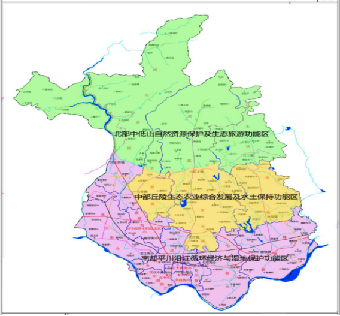

前 言

“十四五”时期（2021—2025年）是我国全面建成小康社会、实现第一个百年奋斗目标之后，乘势而上开启全面建设社会主义现代化国家新征程、向第二个百年奋斗目标进军的第一个五年，也是汉台区高质量建设陕西强区、打造“三市”建设核心区、奋力谱写新时代追赶超越新篇章的关键五年。根据党的十九届五中全会精神，按照《中共陕西省委关于制定国民经济和社会发展第十四个五年规划和二〇三五年远景目标的建议》、《汉中市“十四五”经济社会发展基本思路》和区委、区政府审定的《汉台区国民经济和社会发展第十四个五年规划基本思路》，编制本规划《纲要》。

“十四五”发展规划由本规划《纲要》和专项规划组成。本规划《纲要》是基础性、战略性规划，以习近平新时代中国特色社会主义思想、习近平总书记来陕考察重要讲话指示精神为遵循，以新发展理念为引领，主要阐明汉台区“十四五”时期经济社会发展的战略目标、工作重点，是落实党的十九届五中全会精神和习近平总书记来陕考察重要讲话的具体任务安排，是完善全区经济治理体系、推动经济社会高质量发展的重要基础，也是政府履行调节经济、市场监管、社会管理、公共服务、生态环境保护等职能的重要依据。

规划期限为2021—2025年，远景目标展望到2035年。

## 第一章 贯彻落实习近平总书记两次来陕考察重要讲话，

# 开启汉台全面建设社会主义现代化新征程

### 第一节 发展基础

## 一、“十三五”发展成就

“十三五”时期，在市委、市政府的坚强领导下，全区上下以习近平新时代中国特色社会主义思想和党的十九大精神为指引，坚持新发展理念，紧扣“五新”战略和“三市”建设目标，加快追赶超越步伐，沉着应对各种风险挑战，统筹疫情常态化防控和经济社会发展，砥砺前行、开拓创新，“十三五”规划确定的主要目标达到预期效果，脱贫攻坚任务全面完成，将如期与全国、全省、全市同步进入全面小康社会。

经济总量稳步攀升，综合实力不断增强。2020年，全区实现生产总值375.8亿元，是2015年的1.6倍，年均增长7.8%；完成地方财政收入11.63亿元，与2015年相比，年均增长1.6%；实现社会消费品零售总额198.05亿元，是2015年的1.6倍，年均增长9.2%；全社会固定资产投资五年累计完成1742.91亿元，是“十二五”时期的2.1倍；主要经济指标位居全市前列，在全省30个城区经济社会发展综合实力排名由2015年的第15位提高到2019年的第11位。

产业结构持续优化，转型升级态势良好。三次产业结构由2015年的7.4:44.2:48.4调整为2020年的4.9:37.7:57.4，实现历史性转型。工业经济平稳运行。航空零部件配套、智能装备制造、绿色食药、现代材料等主导产业稳步发展，战略性新兴产业年均增长12%以上；规模以上工业增加值年均增长10.1%；规模以上工业企业达到117家，较2015年增加23家。高新技术企业达到37家，科技型中小企业达到46户。铺镇工业集中区成功创建为省级高新技术开发区。现代服务业活力增强。城市经济特色更加鲜明，吾悦广场、海洋城、华汉新世纪等商业综合体建成运营，褒河物流园区建设取得新进展，大明宫建材市场、海关保税仓建成使用。电子商务蓬勃发展，开通并运营今日头条、抖音认证的“汉台电商扶贫公众号”商城，郭湾李子、植元汉中凉皮等十余种产品网上走俏。全域旅游加快推进，建成投用汉台旅游集散中心，兴汉胜境创建为4A级景区，天台国家森林公园创建为3A级景区，山河堰入选世界灌溉工程遗产名录，建成花果山旅游环线，培育了上百个游客采摘园和标准化“农家乐”，2020年接待游客1097.2万人次，实现旅游综合收入81.7亿元。数字经济蓬勃发展，智慧汉台数字经济产业园跻身首批省级数字经济示范园。现代金融、健康养老、科技服务等新产业新业态不断涌现。现代农业提质增效。粮油生产连续获得丰收，2020年粮食总产量达到11.54万吨，油料产量达到1.38万吨；果品产量达到5.6万吨；生猪、家禽、牛羊出栏量分别达到10.58万头、152万只和0.92万头。省市级农业园区达到19家，市级以上农业产业化龙头企业达到22家，农民专业合作社达到430家，家庭农场达到356家。

城镇建设亮点纷呈，城乡面貌日新月异。城市更新步伐加快。兴汉新区、滨江新区、褒城组团强势崛起，城东片区开发步伐加快，棚户区和老旧小区改造有序推进，火车站南广场建成投用，兴汉胜境、汉江湿地公园等成为“网红打卡地”，完成了西环路、梁州路北段等雨污分流工程，实施了明珠河北段、东排洪渠王观营段等改造工程，打通了望江路中段、东新街、西新街等中心城区“断头路”。城市管理水平不断提升。完成了中心广场、桥北广场等亮化美化工程，打造了梁州路、小康路等靓美街道和特色小巷，生活垃圾分类试点和餐厨废弃物规范化处置稳步推进，生活垃圾焚烧发电项目进展顺利，在鑫源办事处试点推行智慧环卫。重点镇建设有序推进。铺镇产城融合不断深入，联丰南路、北二路、莲花路全面建成，集镇至高新区污水管网改造完成，汉水紫薇、竹韵汉府、陕南移民安置区等居住项目实现入住；武乡古镇韵味不断提升，集镇道路改造完成，移民搬迁集中安置点二期建成入住；河东店镇一二三产业加快融合，文化旅游名镇建设持续推进，褒河新城养老社区基本建成，成功列入省上跟踪指导考核市级重点镇；汉王、宗营、徐望等镇基础设施不断完善，管理水平明显加强。区位优势不断提升。高铁汉中站建成使用，G244、S315过境段稳步实施，“三高三铁三国道一机场”立体交通网络更加完善，汉台融入了西安—成都2小时经济圈，互通东西、联动南北的地理与经济地位更加凸显。

环境治理成效明显，生态环境更加宜居。成功创建国家园林城市和省级环保模范城市，顺利通过国家卫生城市复审和省级生态文明建设示范区创建技术评估。大气污染防治成效显著。大力开展铁腕治霾保卫蓝天专项行动，强力推进“减煤、抑尘、控车、治源、禁燃”五大举措，城市扬尘专项整治成效显著，清洁能源替代项目顺利推进，PM2.5年平均浓度42微克/立方米，超额完成年度任务和三年行动计划目标，2020年空气优良天数达到320天。生态保护持续加强。秦岭乱搭乱建、乱砍乱伐、乱采乱挖、乱排乱放、乱捕乱猎问题得到有效整治，江北垃圾处理场配套设施基本完成，“十三五”时期完成中幼林抚育1.7万亩、封山育林1.5万亩，2020年森林覆盖率达到28.2%。“河湖长制”深入推进。扎实开展“最美河湖”三年计划、河湖“清四乱”专项行动，汉江综合整治基本完成，武乡、河东店污水处理厂建成投用，农村安全饮水问题全面解决，汉江、褒河出境水质保持Ⅱ类标准，成功创建省级节水型城市。农村人居环境持续改善。完成5个镇16个村面源污染综合治理，整村试点推进厕所革命，70个村达到清洁乡村创建标准，吴庄村被评为省级美丽宜居示范村，狮子村荣获国家乡村治理示范村称号，建成花果村、天台村等美丽乡村24个。

社会保障更加有力，民生福祉不断增进。脱贫攻坚取得决定性胜利。55个贫困村全部脱贫退出，累计脱贫11666户35164人，如期完成新时代脱贫攻坚目标任务。就业形势总体良好。累计新增城镇就业8.46万人，累计转移农村劳动力就业35万人，城镇登记失业率控制在4.3%以内。居民收入稳步提升。城镇居民人均可支配收入达到35185元，年均增长8.1%，农村居民人均可支配收入达到12327元，年均增长8.2%。教育事业稳步推进。成功创建国家义务教育基本均衡区、陕西省“双高双普”合格区，新建、改扩建思源学校、恒大小学、南关小学等义务教育阶段学校7所，新建、改扩建幼儿园12所，义务教育阶段学校基本消除“超大班额”，普惠性幼儿园占比达到83.5%，高考二本以上上线率实现十连增。健康汉台全面提升。加快医联体建设，促进医疗同质化管理，市医院妇儿专科楼、区疾控中心业务楼、市精神病院医技楼建成投用，基层中医馆实现全覆盖，行政村卫生室标准化建设实现全覆盖，成功创建省级慢性病综合防控示范区和卫生应急综合示范区，城乡一体的医疗服务体系基本建成。文化事业蓬勃发展。龙江社区博物馆挂牌运行，《汉台区志》正式出版，长篇小说《褒姒》荣获首届“丝路金融文学奖”，广播剧《妈妈在远方》入选全省文化精品项目，基层综合性文化服务中心实现全覆盖。体育事业稳步推进。滨江体育公园建成投用，成功举办花海半程马拉松、环城跑等大型群众体育赛事，农民健身工程实现全覆盖，荣获“省级全民健身示范区”称号。民生保障不断加强。不断扩大社会保障覆盖面，率先在全省完成城乡居民医保整合并实现一体化经办，城乡居民基本养老保险参保率达到99%。改扩建铺镇敬老院和赵庄敬老院，东方老年公寓被评为省级医养结合示范基地，汉中路街道办事处荣获全国“智慧健康养生应用试点示范街道”称号，“网格化+退役军人服务管理”经验受到中央和省市肯定。社会大局和谐稳定。平安汉台、法治汉台建设持续深化，扫黑除恶专项斗争取得重大战果，债务管控不断加强，“阳光信访、法治信访、责任信访”制度改革初见成效，成功创建省级社区治理和服务创新实验区，“1+4”党建引领基层社会治理经验在全市得到推广，陈家营社区荣获“全国民族团结进步模范集体”称号。

改革开放深入推进，发展活力有效释放。重点领域改革扎实推进。党政机构改革任务圆满完成，行政审批服务局树立全市模板。财税体制、城管综合执法等改革全面落实，网格化管理跻身全市十大创新改革，城市管理新模式受到中央和省市肯定以及广大市民好评。启动了供销合作社综合改革，完成了国有林场改革，学校联盟、医疗纠纷调赔机制等自主创新改革有序铺开，大学区制被评为全市十大自主创新改革。营商环境不断优化。持续推进“放管服”改革，积极推行市场监管清单和市场准入负面清单，“一网一门一次”改革荣获全市十大创新改革，“五减三加”审批服务被评为全省十佳改革案例，“十三五”时期累计新增市场主体5.8万户，非公经济占比重达到56%，连续两年营商环境监测评价位列全市第一。农村改革步伐加快。全面完成农村承包土地经营权确权登记、村集体产权制度改革工作。家庭承包耕地流转率达到36.1%，180个涉改村全部建立了集体经济组织。宅基地“三权分置”改革全面铺开，红星村“三变改革”经验在全省推广。对外开放加快推进。组织参加丝博会、西洽会、亚欧博览会、国际投资暨全球采购会、广东汉商回归、陕粤港澳经济合作周等活动，成功引入陕西果业陕南特产集团有限公司、罗普特（厦门）投资管理有限公司、雅居乐集团控股有限公司等一批优质企业和项目。

经过五年不懈努力，汉台区综合实力不断增强，区域首位度不断提升，人民生活水平显著提高，全面建成小康社会胜利在望，陕西强区建设迈上新台阶，汉台发展站在新的历史起点。总结“十三五”发展经验：一是坚持正确的政治方向。增强“四个意识”，坚定“四个自信”，做到“两个维护”，始终与以习近平同志为核心的党中央保持高度一致。二是坚持贯彻落实新发展理念。突出城市经济特色，大力发展装备制造、绿色食药、文化旅游、商贸物流等优势产业，积极培育新业态新模式，切实转变发展方式，推动质量变革、效率变革、动力变革，不断提高经济发展的质量和效益。三是坚持抓好项目建设。精心谋划包装重大项目，创新招商引资模式，推进重大项目建设，“十三五”时期，累计实施重点项目367个，完成投资1339.1亿元，积蓄了发展后劲。四是坚持深化改革开放。坚持创新体制机制和扩大对外开放并重，以改革的思维、创新的精神、开放的姿态，深入推进各项改革，强化对外交流合作，增强内生发展动能。五是坚持绿色循环发展。坚守“绿色循环、生态宜居”发展定位，狠抓生态修复和环境治理，加强节能减排，走产业强、山水美、环境好的绿色崛起之路。六是坚持以人民为中心。坚持把为群众谋福利作为工作的出发点和落脚点，深入实施精准脱贫、健康汉台、社会保障等民生工程，不断提高人民群众获得感幸福感安全感。

## 二、“十三五”发展中的问题

肯定成绩同时，必须清醒地看到，全区发展不平衡不充分问题依然突出，与高质量发展要求相比，仍存在许多短板和弱项。

一是市域内首位度不高，综合竞争能力不强。与南郑区、城固县等周边区县相比，汉台区经济规模和人口优势不明显，对周边资源要素聚集和吸引能力不强，引领带动全市发展的龙头作用不突出。在全省30个城区中，汉台区经济总量在陕南3市中落后于安康汉滨区，与全省排名第一的西安雁塔区有五倍以上差距，处于全省第二梯队位置。

二是创新发展水平不高，产业升级仍需加强。2020年全社会科技研发投入强度仅为1.15%左右，远低于全国2.4%、全省2.3%的平均水平。产学研机制尚不健全，科技领军人才和创新团队偏少，专业技术人才资源分布不均衡，招工难与就业难并存，实用技能型人才、高级管理人才紧缺，高端工匠、技术工人严重不足，人口老龄问题逐渐突出。传统服务行业占据主导地位，网络购物对传统商贸流通影响加深。制造业结构层次较低，高新技术企业数量占比仅19%左右，战略性新兴产业体量较小，新兴服务业规模不大。

三是改革开放力度不够，发展环境亟待优化。汉台区对外开放的广度和层次不够，外向型经济规模较小，与周边区域协同发展不足，褒河物流园区、汉中综合保税仓等平台作用不明显，服务全市、参与全省打造内陆对外开放高地能力有待增强。束缚创新发展的体制机制障碍依然较多，与经开区、兴汉新区、滨江新区协调机制不完善，对优质资源和高端要素吸纳能力不强。

四是金融支持力度不够，财政收支矛盾突出。受经济下行和结构性减税降费持续推进影响，可用财力增长缓慢，财政对民生投入规模逐年加大，城市建设维护、教育、医疗卫生、科技创新等支出需求仍有较大缺口。担保体系还不完善，中小企业融资渠道狭窄，发展建设资金缺口巨大。

五是城市功能仍不完善，配套设施短板较多。城乡基础设施和公共服务配套不完善，中心城区绿地广场、停车场、公厕等设施偏少，交通拥堵问题突出，棚户区、老旧小区改造任务较重，滨江新区、兴汉新区、城东片区等开发区域基础设施存在短板，城乡环境整治、交通体系、公共服务体系与群众期望还有明显差距，城市规划、建设和管理仍有较大提升空间。

六是民生保障仍不完善，社会治理有待加强。城乡教育、医疗、文化、养老等公共资源供给不平衡不充分问题突出。居民人均可支配收入处于全省30个城区的中下游，城乡居民收入比为2.85:1，与全国、全省平均水平差距较大，已脱贫群众收入不高。农村基础设施和公共服务配套还需完善。社会治理法治化、智能化、专业化水平仍有待提高。

### 第二节 发展环境

## 一、发展机遇

习近平总书记来陕考察指明的机遇。习近平总书记提出奋力谱写新时代追赶超越新篇章的“总体目标”是陕西长远发展的战略目标、“五项要求”是为陕西量身定制的“路线图”“任务书”，也是“十四五”规划的方向指引。全区上下要以学习贯彻习近平总书记来陕考察重要讲话精神为动力，牢牢把握发展机遇期和政策窗口期，用延安精神净化政治生态，咬定新时代追赶超越、高质量建设陕西强区目标不放松，抓重点补短板、强弱项增优势，争当时代弄潮儿，实现汉台各项工作取得新作为、展现新气象。

新时代生态文明建设带来的机遇。习近平总书记要求持续筑牢生态防线，切实做守护秦岭生态的卫士。汉台区是国家南水北调中线重要水源涵养区、省内“引汉济渭”工程的水源保护区、国家秦巴生物多样性功能区，生态屏障战略地位突出。同时，汉台区生物资源丰富，是国家级生态示范区和重要农产品生产基地，生态环境优美宜居。生态文明导向有利于汉台坚定绿色循环发展道路，在秦岭、长江、汉江大保护格局中，发展文化旅游、健康养老、绿色食药等产业，形成高质量发展体系。

国家重大战略实施带来的机遇。党的十九大从党和国家事业全局出发，作出实施乡村振兴战略的重大部署，“一带一路”、新时代西部大开发等重大战略深入实施，立足重塑我国国际合作和竞争新优势的战略抉择，党中央提出推动形成以国内大循环为主体、国内国际双循环相互促进的新发展格局，新基建、新型城镇化和重大工程成为最具潜力投资领域，国内消费成为经济增长新动能，创新驱动不断激发新产业新业态，汉台面临国家战略多重叠加的乘数效应。

区域融合发展加速带来的机遇。汉台位于成渝城市群、关中平原城市群两大城市群相向辐射的交汇区。汉江生态经济带上升为国家战略。省委省政府实施关中协同创新、陕北转型持续、陕南绿色循环区域发展战略，支持汉中建设区域中心城市，建设重要的装备制造业基地、循环经济产业集聚区和重要的物流中心；国家南水北调对口协作机制逐步实施，川陕革命老区振兴发展规划稳步推进。区域协调发展步伐加快，有利于汉台全面融入汉江和秦巴片区高质量协同发展体系，加大关键领域和薄弱环节补短板力度，在功能上相互补充，在产业上协作配套，提升互联互通和开放合作水平。

新一轮科技革命和产业变革带来的机遇。新一轮科技革命和产业变革深入发展，大数据、云计算、物联网、区块链、人工智能等新产业新业态蓬勃发展，全球产业版图正在重塑。创新驱动发展战略深入实施，制造强国、质量强国、网络强国、数字中国等强国战略纵深推进，数字经济和实体经济加快融合，为汉台产业智能化、数字化转型，加快数字经济跨越式发展提供了难得的机遇。

## 二、面临挑战

经济形势更加严峻复杂。发达国家“再工业化”推动中高端制造业回流，东南亚等新兴市场制造业能力提升，我国发展面临高端技术封锁和低端产业外迁的“两头挤压”。全球贸易摩擦对我国产业链安全影响逐渐加深，新冠疫情常态化防控加剧经济下行压力。汉台发展不稳定性不确定性明显增强，做好“六稳”工作、落实“六保”任务艰巨。

环境质量提升压力巨大。随着经开区、滨江新区、兴汉新区的发展，汉台发展空间被压缩，土地、能源、生态环境刚性约束趋紧，国家重点生态功能区产业准入负面清单深入实施，秦岭区域项目准入清单出台，汉台产业发展门类受到限制，项目建设约束条件增多，走出一条绿色、生态、可持续的发展道路显得尤为迫切和必要。

区域之间竞争日趋激烈。汉台处于西安、成渝、武汉都市圈之间，属于典型的省际边缘区，周边大城市对人才、资金等要素的虹吸效应愈发明显。与安康市汉滨区、广元市利州区、巴中市巴州区、达州市通川区等周边地区相比，汉台区在区位条件、资源要素、经济结构等方面同质化现象严重，在要素资源争夺上将更趋激烈。

新旧动能转换任重道远。汉台区基础设施建设进入补短板优结构阶段，固定资产投资增速放缓，投资拉动效应不断减弱。老龄人口比例偏高，青壮年劳动力流失严重，高技能人才匮乏，创新能力不足。依靠土地、劳动力、投资等要素投入的增长方式难以持续，加快新旧动能转换任务艰巨。

总体判断，“十四五”时期汉台区依然处于高质量发展的重要战略机遇期，同时面临诸多风险与挑战。要坚定发展信心，发扬斗争精神，树立底线思维，准确识变、科学应变、主动求变，善于在危机中育先机、于变局中开新局，开启汉台区全面建设社会主义现代化新征程的崭新局面。

### 第三节 二〇三五年远景目标

到2035年，全区经济建设、政治建设、文化建设、社会建设、生态文明建设迈上新台阶，发展不平衡不充分问题得到基本破解，与全国全省全市同步基本实现社会主义现代化。

——综合实力大幅提升。在高质量发展基础上，人均地区生产总值较2020年实现翻一番，创新发展能力显著增强，全要素生产率对经济增长的贡献显著提升。

——现代化建设全面推进。基本实现新型工业化、信息化、城镇化、农业现代化，建成生态与创新双轮驱动、质量与结构同步优化的现代化经济体系。

——生态效益全面凸显。城市空间格局、经济格局、城乡格局进一步优化，绿色健康的生产生活方式蔚然成风，基本实现人与自然和谐共生的现代化，“美丽汉台”建设迈上更高水平。

——改革开放取得重大进展。区域发展协调性显著增强，对周边地区的引领带动能力进一步提升，形成对外开放新格局，参与国内外经济合作和竞争新优势明显增强。

——社会治理现代化基本实现。人民平等参与、平等发展权利得到充分保障，城市运行更加高效安全，基本建成法治政府、法治社会，平安汉台建设达到更高水平。

——人民生活更加美好。国民素质和社会文明程度达到新高度，文化软实力显著增强，基本公共服务实现均等化，城乡区域发展差距和居民生活水平差距显著缩小，城乡居民收入较2020年翻一番，人民生活更加美好，人的全面发展、全体人民共同富裕取得更为明显的实质性进展。

### 第四节 总体要求

## 一、指导思想

以习近平新时代中国特色社会主义思想为指导，认真贯彻习近平总书记来陕考察重要讲话重要指示精神，统筹推进“五位一体”总体布局，协调推进“四个全面”战略布局，坚持新发展理念，坚持稳中求进工作总基调，贯通落实“五项要求”“五个扎实”，以高质量发展为主题，以深化供给侧结构性改革为主线，以改革创新为根本动力，以满足人民日益增长的美好生活需要为根本目的，以打造“三市”建设核心区为统领，紧扣市委关于“五大工程”“六个中心”部署要求，大力实施“创新驱动、项目支撑、人才集聚、新型城镇化、乡村振兴”五大战略，高质量推进“制造业集群化、新兴产业提速、现代农业提质、服务业品质化、城市提档升级、民生幸福提升”等十大工程，更好统筹发展和安全，积极融入国内国际双循环新发展格局，全面提高中心城区首位度，全力打造高质量发展引领区、开放创新活力区、乡村振兴示范区、“四个在汉中”样板区，奋力谱写新时代追赶超越高质量建设“陕西强区”新篇章。

| 汉台区“十四五”总体部署一个目标：全面提高中心城区首位度，打造“三市”建设核心区。四大定位：高质量发展引领区、开放创新活力区、乡村振兴示范区、“四个在汉中”样板区。五大战略：创新驱动战略、项目支撑战略、人才集聚战略、新型城镇化战略、乡村振兴战略。十大高质量发展工程：制造业集群化工程、新兴产业提速工程、现代农业提质工程、服务业品质化工程、城市提档升级工程、绿色循环发展工程、开放合作深化工程、文化铸魂行动工程、民生幸福提升工程、社会治理创新工程。 |
|---|

## 二、基本原则

——坚持党的全面领导。全面贯彻党的基本理论、基本路线、基本方略，坚持和完善党领导经济社会发展的体制机制，全面提高贯彻新发展理念、推动高质量发展的能力和水平，加强法治政府和法治社会建设，为新时代追赶超越发展提供坚强保证。

——坚持以人民为中心。坚持人民主体地位，推动城乡基本公共服务普惠共享和城乡基础设施一体化建设，健全公共服务体系和公共安全体系，扎实办好民生实事，维护人民根本利益，促进社会公平，不断增进汉台百姓福祉。

——坚持新发展理念。把新发展理念贯穿发展全过程和各领域，崇尚创新、注重协调、倡导绿色、厚植开放、推进共享，积极融入新发展格局，加快转变经济发展方式，构建现代产业体系，实现更高质量、更有效率、更加公平、更可持续、更为安全发展。

——坚持深化改革开放。深化供给侧结构性改革，着力破除制约高质量发展、高品质生活的体制机制障碍，参与“一带一路”建设，主动融入关中平原城市群、成渝城市群建设，优化营商环境，强化资源配置，调动全社会积极性，增强发展动力和活力。

——坚持系统观念。前瞻性思考、全局性谋划、战略性布局、整体性推进，正确处理当前与长远、发展和安全的关系，着力固根基、扬优势、补短板、强弱项，注重防范化解重大风险挑战，实现发展质量、结构、规模、速度、效益、安全相统一。

——坚持真抓实干。强化问题导向、目标导向、结果导向，打破僵化思维，摆脱路径依赖，树立“实干”导向，提升“会抓”本领，锤炼“真抓”作风，低调务实不张扬、埋头苦干，推动各项工作落到实处、见到实效。

## 三、发展定位

“十四五”期间，加快追赶超越步伐，全力打造“四区”，不断提高汉台在区域中心城市中的首位度。

——高质量发展引领区。突出汉台在“三市”建设中经济、文化、科技、金融、人才等聚集优势，做大城市经济规模，吸引人口和要素集聚，构建以装备制造、现代服务业、文化旅游、现代农业等为主导的现代产业体系，增强城市功能，全面提升汉台在“三市”建设中首位度，辐射引领全市经济高质量发展。

——开放创新活力区。发挥“丝绸之路”源点城市区位优势，以国际化视野、开放型思维，全面融入汉江生态经济带、成渝城市群、关中平原城市群，大力发展外资、外贸、外经“三外”经济，深入推进大众创业、万众创新，聚集创业创新资源，建立创新创业基地，激发市场活力和创造力，形成陆空内外联动、东西双向互济的全面开放新格局，打造陕南创新创业活力区。

——乡村振兴示范区。按照“产业兴旺、生态宜居、乡风文明、治理有效、生活富裕”总要求，大力发展城郊型农业，聚力打造“3+X”特色产业，发展农村集体经济，建设美丽乡村，壮大乡村人才队伍，繁荣兴盛乡村文化，健全现代乡村治理体系，创建乡村振兴示范镇、示范村，全面推进城乡融合发展，奋力建设农业更强、农村更美、农民更富的乡村振兴示范区。

——“四个在汉中”样板区。突出汉台资源聚集优势，深度挖掘两汉三国、生态文化、科教文卫等资源，大力发展文化旅游、健康养老、体育休闲、教育培训等幸福产业，打造汉文化传播示范基地，弘扬“汉文化”魅力，进一步提升城市功能和形象，把“学研在汉台”“医养在汉台”“旅居在汉台”“兴业在汉台”打造成引领“四个在汉中”的示范样板和高地，不断提高人民群众的获得感、幸福感、安全感。

### 第五节 发展目标

到2025年，高质量发展迈出更大步伐，现代产业体系基本形成，创新能力显著增强，开放合作不断深化，生态环境持续优化，民生福祉大幅改善，生产总值在全市占比进一步提升，“三市”建设核心区地位进一步提升，人民幸福指数进一步提升，力争进入陕西十强区。

——综合实力迈上新台阶。全区地区生产总值年均增长6%；地方财政收入年均增长5%；全社会固定资产投资年均增长7%；规模以上工业增加值年均增长6%；社会消费品零售总额年均增长8%；城市经济特色更加鲜明，以装备制造、绿色食药、文化旅游、商贸物流、现代农业为主导的现代产业体系基本形成，地区生产总值占全市比重达到25%以上。

——创新能力得到新提升。科技创新成为推动经济发展的核心动力，产学研合作进一步深化，研发经费投入年均增长4%，全员劳动生产率年均增长6.5%以上，规模以上工业战略性新兴产业总产值占工业总产值比重达到30%，高新技术企业数量实现翻一番，达到50家。

——城乡建设展现新面貌。城市功能更加完善，城市品质不断提升，常住人口城镇化率达到76%，脱贫攻坚成果巩固拓展，乡村振兴战略全面推进，城乡融合发展取得突破，美丽汉台建设不断迈上新台阶。

——改革开放取得新突破。重点领域和关键环节改革取得重大突破，营商环境便利度持续提升，融入关中平原城市群、成渝城市群、汉江生态经济带成效明显，资源要素整合吸纳能力显著增强，市场主体更加充满活力，非公有制经济占地区生产总值比重达到58%，形成全面深化改革开放新标杆。

——三生融合彰显新优势。国土空间开发保护格局得到优化，绿色生产生活方式成为常态，城市空气质量优良天数比例达到83.5%。单位地区生产总值能耗控制在省、市下达的目标以内，生活垃圾回收和资源化利用率明显提升。

——民生普惠迈出新步伐。实现更加充分更高质量就业，全体居民人均可支配收入年均增长7%；基本公共服务均等化水平明显提高，全民受教育程度不断提升，多层次社会保障体系更加健全，卫生健康体系更加完善，城镇调查失业率控制在5.5%以内，公众社会安全满意度达到90%以上。

——治理效能得到新提高。社会主义核心价值观深入人心，人民精神文化生活日益丰富。社会信用体系和民主法治更加健全，重大风险防范化解机制和公共安全体系更加完善，应急保障能力显著增强，民族团结、宗教和顺、社会安定的局面巩固发展。

表1-1 汉台区“十四五”规划主要指标

| 类别 | 序号 | 指标名称 | 2020完成值 | 2025目标值 | 年均增速 | 指标属性 |
|---|---|---|---|---|---|---|
| 经济发展 | 1 | 地区生产总值（亿元） | 375.8 | 500 | 6% | 预期性 |
| 2 | 全社会固定资产投资增速 | - | - | 7% | 预期性 |
| 3 | 社会消费品零售总额（亿元） | 198.05 | 290 | 8% | 预期性 |
| 4 | 规模以上工业增加值增速 | - | - | 6% | 预期性 |
| 5 | 服务业增加值占地区生产总值比重（%） | 57.4 | 60 | [2.6] | 预期性 |
| 创新驱动 | 6 | 研发经费投入增长 | - | - | 4% | 预期性 |
| 7 | 规模以上工业企业中有研发活动企业占比（%） | - | 25 | - | 预期性 |
| 8 | 规模以上工业战略性新兴产业总产值占工业总产值比重（%） | 25 | 30 |  | 预期性 |
| 9 | 每万人口有效发明专利拥有量（件） | 5.1 | 6 | - | 预期性 |
| 质量安全 | 10 | 全员劳动生产率增长 | - | - | 6.5% | 预期性 |
| 11 | 地方财政收入（亿元） | 11.63 | 14.85 | 5% | 预期性 |
| 12 | 常住人口城镇化率（%） | 74.8 | 76 | [1.2] | 预期性 |
| 13 | 粮食综合生产能力（万吨） | ≥11 | ≥11 | - | 约束性 |
| 生态环境 | 14 | 单位地区生产总值能耗下降（%） | - | - | [12]* | 约束性 |
| 15 | 单位地区生产总值用水量降低（%） | - | - | [10]* | 约束性 |
| 16 | 单位地区生产总值二氧化碳排放量降低（%） | - | - | [15]* | 约束性 |
| 17 | 城市空气质量优良天数比例（%） | - | 83.5* | - | 约束性 |
| 18 | 地表水质量达到Ⅱ类水体比例（%） | 100 | 100 | - | 约束性 |
| 19 | 森林覆盖率（%） | 28.2 | ≧28.2 | - | 约束性 |
| 改革开放 | 20 | 对外贸易进出口总额（亿元） | 5.06 | 7 | 7% | 预期性 |
| 21 | 非公经济增加值占地区生产总值比重（%） | 56 | 58 | [2] | 预期性 |
| 22 | 营商环境便利度（全市位次） | - | ≤3 | - | 预期性 |
| 民生福祉 | 23 | 全体居民人均可支配收入（元） | 29425 | 41200 | 7% | 预期性 |
| 24 | 城镇调查失业率（%） | - | 5.5 | - | 预期性 |
| 25 | 学前三年毛入学率（%） | 96 | 99 | - | 预期性 |
| 26 | 高中阶段毛入学率（%） | 98 | ≧98.5 | - | 预期性 |
| 27 | 劳动年龄人口平均受教育年限（年） | 13.8 | 14 | - | 预期性 |
| 28 | 城乡居民基本养老参保率（%） | 99 | ≧99 | - | 预期性 |
| 29 | 城乡居民基本医疗参保率（%） | 99 | ≧99 |  | 预期性 |
| 30 | 每千人拥有医疗床位数（张） | 13 | 14 | - | 预期性 |
| 31 | 每千人拥有执业医师（助理）人数（人） | 4.4 | 4.8 | - | 预期性 |
| 32 | 公众社会安全满意度（%） | - | 90 | - | 预期性 |

注：[ ]表示五年累计数，带*指标以市上下达为准。

### 第六节 战略布局

依据主体功能区定位，贯彻多规合一理念，结合汉台地形地貌、生态条件、经济发展和资源承载力等因素，统筹城镇空间、产业空间、生态空间布局，构建“一心引领、两极突破、三带联动、四区协同”的总体发展格局，实现三生融合和区域协同发展。

一、一心引领：高质量发展核心区。

以汉台中心城区为核心，建设高质量发展核心区。提升城区整体特色风貌，优化商贸网点布局，高标准打造大型消费商圈、商业综合体、精品步行街，推进建设现代金融、现代商务、科技服务、信息服务等为主的商务功能区，积极培育数字经济、现代物流等新兴业态，提升城市综合服务功能和品位，增强产业、人口、资源要素承载能力，引领全市经济高质量发展。

二、两极突破：高新技术产业和文化旅游产业两大增长极。

——高新技术产业增长极。突出汉台科创资源优势和产业聚集优势，充分依托高新区、经开区承载平台，大力发展航空零部件、高端数控机床、智能输配电、智能仪器仪表、生物医药等高技术产业，大力培育信息服务、研发设计、商务服务、现代金融等高技术服务业，培育孵化高新技术企业和科技型企业，建设一批创业创新基地，打造引领全市、辐射陕南的创新创业高地，引领全市高新技术产业发展，形成全区经济增长强劲引擎。

——文化旅游产业增长极。加快创建国家级全域旅游示范区，突出生态资源优势，挖掘历史文化内涵，创新开发模式，推进天台山-武乡连片综合开发和西汉三遗址历史文化街区保护性开发，做优做靓兴汉胜境汉文化体验区、“一江两岸”生态观光区、古褒国旅游度假区等精品旅游景区，大力发展旅游购物、文化创意、餐饮娱乐、体育休闲、健康养老等业态，促进文化旅游产业集聚集群，打造经济增长新引擎。

三、三带联动：南部沿江循环经济带、中部乡村振兴示范带、北部生态保护旅游带。

——南部沿江循环经济带。发挥中心城区带动作用，统筹协调汉江沿线龙江、七里、铺镇资源要素，大力发展中高端装备制造业、商贸流通、信息服务、现代金融等业态，积极培育战略性新兴产业，打造引领全市经济高质量发展的沿江循环经济主轴带。

——中部乡村振兴示范带。贯穿宗营、老君、徐望、汉王南部等区域，建设美丽乡村，提升居民生活品质，因地制宜发展生态农业、乡村旅游、健康养老等产业，加快一二三产业融合发展，建设乡村振兴示范区，打造汉中城市后花园。

——北部生态保护旅游带。沿河东店、武乡、汉王北部建设生态保护旅游带，强化森林、湿地保护，加强水源涵养，维护生物多样性，守住生态安全屏障。有序开发建设天台国家森林公园、褒河森林公园，适度发展生态旅游、特色林果等产业，打造观光旅游、休闲避暑栖息胜地，形成支持区域经济发展新轴带。

四、四区协同：高新区、经开区、滨江新区、兴汉新区。

坚持协同发展理念，各片区既充分依托各自资源禀赋，突出功能定位，发挥比较优势，形成独特吸引力和竞争力。同时，各片区之间加强规划对接、改革联动、创新协同、服务共享、设施互通，建立完善合作项目利益共享、重大项目协同推进等协同机制，促进各类要素资源优化配置，实现“四区”优势互补、错位发展、同频共振，整体提升综合实力。

——高新区。以创新驱动发展战略、推动经济转型升级为主线，以国内外市场需求和产业升级趋势为导向，重点布局知识密集型、技术密集型的“高”“新”“特”产业，打造先进制造业基地，发展智能装备制造、新能源和新材料、生物医药、新一代信息技术、数字经济等新兴产业，构建“产业+科技+现代服务”产城人深度融合的科技新城，做大经济总量，推动创建国家级高新区，打造千亿级骨干园区。

——经开区。加强与经开区协作，按照“一区五园”的空间布局，支持建设创智产业园、褒河物流园、褒河智能制造产业园、老君食品工业园和褒城组团，集群发展航空配套、高端装备制造、新一代信息技术、绿色食药、现代物流等产业。

——滨江新区。突出“一江两岸”核心地带优势，优化创业创新环境，大力发展文化旅游、教育培训、信息服务等现代服务业态，着力打造汉中“三生融合”和“四个在汉中”示范区、改革创新和扩大开放引领区，创业创新和体制创新先行区。

——兴汉新区。以汉中享誉世界的汉文化遗存为依托，以汉文化旅游建筑群为载体，发展休闲度假、文化娱乐、教育培训、医疗保健、养老养生、艺术设计、旅居安居、商贸会展等产业，建设国际知名汉文化旅游目的地。

## 第二章 实施创新驱动战略，全面塑造发展新优势

以创新型城市建设为抓手，围绕产业链部署创新链、围绕创新链布局产业链，推动创新链、产业链、资金链、政策链有机融合，争创区域科技创新高地，建成区域科教文化中心。

### 第七节 构建科技创新平台

## 一、健全公共创新平台

借助汉中市绿色循环暨产业经济研究院、科技资源统筹中心汉台分中心、院士专家工作站等桥梁作用，主动对接省内外创新资源，吸引西安交通大学、西北农林科技大学等高校、科研院所在汉台设立分支机构。推广“一所一院”模式，组建一批技术研究院、产学研协同创新中心和公共研发平台，协助建设西安交大汉中科技园、汉中中试城等平台，打造陕南科创资源聚集高地，加快实现由跟跑承接向创新引领转变。

## 二、提升创新应用平台

鼓励企业创建博士后工作站、博士后流动站和院士专家工作站，支持具备条件企业创建工程技术研究中心、重点实验室和企业研发技术中心，重点建设航空零部件研发中心、食药研发中心、现代材料研发中心等。到2025年，建成院士专家工作站15个、产学研协同创新中心5个、省级工程技术研究中心10个。

## 三、打造“双创”升级版

实施创业创新高质量发展行动，推动大众创业、万众创新，支持高等院校、科研院所、大中型企业参与建设星创天地、众创空间、孵化基地等“双创”孵化载体，推行“孵化+创投”模式，吸引高层次领军人才和团队来汉台创新创业，构筑“苗圃—孵化器—加速器—产业园”的完整创业孵化链。到2025年，建成众创空间10家、科技企业孵化器3家、星创天地10家。

### 第八节 增强企业创新主体地位

## 一、大力培育创新型企业

实施规上企业培育护航三年行动，以“初创企业——科技型中小企业——高新技术企业——瞪羚企业——独角兽企业”为培育路径，建立健全全生命周期梯度培育机制和全程孵化体系，支持有条件企业申报高新技术企业，激励科研人员直接领办创新型企业，引进“专精特新”科技型企业，培育一批“单项冠军”“小巨人企业”，孵化一批瞪羚、独角兽等高技术企业。到2025年，高新技术企业达到50家，科技型企业达到300家。

## 二、增强企业科研能力

用好市级科技创新券政策，落实研发费用加计扣除、固定资产加速折旧等优惠政策，实施首台套重大技术装备、首批次新材料、首版次软件奖补制度，实施科技顾问、专家领衔、“揭榜挂帅”等制度，鼓励科研团队以“订单式”参与技术攻关，支持大中企业联合承担重大科研项目，扶持小微企业灵活开展“微创新”，每年新培育3-5个省级重点产品开发项目，形成一批具有自主知识产权的原创性、标志性成果。

### 第九节 完善协同创新体系

## 一、加强区域创新合作

主动对接关中、成渝创新资源，打造一批飞地平台和离岸孵化器。支持企业与高校、科研院所合作在发达地区设立“飞地智库”“飞地实验室”，吸引外地企业在汉台设立“飞地产业园”，建设“创新飞地”“人才飞地”。探索孵化在高等院所、转化在汉台的创新模式。

## 二、加强知识产权保护

建设陕西省知识产权强县工程示范区，支持社会各界申报专利、注册商标、登记版权，提高自主知识产权拥有量，强化专利资源的开发利用，打通知识产权创造、运用、保护、管理、服务全产业链。到2025年，每万人有效发明专利拥有量达到6件。

## 三、促进科技成果转化

健全“政产学研用金”六位一体协同创新体系，促进科技成果转化“陕九条”“汉十条”等创新政策落地实施，建设汉中市科技资源统筹中心汉台分中心，建设“汉中科技大市场”。完善以企业为主体的科技成果转化激励机制，加大科研人员科技成果转化收益分配。探索“技术经理人”参与科技成果转移转化模式。

### 第十节 实施人才聚集战略

## 一、加大人才引进力度

聚焦陕西强区建设推进人才引进更加灵活开放。大力引进智能制造、数字经济等领域领军人才和高级技术人才。通过社会公开招录、区外挖掘调入、“进高校招英才”等方式，招引优秀大学毕业生、研究生。推行“短期聘用、定期服务、技术合作”等柔性引智方式，建设院士专家工作站、博士工作站，引进经营管理人才和高技术人才。加强汉台区籍在外高层次人才联系服务，发挥亲情、友情、乡情纽带作用和“杠杆”作用，激发以才聚才“蝴蝶效应”。发挥人才发展专项资金引导作用，强化效益意识和柔性引才理念，建立完善“假期团队”“周末专家”等引才机制。

## 二、创新人才培养模式

积极对接中央和省市重大人才工程，加强全区各类高层次人才的选育推荐，深化“汉台名师”“汉台名医”“汉台工匠”等评选表彰工作。鼓励引导区内专业技术人才成立优秀人才工作室等线上、线下技能培训载体，通过公益服务、有偿教育、学术交流等方式，打造本地优质育才平台。大力发展职业培育，推行开放式校企联合培养模式，以订单式和现代学徒制等方式，培养一批高技能人才和“工匠人才”。以重大专项和重大工程为依托，培养和造就一批高层次研发人才和高技能人才队伍。引导企业建立健全引人、留人和用人机制。弘扬科学精神和工匠精神，加强科普工作，营造崇尚创新的社会氛围，全力创建全国科普示范城区，不断提高全民科学素质。

## 三、完善人才保障体系

完善联系服务专家人才制度，建立优秀人才一站式服务中心，探索线上线下互通服务模式。完善支持企业引进人才的政策措施，鼓励企业设立人才发展专项资金。在住房保障、子女入学、配偶就业、医疗卫生服务等方面为高层次人才提供便利，及时为人才排忧解难。坚持优秀人才定期研修培训制度，拓宽人才参政议政渠道，推动尊重劳动、尊重知识、尊重人才、尊重创造的理念植根社会发展，形成尊重贤才、共谋大业的良好氛围。

| 专栏1：创新驱动战略重点项目汉中高新区科技创新产业园建设项目。总投资40亿元，依托君泰航空、万利航空、燕航精工、汉力精密等，建设大学交流科技园、技术市场交易中心、综合服务社区等功能区等；新建综合服务大楼，标准化厂房；配套水、电、路、气、绿化、亮化、消防等工程。汉中高新区创新创业科技孵化园项目。总投资0.6亿元，总建筑面积3.6万平方米，建设综合服务大楼标准化厂房、库房、餐厅，配套建设水、电、路等设施。璟鈜计量检测中心建设项目。总投资0.76亿元，拟建检测大楼，新增140台（套）检测设备和仪器，配套市政设施。 |
|---|

## 第三章 加快转型升级步伐，构建现代产业新体系

把经济发展着力点放在实体经济，积极实施服务业品质化工程、制造业集群化工程、新兴产业提速工程，抓链条、聚集群，扩总量、提质量，推进优势产业高端化、战略新兴产业规模化、服务业现代化，打造区域经济高质量发展核心增长极。

### 第十一节 构建高品质服务业体系

实施服务业品质化工程，突出新型服务型城市定位，推动生活性服务业向高品质和多样化升级，推动生产性服务业向专业化和价值链高端延伸，推进先进制造业和现代服务业“两业融合”，加强服务品牌建设，推动区域经济向城市经济转型发展。到2025年，服务业增加值达到300亿元，年均增长7%。

## 一、做优做强三大支柱服务业

## （一）文化旅游业

依托两汉三国、秦巴风情、古褒国文化、生态文化等资源，推动旅游与三次产业深度融合，构建多元化旅游产品体系，打造精品旅游景区，完善配套服务体系，推动“旅游”向“旅居”转变，叫响做靓“旅居在汉台”，建设区域旅游集散中心，打造全国具有重要影响力的生态文化旅游目的地。到2025年，接待游客人数1300万人次以上，实现旅游综合收入100亿元以上。

提档升级重点景区。打响叫亮天台山“陕南第一名山”品牌，加快武乡省级重点镇暨汉中天台国家森林公园连片开发，推进天台国家森林公园创建4A级景区，争创5A级景区，逐步完善旅游配套设施，力争接待游客人数和旅游综合收入较大增长。深入挖掘两汉三国人文旅游资源，整合古汉台、拜将台、饮马池西汉三遗址，进行保护性开放，建成群落式市级博物馆及仿古文旅街区，恢复浓郁的历史文化韵味，强化旅游集散和辐射功能，打造城市新名片。建设古褒国旅游度假区，推动褒城组团建设，加快建设褒河森林公园黄花河景区，积极开发山河堰遗址文化公园，打造河东店文化旅游名镇。提升兴汉新区汉文化生态旅游度假区品质，巩固兴汉胜境景区4A级景区创建成果，加快建设“一水两湖三组团、四馆五街六片区、七岛八渡九业态”项目，增强对游客吸引力，打造全市旅游枢纽。以汉江湿地景区为核心，加强“一江两岸”5A级核心带建设，以水为载体构建生态休闲胜景和滨水休闲区，打造以文旅购物、餐饮娱乐、文化博览、会议会展、体育运动为主题的滨江休闲文化旅游产业带。

大力发展乡村旅游。突出“一村一特色”，重点开发褒姒故里游、生态观光游、油菜花海观花游、休闲度假游、运动康体游等生态旅游产品，培育河东店村、花果村、吴庄村、皇塘村等旅游示范村。支持花果山景区创建4A级景区，推动皇塘-龙沟片区综合开发。建成一批依附于山、水、林、桔园等景观的高品质农家乐，积极培育特色乡村民宿。

实施“旅游+”工程。推动旅游与文化、生态、农业、医养、体育、工业等深度融合，全业态延伸旅游产业链。推进文化旅游融合，开展文化和旅游消费试点示范，策划包装文化演艺、文创产品、旅游商品、节事活动等旅游产品，发展遗址博览、文创体验、非物质文化传承、文化演艺、休闲娱乐等文化体验旅游。推进农旅融合，开展农业种植与大地旅游景观营造、生态农产品与旅游商品开发、农舍改造与民宿结合、农业种植园及产业园旅游化改造等工程。推进生态旅游融合，以汉台区田园、花木、汉江、水库、山地、森林公园等为依托，开发森林观光休闲、森林户外拓展、森林康养度假、滨水休闲体验等深度体验产品。推进工业旅游融合，加强特色旅游商品开发、非物质文化遗产活化开发等工作，鼓励高新区、经开区配套建设工业旅游通道、工业旅游体验馆。推进体旅融合，将体育赛事活动与旅游开发相结合，持续做好健步走、山地自行车赛、半程马拉松赛等赛事，开发穿越秦岭、绿色出行健步赛跑、山地露营节等活动。发展研学旅游，以“研学科普+山地度假”为主要产品，建设集观光、休闲、娱乐、度假、科普、研学等功能于一体研学基地。

提升旅游服务水平。加强旅游交通建设，开通汉中城市观光巴士，增开旅游专线公交、旅游客运班。打造汉台区域内秦岭山地康养度假游线路、汉江滨水风情游线路、汉台历史文化体验游线路、汉台文化研学游线路、大美汉台乡村游线路、油菜花海休闲游线路、醉美汉台自驾游线路等8条精品旅游线路。完善景区停车场、游客接待中心等设施。规范布局景区公厕、垃圾桶、标识标牌。提升改造宾馆和饭店，增强游客综合接待能力。建设旅游诚信体系，完善旅游咨询、投诉、应急处置、紧急救援、旅游保险等旅游公共服务体系。

积极推广旅游品牌。大力宣传“汉人老家·醉美汉台”旅游形象。利用微博、微信、客户端、网络搜索植入和旅游网站等新媒体开展营销推介。深度开发省内及周边市场，积极举办旅游产品推介会，与周边旅游景区、旅游平台联盟合作，推进区域之间资源共享、客源互动，形成区域规模与品牌优势。大力培育兴汉胜境、汉江湿地公园等网红旅游打卡地，加强文化和概念包装，运用现代信息技术全方位宣传推介。

| 专栏2：文化旅游业重点项目西汉三遗址历史文化街区建设项目。总投资200亿元，整合古汉台、拜将台、饮马池西汉三遗址，进行保护性开发。对文物保护古建筑修缮改造，对传统民居院落风貌进行保护提升，新建群落式市级博物馆；建设文化体验区、商业街区；配套实施道路改造、亮化、绿化塑造等工程。武乡省级重点镇暨汉中天台国家森林公园连片开发项目。总投资10.45亿元，在天台国家森林公园3A级景区现有基础上，打造4A级景区暨国家级旅游休闲度假区，配套建设智慧景区及安防、消防等设施。山河堰遗址文化公园建设项目。总投资3.92亿元，建设萧何水利博物馆，对现有堤岸边际适当加宽，配套休闲观光步道、水利景观、绿化、亮化、停车等设施。河东店镇旅游配套基础设施提升工程。总投资3.34亿元，新建花果山温泉酒店、竹林康养酒店、农产品展示销售中心、徐向前元帅停留处旧址等；建设停车场、充电桩、智慧停车收费系统、旅游公厕等；改扩民居1000平方米，发展汉字文化民宿；完善道路、污水管网、天然气管网等设施。皇塘—龙沟片区开发项目。总投资1亿元，新建文化体验、乡村休闲、康养度假、会议会展等为一体的乡村休闲旅游度假区；建设拦水坝及休闲观光步道5公里；配套皇塘区域、龙沟沿线和桃花苑片区旅游服务设施。乡村特色民宿建设项目。总投资0.5亿元，依托天台山森林公园、武乡古镇、武乡荷园、诸葛故堡和“南塘古会”等旅游资源，利用现有村庄房屋打造三国文化民宿（东村）、亲子民宿（郑庄村）、避暑民宿（明光村）。利用附近凤家沟水库岛，改造岛上空置民宅800平方米，配套相关基础设施。 |
|---|

## （二）商贸服务业

推动商圈建设。加快建设滨江现代生活体验带、天汉大道中轴商贸升级带、城东新兴服务业培育带。提升改造天汉大道“百亿元”核心商业区，高标准打造城东恒大文旅城、城西吾悦广场、城南海洋城、城北兴汉新区4大商圈，建设汉上第一街、大红门国际商厦等商业综合体，提升消费吸引能力，打造区域消费中心。

提升住宿餐饮水平。重点发展高星级酒店和综合性会议中心，支持发展连锁商务酒店，推进集镇经济型酒店、特色宾馆和客栈发展，提高乡村民宿酒店和家庭旅馆服务规范化、标准化水平。加快中式快餐连锁规范化发展，完善星级酒店餐饮；挖掘陕南地方特色美食文化，培育品牌餐饮企业，打造天汉长街、望江路、汉中茶城等特色美食街区。

大力发展电子商务。以智慧汉台数字产业园、高新区数字经济产业园、云商工场电子商务产业园为载体，引进国内优秀电商服务企业。鼓励企业开展网上交易，支持建设行业电商平台，促进线上线下交易融合互动。培育电子商务带头人，通过电商平台营销渠道、自建电商平台、新媒体营销渠道、大客户营销渠道等形式，配合短视频、直播等手段，推介陕南特色农副产品，培育网红产品，提高农产品上行销量。完善区镇村三级电商物流体系，打通“工业品下乡、农产品进城”的双向流通渠道。到2025年，全区电子商务交易额达到20亿元以上。

完善城乡流通体系。推进传统商贸市场改造升级，着力建设汉中农产品交易批发中心，支持各镇建设便民市场。优化调整建材市场布局，规范布局二手车市场。推进汽车、家电等耐用消费品下乡，扩大农村消费市场。到2025年，全社会消费品零售总额达到290亿元，年均增长8%。

鼓励发展社区服务业。完善社区服务设施，鼓励在乡村建设综合型服务网点，开展“智慧社区”试点，规范和拓展代收费、代收货等便民服务，扶持培育“员工制”家政企业，打造“汉台家政”服务品牌，大力建设集农贸市场、便民服务、教育培训、居民交流为一体的“15分钟社区生活圈”。

| 专栏3：商贸服务业重点项目植物园片区开发项目。总投资230亿元，改造提升陕南植物园景观园林，新建陕南珍稀植物博物馆；颐养园、亲子园、主题博物酒店、健康中心、主题商业街；九年制学校及幼儿园；高品质住宅楼；配套实施市政道路、供水、供电、绿化等附属工程。农旅综合体建设项目。总投资9.8亿元，总建筑面积18万平方米；建设农产品超市、商业综合展馆、美食街、特产馆、绿色生态农产品博览交易中心、手工艺展示区、精品进口水果区、小商品交易区等。汉中大红门国际商厦建设项目。总投资7.6亿元，新建商厦11.94万平方米；配套相关设施。光辉社区商业综合体建设项目。总投资5.6亿元，总建筑面积18.5万平方米，建设商业用房、住宅、商务酒店、餐饮、写字楼，配套地下车库、设备用房等。汉中二手车交易市场建设项目。总投资3亿元，建设汽车检测及维修车间、二手汽车美容装潢店、二手汽车（含配件）展示及交易大厅、综合办公楼、商务服务楼，购置汽车检测、维修、装潢美容、汽车交易信息系统；建设水电路等配套设施。 |
|---|

## （三）现代物流业

完善物流服务体系。建设褒河公铁联运、物流中心、快递产业园和配送中心，提升褒河物流园区建设水平，大力培育第三方物流企业，积极发展保税物流，构建现代物流产业链和生态链，打造陕甘川渝毗邻地区最大物流集散中心和交通商贸物流中心。

发展专业物流。建设汉台区城市生活配送中心。鼓励和支持企业联合建立生鲜配送中心，发展以仓储和配送鲜活农产品、果蔬等为主的农产品冷链物流。推动建设两烟物流基地。

发展智慧物流。优化物流企业供应链，建立以物流配送中心和高效信息管理为支撑的“电子商务+物流”基地，发展壮大城市仓、云仓、无界工厂。鼓励商贸企业、专业市场、连锁超市强强联合，推行“实体经济+电子商务+现代物流”发展模式。鼓励发展共同配送、统一配送、集中配送、分时配送等集约化配送新业态。

发展快递服务。建设汉中市快递产业园，吸引全国主要电商平台、快递物流企业在汉台布局区域性物流集散中心和高层级仓储配送中心。鼓励快递网点向农村延伸，支持物流企业、新型农业经营主体与连锁超市、快递网点和社区直接对接，发展直销型、联盟型农村物流配送服务。

| 专栏4：现代物流业重点项目汉中市快递产业园建设项目。总投资1.48亿元，一期总建筑面积2500平方米，建设综合办公楼、快递分拣区、仓储中转区、生活服务区及政府监管区；二期总建筑面积2400平方米，建设综合办公楼、综合仓库、冷冻库、冷藏库，以及待验区、发货区、生活区等。两烟物流（卷烟物流、烟叶物流）建设项目。总投资1.99亿元，新建原烟仓库、物资库、质检厂房、除湿车间，联合工房、设施用房（卷烟物流）、库区管理用房等，配套保卫室、公厕、洗车房及相关附属设施。城市生活配送中心建设项目。总投资3.07亿元，新建包装车间、冷库、仓储库等；建设果品、蔬菜分拣生产线9条；配套附属设施。农产品冷链物流建设项目。总投资1亿元，建设气调低温预冷库、保鲜库、恒温库等共50个，配套压缩机房、变配电室、仓储冷链物流配套设备及设施；购置运输车辆等设施。农产品智慧物流中心建设项目。总投资3亿元，建设集蔬菜、水果、水产、肉类冻品、干调、茶叶、副食品、农资、农机、农产品体验、交易、冷链、物流、综合配套等全业态的汉中农产品智慧交易中心，总建筑面积约20万平方米。 |
|---|

## 二、聚力发展三大成长型服务业

## （一）健康养老业

发展生态康养旅游。推进养老与旅游、旅居、文化、教育、休闲等产业深入融合，打造休闲康养、田园康养、中医药康养、森林康养等生态康养旅游产品，积极发展银发休闲游、异地候鸟式养老养生游。推进建设健康养生养老城等高端医养旅居项目，加快构建“住、养、医、护、康”五位一体健康养生服务模式，做大做强“医养在汉台”品牌。

推动医养融合发展。鼓励区级医疗机构以托管、合作等形式与社会资本合作，加快向康复医院、老年病专科医院、护理院、疗护医院等老年专业医疗服务机构转型。鼓励在养老机构、日间照料中心、居家养老服务中心和托老所设立集医疗护理、生活照护等服务于一体的社区嵌入式医养结合机构，建设一批高品质“医养中心”“医养小区”“幸福小区”。引入国内知名品牌医养机构和先进技术、管理经验，建设医疗养老联合体，重点建设医养产业园、褒国康乐园养老社区、神农庄园康乐颐养等项目。

推广智慧健康养老。支持养老机构提升智慧化水平，引进培育一批智慧养老产业龙头企业，打造智慧养老产业园。探索“互联网+医养结合”O2O智慧医养结合模式，推进建设互联网医院、智慧医院、远程医疗、移动医疗应用体系。引导养老服务机构开展智慧照料、智慧医疗、智慧文娱等服务。

拓展社区居家养老。加快建设社区老年人日间照料中心，支持居家养老服务机构与社区卫生服务中心、镇卫生院、村卫生室等基层医疗机构合作，为老年人提供日常护理、健康体检、保健咨询、慢性病管理、中医药保健等服务，鼓励医疗机构将医疗护理和康复等服务延伸至家庭。深化医养签约，鼓励养老机构与医疗卫生机构开展多种形式签约合作，推动为失能、半失能老人设立“家庭病床”，优先对60岁以上老年人提供家庭医生签约服务。到2025年，实现所有养老机构医疗服务覆盖。

| 专栏5：健康养老业重点项目褒河医养产业园建设项目。总投资7.2亿元，建设西安医学院汉中分校，扩建西安医学院附属汉江医院老年病专科；建设康养文化社区，开发中医药养生产品，配套水、电、道路、绿化及停车场等基础设施；打造医养结合示范镇。东方健康产业园建设项目。总投资4亿元，新建养老公寓28800平方米，配套用房10040平方米，配套建设景观绿化、停车场、水电路等。褒国康乐园养老社区建设项目。总投资1.56亿元，建设康养社区、颐养公园等，设置床位668张；配套康复中心、综合活动中心、医疗中心等；建设给排水、绿化、道路等附属设施。神农庄园康乐颐养项目。总投资1.6亿元，依托神农庄园原有场地开发健康养老产业，重点建设老年宿舍，拟配备床位500个，建设医疗、健身、后勤服务、绿化、道路等配套设施。嘉旺生态休闲养生观光园一期老年公寓建设项目。总投资0.98亿元，建设康养社区，总建筑面积2万平方米，绿地1万平方米；配套水、电、路等设施。 |
|---|

## （二）教育培训业

发展职业技能培训。依托汉中职业技术学院，谋划建设教育科技产业园。推进职业学校和企业联盟、与行业联合、同园区联结，建设一批高水平的实习实训基地。整合企业、职业院校、劳动就业训练中心和社会培训机构等，联合组建高水平产教融合体，做强职业技能培训品牌，形成集团优势。

规范教育培训机构。鼓励兴办职业技能培训、文化艺术、教育咨询等培训机构和企业，建设教育综合体，扶持教育培训机构和企业发展，实施连锁经营，形成品牌效应。

开展研学教育与交流。依托两汉三国文化、秦巴山水文化、汉水文化、生态文化等，创新发展生态研学、地质研学、汉文化研学、乡村研学、农业研学等，开展研学合作，打响“学研在汉台”品牌。

## （三）体育休闲业

加强体育设施建设。建设体育运动中心二期项目。鼓励社会力量利用城市空置场所、地下空间、公园绿地、住宅小区等空间，建设足球、篮球、羽毛球、排球、乒乓球等小型运动场地及设施。鼓励建设分布于社区、商圈、工业园区的智慧健身中心、智慧健身馆，加快建设15分钟健身圈。

举办特色体育赛事。培育壮大赛事经济，配合办好全国第十四届运动会铁人三项、跆拳道2项国家级赛事，持续举办花海马拉松、环秦岭自行车联赛、登山比赛等精品赛事，引导社会力量参与体育赛事运营管理。发挥体育协会、体育俱乐部等组织作用，大力开展球类、自行车骑行、广场舞、垂钓等体育赛事活动。

发展体育健身产业。引进高端体育健身服务品牌，支持社会力量开办体育培训机构，建设小型化、多样化健身设施。鼓励发展群众性体育俱乐部、健身俱乐部，培育壮大体育培训、运动指导、竞赛表演、健康咨询、健康管理等体育健身服务。

培育新兴体育业态。实施“体育+”工程，开发体育休闲运动度假精品线路及产品，发展自行车山地运动、儿童夏令营、半程马拉松、健步赛跑等。鼓励社会力量建设特色体育项目，积极发展运动主题民宿等体育新业态。招商引资体育服装、器材装备等生产企业，发展壮大体育用品销售产业。

三、大力培育四大生产性服务业

## （一）金融保险业

促进金融机构聚集发展。积极建设区域性金融服务中心，争取国内外知名银行、证券、保险公司在汉台区开设区域总部、地区总部和筹建地方金融机构，完善金融服务功能，形成银行、保险、证券、期货、基金等金融机构及资产评估、信用评级等金融中介种类较为齐全的金融服务体系，打造汉中金融商务区。到2025年，力争吸引1-2家国内外金融机构来汉设立区域总部或分支机构。

创新金融产品供给。鼓励国有银行、股份制银行等金融机构向上级行争取更多信贷规模，扩大金融对实体经济供给总量。“十四五”期间，全区金融机构存款余额年均增长8%以上，贷款增长速度与地区生产总值增速相匹配。积极发展供应链金融、金融租赁、天使投资、创业投资等新兴金融业态。鼓励商业银行发起设立村镇银行，鼓励社会民间资本发起设立小额贷款等普惠金融服务机构。组建政府参股的融资性担保公司，建立区级融资担保服务体系。探索创新信贷服务，解决中小微企业融资难问题。“十四五”期间，力争中小微企业担保余额突破5亿元。拓宽农业保险覆盖领域，提高保险业对“三农”的服务能力。

拓宽企业融资渠道。做好企业上市、挂牌以及后备资源培育工作，积极扶持科创企业在科创板块上市，“十四五”期间，力争新增1户重要板块上市挂牌企业。推动企业股权融资、债券融资，鼓励发展重点领域建设投资基金。

## （二）科技服务业

完善科技服务体系。培育科技中介服务机构，搭建成果转化平台、产权交易平台，加快形成以企业为主体，涵盖科学研究、技术推广、信息交流、科技培训、产权服务、科技评估等于一体的科技服务体系。

发展专业科技服务。重点发展以新技术、新产品、新材料、新工艺开发及小试、中试等为主的研发服务，以产品设计、工业设计、工程设计等为主的设计服务，以大数据、云计算、软件开发等信息技术服务为主的资源服务，以战略咨询、管理咨询、工程咨询、信息咨询等为主咨询业务，推动发展检验检测服务业。

## （三）商务服务业

加快发展总部经济。支持建设滨江新区经创中心、白渡片区总部中心、高新区总部经济区、经开区创智谷企业总部基地等项目，吸引大中型企业设立地区总部或功能型性、职能型总部机构、采销中心及分公司等，积极打造总部经济聚集区。

大力发展会展经济。支持建设经开区天汉国际会展中心、兴汉新区文化会展中心、褒河物流园区生产性综合服务中心，积极承办大型国际会议和商品展销会，培育富有汉台特色的区域性会展服务品牌。

发展其他商务服务。加快发展广告、咨询、法律、会计、审计等其他高端商务服务，不断完善商务服务体系。

## （四）人力资源服务

打造集中高端人才交流、政务服务、众创服务、人才测评服务等功能于一体的人力资源服务平台，引进培育具有核心产品、成长性好、竞争力强的人力资源服务企业，鼓励发展中小微人力资源服务机构，鼓励用人单位通过人力资源服务引进人才。

### 第十二节 推动制造业高质量发展

实施产业链提升行动，坚持“扩总量、延链条、促转型、提质量”，重点打造高端装备制造、绿色食药、现代材料3大支柱产业集群，提速发展新能源汽车、新能源、节能环保和新一代信息技术4大战略性新兴产业，促进产业基础高级化、产业链条现代化，打响“汉台制造”“汉台配套”品牌，打造全省具有较强影响力的绿色制造业示范基地。到2025年，规模以上工业增加值达到115亿元，年均增长6%。

## 一、做大做强三大支柱产业集群

## （一）高端装备制造产业

实施航空零部件配套强链行动。围绕陕飞配套链条，以万利航空、朝阳机械、君毅航空等企业为骨干，发展航空零部件、航空组件、机载设备，提升配套陕飞及全行业的标准件生产能力，打造体系完整的航空配套产业集群。

实施高档数控机床强基行动。围绕法士特配套产业链，积极招引行业优质企业，加强汉江机床、汉江工具等企业提质增效，重点发展大型精密数控机床、滚动功能部件、卧式、龙门式加工中心等系列产品，积极研发研制复杂刀具新产品。

实施智能装备制造建链行动。依托智熔金属3D打印、大秦索道、米克隆等骨干企业，培育发展智能仪器仪表、智能交通设备、智能机器人、感知系统等智能测控装置和3D打印设备，攻克核心基础零部件制造技术、关键智能制造技术和系统集成技术，引领全市制造业智能化转型。

实施智能电网装备延链行动。紧盯国家特（超）高压变电、远程输电、储能电站等重大工程，依托特变电工、亚特高压等企业，重点发展电网控制保护成套设备、综合自动化系统及继电保护装置等产品。

## （二）绿色食药产业

实施绿色食品延链行动。支持成祥米业、给力食品等农产品加工龙头企业发展，紧密对接特色种养殖业，着力延伸“粮、油、肉、菜、酒”绿色食品加工产业链，大力发展“虾稻米、低脂油、生态肉、绿色菜”等健康食品系列，围绕杜仲、天麻、西洋参等药食同源产品，积极开发药膳、茶酒、饮料等功能保健食品。

实施现代中药融链行动。支持企业联合各类研发机构，围绕杜仲、银杏、厚朴、元胡等资源深开发，研制一批疗效明显、质量可控、剂型稳定、服用方便的现代中药产品。

实施生物医药提速行动。支持汉王药业等骨干企业攻克并掌握一批关键核心技术，大力发展生物技术药物、小分子药物、生物诊断试剂等，积极发展与主导原料药相匹配的精细化工产品、医药中间体和新型药用辅料。

## （三）现代材料产业

实施建筑材料扩能行动。加快现有产业结构调整，支持珑城建材等企业技术改造，重点发展防火保温材料、轻质节能墙体材料、环保装饰新型建筑材料产品。

实施金属材料建链行动。面向高端装备制造、新能源汽车配套链条，发展汽车用接插件、特种电线电缆等产品；招商引资钢结构装配、金属网、钢绞线等钢铁深加工系列产品。

实施前沿新材料培育行动。战略布局3D打印材料、高性能复合材料，硅基半导体材料等，加强隐身材料、减震材料、耐磨材料、医用材料等先进材料研究。

| 专栏6：制造业集群化工程重点项目陕西君泰航空科技产业园建设项目。总投资1.5亿元，建设无人机发动机核心零部件生产线、航空地勤设备、复合材料研发及无人机总装用房，配套附属设施。万利航空飞机零部件加工制造及装配生产线建设项目。总投资1.05亿元，新建生产厂房、综合办公楼、库房；新建飞机零部件加工制造生产线；部件成品装配生产线；购置设备30台（套）；自制工装30套；建设水、电、路等配套设施。朝阳机械产业链突破提升综合项目。总投资1亿元，新建研发设计大楼、厂房及办公、生活设施及其相关附属配套设施；建设航空部件、组合件装配生产线及航空零部件钣金生产线；购置生产设备、检测设备20台。汉川H2分厂建设项目。总投资5亿元，建设数控机床加工厂房、研发检测大楼、配套建设热表处理车间；拟引进数控加工、成套设备制造、汽车配件加工等创新型、成长型高端技术企业项目入驻。汉中智熔增材制造产业园建设项目。总投资5亿元，新建研发楼、生产车间、培训基地等；建设打印设备研发与制造生产线；配套相关附属设施。大秦机械单线循环脱挂抱索器客运索道研制及产业化项目。总投资0.38亿元，建设一条150米单线循环脱挂抱索器客运索道试验线，研发设计单线循环脱挂抱索器客运索道，购置加工和检测设备，改造生产线，完善检测线。汉江药业高端原料药新区建设项目。总投资5.58亿元，新建API车间、激素车间、PMP车间、库房；配套生产管理楼、行政办公楼、维修中心、动力中心、污水处理站、锅炉房、生活服务楼等。汉江药业高端原料新区二期建设项目。总投资2亿元，建设高端原料药扩能改造车间、成品仓库，新产品研发中心；水、电、路、消防等相关配套设施。年产5万吨茶饮料生产线建设项目。总投资1.2亿元，设立研发中心，购置设备189套，建设茶饮料生产线5条；配套相关附属设施。大豆系列食品加工项目。总投资1.3亿元，扩建豆浆食品车间，新建芽苗菜清洗、预包装车间，新建大豆包装食品车间等。唐正生物医药产业园建设项目。总投资1.2亿元，新建生产车间、辅助车间、物流仓库、产品仓库、机修车间、研发办公综合楼、检测中心、生活中心等设施。汉中钢材制品产业集群建设项目。总投资40亿元，依托陕钢研究院平台，招引下游企业，培育一个钢铁深加工、配套设施及运输物流的钢铁产业集群。高纯石英砂和硅微粉加工项目。总投资0.52亿元，建设年产18万吨高纯石英砂生产线，年产1.5万吨硅微粉生产线，年产6000吨超纯石英砂生产线；改建生产车间、库房、办公楼、餐厅及其他辅助用房1万平方米。新型环保建筑材料生产线建设项目。总投资2亿元，建设轻质水泥发泡隔墙板、太空板、无梁楼板水泥发泡模壳等新型环保建筑板材生产线；建设生产厂房、办公楼、材料库以及三废处理设施等环保工程。 |
|---|

## 二、提速发展四大新兴产业

## （一）新能源汽车产业

新能源整车制造。推进建设汉中新能源客车项目，重点发展纯电动公交、纯电动客车、天然气客车、混合动力客车等新能源商用车，积极发展家用车、出租车和公务车等纯电动车，鼓励发展物流快递车、环卫车、市政工程车等新能源专用车。

关键零部件配套。对接关中平原城市群、成渝城市群、汉江经济带等产业市场，建设新能源汽车关键零部件研发生产基地，对口引进动力电池、电机及控制系统等关键零部件配套企业。

汽车充电桩。重点发展落地式交流充电桩、壁挂式交流充电桩、便携式充电桩、分体式直流充电桩，延伸发展充电连接器、检测仪器等配套设备。

## （二）新能源产业

光伏产业。推动建设光伏产业研发基地，大力开展高转换率、长寿命晶硅电池技术研发，做大切片及电池产品规模。积极建设地面集中式农光互补光伏电站，力争2025年光伏发电装机容量200兆瓦。

氢能产业。依托清华大学汉中氢能与燃料电池工程技术中心，探索发展氢气储运及加氢站、燃料电池及关键零部件、燃料电池汽车等，打造氢能及氢能装备生产制造、氢燃料电池技术开发利用、氢能应用全产业链。

生物质能。积极发展生物天然气，推进城镇生活垃圾焚烧发电项目建设，加快形成多元化生物智能发展模式。

## （三）新一代信息技术产业

智能传感和控制产业。支持中航电测新型传感器开发及产品升级改造，引进一批优秀传感器企业，研制开发传感器及敏感元器件、视频监控、IC卡智能仪器仪表、智能化量具、无线射频识别（RFID）以及控制系统等。

智能终端产业。引进一批智能家居、智能安防制造类企业，配套引进智能终端、可穿戴设备、虚拟现实设备等电子信息产品制造企业和具有虚拟现实核心技术的企业。

电子元器件产业。招商引资半导体应用材料、5G超高光纤材料、电子级晶硅材料、集成电路用硅材料等优质企业和项目，大力发展传感器、电阻器、继电器、集成电路等关键元器件。

## （四）节能环保产业

资源循环利用。建设汉中市生态循环经济产业园，重点招商生活垃圾、餐厨垃圾、建筑垃圾、医疗废弃物、工业废弃物、二手车拆解等综合利用项目。

节能装备制造。重点发展水污染防治装备、固体废弃物处理、资源综合利用装备、环保新材料、环境监测仪器、废水垃圾处理等领域关键共性技术及装备。

节能环保服务。推广合同能源管理服务，培育系统设计、设备成套、工程施工、调试运行和维护管理一条龙服务机构，推进环保设施专业化、社会化运营，扶持环境咨询服务企业发展。

| 专栏7：新兴产业提速工程重点项目新能源客车生产线项目。总投资30亿元，建设新能源客车整车及零部件生产线，主要建设零部件整装生产车间、研发中心、仓库、综合办公楼和职工宿舍等；购置生产设备750台（套）；配套道路硬化、绿化、室内外电气等工程。充电基础设施产业化基地建设项目。总投资3亿元，新建生产车间、仓库、综合研发楼等；新建新能源汽车交流慢充充电桩生产线、新能源汽车交流慢充充电枪、自动判断功率便携式充电盒生产线；购置设备30台（套），新建水电路配套设施。八度阳光光伏产业研发制造基地。总投资1.01亿元，新建标准化厂房、标准库房、研发综合楼，配套建设停车场、水、电、路、绿化等基础设施。新能源汽车电池包及动力控制系统建设项目。总投资10亿元，新建汽车电机联合厂房、控制系统联合厂房、物流仓库、办公科技楼；配套停车场、水、电、路等基础设施。4GWH锂离子动力电池电芯项目。总投资20亿元，引资建设电芯生产联合厂房、配套厂房、PACK厂房、研发楼等；配套完善基础设施。农光互补建设项目。总投资9亿元，建设100兆瓦光伏发电项目，光伏发电装机容量200兆瓦。氢燃料电池生产项目。总投资15亿元，新建氢燃料电池生产线，配套建设生产车间、仓储库房、研发中心、办公室及其他附属设施设备。智慧安全产业基地项目。总投资5亿元，建设罗普特智慧安全核心产品生产线；建设融合研发、生产、服务为一体的产业基地。电子信息产业终端零部件生产线项目。总投资0.5亿元，建设手机锂电池生产线，摄像镜头、手机模组件生产线。行星滚柱丝杠副研制、石墨电极量规、伺服控制系统研发项目。总投资1.4亿元，对现有厂房进行改造，建立研发中心，购置高精度设备40台（套）。年产9万吨环保水处理剂生产项目。总投资1.2亿元，建设车间、储存池、储存罐、尾气治理设备、水处理设施、反应釜、地磅、办公楼。 |
|---|

### 第十三节 积极创建国家级高新区

实施园区提档升级行动，科学布局资源要素，加大改革创新步伐，加快形成特色产业集群，努力打造全市“千亿级骨干园区”。力争到2025年，园区总产值达到300亿元。

## 一、优化园区产业布局

高标准建设高新技术孵化板块、科技企业孵化器板块、智能化设备板块、航空零部件制造板块、新能源汽车制造板块、生物医药产业板块和总部经济区。推进科技创新产业园、数字经济产业园、生物医药产业园3个高质量示范项目，培育装备制造、航空零部件配套、生物医药、新能源、新材料、电子信息主导产业，引进产业链关键环节延链补链项目和企业，形成集群优势。

## 二、创新园区运营管理模式

加快高新投资公司体制改革，探索建设高新区“管委会+集团公司”运行模式，用活“飞地经济”模式，探索建立“飞地园区”“飞地智库”等平台，设立“编制池”“土地池”“资金池”“环境容量调剂池”，布局一批创业示范基地、担保示范机构、综合服务示范平台等公共服务平台。

## 三、推进产城融合发展

引入社会资本，不断完善基础设施，推进高新区与城镇融合发展，高标准建设生活配套服务区，提升公共服务设施建设，配套发展总部经济、数字经济、电子商务、现代金融、科技服务等生产性服务业，向北与铺镇集镇、兴汉新区连为一体，向西与城东片区相融共进，打造汉江生态经济带绿色明珠、科创新城，力争创建成为国家级高新技术产业开发区。

| 专栏8：高新区建设重点项目汉中高新区创新创业产业园建设项目。总投资7亿元，建设创新创业研发区、小微企业孵化区、智能制造产业聚集区等，总建筑面积25万平方米，配套建设水电路讯等基础设施。高新技术总部经济区建设项目。总投资50亿元，以汉台区高新区东南侧为核心，新建集总部楼、CEO服务公寓、酒店式议事厅、总部街区、综合商务服务中心等；建设基础设施工程；建设总部经济商圈，吸引现代工业组团区内的企业总部入驻。汽车电子产业园建设项目。总投资30亿元，建设标准化厂房，提供各项基础设施配套以及共享实验室、公共检验检测等平台，引进汽车传统电子、新型电子、汽车音响及智能座舱等汽车电子项目落户园区。汉中高新区市政道路建设项目。总投资48.9亿元，新建高新区公租房、搬迁安置小区，建设科技二路、三路、四路、五路、六路，兴汉一、二、三路；建设朱鹮大道、一路、三路、四路，火炬三路，西二路城镇道路；实施火炬路、火炬一路、高速引道、临江路、联丰路等道路提升改造；配套附属工程。 |
|---|

### 第十四节 大力发展数字经济

实施“智慧汉台+产业链”融合工程，推进数字产业化和产业数字化，壮大数字经济规模，打造区域数字经济发展高地。

## 一、积极推进数字产业化

以智慧汉台数字经济产业园、高新区、经开区为载体，聚集人工智能、物联网、云计算、区块链等产业要素，吸引省内外优秀数字经济企业落户汉台，促进上下游企业集聚落地、链式发展，发展面向工业制造、消费升级、智慧农业等应用场景的大数据产品和服务，形成大企业引领、中小企业配套的数字经济产业体系。到2025年，努力打造市级数字经济示范园区3个，力争创建省级数字经济示范园区2个，培育瞪羚企业、独角兽企业2-3家。

## 二、深入推进产业数字化

实施数字赋能计划，推动企业“上云上平台”。推进“互联网+先进制造业”专项工作，实施“设备换芯”“生产换线”和关键岗位“机器换人”，支持企业生产线智能化改造，推广个性化定制、网络协同制造、远程运行维护等智能制造新模式，培育5家以上数字化车间、智能工厂，促进两化融合高质量发展。加快物联网、移动互联网等技术在农业生产各环节应用。大力发展网络体验、智能零售、共享经济、平台经济等新模式新业态，建设智慧旅游景区，发展在线教育、互联网医疗和便捷化线上办公。

## 三、提升“智慧汉台”建设水平

打造数字治理新模式。提升新一代智能化基础设施水平，建设智慧汉台云平台，搭建汉台大数据中心、运营指挥中心和体验中心，加强区级基础数据库及专题数据库建设，完善数据安全保护机制，做强“城市大脑”运行体系，加快实现汉台区大数据中心与市级大数据中心以及各业务部门之间的数据交换与共享。

提升城市智慧管理水平。推动数字技术全面融入城市管理，持续推进“互联网＋政务服务”，整合内外网络和政务云体系，推动政务数据高效采集、有效互联和规范使用，实现更多跨区域、跨系统、跨业务协同政务服务。大力推广政务服务“一网通办”，积极探索城市运行“一网统管”，全面升级社会治理“一键回应”，着力降低制度性交易成本，让企业、市民在反映问题、获取帮助时更有感受、更有温度。

| 专栏9：“数字经济”重点项目汉中高新区数字经济产业园建设项目。总投资20亿元，以宇龙实业孵化园、翔通实业孵化园、申通快递产业园、紫晶科技孵化园、增材制造产业园、中航电测搬迁项目等为主体，建设大数据中心、智慧城市运营中心。新建数字产业园标准化厂房，综合服务楼、研发大楼、实验室、产品展示中心、智能分拣中心、终端智能生产车间等30万平方米；配套水、电、路、气、绿化、亮化、消防等工程。汉台区智慧医疗示范项目。总投资1亿元，以汉中市人民医院为龙头，乡镇卫生院为枢纽，村卫生室为基础，通过网络、云计算、呼叫中心及应用服务，在分级诊疗、远程医疗、互联网医院、应急救援等多种业务场景打造互联网诊疗平台。汉台区智慧农业试点项目。总投资3亿元，以农产品产业园为载体，建设智慧农田、智慧大棚，搭建智慧农业云平台、智慧农业系统、智能灌溉系统、智慧农业控制系统、智慧农业主机控制系统。汉台区智慧校园建设项目。总投资0.3亿元，将全区的教学、科研、管理、校园资源充分融合，构建先进实用的网络教学平台，建立师生互动的新型教学模式；营造综合教学管理智慧网络，科学统一配置教学资源等。 |
|---|

## 第四章 坚持扩大内需战略，积极融入新发展格局

把实施扩大内需战略同深化供给侧结构性改革有机结合，发挥投资关键作用和消费促进作用，夯实交通、水利、能源、新基建等基础设施，打通生产、分配、流通、消费等领域堵点，加快融入双循环发展格局，促进供需在更高水平上形成良性循环。

### 第十五节 抓好项目建设扩大有效投资

实施项目支撑战略。发挥投资关键作用，树牢“项目为王”理念，将重大项目建设作为推动高质量发展的总抓手。实施基础设施、产业发展、公共服务、生态环保四大类357个项目，总投资2487.75亿元，其中：“十四五”期间计划投资2127.45亿元。

着力优化投资结构。发挥投资对优化供给结构的关键作用，注重投资质量和效益，不断拓展投资空间。加快5G网络、工业互联网、智慧交通能源、科技基础设施等新型基础设施建设，推进先进制造业和战略性新兴产业投资，推动企业设备更新和技术改造。加大公共卫生、能源、交通、水利、农业农村、生态环保、城镇建设、社会民生等基础性领域投资力度，着力补齐发展短板。加强文化旅游、健康养生、体育休闲等幸福产业投资。到2025年，制造业投资占固定资产投资比重达到15%，基础设施领域投资占固定资产投资比重达到30%，幸福产业领域投资占固定资产投资比重达到10%。

健全投资内生增长机制。认真落实减税降费和“放管服”改革要求，消除民间投资的各种隐性壁垒。鼓励民间投资参与基础设施和公共服务设施建设，畅通项目融资渠道。统筹用好各类金融工具，发挥政府投资撬动作用，扎实推进地方政府专项债券项目建设。出台政策鼓励民间资本投资兴业，到2025年，民间投资占固定资产投资比重达到60%。

### 第十六节 加快释放消费需求

稳步提升传统消费。完善城乡融合消费网络，加快建设区域消费中心，引导商业综合体健康发展，结合老旧小区改造合理规划建设便民生活服务圈、城市社区邻里中心，加强农村社区综合性服务网点建设。加大公共停车场、充电桩建设力度，带动汽车及相关产品消费。宣传汉中面皮、褒河鲜鱼等传统美食，挖掘地方特色风味美食文化底蕴，拉动餐饮旅游消费。全面提升服务供给质量，扩大健康、养老、休闲、家政、托育等生活消费，改善提高人民生活品质。

培育拓展新型消费。加快传统商业模式转型升级，打造“智慧商圈”“智慧街区”“智慧商店”，探索批发、零售、餐饮、民宿等领域数字化营销活动，创新发展“云逛街”“云购物”、无人超市、无接触式配送等新零售模式。加快培育在线医疗、在线教育、在线文娱、智慧旅游、在线交通等新消费热点。鼓励共享出行、餐饮外卖、在线购药等领域商业模式创新。完善夜市、夜景、夜购、夜娱、夜游功能布局，培育夜间观光游憩、文化休闲、演绎体验、特色餐饮等夜间经济，塑造24小时生活圈，打造“不夜汉台”。

持续改善消费环境。依托市区信用体系综合服务平台，推进重点消费领域信用体系建设。推进市区联动、部门协作的市场监管机制，推广使用陕西省进口冷链食品追溯系统，健全重要消费产品质量追溯体系，加大消费市场监管和执法力度。加大对销售假冒伪劣商品、侵犯知识产权、虚假宣传、价格欺诈、泄露隐私等行为打击力度。督促落实经营者主体责任，组织企业开展放心消费示范创建活动，共同营造安全、放心的消费环境。

### 第十七节 提升基础设施现代化水平

以整体优化、协同融合为导向，加强基础设施建设，构建集约高效、经济适用、智能绿色、安全可靠的现代化基础设施体系。

## 一、完善综合交通网络

加强对外通道建设。推进中心城区轨道交通、汉巴南铁路前期工作，全面提升铁路运输能力，构建由“三高三铁”（西成客专、阳安铁路、汉巴渝铁路为骨架的现代铁路网络和西汉、十天、宝汉高速为骨架的高速公路网）、G108、G316为主骨架的对外交通大通道。

优化提升公路网络。改造提升“七纵六横”普通公路网，重点实施G244青桥驿至南湖一级公路、S315文川至褒城公路等国省道改造提升工程。推动“四好农村路”建设，实施县乡公路改造9个77.122公里；实施建制村通双车道工程3个8.5公里；实施自然村通硬化路52个30.882公里；建设资源路旅游路产业路4个18.583公里；完善通村公路99个101.565公里；建设通村联网工程47个51.125公里；实施安全生命防护工程112个249.96公里；实施桥涵配套及危桥整治31个1012延米。

加快客运设施建设。建设汉中机场综合客运枢纽、等级客运站、招呼站、停靠点，探索城市公交站场建设新模式，建设“零换乘”的综合客运枢纽。依托汉中高铁枢纽站点，大力发展高铁经济。

## 二、完善水利基础设施

提升城乡供水能力。推动城乡供水一体化，推进城乡供水管网改造。巩固提升改造农村供水工程，采取新建、配套、改造、联网等方式，进一步巩固提升农村饮水集中供水率、自来水普及率、供水保证率和水质达标率。

加强水利设施建设。加快排涝沟道、渠道和小型农田水利等基础设施建设，实施许家岭水库、黎明水库、稻香水库、东方红水库等12座病险水库除险加固，建设汉台引调水工程，加强抗旱水源工程建设。

完善防洪减灾体系。开展文庙沟、干沟河、洪沟河上游、夏家沟、青沙河等山洪沟治理，做好汉台区丹治三期水土保持治理，加强防汛预警系统、水旱灾害防治能力等防洪非工程建设，进一步夯实防汛减灾基础。

## 三、提高能源保障能力

加快电力网络建设。加快配电网智能化升级改造，新建及改造汉源、付家营、朝阳、光辉等110千伏输变电项目，新建改造10千伏线路103条280公里。实施新一轮电网改造升级工程，建设智能输变电系统，着力解决配电网薄弱问题。

建设“气化汉台”。完善城乡天然气管网体系和调峰设施，推动天然气站建设，加快次管网和用户联网扩面向农村延伸，进一步提高天然气入户使用率。

改善能源消费结构。因地制宜推进“煤改气”“油改气”、生物质能利用、电能替代，建设农业光伏互补等工程，全面实现城镇以热电、燃气锅炉等集中供暖为主，分散式天然气、可再生能源等利用为辅的清洁取暖格局，提高清洁能源利用率。

## 四、加强新型基础设施建设

建设“数字汉台”。加强信息基础设施的统筹、规划、建设与保护。实施光纤宽带网络升级改造工程，优化升级移动通信网络，加快窄带物联网建设，升级建设下一代广播电视网，建设泛在连接、智能感知的信息通信网络。支持企业运用IPv6（互联网协议第6版）、PON（工业无源光网络）、工业无线、SDN以及新型蜂窝移动通信技术等改造升级内网和外网，加快建设连接中小企业的专线网络。深化市区共建共享，推动5G在工业、交通、教育、政务、医疗、旅游、智慧城市等领域融合发展。

建设“数字乡村”。稳步推进数字乡村发展三年行动计划，提升乡村信息基础设施建设水平，实施“百兆乡村”“4G乡村”工程，推动5G网路向乡村延伸，加快乡村基础设施数字化转型，构建数字乡村发展信息化平台，推进村级站“智慧窗口”建设，建设完善区、镇、村三级信息服务体系，开展数字乡村试点示范。

| 专栏10：基础设施重点项目G244汉台至南郑公路（汉台段）改建工程。总投资6.76亿元，建设一级公路11.6公里，配套相关附属设施。S315汉中文川至褒城公路（汉台段）建设工程。总投资4.82亿元，建设二级公路20.2公里，配套相关附属设施。汉台区山洪沟治理项目。总投资1.7亿元，对文庙沟、干沟河、洪沟河上游、夏家沟、青沙河上游进行河道治理，新建堤防29.6公里，加高加固堤防15公里。汉台区城乡供水一体化建设项目。总投资2.83亿元，新建1.80万m³/d的规模化水厂9座，配套建设总管网372.23公里。汉台区引调水工程。总投资1.41亿元，衬砌改造渠道540km，修复塘堰490座，配套渠系建筑物建设。汉中供电局输变电工程建设项目。总投资3.45亿元，实施汉源、付家营、朝阳、光辉110千伏输变电工程。 |
|---|

## 第五章 推进统筹协调发展，加快推进新型城镇化

统筹推进以人为核心的新型城镇化，优化提升中心城区品质，完善城镇功能，加快推进农业转移人口市民化，全面提高汉台在汉中“三市”建设中的首位度。到2025年，城镇化水平达到76%。

### 第十八节 打造宜居宜业城市

坚持“中心做新、东扩做强、西进做大、南联做美、北优做特”发展战略，实施城市提档升级工程，开展“四改一拆一通一落地”三年行动，推进产城人文融合、幸福满意提升，不断提升城市功能与品质，建设“有温度”“有人情味”的宜居宜业城市。

## 一、加快城市有机更新

加强城市空间规划。加强对城市空间立体性、平面协调性、风貌整体性等方面规划和管控，塑造城市风貌，以基础设施改善、公共空间治理、公共服务完善、生态环境提升为指引，推进城市空间优化重构，推动产业转型、空间增效，实现高质量发展。

推进老旧小区更新。有序推进黄家塘新村、水利局家属院、教师小区等老旧住宅小区更新改造，完成老旧小区环境综合整治，逐步建立老旧小区的物业管理长效机制，引导发展社区养老、托幼、医疗、助餐、保洁等服务，提升小区居住品质。

改善居民住房条件。推动莲花池片区、劳动西路以南区域连片等棚户区改造，加大保障性安居工程建设力度，基本解决棚户区困难群体的住房问题。推进建设雅居乐花园、滨江汉水印象等高品质居住社区，满足居民多样化住房需求。

强化历史文化保护。保护性开发建设西汉三遗址历史文化街区、东关正街历史文化街区、南关正街历史风貌街区和西关正街历史风貌街区，充分挖掘历史底蕴和人文故事，打造街巷文化品牌，建设丁街曲巷等传统街巷，以城区形象和人文故事创新创意，持续拓展城区品牌内涵。

## 二、提升城市基础设施水平

优化城市路网结构。建设城市快速干线，实施北一环路、天汉大道等道路提升工程，打通西一环路南段等城市断头路，推进主要道路公交车站港湾式改造，提高道路通达性，有效缓解城市交通拥堵问题。合理配置停车设施，建设智慧停车场，布局建设充电桩，逐步缓解停车难问题。

推进雨污分流建设。完成兴汉路、太白路、北团结街等道路合流管道，埋设东排渠、西排渠等城市排洪渠截污管线，结合排洪排污渠道治理、道路整治、棚户区改造，逐步推进城市地下综合管廊建设。到2025年，完成主要大街城市雨污排放体系改造，实现建成区污水管网全覆盖，城市污水处理率达到98%以上。

建设“海绵城市”。突出海绵化建筑、海绵化道路等“海绵体建设”，实施老城区人行道透水铺装改造，全面实行城市新区下沉式绿地建设，增强城市雨水渗、净能力。完善城区排水防涝设施，实施北排洪渠改造整治，增强城市防洪排涝能力。

完善市政公用设施。完善城市燃气管网，建成天然气供气东、西环线和应急储气调峰项目。实施中心城区集中供热工程，建成滨江新区、兴汉新区热源站和供热管网。

## 三、全力支持新区建设

支持兴汉新区建设。完善兴汉胜境核心体验区，建设世界汉语大会、世界汉学大会和世界汉文化大会永久会址，打造汉文化传播示范基地，支持建设大数据产业中心、汉服产业园、兴汉体育场馆等项目，建成国际知名汉文化旅游目的地核心区。

支持滨江新区建设。依托“一江两岸”生态景观优势，完善路网、水、电、气等基础设施，推进白渡片区开发，建设彰显城市风貌的精品景观社区、文化休闲游区和现代化商务区。

加快城东片区建设。突出新金融、高科技、精配套、差异化，与高新区同步规划布局，完善公共服务设施，着力建设总部经济区、科创产业区，招商引资国际康养产业中心、大学科技园、创客工作室等项目，加快形成现代化的生态宜居新城区。

## 四、提升城市精细化管理水平

推进“智慧汉台”建设，推广智慧政务、公共服务、创新创业、行业应用等大数据应用。常态化开展占道经营、乱停乱放、市场外溢等综合整治，打造靓美街道。全面开展生活垃圾分类，加强垃圾分类处置设施建设。抓好背街小巷改造，强化大气、噪声、固体废物、建筑扬尘等环境治理。加强城市道路、地下综合管廊、给排水等基础设施建设管理和维护，保障市政公用设施安全高效运行。加快智慧停车场建设，规范各类车辆和共享单车停放管理。加强城市防灾避难场所建设管理。改造提升及增加公共厕所，实现公厕免费开放。健全城市社会治理体制机制，加强人才队伍和信息化建设，提高城市管理效能。

| 专栏11：城市提档升级工程重点项目汉台区中心城区棚户区改造项目。总投资635亿元，实施汉台区中心城区梁州路区域棚户区、长青林业局棚户区、汤房村区域棚户区、将坛西路以南片区棚户区、南关正街棚户区、幺二拐棚户区等棚户区改造；配套相关附属设施。汉台区老旧小区改造及小区内配套基础设施项目。总投资13亿元，改造中心城区8个办事处老旧小区；小区内道路、供排水、供电、供气、供暖、绿化、照明、围墙、垃圾收储、便民设施等基础设施；公共服务设施建设；其他相关基础设施。兴汉路道路综合改造工程。总投资0.94亿元，改造兴汉路道路（人民路—新桥十字），总长2560米。城区排涝和雨污分流工程。总投资6.6亿元，实施南一环、莲湖路等道路雨污分流及北排洪渠、东西排洪渠改造整治，铺设截污干管，配套相关附属设施。汉台区智慧停车场建设项目。总投资2.09亿元，总建筑面积6.2万平方米，建设停车位4900个。西一环南段道路建设工程。总投资0.95亿元，新建西一环南段（民主街—南一环西段），道路长约1000米，红线宽约45米；配套相关附属设施。北一环路（天汉大道—东塔路）道路改造工程。总投资6.8亿元，新建北一环路中段（天汉大道—东塔路），长1476.26米，红线宽40米；配套相关附属设施。城区环境综合改善项目。总投资2.04亿元，中心城区道路改造提升8.8万平方米；新建改建公厕60座、垃圾压缩站10座、垃圾收集站25座；改造升级环卫设施。 |
|---|

### 第十九节 建设重点镇和特色镇

以“突出特色、错位发展、集聚提升”为思路，加强铺镇、河东店镇、武乡镇3个重点镇建设，加快宗营镇、老君镇、徐望镇、汉王镇4个特色镇建设，提升城镇道路、供水、排水、供电、通讯、垃圾站点、污水处理等基础设施，完善城镇服务功能，强化城镇产业支撑，引导农民向城镇有序转移，促进产城融合，实现“经济-人口-资源-环境”空间匹配。

一、大力建设重点镇

铺镇。紧密依靠高新区建设，按照产城融合发展理念，完善基础设施体系，改造提升老集镇，加快实施联丰南路棚户区改造，彻底打通高新区与铺镇镇区交通瓶颈，优化劳动力结构，突出地域优势服务高新区，培育临空产业，打造生态宜居城镇。

河东店镇。全力推进古褒国旅游度假区建设，启动建设316国道以西棚户区改造二期异地安置区、褒河医养产业园、花果山温泉大酒店、褒国康乐园三期、褒城驿、山河堰遗址公园等项目，提升风貌特色和文化内涵，加快一二三产融合发展，全面建成以文化旅游、健康养老、体育休闲、啤酒产业为特色的新型城镇，建成国家级旅游度假区，打造国家级旅游名镇。

武乡镇。依托天台山、哑姑山旅游资源，融合景区、街区、园区元素，提升古镇风貌，打造省级历史文化古镇，突出智慧经济和田园风光，大力发展田园综合体，建成国家级重点示范镇，积极申报设立镇级市。

二、积极建设特色镇

宗营镇。拓宽、改造城镇道路，完善给排水、污水管网、燃气管道，打造以东方养老公寓为核心的养老产业基地，巩固提升苗木花卉基地，发展近郊休闲观光农业和养老产业，建设农旅融合型城镇。

老君镇。依托老君绿色食品工业集中区，培育农业龙头企业，建设优质粮油、蔬菜基地，培育农产品特色品牌；依托皇塘生态风光资源，建设全市乡村旅游环线重要节点；依托兴汉新区康养社区等项目，引进智慧健康养生平台、技术、运营模式，积极发展智慧健康养老；着力打造生态农业强镇和体育强镇。

徐望镇。配合建设汉中市生态循环经济产业园，打通徐望与智慧新城之间连接道路，加强镇区污水处理设施建设，整村推进发展特色养殖业和中药材、莲藕、蔬菜、猕猴桃等种植业，发展稻虾、荷虾、荷蛙套养模式，建设以生态循环经济为特色的现代化农业强镇。

汉王镇。完善城镇功能，大力发展柑橘、优质粮油等特色农业，建设田园综合体，建设桔园景区，发展乡村旅游，培育红星村、汉明村、汉王村等乡村振兴示范村，建设特色农业强镇。

| 专栏12：新型城镇化战略重点项目铺镇公共基础设施提升工程。总投资55亿元，新建北二路、汉江铺镇段湿地公园、文化广场，实施农村人居环境、干沟河、G108过境段等生态综合治理工程，配套实施水、电、气、雨污管网等改造工程；新建食用菌生产基地；建设商贸物流工程，包括新建临空产业园、农产品交易中心、仓储冷链配送中心，配套建设电影院、酒店等商业设施。宗营镇基础设施改造提升工程。总投资0.71亿元，提升改造镇级便民服务大厅、村级便民服务中心、15个村文化广场等；建设过街天桥、道路，打通集镇3条断头路、硬化道路15380平方米、改建公路及通村路总长约6.4公里；配套停车场、足球场、体育运动公园、文化长廊、垃圾压缩站、路灯等附属设施。汉王镇基础设施改造提升工程。总投资0.45亿元，提升镇级便民服务中心、村级党群服务中心及文化活动场所等；配套垃圾处理设施、道路、停车场等附属设施。徐望镇基础设施改造提升工程。总投资1.49亿元，新建行政公共服务中心、休闲广场、体育活动中心等，共12614平方米；加宽硬化集镇道路1500米、望江集镇至城固航空智慧城5公里；静脉产业园主干道路10公里；建设桥梁长800米、宽4.5米；配套相关绿化、亮化等设施。老君镇基础设施改造提升工程。总投资2.72亿元，实施庆丰村、付庙村、五丰村、新兴村、金寨村共计2公里道路硬化拓宽工程。新建长5200米、宽2米，共计10400平方米的皇塘健身步道。 |
|---|

### 第二十节 加快农业转移人口市民化

促进农业转移人口全面融入城市。全面落实城镇落户政策，以住房保障、子女教育、社会保险等为重点，提高基本公共服务质量，逐步使农业转移人口与城镇户籍人口享有同等基本公共服务。将农业转移人口随迁子女义务教育纳入全区教育发展规划，落实农业转移人口职业技能培训补贴政策，推进农民工参加城镇社会保险，理顺农民工社会保险的衔接。推动农民工特别是新生代农民工融入城镇，使城区和重点镇成为农民就近转移转化的主阵地。倡导开放包容的城市文化，营造和谐温暖的社会氛围，强化权益保障和人文关怀，提高农业转移人口的市民身份认同和归属感。到2025年，城市常住人口规模达到70万人以上。

维护进城落户农民农村权益。积极保障进城落户农民土地承包权、宅基地使用权、集体收益分配权。鼓励依法自愿有偿流转农村承包地经营权，完善农村“三权”在依法自愿有偿前提下的市场化退出机制，确保农民依法获得合理补偿。

### 第二十一节 推动城乡融合发展

按照“提升中心城区、做强重点城镇、培育特色镇、推进乡村振兴”的思路，健全城乡融合发展机制，加快形成以城带乡、城乡互补、协调发展的新型城镇化格局。

推动城乡要素双向流动。积极破除妨碍城乡要素自由流动和平等交换的体制机制壁垒，推动城乡要素跨界配置和产业有机融合。建立城乡劳动力有序流动机制，建立城乡统一的建设用地市场，探索农村集体建设用地入市，盘活用好乡村资源资产。完善农村金融服务渠道和体系，推动农村金融机构回归本源。促进科技成果入乡，畅通城市资源和公共服务下乡渠道，推动人才、资本、产业、科技等向农村汇集。

推动城乡公共服务普惠共享。推动公共服务向农村延伸、社会事业向农村覆盖，推进城乡基本公共服务标准统一、制度并轨。建立城乡教育资源均衡配置机制，统筹城乡公共文化设施布局、服务提供、队伍建设，统筹城乡社会救助体系，健全全民覆盖、普惠共享、城乡一体的基本公共服务体系。

推动城乡基础设施互联互通。把公共基础设施建设重点放在乡村，统筹规划布局城乡道路、供水、供电、信息、防洪和垃圾污水处理等基础设施，推动重要市政公用设施向乡村延伸，推动城乡道路客运一体化，健全分级分类投入机制，实现城乡基础设施统一规划、统一建设、统一管护。

## 第六章 实施乡村振兴战略，加快农业农村现代化

把解决好“三农”问题作为工作重中之重，以发展现代农业为总揽，强化以工补农、以城带乡，加快农村产业、生态、文化、治理、生活现代化，谱写乡村发展新篇章。

### 第二十二节 实现巩固脱贫成果与乡村振兴有效衔接

坚持政府引导和市场主导相协调，实施脱贫振兴一体化行动，充分调动各方面能动性和创造性，推动减贫战略和工作体系平稳转型，激发农村低收入人口发展的内生动力，推动相对贫困村可持续发展，拓展“谋全局”的视野，完善“利长远”的政策，推动脱贫攻坚与乡村振兴有效衔接。

一、巩固落实脱贫攻坚成果

严格落实“四个不摘”工作要求，保持现有主要帮扶政策总体稳定，全面巩固拓展脱贫攻坚成果，认真落实后续扶持政策措施，着力做好产业带贫增收、贫困人口稳岗就业、消费扶贫、易地扶贫搬迁后续扶持等工作，带动脱贫攻坚提质增效。精准落实各项巩固措施，确保脱贫后能发展、可持续。

二、建立防治返贫监测机制

深入贯彻落实习近平总书记“防止返贫和继续攻坚同样重要”的重要指示精神，完善脱贫人口动态管理体系，健全完善防止返贫监测和常态化帮扶机制，重点加大脱贫不稳定户、边缘易致贫户、特殊困难群体等动态监测，持续跟踪收入变化、“两不愁三保障”和饮水安全巩固情况，对因病、因灾等突发变故导致家庭困难的农户，分层分类及时纳入帮扶政策范围，落实动态帮扶措施，切实消除返贫致贫风险，确保动态清零。加强对农村低收入人口监测筛查，对特困供养人员、低保对象、残疾人、重慢病患者等刚性支出较大特殊重点人群实行重点监测，及时采取针对性帮扶措施，确保稳定实现“两不愁三保障”。

三、打好巩固提升组合拳

坚决打好产业扶持、就业帮扶、结对帮扶、社会帮扶、政策保障、扶志扶智等巩固提升“组合拳”，多措并举提高脱贫质量。着力构建“3+X”特色产业体系，持续壮大村集体经济，完善带贫益贫机制，强化经营主体带贫益贫作用。加快以“三变改革”为主的集体产权制度改革，通过“党组织+村集体经济+新型经营主体+建档立卡户+低收入户”帮扶模式，构建带动建档立卡户、低收入户长期增收的利益连接机制。做好公益岗位管理，促进低收入群体就地就近就业。完善各类保障性政策，突出基本生活救助和“救急难”两个重点，针对“生活类困难、急难性困难、支出性困难”家庭，研究提出特事特办、急事急办的办法，确保救助高效及时。注重扶贫与扶志、扶智相结合，强化扶志宣传教育和技能培训，提升脱贫群众精神面貌，引导贫困群众克服等靠要思想，形成自强自立、争先脱贫的精神风貌。

### 第二十三节 保障粮食安全和重要农产品供给

一、稳定粮食面积和产量

把粮食安全作为底线任务，严格落实耕地保护制度，严守耕地保护红线，坚决遏制耕地“非农化”、防止“非粮化”。实施“藏粮于地、藏粮于技”战略，加强粮食功能区和特色农产品优势区建设，推进优质粮油综合生产能力稳步提升。“十四五”期间，全区粮食播种面积稳定在24万亩，粮食产量稳定在11万吨。

二、夯实农业生产基础

因地制宜推进农用地整理、丘陵低产田改造、“旱改水”工程。支持农业园区、产业基地配套滴喷灌水利设施。开展以土地平整、农田水利、耕地质量提升、机耕道路、农田林网为主要内容的高标准农田建设，“十四五”时期，完成8.5万亩高标准农田建设。

三、加强科技服务体系建设

推进主要农作物生产全程机械化示范，加大新机具、新技术示范推广。加强良种示范推广，健全畜禽良种繁育体系。健全动物防疫和病虫害防治体系，强化农作物重大病虫害应急防控，加强重大动物疫病防控。强化重点农产品市场监测预警，抓好农产品产销衔接、供需平衡。扶持农资供应、测土配肥、疫病防治、信息服务、金融保险、技术培训等社会化服务组织，打通农业向二三产连接路径，到2025年，农业社会化服务组织50家以上。

### 第二十四节 构建现代乡村产业体系

坚持“质量兴农、绿色兴农、品牌强农”，按照优化布局、规模经营、壮大主体、园区支撑、品牌引领的思路，实施现代农业提质工程，全产业链推动农业与二产、三产融合发展，构建现代农业产业体系、生产体系和经营体系，提高农业质量效益和竞争力。到2025年，实现农业增加值22.5亿元，年均增长4%。

一、做强三大优势产业

优质果品产业。打造徐望、武乡、老君猕猴桃核心示范园，辐射带动连片建设猕猴桃产业基地，培育一批猕猴桃专业村和种植大户，形成中东部猕猴桃产业带，到2025年，猕猴桃总面积达到2万亩，总产量达到3万吨。推进汉王、武乡、河东店等北部柑桔产业带建设，不断提升示范园经济效益，到2025年，全区柑桔面积达到5万亩，总产量达到10万吨。

设施蔬菜产业。引进国内知名设施蔬菜龙头企业，建设铺镇、龙江、宗营镇、七里蔬菜大棚基地，建设龙江巢林茭白、徐望莲藕、汉王黄花菜3个特色蔬菜示范基地，积极培育蔬菜精品示范园，到2025年，发展设施蔬菜1万亩、特色蔬菜1万亩。以康田食用菌生产加工基地为核心，辐射带动周边发展香菇、双孢菇、平菇、羊肚菌、黑木耳等，到2025年，食用菌生产达到500万袋。

稻渔连作产业。坚持培育精品粮油思维，全面提高应用优质粮油品种，创新突破粮油增产增效技术，以老君、武乡、徐望为重点区域，推进14万亩稻米产业升级提效。大力发展虾（蟹）稻综合种养和共生连作，建成2万亩虾（蟹）稻连作产业示范带。

二、做优三大特色产业

畜禽养殖产业。以汉王、徐望、武乡等镇为主，建设无公害生猪基地，发展牛羊、家禽规模化养殖，推进畜禽业向技术集约型、资源高效利用型转变。到2025年，全区生猪出栏规模达到15万头、禽类200万只以上，畜禽标准化养殖比重达到85%。

现代渔业。建设武乡渔业特色小镇，依托狮子沟、许家岭、凤家沟等池塘水库，建设标准化无公害水产品养殖基地，积极发展大鲵、泥鳅等高端品种。到2025年，全区水产养殖规模稳定在1.2万亩，水产品年产达到8000吨以上。

苗木花卉产业。把发展苗木花卉与城市美化创建、美丽乡村建设、节日集庆会展等有机结合，集中发展G316、G108、十天高速引道等沿线景观绿化苗木生产集聚带，培育月季、红掌、汉桂、紫薇等特色品种。

三、打造农业发展新载体

围绕猕猴桃、柑橘、食用菌、生猪、稻虾等产业，加快建设一批特色农业产业化基地，大力建设现代农业产业园，推进现有园区提质增效，鼓励省市级现代农业园区、农业科技园区联动发展。培育特色鲜明、乡土文化浓郁、田园风光优美的休闲观光农业示范园，支持建设集循环农业、创意农业、农事体验于一体的田园综合体，抓好汉农、阳辉、英豪等农业综合体建设，促进农业内部融合和产业链延伸。到2025年，建成市级以上农业园区20个。

四、培育新型农业经营主体

大力培育种养大户、家庭农场、农民专业合作社等新型农业经营主体，扶持一批辐射带动能力强的合作社发展壮大成为龙头企业。引导鼓励农业科技人员、科技特派员、大中专毕业生、农民技术员领办创办新型农业经营主体。推动设立柑橘、猕猴桃、苗木花卉、食用菌等专业协会。到2025年，全区市级农业产业化龙头企业达到30家，专业合作社达到500家，家庭农场400家。

五、推进农村一二三产融合

农产品加工业。支持农业龙头企业、农民合作社等发展粮油烘干仓储加工、果品清选包装、蔬菜净菜加工、食用菌加工、肉品屠宰分割等产地初加工，鼓励发展农产品精深加工，开发高端农产品，提高主要农产品加工转化率。

农村电商物流。引进加盟全国性知名批发市场，扶持供销社、流通企业、专业合作社建设集保鲜、配送为一体的农产品冷链物流体系。鼓励新型农业经营主体和电商企业开展从地头到餐桌的生鲜农产品同城配送。

休闲观光农业。推动农业与文化旅游、教育、康养等产业融合发展，发展智慧农业、创意农业等融合新业态，培育一批休闲观光园、农耕文化体验区、康养基地、乡村民宿等。

六、提升农业质量品牌

加强农业品牌建设。推动生鲜农产品、优质农副产品融入“味见汉中”区域公用品牌体系，鼓励龙头企业、合作社、行业协会申报绿色食品、有机农产品和农产品地理标志。鼓励和支持企业创建品牌、注册商标，扶持汉中大米、褒河蜜橘、中园“绿娇”“武乡珍猪嘿”等特色品牌，加大线上线下推广和营销力度，提升品牌影响力和知名度。到2025年，“双品一标”产品达到50个。

加强农产品质量安全管理。推进省级和国家级农产品质量安全区创建，推行农产品合格证明管理，推广使用农产品质量安全二维码追溯系统。加强动物卫生监督、兽药饲料监管和畜禽屠宰监管。完善区镇村三级农产品质量安全监管体系，建立产地准出和市场准入机制，对主要农产品生产基地全部抽查。完善生产企业信用信息系统，建立质量安全信用档案和“黑名单”制度，加强农产品产地环境保护和源头治理，从源头上确保产品质量。“十四五”期间，确保农产品质量安全合格率保持在98%以上。

| 专栏13：现代农业提质工程重点项目高标准农田建设项目。总投资1.3亿元，开展8.5万亩高标准农田建设，实施土壤改良培肥1万亩、修建农用井43座、新建小型集雨设施32座、泵站11座、衬砌明渠（沟）164公里、排水暗渠（管道）4.1公里、配套渠系建筑物1.3万个，修建机耕路150公里、建设农田林网防护工程120千米，配套低压输电线路11公里。东方希望集团15万套肉禽场建设项目。总投资2亿元，建设15万套种禽养殖舍12000平米，配套建设办公住宿、孵化、鸡粪处理、人员车辆消毒灯配套设施。希望集团年产30万吨生物饲料生产厂房建设项目。总投资2亿元，建设主车间、筒仓群、库房、散装料塔、锅炉房、办公楼、附属设施等。食用菌种植及加工项目。总投资1.5亿元，种植区5000亩，加工区30亩，新建单层钢结构冷库、库房、生产车间、办公用房及配套设施。2万亩稻渔综合种养项目。总投资2亿元，以铺镇、徐望镇为重点，采取“订单+农户”的生产经营模式，建设2万亩虾（蟹）稻连作示范带，发展循环经济。现代化生猪屠宰场建设项目。总投资0.6亿元，建设屠宰车间，安装2条全自动生猪屠宰生产线；建设分割肉车间，冷库2800平方米，配套其他设施设备。徐望镇生猪标准化养殖产业园区建设项目。总投资0.8亿元，建设年存栏基础母猪1800头规模的标准化扩繁场，配套生物安全检测防控体系及水电路设施。猕猴桃休闲观光产业园建设项目。总投资3.3亿元，以中部丘陵区为核心，集中连片开发2万亩猕猴桃产业带；配套建设仓储物流、产品深加工、桃苗木扩繁及花粉基地等设施。 |
|---|

### 第二十五节 建设生态宜居美丽乡村

一、提升农村人居环境

持续开展农村人居环境整治。加强农村生活垃圾治理，完善“村收集、镇转运、区处理”生活垃圾处理体系，推行垃圾就地分类处理和资源化利用。推进“厕所革命”，加强改厕与农村生活污水治理的有效衔接，鼓励将厕所粪污、畜禽养殖废弃物一并处理并资源化利用。推进农村生活污水治理，推动城镇污水管网向周边村庄延伸覆盖，以房前屋后、河塘沟渠为重点实施清淤疏浚，采取综合措施恢复水生态，消除农村黑臭水体。到2025年，实现农村生活垃圾集中处理率100%，卫生厕所普及率超过90%。

二、改善提升村容村貌

强化村庄规划和风貌管控，全面推进乡村绿化，引导农村巷道植绿、庭院增绿、道路护绿，建设具有乡村特色的绿化景观。鼓励农户在房前屋后、田间道旁种植时令杂果，发展庭院经济。有序分类推进乡村建设，合理确定基础设施用地范围、布局、规模和建设标准，合理配置公共服务设施。

三、提升农村基础设施

扎实推进“四好农村路”建设，重点建设产业路、旅游路、扶贫路、通组（自然村）路，加强机耕路、生产路、入户步道等建设，提高生产生活便捷度。推进农村安全饮水工程提质增效。实施新一轮电网改造升级和自然村通动力电工程，支持发展太阳能光伏、生物质能等清洁能源发电。推进智能电网建设。实施“气化农村”工程，推动供气设施向农村延伸，推进“柴改气”“煤改气”。完善农村通信基础设施，有序推动5G网络布局。

四、创建乡村振兴示范村（镇）

完善乡村振兴指导团工作机制，加强政策资金等要素保障。重点建设花果村、吴庄村、汉明村等示范引领村，在全区率先基本实现农业农村现代化，按照城市管理要求不断提高城郊融合类村庄治理水平，着力打造乡村旅游、特色农业等乡村振兴示范村。力争到2025年，培育10个“省市级乡村振兴示范镇（村）”。

| 专栏14：美丽乡村重点项目人居环境整治项目。总投资2.3亿元，实施2万户农村无害化改厕，无害化卫生厕所普及率达到90%以上，新建6处农村生活污水处理设施，村庄道路绿化、栽植树木、种植花草600条，新建村庄道路20公里，改建村庄道路10公里，完善5个村庄文化活动广场，提升村庄卫生室、村级电商、幸福院等设施。农村公路完善提升工程。总投资1.63亿元，自然村通村硬化路30.88公里、建制村双车道8.5公里，完善通村公路101.565公里，通村联网工程52.025公里。县乡公路新改建提升工程。总投资3.9亿元，新改建周寨至孤山公路9.7公里、新校至褒河火车站2.7公里、四合至繁荣14.6公里、马王庙至杨家山3.3公里、铺镇至汉王15.6公里、草塘至俊丰3.5公里、武乡至姜坝12.6公里、三里店至孤山10.022公里、黄营至张码头5.1公里、金寨至五星5.75公里、郭湾至韩塘4.76公里、铺镇双庙至姜坝2.18公里，汉中至徐望5.893公里；配套相关附属设施。农村桥梁建设工程。总投资0.55亿元，新建桥梁31座，共计1012米。 |
|---|

### 第二十六节 繁荣兴盛乡村文化

加强思想道德建设。持续深入开展“讲文明、除陋习、倡新风”等移风易俗行动，大力推动婚俗改革，培育有地方特色和时代精神的新乡贤文化，深入开展文明镇村、最美家庭创评活动。推进社会公德、职业道德、家庭美德、个人品德建设。

传承农优秀传统文化。实施农耕文化传承保护工程，保护好传统村落、传统民居、文物古迹、农业遗迹、灌溉工程遗产，弘扬传统农耕文化。鼓励发展民俗馆、“乡村记忆”馆，让人民群众看得见过去、留得住记忆、记得住乡愁。

实施“乡村文化+”行动。深入实施“文化惠民”工程，加强农村演出舞台、文体活动室、农家书屋等文化设施建设，广泛开展民俗节庆活动，举办民间技艺大赛、乡村读书节、农民文化大院技能展示等面向农村的文化活动，丰富群众文化生活，促进文化与科技、教育、旅游等跨业融合，繁荣乡村文化经济。

### 第二十七节 健全现代乡村治理体系

加强基层党组织建设。全面提升基层党组织的创造力、凝聚力和战斗力，选优配强村“两委”班子，培养造就一批懂农业、爱农村、爱农民的“三农”工作队伍，培养一批致富示范户、党员带富标兵。

加强村民民主自治。引导完善提升村规民约，依托村（居）委会、村民议事会、理事会、监委会等，强化村民民约的自我约束，形成民事民议、民事民办、民事民管的基层协商格局。

扎实推进“法治乡村”建设。开展农村基层法治创建活动。实现“一村（社区）一法律顾问”全覆盖。完善乡村综合治理体系、社会治安防控体系，全面提升农村群众法制意识和安全感。

### 第二十八节 振兴乡村人才队伍

培育新型职业农民。建立新型职业农民教育体系，聘请科研单位农科专家建立培训师资库，打造一批实训基地。支持新型经营主体创办农民田间学校，对新型职业农民进行免费培训。成立职业农民协会，每年度举办职业农民技能比赛。到2025年，全区职业农民达到1000人以上。

培养农村实用人才。培养乡村致富能人，开展汉台优秀乡土人才评选，认定一批带动能力强、有一技之长的“土专家”“田秀才”，成立“汉台乡土人才协会”。以乡村手工业、建筑业、民间文艺为重点，培养一批技艺精湛、扎根农村、热爱乡土的乡村工匠、文化能人和非遗传承人。

完善人才“回乡”激励机制。鼓励乡贤回村任职，鼓励离退休党员干部、知识分子和工商界人士“告老还乡”，到乡村发挥余热、施展才能。培育有地方特色和时代精神的新乡贤文化，鼓励发展乡贤理事会、参事会、议事会等乡贤组织，吸引支持企业家、专家学者、医生教师、技能人才等回馈故里，推动项目回归、人才回乡、技术回援、文化反哺。

### 第二十九节 深入推进农村综合改革

巩固完善农村基本经营制度。落实第二轮土地承包到期后再延长三十年政策，健全土地承包“三权分置”，同等保护承包者和经营者合法权益。推动土地流转型、土地入股型、服务带动型规模经营，建立完善“龙头企业+协会（合作社）+农户+订单生产”的联农带农合作机制，积极推行“订单农业”“农超对接”“厂超挂钩”模式，引导农业产业化龙头企业带动小农户发展生态农业、设施农业、体验农业等新业态。

深化农村集体产权制度改革。推动农村改革系统集成、协同高效，推动资源变资产、资金变股金、农民变股东，盘活农村“三资”，发展多种形式的股份合作。完善农民对集体资产股份的占有、收益、有偿退出、抵押、担保、继承等权利管理办法。探索农村集体资源资产有效监管方式、集体资产股权质押办法、集体经济发展与村干部薪酬奖励挂钩机制，积极争取省、市发展壮大村集体经济资金和项目，持续发展壮大农村集体经济，激发乡村振兴发展动力。

积极开展农村土地制度改革。探索农村集体经营性建设用地入市制度，推动建设城乡统一的建设用地市场。扎实推进宅基地“房地一体”确权登记颁证，探索宅基地“三权分置”，积极推进农村承包土地的经营权抵押贷款，拓宽“三农”直接融资渠道。

## 第七章 推动绿色循环发展，描绘美丽汉台新画卷

坚持绿水青山就是金山银山理念，坚持尊重自然、顺应自然、保护自然，推进生态屏障保护、环境污染治理、资源节约利用，推行绿色生产生活方式，促进经济社会发展全面绿色转型，建成绿色低碳、美丽宜居、人与自然和谐共生的生态城市。

图7-1 汉台区生态功能分区图

### 第三十节 优化生态空间格局

以山水林田湖草系统治理为统揽，按照“南部平川沿江循环经济与湿地保护功能区、中部丘陵生态农业综合发展及水土保持功能区、北部中低山自然资源保护及生态旅游功能区”的生态功能布局，完善生态空间保护开发制度机制，细化和落实“三线一单”管控要求，守牢资源利用上限、环境质量底线和生态保护红线，构建科学合理的生产空间、生活空间和生态空间。

### 第三十一节 筑牢生态安全屏障

## 一、当好秦岭生态卫士

持续打好青山保卫战。落实《陕西省秦岭生态环境保护条例》《汉中市秦岭生态环境保护总体规划》等相关法律法规要求，杜绝不合理开发和建设活动对秦岭生态破坏。全面推行山长制，持续整治秦岭“五乱”问题。落实生态补偿制度，构建秦岭生态保护长效机制，建立秦岭生态环境网格化监管体系，筑牢秦岭生态安全屏障，当好秦岭守护卫士。

全面加强森林资源管护。实施天然林保护、封山育林、水土保持等工程，开展退化林修复，加强林业有害生物防控基础设施、森林防火设施以及网络智能化管护设施建设，完成封山育林1.5万亩，森林抚育工程0.8万亩，低质低效林改造1万亩。到2025年，全区森林面积稳定在23万亩以上，生态公益林面积保持在22万亩以上。

加强生物多样性保护。加强对自然保护区内典型生态系统、珍稀、濒危和特有物种等多样性保护，加强对外来入侵物种和转基因作物安全管理。加强濒危物种栖息地管理、拯救繁育、野化放归和增殖放流。

## 二、持之以恒保护汉江生态

持续保护水环境。加强南水北调中线工程等重点区域的水生态环境保护，开展水质监测，实施沿江点源与面源控制工程、垃圾处理工程，严格规范涉江河湖库建设项目管理，加强汉江流域平川段滨河带生态建设，控制水环境污染，确保汉江汉台出境断面水质保持Ⅱ类，其他国控断面水质达到考核要求。

加强湿地保护与恢复。按照“有河有水、有鱼有草”的原则，开展水生态恢复，推进褒河、汉江、石门湿地封滩种草，创建生物良好栖息环境，保护生物多样性。加大水源涵养林建设与保护力度，开展汉江湿地保护与修复，实施农村河道综合整治，形成江河湖库生态安全屏障。

## 三、开展国土绿化行动

巩固国家森林城市创建成果。完善山区绿屏、平川绿网、城市绿景三大生态体系。做好中心城区绿化美化，实施大苗栽植、绿篱改造、城市出入口防护林带建设等工程，构建“城市公园、市民广场、街头绿地、小区游园”为主的公园绿地体系，推动生态园林化、园林生态化，提高城区绿地面积和园林城市品位。

实施重点区域绿化。做好水系与道路绿化，实施国省干道绿化修复提升、县乡公路绿化和重要路网节点绿化等工程，提高路网绿化率。开展一江两岸绿化提升，建设沿江亲水绿带。实施农村庭院绿化、村庄绿化、路渠绿化，着力打造城区、乡镇和村庄绿化示范。到2025年，森林覆盖率稳定在28.2%。

### 第三十二节 持续改善环境质量

坚持山水林田湖草一体化综合治理、系统治理、源头治理。强化多污染物协同控制和区域协同治理，加强生态系统保护修复，加大生态监管力度，打造秦巴地区山水林田湖草综合治理示范区。

## 一、加强水环境综合治理

大力实施碧水保卫战。实施汉江、褒河等水域十年禁捕，深入推行河湖长制，保障河湖基本生态水量，开展河湖健康评价。加强汉江、褒河及其支流综合治理与保护，实施小流域生态治理，强化排污口监管，以水生态改善为核心，统筹水资源、水生态、水环境治理，推进美丽河湖建设。

加强水污染源头防治。严格执行排污许可证制度，推进工业园区污水处理设施稳定运行，实施工业污染源全面达标排放计划，严格控制新建、扩建高耗水行业。推进城镇生活污水治理。加强镇级污水收集处理设施建设，城镇建设实施雨污分流，加快污泥无害化、资源化处置。强化农村生活污水处理，加强污水治理与改厕有机衔接，有效减少农村污水直排现象。到2025年，城镇污水处理率达到95%，农村生活污水收集处理率达到60%以上，排放达标率不低于90%。

加强饮用水水源地保护。加强中心城区新的水源地及供水管网建设。完善饮用水源地监测管理体系，强化饮用水源监管执法，协同防治土壤、地下水与地表水污染。推进农村千人以上集中式饮用水水源保护区划定，加强农村饮用水水源保护和水质监测。到2025年，村镇饮用水水质达标率达到100%。

## 二、加强大气污染防治

持续开展蓝天保卫战。贯彻落实《汉中市大气污染防治条例》，推行跨区域联合执法，加强大气环境质量综合整治，坚持减煤、控车、抑尘、治源、禁燃、增绿六措并举，持续改善空气质量。到2025年，城市空气质量优良天数比例达到83.5%。

强化大气污染源治理。深入实施工业污染源全面达标排放，加强“散乱污”企业治理，以建材、铸造等行业带动工业炉窑综合治理。实施全面全时全域禁燃禁放。加大餐饮油烟治理力度，全面规范治理露天烧烤污染。加强城市建筑工地、道路、工业炉窑等扬尘污染全过程监管。严格管控高排放机动车污染排放。加强重污染天气应急响应，提高重污染天气处置能力。

加强有毒有害大气污染物管控。持续开展有机化工、表面涂装、包装印刷、家具等行业颗粒物排放管理，持续加强含VOCS（挥发性有机物）污染整治，做好CFC-11（一氟三氯甲烷）等消耗臭氧层物质管理，推进大气汞排放控制，落实相关履约责任。

加强噪声污染防治。严格实施城区禁鸣、限行、减速等措施。加强施工噪声管理，实施城市建筑施工环保公告制度，推进噪声自动监测系统建设，严厉查处工业企业噪声排放超标扰民行为。

## 三、加强土壤污染防治

扎实推进净土保卫战。加强全区建设用地土壤环境管理，加大土壤污染重点监管单位监管力度。实施农用地土壤环境分级分类管理，加大优先保护类耕地保护力度，严格企业达标排放，不得对土壤造成新的污染。加强畜禽粪便、农用塑料薄膜等农村面源污染防治，实施化肥农药“减量增效”行动。

开展污染土壤治理与修复。实施一批土壤污染防治、风险管控和治理修复工程。聚焦铅、汞、铬、砷等重金属污染物，推进重点河流湖库、水源地、农田等环境敏感区域周边涉重企业污染综合治理。加快损毁矿山生态修复，解决历史遗留矿山采选废渣和矿硐涌水等污染问题。

## 四、加强固体废物污染防治

加强危险废物收集处理。着力提升危险废物环境监管、利用处置和环境风险防范能力，开展危险废物集中处置区域合作，跨区域协同规划，共享危险废物集中处置能力。提升医疗废物收集转运处置能力，推进医疗废物协同应急处置机制建设。

推动生活垃圾处理处置。开展生活垃圾源头减量和垃圾分类，推进以焚烧为主的生活垃圾处理设施建设。推进有害垃圾和餐厨垃圾的单独收运、处理，探索厨余垃圾处理新模式，确保有害垃圾得到安全处置。到2025年，城区生活垃圾无害化处理率达到98%以上，乡镇生活垃圾无害化处理率达到95%以上。

加强工业固体废物管理。鼓励建设资源综合利用重大示范工程和循环利用产业基地，逐步解决工业固体废物历史遗留问题。到2025年，固体废物安全处置率达到90%以上。

加强塑料污染治理。禁止、限制部分塑料制品生产、销售和使用，创新推动快递、外卖行业包装“减塑”，推广使用一次性塑料制品的替代产品，加强废弃塑料资源化能源化利用。到2025年，塑料垃圾填埋量大幅降低，塑料污染得到有效控制。

## 五、保障环境生态安全

加强环境安全风险防范。加快建设有毒有害化学物质环境风险管理体系，建立化学品风险防控重点企业数据库，防止化学品环境污染事故发生。加强持久性有机污染物（POPs）、汞等化学物质排放重点行业监督管理。积极防范G108、G316等事故高发路段引发的交通事故次生环境污染事件。

提高环境应急能力。完善生态环境风险防范与应急体系，建立跨区域、跨部门的突发环境事件应急协调机制，加强环境应急物质储备、应急队伍建设，完善生态环境损害赔偿和责任追究制度。严防生态保护区、禁止开发区发生环境污染、生态破坏事件。

确保核与辐射安全。加强法规宣传，切实履行监管、属地和主体责任，对全区核技术利用单位和核安全设备持证单位依法依规实施安全隐患排查。强化对废旧金属回收熔炼企业放射性监测与辐射监测制度执行情况的监督检查，严防放射性污染事故发生。

### 第三十三节 推动绿色低碳发展

## 一、深入推进节能减排

加强能源消费总量控制。调整能源产业结构，坚决淘汰不符合国家产业政策和节能减排要求的落后产能，严控高耗能、高污染、高排放的企业落户汉台。落实重点单位能源利用状况报告制度，支持低碳节能技术研发和应用。实施能效“领跑者”制度。抓好建筑节能、交通节能、公共机构节能，推广节电产品和绿色照明工程，大力普及建筑节能新技术和新型材料，推动党政机关、学校、医院、影剧院、体育馆等建筑执行绿色建筑标准。鼓励新建热源采用燃气、地源热泵等清洁能源，逐步提高清洁能源使用比重。

## 二、强化资源节约利用

节约水资源。落实最严格的水资源管理制度，严格执行用水总量控制，加强用水需求管理，加强对工业节水设施改造。强化节水意识，加强再生水和非常规水资源利用，推广农业高效节水灌溉技术，全面建设节水型社会。

节约土地资源。严守永久基本农田，严管城镇开发边界，从严控制非农建设占用耕地。严格落实耕地占补平衡，科学确定新增建设用地规模、结构和时序，扎实开展批而未供和闲置土地清理处置攻坚行动，全力落实单位地区生产总值建设用地使用面积下降目标，提高资源供给质量和效率。

加强自然资源管理。健全自然资源产权制度和用途管制制度，按照“谁开发谁保护、谁受益谁补偿”的原则，探索实行资源有偿使用制度。加快完善生态补偿机制。积极落实主体功能区、南水北调等生态补偿机制，通过资金补助、产业转移、人才培训等方式实施补偿。推进环境污染第三方治理，开展水权、排污权、用能权及碳排放权市场交易。

## 三、大力发展循环经济

开展循环经济产业链试点示范创建，培育循环经济示范单位，按照“资源-产品-废弃物-再生资源”的循环发展模式，加快建设集生活垃圾、餐厨垃圾、建筑垃圾、工业废弃物等固体废弃物为一体的汉中市生态循环经济产业园，建设余热利用、中水回用、新型建材等资源综合利用、产业链延伸项目，促进企业、园区、行业间链接共生、原料互供、资源共享。完善再生资源回收产业体系及回收网络，推进资源再生利用产业规范化、规模化发展，鼓励废旧家电、废旧轮胎、废塑料、废纸、包装物等回收利用，提高大宗工业固体废弃物、废旧金属、废弃电器电子产品等综合利用水平。推进循环农业发展，推广“种、养、加”立体循环农业发展模式，加强农作物秸秆、畜禽粪污、农用残膜资源化综合利用和加工转化，加大农用残膜回收利用。

## 四、积极应对气候变化

认真落实国家应对气候变化战略和2030年前达峰目标，围绕实现“碳达峰”“碳中和”目标，实施绿色创新企业培育行动，全面推进园区、企业绿色化改造，开展清洁生产与节能降耗行动。推动建立企业温室气体排放信息披露制度，充分发挥排污许可证“一证式”管理作用，推进主要污染物防治与控制温室气体排放融合管理。持续优化能源结构，加快产业结构低碳调整，推进建筑、交通、农业等领域低碳发展，运用高新技术和先进适用技术改造传统产业，延伸产业链条，提高附加值，降低单位产品碳排放量。全面加强森林资源保护，持续增加森林碳汇。

## 五、倡导绿色生活方式

开展生态文明宣传教育，完善政策措施，形成激励和约束机制，引导群众切实增强节约意识、环保意识和生态意识。大力开展节约型机关、绿色家庭、绿色学校、绿色社区创建等行动，倡导简约适度、绿色低碳生活，引导群众争做生态环境的保护者、建设者。倡导珍惜水、电等资源能源，树立爱粮节粮等意识，拒绝“舌尖上的浪费”。以社区为单位，大力推广节能家电、高效照明产品、节水器具、绿色建材等绿色产品和新能源汽车。以家庭为单位，大力推广节水节电、废物可循环利用、再生废品回收等绿色生活方式。完善城市慢行系统，优先发展公共交通，加快构建绿色低碳交通体系，大力倡导绿色出行。倡导使用环保用品，推动塑料产品替代和限制使用。

| 专栏15：绿色循环发展工程重点项目汉中市生态循环经济产业园项目。总投资16.97亿元，重点建设8个子项目：1.汉中城市生活垃圾焚烧发电PPP项目，日处理生活垃圾1500吨；2.汉中市餐厨及厨余垃圾无害化资源化处置及收运体系建设项目，日处理餐厨垃圾100吨；3.汉中市废旧车辆拆解厂项目；4.汉中市废旧电子产品回收项目；5.汉中市废旧钢材再生利用项目；6.汉中市塑料再生利用项目；7.汉中市废弃有色金属再生利用项目；8.汉中市废旧轮胎回收利用项目，年处理废旧轮胎3万吨。汉中市生态循环经济产业园基础设施建设项目。总投资2亿元，新建自来水厂，铺设给水管网；建设污水处理厂，铺设污水管网、雨水管网；建设园区道路；配套建设绿化、中水利用、电力、通信、燃气、供热供冷等附属工程。汉江生态治理项目。总投资4.71亿元，对汉江褒河汇入口至沙沿沟汇入口、桥闸至西汉高速桥、西汉高速桥至G316共计1.08公里河段进行生态治理，主要包括护滩及滩面绿化工程，堤顶美化、亮化工程，背水坡、护堤地绿化及景观工程等。褒河综合整治项目。总投资4亿元，对褒河大桥至瞿鲁营村4.05公里河堤进行加固，整治周边环境，对污水进行综合处理。丹治三期水土保持项目。总投资0.48亿元，治理水土流失面积26.64平方公里，其中综合治理面积6.94平方公里，生态修复19.7平方公里。清洁型小流域治理项目。总投资2.02亿元，对岭后沟、干沟河、文庙沟、青沙河、汉王河等实施清洁型小流域治理，治理面积约100平方公里。农村生活污水治理项目。总投资0.5亿元，对汉台区农村生活污水进行有效治理，因地制宜处理生活污水，配套建设污水收集管网及检查井。 |
|---|

## 第八章 加强对外交流合作，打造改革开放新标杆

坚持深化改革和扩大开放同步推进，积极实施开放合作深化工程，加强重点领域改革，充分发挥市场在资源配置中的决定性作用，更好发挥政府作用。全面提高对外开放水平，激发各类市场主体活力。

### 第三十四节 推进重点领域改革

推进投融资体制改革。积极稳妥推进财税体制、科技创新体制、金融市场体系改革。支持民间资本参与国有企业改革重组，鼓励非公有制经济参与文化旅游、商贸服务等产业发展。推进城市基础设施、市政公共事业、社会事业向民营资本开放。创新“政银担保”合作模式，盘活存量资产、撬动社会资本。支持企业以商标专用权、股权、动产抵押等作为担保标的，引导企业通过私募股权投资、股权转让、融资租赁、票据、债券等融资方式。

推进要素市场化改革。提高要素配置效率和全要素生产率，盘活“沉睡”的要素资源。增强土地管理灵活性，灵活产业用地方式，灵活土地计划指标管理，适应经济社会发展需求。引导劳动力要素合理畅通有序流动，畅通落户渠道，畅通职称评审渠道。完善多层次的资本市场制度。激发技术供给活力，促进科技成果转化。加快培育数据要素市场，全面提升数据要素价值。完善农产品价格形成机制，推进能源价格市场化，理顺医疗服务价格，创新公用事业和公益性服务价格管理。

推进其他领域改革。全面推进社会治理体制改革，鼓励和支持社会各方面参与，实现政府治理和社会自我调节、居民自治良性互动。推进城乡均等公共就业创业服务体系建设。加快综合医改步伐，健全现代医院管理制度，强化医保基金监管，深化医保支付方式改革。落实自然资源资产产权制度改革。深入推进校长管理、教师培养机制改革，巩固大学区制改革。健全重大决策的社会稳定风险评估机制。建立健全食品药品动态监测、质量追溯和举报查实奖励制度。深化文化体制创新，完善文化管理体制，构建公共文化服务体系。围绕交通出行、物业管理、水电气暖等群众急难忧烦事项，实施一批小切口改革。

### 第三十五节 激发市场主体活

## 一、深化“放管服”改革

加快推进政府职能转变，全面实行政府权责清单制度，建设职责明确、依法行政的政府治理体系。深化简政放权、放管结合、优化服务改革。实施涉企经营许可事项清单管理，持续精简行政许可事项，对新产业新业态实行包容审慎监管，实行“证照分离”改革，推进“照后减证”，加强事中事后监管。健全以“双随机、一公开”监管为基本手段、重点监管为补充、信用监管为基础的信息性监管机制和联合惩戒机制。推进政务服务标准化、规范化、便利化，完善“互联网+政务服务”平台，推行“一网通办”“一网统管”，实现项目审批“集成办”，企业设立“一次办”，民生事项“就近办”，服务质量“好差评”,积极构建“15分钟便民服务圈”，力促公共服务事项基层可办、区镇联办。

## 二、支持引导非公有制经济发展

充分发挥市场在资源配置中的决定性作用，全面实施市场准入负面清单制度和公平竞争审查制度，毫不动摇鼓励、支持、引导非公有制经济发展，破除制约民营企业发展的各种壁垒。推进大中小企业融通发展，拓宽发展空间，支持中小微企业加快转型升级。大力弘扬本土优秀企业家精神，培育一批具有专业化、市场化、国际化视野的企业家和职业经理人，形成一批具有核心竞争力和国内外影响力的品牌企业。完善中小微企业发展政策体系，以融资担保、创业辅导、市场开拓等为重点，创造平等使用生产要素环境。到2025年，非公有制经济占比58%以上。

## 三、构建亲清政商关系

贯彻落实民商法和相关法律法规，依法平等保护各种所有制企业产权和自主经营权。加强汉台企业家队伍建设，不断增强企业家爱国情怀、创新精神、责任意识、国际视野。严格依法保护企业经营者人身和财产安全。完善规范化、机制化政企沟通渠道，畅通企业家提出意见诉求通道，优化意见诉求受理处置、反馈、督办程序。支持设立鼓励行业协会商会、人民团体在畅通企业与政府沟通方面发挥建设性作用。

### 第三十六节 加强对外交流与合作

深度融入大西安。利用好西安大龙头、大枢纽、大平台、大市场的辐射带动作用，主动对接关中特别是西安资源要素，积极延伸配套产业链，优化高品质服务供给，积极承接航空零部件配套、新能源汽车、电子信息产业等产业链延伸配套，推动要素互通互补、人文交流联动、产业镶嵌相容，提高服务大西安适配性。

共建汉江生态经济走廊。与全市、安康、商洛、十堰等区县协作联合，围绕“六个汉江”建设，着力发展文化旅游、健康养生、绿色食药等特色产业，推动汉江生态保护与农产品品牌培育，加快循环经济发展，形成汉江生态经济带协调发展新模式。

积极承接三大城市群辐射。加快融入关中平原、成渝、长江中游三大城市群，主动接受西安、成都、重庆、武汉等周边中心城市辐射，积极承接装备制造业、战略性新兴产业转移，积极打造城市群联动发展的战略枢纽。

开拓“一带一路”大市场。发挥丝路源点城市区位优势，坚持向东融入海上丝绸之路、向西融入新丝绸之路经济带、向南融入长江经济带、向北融入京津冀经济圈的“四向融入”战略。加强与中亚、中东、中东欧、东南亚等国家和地区的贸易务实合作，扩大航空装备、高端工量具、食用菌、茶叶、中药材及中间提取物等特色产品出口。以“汉文化”为纽带，面向全球举办国际汉文化论坛，广泛开展教育、文化、科技、人才等合作，拓展国际友好合作关系，缔结更多国际友好城市（区）。大力发展外资、外贸、外经“三外”经济，以高水平开放带动经济高质量发展。

打造开放合作平台。积极申报综合保税区，配套建设保税仓储物流。推进国际口岸建设。以汉中海关建设为契机，协助推进特殊监管区建设；以褒河物流园区为核心，推进陆路口岸建设；以省级电子口岸为依托，推进“国际贸易单一窗口”建设，大力发展跨境电商、跨境物流。围绕汉中机场布局临空经济服务区，重点发展分拣加工、客货运输、仓储物流等临空经济业态，延伸发展现代商务、信息服务、维修服务等生产性服务业，配套发展酒店餐饮、商贸等生活性服务业。

### 第三十七节 强化招商引资工作

谋划重大招商项目。发挥规划引导和政策扶持作用，围绕供给侧结构性改革和需求侧管理，围绕“四个在汉中”平台，聚焦文化旅游、装备制造、绿色食药、新能源汽车等重点领域，谋划一批强链延链补链项目；对标“两新一重”，谋划一批重大基础设施项目；围绕改善提升民生福祉，谋划一批重大民生工程项目；围绕绿色循环发展，谋划一批生态环保项目；围绕乡村振兴，谋划一批现代农业、美丽乡村建设等项目。

实施精准招商引资。强化招商工作的组织领导，坚持要素招商与服务招商齐抓、单项招商与链式招商结合、政府招商与各方招商联动、招商引资与招才引智并举，拓展产业链靶向招商、补链强链招商、以商引商、要素招商、规划招商等多种招商模式，抢抓国企进汉、汉商回归、京汉合作等政策机遇，用好丝博会、陕粤港澳经济合作周等招商平台，紧盯长三角、珠三角、京津冀、粤港澳大湾区、西成渝等地，加强对央企、上市公司、行业龙头企业尤其是世界500强、国内500强、行业百强企业的招商引资。

## 第九章 繁荣发展文化事业和产业，提升汉台发展软实力

实施文化铸魂行动工程，坚定文化自信，坚持以社会主义核心价值观引领文化建设，围绕举旗帜、聚民心、育新人、兴文化、展形象的使命任务，推动物质文明和精神文明协调发展，不断激发文化事业创新创造活力，更好满足人民精神文化生活新期待，促进满足人民文化需求和增强人民精神力量相统一。

### 第三十八节 提高社会文明程度

践行社会主义核心价值观。深入开展习近平新时代中国特色社会主义思想学习教育，充分运用各类媒体、文艺作品、公益广告和群众性文化活动，广泛开展理想信念教育，深化中国特色社会主义和中国梦宣传教育。大力弘扬民族精神和时代精神，加强爱国主义、集体主义、社会主义教育，弘扬党和人民在各个历史时期奋斗中形成的伟大精神。强化实践养成，注重典型示范，开展文化培育，把社会主义核心价值观融入法治建设，更好运用法治手段维护社会公共价值，不断增强群众的思想认同、价值认同和情感认同，让正确的价值观在社会蔚然成风。

推进公民道德建设。推进社会公德、职业道德、家庭美德、个人品德建设，不断优化“厚德陕西·德润汉台”活动品牌，持续开展“道德模范”评选活动，广泛宣传道德模范先进事迹，通过“身边好人”示范引领，使“争做好人”成为广大群众的自觉行动。加强未成年人思想道德建设。引导群众爱党爱国、向上向善、孝老爱亲、重义守信、勤俭持家。强化公民的社会责任、规则意识、集体意识、主人翁意识，完善守信联合激励和失信联合惩戒联动机制，推进公民个人诚信成果在各领域应用。

树立社会文明新风尚。提倡艰苦奋斗、勤俭节约，深入开展“讲文明、除陋习、倡新风”等移风易俗行动，培育有地方特色和时代精神的新乡贤文化，引导群众自觉抵制婚丧大操大办、高额彩礼、薄养厚葬、人情攀比等陈规陋习。利用春节、清明、端午、中秋等重要传统节日，开展群众喜闻乐见的民俗文化娱乐活动，弘扬中华民族优秀传统文化。开展文明村镇（街道）、文明家庭以及文明户创建评选活动，加强家庭、家教、家风建设。

### 第三十九节 加强公共文化产品和服务供给

健全区镇（街道）村（社区）三级公共文化服务体系，协同推进天汉大剧院、天汉文化公园等文体工程建设。加强公共文化服务数字化建设，推行图书馆、文化馆总分馆制建设，持续深化做好“两馆一站”免费开放。推进镇（街道）综合文化站、村（社区）综合文化服务中心等文化设施建设，打通公共文化服务“最后一公里”。推进“文化惠民演出”“公益电影放映”“培训”“讲座”“展览”等公益文化惠民活动。挖掘乡土文艺人才，培育在全市或全省具有知名度的社区文化团队，组织开展具有影响力的群众性文化活动，探索具有民间特色和市场效益的公共文化供给方式。

### 第四十节 传承和保护文化遗产

加强文物保护重点工程、重点单位的维护和管理。守护好古汉台、拜将坛、饮马池、天台山建筑群、山河堰遗址、汉中城墙遗址等文物遗产，确保文物本体安全。弘扬革命文化，挖掘保护红色资源，讲好红色故事，守住红色根脉。加强文物和文化遗产保护利用，实施汉台记忆恢复工程，打造一批非物质文化遗产知名品牌。加强传统村落、传统民居、文物古迹、农业遗迹、灌溉工程遗产等保护与开发。加强对“汉家发祥地”“石门十三品”“两汉三国”等“汉文化”研究推广，打造栈道之乡、褒姒故里、汉人老家等文化品牌，厚植汉台人文历史。

### 第四十一节 扶持文化精品创作

鼓励文化艺术、广播影视、文学美术精品创作，支持原创性文学、歌舞、书法、民间文艺等的创作和生产，不断推出反映时代新气象、讴歌人民新创造的文艺精品。着力打造“媒体+政务+服务”的全媒体传播体系，推动移动化、数字化广播电视事业发展，支持网络平台建设，占领新兴传播阵地，讲好汉台故事、唱响汉台声音、展示汉台形象。加强网络文明建设，发展积极健康的网络文化。

### 第四十二节 繁荣发展文化产业

坚持把社会效益放在首位、社会效益和经济效益相统一，扩大优质文化产品供给。推动汉台融媒体中心提质增效，加快发展文化制造、文化服务、文化批零等业态，培育壮大一批骨干文化企业，推动文化与旅游、科技、金融等融合发展。深度挖掘“花海汉台+汉人老家”旅游IP，推进汉江湿地、兴汉胜境、石门栈道、褒姒故里、秀美天台、花果桔乡、生态吴庄、皇塘花海等旅游资源串珠成线、连片成面。大力发展文化创意、休闲度假、乡村旅游、学研教育等新业态，以弘扬和传播“汉文化”为着力点，加强对外文化交流和多层次文明对话。

| 专栏16：文化铸魂行动工程重点项目东关正街历史文化街区保护性改造项目。总投资21.5亿元，改造历史文化街区2公里，其中：保护性改造19万平方米；开发性改造15万平方米，保护性改造配套建设。武乡镇文体设施建设项目。总投资0.6亿元，新建武侯大剧院3250平方米、武乡书院600平方米；建设售票厅、停车场；配套相关附属设施。汉服博物馆建设项目。总投资1亿元，以古代的制式1:1制作并展示自先秦到明清的传统服装、帽子、发饰、工艺品等，建设集传统服饰展示、交流研讨、穿戴体验、网红打卡、高级定制等功能于一体的展馆，配套建设相关设施设备。两汉三国文化剧目开发项目。总投资0.5亿元，聘请（成立）专业文娱演艺公司，以三国、两汉时期历史故事为主题，编排原创历史舞台剧、实景剧，拍摄影视剧、网剧、纪录片、综艺节目等，通过现场演绎、影视创作、网络和自媒体宣传等方式，打造独具两汉三国文化底蕴的演艺产业。 |
|---|

## 第十章 坚持以人民为中心，实现生活品质新提升

坚持把实现好、维护好、发展好最广大人民根本利益作为发展出发点和落脚点，聚焦群众最关心的问题，实施民生幸福提升工程，着力提升公共服务，扎实推动共同富裕，不断增强人民群众获得感、幸福感、安全感。

### 第四十三节 全力扩大就业增收

## 一、推动更高质量就业

千方百计稳定和扩大就业，完善企业主导、政府推动与社会支持相结合的职业培训格局，引导行业和企业组织开展职工技能提升培训。注重解决结构性就业矛盾，引导农村劳动力转移就业，扎实做好下岗失业人员、高校毕业生、农民工、退役军人等重点群体就业工作。扩大公益性岗位安置，帮扶残疾人、零就业家庭成员就业。“十四五”期间城镇调查失业率控制在5.5%以内。

## 二、健全就业服务体系

打造公共就业服务信息化平台，优化就业培训和服务指导。健全就业服务、劳动关系协调、职业技能培训制度。完善促进创业带动就业、多渠道灵活就业的保障制度。鼓励劳务中介组织发展壮大，保障城镇新增就业、城镇失业人员再就业、就业困难人员再就业、农村劳动力转移等实现新突破。对接市场需求，搭建就业创业平台，完善创新创业载体，优化创新创业服务。充分发挥小额信贷职能，提高贷款额度，放低贷款门槛，加快小额贷款发放进度，为创业者提供更优质服务。

## 三、提高居民收入水平

坚持按劳分配为主体、多种分配方式并存，提高劳动报酬在初次分配中的比重，健全工资合理增长机制，提高低收入群体收入，扩大中等收入群体。提高城镇居民收入。深化国有企业收入分配改革，建立健全事业单位工资和津贴补贴政策调整机制，鼓励劳动者以资本、技术、知识、管理等参与分配，鼓励民间投资和创业致富，多渠道拓宽城镇居民收入来源。拓宽农民增收渠道。大力发展特色种养、农产品加工、乡村旅游等新业态，带动农民增收致富；鼓励农民外出务工经商和转移就业，增加农民工资性收入；完善农民工工资支付制度，切实提高劳动者现金收入；认真落实支农惠农政策，加大惠民补贴力度；释放财产性收入红利，拓展农民收入增长空间。到2025年，城乡居民人均可支配收入分别达到48300元和18100元，年均分别增长6.5%和8%。

### 第四十四节 办好人民满意教育

全面贯彻党的教育方针，把立德树人作为教育的根本任务，以创建国家义务教育优质均衡发展区为目标，深化教育改革、推进素质教育，打造优质教育生态，做响做靓“学研在汉台”教育名片，培养德智体美劳全面发展的社会主义建设者和接班人。

## 一、促进基础教育优质均衡发展

推进学前教育普惠发展。大力推进学前教育的公益性和普惠性，继续加大公办幼儿园建设，鼓励民办幼儿园发展，新建崔家营幼儿园，扩建丁家营幼儿园，实施雷家巷幼儿园、东关幼儿园标准化提升工程，推进幼儿园标准化和配套设施建设，加强示范引领，规范保教行为，重视家庭、社区共育，实现共享发展。到2025年，基本建成以普惠性幼儿园为主体、布局合理、覆盖城乡的学前教育公共服务体系，基本解决有园上到上好园的问题。

推进义务教育均衡发展。实施义务教育“大班额”消除计划，新建崔家营小学，改造提升舒家营小学、北关小学、武乡初级中学、思源实验学校二期等。探索跨区教育合作模式，推动建设滨江新区、兴汉新区义务教育阶段学校布局，引进知名高校附属学校，推广优质学校+办学模式，扩大深化联盟学校范围，促进教育向高质量、优质化发展。

推动普高教育内涵式发展。主动适应高考改革，实施选课走班教学管理机制，建立科学的教育评价和考试招生制度，推进普通高中课型研究与改革，建设高中学校骨干体系，加强汉台中学、汉台二中改扩建，扩大省示范高中引领带动作用，向高校输送更多优秀生源。到2025年高中阶段毛入学率达到98.5%以上。

## 二、促进职业教育特色化发展

健全职业教育体系。把职业教育摆在教育改革创新和经济社会发展更加突出位置，落实普职招生大体相当要求，地方教育附加30%用于职业教育等保障政策，按照“联合办学、产教融合、校企合作、育训结合”发展主线，整合汉中市一职中专、职教中心等，做强中职、做大培训、规范和创新职业继续教育，逐步建立完善与产业发展需求相适应的现代职业教育体系。到2025年，将汉中市一职中专建成办学特色明显、省内一流的中等职业学校。

做好中高职贯通衔接。优先培育学前教育、旅游餐饮、医养服务、装备制造、绿色农业等技能人才，广泛开展“3+2、3+3、2+1+3”等多种形式的中高职贯通衔接，引导中职毕业生积极参加高考，积极鼓励高中毕业未升学学生、退役军人、退役运动员、下岗职工、返乡农民工等接受高职教育。

## 三、推动教育信息化

实施校园网络建设提升工程，巩固提高“三通两平台”信息教育成果，推广应用新媒体新技术教学。推进“互联网+校园安全”，创新提升“一日闭环”学生安全管理，开展大数据支撑的教育治理能力提升行动。加强“专递课堂”“名师课堂”和“名校网络课堂”建设与应用，组建跨区域教育共同体，实现名校名师资源与信息共建共享共研。到2025年，中小学校“互联网+教育”实现全覆盖。发挥在线教育优势，完善终身学习体系。

## 四、加强新时代教师队伍建设

加强师德师风建设。把师德师风作为评价教师队伍素质的第一标准，落实教育行政部门主体责任和校园长第一责任人责任。实施强师计划，持续“三级三类”骨干教师的选拔培养工作，提高教师专业化水平。探索实施中小学校长职级制改革，建立完善“职务能上能下，待遇能高能低，流动能进能出”的校长管理新机制。常态化开展城乡校长、教师交流轮岗，选派优秀教师到农村学校任教，促进优质教育资源共享。有计划组织校长、骨干教师、优秀教师赴教育发达地区学习提高。保障教师工资待遇，健全中小学教师工资增长长效联动机制。

## 五、加强学校体育工作

培养学生多元体育技能。定期组织举办青少年体育系列比赛，推广校园足球U系列联赛制度。常态化开展学校体育比赛、运动会，积极创建“一校一品”体育特色学校、体育传统项目学校，广泛开展青少年体育冬夏令营等活动，让全体学生掌握2项及以上体育运动技能。

| 专栏17：满意教育重点项目汉台区学前教育学校改扩建项目。总投资1.11亿元，崔家营、丁家营等5所公办幼儿园进行校舍改扩建2.1万平方米，配套相关附属设施。汉台区义务教育阶段学校改扩建项目。总投资4.12亿元，崔家营小学、武乡初中等9所义务阶段中小学校舍进行改扩建9万平方米，配套相关附属设施。汉台区高中学校改扩建项目。总投资1.28亿元，对全区汉台中学等2所高中校舍进行改扩建2.18万平方米，配套相关附属设施。汉中高新学校建设项目。总投资6亿元，总建筑面积18万平方米，设有小学部、中学部，主要建设学校教学楼、综合楼、教职工与学生宿舍及学校食堂等，以及水电、道路、消防、环保、绿化、亮化、雨污管线等配套工程。汉中市第一职业中等专业学校新校区建设项目。总投资3.33亿元，迁建一职中专，新建教学楼、实训楼、综合楼、宿舍楼、运动场等，建筑面积6.7万平方米。汉台区体育运动中心二期项目。总投资1.5亿元，新建乙级游泳馆，建设全民健身活动中心，配套体育场馆设施。 |
|---|

### 第四十五节 实施“健康汉台”行动

把保障人民健康放在优先发展位置，坚持预防为主，补齐卫生健康基础设施短板弱项，全面做好疾控预防体系建设，提高优质医疗服务供给，为人民提供全方位全周期健康服务。

## 一、健全医疗卫生服务体系

加强区级医院服务能力建设，持续提升基层医疗机构医疗服务能力，建立以居民健康档案为基础的区域医疗卫生服务信息网络平台，构建资源布局均衡、服务便捷优质的区镇村(社区)三级医疗卫生服务网络。加强区级医院临床重点专科建设，支持与国内外高水平医疗机构开展合作，力争优势学科达到国内领先水平。建设一批高品质医疗服务机构，多层次满足群众就医需求。

## 二、深化医药卫生体制改革

健全现代医院管理、分级诊疗等制度，持续推进紧密型医联体建设，鼓励发展以满足基本医疗服务需求为主要目标的非营利性医疗机构，鼓励社会办医，为群众提供多样化、差异化医疗服务。探索建立跨区域医联体，强化协同创新、技术转移和人才培养，辐射带动全区医疗水平跃升。

## 三、全面深化医疗保障制度改革

充分发挥医保杠杆作用及医保基金战略购买能力。医保支付方式改革覆盖所有定点医疗机构，扩大按病种付费服务；逐步实现按疾病诊断相关分组（DRGS）付费；全面推行药品、高值耗材集中招采和使用。基本医保就医实现全国直接结算。持续深化打击欺诈骗保，确保医保基金安全平稳运行。深入推进“三医联动”改革。

## 四、提升公共卫生应急能力

坚持预防为主、防治结合，完善突发公共卫生应急响应、传染病防控救治、疾病预防控制等体制机制，进一步完善常态化疫情防控机制，提升疫情监测预警和应急响应能力。加快应急专业人才队伍建设，整合辖区医疗卫生资源建立应急救援专业医疗队伍库，争取市级紧急医学救援队伍和应急心理救援队伍技术支持，提升医学救援队伍的快速反应和有效处置能力。加快疾控中心基础设施建设和仪器设备更新，提升公共卫生机构服务硬件条件，增强疾病预防控制能力、卫生应急指挥和反应能力。加强职业病、地方病、精神疾病等重点疾病防治能力，切实提升居民健康水平。

## 五、大力发展中医药事业

加快区级中医医院建设，规范综合医院中医科设置，持续推进进程。实施中医治未病健康工程，在中医医院及有条件的综合医院设立治未病中心或治未病科室，搜集、整理民间中医药单方验方及特色技术与方法，有步骤地推广应用。鼓励支持基层医疗机构与上级医疗机构、科研院所及高校合作，开展中医药科研。开展中医健康体检、健康评估、健康干预及中医药、治未病、药膳食疗等科普活动，支持企业加大药品、保健品与药食同源系列产品饮品综合开发。普及中医药健康养生智慧、健康理念和知识方法。加强在职中医药人才培训，继续开展名老中医经验继承和名医评选活动。

## 六、开展全民健身活动

落实公共体育场地设施免费或低收费开放政策，区级体育场馆全面开放，学校和企事业单位体育场地设施有序向社会开放，充分发挥体育场地设施的社会效益，实现镇（街道）、村（社区）体育健身设施全覆盖。开展国民体质监测，进行科学建设指导，把全民健身落实到基层、落实到群众身上，创新开发群众喜闻乐见、老少皆宜的特色体育项目，大力开展群众健身活动。

| 专栏18：健康汉台重点项目汉中市传染病医院建设项目。总投资7.2亿元，总建筑面积约11万平方米，一期建设传染病门诊、住院部、医技楼，保障系统（水、电、动力供应、污水处理、医废暂存等），行政管理、停车场等设施；二期建设综合业务门诊、住院大楼及附属设施。汉中市口腔医院新址建设项目。总投资1.2亿元，按照国家三级口腔专科医院设置标准，建设口腔医院综合大楼一栋，总建筑面积约1.2万平方米。汉中市汉台区中医医院建设项目。总投资3.3亿元，新建中医院业务楼，总建筑面积4.4万平方米，配套室内装修工程、中央空调工程、污水污泥处理工程、室外水电设施、区内道路、绿化、停车场、附属房、围墙等。汉中市人民医院肿瘤综合治疗中心业务楼建设项目。总投资0.5亿元，总建筑面积3500平方米，新建肿瘤综合治疗中心业务楼，其中门诊和住院病区建筑面积2500平方米，放疗直线加速器机房面积1000平方米，购置直线加速器设备1套。汉中市人民医院中医康复综合楼建设项目。总投资0.5亿元，总建筑面积4500平方米，新建地上二层的中医康复综合楼一栋，购置相应的中医、康复诊疗设备。龙江中心卫生院迁建项目。总投资0.23亿元，新建门诊综合楼四层框架结构2500平方米，公共卫生楼三层框架结构1500平方米。 |
|---|

### 第四十六节 保障妇女未成年人残疾人权益

促进妇女全面发展。坚持男女平等基本国策，完善妇幼健康服务体制，提高妇幼保健服务能力，增进妇女儿童健康福祉。依法保障妇女享有产假和生育津贴，公平参与并更多分享发展成果。提升农村留守妇女关爱服务水平。严厉打击侵害妇女人身权利的违法犯罪行为。

提升未成年人关爱保护服务水平。坚持“儿童优先”和“儿童利益最大化”，重点控制儿童肥胖和近视。推动儿童友好型社区建设，加强未成年人保护，强化农村留守儿童和城乡困境儿童关爱服务体系建设，严厉打击侵害未成年人权益的违法犯罪行为。

完善残疾人关爱服务体系。完善困难残疾人生活补贴和困难残疾人护理补贴制度，加快精神障碍康复服务发展。健全残疾人就业服务体系，扶持残疾人自主就业创业，促进残疾人增加收入。推进无障碍公共设施建设和改造。

### 第四十七节 积极应对人口老龄化

## 一、促进人口均衡发展

提升优生优育服务水平，建立健全母婴保健服务体系，有效预防和减少出生缺陷，支持社会力量发展普惠托育服务。建立出生人口信息收集和共享机制，健全流动人口计划生育服务管理工作。健全生命全过程关爱服务体系，完善儿童早期发展教育、青春健康教育、妈妈孕期培训、养生健康保健、男性健康指导、老年保健等服务。构建科学合理的人才引进落户政策体系，有效提升和改善区域人口素质和结构。

## 二、大力发展养老事业

推动养老事业和养老产业协同发展，发展普惠型养老服务和互助性养老，优化养老服务设施供给，建立以居家养老为基础、社区养老服务为依托、公办养老机构为示范、民办养老机构为补充的“四轮驱动”城乡养老服务体系，实现城乡居民养老服务全面覆盖。

### 第四十八节 健全社会保障体系

完善城乡社会保障体系。实施全民参保计划，健全和完善社会保险登记制度，提升城镇企业职工社会保险水平，加强城乡居民基本养老保险、城乡居民基本医疗保险管理工作，全面实施长期护理保险制度试点。通过统一制度、完善政策、健全机制、提升服务，增强城乡社会保障的公平性、协同性，建成覆盖全民、城乡统筹、公平统一、可持续的多层次社会保障体系。

完善城乡低保和社会救助体系。全面落实社会救助、高龄补贴、残疾人优待等政策，逐步提高保障标准，保障困难群众基本生活。完善社会弱势群体救助制度，着力提高城乡特困、城乡低保和残疾人、孤残儿童保障服务水平。

大力发展社会福利。加强未保中心建设，重视保障妇女儿童权益。发展残疾人事业，保障残疾人康复、就业等权利。完善殡葬基础设施建设，加强殡葬服务管理，强化殡葬用品市场监管，切实保障城乡居民基本殡葬需求。

健全完善住房保障体系。坚持“房子是用来住的，不是用来炒的”定位，引导居民住房合理消费。鼓励房产开发企业参与保障性安居工程建设，切实改善城镇中低收入住房困难家庭的居住条件。加大城镇棚户区改造力度，大力推进老旧小区改造，完善住房配套市政基础设施和公共服务设施用地配置，建设形成多主体供给、多渠道保障、租购并举的市场体系。

| 专栏19：社会保障重点项目汉台区未保中心（区救助站）新建项目。总投资0.12亿元，建筑面积3500平方米，新建汉台区未保中心（区救助站），设置床位80张。汉中殡仪馆改扩建项目。总投资0.1亿元，建筑面积约1540平方米，建设五层框架结构办公楼，配套殡仪服务接待厅、丧属休息室、行政办公、职工宿舍、档案室、图书室、会议室、餐厅等。汉中城市公益性公墓改扩建项目。总投资0.32亿元，总面积2667平方米，改扩建公益性公墓墓穴及配套设施。 |
|---|

## 第十一章 统筹发展和安全，提升现代治理新效能

### 第四十九节 加强社会治安治理

提升城市治理水平。实施“1+4”社会治理创新行动，深化街道体制改革，加强社区党组织、社区居委会对业委会和物业服务企业的指导和监督。加强基层政法机关基础设施建设，加强立体化、信息化社会治安防控体系建设，推进“雪亮工程”，加强对城中村、城乡结合部等重点地区和部位社会治安突出问题的排查整治。创新社会治安防控手段，提升公共安全管理科学化、精细化、数字化、网络化、智能化水平。

完善乡村治理体系。完善村党组织领导乡村治理的体制机制，全面实施村级事务阳光工程，建立健全全民自治制度，支持社会组织参与，开展形式多样的基层民治协商。在社区治理、基层公共事务和公益事业中广泛实行群众自我管理、自我服务、自我教育、自我监督，畅通和规划群众诉求表达、利益协调、权益保障通道。探索“德治为先、自治为基、法治为本”的基层社会治理体系，建设人人有责、人人尽责、人人享有的社会治理共同体。

积极化解调处社会矛盾。坚持和发展新时代“枫桥”经验，健全社会矛盾纠纷多元化预防调处化解机制，持续深化群众说事、法官说法工作机制。深化信访制度改革，依法依规协调处理群众诉求。构建人民调解、行政调解、司法调解联动工作体系，推进基层司法所体制机制改革，加强司法所和人民调解组织建设。

| 专栏20：社会治安治理重点项目汉台区公安派出所改造提升项目。总投资0.31亿元，涉及东关办事处、北关办事处、汉中路办事处、龙江办事处、河东店镇、宗营镇、汉王镇、徐望镇，实施派出所改造提升，顶面基层处理及刷漆，墙面基层处理及刷漆，卫生间墙面贴砖，地面基层处理及铺砖等软硬件配套设施。汉台区公安派出所建设项目。总投资0.78亿元，新建老君镇、民主街、中山街、滨江路、武乡镇、石门6个派出所，总建设规模9000平方米；配套相关附属设施。汉台区民辅警教育训练基地建设项目。总投资1.5亿元，新建民警教育训练基地，建设规模为8000平方米；配套相关附属设施。汉台区刑侦技侦业务用房建设项目。总投资0.78亿元，新建刑侦技术业务用房，建设规模为3000平方米；配套相关附属设施。 |
|---|

### 第五十节 健全公共安全体系

强化安全生产管理。加强消防工作，优化布局消防救援站，推进消防基础设施建设和安全改造，坚决防范遏制重特大灾害事故。全力防范化解重大安全风险，严格落实企业安全生产主体责任，加强安全生产监管执法。建立重大危险源监控制度，严格重大危险源申报、登记、检测和评估。加强安全生产培训和宣传教育，建立区、镇（街道）两级安全生产应急救援体系，守牢安全生产底线，多措施、多途径维护公共安全和社会稳定。

强化食品药品安全监督。加强食品药品安全监管能力建设，严格实施食品药品全过程监管，健全食品药品安全应急体系，强化快速通道和快速反应机制，推进食品药品企业诚信体系建设。

加强信息网络安全建设。推动公安机关与民政、卫健、住建、经贸、应急管理等相关政府部门以及电信、金融、运输、学校等企事业单位建立高效的信息资源共享机制。加强信息网络监管，严格信息系统分级保护和风险评估，切实保障信息安全。

### 第五十一节 推进法治汉台建设

全面推进依法治区。深入推进依法治区，持续推进法治政府建设，开展“八五”普法。规范政府投融资行为和重大投资项目管理，守住债务不违约底线。坚决打击电信网络诈骗、非法集资等涉及群众切身利益的违法犯罪行为。建立健全扫黑除恶长效机制，巩固深化扫黑除恶专项斗争成果。

加强民族宗教工作。依法治理民族事务，深入推进民族团结进步事业，做好新形势下民族工作。依法管理宗教事务，始终坚持我国宗教中国化方向，巩固深化宗教治理成果，进一步提高宗教工作法治化水平，维护宗教和睦与社会和谐。

做好双拥共建工作。扎实做好国防动员、双拥共建等工作，认真落实好各项优抚安置政策，切实维护退役军人合法权益。

### 第五十二节 强化“信用汉台”建设

完善全过程信用管理体系。加强事前、事中、事后信用全过程监管，制定政府部门、司法机关、事业单位、企业法人、社会组织和个人六大社会主体统一的信用数据、行为、应用等“三清单”。稳步推进信用分级分类监管，建立联合惩戒措施清单动态更新并向社会公开制度，依法追究违法失信责任，探索完善失信主体信用修复机制。

提升信用应用服务能力。配合推进全国信用信息共享平台（陕西汉中）及各行业信用信息系统建设，依法加快推进市区信用平台网站及各行业（领域）业务系统的建设与互联互通，协助推进全市社会信用体系综合服务平台建设，逐步扩大信用产品和服务的应用范围，在社会管理、公共服务过程中将信用状况作为重要参考。

健全信用建设长效机制。鼓励行业商会协会广泛建立诚信自律机制，积极创建“诚信政府”“诚信企业”“诚信村镇”“诚信社区”“诚信市民”等诚信品牌，树立诚信典型。做好诚信宣传进校园、进楼宇、进企业、进社区、进农村工作，广泛开展诚信教育。推动征信、信用评级、信用保险、信用担保、履约担保、信用管理咨询等信用服务发展，加强第三方信用服务机构管理。定期将中省推送的公共信用综合评价结果推送至相关政府部门、金融机构、行业协会商会，结合部门行业管理数据参考使用，为信用监管提供更精准的依据。

### 第五十三节 构建现代应急管理体系

强化监测预警体系建设。完善传染病和突发公共卫生事件监测预警、应急响应平台和决策指挥系统，提高早期预防、风险研判和及时处理能力。强化市区联动，统筹加强重大自然灾害易发地监测与防治，完善灾害预警预报和信息发布机制，及时发布灾情预警信息。

完善灾害应急救援体系。强化突发事件应急指挥与决策系统建设，加强防汛应急物资储备和地质灾害防治，建立组织指挥、救援力量调用、物资储运分配等应急联动机制，建设汉中市应急救援冷链物流中心，完善救灾准备、灾情管理、应急救助、灾损评估、恢复重建等相衔接的救助机制。

加强减灾能力体系建设。建设城市人防、防洪排涝、应急水源、避险场所，推进建设应急救援基地和应急救援储备仓库，完善跨区域、跨部门、跨行业的应急物资储备、调拨和紧急配送等机制。加强应急救援队伍建设，引导社会力量参与防灾减灾工作，推进志愿者队伍建设。

| 专栏21：应急管理体系重点项目汉中市应急救援冷链物流中心建设项目。总投资1.66亿元，总建筑面积2.32万平方米，建设物资储备仓库、仓储保鲜冷库、千吨气调库、预冷包装、烘干厂房、救援车库及指挥调度中心配套设施，配套建设排水系统、电气系统、暖通系统、道路工程、绿化工程等。 |
|---|

## 第十二章 加强规划实施保障，确保完成各项目标任务

### 第五十四节 加强党的全面领导

坚持党的领导核心作用。把增强“四个意识”、坚定“四个自信”、做到“两个维护”贯穿规划实施全过程，把习近平总书记来陕考察重要讲话、党中央和省市决策部署落实到推动全区“十四五”时期经济社会发展上来。旗帜鲜明讲政治，完善党委研究全区经济社会发展战略、定期分析经济形势、研究重大方针政策的工作机制，健全决策咨询机制，提高决策科学化水平，为实现“十四五”经济社会发展目标提供坚强政治保障。

全面加强干部队伍建设。进一步提高各级领导干部适应新时代新要求、抓改革促发展保稳定的水平和专业化能力，以高质量发展论英雄，凭工作实绩用干部。切实推动全面从严治党向纵深发展，坚决整治推诿扯皮、敷衍应付、作风漂浮等形式主义、官僚主义顽疾，不忘初心，埋头苦干，克难攻坚。加强对敢担当、善作为干部的激励保护，贯彻好“三项机制”正确用人导向，引领广大领导干部干事创业，营造风清气正的良好政治生态。

充分发挥区委总揽全局、统筹协调作用。发挥工会、共青团、妇联等群团组织以及民主党派、工商联和无党派人士作用，把各自联系的群众紧紧凝聚在党的周围，形成推动“十四五”规划落实的强大合力。

健全和完善党和国家监督体系。把监督融入“十四五”建设之中，以强有力的监督确保党中央重大决策和省委、市委、区委部署要求贯彻落实到位，确保“十四五”规划目标任务落到实处。以党内监督为主导，健全各类监督制度，增强监督治理效能，形成常态长效的监督合力。

### 第五十五节 健全规划实施体系

形成统一规划体系。加强对规划的统筹管理和衔接协调，组织编制专项规划，细化落实本规划纲要提出的主要目标任务，形成定位准确、边界清晰、功能互补、统一衔接的汉台区“十四五”发展规划体系。加强发展规划与空间规划的有机衔接，强化发展规划的统领作用和空间规划的基础作用，保障本规划纲要和专项规划提出的重大项目落地实施。

完善规划实施机制。成立全区“十四五”规划实施领导小组及办公室，领导小组办公室设在发改局，统筹负责“十四五”规划的组织实施。加快规划目标任务分工，明确责任主体，细化工作措施，建立清单台账，夯实工作责任。健全以发展规划为战略导向，财政作保障、金融为支撑，就业、产业、投资、消费、环保等政策紧密配合的政策协调和工作协调机制，积极引导各类资源按照规划确定的方向高效配置。各部门要成立相应的工作机构，分年度、分领域、分阶段落实规划提出的目标和任务，保障规划有效实施。

加强规划实施的监测评估。区政府有关部门要加强对规划相关领域实施情况的跟踪分析和监测评估，建立健全年度评估、中期评估、终期评估机制，引入第三方评估机制，提高规划实施监测分析的精准度。把监测评估结果作为改进政府工作和绩效考核的重要依据，并依法向区人大常委会报告规划实施情况，自觉接受人大监督。当经济运行环境发生重大变化或由于其他重要原因使经济运行偏离规划目标太大时，应及时提出调整方案，经人大审议批准实施。

### 第五十六节 强化要素保障支撑

优化提升区级融资平台，加大产业、科技、环保、人才等领域资金整合力度，充分发挥财政资金对经济发展引导支持作用。优化财政支出结构和政府投资结构，增加政府投资规模，重点投向民生和社会事业、乡村振兴、科技创新、生态环保等领域。加强信贷资金与建设项目对接，拓宽融资渠道，积极争取政策性金融机构的融资支持。鼓励和引导民间资本参与市政、交通、水利、电力、土地整治等基础设施建设、公用事业和政策性住房建设、社会事业和金融服务等领域。严格执行土地用途管制制度，建立健全土地承包经营权流转市场。完善土地供应招拍挂流程以及建设用地审批制度，简化程序，统筹安排各类各业用地，对重点建设项目用地给予重点保障。建立土地出让后续监管机制，增强土地出让、转让后开发利用监管力度，建立退出奖励机制。

### 第五十七节 强化营商环境支撑

认真贯彻落实优化营商环境条例，发挥区域中心城市核心区引领作用，积极探索营商环境改革试点。深入开展优化营商环境“五大专项行动”，对标省、市两级营商环境评价指标体系，优化完善汉台区营商环境监测评价考评机制，进一步压缩企业开办、工程建设项目审批、不动产登记、获得水电气暖等办理程序和时间，加强企业全生命周期监管与服务。建立健全招标投标体制机制，强化中介机构监管，减少行政程序繁琐环节，有效破除企业投资生产经营中的各类堵点难点痛点，保障市场公平竞争，推进营商环境质效双升，促进市场主体持续增多、民间投资持续上升、企业成本持续下降，打造市场化、法治化、国际化营商环境。

### 第五十八节 做好项目组织实施

加强项目策划和储备。建立汉台区“十四五”重大项目库，科学策划包装项目。加强同国家和省市的衔接，争取一批重大项目挤进国家和省市重大项目库。健全重大项目推进机制。成立重大项目推进工作小组，按照储备项目、前期项目、新建项目、续建项目、投产项目、建成项目等不同阶段，实行分类推进机制。认真秉持“项目为王”理念，将《汉台区重点项目考核暂行办法》、《汉台区重点项目推行实施办法》同“三项机制”相结合，落实项目包联、责任书、承诺书等各项制度。严格项目建设管理。建立区级领导项目建设责任制、项目定期督查制等多项推进措施，深入论证重点工程、重点项目实施的必要性、可行性和效果影响，设置年度目标并做好年度间综合平衡，结合形势发展确定年度工作重点，明确重点工程、重点项目的年度实施要求。

附件：1.汉台区“十四五”规划重点建设项目计划表

%1. 汉台区“十四五”规划重点建设前期项目计划表

附件1

汉台区“十四五”规划重点建设项目计划表

| 序号 | 项目名称 | 项目单位 | 建设内容及规模 | 建设地点 | 建设类别 | 建设起止年限 | 总投资 （亿元） | “十三五”已完成投资 （亿元） | “十四五”期间投资 （亿元） | 投资来源 | 经济和社会效益 | 目前进展情况 | 责任单位 | 备注 |
|---|---|---|---|---|---|---|---|---|---|---|---|---|---|---|
| 合计：357个 |  |  |  | 2487.75 | 203.91 | 2127.45 |  |  |  |  |  |
| 一、基础设施（129个） |  |  |  | 1108.72 | 169.11 | 889.42 |  |  |  |  |  |
| （一）交通（5个） |  |  |  | 20.07 | 7.84 | 12.23 |  |  |  |  |  |
| 1、铁路突破工程（1个） |  |  |  | 3.79 | 1.90 | 1.89 |  |  |  |  |  |
| 1 | 汉中火车站北广场及北站房建设项目 | 汉中火车站北广场项目建设领导小组办公室、中铁西安局集团公司 | 新建火车站北广场，其中地上广场面积2.93万平方米，绿地面积7416平方米；新建5068平方米北站房，同步建设人防工程，包括地下出站通道、商业街建筑面积6500平方米，地下车库建筑面积4.49万平方米，配套建设给排水、电气、暖通及相关服务管理配套设施。 | 汉台区 | 续建 | 2016-2022 | 3.79 | 1.90 | 1.89 | 政府投资 企业自筹 | 方便群众出行，带动经济社会发展。 | 已开工建设。 | 北关办事处 |  |
| 2、国道提升工程（1个） |  |  |  | 6.76 | 3.09 | 3.67 |  |  |  |  |  |
| 2 | G244汉台至南郑公路改建工程（汉台段） | 汉台区诚和交通投资运营有限公司 | 建设一级公路11.6公里，配套相关附属设施。 | 龙江办事处、河东店镇、宗营镇 | 续建 | 2021-2022 | 6.76 | 3.09 | 3.67 | 政府投资 | 大幅提高公路通行能力，促进经济发展，为沿线企业发展提供交通便利。 | 正在进行路基施工。 | 区交通运输局 市自然资源局汉台分局 龙江办事处 河东店镇政府 宗营镇政府 |  |
| 3、省道提质工程（1个） |  |  |  | 4.82 | 2.85 | 1.97 |  |  |  |  |  |
| 3 | S315汉中文川至褒城公路建设工程（汉台段） | 区交通运输局 | 建设二级公路20.2公里，配套相关附属设施。 | 汉王镇、武乡镇、宗营镇、河东店镇 | 续建 | 2021-2022 | 4.82 | 2.85 | 1.97 | 政府投资 | 大幅提高公路通行能力，促进经济发展，为沿线企业发展提供交通便利。 | 正在进行路基施工。 | 区交通运输局 市自然资源局汉台分局 汉王镇政府 宗营镇政府 武乡镇政府 河东店镇政府 |  |
| 4、县乡村道路通畅工程（1个） |  |  |  | 3.90 |  | 3.90 |  |  |  |  |  |
| 4 | 县乡公路新、改建提升工程 | 区交通运输局 | 新建或改建：周寨至孤山公路9.7公里、新校至褒河火车站2.7公里、四合至繁荣14.6公里、马王庙至杨家山3.3公里、铺镇至汉王15.6公里、草塘至俊丰3.5公里、武乡至姜坝12.6公里、三里店至孤山10.022公里、黄营至张码头5.1公里、金寨至五星5.75公里、郭湾至韩塘4.76公里、铺镇双庙至姜坝2.18公里、汉中至徐望5.893公里；配套相关附属设施。 | 各相关镇办 | 新建 | 2021-2025 | 3.90 |  | 3.90 | 政府投资 | 提升县乡公路通行能力，促进经济发展。 | 正在进行规划设计。 | 区交通运输局 各相关镇办 |  |
| 5、客（货）运站（1个） |  |  |  | 0.80 |  | 0.80 |  |  |  |  |  |
| 5 | 客运设施提升项目 | 区交通运输局 汉中市公交公司等 | 分年度更换乡镇客运班线、公交车、出租车为新能源汽车，淘汰老旧公共交通设备，更新公交站点，推进人员聚居区域出租车停靠点建设。 | 汉台区 | 新建 | 2021-2025 | 0.80 |  | 0.80 | 政府投资 企业自筹 | 推进汉台区客运体系建设，推进新能源公共交通普及，改善区域环境质量。 | 前期谋划。 | 区交通运输局 |  |
| （二）水利（6个） |  |  |  | 12.90 |  | 12.90 |  |  |  |  |  |
| 1、重点水源工程（2个） |  |  |  | 2.06 |  | 2.06 |  |  |  |  |  |
| 6 | 汉台区抗旱水源建设项目 | 区水利局 | 新建拦水坝1座、蓄水池2座；改造大塘1座；新建抗旱井14座，同时配套井泵房及机电设备，改造水库进水渠3.50公里。 | 各相关镇办 | 新建 | 2021-2023 | 0.65 |  | 0.65 | 政府投资 | 提高8800亩耕地的用水保障率。 | 正在办理项目前期手续。 | 区水利局 |  |
| 7 | 汉台区引调水工程 | 区水利局 | 衬砌改造渠道540公里，修复塘堰490座，配套建设渠系建筑物。 | 各相关镇办 | 新建 | 2020-2022 | 1.41 |  | 1.41 | 政府投资 | 提高农业灌溉用水的利用率和保障水平。 | 可行性研究报告已批复，初步设计阶段。 | 区水利局 |  |
| 2、病险水库除险加固（1个） |  |  |  | 0.43 |  | 0.43 |  |  |  |  |  |
| 8 | 病险水库除险加固工程 | 区水利局 | 综合治理许家岭水库、黎明水库、稻香水库、东方红水库、渔塘沟水库、崔家沟二库、冲沟水库、柏树岭水库、留马山水库、李家沟水库、邢家坝水库和黄塘水库等12座病险水库。 | 各相关镇办 | 新建 | 2022-2024 | 0.43 |  | 0.43 | 政府投资 | 改善灌溉面积6600亩，保障4.35万人安全。 | 正在办理项目前期手续。 | 区水利局 |  |
| 3、江河湖泊治理骨干工程（3个） |  |  |  | 10.41 |  | 10.41 |  |  |  |  |  |
| 9 | 汉江生态治理工程 | 区水利局 | 对汉江褒河汇入口至沙沿沟汇入口、桥闸至西汉高速桥、西汉高速桥至316国道，共计1.08公里河段进行生态治理，主要包括护滩及滩面绿化工程，堤顶美化、亮化工程，背水坡、护堤地绿化及景观工程等。 | 龙江办事处、七里办事处、铺镇 | 新建 | 2021-2025 | 4.71 |  | 4.71 | 政府投资 | 保护沿岸3个镇（办）19个村2.4万人及7310亩耕地安全。 | 正在办理项目前期手续。 | 区水利局 |  |
| 10 | 山洪沟治理工程 | 区水利局 | 对文庙沟、干沟河、洪沟河上游、夏家沟、青沙河上游进行河道治理，新建堤防29.6公里，加高加固堤防15公里。 | 各相关镇办 | 新建 | 2021-2024 | 1.70 |  | 1.70 | 政府投资 | 保护耕地2万亩，解决灌排面积1.5万亩。 | 正在办理项目前期手续。 | 区水利局 |  |
| 11 | 褒河综合整治工程 | 河东店镇政府 区水利局 | 对褒河大桥至瞿鲁营村4.05公里河堤进行加固，整治周边环境，对污水进行综合处理。 | 河东店镇 | 新建 | 2022-2025 | 4.00 |  | 4.00 | 政府投资 | 改善生态环境。 | 正在进行方案设计。 | 河东店镇政府区水利局 |  |
| （三）农村基础设施建设（8个） |  |  |  | 7.92 | 0.01 | 7.91 |  |  |  |  |  |
| 1、农村道路建设工程（3个） |  |  |  | 2.78 |  | 2.78 |  |  |  |  |  |
| 12 | 汉台区农村公路完善提升工程 | 区交通运输局 | 自然村通村硬化路30.88公里、建制村双车道8.5公里，完善通村公路101.565公里，通村联网工程52.025公里。 | 各相关镇办 | 新建、改建 | 2021-2025 | 1.63 |  | 1.63 | 政府投资 | 提升农村公路通行能力，促进经济发展。 | 正在进行规划设计。 | 区交通运输局 各相关镇办 |  |
| 13 | 汉台区农村桥梁建设工程 | 区交通运输局 | 新建桥梁31座，共计1012米。 | 各相关镇办 | 新建、改建 | 2021-2025 | 0.55 |  | 0.55 | 政府投资 | 提升农村地区桥梁联通能力，促进经济发展。 | 正在进行规划设计。 | 区交通运输局 各相关镇办 |  |
| 14 | 汉台区农村公路安全生命防护工程 | 区交通运输局 | 建设安全生命防护工程112个，共249.99公里。 | 各相关镇办 | 新建、改建 | 2021-2025 | 0.60 |  | 0.60 | 政府投资 | 提升农村公路安防能力，促进经济发展。 | 正在进行规划设计。 | 区交通运输局 各相关镇办 |  |
| 2、农村人居环境整治工程（3个） |  |  |  | 3.26 | 0.01 | 3.25 |  |  |  |  |  |
| 15 | 汉台区村庄公共基础设施配套建设项目 | 区农业农村局 | 硬化村庄内部道路；改扩建行政村公共服务中心及配套设施。 | 汉台区 | 新建 | 2021-2025 | 0.60 |  | 0.60 | 政府投资 | 提升群众生活舒适度和便捷性，加速农产品进入流通领域，增加农民收入。 | 正在编制项目实施方案。 | 区农业农村局 |  |
| 16 | 汉台区农村人居环境整治项目 | 区农业农村局 各相关镇办 | 实施2万户农村改厕，使卫生厕所普及率达到90%以上；新建6处农村污水处理设施；村庄道路绿化、美化600条，新建村庄道路20公里，改建村庄道路10公里；完善5个村庄文化活动广场，提升村庄卫生室、村级电商、幸福院等设施。 | 河东店镇、武乡镇、汉王镇等9个镇办 | 新建 | 2021-2025 | 2.30 |  | 2.30 | 政府投资 | 改善农村生产、生活条件，提高生活、生产便捷度。 | 已完成可研编制。 | 区农业农村局 |  |
| 17 | 河东店镇人居环境整治暨村组基础设施建设项目 | 河东店镇政府 | 实施“白改黑”工程，建设总里程13公里；通村（组）道路进行混凝土硬化建设，共12.4公里；安装道路安全生命防护设施，建设长度4.2公里；新建3座便民桥涵、改建1座、加固维修1座，建设总长度111米。按照美丽乡村规划，实施邹马、磑里、瞿鲁营连片打造，新建乡村大舞台1座，约300平方米；改建乡村大舞台1座，约200平方米；拓宽改造村组道路4.2公里，并完善绿化、亮化、排水等配套设施；建设2000亩优质大米生产基地。 | 河东店镇 | 续建 | 2021-2025 | 0.36 | 0.01 | 0.35 | 政府投资 | 完善当地基层文化服务设施及公共配套设施。改善当地村民生活水平，提高出行便捷度。 | 正在进行规划设计。 | 河东店镇政府 |  |
| 3、农村饮水安全提升巩固工程（1个） |  |  |  | 0.58 |  | 0.58 |  |  |  |  |  |
| 18 | 农村小型供水工程 | 区水利局 | 改造单村式供水工程水源8处，配套建设管网总长133.25公里。 | 各相关镇办 | 新建 | 2021-2025 | 0.58 |  | 0.58 | 政府投资 | 巩固提升2.33万人饮水安全。 | 正在进行前期工作。 | 区水利局 |  |
| 4、高标准农田建设工程（1个） |  |  |  | 1.30 |  | 1.30 |  |  |  |  |  |
| 19 | 高标准农田建设项目 | 区农业农村局 | 开展高标准农田建设8.5万亩，实施土壤改良培肥1万亩、修建农用井43座、新建小型集雨设施32座、泵站11座、衬砌明渠（沟）164公里、排水暗渠（管道）4.1公里、配套渠系建筑物13,380个，修建机耕路150公里、建设农田林网防护工程120公里，配套低压输电线路11公里。 | 各相关镇办 | 新建 | 2021-2025 | 1.30 |  | 1.30 | 政府投资 | 补齐农业生产基础设施短板，改善农业生产条件，提高农业抗风险能力，促进现代农业发展。 | 正在积极争取项目。 | 区农业农村局 |  |
| （四）城镇基础设施（102个） |  |  |  | 952.58 | 160.76 | 741.63 |  |  |  |  |  |
| 1、市政设施（20个） |  |  |  | 138.03 | 3.68 | 134.35 |  |  |  |  |  |
| （1）城乡供水提升改造工程 |  |  |  | 2.83 |  | 2.83 |  |  |  |  |  |
| 20 | 城乡供水一体化建设项目 | 区水利局 | 新建供水总规模为1.80万立方米/天的水厂9座，配套建设总管网372.23公里。 | 汉台区 | 新建 | 2022-2023 | 2.83 |  | 2.83 | 政府投资 | 巩固提升17.56万人饮水安全。 | 可行性研究报告已批复，正在进行初步设计。 | 区水利局 |  |
| （2）供热暖民工程 |  |  |  | 18.86 | 1.90 | 16.96 |  |  |  |  |  |
| 21 | 汉中市中心城区集中供热一期项目 | 汉中市城区热力有限公司 | 滨江新区建设2×29MW、1×58MW天然气锅炉，城东片区铺镇供热站建设3×58MW生物质锅炉，大河坎镇建设2×29MW、3×58MW生物质锅炉，供热管网总长度56.86公里，实现集中供热面积约1500万平方米。 | 汉台区 | 续建 | 2020-2025 | 18.86 | 1.90 | 16.96 | 企业自筹 | 实现中心城区集中供热，可节约能源，改善生活环境质量。 | 正在进行热源站主体工程施工及热力管网建设。 | 区城管局 |  |
| （3）城区排涝和雨污分流工程 |  |  |  | 6.60 | 1.65 | 4.95 |  |  |  |  |  |
| 22 | 中心城区雨污分流东西排洪渠改造整治工程 | 区住建局 | 东排：北起阳安铁路涵洞，南至汉宁路污水截流闸，全长4600米，宽6-8米，配套建设渠道相关附属工程。 西排：北起西城高铁线，南至滨江东路，全长约8公里，对渠道整体进行雨污分流改造，并配套建设相关附属工程。 | 汉台区 | 续建 | 2018-2021 | 3.20 | 1.50 | 1.70 | 政府投资 | 项目实施后可改善汉台区生活环境，减轻污水处理压力。 | 已开工建设。 | 区住建局 |  |
| 23 | 梁州路污水管道北段建设工程（接惠府路污水） | 区住建局 | 污水管道接兴汉新区惠府路，沿朱家营北巷红线侧向西至梁州巷，沿梁州巷向南至梁州路，接已建成污水管道，管道设计总长度约970米，管径1200毫米。年内计划建成投用。 | 汉台区 | 续建 | 2019-2021 | 0.30 | 0.15 | 0.15 | 政府投资 | 项目实施后可改善汉台区生活环境，减轻污水处理压力。 | 已开工建设。 | 区住建局 |  |
| 24 | 南一环雨污分流改造整治工程 | 区住建局 | 实施天汉大道至益州路雨污分流改造整治工程，全长5340米，道路两侧增设管径600毫米混凝土管；配套相关附属设施。 | 汉台区 | 新建 | 2021-2023 | 0.50 |  | 0.50 | 政府投资 | 保护我市南水北调中线工程水源涵养地，完善城市功能，提高居住环境质量。 | 进行项目前期手续办理工作。 | 区住建局 |  |
| 25 | 北排洪渠改造整治工程 | 区住建局 | 实施北排洪渠改造整治工程，全长约6100米，经火车站、北一环、前进路中路、陈家营十字、牛家桥、王仁桥汇入东排洪渠，在暗渠两侧埋设截污干管，明渠进行硬化改造；配套相关附属设施。 | 汉台区 | 新建 | 2021-2023 | 1.50 |  | 1.50 | 政府投资 | 保护我市南水北调中线工程水源涵养地，完善城市功能，提高居住环境质量。 | 进行项目前期手续办理工作。 | 区住建局 |  |
| 26 | 天台路、北团结街污水干管雨污分流改造整治工程 | 区住建局 | 实施天台路、北团结街污水干管雨污分流改造整治工程，改造长度约2000米，设置污水排水管网；配套相关附属设施。 | 汉台区 | 新建 | 2021-2021 | 0.60 |  | 0.60 | 政府投资 | 保护我市南水北调中线工程水源涵养地，完善城市功能，提高居住环境质量。 | 进行项目前期手续办理工作。 | 区住建局 |  |
| 27 | 莲湖路雨污分流改造整治工程 | 区住建局 | 实施莲湖路雨污分流改造整治工程，西起北团结街，东至益州路，两侧埋设截污干管，改造长度约1800米；配套相关附属设施。 | 汉台区 | 新建 | 2021-2023 | 0.50 |  | 0.50 | 政府投资 | 保护我市南水北调中线工程水源涵养地，完善城市功能，提高居住环境质量。 | 进行项目前期手续办理工作。 | 区住建局 |  |
| （4）市政道路维护提升工程 |  |  |  | 62.65 | 0.05 | 62.60 |  |  |  |  |  |
| 28 | 汉中高新区市政道路建设项目 | 汉中高新产业发展投资有限公司 | 新建高新区公租房36.6万平方米、搬迁安置小区20万平方米；建设科技二路道路全长1800米，科技三路道路全长2372米，科技四路道路全长874米，科技五路道路全长1300米，科技六路道路全长1500米，兴汉一、二、三路共17384米，朱鹮大道、朱鹮一路、朱鹮三路、朱鹮四路共8196米（红线宽40-60米），火炬三路、科技五路、西二路城镇道路，长度约6900米；实施火炬路、火炬一路、高速引道、临江路、联丰路等道路提升改造工程，并对架空线路入地改造等；配套实施给排水、电力、通信、绿化、亮化等附属工程。 | 汉中高新区 | 新建 | 2022-2025 | 48.90 |  | 48.90 | 政府投资 企业自筹 | 建成后，可提升园区投资生活环境，加速企业聚集，促进周边经济发展，为高新区升级为国家级高新区打下坚实的基础。 | 正在进行项目建议书编制等前期工作。 | 汉中高新技术产业开发区管委会 |  |
| 29 | 西一环南段道路建设工程（民主街—南一环西段） | 市住建局 区住建局 | 新建西一环南段（民主街—南一环西段），道路长约1000米，红线宽约45米；配套相关附属设施。 | 汉台区 | 新建 | 2021-2023 | 0.95 |  | 0.95 | 政府投资 | 缓解中心城区交通压力。 | 进行项目前期手续办理工作。 | 区住建局 汉中路办事处 |  |
| 30 | 汉台区天汉大道提升改造项目 | 市住建局 区住建局 | 改造青龙路至劳动西路段，长约1260米，包括道路两侧人行道及非机动车道，改造面积约34433平方米，其中人行道23093平方米，非机动车道11340平方米。 | 汉台区 | 新建 | 2021-2025 | 0.91 |  | 0.91 | 政府投资 | 缓解中心城区交通压力。 | 进行项目前期手续办理工作。 | 区住建局 北关办事处 汉中路办事处 东大街办事处 |  |
| 31 | 北一环路（天汉大道—东塔路）道路改造工程 | 市住建局 区住建局 | 改造北一环路中段（天汉大道—东塔路），道路长1476.26米，红线宽40米；配套相关附属设施。 | 汉台区 | 新建 | 2021-2025 | 6.80 |  | 6.80 | 政府投资 | 缓解中心城区交通压力。 | 进行项目前期手续办理工作。 | 区住建局 北关办事处 |  |
| 32 | 汉台区兴汉路道路综合改造工程 | 区住建局 | 改造兴汉路道路（人民路—新桥十字），总长2560米：拆除机非隔离带、路灯、交通标志牌，拆除原有机非隔离带老旧公交车站14个；新建港湾式公交站停靠点12个；在人行道上新建路灯及电力管道，人行道外侧各建设一条污水管道，人行道重新铺装，合理设置交通信号灯及安全标志标识。 | 汉台区 | 新建 | 2021-2021 | 0.94 |  | 0.94 | 政府投资 | 改善交通通行环境，提高人们通行便利性。 | 已开工建设。 | 区住建局 |  |
| 33 | 汉台区博望二路南段道路建设项目 | 区城投集团公司 | 建设道路长约为1189米，道路红线宽40米，其中机动车道宽15米，非机动车道宽4.5米，双向四车道，路面结构为沥青路面；占地面积约64.06亩，起止为兴汉二路至金华路。 | 汉台区 | 新建 | 2021-2023 | 1.49 |  | 1.49 | 政府投资 | 缓解中心城区交通压力。 | 前期工作基本完成，即将开工建设。 | 区城投集团公司 |  |
| 34 | 博望三路（兴汉路至新民一路段）建设项目 | 区城投集团公司 | 新建博望三路（兴汉路至新民一路段），全长约486米，占地约47亩，配套相关附属设施。 | 汉台区 | 续建 | 2020-2023 | 0.62 | 0.05 | 0.57 | 政府投资 | 缓解中心城区交通压力。 | 前期工作基本完成，即将开工建设。 | 区城投集团公司 |  |
| 35 | 汉台区城区环境综合改善项目 | 区创建办 | 实施中心城区道路改造提升88180平方米；新建或改建公厕60座、垃圾压缩站10座、垃圾收集站25座；改造升级环卫基础设施。 | 汉台区中心城区 | 新建 | 2021-2025 | 2.04 |  | 2.04 | 政府投资 | 城区基础设施更加完善，城市环境进一步美化，给市民提供良好的生活环境。 | 项目计划推进中。 | 区创建办 |  |
| （5）综合管廊工程 |  |  |  | 40.00 |  | 40.00 |  |  |  |  |  |
| 36 | 汉台区地下综合管廊建设项目 | 汉中市市级相关部门及企业 | 在汉台区境内老城区、新区和产业聚集区等区域内，铺设地下综合管廊30公里，内含道路工程、给水管道、污水管道、中水管道、燃气管道、供热管道、照明系统、通信光缆等。 | 汉台区 | 新建 | 2023-2025 | 40.00 |  | 40.00 | 政府投资 | 可节约地表建筑用地的面积，美化城市环境，便于各单位正常维护和管理线路、管道。 | 前期谋划。 | 区住建局 区城管局 |  |
| （6）其他市政工程 |  |  |  | 7.09 | 0.08 | 7.01 |  |  |  |  |  |
| 37 | 汉台区智慧停车场建设项目 | 区城投集团公司 | 建设停车场55625平方米，其中地上停车场50650平方米。地下停车场4975平方米。设置停车位4450个，其中：地上停车位4052个，地下停车位398个。 | 汉台区 | 续建 | 2020-2023 | 2.09 | 0.08 | 2.01 | 企业自筹 | 解决中心城区停车难问题。 | 项目建议书已批复。 | 区城投集团公司 |  |
| 38 | 汉台区综合供能服务站建设项目 | 招商引资 | 在主城区的城东、城西、城北各新建集电能、天然气及清洁油品等能源供给服务功能为一体的综合功能服务站2座（共6座），平均每站占地约10亩，建设智慧供能服务平台，配套建设停车饮水、公共卫生、旅行中继、旅游宣传和信息咨询等配套公共服务设施设备。 | 汉台区 | 新建 | 2021-2025 | 4.50 |  | 4.50 | 企业自筹 | 解决城区汽车供能问题，节约土地资源，提高供能效率。 | 前期谋划。 | 区商务局 |  |
| 39 | 汉台区新能源汽车充电桩建设项目 | 招商引资 | 以主城区和各乡镇重要旅游景点为重点，改造区域内原有停车场，改建新能源汽车停车位和充电桩，新建停车场，统一规划20%的新能源汽车专用停车位和充电桩。 | 汉台区 | 新建 | 2021-2025 | 0.50 |  | 0.50 | 企业自筹 | 提高区域内充电桩配比，满足车辆通行的能源需求。 | 前期谋划。 | 区城管局 区商务局 |  |
| 2、建制镇基础设施建设（5个） |  |  |  | 60.09 |  | 57.49 |  |  |  |  |  |
| 40 | 汉台区铺镇公共基础设施提升工程 | 铺镇政府 | 项目总规划用地面积约3480亩，主要进行基础设施提升改造： 1.基础设施：新建北二路、汉江铺镇段湿地公园、文化广场，实施农村人居环境、干沟河、G108过境段等生态综合治理工程，配套实施水、电、气、雨污管网等改造工程； 2.产业设施：新建食用菌生产基地；建设商贸物流工程，包括新建临空产业园、农产品交易中心、仓储冷链配送中心，配套建设电影院、酒店等商业设施。 | 铺镇 | 新建 | 2021-2025 | 55.00 |  | 55.00 | 政府投资 企业自筹 | 提升铺镇重点镇基础设施建设和产业发展基准，打造汉台东部物流基地。 | 正在开展前期工作。 | 区住建局 铺镇政府 |  |
| 41 | 宗营镇基础设施改造提升工程 | 宗营镇政府 | 提升改造镇级便民服务大厅、村级便民服务中心、15个村文化广场等；建设过街天桥1座、道路1条、打通集镇3条断头路、硬化道路15380平方米、改建公路及通村路总长约6.4公里；配套停车场、文化长廊、垃圾压缩站、路灯等附属设施。 | 宗营镇 | 新建、改建 | 2021-2023 | 0.43 |  | 0.43 | 政府投资 企业自筹 | 项目的实施可加强当地公共基础设施建设，有利于丰富人民群众的文化生活，满足广大群众精神需求，促进全镇精神文明建设和物质文明建设，具有显著的社会效益。 | 正在进行规划设计。 | 区住建局 宗营镇政府 |  |
| 42 | 汉台区汉王镇基础设施改造提升工程 | 汉王镇政府 | 提升镇级便民服务中心、村级党群服务中心及文化活动场所等；配套集镇垃圾处理设施、道路、停车场等附属设施。 | 汉王镇 | 新建 | 2021-2025 | 0.45 |  | 0.45 | 政府投资 企业自筹 | 有效改善汉王镇现有的基础设施服务水平，增强居民幸福感，具有显著的社会效益。 | 正在进行规划设计。 | 区住建局 汉王镇政府 |  |
| 43 | 徐望镇基础设施改造提升工程 | 徐望镇政府 | 新建行政公共服务中心、休闲广场、体育活动中心等4处，共12614平方米；加宽硬化集镇道路1.5公里、望江集镇至城固航空智慧城5公里；静脉产业园主干道路10公里；建设桥梁长800米、宽4.5米；配套相关绿化、亮化等设施。 | 徐望镇 | 新建 | 2021-2025 | 1.49 |  | 1.49 | 政府投资 企业自筹 | 能够改善生态、居住等环境，提升徐望镇镇容镇貌。 | 正在进行规划设计。 | 区住建局 徐望镇政府 |  |
| 44 | 汉台区老君镇基础设施改造提升工程 | 老君镇政府 | 实施庆丰村、付庙村、五丰村、新兴村、金寨村共计2公里道路硬化拓宽工程。新建长5200米、宽2米，共计10400平方米的皇塘健身步道。 | 老君镇 | 新建 | 2021-2035 | 2.72 |  | 0.12 | 政府投资 企业自筹 | 有利于地方经济收入的提高，有助于实施乡村振兴。 | 正在进行规划设计。 | 区住建局 老君镇政府 |  |
| 3、安居工程（77个） |  |  |  | 754.46 | 157.08 | 549.79 |  |  |  |  |  |
| （1）棚户区改造及配套基础设施建设工程 |  |  |  | 636.50 | 104.22 | 484.79 |  |  |  |  |  |
| 45 | 前进东路（崔家营社区）棚户区改造项目 | 区城投集团公司 | 本项目实施改造区域位于汉中市汉台区西环路、劳动中路北侧。建设用地的土地性质为国有土地，总面积约32213平方米。规划总建筑面积160000平方米，其中：地上商业面积37957平方米，住宅面积103656平方米。 | 汉台区 | 新建 | 2021-2025 | 10.00 |  | 10.00 | 政府投资 企业自筹 银行贷款 | 该项目建成后可极大地提升城市形象，改善居民居住环境，完善基础设施建设，提高周边区域价值。 | 已列入2019年陕西省棚改计划，已取得风评、环评备案、立项、可研批复、土地预审、规划设计条件、拆迁补偿安置方案、征地拆迁通告，已成立拆迁领导小组。 | 七里办事处 |  |
| 46 | 汤房社区棚户区改造项目 | 区城投集团公司 | 该项目位于汉台区汤房社区，东起万营巷，西至兴元南路，北起虎头桥路，南至汉水名城芳菲园北侧用地界限。该项目拆迁200户800人，拆迁面积105000平方米。新建商住楼230000平方米，其中：住宅面积180540平方米，商业面积19460平方米，地下车库及设备用房面积30000平方米。配套实施给排水、电力、通讯、燃气、绿化、亮化等附属工程。 | 汉台区 | 新建 | 2021-2025 | 8.72 |  | 8.72 | 政府投资 企业自筹 银行贷款 | 该项目建成后可极大地提升城市形象，改善居民居住环境，完善基础设施建设，提高周边区域价值。 | 目前已完成项目建议书、可研批复、土地预审、规划设计条件、风评、环评，已成立拆迁领导小组。 | 北关办事处 |  |
| 47 | 文化街以东棚户区改造项目 | 招商引资 | 对东起高家巷、南至东大街、西至文化街、北至中学巷的区域进行搬迁改造，新建安置住宅楼及配套设施，总建筑面积53200平方米。 | 汉台区 | 新建 | 2021-2025 | 8.00 |  | 8.00 | 政府投资 企业自筹 | 该项目建成后可极大地提升城市形象，改善居民居住环境，完善基础设施建设，提高周边区域价值。 | 项目拆迁完成三分之一。 | 东大街办事处 |  |
| 48 | 北大街东路以北区域棚户区改造项目 | 汉中市大红门置业有限公司 | 项目位于汉中市天汉大道以东，北大街以西，世纪阳光商厦以南，体东路以北片区。拆迁93户，拟新建26层框架结构高层建筑一栋，总建筑面积135800平方米，其中地上商业用房111800平方米，地下设备用房及停车场24000平方米，配套实施给排水、电力、通讯、燃气、绿化、亮化等附属工程。 | 汉台区 | 新建 | 2021-2025 | 7.64 |  | 7.64 | 企业自筹 | 该项目建成后可极大地提升汉台区的形象，改善居民居住环境，完善基础设施建设，提高周边区域价值。 | 项目拆迁完成10%。 | 东大街办事处 |  |
| 49 | 太白路以南片区棚户区改造项目 | 陕西汉宇房地产开发有限公司 | 拆迁345户43860平方米，新建132000平方米（其中：地上住宅33700平方米、商业用房74300平方米、地下车库及附属设施24000平方米）并配套相关设施。 | 汉台区 | 新建 | 2021-2025 | 6.30 |  | 6.30 | 企业自筹 银行贷款 | 该项目建成后可极大地提升城市形象，改善居民居住环境，完善基础设施建设，提高周边区域价值。 | 正在进行前期征收工作。 | 汉中路办事处 |  |
| 50 | 汉台区西关片区棚户区改造项目 | 汉台区西关片区棚户区项目办 | 共需改造1582户（已改造户数274户），新建商住综合体，面积约36万平方米。 | 汉台区 | 续建 | 2017-2022 | 20.00 | 10.00 | 10.00 | 企业自筹 银行贷款 | 可以改善群众住房和居住环境，带动城区经济快速发展，提升汉中中心城区城市形象。同时，可以使西大街主干道与西一环打通，缓解交通压力，方便群众出行。 | 拆迁中。 | 北关办事处 汉中路办事处 |  |
| 51 | 汉台区文庙巷棚户区改造项目 | 汉台区文庙巷棚户区改造项目办 | 项目占地约130.92亩，新建商品房、商业区、回迁安置楼。 | 汉台区 | 续建 | 2020-2023 | 14.00 | 6.00 | 8.00 | 企业自筹 银行贷款 | 项目建成后将提升城市品位，改善棚户区居住环境，方便居民出入通行。 | 拆迁中。 | 区棚改办 |  |
| 52 | 汉台区金华片区棚户区改造项目 | 汉台区金华片区棚户区改造项目办 | 拆迁共3018户,新建安置小区及商业配套设施，面积约439200平方米。 | 汉台区 | 续建 | 2017-2025 | 15.00 | 0.80 | 14.20 | 企业自筹 银行贷款 | 项目建成后将提高生活品质，改善城东片区交通及生活环境。 | 准备分批供地。 | 七里办事处 |  |
| 53 | 汉台区天汉大道以东市地税局以北区域棚户区改造项目 | 汉中美安房地产开发有限公司 | 占地面积12218平方米（约18.32亩），拆迁户约20户，拆迁面积9300平方米。用地为商业+商务公寓，用地面积122293.93平方米。 | 汉台区 | 续建 | 2021-2024 | 3.12 | 0.30 | 2.82 | 企业自筹 | 打造集商业、商务办公、金融服务中心和生态绿色等为一体的高品质综合体，改善本地企业办公条件。 | 投资主体缺资金，正在筹措资金。 | 汉中路办事处 |  |
| 54 | 汉台区天汉大道以东市地税局以北区域二期棚户区改造项目 | 汉中美安房地产开发有限公司 | 用地面积23310平方米（约35亩），拆迁290户，拆迁面积约35000平方米。用地为商业+居住，用地面积8785.99平方米。 | 汉台区 | 新建 | 2021-2024 | 4.86 |  | 4.86 | 企业自筹 银行贷款 | 打造集商业、商务办公、金融服务中心和生态绿色等为一体的高品质综合体，改善本地企业办公条件。 | 投资主体缺资金，正在筹措资金。 | 汉中路办事处 |  |
| 55 | 汉台区天汉大道以东镇江巷以北区域棚户区改造项目 | 汉中美安房地产开发有限公司 | 拆迁居民96户，拆迁面积21000平方米。用地为金融商业与办公，用地面积9306.21平方米。 | 汉台区 | 新建 | 2021-2024 | 4.60 |  | 4.60 | 企业自筹 银行贷款 | 打造集商业、商务办公、金融服务中心和生态绿色等为一体的高品质综合体，改善本地企业办公条件。 | 投资主体缺资金，正在筹措资金。 | 汉中路办事处 |  |
| 56 | 汉台区堂宏广场棚户区改造项目 | 汉台区堂宏广场棚改项目领导小组办公室 | 项目面积17.3万平方米（约262亩），拆迁户数1426户，新建安置楼、商住楼、公建设施等配套，建设面积总计约128万平方米。 | 汉台区 | 续建 | 2013-2022 | 40.00 | 16.00 | 10.00 | 企业自筹 银行贷款 | 项目建成后将极大改善原十号信箱区域拆迁户的居住环境，整体提升区域城市面貌，同时随着新建小区及商业配套设施的投入使用，将吸纳社会人员就业。 | 投资主体正在寻找融资渠道，筹措资金。 | 汉中路办事处 |  |
| 57 | 汉台区西后城棚户区改造项目 | 汉台区西后城棚户区改造项目领导小组办公室 | 面积186亩，涉及单位17家，其中区属单位5家，市属单位12家，城市居民778户，征收房屋总面积106400平方米。开发商住楼及配套设施，总建筑面积28.66万平方米（其中住宅楼24.94万平方米，商业用房3.72万平方米）。 | 汉台区 | 续建 | 2021-2023 | 29.30 | 1.55 | 27.75 | 企业自筹 银行贷款 | 改善该区域老百姓生活环境和居住条件，提升城市面貌。 | 原投资主体已退出，目前正在进行清算，正在和新的投资主体接洽中。 | 汉中路办事处北关办事处 |  |
| 58 | 田园酒店以西汉航大厦以东路段棚户区改造项目 | 汉台区劳动东路南北区域改造项目领导小组 | 新建绿色智慧城市综合体，包括智慧社区、体验式商业、文化旅游街区、科创孵化基地等。总建筑面积458098平方米，配套相关设施。 | 汉台区 | 新建 | 2020-2025 | 26.50 |  | 26.50 | 企业自筹 银行贷款 | 加快汉台区城市改造建设的步伐，以确保改善群众生活环境，能更好地提高城市品味。 | 已完成前期项目手续，完成摸底、测绘工作。 | 东大街办事处 |  |
| 59 | 316国道以西棚户区改造项目 | 汉台区褒国文化旅游发展有限公司 | 拆迁个户672户、单位10家，占地总面积189.49亩，规划地上建筑面积82410平米，地下建筑面积22255平方米。新建商住楼及配套设施。 | 河东店镇 | 续建 | 2018-2024 | 10.58 | 2.20 | 8.38 | 企业自筹 | 改善街区环境，提升当地人居环境，提高河东店镇的城镇风貌。 | 已完成部分拆迁工作。 | 河东店镇政府 |  |
| 60 | 河东店316国道以西二期棚户区改造异地安置区建设项目 | 汉中市云翔房地产开发有限公司 | 项目建设总用地面积50000平方米，规划总建筑面积150000平方米，其中地上建筑面积130000平方米，地下建筑面积20000平方米。 | 河东店镇 | 续建 | 2020-2022 | 4.95 | 0.50 | 4.45 | 企业自筹 | 改善街区环境，提升当地人居环境，提高河东店镇的城镇风貌。 | 正在征地。 | 河东店镇政府 |  |
| 61 | 黄家塘小学以东区域棚户区改造项目（乐嘉中心二期） | 汉中旭泰房地产开发有限公司 | 总建筑面积57000平方米，其中：地上建筑积43000平方米，地下建筑积14000平方米；1#楼：地上17层，地下2层；2#楼：地上27层、地下2层；3#楼：地上30层、地下2层。 | 北关办事处 | 续建 | 2019-2021 | 1.68 | 0.25 | 1.43 | 企业自筹 | 新建安置房、商铺，提升群众生活品质，带动就业，促进片区经济发展。 | 二期已拿到房屋预售证。 | 北关办事处 |  |
| 62 | 汉台区将坛西路北侧区域棚户区改造项目 | 招商引资 | 项目位于市政府围墙以西，民主街以南，将坛西路以北，西环路以东合围区域，占地118.8亩，拆迁户数912户，新建商业区与住宅楼。 | 汉中路办事处 | 续建 | 2021-2023 | 6.21 | 0.05 | 6.16 | 企业自筹 | 棚户区改造可提升群众生活品质，带动就业，促进片区经济发展。 | 前期策划中。 | 汉中路办事处 |  |
| 63 | 汉台区广坪社区南区棚户区改造项目 | 汉中路办事处 | 项目地点位于天汉大道南段与汉宁路西北角，新建总建筑面积96924.71平方米，其中：商业面积20534.34平方米，住宅面积36633.04平方米，酒店面积19293.44平方米；地下总建筑面积20463.90平方米。 | 汉中路办事处 | 续建 | 2021-2023 | 4.30 | 1.00 | 3.30 | 企业自筹 | 建成后，项目能缴纳税金约6000万元，并显著地改变该区域居住环境，改变广坪社区南区脏乱差的面貌，带动当地经济发展，提供约1000个就业岗位。 | 目前已完成拆迁96户，项目手续齐全，现已展开后续工作。 | 汉中路办事处 |  |
| 64 | 莲花池公园区域棚户区改造项目 | 陕西广厦投资发展集团有限公司 | 新建城市综合体、养老公寓和住宅65.6万平方米，建设明珠南苑二期安置区344297平方米及配套设施。 | 东大街办事处 | 续建 | 2021-2025 | 49.68 | 5.30 | 10.00 | 政府投资 企业自筹 银行贷款 | 打造汉中多元化核心区域，可提供就业岗位2000个。同时，可带动商业、餐饮、文化休闲及服务业等第三产业的发展，预计每年上缴税金3000万元，实现较好的经济效益和社会效益。 | 明珠南苑安置区已建成，部分已入住。 | 东大街办事处 |  |
| 65 | 东关东片区旧城棚户区改造项目 | 汉中地王房地产开发有限公司 | 总建筑面积112600平方米，其中安置楼85000平方米，商业用房9000平方米。配套公共建筑用房600平方米，地下车库18000平方米。建设东新街东门桥至望江路段道路517米，配套相关设施。 | 东关办事处 | 续建 | 2016-2025 | 6.50 | 2.40 | 4.10 | 企业自筹 | 改善群众居住条件，改善城市环境，有利于满足社会管理和社会整体发展的需要，改造后将彻底改变过去棚户区脏、乱、差的面貌。 | 正在进行征地拆迁工作。 | 东关办事处 区棚改办 |  |
| 66 | 望江路南段棚户区改造项目 | 区城投集团公司 | 本项目位于汉台区过街楼村，项目涉及2个地块，用地面积116.44亩。新建拆迁安置住房，配套相关设施。 | 汉台区 | 续建 | 2021-2025 | 11.30 | 5.50 | 5.80 | 企业自筹 | 建设期间可吸纳大量劳动力，缓解就业压力，带来较好的社会效益。同时提升城市品位和人居环境，进一步改善项目周边的开发投资环境，提升区域的核心竞争力，加快打造汉中市中心城区的步伐。 | 项目进度正常，项目分南北区，其中北区主体已完成40%，南区已完成拆迁总量的80%，项目总拆迁户数250户，已完成拆迁工作212户，剩余38户待拆迁。 | 中山街办事处 |  |
| 67 | 望江路中段以东棚户区改造项目 | 区城投集团公司 | 该项目拟拆迁面积24300平方米，拆迁户数115户。计划新建6栋商住楼65773.61平方米，其中：住宅面积46954.23平方米，商业面积5308.38平方米，地下建筑13511平方米。配套给排水管道、照明和通讯网络等。 | 北关办事处 | 续建 | 2019-2021 | 3.22 | 0.20 | 3.02 | 政府投资 企业自筹 银行贷款 | 项目建成后可提升市容市貌，促进人与社会环境的和谐发展。改造以后的社区无论从环境还是管理上都变得井井有条，改变了城市的面貌，充分体现了人与社会环境的和谐发展。 | 规划已下达、省土批建已下达、环评已完成、风评已完成，现正在准备前期拆迁手续。 | 北关办事处 |  |
| 68 | 青年路以东棚户区改造项目 | 汉中市莲湖房地产开发有限责任公司 | 拆迁198户11868平方米，新建安置楼96套7052平方米及配套设施。 | 中山街办事处 | 续建 | 2020-2025 | 4.50 | 0.80 | 3.70 | 企业自筹 银行贷款 | 项目建成后将大大改善拆迁户的居住环境，整体提升区域城市面貌，同时随着新建小区及商业配套设施的投入使用，将吸纳社会人员就业。 | 项目在建。 | 中山街办事处 |  |
| 69 | 三里店棚户区改造项目 | 汉中市城市发展投资有限责任公司 | 拆迁198户，面积共约11868平方米，新建安置房96套，面积共约7052平方米，配套相关设施。 | 龙江办事处 | 续建 | 2020-2023 | 1.80 | 0.70 | 1.10 | 政府投资 企业自筹 银行贷款 | 项目建成后将大大改善拆迁户的居住环境，整体提升区域城市面貌，同时随着新建小区及商业配套设施的投入使用，将吸纳社会人员就业。 | 项目在建。 | 龙江办事处 |  |
| 70 | 陕南亿丰国际商贸城一期棚户区改造项目 | 区城投集团公司 | 该项目拆迁改造范围为：东至博望六路（原东五路）、南至兴汉一路（原东新街）、西至博望五路（原东四路）、北至兴汉路。涉及被拆迁户500户1226人，房屋拆迁面积99850平方米。 | 七里办事处 | 续建 | 2020-2023 | 2.50 | 0.50 | 2.00 | 企业自筹 银行贷款 | 项目建成后将大大改善拆迁户的居住环境，整体提升区域城市面貌，同时随着新建小区及商业配套设施的投入使用，将吸纳社会人员就业。 | 项目在建。 | 七里办事处 |  |
| 71 | 西环路原水果市场及周边区域棚户区改造项目 | 汉中多联印象实业有限公司 | 本项目位于汉台区张万营原水果市场，东临西环路，南临劳动西路，西临张万营五组，北临张万营北巷。拆迁103户，拆迁面积8500平方米。新建住宅及商业用房，总建筑面积130000平方米。 | 北关办事处 | 新建 | 2021-2023 | 3.60 |  | 3.60 | 政府投资 企业自筹 银行贷款 | 项目建成后将大大改善拆迁户的居住环境，整体提升区域城市面貌，同时随着新建小区及商业配套设施的投入使用，将吸纳社会人员就业。 | 前期手续已办理完毕，准备开工。 | 北关办事处 |  |
| 72 | 汉中市实验中学棚户区改造项目 | 汉中汉都房产经营有限公司 | 拆迁57户、单位1家，拆迁面积4100平方米。新建教职工宿舍2245平方米、学生食堂1963平方米、70米×180米运动场及配套设施。 | 东大街办事处 | 新建 | 2021-2024 | 0.70 |  | 0.70 | 企业自筹 银行贷款 | 项目建成后将大大改善拆迁户的居住环境，整体提升区域城市面貌，同时随着新建小区及商业配套设施的投入使用，将吸纳社会人员就业。 | 前期谋划中。 | 区棚改办 |  |
| 73 | 培德街友爱路十字东南角片区棚户区改造项目 | 汉中市旭阳房地产开发有限公司 | 该项目北起培德街南侧道路红线，南至南侧住宅小区北侧用地界限，西起友爱路东侧道路红线，东侧用地界限距已建成住宅楼4米。新建商住楼，总建筑面积11734平方米。 | 汉中路办事处 | 新建 | 2021-2023 | 0.30 |  | 0.30 | 政府投资 企业自筹 银行贷款 | 项目建成后将大大改善拆迁户的居住环境，整体提升区域城市面貌，同时随着新建小区及商业配套设施的投入使用，将吸纳社会人员就业。 | 前期谋划中。 | 汉中路办事处 |  |
| 74 | 前进路汉前巷片区棚户区改造项目 | 陕西省汉中大丰置业有限公司 | 该项目拟拆迁面积31000平方米，拆迁户数324户，其中：实物安置298户，货币安置26户。计划新建商住安置楼109605平方米，其中：住宅面积74515平方米，商业面积20000平方米，地下建筑15090平方米。配套实施给排水管网、照明和通讯网络等附属工程。 | 北关办事处 | 新建 | 2021-2024 | 3.60 |  | 3.60 | 政府投资 企业自筹 银行贷款 | 项目建成后将大大改善拆迁户的居住环境，整体提升区域城市面貌，同时随着新建小区及商业配套设施的投入使用，将吸纳社会人员就业。 | 前期谋划中。 | 北关办事处 |  |
| 75 | 莲花池东片区城市棚户区改造项目 | 陕西广厦投资发展集团有限公司 | 拆迁3336户427802平方米。采取货币化安置1776户，住宅安置1560户186235平方米。 | 东大街办事处 | 新建 | 2021-2025 | 23.20 |  | 23.20 | 企业自筹 银行贷款 | 项目建成后将大大改善拆迁户的居住环境，整体提升区域城市面貌，同时随着新建小区及商业配套设施的投入使用，将吸纳社会人员就业。 | 前期谋划中。 | 东大街办事处 |  |
| 76 | 曹家营西巷棚户区改造项目 | 汉中科源房地产开发有限公司 | 拆迁曹家营巷以西区域的棚户区196户32500平方米，新建商业区、商住楼200000平方米及配套设施。 | 北关办事处 | 新建 | 2021-2024 | 7.00 |  | 7.00 | 企业自筹 银行贷款 | 项目建成后将大大改善拆迁户的居住环境，整体提升区域城市面貌，同时随着新建小区及商业配套设施的投入使用，将吸纳社会人员就业。 | 前期谋划中。 | 北关办事处 |  |
| 77 | 河东店镇316国道以西三期棚户区改造项目 | 汉中市云翔房地产开发有限公司 | 项目建设总用地面积约30000平方米，规划总建筑面积80000平方米，其中地上建筑面积70000平方米，地下建筑面积10000平方米。 | 河东店镇 | 新建 | 2021-2023 | 2.00 |  | 2.00 | 企业自筹 银行贷款 | 项目建成后将大大改善拆迁户的居住环境，整体提升区域城市面貌，同时随着新建小区及商业配套设施的投入使用，将吸纳社会人员就业。 | 前期谋划中。 | 河东店镇政府 |  |
| 78 | 东关西片区旧城棚户区改造项目 | 陕西汉中海德房地产公司 | 拆迁3847户264000平方米，新建安置区、商业区320000平方米及配套设施。 | 东关办事处 | 续建 | 2015-2025 | 15.98 | 7.60 | 8.38 | 企业自筹 银行贷款 | 棚户区改造可以有效地解决东关低收入家庭的住房困难问题，彻底改变居住环境。历史风貌街区的改建，将有效的提升汉中城市的文化魅力，拉动经济、带动就业、增加税收，促进文旅产业快速发展。 | 东关棚户区改造工程一期项目拆迁基本完成，安置楼主体已封顶，东关二期已拆迁251户。 | 东关办事处 |  |
| 79 | 梁州路区域棚户区改造项目 | 陕西广厦投资发展集团有限公司 | 新建商住及回迁楼，建设面积约100万平方米，配套附属设施。 | 东关办事处 | 续建 | 2020-2025 | 27.00 | 8.00 | 19.00 | 企业自筹 银行贷款 | 项目建成后将改变此处脏乱差的旧貌，缓解城区交通压力，改善居住环境。可提供约1500个岗位。 | 梁州路以西拆迁已完成，准备开工前手续。梁州路以东，尽快完成拆迁，为早日开工做好准备。 | 汉台区梁州路建设指挥部办公室 |  |
| 80 | 汉中市纺织品总公司区域棚户区改造项目 | 汉中市华建房地产开发有限责任公司 | 新建1号商住楼20层、2号楼A座商住楼27层、B座住宅楼29层、3号楼商业楼5层、4号楼住宅楼19层，总建筑面积66010平方米，建设地下停车场等配套设施。 | 东关办事处 | 续建 | 2015-2023 | 3.78 | 2.45 | 1.33 | 企业自筹 | 该项目集商业经营、休闲住宅为一体，建成后，可实现销售收入为39200万元，缴纳税费2826.5万元，可解决150人的就业问题。 | 项目二期已于2018年5月底竣工验收，并于2018年12月交付使用。目前开展三期项目旧房拆迁及项目前期手续办理工作。 | 东关办事处 |  |
| 81 | 长青林业局棚户区（危旧房）一期改造工程 | 陕西省长青林业局 | 一标段建设面积22000平方米，地下1层、地上11层；二标段建设面积44000平方米，地下1层、地上18层；三标段建设面积35000平方米，地下1层、地上17层。 | 北关办事处 | 续建 | 2019-2021 | 2.23 | 0.22 | 2.10 | 企业自筹 | 解决本单位1156户职工住房问题。 | 完成8#10#楼筏板钢筋制作安装；7#9#楼筏板砼浇筑，墙柱钢筋制安完成；11#12#楼筏板底防水施工完毕，正在制安筏板钢筋。 | 北关办事处 |  |
| 82 | 长青林业局棚户区改造项目 | 陕西省长青林业局 | 新建长青林业局二期3个标段6栋安置房，总建筑面积63000平方米，配套道路、绿化等工程。 | 龙江办事处 | 续建 | 2020-2023 | 4.08 | 1.40 | 3.58 | 企业自筹 | 解决职工住房问题。 | 已完成一期部分工程，二期正在开工建设。 | 龙江办事处 |  |
| 83 | 虎桥西路汤房村区域棚户区改造项目（仕锦云阙） | 汉中仕锦房地产开发有限公司 | 总建筑面积17万平米，其中商业3万平米，住宅14万平米。 | 北关办事处 | 续建 | 2020-2021 | 6.09 | 3.20 | 2.89 | 企业自筹 银行贷款 | 打造住宅小区，提升群众生活品质。 | 5#住宅楼主体结构已完成17层；6#、7#住宅楼主体结构已完成15层；9#住宅楼主体结构已完成11层；12#住宅楼主体结构已完成5层；其余楼层和商铺未开工。 | 北关办事处 |  |
| 84 | 将坛西路以南片区棚户区改造项目 | 汉中市安居房地产开发有限公司 | 总建筑面积16万平方米，建设安置房、商业房、车库。 | 汉台区 | 续建 | 2021-2023 | 9.00 | 0.80 | 8.20 | 企业自筹 | 打造住宅小区，提升群众生活品质。 | 前期手续已办理，正在洽谈拆迁事宜。 | 汉中路办事处 |  |
| 85 | 汉台区南关正街棚户区改造项目 | 汉中市城投公司 | 项目土地总面积146亩，其中：建设用地102亩，代征道路44亩。总建筑面积26万平方米，其中地下5万平方米，地上21万平方米（住宅17万平方米、传统风貌商业街区4万平方米）。 | 汉台区 | 续建 | 2013-2022 | 22.00 | 12.90 | 9.00 | 企业自筹 | 打造住宅小区，提升群众生活品质。 | Z3#、Z4#安置楼基本完工；Z10#、Z11#、Z12#楼基本完工；Z1A#、Z1B#、Z2#楼精装修完成70%；Z6#楼主体完成80%，Z7#、Z8#、Z9#楼砌体完成50%。风貌街区主体完成50%。古建外装、亮化工程、景观工程进场开始施工。 | 汉中路办事处 |  |
| 86 | 幺二拐棚户区改造建设项目 | 汉中市城投公司 | 项目用地面积约196亩，其中规划用地面积约56亩，陕西信合2.02亩不拆迁，其余为城市道路用地。涉及拆迁共1998户，拆迁面积21.9万平方米，项目规划建筑面积39.69万平方米。 | 汉台区 | 新建 | 2021-2025 | 27.83 |  | 27.83 | 企业自筹 | 改善拆迁户的居住环境，整体提升区域城市面貌，同时随着新建小区及商业配套设施的投入使用，将吸纳社会人员就业。 | 正在办理项目前期手续。 | 汉中路办事处 |  |
| 87 | 西环路东侧劳动中路北侧区域棚户区改造项目 | 汉中龙城房地产开发有限公司 | 新建商住楼，总建筑面积141613平方米，其中商业面积37957平方米，住宅面积103656平方米，配套相关设施。 | 汉台区 | 新建 | 2020-2024 | 9.00 |  | 9.00 | 政府投资 企业自筹 银行贷款 | 改善城西商业模式，与汉中周边城市互动，为汉台区开辟新商业地标。 | 已完成前期项目手续，完成摸底、测绘工作。 | 区棚改办 |  |
| 88 | 供电大道以北王观营社区区域棚户区改造项目 | 汉中天汉宜居物业管理有限责任公司 | 涉及拆迁225户，总拆迁面积81000平方米，新建商业及住宅用房，总建筑面积250880平方米，配套相关设施。 | 汉台区 | 新建 | 2021-2022 | 9.00 |  | 9.00 | 政府投资 企业自筹 | 改善群众居住条件，改善城市环境，有利于社会整体发展，改造后将彻底改变过去棚户区脏、乱、差的面貌。 | 完成前期摸底工作。 | 北关办事处 |  |
| 89 | 青龙观社区区域棚户区改造项目 | 区城投集团公司 | 汉台区青龙观社区区域整体改造开发，用地面积约14000平方米，共涉及拆迁约90户。 | 汉台区 | 新建 | 2021-2022 | 3.00 |  | 3.00 | 政府投资 企业自筹 | 改善困难群众住房条件，提升城市综合承载力，促进经济增长和美丽汉中建设。 | 完成前期摸底工作。 | 北关办事处 |  |
| 90 | 西大街天爷庙巷以西棚户区改造项目 | 汉中旭泰房地产开发有限公司 | 涉及拆迁户83户，拆迁面积6200平方米，拟新建商住楼，总建筑面积23000平方米。 | 汉台区 | 续建 | 2021-2023 | 1.10 | 0.10 | 1.00 | 企业自筹 | 改善困难群众住房条件，提升城市综合承载力，促进经济增长和美丽汉中建设。 | 拆迁阶段。 | 汉中路办事处 |  |
| 91 | 河东店316国道以西棚户区改造项目 | 汉中市云翔房地产开发有限公司 | 建设5000平方米刘邦主题公园、汉文化展览馆、汉王庙博物馆、刘氏宗祠，建设50000平方米商住用房，形成3000平方米特色商圈。 | 汉台区 | 续建 | 2021-2025 | 3.00 | 2.00 | 1.00 | 政府投资 企业自筹 | 改善困难群众住房条件，提升城市综合承载力，促进经济增长和美丽汉中建设。 | 正在建设。 | 河东店镇政府 |  |
| 92 | 前进西路道路建设及其南北区域旧城改造项目（温莎国际） | 南郑慧川房地产开发有限责任公司汉中分公司 | 改造旧危房300余户，新建商住楼，建筑面积41万平方米，二期建设面积约9.8万平方米，三期建设面积约25万平方米。 | 北关办事处 | 续建 | 2016-2024 | 14.40 | 4.80 | 9.60 | 企业自筹 | 项目可提升群众生活品质，带动就业，促进片区经济发展。 | 计划分三期开发，一期5.8万平方米，已于2018年10月交付使用，3、4、5、6号楼内外墙粉刷；7#主体验收；绿化工程正在启动。 | 北关办事处 |  |
| 93 | 桃园片区棚改二期建设项目 | 汉中市城投公司 | 建设总建筑面积93273平方米，商住楼及配套设施。 | 汉台区 | 新建 | 2021-2025 | 6.18 |  | 6.18 | 企业自筹 | 提升群众生活品质，带动就业，促进片区经济发展。 | 正在洽谈协商项目合作开发事宜，开始拆迁工作。 | 七里办事处 |  |
| 94 | 新星街棚户区改造项目 | 汉中市城投公司 | 总占地面积约170.4亩，可供建设用地面积约134.4亩，总拆迁面积148584平方米。项目规划总建筑面积约435744平方米，其中：地上建筑面积约354624平方米，地下建筑面积81120平方米。 | 汉台区 | 新建 | 2021-2025 | 23.52 |  | 23.52 | 企业自筹 | 提升群众生活品质，带动就业，促进片区经济发展。 | 正在招商引资。 | 东大街办事处 |  |
| 95 | 宗营镇人民政府棚户区改造项目 | 宗营镇政府 | 拆迁316国道宗营段以东村民自建房90户，面积约18590平方米，新建商住楼9000平方米及停车场、绿地等配套设施。 | 宗营镇 | 新建 | 2021-2025 | 0.60 |  | 0.60 | 政府投资 企业自筹 | 拓宽316国道宗营集镇段路面，保障过往行人及车辆出行安全，提升乡镇形象。 | 项目前期手续办理筹备。 | 宗营镇政府 |  |
| 96 | 刘家巷棚户区改造项目 | 汉中东联尚辉置业有限公司 | 项目位于新星街以西，西环路以东，刘家巷以北，虎头桥以南。棚户区内总占地42.5亩，涉及拆迁户200户700人，拆迁约35000平方米。 | 东大街办事处 | 新建 | 2021-2025 | 5.03 |  | 5.03 | 企业自筹 | 提升群众生活品质，带动就业，促进片区经济发展。 | 项目前期手续办理筹备。 | 东大街办事处 |  |
| 97 | 316国道以西棚户区改造项目 | 汉台区褒国文化旅游发展有限公司 | 拆迁个户672户、单位10家，占地总面积189.49亩，规划地上建筑面积82410平米，地下建筑面积22255平方米。建设绿化、亮化等配套设施。 | 河东店镇 | 续建 | 2018-2024 | 10.78 | 2.2 | 8.58 | 企业自筹 | 改善街区环境，提升当地人居环境，提高河东店镇竞争力。 | 316国道以西礼乐广场、周南广场、褒城驿广场建成投用，其他部分已完成部分拆迁工作。 | 河东店镇政府 |  |
| 98 | 河东店316国道以西二期棚户区改造异地安置区建设项目 | 汉中市云翔房地产开发有限公司 | 项目占地5万平方米，规划总建筑买面积15万平方米，其中地上建筑面积13万平方米，地下建筑面积2万平方米。 | 河东店镇 | 续建 | 2020-2022 | 4.95 | 0.50 | 4.45 | 企业自筹 | 改善街区环境，提升当地人居环境，提高河东店镇竞争力。 | 正在征地。 | 河东店镇政府 |  |
| 99 | 烈火村、雷家巷村棚户区改造项目 | 招商引资 | 该项目位于七里办事处烈火村、东关办事处雷家巷村，棚户区范围北至沛公路、南至丁家营巷、东至纪家巷、西至益州路，占地约138.42亩，涉及拆迁户205户。新建商住楼总建筑面积316856.9平方米，其中地上总建筑面积276545.2平方米，地下总建筑面积40311.7平方米，配套建设绿化、给排水管网、电力及照明等基础设施。 | 七里办事处、东关办事处 | 新建 | 2021-2025 | 14.70 |  | 14.70 | 企业自筹 | 项目建成后将大大改善拆迁户的居住环境，整体提升区域城市面貌，同时随着新建小区及商业配套设施的投入使用，将吸纳社会人员就业。 | 正在进行洽谈。 | 区经合中心 七里办事处 东关办事处 |  |
| 100 | 铺镇新桥村棚户区改造项目 | 招商引资 | 该项目占地面积164亩，道路代征47亩，拆迁村民居民132户。拆迁结束后拟规划建设商住小区，项目面积729944.35平方米，其中：住宅面积201240.6平方米，商业面积35305平方米，酒店面积18909.3平方米，公共配套面积2245平方米。 | 铺镇 | 新建 | 2021-2025 | 15.00 |  | 15.00 | 企业自筹 | 项目建成后将大大改善拆迁户的居住环境，整体提升区域城市面貌，同时随着新建小区及商业配套设施的投入使用，将吸纳社会人员就业。 | 正在进行项目前期策划。 | 铺镇政府 |  |
| 101 | 建国社区棚户区改造项目 | 招商引资 | 汉台区建国社区棚户区改造项目位于滨江路以北，南团结街以西（利民路东西两侧），米仓路以东，南一环路（风景路）以南，项目占地约72.063亩；拟建建筑面积总计约为18万平方米，其中地上建筑面积约16万平方米；配套相关附属设施。 | 中山街办事处 | 新建 | 2021-2025 | 4.89 |  | 4.89 | 银行贷款 企业自筹 | 项目建成后将大大改善拆迁户的居住环境，整体提升区域城市面貌，同时随着新建小区及商业配套设施的投入使用，将吸纳社会人员就业。 | 正在进行前期工作 | 中山街办事处 |  |
| 102 | 康复路南侧、公路局机械厂家属院棚户区改造项目 | 陕西利邦实业集团有限公司 | 本项目拆除原址新建，建设商住综合楼16层1幢,含1-4层综合商业，建设面积地上8660平方米。地下室约2000平方米。 | 汉中路办事处 | 新建 | 2020-2023 | 1.00 |  | 1.00 | 企业自筹 | 项目建成后将大大改善拆迁户的居住环境，整体提升区域城市面貌，同时随着新建小区及商业配套设施的投入使用，将吸纳社会人员就业。 | 前期手续已完善，拆迁摸底动员阶段，为下一步工程建设做准备。 | 汉中路办事处 |  |
| 103 | 劳动西路以南区域棚户区改造项目 | 汉中苏商实业发展有限公司 | 总用地面积96957.36平方米，其中住宅面积约330000平方米，商业面积约120000平方米，建设车位4000个，小学和幼儿园15000平方米；配套公厕、古城区遗址广场等设施。 | 汉中路办事处 | 新建 | 2021-2025 | 26.00 |  | 26.00 | 企业自筹 | 该项目建成后极大的提升城市形象，改善居民居住环境和基础设施，提高周边区域价值。 | 正在进行前期工作。 | 汉中路办事处 |  |
| 104 | 南一环棚户区改造项目 | 陕西益群房地产开发有限公司 | 征地拆迁约50亩，新建住宅100000平方米；配套建设商业、物管等用房8000平方米。 | 中山街办事处 | 新建 | 2021-2025 | 5.50 |  | 5.50 | 企业自筹 | 该项目建成后极大的提升城市形象，改善居民居住环境和基础设施，提高周边区域价值。 | 正在进行前期工作，项目主体计划引进红星美凯龙共同开发。 | 中山街办事处 |  |
| 105 | 新桥东南十字区域棚户区改造项目（缙颐.久玺台） | 陕西汉中东方朝阳房地产开发有限责任公司 | 新建8栋商住楼及地下车库,总建筑面积133384.9平方米,其中:地上建筑面积110984.9平方米,地下建筑面积22400.63平方米。配套建设给排水、电力、通讯、燃气、消防及绿化景观等附属工程。 | 东关办事处 | 续建 | 2019-2025 | 12.50 | 4.00 | 8.50 | 企业自筹 | 该项目建成后极大的提升城市形象，改善居民居住环境和基础设施，提高周边区域价值。 | 6栋高层建设中 | 东关办事处 |  |
| 106 | 陕西地质勘查院家属区棚户区改造项目 | 中华地质矿山总局陕西地质勘测院 | 占地约51.35亩，拆迁112户，新建商住两用功能的社区。规划总建筑面积约74520.5平方米，其中地上建筑面积67440.5平方米,地下建筑面积708平方米（地下储藏室），安置补偿面积约9050平方米，商业销售住宅面积约55412.5平方米。 | 河东店镇 | 新建 | 2021-2023 | 1.50 |  | 1.50 | 政府投资 | 改善老旧小区居民人居环境。 | 正在进行规划设计。 | 河东店镇政府 |  |
| 107 | 光辉村滨江路西侧商贸楼建设项目 | 七里办事处光辉村委会 | 新建商贸楼35000平方米及配套设施。 | 七里办事处光辉村 | 新建 | 2021-2021 | 1.20 |  | 1.20 | 政府投资 | 改善光辉村村容村貌以及人们生活消费环境。 | 项目已备案，正在完成前期手续。 | 七里办事处 |  |
| （2）老旧小区改造工程 |  |  |  | 13.00 | 0.04 | 12.96 |  |  |  |  |  |
| 108 | 汉台区老旧小区改造及小区内配套基础设施建设项目 | 汉台区老旧小区改造工作领导小组办公室、8个中心城区办事处及相关产权单位 | 改造中心城区8个办事处老旧小区。改造内容包括：小区内道路、供排水、供电、供气、供暖、绿化、照明、围墙、垃圾收储、安防、无障碍通道、便民设施等基础设施；公共服务设施建设；与小区直接相关的基础设施。 | 汉台区 | 续建 | 2019-2025 | 13.00 | 0.04 | 12.96 | 政府投资 企业自筹 | 改善汉台区城区基础设施条件和住房环境，提升居民幸福指数。 | 2019年5个试点项目正在积极推进；2021年已申报64个城镇老旧小区改造项目，并按年度计划做好编报工作。 | 各项目辖区所在办事处 |  |
| （3）地产及商住综合体开发工程 |  |  |  | 104.96 | 52.82 | 52.04 |  |  |  |  |  |
| 109 | 天汉园中青凯旋门、翡翠城建设项目 | 陕西中青置业有限公司 | 新建住宅、商业配套一体的高端社区261989平方米。 | 东关办事处 | 续建 | 2018-2023 | 12.00 | 8.50 | 3.50 | 企业自筹 | 项目建成后，极大地改善社区居民的居住环境，形成新的商贸区。 | 天汉园中青凯旋门主体建成，内外装修中，翡翠城4栋高层建设中。 | 东关办事处 |  |
| 110 | 天汉园·汉江首府建设项目 | 陕西中青伟业房地产开发有限公司 | 三期新建6栋住宅楼、1栋商业及1栋农贸市场及地下室11.1万平方米；四期新建住宅楼4栋住宅楼及商业裙楼、地下室共8.1万平方米；五期新建住宅楼5栋、商业楼6栋及配套设施共约8.6万平方米。 | 东关办事处 | 续建 | 2018-2025 | 6.20 | 2.70 | 3.50 | 企业自筹 | 项目建成后，将呈现出新的城市居住区，成为一江两岸景区新的亮点，形成新的商贸区。 | 三期主体封顶进入内外装修，四期、五期主体建设中。 | 东关办事处 |  |
| 111 | 汉江森林城建设项目 | 城固县东义房地产开发有限责任公司 | 新建商住楼4万平方米及配套设施。 | 东关办事处 | 续建 | 2019-2021 | 1.10 | 0.75 | 0.35 | 企业自筹 | 满足居民生活需要，带动周边经济发展。 | 项目主体已建至地上4层。 | 东关办事处 |  |
| 112 | 燕园居建设项目 | 陕西省汉中市晨升置业有限公司 | 总建筑面积约49000平方米（含地下停车位350个，8000平方米），其中住宅38600平方米，商业2080平方米，管理用房320平方米，相应配套给排水、电力、通讯、燃气及室外景观绿化等附属工程。 | 东关办事处 | 新建 | 2021-2024 | 1.86 |  | 1.86 | 企业自筹 | 有效改善居住环境，提升城市品质。 | 正在办理土地、立项及规划设计方案等前期相关手续。 | 东关办事处 |  |
| 113 | 汉中雅居乐花园建设项目 | 汉中龙腾雅居房地产开发有限公司 | 新建高层、多层住宅楼及地下车库等配套设施，总建筑面积60.2万平方米，其中一期34.32万平方米，二期25.9万平方米，其中地上建筑面积总49万平方米，地下建筑面积11.2万平方米。 | 七里办事处 | 续建 | 2019-2022 | 21.60 | 14.00 | 7.60 | 企业自筹 | 改善周边人居环境，提高居住条件，打造宜居宜业的社区。 | 正在进行建设。 | 七里办事处 |  |
| 114 | 国宾一号建设项目 | 西安叁叁实业有限公司 | 新建商住楼21万平方米，包括高层、多层住宅，商业及地下车库。 | 七里办事处 | 续建 | 2020-2023 | 8.00 | 2.50 | 5.50 | 企业自筹 | 可改善居民居住环境和基础设施，提高周边区域价值。 | 已经开工建设。 | 七里办事处 |  |
| 115 | 嘉和尚品二期建设项目 | 汉中科源房地产开发有限公司 | 新建商品住宅楼8.5万平方米，其中住宅面积6.5万平方米，商业及其他建筑面积2万平方米。 | 北关办事处 | 续建 | 2020-2022 | 3.00 | 1.50 | 1.50 | 企业自筹 | 可改善居民居住环境和基础设施，提高周边区域价值。 | 已经开工建设。 | 北关办事处 |  |
| 116 | 新天汉时代滨江建设项目 | 汉中金泰房地产发展有限公司 | 建筑面积共约30万平方米，建设高层、多层住宅、商业用房，配套相关设施。 | 北关办事处 | 续建 | 2018-2022 | 17.80 | 7.37 | 10.43 | 企业自筹 | 建筑品质良好，打造舒适居住环境，作为滨江新区片区项目，提升城市形象，促进区域经济发展。 | 27#楼已全部竣工封顶。 | 北关办事处 |  |
| 117 | 金泰·滨江花城建设项目 | 陕西金泰恒业汉中置业有限公司 | 规划总建筑面积32万平方米，配建3000平方米幼儿园及60平方米城市公厕。 | 北关办事处 | 续建 | 2012-2022 | 12.00 | 8.90 | 3.10 | 企业自筹 | 项目占据滨江新区地理优势，打造典雅新中式建筑，提升住户生活质量和品质。 | 4栋封顶、8栋在建。 | 北关办事处 |  |
| 118 | 晨晖帝景府二期建设项目 | 陕西宝业晨晖置业有限公司 | 建设面积为4万平方米商住小区，配套建设相关设施。 | 中山街办事处 | 新建 | 2021-2024 | 1.30 |  | 1.30 | 企业自筹 | 可改善居民居住环境和基础设施，提高周边区域价值。 | 目前正在办理项目前期手续。 | 中山街办事处 |  |
| 119 | 创智家园建设项目 | 汉中经开建设有限责任公司 | 总建筑面积约23万平方米。南区建筑面积10.13万平方米，北区建筑面积12.34万平方米；配套建设室外道路、院内停车场、雨水管网及绿化景观等。 | 经开区 | 续建 | 2019-2022 | 10.10 | 6.00 | 4.00 | 企业自筹 | 可改善居民居住环境和基础设施，提高周边区域商业价值。 | 正在建设中。 | 汉中经开建设有限责任公司 |  |
| 120 | 三盛璞悦湾建设项目 | 三盛集团汉中添域鑫业房地产开发有限责任公司 | 新建商业、住宅总建筑面积约160000平方米，其中，地上建筑面积约125000平方米，地下车库及其他配套设施约35000平方米。 | 七里办事处 | 新建 | 2021-2022 | 8.50 |  | 8.50 | 企业自筹 | 可改善居民居住环境和基础设施，提高周边区域商业价值。 | 前期工作基本完成，即将开工建设。 | 七里办事处 |  |
| 121 | 汉泉菁华里建设项目 | 汉中君怡实业有限公司 | 规划用地总面积12000平方米，项目总建筑面积42515.1平方米，容积率3.486，建筑密度24.46%，绿化率35.1%，建设集住宅、商业、车库等为一体的民用项目。 | 七里办事处 | 续建 | 2020-2021 | 1.50 | 0.60 | 0.90 | 企业自筹 | 可改善居民居住环境和基础设施，提高周边区域商业价值。 | 正在建设中。 | 七里办事处 |  |
| （五）能源基础设施（4个） |  |  |  | 26.05 | 0.50 | 25.55 |  |  |  |  |  |
| 1、天然气基础设施建设工程（1个） |  |  |  | 13.30 | 0.30 | 13.00 |  |  |  |  |  |
| 122 | 宁强至汉中天然气管道（汉台区段）铺设工程 | 汉中城市新能源建设开发有限公司 | 建设宁强至汉中天然气输气管道（汉台区段），线路长度约106.95公里。 | 宁强县、勉县、南郑区、汉台区 | 续建 | 2019-2023 | 13.30 | 0.30 | 13.00 | 企业自筹 | 预计投资收益率10.81%，为生活和生产提供清洁能源供应。 | 项目选址意见书、风险评估报告及项目核准已取得；正在进行施工设计工作。 | 汉中市城投公司 |  |
| 2、电力基础设施建设工程（3个） |  |  |  | 12.75 | 0.20 | 12.55 |  |  |  |  |  |
| 123 | 汉中供电局输变电工程建设项目 | 国网汉中供电公司 | 项目用地约共30亩。实施汉源、付家营、朝阳、光辉110千伏输变电工程。 | 汉台区 | 续建 | 2020-2025 | 3.45 | 0.20 | 3.25 | 企业自筹 银行贷款 | 满足汉中境内经济和社会发展的用电需求。 | 规划、可研阶段。 | 区经贸局 |  |
| 124 | 汉台区农光互补建设项目 | 大唐发电韩城分公司 | 计划用地4500亩，建设100兆瓦光伏发电项目，光伏发电装机容量200兆瓦。 | 汉台区 | 新建 | 2021-2025 | 9.00 |  | 9.00 | 企业自筹 | 项目可实现产业融合发展，促进本地居民增收。 | 项目已签约，踏勘项目实地。 | 徐望镇政府 |  |
| 125 | “智慧汉台”提升工程 | 汉中市智慧汉台建设管理有限公司 | 搭建集区级调度中心、应急指挥中心、交通、环保、公共服务、旅游服务等功能于一体的城市运营指挥平台，对接并扩展至全市便民服务平台，提升全区城市管理和应急指挥能力。 | 汉台区 | 新建 | 2022-2024 | 0.30 |  | 0.30 | 政府投资 | 整合区域内现有的信息化系统，拓展其他智慧城市管理子系统。 | 前期谋划。 | 区网信办 |  |
| （六）园区基础设施建设项目（4个） |  |  |  | 89.20 |  | 89.20 |  |  |  |  |  |
| 126 | 高新技术总部经济区建设项目 | 招商引资 | 项目规划占地1000亩，以汉台区高新区西南侧为核心，建设总部经济商圈，吸引企业总部入驻。新建集总部楼、CEO服务公寓、酒店式议事厅、总部街区、综合商务服务于一体的工业企业总部经济产业园。主要建设园区道路、土建、供热供冷、配电设施、智能化、景观绿化等园区基础设施工程。 | 汉中高新区 | 新建 | 2021-2025 | 50.00 |  | 50.00 | 政府投资 企业自筹 | 预计年营业收入100000万元，提供就业岗位500个。 | 前期谋划。 | 汉中高新技术产业开发区管委会 |  |
| 127 | 汉中高新区创新创业产业园建设项目 | 汉中高新产业发展投资有限公司 | 总用地340亩，建设创新创业研发区、小微企业孵化区、智能制造产业聚集区等，总建筑面积25万平方米，配套建设水电路讯等基础设施。 | 汉中高新区 | 新建 | 2021-2022 | 7.00 |  | 7.00 | 企业自筹 | 预计入园企业年实现产值30亿元，增加就业岗位3000余个。 | 项目已备案，正在进行可研编制。 | 汉中高新技术产业开发区管委会 |  |
| 128 | 汽车电子产业园建设项目 | 汉中高新技术产业开发区管委会 | 建设标准化厂房，提供各项基础设施配套以及共享实验室、公共检验检测等平台，引进汽车传统电子、新型电子、汽车音响及智能座舱等汽车电子项目落户园区。 | 汉中高新区 | 新建 | 2021-2025 | 30.00 |  | 30.00 | 政府投资 | 预计年营业收入60000万元，提供就业岗位500个。 | 前期谋划。 | 汉中高新技术产业开发区管委会 |  |
| 129 | 汉中市生态循环经济产业园基础设施建设项目 | 区城管局 | 拟新建自来水厂一座，日产自来水2万吨，铺设给水管网30公里；建设污水处理厂一座，日处理污水2万吨，铺设污水管网30公里、雨水管网30公里；建设园区道路26条，总长度约15000米，宽度为20米-30米。配套建设绿化、中水利用、电力、通信、燃气、供热供冷等附属工程。 | 徐望镇 | 新建 | 2021-2025 | 2.20 |  | 2.20 | 政府投资 | 为园区招商引资提供基础的设施配套。 | 已取得项目建议书的批复。 | 区城管局 |  |
| 二、产业发展（158个） |  |  |  | 1246.29 | 29.19 | 1112.59 |  |  |  |  |  |
| （一）农业产业化（18个） |  |  |  | 25.02 | 0.56 | 24.46 |  |  |  |  |  |
| 1、种植业（6个） |  |  |  | 13.01 | 0.30 | 12.71 |  |  |  |  |  |
| （1)粮油产业建设 |  |  |  | 0.51 |  | 0.51 |  |  |  |  |  |
| 130 | 粮油仓储加工建设项目 | 汉中龙祥工贸有限责任公司 | 新建综合楼建筑面积12589.5平方米，加工车间、原料库建筑面积1534.98平方米，成品库建筑面积2587.25平方米，建筑总面积16712.33平方米；购置加工设备5台（套）；建设水、电、道路、绿化等配套设施。 | 汉台区 | 新建 | 2021-2025 | 0.51 |  | 0.51 | 企业自筹 | 提高汉中粮油储备能力，保障粮油有序供给。 | 已完成项目立项备案，正在办理规划建设手续。 | 老君镇政府 |  |
| （2）蔬果产业建设 |  |  |  | 12.50 | 0.30 | 12.20 |  |  |  |  |  |
| 131 | 铺镇狮子村现代农业产业园区建设项目 | 铺镇政府 | 以狮子村蔬菜基地为中心，建设设施蔬菜基地1万亩，食用菌生产基地500亩。 | 铺镇 | 新建 | 2021-2023 | 1.00 |  | 1.00 | 政府投资 企业自筹 | 提升农产品市场竞争力，每年可提供优质蔬菜2万吨、食用菌100吨，实现产值3000万，带动周边1000人就业。 | 已建成狮子村、芦坝、元房村蔬菜基地5000亩。 | 铺镇政府 |  |
| 132 | 高质量蔬菜基地建设项目 | 招商引资 | 依托农业产业化联合体，扩建设施蔬菜5000亩，到2025年，达到4万亩。种类包括西红柿、茄子、黄瓜、辣椒等。新建蔬菜加工基地若干，对新鲜蔬菜进行初级加工处理，提高蔬菜的附加值，建设厂房、冷库、办公用房等设施设备。 | 汉台区 | 新建 | 2021-2025 | 2.00 |  | 2.00 | 政府投资 企业自筹 | 提高蔬菜产量，为本地及周边地区人民的蔬菜供应提供良好保障。 | 前期谋划。 | 区农业农村局 |  |
| 133 | 水果基地建设项目 | 招商引资 | 栽培猕猴桃，种植柑橘，土壤深松深根及土壤改良，建设水肥一体化设施、农产品可追溯体系、机耕道路、支排水渠系、主排洪渠、电力线路、喷灌管网系统。 | 武乡镇 | 续建 | 2020-2021 | 0.50 | 0.30 | 0.20 | 企业自筹 | 提高水果产量，为本地及周边地区人民的水果供应提供良好保障。 | 前期谋划。 | 区农业农村局 |  |
| 134 | 柑橘提质增效项目 | 招商引资 | 实行缓坡地梯改坡，整平地面；定植优质无病大苗，使用无病苗木保障产业安全，使用容器苗提高建园成功率；推行宽行浅垄栽培，保障早期丰产；引入新型栽培技术，搭建智慧果园作业系统；开展柑橘产业后整理，购置柑橘分拣线，根据柑橘大小和甜度，细分果品品质，分类销售，进一步提升柑橘产业后整理效率。 | 汉台区 | 新建 | 2021-2025 | 5.00 |  | 5.00 | 政府投资 企业自筹 | 为柑橘生产全过程提供基础设施配套和技术支撑，促进柑橘产业更好更快的发展。 | 前期谋划。 | 区农业农村局 |  |
| 135 | 1万亩猕猴桃种植基地新建项目 | 招商引资 | 新建猕猴桃种植基地1万亩，推广良种经营，配套建设和维护灌溉设备、水肥一体化设备及生产道路等基础设施。 | 汉台区 | 新建 | 2021-2025 | 4.00 |  | 4.00 | 政府投资 企业自筹 | 提高本地猕猴桃产量，为后期产业链延伸提供原材料保障。 | 前期谋划。 | 区农业农村局 |  |
| 2、养殖业（11个） |  |  |  | 11.51 | 0.26 | 11.25 |  |  |  |  |  |
| （1）畜牧产业建设 |  |  |  | 8.51 | 0.26 | 8.25 |  |  |  |  |  |
| 136 | 徐望镇生猪标准化养殖产业园区建设项目 | 汉中多乐旺农业有限责任公司 | 建设年存栏基础母猪1800头规模的标准化扩繁场，建设圈舍17000平米，配套生物安全检测防控体系及水电路等设施。 | 徐望镇 | 续建 | 2021-2022 | 0.80 | 0.20 | 0.60 | 企业自筹 | 项目建成后，年产值达12000万元，提供就业岗位50个。 | 已开始实施。 | 区农业农村局 |  |
| 137 | 东方希望集团15万套肉禽养殖场建设项目 | 东方希望集团公司 | 建设15万套肉禽养殖舍12000平米，配套建设办公住宿、孵化、鸡粪处理、人员车辆消毒灯等设施。 | 武乡镇 | 新建 | 2021-2025 | 2.00 |  | 2.00 | 企业自筹 | 项目建成后，年产值达10000万元，提供就业岗位60个。 | 正在洽谈招商引资合作协议。 | 区农业农村局 |  |
| 138 | 现代化生猪屠宰场建设项目 | 汉中辰晖食品有限公司 汉中市汉森食品有限公司 汉台区皇冠公司生猪定点屠宰厂 | 项目规划用地约80亩，建设屠宰车间3360平方米，安装2条全自动生猪屠宰生产线；建设分割肉车间2246平方米，冷库2800平方米，配套建设其他设施设备。 | 老君镇 | 新建 | 2021-2025 | 0.60 |  | 0.60 | 企业自筹 | 本项目正式运营后，可实现年均销售收入97470万元，提供就业岗位130个。 | 项目可研编制，项目审批。 | 区农业农村局 |  |
| 139 | 汉中市清真牛羊肉定点屠宰厂建设项目 | 汉中市伊民牛羊屠宰有限公司 | 建设屠宰厂房4000平方米、冷库600平方米、污水处理与环保设施400平方米。 | 老君镇 | 新建 | 2021-2021 | 0.15 |  | 0.15 | 企业自筹 | 项目运营后，可实现年均销售收入为1000万元，提供就业岗位50个。 | 前期工作基本完成，即将开工建设。 | 区农业农村局 |  |
| 140 | 年出栏1200头良种母猪繁育场建设项目 | 汉中苜蓿园养殖有限公司 | 新建繁育猪舍4000平方米、动物卫生防疫等设施800平方米、智能化环控系统、300立方米粪污干湿分离堆粪场、600立方米黑膜沼气工程、沼液存储池等。 | 宗营镇 | 新建 | 2021-2021 | 0.14 |  | 0.14 | 企业自筹 | 年产值约1000万，提供就业岗位30个。为周边地区生猪养殖提供良好的种猪供应。 | 前期工作基本完成，即将开工建设。 | 区农业农村局 |  |
| 141 | 汉王镇汉明村种养结合循环农业项目 | 汉中聚元德生态农业发展有限公司 | 新建7200平方米生猪养殖圈舍、800立方米三级沉淀化粪池、400平方米固体微肥储存场、220立方米化尸窖；配套附属设施。 | 汉王镇 | 新建 | 2021-2021 | 0.30 |  | 0.30 | 企业自筹 | 项目运营后，可实现年均销售收入为3000万元，提供就业岗位50个。 | 前期工作基本完成，即将开工建设。 | 区农业农村局 |  |
| 142 | 文振兴汉现代农业产业园建设项目 | 汉中市汉台区文振兴汉农业养殖有限公司 | 建设万头生猪养殖基地；改良柑橘产业园，打造800亩柑橘观光采摘示范园；配套建设水、电、路及场地硬化等配套设施，打造精品绿色猪肉品牌。 | 汉王镇 | 续建 | 2020-2021 | 0.40 | 0.01 | 0.39 | 企业自筹 | 项目运营后，可实现年均销售收入为4000万元，提供就业岗位60个。 | 前期工作基本完成，即将开工建设。 | 区农业农村局 |  |
| 143 | 生猪育肥场建设项目 | 招商引资 | 在适养区建设生猪标准化育肥场5个，每个育肥场规模约5000头。配套建设水粪便池、饲料加工设备、动物和粪便无害化处理设备。将生态猪与水产养殖、农业种植有机结合，建设蓄粪池，利用生猪有机肥供给农业园区，同时将农业中的杂草等作为生猪的天然饲料，实现产品的绿色无公害化，达到循环利用、变废为宝的目的，实现清洁养殖。 | 汉台区 | 新建 | 2021-2025 | 3.00 |  | 3.00 | 政府投资 企业自筹 | 年产值约6000万，提供就业岗位150个。扩大生猪养殖规模，为后期肉类深加工提供原材料保障。 | 前期谋划。 | 区农业农村局 |  |
| 144 | 汉台区种猪育种中心建设项目 | 招商引资 | 建设生猪原种场、授精站、扩繁场、沼气站和有机肥处理厂，配套建设水粪便池、饲料加工设备、动物和粪便无害化处理设备等。 | 汉台区 | 新建 | 2021-2025 | 1.00 |  | 1.00 | 政府投资 企业自筹 | 年产值约3000万，提供就业岗位50个。为周边地区生猪养殖提供良好的种猪种类。 | 前期谋划。 | 区农业农村局 |  |
| 145 | 标准化肉牛养殖及产业链开发项目 | 汉台区远方生态农业综合开发有限公司 | 建设肉牛标准化养殖厂房、生态活动区、秸秆青储窖池、饲料存储库、发酵厂房、分包车间、冷藏保鲜库、办公区及设备、车辆。 | 武乡镇 | 续建 | 2020-2021 | 0.12 | 0.05 | 0.07 | 企业自筹 | 项目年产值约1000万，提供就业岗位30个，可有效延伸牛肉深加工产业链。 | 正在建设中。 | 区农业农村局 |  |
| （2）渔业产业建设 |  |  |  | 3.00 |  | 3.00 |  |  |  |  |  |
| 146 | 2万亩稻渔综合种养项目 | 区水产站 | 以铺镇、徐望镇为重点，建设2万亩虾（蟹）稻共作示范带，采取“订单+农户”的生产经营模式，发展循环经济，培育高效农业。 | 铺镇、徐望、武乡等镇办 | 新建 | 2021-2025 | 3.00 |  | 3.00 | 企业自筹 | 项目建成后，年产值达6000万元，亩均产值3000元 | 正在进行前期准备工作。 | 区农业农村局 |  |
| 3、其他（1个） |  |  |  | 0.50 |  | 0.50 |  |  |  |  |  |
| 147 | 汉中中园现代循环农业园区建设项目 | 汉中中园农业科技发展（集团）有限公司 | 新建工厂化育苗车间、绿色种植示范车间、果蔬选捡中心、生产车间、农产品加工及包装车间、农产品分类储藏车间、生产试验检测中心、农业科技研发及科普培训室、特色农产品展示大厅、服务管理中心。 | 汉台区 | 新建 | 2021-2022 | 0.50 |  | 0.50 | 企业自筹 | 加快当地农业产业发展，提高农产品产量，为本地及周边地区人民的农产品供应提供良好保障。 | 正在办理项目前期手续。 | 武乡镇政府 |  |
| （二）工业（71个） |  |  |  | 362.72 | 9.67 | 318.55 |  |  |  |  |  |
| 1、装备制造产业提质工程（39个） |  |  |  | 241.41 | 3.21 | 223.20 |  |  |  |  |  |
| （1）航空装备制造提升行动 |  |  |  | 82.06 | 0.34 | 81.72 |  |  |  |  |  |
| 148 | 高原特种无人装备研发制造基地建设项目 | 招商引资 | 一期租赁标准化厂房2000平方米，建设高原特种无人装备生产线；二期拟征地100亩，建筑面积60000平方米，建设高原特种无人装备研发制造基地，包括科研制造中心、综合测试中心、运营办公中心、培训科普中心、试飞竞技中心（室外）五大板块。 | 汉中高新区 | 新建 | 2021-2025 | 30.00 |  | 30.00 | 企业自筹 银行贷款 | 建成后，预计实现年工业产值12000万元以上，年上缴税收1600万元，提供就业岗位50个。 | 前期洽谈。 | 汉中高新技术产业开发区管委会 |  |
| 149 | 飞机大型结构件加工制造及检测生产线建设项目 | 汉中万利航空装备制造有限公司 | 新征土地29亩。新建生产厂房、库房、检测中心，总建筑面积12000平方米；新建飞机大型结构件及产品检测生产线1条；购置设备10台（套）；配套建设水、电、路等配套设施。 | 汉中高新区 | 续建 | 2019-2022 | 0.51 | 0.22 | 0.29 | 企业自筹 银行贷款 | 建成后，预计实现年产值10000亿元，利税1000万元，新增就业岗位60个。 | 前期报建、环评、土地预审。 | 汉中高新技术产业开发区管委会 |  |
| 150 | 无人机制造产业链提升工程 | 招商引资 | 新建无人机零部件生产车间、整机研发中心、组装车间、仓储物流中心、办公楼、成品展示区等；建设无人机动力系统（电机、电调、螺旋桨、电池等）生产组装线、无人机机架生产线、螺旋桨生产线和遥控器生产线；配套日常试飞场地、航线测试场地、停车场、水电路等附属设施。形成军民两用的无人机研发生产基地。 | 汉中高新区 | 新建 | 2021-2025 | 43.00 |  | 43.00 | 企业自筹 银行贷款 | 建成后，预计年产值28亿元，提供就业岗位500个。 | 前期谋划。 | 汉中高新技术产业开发区管委会 |  |
| 151 | 飞机零部件加工制造及装配生产线建设项目 | 汉中万利航空装备制造有限公司 | 占地63亩。新建生产厂房、综合办公楼、库房，总建筑面积23200平方米；新建飞机零部件加工制造生产线3条、部件成品装配生产线1条；购置设备30台（套）；自制工装30套；配套建设水、电、路等配套设施。 | 汉中高新区 | 新建 | 2021-2023 | 1.05 |  | 1.05 | 企业自筹 银行贷款 | 建成后，预计年销售收入3000万元，新增税金150万元，提供就业岗位100个。 | 项目已备案，正在进行土地报批。 | 汉中高新技术产业开发区管委会 |  |
| 152 | 陕西君泰航空科技产业园建设项目 | 陕西君泰航空科技有限公司 | 占地50亩。规划建筑面积21235平方米，建设无人机发动机核心零部件生产线、航空地勤设备、复合材料研发及无人机总装用房，配套相关附属设施。 | 汉中高新区 | 续建 | 2018-2024 | 1.50 | 0.12 | 1.38 | 企业自筹 | 建成后，预计新增就业岗位300个，年产值约26000万元，年税金约2100万元。 | 已完成备案、环评等前期手续办理，已完成场地平整和基础开挖。 | 汉中高新技术产业开发区管委会 |  |
| 153 | 朝阳机械产业链突破提升项目 | 汉中朝阳机械有限责任公司 | 拟用地15亩。新建研发设计大楼、厂房及办公楼、生活设施及其相关附属配套设施，总建筑面积9000平方米；建设航空部件、组合件装配生产线及航空零部件钣金生产线3条；购置生产设备、检测设备20台。 | 汉中高新区 | 新建 | 2021-2025 | 1.00 |  | 1.00 | 企业自筹 银行贷款 | 建成投产后，预计年产值可达8500万元，年上缴税收320万元。 | 正在开展前期论证。 | 汉中高新技术产业开发区管委会 |  |
| 154 | 航空航天通用零配件生产线建设项目 | 招商引资 | 以不锈钢、铜材、铝材等为主要原材料，生产航空航天通用零配件（如，航天不锈钢电连接件及组件、航天特种阀门及管路件、航空联轴器组件、航空用不锈钢等）。建设生产厂房、研发中心、办公楼、仓储中心及其他附属设施设备，购置安装生产设备及环保设备。 | 汉中高新区 | 新建 | 2023-2025 | 5.00 |  | 5.00 | 企业自筹 | 建成后，预计年产值10000万元，提供就业岗位150个。 | 前期谋划。 | 汉中高新技术产业开发区管委会 |  |
| （2）通用装备制造提质行动 |  |  |  | 17.95 | 1.42 | 16.53 |  |  |  |  |  |
| 155 | 半球谐振陀螺生产线建设项目 | 汉中燕航精工机械有限公司 | 新建净化车间500平方米，新建装配生产线1条，购置生产及检测设备32台；新建水、电、路等相关配套设施。 | 汉中高新区 | 续建 | 2020-2022 | 0.35 | 0.20 | 0.15 | 企业自筹 | 建成后，可实现销售收入7500万元，税收520万元，带动地方就业80人左右。 | 正在进行设备购置。 | 汉中高新技术产业开发区管委会 |  |
| 156 | 大秦机械单线循环脱挂抱索器客运索道研制及产业化建设项目 | 汉中大秦机械有限公司 | 建设一条150米单线循环脱挂抱索器客运索道试验线，研发设计单线循环脱挂抱索器客运索道、购置加工和检测设备4台、改造生产线、完善检测线。 | 汉中高新区 | 续建 | 2020-2022 | 0.38 | 0.10 | 0.28 | 企业自筹 | 建成后，预计实现年产值10亿以上，实现利税2.65亿以上，提供就业岗位30个。 | 在建。 | 汉中高新技术产业开发区管委会 |  |
| 157 | 八度阳光光伏研发制造基地建设项目 | 汉中市八度阳光科技有限公司 | 新建标准化厂房6栋、标准库房2栋、研发制造综合楼5层，配套建设停车场、水、电、路、绿化等其他基础设施，建筑面积6万平方米。 | 汉中高新区 | 新建 | 2022-2023 | 1.01 | 0.00 | 1.01 | 企业自筹 | 建成后，可实现年产值5亿元，提供就业岗位330个。 | 正在进行前期规划。 | 汉中高新技术产业开发区管委会 |  |
| 158 | 工程机械零配件加工及升级再制造生产线建设项目 | 汉中英福工贸服务有限公司 | 新建工业厂房、生产车间、研发中心、综合办公楼、库房共计6.5万平方米。车间、库房10个、研发中心及办公楼1栋。购置生产设备、机械设备80多台，新建水、电、路等相关配套设施。 | 汉中高新区 | 续建 | 2019-2022 | 1.00 | 0.57 | 0.43 | 企业自筹 | 建成后，预计年产值达到20000万元，仓储及物流配送年收入达1000万元以上，提供就业岗位近200个。 | 已完成四栋车间建设，部分生产设备安装到位。 | 汉中高新技术产业开发区管委会 |  |
| 159 | 行星滚柱丝杠副研制、石墨电极量规、伺服控制系统研发项目 | 陕西航空宏峰精密机械工具有限责任公司 | 对现有厂房进行改造，建立研发中心，购置高精度设备40台（套）。 | 铺镇 | 新建 | 2021-2023 | 1.40 |  | 1.40 | 企业自筹 | 项目建成后，预计实现销售收入6000万元，缴纳税收1600万元，新增利润5870万元，新增就业岗位40个。 | 已小批量为客户供货，得到了客户的认可。 | 铺镇政府 |  |
| 160 | 铜材、电缆生产线及贸易运营结算中心建设项目 | 陕西汇悦恒铜业有限公司 | 租赁厂房1.38万平方米，建设4条铜制品及电缆生产线，配套贸易运营结算中心及附属相关设施。 | 汉中高新区 | 续建 | 2020-2025 | 1.00 | 0.35 | 0.65 | 企业自筹 | 建成后，预计年销售收入及贸易额达到15亿元以上，年上缴税收1500万元；提供就业岗位110个。 | 已完成厂房装修设计和部分设备安装调试。 | 汉中高新技术产业开发区管委会 |  |
| 161 | 电气成套设备生产线建设项目 | 汉中市温成电气成套设备有限公司 | 拟用地约10亩，建设厂房2栋，建筑面积约5000平方米，建设原料库及成品库200平方米，建设综合楼1栋，建筑面积约720平方米，综合楼功能包括办公、生活用房，配套完成室外停车场及硬化约800平方米，绿化面积约300平方米。 | 汉中高新区 | 新建 | 2021-2022 | 0.21 |  | 0.21 | 企业自筹 | 建成后，预计实现年产值8000万元，年均上缴税金70万元，提供200个就业岗位。 | 正在进行前期规划。 | 汉中高新技术产业开发区管委会 |  |
| 162 | 年产30万支焊接合金螺旋铣刀、可转位铣刀生产线建设项目 | 招商引资 | 拟租赁0.5万平方米标准化厂房，200平米办公场所，购置生产设备50台（套），建设年产30万支焊接合金螺旋铣刀、可转位铣刀项目生产线2条。 | 汉中高新区 | 新建 | 2022-2023 | 0.50 |  | 0.50 | 企业自筹 | 建成投产后，预计年产值可达2000万元，年上缴税收150万元，提供就业岗位50个。 | 前期洽谈。 | 汉中高新技术产业开发区管委会 |  |
| 163 | 汉中智熔增材制造产业园建设项目 | 陕西智熔增材技术有限公司 | 拟用地200亩。新建研发楼、生产车间、培训基地等，总建筑面积13万平米；建设打印设备研发与制造生产线；配套产业园区相关附属设施。 | 汉中高新区 | 新建 | 2021-2023 | 5.00 |  | 5.00 | 企业自筹 | 建成后，预计实现年产值5亿元，提供就业岗位340个。 | 正在调整用地规划。 | 汉中高新技术产业开发区管委会 |  |
| 164 | 汉川H2分厂建设项目 | 招商引资 | 规划用地600亩。已建成数控机床加工厂房3栋、检测、研发大楼1栋、配套建设热表处理车间10.5万平方米。目前，300亩土地未建设，拟引进数控加工、成套设备制造、汽车配件加工等创新型、成长型高端技术企业项目入驻。 | 汉中高新区 | 新建 | 2021-2025 | 5.00 |  | 5.00 | 企业自筹 | 项目建成后，预期达产年营业收入10亿元，利润总额1.3亿元；投资回报率21%，项目投资回收期约为6年。 | 前期谋划。 | 汉中高新技术产业开发区管委会 |  |
| 165 | 铺粉式电子束金属打印机开发项目 | 陕西智熔增材技术有限公司 | 利用原租赁厂房中的1000平方米场地，作为本项目研发及试验场地，开发1-2台工业级铺粉式电子束金属打印机。 | 汉中高新区 | 续建 | 2020-2021 | 0.30 | 0.20 | 0.10 | 企业自筹 | 项目建成后，预期达产年营业收入3000万元；投资回报率20%，项目投资回收期约为5年。 | 正在建设中。 | 汉中高新技术产业开发区管委会 |  |
| 166 | 吉锐电气特种电线电缆建设项目 | 陕西吉锐电气线缆制造有限公司 | 建设特种电线电缆生产车间、研发中心大楼，配套相关附属设施。 | 汉台区 | 新建 | 2021-2023 | 1.80 |  | 1.80 | 企业自筹 | 项目建成后，预期达产年营业收入15000万元，项目投资回收期约为6年。 | 正在进行土地报批。 | 汉中高新技术产业开发区管委会 |  |
| （3）智能装备制造培育行动 |  |  |  | 31.90 | 0.55 | 31.35 |  |  |  |  |  |
| 167 | 新松机器人智能制造产业园建设项目 | 汉中新松机器人产业发展有限公司 | 拟供地300亩，建设新松机器人智能制造产业园。建设智能制造产业创新服务平台、智能制造联合研究院、机器人应用研发创新基地、机器人装备生产基地、智能制造产业基地和机器人服务应用示范基地。 | 汉中高新区 | 续建 | 2020-2025 | 15.00 | 0.20 | 14.80 | 企业自筹 | 建成后，将实现年产值50亿元以上，年上缴税金5亿元，提供就业岗位500个。 | 正在完善规划方案设计和供地资料，进行土地报批。 | 汉中高新技术产业开发区管委会 |  |
| 168 | 汉中智能测控基地建设项目 | 中航电测仪器股份有限公司 | 占地220亩，建设生产车间、生产线、办公楼及生活服务设施12万平方米；配套附属设施。 | 汉中高新区 | 新建 | 2022-2025 | 8.00 |  | 8.00 | 企业自筹 | 建成后，年产值可达6.5亿元，带动就业600人。 | 正在进行前期规划。 | 汉中高新技术产业开发区管委会 |  |
| 169 | 智慧安全产业基地建设项目 | 罗普特（厦门）投资管理有限公司 | 项目分二期建设：一期租赁厂房832平方米，建设罗普特智慧安全核心产品生产线；二期拟用地50亩，建筑面积30000平方米，建设融合研发、生产、服务为一体的罗普特智慧安全产业基地。 | 汉中高新区 | 续建 | 2020-2023 | 5.00 | 0.20 | 4.80 | 企业自筹 | 建成后，预计实现年营业收入42359万元，提供就业岗位130个。 | 完成一期租赁厂房基础装修。 | 汉中高新技术产业开发区管委会 |  |
| 170 | 电子信息产业终端零部件生产线建设项目 | 汉中市奥启科技有限公司 | 租赁厂房12480平方米，建设手机锂电池生产线16条，摄像镜头生产线14条，手机模组件生产线4条，配套建设其他设施设备。 | 汉中高新区 | 续建 | 2020-2022 | 0.50 | 0.15 | 0.35 | 企业自筹 | 建成后，预计年产值可达1.5亿元以上，年税收可达300万元。 | 正在进行厂房基础装修。 | 汉中高新技术产业开发区管委会 |  |
| 171 | 5G通信键合材料生产项目 | 西安德盟特半导体科技有限公司 | 租赁厂房5000平方米，建设我国首条IMC键合材料及工艺生产线，形成大规模IMC纳米键合材料及键合工艺平台，建设一个宽禁带半导体材料与器件的实验平台。 | 汉中高新区 | 新建 | 2021-2022 | 0.20 |  | 0.20 | 企业自筹 | 建成后，预计将实现年产值8000万元以上，年上缴税收1300万元，引进相关专业技术人才20余个，提供就业岗位60个。 | 已签订框架合作协议，正在就具体内容进行深入洽谈。 | 汉中高新技术产业开发区管委会 |  |
| 172 | 年产9万吨环保水处理剂生产线建设项目 | 陕西绿源溢水环保科技有限公司 | 建设2500平方米的车间2个、2000立方米的储存池1个、1000立方米的储存罐、尾气治理设备、水处理设施、反应釜、地磅、办公楼1200平方米。 | 汉中高新区 | 新建 | 2021-2023 | 1.20 |  | 1.20 | 企业自筹 | 建成后，预计年产值可达1500万元，年上缴税收100万元。 | 前期洽谈。 | 汉中高新技术产业开发区管委会 |  |
| 173 | 环保新材料水处理剂生产项目 | 汉中市江南环保科技有限公司 | 建设水处理剂研发中心、生产厂房、储存池、储存罐等，购置设备50套（台）。 | 汉中高新区 | 新建 | 2021-2022 | 0.50 |  | 0.50 | 企业自筹 | 建成后，预计年产值可达1000万元，年上缴税收80万元，拉动就业人数达30人。 | 前期洽谈。 | 汉中高新技术产业开发区管委会 |  |
| 174 | 年产1000套养种植智能配料系统及制药业智能储配罐生产线建设项目 | 海南超凡环保科技有限责任公司 | 建设（机加）加工车间2760平方米，装配房3200平方米，仓储库房2840平方米，办公科研综合大楼6000平方米，完成水、电、路、绿化等配套设施建设。 | 汉中高新区 | 新建 | 2021-2023 | 1.00 |  | 1.00 | 企业自筹 | 建成后，预计年产值可达2600万元，上缴税收250万元，提供就业岗位60余个。 | 前期洽谈。 | 汉中高新技术产业开发区管委会 |  |
| 175 | 医用3D打印智造中心建设项目 | 招商引资 | 租赁标准化厂房2200平方米，建设三类医疗器械GMP标准的3D医疗打印生产中心、3D医疗打印展示中心、办公中心、物料中心、生产配套设施空间约900平米。 | 汉中高新区 | 新建 | 2021-2023 | 0.50 |  | 0.50 | 企业自筹 | 建成后，预计实现年产值8000万元，年均上缴税金800万元，提供就业岗位40个。 | 已签订框架合作协议，正在就具体内容进行深入洽谈。 | 汉中高新技术产业开发区管委会 |  |
| （4）新能源汽车及零部件 |  |  |  | 109.50 | 0.90 | 93.60 |  |  |  |  |  |
| 176 | 充电基础设施产业化基地建设项目 | 陕西心网新能源科技有限公司 | 新建生产车间、仓库、综合研发中心等2万平方米；新建新能源汽车交流慢充充电桩生产线1条、新能源汽车交流慢充充电枪生产线1条、自动判断功率便携式充电盒生产线1条，购置设备30台（套），配套水电路等设施。 | 汉中高新区 | 续建 | 2018-2022 | 3.00 | 0.90 | 2.10 | 企业自筹 | 预计可实现年产值8000元以上，年税收约1000万元，提供就业岗位180个。 | 已建成车间1栋、充电桩生产线3条和主要水、电、路等设施。 | 汉中高新技术产业开发区管委会 |  |
| 177 | 4GWH锂离子动力电池电芯生产项目 | 湖南时代联合新能源有限公司 | 拟用地约170亩。主要建设1栋电芯生产联合厂房、1栋配套厂房、1栋PACK厂房、2栋6F研发楼和1栋6F宿舍楼。 | 汉中高新区 | 新建 | 2021-2024 | 20.00 |  | 20.00 | 企业自筹 | 预计年产值可达10亿元以上，年上缴税收0.8亿元，提供就业岗位180个。 | 前期洽谈。 | 汉中高新技术产业开发区管委会 |  |
| 178 | 新能源客车生产线建设项目 | 陕西汉中客车有限公司 | 拟用地200亩，分两期建设新能源客车整车及零部件生产线项目，包括零部件整装生产车间、研发中心、仓库、综合办公楼和职工宿舍等19万平方米，购置生产设备750台（套），配套道路、绿化、室内外电气等工程。 | 汉中高新区 | 新建 | 2022-2028 | 30.00 |  | 15.00 | 企业自筹 | 预计年销售收入48亿元，年上缴税收3900万元，提供就业岗位850个。 | 正在前期论证。 | 汉中高新技术产业开发区管委会 |  |
| 179 | 新能源汽车电池包及动力控制系统建设项目 | 招商引资 | 拟用地45亩，新建电池包联合厂房、仓储用房、办公研发用房、职工宿舍、餐厅及其它辅助用房，建筑面积2.5万平方米；购置配套电池包及动力控制系统，建设生产线4条；配套建设给排水、消防、供电等设施。 | 汉中高新区 | 新建 | 2023-2025 | 10.00 |  | 10.00 | 企业自筹 | 预计年营业收入达1.8亿元，提供就业岗位400个。 | 正在前期论证。 | 汉中高新技术产业开发区管委会 |  |
| 180 | 氢燃料电池生产项目 | 招商引资 | 新建氢燃料电池生产线，配套建设生产车间、仓储库房、研发中心、办公室及其他附属设施设备。 | 汉中高新区 | 新建 | 2022-2025 | 15.00 |  | 15.00 | 企业自筹 | 建成后，预计年产值30000万元，提供就业岗位200个。 | 前期谋划。 | 汉中高新技术产业开发区管委会 |  |
| 181 | 电动汽车整车控制器生产项目 | 招商引资 | 新建电动汽车整车控制器（如燃料电池、内燃机等）生产线，配套建设生产车间、仓储库房、研发中心、办公室及其他附属设施设备。 | 汉中高新区 | 新建 | 2022-2025 | 5.00 |  | 5.00 | 企业自筹 | 建成后，预计年产值10000万元，提供就业岗位150个。 | 前期谋划。 | 汉中高新技术产业开发区管委会 |  |
| 182 | 汽车4K/8K+5G显像系统生产项目 | 招商引资 | 以超高清显像与5G超高速传输技术为基础，新建汽车4K+5G、8K+5G显像系统生产线，配套建设生产车间、装配车间、仓储库房、办公室及其他附属设施设备。 | 汉中高新区 | 新建 | 2022-2025 | 4.00 |  | 4.00 | 企业自筹 | 建成后，预计年产值8000万元，提供就业岗位100个。 | 前期谋划。 | 汉中高新技术产业开发区管委会 |  |
| 183 | 5G车载智能终端生产项目 | 招商引资 | 新建5G车载智能终端生产厂，主要生产智能行车记录仪、多媒体车载导航、ETC智能终端、智能后视镜等搭载5G车联网功能的车载终端。建设研发中心、生产车间、仓储中心、办公用房、综合服务区等，购置安装生产线及配套设施设备。 | 汉中高新区 | 新建 | 2022-2025 | 2.50 |  | 2.50 | 企业自筹 | 建成后，预计年产值5000万元，提供就业岗位90个。 | 前期谋划。 | 汉中高新技术产业开发区管委会 |  |
| 184 | 车载传感器生产项目 | 招商引资 | 新建汽车专用的转向传感器、发动机转速传感器、温度传感器、胎压监测传感器、进气压力传感器等车载传感器生产线，配套建设生产车间、装配车间、仓储库房、办公室及其他附属设施设备。 | 汉中高新区 | 新建 | 2022-2025 | 5.00 |  | 5.00 | 企业自筹 | 建成后，预计年产值10000万元，提供就业岗位150个。 | 前期谋划。 | 汉中高新技术产业开发区管委会 |  |
| 185 | 动力电池PACK生产项目 | 招商引资 | 新建动力电池PACK生产线，建设热成型车间、机加车间、库房、研发中心、办公用房及其他配套设施。 | 汉中高新区 | 新建 | 2022-2024 | 10.00 |  | 10.00 | 企业自筹 | 建成后，预计年产值20000万元，提供就业岗位200个。 | 前期谋划。 | 汉中高新技术产业开发区管委会 |  |
| 186 | 汽车尾气激光遥感检测仪生产项目 | 招商引资 | 新建（移动式、固定式、立体式）机动车尾气遥感检测系统、机动车尾气不透光烟度遥感检测系统和柴油车尾气快速分析仪等生产线，配套建设生产车间、仓储库房、研发中心、办公室及其他附属设施设备。 | 汉中高新区 | 新建 | 2022-2024 | 5.00 |  | 5.00 | 企业自筹 | 建成后，预计年产值10000万元，提供就业岗位150个。 | 前期谋划。 | 汉中高新技术产业开发区管委会 |  |
| 2、现代材料产业延链工程（10个） |  |  |  | 55.68 | 0.50 | 35.68 |  |  |  |  |  |
| （1）金属材料延链行动 |  |  |  | 40.00 | 0.50 | 20.00 |  |  |  |  |  |
| 187 | 汉中钢材制品产业集群建设项目 | 陕钢集团产业创新研究院有限公司 | 依托陕钢研究院平台，招引下游企业，培育一个钢铁深加工、配套设施及运输物流的钢铁产业集群。 | 汉中市 | 续建 | 2020-2030 | 40.00 | 0.50 | 20.00 | 企业自筹 | 引进钢材制品研究生产企业及机构，形成总部经济效应。 | 已投资1家公司。 | 区经贸局 |  |
| （2）非金属材料补链行动 |  |  |  | 2.68 |  | 2.68 |  |  |  |  |  |
| 188 | 家具生产项目 | 招商引资 | 以石英岩为主要原材料，建设餐桌、茶几等家具生产线，配套建设生产厂房、研发中心、办公楼、仓储中心及其他附属设施设备，购置安装生产设备及环保设备。 | 汉中高新区 | 新建 | 2022-2023 | 2.00 |  | 2.00 | 企业自筹 | 建成后，预计年产值8000万元，提供就业岗位50个。 | 前期谋划。 | 汉中高新技术产业开发区管委会 |  |
| 189 | 高纯石英砂和硅微粉加工项目 | 陕西硅海科技有限公司 | 建设年产18万吨高纯石英砂生产线，年产1.5万吨硅微粉生产线，年产6000吨超纯石英砂生产线。改建生产车间、库房、办公楼、餐厅及其他辅助用房1万平方米。 | 铺镇 | 新建 | 2021-2021 | 0.52 |  | 0.52 | 企业自筹 | 建成后，预计年产值5000万元，提供就业岗位12个。 | 前期工作基本完成，即将开工建设。 | 区经贸局 |  |
| 190 | 聚智达远特种高分子材料产业化建设项目 | 汉中聚智达远环能科技有限公司 | 租赁标准化厂房3177平方米，建设特种高分子材料生产线4条，购置设备25台（套）。 | 汉中高新区 | 新建 | 2021-2021 | 0.08 |  | 0.08 | 企业自筹 | 建成后，预计年产值550万元，提供就业岗位40个。 | 新建生产线1条，购置设备12台（套），建成投产。 | 汉中高新技术产业开发区管委会 |  |
| 191 | 米斯特单晶硅树脂水性工程涂料生产线建设项目 | 陕西米斯特高分子科技有限公司 | 租赁厂房2306平方米，建设单晶硅树脂水性工程涂料生产线2条，购置生产设备12台（套）。 | 汉中高新区 | 新建 | 2021-2021 | 0.08 |  | 0.08 | 企业自筹 | 建成后，预计年产值550万元，提供就业岗位40个。 | 完成厂房装修、设备采购，生产线建成投产达效。 | 汉中高新技术产业开发区管委会 |  |
| （3）建筑材料扩能行动 |  |  |  | 13.00 |  | 13.00 |  |  |  |  |  |
| 192 | 绿色装配式建筑基地建设项目 | 招商引资 | 建设一整套装配式建筑材料加工基地，包括生产外墙板、内墙板、楼梯及预制梁等。主要建设装配式建筑产品生产车间及相关配套设施，若干条进口叠合楼板、墙板生产线，若干条国产异型构件（楼梯、阳台、飘窗）生产线。所有建材生产流程及产品均严格符合国家环保标准。 | 汉台区 | 新建 | 2021-2025 | 5.00 |  | 5.00 | 企业自筹 | 建成后，预计年产值10000万元，提供就业岗位150个。 | 前期谋划。 | 区经贸局 汉中高新技术产业开发区管委会 |  |
| 193 | 高档家装材料生产项目 | 招商引资 | 以石英岩为主要原材料，建设厨房台面、陶瓷卫浴、瓷砖、窗台、门套等家装材料生产线，配套建设生产厂房、研发中心、办公楼、仓储中心及其他附属设施设备，购置安装生产设备及环保设备。 | 汉台区 | 新建 | 2021-2023 | 2.00 |  | 2.00 | 企业自筹 | 建成后，预计年产值4000万元，提供就业岗位100个。 | 前期谋划。 | 区经贸局 汉中高新技术产业开发区管委会 |  |
| 194 | 岩矿棉制品生产线建设项目 | 招商引资 | 新建岩矿棉制品生产线若干条；建设生产车间、原料库、成品库、办公及生活用房；购置生产线设备及配套设施。 | 汉台区 | 新建 | 2022-2024 | 2.00 |  | 2.00 | 企业自筹 | 建成后，预计年产值4000万元，提供就业岗位100个。 | 前期谋划。 | 区经贸局 汉中高新技术产业开发区管委会 |  |
| 195 | 蒸压加气混凝土砌块生产线建设项目 | 招商引资 | 新建蒸压加气混凝土砌块生产线1条；建设粉碎车间、生产成型车间、原料库房、消防水池、综合办公用房、生活服务用房等；购置生产线设备及配套设施。 | 汉台区 | 新建 | 2022-2024 | 2.00 |  | 2.00 | 企业自筹 | 建成后，预计年产值4000万元，提供就业岗位100个。 | 前期谋划。 | 区经贸局 汉中高新技术产业开发区管委会 |  |
| 196 | 新型环保建筑材料生产线建设项目 | 招商引资 | 建设轻质水泥发泡隔墙板、太空板、无梁楼板水泥发泡模壳等新型环保建筑板材生产线。建设生产厂房、办公楼、材料库以及三废处理设施等配套设施。 | 汉台区 | 新建 | 2021-2022 | 2.00 |  | 2.00 | 企业自筹 | 建成后，预计年产值4000万元，提供就业岗位100个。 | 前期谋划。 | 区经贸局 汉中高新技术产业开发区管委会 |  |
| 3、食品产业强基工程（11个） |  |  |  | 14.85 | 2.46 | 12.39 |  |  |  |  |  |
| （1）食品加工壮大行动 |  |  |  | 11.43 | 2.23 | 9.20 |  |  |  |  |  |
| 197 | 大豆系列食品加工项目 | 汉中给力食品有限公司 | 扩建豆浆食品车间0.33万平方米，新建芽苗菜清洗、预包装车间0.3万平方米，建设大豆旅游食品包装车间0.13万平方米等。 | 铺镇 | 续建 | 2021-2023 | 1.30 | 0.80 | 0.50 | 企业自筹 | 项目建成后，年产值达13000万元，提供300个就业岗位。 | 芽菜车间、豆浆食品车间、大米生产车间已投产。 | 铺镇政府 区农业农村局 |  |
| 198 | 神龙药业年产100亿粒功能食品生产线建设项目 | 陕西神龙生物科技集团有限公司 | 总建筑面积32906.55平方米，其中：综合楼五层4974平方米；职工楼2884.98平方米；提取车间8155.26平方米；原药材及原辅料库2359.73平方米；固体制剂车间2723.8平方米；成品及包材库2361.95平方米；液体制剂和前处理车间各2352.19平方米；建设变配电室、锅炉房、泵房、门卫房等4742.45平方米；建设水电、道路、绿化等公共配套设施；建生产线4条，配套设备共计60台（套）。 | 汉中高新区 | 续建 | 2019-2021 | 1.63 | 1.43 | 0.20 | 企业自筹 | 建成后，预计年产值10000万元，提供就业岗位80个。 | 正在建设中。 | 汉中高新技术产业开发区管委会 |  |
| 199 | 食用菌精深加工项目 | 招商引资 | 提取食用菌中蘑菇多糖、蘑菇多肽等抗癌营养保健物质，生产香菇、木耳等菌类多糖片剂、口服液、饮料、保健品、药品等系列产品。建设提取车间、深加工车间、仓储物流中心、办公区及其它附属设施设备。 | 汉台区 | 新建 | 2021-2025 | 2.00 |  | 2.00 | 政府投资 企业自筹 | 建成后，预计年产值4000万元，提供就业岗位80个。 | 前期谋划。 | 区农业农村局 |  |
| 200 | 大米精深加工项目 | 招商引资 | 以汉中市及周边地区的大米为原材料，利用多种加工工艺，生产米糊、大米糖浆、大米蛋白粉等，提取大米蛋白肽等营养保健物质。建设大米深加工和精深加工全自动化生产线若干条，配套建设研发中心、仓储中心、办公综合区及附属设施设备。 | 汉台区 | 新建 | 2021-2025 | 1.00 |  | 1.00 | 企业自筹 | 建成后，预计年产值2000万元，提供就业岗位60个。 | 前期谋划。 | 区农业农村局 |  |
| 201 | 米糠综合开发利用项目 | 招商引资 | 以稻米加工后副产品米糠为原料，一期建设米糠提取物（如米糠毛油、膳食纤维、脂肪酸、糠蜡等）生产线，二期建设米糠精油生产线，三期新建（米糠）谷维素提取线和谷维素片生产线。建设标准化生产厂房、技术研发中心、生产车间、仓储中心、包装车间、办公区及其它附属设施，购置加工设备和环保处理设施等。 | 汉台区 | 新建 | 2021-2025 | 1.50 |  | 1.50 | 企业自筹 | 建成后，预计年产值3000万元，提供就业岗位70个。 | 前期谋划。 | 区农业农村局 |  |
| 202 | 稻壳粉精深加工项目 | 招商引资 | 依托高产量的水稻副产品稻壳，一期新建年产3万吨精制稻壳粉生产线；二期以稻壳粉为原材料，建设一次性环保餐具、酵母、颗粒状混合饲料生产线各若干条。新建标准化生产厂房、办公区域、仓储中心等配套设施设备。 | 汉台区 | 新建 | 2021-2025 | 1.00 |  | 1.00 | 企业自筹 | 建成后，预计年产值2000万元，提供就业岗位60个。 | 前期谋划。 | 区农业农村局 |  |
| 203 | 大鲵精深加工项目 | 招商引资 | 一期以大鲵为原材料，提取胶原蛋白、脂肪、大鲵肉粉（大鲵肉烘干打粉）等；二期以一期提取物为原材料或添加剂，生产口服液、鱼油胶囊、营养食品、保健品、化妆品等。建设提取和生产车间、科研室、办公楼、仓储中心及其他附属设施设备。 | 汉台区 | 新建 | 2021-2022 | 2.00 |  | 2.00 | 企业自筹 | 建成后，预计年产值4000万元，提供就业岗位100个。 | 前期谋划。 | 区农业农村局 |  |
| 204 | 鸡蛋深加工项目 | 招商引资 | 以汉台区及周边地区的鸡蛋为原料进行深加工，生产液蛋成品、全蛋粉、蛋黄油、卵黄蛋白、蛋壳粉等。新建鸡蛋加工厂房1座，鸡蛋加工生产线若干条，配套建设仓储中心、办公综合区及附属设施设备。 | 汉台区 | 新建 | 2021-2023 | 1.00 |  | 1.00 | 企业自筹 | 建成后，预计年产值2000万元，提供就业岗位60个。 | 前期谋划。 | 区农业农村局 |  |
| （2）酒水饮料突破行动 |  |  |  | 3.42 | 0.23 | 3.19 |  |  |  |  |  |
| 205 | 古褒国啤酒小镇建设项目 | 汉中汉樽科农实业发展有限公司 | 建设年产900吨褒河鲜啤生产基地，创新建立市场营销网点；发挥褒河鲜啤酿造技术优势，研发橘子啤酒、樱桃啤酒、蓝莓啤酒等“褒河水果+”鲜啤新品种；加大宣传推介力度，策划啤酒文化活动，推广、安装啤酒保鲜供应设施，打造啤酒元素景观小品，持续展示啤酒文化、啤酒美食，建成啤酒特色小镇。 | 河东店村 | 续建 | 2021-2025 | 0.22 | 0.03 | 0.19 | 企业自筹 | 促进当地特色产业发展，实现三产深度融合，带动农民持续增收。 | 已建成3个褒河鲜啤体验店。 | 河东店镇政府 |  |
| 206 | 年产5万吨茶饮料生产线建设项目 | 汉中活力绅生物工程有限公司 | 租赁标准化厂房8180平方米，设立研发中心，购置设备189套，建设茶饮料生产线5条；配套相关附属设施。 | 汉中高新区 | 续建 | 2018-2021 | 1.20 | 0.20 | 1.00 | 企业自筹 | 预计年实现产值10000万元,年上缴税金1000万元，新增就业500人。 | 已完成2000平米液态茶GMP车间建设和设备安装。 | 汉中高新技术产业开发区管委会 |  |
| 207 | 希望集团年产30万吨生物饲料生产厂房建设项目 | 汉中希望饲料有限公司 | 建设主车间、筒仓群、库房、散装料塔、锅炉房、办公楼、附属设施等。 | 汉中高新区 | 新建 | 2021-2023 | 2.00 |  | 2.00 | 企业自筹 | 预计实现销售收入15亿元，税收500万元，新增就业岗位110人。 | 正在选址征地。 | 汉中高新技术产业开发区管委会 |  |
| 4、医药产业提速工程（8个） |  |  |  | 24.28 | 3.50 | 20.78 |  |  |  |  |  |
| （1）中间体提取提质行动 |  |  |  | 17.78 | 3.50 | 14.28 |  |  |  |  |  |
| 208 | 陕西汉江药业集团股份有限公司高端原料药新区建设项目 | 陕西汉江药业集团股份有限公司 | 建筑总面积5.2万平方米，新建生产车间3个（API车间、激素车间、PMP车间）、库房4座，以及生产管理楼、行政办公楼、维修中心、动力中心、污水处理站、锅炉房、生活服务楼等。 | 汉中高新区 | 续建 | 2020-2022 | 5.58 | 3.50 | 2.08 | 企业自筹 | 预计年销售收入2亿元，出口额3000万美元，新增税金2000万元，提供就业岗位700个。 | 正在进行土建及基础部分设备安装。 | 汉中高新技术产业开发区管委会 |  |
| 209 | 汉江药业高端原料新区二期建设项目 | 汉中高新产业发展投资有限公司 | 用地122亩，建设高端原料药扩能改造车间2个、成品仓库2个，新产品研发中心1个等建筑面积约6万平方米；建设水电路消防等相关配套设施。 | 汉中高新区 | 新建 | 2023-2025 | 2.00 |  | 2.00 | 企业自筹 | 预计年产值达3.3亿元，上缴税金450万元，提供就业岗位180个。 | 正在开展项目建议书编制等前期工作。 | 汉中高新技术产业开发区管委会 |  |
| 210 | 药用植物提取智慧工厂建设项目 | 招商引资 | 新建药用植物提取智慧工厂，包括前处理车间、制剂车间和提取车间，可提取药用油脂、植物精油等产品。 | 汉中高新区 | 新建 | 2023-2025 | 10.00 |  | 10.00 | 企业自筹 | 建成后，预计年产值2亿元，提供就业岗位100个。 | 前期谋划。 | 汉中高新技术产业开发区管委会 |  |
| 211 | 鑫倍德医药原料生产线建设项目 | 汉中鑫倍德医药科技有限公司 | 租赁汉中高新技术开发区宇龙孵化园标准化厂房2150平方米，根据工艺技术要求，购置安装设施设备50台套，建设医药原料(复合氨基酸、磺基水杨酸、对甲苯磺酸)生产线三条。建成年产复合氨基酸1000吨、黄基水杨酸1000吨、对甲苯磺酸1000吨的生产线，年产值达可达1亿元。 | 汉中高新区 | 新建 | 2021-2021 | 0.20 |  | 0.20 | 企业自筹 | 2021年实现销售收入4000万元，上缴税金120万元，新增35个就业岗位; 2022年实现销售收入6000万元，上缴税金200万元; 2023 年实现销售收入8000万元，上缴税金300万。 | 计划完成前期手续办理，厂房改造，部分设备搬迁购置。 | 汉中高新技术产业开发区管委会 |  |
| （2）成药制造扩能行动 |  |  |  | 6.50 |  | 6.50 |  |  |  |  |  |
| 212 | 唐正生物医药产业园建设项目 | 深圳市唐正生物科技有限公司 | 占地约50亩，新建生产车间、辅助车间、物流仓库、产品仓库、机修车间、研发办公综合楼、检测中心、职工生活中心等配套设施，建筑面积4.53万平方米。 | 汉中高新区 | 新建 | 2021-2023 | 1.20 |  | 1.20 | 企业自筹 | 可实现年产值3亿元，提供就业岗位220个。 | 前期洽谈。 | 汉中高新技术产业开发区管委会 |  |
| 213 | 植物源生物制药生产线建设项目 | 汉中绿康生物科技有限公司 | 租赁标准化厂房1600平方米，建设植物源生物制药“0.5%小檗碱水剂”生产线3条，设立检测检验室5间，购置安装设备45台。 | 汉中高新区 | 新建 | 2018-2023 | 0.30 |  | 0.30 | 企业自筹 | 建成后，预计年产值达1800万元，上缴税金350万元，提供就业岗位20个。 | 正在前期研发阶段。 | 汉中高新技术产业开发区管委会 |  |
| 214 | 药膳保健品开发项目 | 招商引资 | 依托汉台区和周边市县道地中药材生产基地建设药膳保健品生产加工厂，配套建设药膳研发中心、仓储中心及其他配套设施。 | 汉中高新区 | 新建 | 2021-2023 | 2.00 |  | 2.00 | 企业自筹 | 建成后，预计年产值4000万元，提供就业岗位60个。 | 前期谋划。 | 区经贸局 |  |
| 215 | 杜仲美容产品开发项目 | 招商引资 | 新建杜仲护肤品、杜仲精油等生产线，配套建设杜仲提取车间、加工车间、包装车间、仓储中心、办公区及其它附属设施设备。 | 汉中高新区 | 新建 | 2022-2024 | 3.00 |  | 3.00 | 企业自筹 | 建成后，预计年产值6000万元，提供就业岗位70个。 | 前期谋划。 | 区农业农村局 |  |
| 5、清洁能源工程（2个） |  |  |  | 25.70 |  | 25.70 |  |  |  |  |  |
| （1）新能源建设工程 |  |  |  | 1.00 |  | 1.00 |  |  |  |  |  |
| 216 | 生物质液体燃料生产项目 | 招商引资 | 以地沟油脂、潲水油脂、餐饮废弃油脂（菜子油、大豆油、花生油、玉米油、棉籽油等植物油，鱼油、猪油、牛油、羊油等回收的动物油）、禽畜粪便、工业有机废水、植物、城市生活垃圾等为原材料，生产生物液体燃料；配套建设生产车间、粉碎区、制粒冷却区、原料区、成品区、办公生活区等；购进生产设备及三废处理设备等。 | 汉台区 | 新建 | 2021-2025 | 1.00 |  | 1.00 | 企业自筹 | 建成后，预计年产值2000万元，提供就业岗位40个。 | 前期谋划。 | 区农业农村局 |  |
| （2）能源化工工程 |  |  |  | 24.70 |  | 24.70 |  |  |  |  |  |
| 217 | 汉中市燃气热电联产集中供热工程 | 汉中城市新能源建设开发有限公司 | 规划建设4台9F级燃气热电联产机组。 | 汉台区 | 新建 | 2021-2025 | 24.70 |  | 24.70 | 企业自筹 | 预计投资收益率5.36%。 | 项目核准、用地预审、选址意见书、专项规划已批复。 | 区城投集团公司 区城管局 |  |
| 6、循环工业（1个） |  |  |  | 0.80 |  | 0.80 |  |  |  |  |  |
| 218 | 汉中市再利用新型环保建材项目 | 汉中三盛新型环保建材科技有限公司 | 占地40亩，新建预处理车间、加工车间，总建筑面积0.87万平方米，建设年处理能力100万吨建筑垃圾再利用新型环保材料生产线3条，购置生产设备6台（套）。 | 汉中高新区 | 新建 | 2020-2023 | 0.80 |  | 0.80 | 企业自筹 | 预计实现年产值6000万元，上缴税金300万元，提供120个就业岗位。 | 正在办理项目前期手续。 | 汉中高新技术产业开发区管委会 |  |
| （三）服务业（59个） |  |  |  | 735.62 | 16.26 | 689.36 |  |  |  |  |  |
| 1、生活性服务业（42个） |  |  |  | 645.23 | 14.70 | 600.53 |  |  |  |  |  |
| （1）批发零售市场扩容工程 |  |  |  | 12.70 | 1.40 | 11.30 |  |  |  |  |  |
| 219 | 汉中二手车交易市场建设项目 | 汉中翔通实业发展有限公司 | 新建汽车检测及维修车间1座、二手汽车美容装潢店1个、二手汽车（含配件）展示及交易大厅2处、综合办公楼1座、商务服务楼1座。购置汽车检测、维修、装潢美容、汽车交易信息系统及建设水电、路等配套设施。 | 汉中高新区 | 新建 | 2021-2025 | 3.00 |  | 3.00 | 企业自筹 | 项目建成后，将提供大量就业岗位，年上缴税金预计50万元，有效促进区域二手车市场和谐发展。 | 正在进行前期工作。 | 区商务局 |  |
| 220 | 汉中蔬菜批发市场建设项目 | 招商引资 | 拟用地100亩，新建钢架结构交易大棚、营业房、办公用房、双功能冷库等，总建筑面积20000平方米；建设停车场、农产品、农药残留检测体系及水电、路等配套设施。 | 七里办事处 | 新建 | 2021-2025 | 1.60 |  | 1.60 | 企业自筹 | 项目建成后，将提供大量就业岗位，年上缴税金预计200万元，为本地蔬菜产业发展做出积极贡献。 | 规划、可研阶段。 | 区商务局 |  |
| 221 | 干果食品综合批发市场建设项目 | 招商引资 | 建设干果食品综合批发市场，含营业用房、办公用房、公寓等；配套水、电、路等相关设施。 | 汉台区 | 新建 | 2021-2025 | 2.00 |  | 2.00 | 企业自筹 | 项目建成后，可提供大量就业岗位，年上交税金80万元，可促进本地干果食品产业发展。 | 前期摸底。 | 区商务局 |  |
| 222 | 农产品交易批发中心建设项目 | 铺镇政府 | 拟用地150亩。建设水果储藏、分拣、包装、冷链配送服务中心等，总建筑面积8000平方米；建设停车场等配套附属设施。 | 铺镇 | 新建 | 2021-2023 | 1.00 |  | 1.00 | 政府投资 企业自筹 | 该项目建成后，实现营业收入2亿元，提供500个就业岗位；将主城区老农副产品批发中心进行退城，缓解城区交通压力。 | 前期摸底。 | 铺镇政府 |  |
| 223 | 汉中滨江新区三里店集贸市场建设项目 | 陕西华建实业有限责任公司 | 建设农副产品交易市场，总建筑面积约1.6万平方米，配套建设住宅及商业部分建筑面积约12.5万平方米。 | 龙江办事处 | 续建 | 2020-2021 | 5.10 | 1.40 | 3.70 | 企业自筹 | 改善区域生活及居住条件，提升城市形象；加快汉中第三产业发展；促进市场繁荣，提高群众收入。 | 正在进行征地拆迁及前期手续办理。 | 区商务局 |  |
| （2）住宿餐饮品质提升工程 |  |  |  | 39.79 | 5.10 | 34.69 |  |  |  |  |  |
| 224 | 乡村特色民宿建设项目 | 武乡镇政府 | 依托天台山森林公园、武乡古镇、武乡荷园、诸葛故堡和“南塘古会”等旅游资源，利用现有村庄房屋打造三国文化民宿（东村）、亲子民宿（郑庄村）、避暑民宿（明光村）。利用附近凤家沟水库岛，改造岛上空置民宅800平方米，配套相关基础设施。 | 武乡镇 | 新建 | 2021-2025 | 0.50 |  | 0.50 | 企业自筹 | 项目建成后，可实现年收入3584万元，利税1716.6万元，投资回收期为6年。 | 正在进行规划设计。 | 武乡镇政府 区文旅局 |  |
| 225 | 花果山农家乐提质增效项目 | 河东店镇政府 | 培育农家乐10家，扶持民宿10家至20家；开展星级农家乐评定活动，在原有星级农家乐的基础上提高标准再评选星级农家乐50户，其中5星级5户、4星级10户，3星级15户，星级户20户，采取奖补鼓励措施，5星级每户奖补30万元、4星级每户奖补20万元，3星级每户奖补10万元，星级户每户5万元，激发农家乐业主内生动力，激励改善经营环境，提升服务水平。 | 河东店镇 | 新建 | 2021-2024 | 0.35 |  | 0.35 | 企业自筹 | 提升花果山景区内农家乐服务水平，为游客提供优质的农家体验。 | 正在进行规划设计。 | 河东店镇政府 |  |
| 226 | 酒吧一条街建设项目 | 招商引资 | 建设集酒吧、茶馆、咖啡店、电竞厅等于一体的酒吧街，提升区域品位，丰富市民和游客生活体验。街区两侧建筑以两汉建筑风格为基础，外立面改建仿汉建筑风格。 | 滨江新区 | 新建 | 2021-2023 | 1.00 |  | 1.00 | 政府投资 企业自筹 | 项目建成后，可实现年收入2000万元，提供200个就业岗位，发展夜经济，为本地旅游业的发展提供消费产品。 | 前期谋划。 | 区商务局 |  |
| 227 | 竹园华府二期竹园华府酒店及商业项目 | 汉中市嘉宸房地产开发有限责任公司 | 建设地上酒店主楼33层，商业楼群7层，总建筑面积160000平方米。 | 汉中路办事处 | 续建 | 2014-2021 | 5.60 | 5.10 | 0.50 | 企业自筹 | 项目建成后，可实现年收入10000万元，提供200个就业岗位，为本地旅游业的发展提供良好的接待环境。 | 正在建设中。 | 汉中路办事处 |  |
| 228 | 中央厨房建设项目 | 招商引资 | 项目总用地面积约82.54亩，面积55033.61平方米，主要建设中央厨房区、烘焙区、配套食材区、菜品研发区、食品检测中心、净菜加工中心、冷库和物流配送中心等。 | 汉台区 | 新建 | 2021-2025 | 5.24 |  | 5.24 | 企业自筹 | 预计本项目建成后，正常可实现年销售收入134000万元，年上缴国家税金17344万元，税后净利润28247万元，项目的税前及税后的静态投资回收期为5.61年和6.23年（含建设期）。 | 前期谋划。 | 区商务局 |  |
| 229 | 汉中市洁尔健区域化医疗消毒供应中心建设项目 | 汉中洁尔健医疗科技有限公司 | 项目规划分二期建设，一期项目规划占地2000平方米，规划年产能消毒灭菌器械处理量为1200万把，服务辐射汉中市区及周边县；二期项目规划占地5000平方米，规划年产能消毒灭菌器械处理量1600万把，服务辐射整个汉中地区。 | 汉台区 | 新建 | 2021-2023 | 0.70 |  | 0.70 | 企业自筹 | 为汉台区及周边地区提供消毒服务，保障群众医疗卫生安全。 | 完成项目备案及一期厂房装修改造、设备安装调试。 | 区卫健局 |  |
| 230 | 圣水健康养老养生综合度假村建设项目 | 汉中诺兴美涛实业有限公司 | 一期120亩建设养老养生住宿，二期180亩用于养老住宿和疗养配套设施建设。 | 老君镇 | 新建 | 2021-2021 | 11.00 |  | 11.00 | 企业自筹 | 项目建成后，可实现年收入10000万元，提供200个就业岗位，为本地旅游业的发展提供良好的接待环境。 | 完成征地和规划等审批手续。 | 老君镇政府 |  |
| 231 | 光辉社区商业综合体建设项目 | 七里办事处光辉村村民委员会 | 项目占地面积约37334平方米，总建筑面积185000平方米，建设内容主要包括管理办公用房、商业用房、住宅、商务酒店、餐饮业与写字楼的底层商铺、地下车库、设备用房等其他配套附属设施。 | 七里办事处 | 新建 | 2021-2021 | 5.60 |  | 5.60 | 企业自筹 | 项目建成后，可实现年收入5000万元，提供100个就业岗位，为本地旅游业的发展提供良好的接待环境。 | 完成前期工作，争取开工。 | 七里办事处 |  |
| 232 | 陕甘川农旅综合体建设项目 | 汉中市水果批发市场有限公司 | 项目占地185亩，总投资98000万元，总建筑面积180007平方米；农产品超市32330平方米;商业综合展馆47627平方米;美食街6660平方米;特产馆6660平方米;陕甘川绿色生态农产品博览交易中心3500平方米;手工艺展示区9560平方米;精品进口水果区18520平方米；小商品交易区8250平方米；其它交易区46900平方米。 | 汉台区 | 新建 | 2021-2023 | 9.80 |  | 9.80 | 企业自筹 | 项目建成后，可实现年收入10000万元，提供200个就业岗位，为本地旅游业的发展提供良好的接待环境。 | 完成前期工作，争取开工。 | 区商务局 |  |
| （3）文化产业类 |  |  |  | 226.60 |  | 226.60 |  |  |  |  |  |
| 233 | 武乡镇文体设施建设项目 | 武乡镇政府 | 新建武侯大剧院3250平方米、武乡书院600平方米；建设公厕、售票厅、停车场；配套道路等相关附属设施。 | 武乡镇 | 新建 | 2021-2025 | 0.60 |  | 0.60 | 政府投资 | 提升全镇文化教育水平，年均吸纳周边及其他市县游学教育资源1万余人次，提供就业岗位270余个。 | 已完成项目建议书编制。 | 武乡镇政府 |  |
| 234 | 文化综合体建设项目 | 招商引资 | 通过改造闲置厂房或征地，整合汉台区文化管理与展示需求，新建包含档案馆、博物馆、文化馆、图书馆和美术馆五馆合一的文化综合体，将其打造为汉台区人文公园、城市书房和艺术展示平台，结合5G、虚拟现实、人工智能等技术，发展新一代沉浸式体验型文化。主要建设文化展示区（五馆合一)、文化产业区、文化创意区、文化消费（娱乐）区（文创商店、小剧场、书店等）。 | 七里办事处、龙江办事处 | 新建 | 2021-2025 | 2.00 |  | 2.00 | 企业自筹 | 提高汉台文化内涵，发展文化产业，带动经济增长，增加就业岗位。 | 前期策划中。 | 区文旅局 |  |
| 235 | 西汉三遗址历史文化街区建设项目 | 招商引资 | 整合古汉台、拜将台、饮马池西汉三遗址，进行保护性开发。对文物保护古建筑修缮改造，对传统民居院落风貌进行保护提升，新建群落式市级博物馆，建设文化体验区、商业街区；配套实施道路改造、亮化、绿化塑造等工程。 | 汉台区 | 新建 | 2021-2025 | 200.00 |  | 200.00 | 政府投资 企业自筹 | 项目建成后，可实现年收入100000万元，提供400个就业岗位，挖掘本地历史文化内涵，吸引更多游客驻足了解体验本地文化，促进旅游经济进一步发展。 | 正在进行前期洽谈。 | 中山街办事处 区商务局 |  |
| 236 | 东关正街历史文化街区保护性改造项目 | 东关办事处 | 改造历史文化街区2公里，其中：保护性改造19万平方米；开发性改造15万平方米，保护性改造配套建设街区停车场15000平方米。 | 东关办事处 | 新建 | 2022-2025 | 21.50 |  | 21.50 | 政府投资 企业自筹 | 项目投入运营后主要是通过商铺出租、物业管理费和停车收费来获取收益，按运营期10年初步估算，每年可获得营业收入约45000万元，税前年均利润总额约22000万元。 | 已完成项目建议书审批，正在与商业投资公司洽谈合作事宜。 | 东关办事处 |  |
| 237 | 汉服博物馆建设项目 | 招商引资 | 以古代1:1的制式制作并展示自先秦到明清的传统服装、帽子、发饰、工艺品等为主，建设集传统服饰展示、交流研讨、穿戴体验、网红打卡、高级定制等功能于一体的展馆，配套建设试装间、拍照间、购物大厅、库房及其他相关设施设备。 | 汉台区 | 新建 | 2021-2023 | 1.00 |  | 1.00 | 企业自筹 | 项目建成后，可实现年收入2000万元，提供100个就业岗位，创新更加贴合本地历史文化的体验类消费产品。 | 前期谋划。 | 区文旅局 |  |
| 238 | “生活在汉中”博物馆建设项目 | 招商引资 | 以收藏和展示新中国后，汉中每代人的时代物品（如生活用品、生产工具、交通物品、服饰等）为主，建设展示汉中市新中国时代变迁的特色博物展馆，配套建设拍照区、购物区、库房及其他相关设施设备。 | 兴汉新区 | 新建 | 2022-2023 | 1.00 |  | 1.00 | 企业自筹 | 项目建成后，可实现年收入1000万元，提供80个就业岗位，发展旅游经济新业态，为游客提供多样化消费。 | 前期谋划。 | 区文旅局 |  |
| 239 | 两汉三国文化剧目开发项目 | 招商引资 | 聘请（成立）专业文娱演艺公司，以三国、两汉时期历史故事为主题，编排原创历史舞台剧、实景剧，拍摄影视剧、网剧、纪录片、综艺节目等，通过现场演绎、影视创作、网络和自媒体宣传等方式，打造独具两汉三国文化底蕴的演艺产业。 | 汉台区 | 新建 | 2022-2023 | 0.50 |  | 0.50 | 企业自筹 | 项目建成后，可实现年收入2000万元，提供100个就业岗位，发展旅游经济新业态，为本地旅游业的发展注入新活力。 | 前期谋划。 | 区文旅局 |  |
| （4）旅游类 |  |  |  | 291.15 |  | 291.15 |  |  |  |  |  |
| 240 | 河东店镇旅游配套基础设施提升工程 | 河东店镇政府 | 新建花果山温泉酒店3.63万平方米、竹林康养酒店5000平方米、农产品展示销售中心300平方米、徐向前元帅停留处旧址80平方米等；建设停车场、充电桩、智慧停车收费系统、旅游公厕等；改扩民居1000平方米；完善道路、污水管网、天然气管网等设施。 | 河东店镇 | 新建 | 2021-2025 | 3.34 |  | 3.34 | 政府投资 企业自筹 | 提高河东店镇旅游承载能力，完善河东店镇旅游配套设施，打造国家级褒河旅游度假区。 | 正在进行规划设计。 | 河东店镇政府 |  |
| 241 | 武乡镇旅游景观及配套基础设施建设项目 | 武乡镇政府 | 天台十八景及历史古迹特色景观恢复；建设武乡古镇旅游停车场及旅游公厕、吴庄片区游客接待中心及停车场、凤家沟（东湖）景区、武乡镇旅游标识系统。 | 武乡镇 | 新建 | 2021-2025 | 0.91 |  | 0.91 | 政府投资 | 可提供就业岗位72个，加快全镇旅游开发步伐，增加旅游业税收3000万元。 | 正在编制项目建议书。 | 武乡镇政府 |  |
| 242 | 山河堰遗址文化公园保护性开发项目 | 区水利局 河东店镇政府 | 结合山河堰水利遗址进行保护利用，依现有堤岸边际适当加宽，打造休闲观光步道、适当设置水利景观并进行绿化、亮化、美化。建设萧何水利博物馆3000平方米并建设停车等设施。 | 河东店镇 | 新建 | 2021-2025 | 3.92 |  | 3.92 | 政府投资 | 发掘和保护水历史及水文化，彰显文物价值，辐射带动旅游收入。 | 正在办理项目前期手续。 | 河东店镇政府 |  |
| 243 | 研学基地建设项目 | 招商引资 | 用地500亩，总建筑面积1.5万平方米，建设炫彩营地、创艺园艺术馆、森林穿越等素质扩展营地；配套餐饮、休闲等附属设施。 | 汉台区 | 新建 | 2021-2025 | 2.00 |  | 2.00 | 企业自筹 | 建设以青少年素质教育为主线，融合IP理念、无动力训练教育、生活素质教育等多种业态的大型青少年研学基地。 | 前期谋划中。 | 区教体局 |  |
| 244 | 文化学习体验地建设项目 | 招商引资 | 依托天台山森林公园、武乡古镇、武乡荷园、诸葛故堡和“南塘古会”等旅游资源，利用现有村庄房屋打造三国文化民宿（东村）、亲子民宿（郑庄村）、避暑民宿（明光村）。利用附近凤家沟水库岛，改造岛上空置民宅800平方米，将其改造为避暑民宿兼农家乐餐饮区。 | 河东店镇、武乡镇 | 新建 | 2021-2025 | 1.20 |  | 1.20 | 政府投资 | 预计可实现年收入6000万元，上缴税费1100万元。 | 前期谋划中。 | 区文旅局 |  |
| 245 | 武乡省级重点镇暨汉中天台国家森林公园连片开发项目 | 四川堂宏实业集团有限公司 | 在天台山国家森林公园3A级景区现有基础上，打造为4A级景区暨国家级旅游休闲度假区，配套智慧景区及安防、消防等设施建设。 | 武乡镇 | 新建 | 2021-2025 | 10.45 |  | 10.45 | 企业自筹 | 提升景区基础设施水平和服务水平，增加吸引力，带动周边群众增收。 | 已签订框架协议。 | 武乡镇政府 区林业局 |  |
| 246 | 褒河森林公园黄花河景区基础设施建设项目 | 招商引资 | 建设武家堰头—呼噜石全长3公里、宽1.8米防腐木旅游步道；对武家堰上游河面进行综合利用，建高1.2米的拦水坝；建设金银斗、三合院2处景点污水处理设备；通过抚育、更新、补植、移栽等技术手段，改造黄花河主景区道路沿线可视范围内景观林。 | 汉河东店镇 | 新建 | 2021-2025 | 0.13 |  | 0.13 | 企业自筹 | 提升景区基础设施水平和服务水平，进一步增加对游客的吸引力，带动周边群众增改，提高旅游收入。 | 正在办理项目前期手续。 | 区林业局 |  |
| 247 | 皇塘—龙沟片区开发项目 | 招商引资 | 新建集文化体验、乡村休闲、康养度假、会议会展等为一体的乡村休闲旅游度假区；建设拦水坝及休闲观光步道5公里；配套皇塘区域、龙沟沿线和桃花苑片区旅游服务设施。 | 老君镇 | 新建 | 2021-2025 | 1.00 |  | 1.00 | 企业自筹 | 项目建成后，预计年收入2000万元，税后利润600万元，投资回收期约16.5年。 | 正在办理项目前期手续。 | 老君镇政府 |  |
| 248 | “智慧诸葛”亲子度假村建设项目 | 招商引资 | 依托天台山国家森林公园的山水风光和诸葛封侯地的历史IP，新建大型高端亲子研学娱乐度假村，兼具部分商务会议功能。度假村主要建设儿童俱乐部、山地运动园、商务会议区、休闲康养区、住宿餐饮区，及其它配套设施设备。 | 武乡镇 | 新建 | 2021-2025 | 15.00 |  | 15.00 | 企业自筹 | 项目建成后，预计年收入15000万元，提供就业岗位300个，挖掘本地历史文化和历史名人内涵，发掘更多的经济业态，吸引各个年龄阶段的游客群体。 | 前期谋划。 | 区文旅局 |  |
| 249 | AAAA花果山旅游景区创建项目 | 河东店镇政府 | 按照创建AAAA级景区要求完善花果山景区道路、停车场标识标牌等基础设施及配套设施，编制AAAA级景区建设规划。 | 河东店镇 | 新建 | 2020-2023 | 0.20 |  | 0.20 | 政府投资 | 完善花果山景区配套设施，提高服务质量，提供更加舒适的旅游环境。推动国家级古褒国旅游度假区建设进程。 | 已完成花果山景区标识标牌招投标工作。 | 河东店镇政府 |  |
| 250 | 植物园片区开发项目 | 招商引资 | 项目总规划用地面积约3897亩，主要实施陕南植物园改造优化工程；规划面积约544亩，改造提升陕南植物园景观园林，新建陕南珍稀植物博物馆；植物园文化旅游康养项目，规划面积约270亩，新建颐养园、亲子园、主题博物酒店、健康中心、主题商业街；文化教育项目，规划面积约70亩，新建九年制学校及幼儿园；高品质住宅项目，规划面积约2367亩，新建住宅楼，配套实施市政道路、供水、供电、绿化等附属工程。 | 七里办事处 | 新建 | 2021-2024 | 230.00 |  | 230.00 | 政府投资 企业自筹 | 提升植物园观赏价值，加大珍稀动植物保护力度。扩展植物园文旅康养承载能力。 | 正在进行前期工作。 | 七里办事处 |  |
| 251 | 森林康养基地建设项目 | 招商引资 | 以天门山国家森林公园为载体，创建国家级森林康养基地。规划分散划片用地2000亩，主要建设康养接待中心（森林酒店、木屋等）、森林健康管理（康复）中心、森林静养区、健身步道、森林浴、森林食疗馆、中药医疗馆等，最多日接待游客1200人。 | 武乡镇 | 新建 | 2022-2024 | 20.00 |  | 20.00 | 企业自筹 | 项目建成后，预计年收入8000万元，提供就业岗位150个，丰富旅游观光的方式，促进大健康产业发展。 | 前期谋划。 | 武乡镇政府 |  |
| 252 | 全域旅游基础设施提升项目 | 区文旅局 | 项目建设范围覆盖全区，以提升全区旅游基础设施为目标，为主要旅游目的地配套建设旅游服务基础设施、旅游公厕、观光步道、景区景点入口标识及内部标识、周边绿化、地域标志等，配备垃圾果皮箱、增设标识体系和指示牌等。 | 汉台区 | 新建 | 2021-2023 | 3.00 |  | 3.00 | 政府投资 | 项目建成后，可改善本地旅游配套的基础设施，为旅游业的发展提供更全面的后备保障。 | 前期谋划。 | 区文旅局 |  |
| （5）综合商贸集约发展工程 |  |  |  | 74.99 | 8.20 | 36.79 |  |  |  |  |  |
| 253 | 汉中高新区商业综合体建设项目 | 汉中高新产业发展投资有限公司 | 总建筑面积2.3万平方米，建设餐饮购物、休闲娱乐、酒店住宿、商务会议等配套服设施。 | 汉中高新区 | 新建 | 2023-2028 | 50.00 |  | 20.00 | 企业自筹 | 预计可实现年收入达2000万元以上，可提供400个就业岗位。 | 正在进行前期规划。 | 汉中高新技术产业开发区管委会 |  |
| 254 | 汉中王府广场建设项目 | 汉中市亚峰置业有限公司 | 新建商业用房6.96万平方米，配套建设相关设施。 | 东大街办事处 | 续建 | 2018-2021 | 4.59 | 3.00 | 1.59 | 企业自筹 | 项目建设可促进消费，扩大内需，拉动投资增长、保持国民经济持续快速增长，建成达产后预计年新增产值3亿以上。 | 主体已封顶，正在进行内部装修。 | 东大街办事处 |  |
| 255 | 虎桥路农贸副食品批发市场综合改造项目 | 招商引资 | 本项目建设地点位于汉台区虎桥西路，规划用地面积66.04亩，新建6万平方米6层商业综合体一座，其中地下两层为车库，总面积2万平方米，约700个停车位；地上4层为商业综合体，建筑面积4万平方米的。 | 汉台区 | 新建 | 2021-2025 | 2.90 |  | 2.90 | 企业自筹 | 可实现年交易额约3.6—5亿，促进商贸流通业发展。 | 正在办理前期手续。 | 区商务局 |  |
| 256 | 望江路商业中心建设项目 | 招商引资 | 建设望江路商业中心和配套基础设施，总占地面积约48.15亩，一期改建0.62万平方米、新建0.13万平方米；二期新建2.4万平方米，包括：商业购物中心、酒店、快捷宾馆、餐饮小吃城、集贸市场，商业街及其临街商业门面，以及道路、绿化、供电，供排水和亮化等。 | 汉台区 | 新建 | 2021-2025 | 2.00 |  | 2.00 | 企业自筹 | 打造望江路商业中心，开拓丰富城东餐饮、商业市场，解决上万人就业，预计年创利税近1000万元，回报期3-5年。 | 招商洽谈中。 | 区商务局 |  |
| 257 | 宗营镇商业体综合开发项目 | 招商引资 | 整合多方资源，利用现有用地，在镇政府西北侧，由镇政府主导联合宗营镇商会，进行商业体综合发。 | 宗营镇 | 新建 | 2021-2025 | 1.10 |  | 1.10 | 政府投资 企业自筹 | 提升城市品牌形象，促进三产开发，为周边居民提供生活便利。 | 前期摸底。 | 宗营镇政府 |  |
| 258 | 汉中市汽车后市场建设项目 | 招商引资 | 建设集整车销售、汽车租赁、保养美容、维修服务、零配件供应、信息反馈等为一体的汽车后市场产业园，购置电脑检测仪、升举机、大梁矫正仪、发动机分析仪等设施设备，配套建设停车场、公厕、餐饮住宿等。 | 兴汉新区 /高新区 | 新建 | 2021-2023 | 8.00 |  | 8.00 | 企业自筹 | 项目建成后，预计年收入15000万元，提供就业岗位300个，可解决本地汽车维修、保养等服务市场小而杂的局面。 | 前期谋划。 | 汉中高新技术产业开发区管委会 |  |
| 259 | 中悦国际商业综合体建设项目 | 汉中龙大房地产开发有限公司 | 建筑总面积50000平方米，地下二层，地上三十二层。 | 汉台区 | 续建 | 2017-2022 | 1.60 | 1.40 | 0.20 | 企业自筹 | 建成后，预计年收入可达5000万元以上，可提供150个就业岗位，为居民提供多样化的商业服务。 | 项目已全部封顶，二次修建已完成，正在进行内部装饰、装修。 | 区商务局 |  |
| 260 | 天汉文化商旅综合体建设项目 | 汉中宇盛实业有限公司 | 拆迁涉及居民73户，规划建设文化旅游商业综合体，其中新建14栋框架结构建筑，总建筑面积3.9万平方米，设置商铺、影院、酒店及社区服务中心；建设地下车库及设备用房，建筑面积2万平方米；配套实施道路硬化、绿化等工程。 | 汉台区 | 续建 | 2016-2022 | 4.80 | 3.80 | 1.00 | 企业自筹 | 建成后，预计可实现年收入10000万元以上，可提供300个就业岗位，为居民提供多样化的文旅服务。 | 正在建设中。 | 中山街办事处 |  |
| 2.生产性服务业（17） |  |  |  | 90.39 | 1.56 | 88.83 |  |  |  |  |  |
| （1）现代物流提速增效工程 |  |  |  | 15.07 | 0.52 | 14.55 |  |  |  |  |  |
| 261 | 汉中市中国邮政快递产业园建设项目 | 招商引资 | 拟用地110亩，建筑面积约5.8万平方米，建设快递分拣区2个、办公楼1个、货运仓库2个、生活服务区1个，以及消防、水电路等配套设施。 | 汉中高新区 | 新建 | 2022-2025 | 2.00 |  | 2.00 | 企业自筹 | 预计年销售收入2.2亿元，年实现利税580万，提供就业岗位230个。 | 规划、可研阶段。 | 汉中高新技术产业开发区管委会 |  |
| 262 | 两烟物流（卷烟物流、烟叶物流）建设项目 | 陕西省烟草公司汉中市公司 | 拟用地106亩，总建筑面积3.3万平方米，新建原烟仓库、物资库、质检厂房、除湿车间等共1.98万平方米，联合工房0.61万平方米，设施用房（卷烟物流）0.36万平方米，库区管理用房0.35万平方米，卫室、公厕、洗车房等300平方米；配套相关附属设施。 | 汉中高新区 | 续建 | 2019-2023 | 1.99 | 0.40 | 1.59 | 企业自筹 | 预计两烟销售收入约38亿元，提供就业岗位700个。 | 项目已备案，并通过国家烟草局立项批复，正在进行征地拆迁工作。 | 汉中高新技术产业开发区管委会 |  |
| 263 | 汉中亚之桥物流公共网络平台建设项目 | 汉中亚之桥物流运输有限公司 | 占地约50亩，砖混结构建筑面积0.7万平方米，钢结构分拣场所1.6万平方米；建设辐射全市各县公路物流发运、接卸分拣、配送场地0.8万平方米；建设高标准电子化、自动化电商分拨立体仓储0.6万平方米；建设办公楼0.1万平方米。 | 汉台区 | 新建 | 2021-2025 | 1.53 |  | 1.53 | 企业自筹 | 项目建成后，预计年可实现营业收入12000万元。 | 正在办理前期手续。 | 区商务局 |  |
| 264 | 汉中市快递产业园建设项目 | 汉中市申通快递有限公司 | 拟用地106亩，一期总建筑面积2500平方米，建设综合办公楼1栋、快递分拣区2处、仓储中转区1处、生活服务区及政府监管区各1处；二期总建筑面积2400平方米，建设综合办公楼2栋、综合仓库1处、冷冻库3个、冷藏库5个，以及待验区、发货区、生活区各1处。 | 汉中高新区 | 续建 | 2018-2024 | 1.48 | 0.10 | 1.38 | 企业自筹 | 建成后，预计实现年销售收入1.8亿元，年实现利税900万，提供就业岗位350人左右。 | 一期已完成土地征用、围墙圈建和基础开挖，二期正在办理土地报批、办理备案等前期手续。 | 汉中高新技术产业开发区管委会 |  |
| 265 | 农产品冷链物流建设项目 | 汉农公司、益辉公司、金津农业合作社等 | 建设气调低温预冷库、保鲜库、恒温库等共50个，配套压缩机房、变配电室、仓储冷链物流配套设备及设施；购置运输车辆等设备。 | 武乡、汉王、徐望等镇 | 续建 | 2020-2025 | 1.00 | 0.02 | 0.98 | 企业自筹 | 项目依托武乡、汉王、徐望等镇柑橘、猕猴桃水果销售运输需求，提升鲜活农产品仓储保鲜能力，提高产品附加值，推动农业提质增效。 | 已逐步实施。 | 区农业农村局 |  |
| 266 | 铺镇农产品交易批发中心建设项目 | 招商引资 | 拟用地150亩，建设水果储藏、分拣、包装、冷链配送服务中心等总建筑面积8000平方米；建设停车场等配套附属设施。 | 铺镇 | 新建 | 2021-2023 | 1.00 |  | 1.00 | 政府投资 企业自筹 | 实现营业收入2亿元，提供500个就业岗位；将主城区老农副产品批发中心进行拆迁，缓解城区交通压力。 | 前期摸底。 | 铺镇政府 |  |
| 267 | 汉中城市生活配送中心建设项目 | 陕西果业集团汉中有限公司 | 新建包装车间、冷库、仓储库等；建设果品、蔬菜分拣生产线9条；配套附属设施。 | 老君镇 | 新建 | 2021-2025 | 3.07 |  | 3.07 | 企业自筹 | 提升鲜活农产品仓储保鲜能力，提高产品附加值，推动农业提质增效。 | 正在办理项目前期手续。 | 区农业农村局 |  |
| 268 | 农产品智慧物流中心建设项目 | 招商引资 | 项目总占地约340亩，一期约270亩，规划建设市场交易区（以蔬菜批发交易区、水果批发贸易区、中药材加工批发交易区三大板块核心，包括但不限于蔬菜、瓜果、水产、粮油、肉食、禽蛋、调味、茶叶、中药材、海产、厨卫、五金、花卉、酒店用品等业态）、冷链物流区、仓储加工区、检验检疫区、电子商务区等；二期约70亩，规划建设市场交易区和商务配套区等。 | 汉台区 | 新建 | 2021-2023 | 3.00 |  | 3.00 | 企业自筹 | 为农产品销售和运输提供信息化平台，保障农产品销售端快捷有效，使得农民劳有所得。 | 前期谋划。 | 老君镇政府 区农业农村局 |  |
| （2）信息服务业 |  |  |  | 21.00 |  | 21.00 |  |  |  |  |  |
| 269 | 汉台区“互联网+”乡村振兴项目 | 招商引资 | 建设互联网+农村人力资本（以互联网为依托的在线教育、吸引互联网新人类加入美丽乡村建设）、互联网+农村金融资本（农村金融建设，如直接融资、农村保险等）、互联网+农村电商技术资本（农村物流基础设施、配送中心等）。主要服务于互联网+产业兴旺、互联网+生态宜居、互联网+乡风文明、互联网+治理有效、互联网+生活富裕。 | 汉台区 | 新建 | 2021-2025 | 1.00 |  | 1.00 | 政府投资 企业自筹 | 项目建成后，可为乡村振兴工程注入活力，让农民、农业、农村享受新科技带来的红利。 | 前期谋划。 | 区农业农村局 |  |
| 270 | 汉中高新区数字经济产业园建设项目 | 汉中高新技术产业开发区管委会 | 建设用地1000亩，以宇龙实业孵化园、翔通实业孵化园、申通快递产业园、紫晶科技孵化园、增材制造产业园、中航电测搬迁项目等为主体，建设大数据中心、智慧城市运营中心。新建数字产业园标准化厂房，综合服务楼、研发大楼、实验室、产品展示中心、智能分拣中心、终端智能生产车间等30万平方米；配套水、电、路、气、绿化、亮化、消防等工程。 | 汉中高新区 | 新建 | 2021-2025 | 20.00 |  | 20.00 | 企业自筹 | 预计年营业收入40000万元，提供就业岗位200个。 | 前期谋划。 | 汉中高新技术产业开发区管委会 |  |
| （3）商务服务开放拓展工程 |  |  |  | 2.06 | 0.20 | 1.86 |  |  |  |  |  |
| 271 | 汉航集团兴航广场综合服务楼建设项目 | 汉中航空工业集团有限公司 | 新建办公综合服务楼18176平方米，其中地上建筑面积15946平方米，地下建筑面积2230平方米。 | 东关办事处 | 续建 | 2019-2021 | 0.56 | 0.20 | 0.36 | 企业自筹 | 提高汉航集团服务供给能力。 | 正在建设中。 | 东关办事处 |  |
| 272 | 汉中旅游租车市场建设项目 | 招商引资 | 在西成高铁汉中站建设租车市场1个，为游客提供4座或6座小汽车、房车等旅游车辆租赁，提供线上平台订车，线下市场取车服务。同时在咸阳国际机场、西安高客站、汉中机场等周边重要交通枢纽站设立车辆取还点，为汽车租赁公司和游客提供航班与车辆租赁的无缝连接服务。 | 汉台区 | 新建 | 2021-2022 | 1.50 |  | 1.50 | 企业自筹 | 项目建成后，预计年收入3000万元，提供就业岗位100个，为本地旅游产业提供更加便利快捷的旅游出行服务。 | 前期谋划。 | 区交通运输局局 |  |
| （4）科技服务提升工程 |  |  |  | 52.26 | 0.84 | 51.42 |  |  |  |  |  |
| 273 | 汉中泰鑫电子信息孵化园建设项目 | 汉中泰鑫机械有限公司 | 新建生产车间5栋，库房1栋，办公楼3栋、展厅等辅助设施共计建筑面积5.3万平方米，配套建设厂区道路、给排水、绿化等基础设施。 | 汉中高新区 | 续建 | 2019-2023 | 0.90 | 0.55 | 0.35 | 企业自筹 | 预计年产值达1.2亿元，上缴税金约1200万元，提供就业岗位500个。 | 已完成4号车间建设及室外配套工程。 | 汉中高新技术产业开发区管委会 |  |
| 274 | 汉中高新区创新创业科技孵化园建设项目 | 汉中宇龙实业有限公司 | 总建筑面积3.6万平方米，其中：建设综合服务大楼标准化厂房2.4万平方米、库房3000平方米、餐厅500平方米，配套水、电、路等其他设施建设。 | 汉中高新区 | 续建 | 2019-2021 | 0.60 | 0.29 | 0.31 | 企业自筹 | 建成后可提供就业岗位1000余个，预计可实现年工业产值5亿元，上缴税金7000万元。 | 5号厂房已建成，4号厂房基础完工，进场主干道路建成,3号厂房正在主体施工。 | 汉中高新技术产业开发区管委会 |  |
| 275 | 汉中新松机器人智能制造产业创新服务平台建设项目 | 汉中新松机器人产业发展有限公司 | 拟用地280亩，建设智能产业发展研究中心、智能制造教育培训中心、智能产业金融服务中心、智能制造大数据服务中心等，建筑面积约18万平方米；配套建设停车场、道路、绿化等附属设施。 | 汉中高新区 | 新建 | 2021-2024 | 10.00 |  | 10.00 | 企业自筹 | 建成后，预计实现年销售收入5.8亿元，提供就业岗位390个。 | 前期谋划。 | 汉中高新技术产业开发区管委会 |  |
| 276 | 汉中高新区科技创新产业园建设项目 | 招商引资 | 建设用地2000亩，预计分三期建设，新建综合服务大楼一栋，标准化厂房8栋；配套水、电、路、气、绿化、亮化、消防等工程。依托君泰航空、万利航空、燕航精工、新松机器人、汉力精密为主体，建设大学交流科技园、技术市场交易中心、综合服务社区等功能区。 | 汉中高新区 | 新建 | 2022-2025 | 40.00 |  | 40.00 | 政府投资 企业自筹 | 项目建成后，可为本地工业企业提供强有力的科技支撑，进一步促进产学研一体化发展。 | 前期谋划。 | 汉中高新技术产业开发区管委会 |  |
| 277 | 汉中璟鈜计量检测中心建设项目 | 汉中米克隆工量具实业有限公司 | 拟建检测大楼，建筑面积为6000平方米，地上五层，绿化300平方米；新建道路1500平方米；新建箱式变电站1处。新增140台（套）检测设备和仪器，配套给水、排水等设施工程。 | 汉中高新区 | 新建 | 2021-2023 | 0.76 |  | 0.76 | 企业自筹 | 预计年实现销售收入7720万元，提供就业岗位58个。 | 已完成前期手续办理及土地平整等工作。 | 汉中高新技术产业开发区管委会 |  |
| （四）融合产业（9个） |  |  |  | 22.93 | 2.70 | 20.23 |  |  |  |  |  |
| 1、农业种养加一体化工程（1个） |  |  |  | 1.50 |  | 1.50 |  |  |  |  |  |
| 278 | 食用菌种植及加工项目 | 汉中聚农裕民生态发展有限公司 | 规划占地5030亩，其中种植区5000亩，加工区30亩。总建筑面积20200平方米，新建单层钢结构冷库、库房、生产车间、办公用房及其他配套设施。 | 铺镇 | 新建 | 2021-2023 | 1.50 |  | 1.50 | 政府投资 企业自筹 | 本项目建成后，可实现年收14000万元，提供就业岗位280个。 | 成立建设主体。 | 铺镇政府 |  |
| 2、农旅融合工程（3个） |  |  |  | 3.32 |  | 3.32 |  |  |  |  |  |
| 279 | 北部丘陵地区田园观光综合体建设项目 | 宗营镇政府 | 依托花果山风景区区位优势建立宗营镇范家坪村、杨家山村、马王庙连片田园观光休闲综合体总面积10530亩包括道路沿线整治、标准农田开发、休闲、餐饮、基础设施建设等。 | 宗营镇 | 新建 | 2021-2025 | 0.70 |  | 0.70 | 政府投资 企业自筹 | 打造宗营镇观光休闲产业，提升周边村民收入，改善居民生活水平，加快地区经济发展。 | 正在筹备办理项目前期手续。 | 宗营镇政府 |  |
| 280 | 河东店乡村振兴建设项目 | 河东店镇政府 | 扩建梅园100亩，对10户农家乐进行提升改造，新建地埋式小型污水处理站4座，配套建设雨污分流管网7公里。建设120亩汉中柑桔博览园暨汉中柑桔种质资源保护基地，改造低产园1000亩，扩大有机果园种植面积至100亩；完善花果村公交停车场附属设施，建设村民活动广场等配套设施，美化花果村景观，建设便民桥1座。 | 河东店镇 | 新建 | 2021-2025 | 1.91 |  | 1.91 | 政府投资 | 改善河东店人居环境，推广汉中蜜橘品牌，推进乡村振兴。 | 已编制可行性研究报告。 | 河东店镇政府 |  |
| 281 | 老君镇农旅综合开发项目 | 老君镇政府及相关企业 | 实施皇塘康养社区项目，改造面积20000平方米，其中改造1栋综合楼3000平方米、1栋办公楼3000平方米、4栋居住楼14000平方米；配套道路、绿化、消防、水、电等附属设施。 | 老君镇 | 新建 | 2022-2035 | 0.71 |  | 0.71 | 政府投资 企业自筹 | 提高老君镇农旅融合开发程度，提升当地产业发展水平和基础建设能力，改善当地居民生活环境，促进地区经济发展。 | 正在进行前期策划工作。 | 老君镇政府 |  |
| 3、三次产业综合体工程（5个） |  |  |  | 18.11 | 2.70 | 15.41 |  |  |  |  |  |
| 282 | 汉台区猕猴桃休闲观光产业园建设项目 | 徐望镇政府 汉王镇政府等 | 以中部丘陵区为核心，集中连片开发2万亩猕猴桃产业带；配套建设仓储物流、产品深加工、桃苗木扩繁及花粉基地等设施。通过第一、二、三产业在农村的融合发展，打造富有特色的猕猴桃产业园区。 | 徐望镇、汉王镇等镇办 | 续建 | 2010-2023 | 3.30 | 1.50 | 1.80 | 企业自筹 | 猕猴桃产业基地建成后，预期年产优质猕猴桃7.5万吨，产值可达6.5亿元。 | 已有陕果汉中分公司、益辉公司、怡农公司等企业建设优质猕猴桃基地1.1万余亩。 | 区农业农村局 |  |
| 283 | 汉中英豪农业生态观光园建设项目 | 汉中英豪千户农业发展有限公司 | 规划用地720亩。建设有机大棚及智能温室439亩、家禽养殖区50亩、乡村度假休闲的园林旅游观光区231亩；新建管理综合楼1500平方米，农业培训服务中心1000平方米，农产品深加工厂5000平方米，仓储中心2200平方米。 | 鑫源办事处 | 续建 | 2018-2023 | 3.46 | 1.00 | 2.46 | 企业自筹 | 项目建成后，预期年收入12600万元，年总成本费用为6800万元，税金2400万元，年平均净利润为3400万元，投资回收期9.05年。 | 已建成有机大棚220座、智能温室6座；建设管理综合楼1500平方米，农业培训服务中心1000平方米，配套水电路等基础设施。 | 区农业农村局 |  |
| 284 | 汉王镇山水田园综合体提升改造工程 | 招商引资 | 按照汉王镇山水田园综合体规划，完善旅游道路、柑橘观光园、户外运动、乡村度假等附属设施。 | 汉王镇 | 续建 | 2018-2025 | 9.45 | 0.20 | 9.25 | 企业自筹 | 完善田园综合体配套工程，提升项目承载能力，改善当地居民生活水平，提升地区经济。 | 前期准备。 | 汉王镇政府 |  |
| 285 | 宗营镇产业综合服务水平提升工程 | 招商引资 | 新建三产综合服务区、花鸟奇石交易市场、集镇商业综合体；配套相关附属设施。 | 宗营镇 | 新建 | 2021-2025 | 1.40 |  | 1.40 | 企业自筹 | 提升当地产业服务质量，改善当地居民生活水平，提升地区经济水平。 | 前期准备。 | 宗营镇政府 |  |
| 286 | 徐望镇产业综合服务水平提升工程 | 招商引资 | 新建产学实践基地，配套建设产学研教室、农产品集散交易市场等设施。 | 徐望镇 | 新建 | 2021-2025 | 0.50 |  | 0.50 | 企业自筹 | 提高乡镇产学研能力，带动当地及周边农业产业发展，改善当地居民生活水平，提升地区经济水平。 | 前期准备。 | 徐望镇政府 |  |
| （五）其他（1个） |  |  |  | 100.00 |  | 60.00 |  |  |  |  |  |
| 287 | 铺镇产业新城建设项目 | 招商引资 | 主要建设中央商务区，以各具特色的标志性建筑为主体，打造以文化、艺术、科技为主导产业的企业聚集区；商业街区：建设“底层商业＋高层公寓”的商业街区和大型高端商业综合体，打造时尚购物区和宜人的商业步行环境；现代化居住区：在不同区域建设不同档次、不同类型、统一风格的，配套设施完善的现代化居住区，满足不同收入层次的住房需求；公共设施配套：根据高新区的商务区、商业区与居住区的分布情况，科学合理地配套建设文化中心、城市公园、停车场、服务中心等公共服务设施。 | 铺镇 | 新建 | 2021-2028 | 100.00 |  | 60.00 | 政府投资 企业自筹 | 加速制造业与服务业的融合发展，激发经济活力。 | 前期谋划。 | 铺镇政府 |  |
| 三、公共服务体系（51个） |  |  |  | 109.14 | 2.54 | 104.89 |  |  |  |  |  |
| 1、教育项目（15个） |  |  |  | 51.34 | 1.85 | 50.49 |  |  |  |  |  |
| 288 | 学前教育学校改扩建项目 | 区教体局 | 对全区崔家营、丁家营等5所公办幼儿园进行校舍改扩建2.1万平方米，配套相关附属设施。 | 各相关镇办 | 新建 | 2021-2025 | 1.11 |  | 1.11 | 政府投资 | 新增1450个学位，缓解学前教育压力。 | 正在进行项目规划设计。 | 区教体局 |  |
| 289 | 义务教育学校改扩建项目 | 区教体局 | 对全区崔家营小学、武乡初中等9所义务阶段中小学校舍进行改扩建，共约9万平方米，配套相关附属设施。 | 各相关镇办 | 续建 | 2020-2025 | 4.12 | 0.07 | 4.05 | 政府投资 | 新增5870个学位，缓解义务教育压力。 | 舒家营综合楼项目正在实施，其余项目正在进行规划设计。 | 区教体局 |  |
| 290 | 高中学校改扩建项目 | 区教体局 | 对区汉台的2所高中校舍进行改扩建，约2.18万平方米，配套相关附属设施。 | 各相关镇办 | 新建 | 2021-2025 | 1.28 |  | 1.28 | 政府投资 | 新增1080个学位，改善高中教学环境。 | 正在进行项目规划设计。 | 区教体局 |  |
| 291 | 思源实验学校教学综合楼（二期）建设项目 | 区教体局 | 新建6层教学综合楼1栋，建筑面积12698平方米；配套水、消防等附属设施。 | 七里办事处 | 新建 | 2021-2022 | 0.39 |  | 0.39 | 政府投资 | 改善高中教学环境。 | 前期工作基本完成，即将开工建设。 | 区教体局 |  |
| 292 | 汉中市第一职业中等专业学校新校区建设项目 | 区教体局 | 迁建一职中专，新建教学楼、实训楼、综合楼、宿舍楼、运动场等，建筑面积6.7万平方米。 | 七里办事处 | 新建 | 2021-2025 | 3.33 |  | 3.33 | 政府投资 | 新增学位1500个，改善中专教学环境。 | 正在办理项目前期手续。 | 区教体局 |  |
| 293 | 金华学校教学综合楼建设项目 | 区教体局 | 该项目建设地点位于城东片区，占地15亩，主要建设5层框架结构楼1栋及各类活动室用房和办公用房。 | 七里办事处 | 新建 | 2021 | 0.30 |  | 0.30 | 政府投资 | 为全区适龄儿童提供校外活动场地，丰富校外生活，提高素质教育质量。 | 正在办理项目前期手续。 | 区教体局 |  |
| 294 | 汉中高新学校建设项目 | 招商引资 | 总建筑面积18万平方米，设有小学部、中学部，主要建设学校教学楼、综合楼、教职工与学生宿舍及学校食堂等，以及水电、道路、消防、环保、绿化、亮化、雨污管线等配套工程。 | 汉中高新区 | 新建 | 2022-2025 | 6.00 |  | 6.00 | 企业自筹 | 项目实施有利于提升园区教育资源配套服务，着力解决入驻企业员工子女上学问题。 | 正在编制项目建议书。 | 汉中高新技术产业开发区管委会 |  |
| 295 | 汉中高新区职业中学建设项目 | 招商引资 | 新建一所职业中学，用地规模100亩，总建筑面积6万平方米；配套相关附属设施。 | 汉中高新区 | 新建 | 2022-2025 | 4.00 |  | 4.00 | 企业自筹 | 项目建成后，有利于汉中教育资源配置优化，促进教育均衡发展。 | 正在编制项目建议书。 | 汉中高新技术产业开发区管委会 |  |
| 296 | 陕西省机械高级技工学校扩建项目 | 陕西省机械高级技工学校 | 新征用土地58.3亩，建设教学实验基地。拟建框架结构为地上5层、地下1层的综合实训楼，总建筑面积5491平方米，主要有实习实训用房及其他附属用房，购置必备的实训设备。 | 河东店镇 | 续建 | 2021-2023 | 0.75 | 0.05 | 0.70 | 政府投资 | 扩大招生规模，缓解学校目前实训场地不足的问题，有效巩固和提高教学成果，促进汉台区教育质量的提高。扩大技术型人才培育规模。 | 综合实训楼现已开始主体建设。 | 河东店镇政府 |  |
| 297 | 汉中职业技术学院扩建及产学研融合发展项目 | 汉中市职业技术学院 | 拟用地66亩。新建教学实训综合楼、学生公寓、食堂、教师周转公寓等，建筑面积4.4万平方米；建设生物医学转化中心、京东产教融合中心、现代农业技术创新示范与培训服务中心、现代早教中心、康养示范园、陕南医学检验中心等，总建筑面积6.7万平方米；配套建设道路、绿化亮化、管网、电力扩容等设施。 | 宗营镇 | 新建 | 2021-2023 | 5.60 |  | 5.60 | 政府投资 | 新增学校基础设施建设用房，为扩大招生规模提供良好的条件，提升学生专业技能培训的能力。 | 项目建议书已审批，继续筹备前期工作。 | 宗营镇政府 |  |
| 298 | 陕西理工大学东校区建设项目 | 陕西理工大学 | 主要建设各类基础设施，包括教学科研场地、学生生活服务设施、体育场馆等，并做好与之配套的供水、供电、供气、信息网络、雨污排水管道等设施建设。 | 东关办事处 | 续建 | 2020-2025 | 11.11 | 0.73 | 10.38 | 政府投资 企业自筹 | 将进一步优化办学条件，强化办学水平，加强核心竞争力，为建设高水平应用型大学奠定良好基础。 | 项目征地拆迁工作已完成，进行整体规划设计中。 | 东关办事处 |  |
| 299 | 褒河医养产业园建设项目 | 西安医学院附属汉江医院 | 项目总规划用地面积约300亩。新建西安医学院汉中分校、扩建西安医学院附属汉江医院老年病专科；建设康养文化社区，开发中医药养生产品，配套建设水、电、道路、绿化及停车场等基础设施；打造医养结合的中高端省级医养示范镇。 | 河东店镇 | 新建 | 2021-2025 | 7.20 |  | 7.20 | 政府投资 | 打造“医养在汉中”城市名片，引进西安医学院优质资源，解决医疗卫生及健康护理人才短缺的问题，推动医养产业融合发展。 | 汉中市政府同西安医学院签订战略合作协议，现正筹备下一步工作。 | 河东店镇政府 |  |
| 300 | 汉台区职教汽车实训基地建设项目 | 招商引资 | 新建汽车实训基地1座，同时进行汽修和新能源汽车等学科建设，服务范围可延伸至周边区县。 | 汉台区 | 新建 | 2021-2022 | 0.50 |  | 0.50 | 政府投资 | 项目建成后，可扩大本地职教学科范围，实现“学以致用”，更好地为学生培养职业技能。 | 前期谋划。 | 区教体局 |  |
| 301 | 汉台区教育档案图书馆建设项目 | 区教体局 | 新建6层框架结构档案综合服务楼1栋，设计馆藏档案数量14.6万卷，总建筑面积5167.57平方米；其中地下室面积：570.73平方米。配套实施馆区道路、给排水、绿化、亮化、通讯等附属工程建设。 | 七里办事处 | 新建 | 2021-2022 | 0.35 |  | 0.35 | 政府投资 | 为全区提供教育档案和图书管理的综合服务，提升档案和图书管理质量，提高公众使用效率。 | 前期工作基本完成，即将开工建设。 | 区教体局 |  |
| 302 | 汉台区教育“补短板”项目 | 区教体局 | 以汉台区所有学校为目标，在学校内新建或改扩建操场、游泳馆、篮球场等运动场地。 | 汉台区 | 续建 | 2021-2025 | 5.30 | 1.00 | 5.30 | 政府投资 | 提升办学条件，改善学校运动环境，为学生提供更全面的运动设施。 | 前期谋划。 | 区教体局 |  |
| 2、卫生项目（9个） |  |  |  | 14.32 |  | 11.62 |  |  |  |  |  |
| 303 | 汉中市传染病医院建设项目 | 汉中市传染病医院 | 总建筑面积约11万平方米，其中：一期建筑面积约6万平方米，包括传染病门诊（含发热门诊、肠道门诊等）、住院部（普通传染病住院楼、呼吸道传染病楼、突发应急传染病楼），医技楼（包括检验科、影像中心、超声、心电、内镜等检查室），保障系统（水、电、动力供应、污水处理、医废暂存等），行政管理（行政管理办公、教学、会议室等），院内生活（餐厅、停车场等）。二期建设约5万余平方米，包括综合业务门诊、住院大楼及附属设施等。 | 铺镇 | 新建 | 2021-2027 | 7.20 |  | 4.50 | 政府投资 | 改善病患就医环境，提高医疗诊疗水平，进一步满足病患者的就医需求。 | 目前已完成项目申报等前期工作。 | 区卫健局 |  |
| 304 | 汉中市口腔医院新址建设项目 | 汉中市口腔医院 | 按照国家三级口腔专科医院设置标准，建设口腔医院综合大楼一栋11层，总建筑面积约21000平方米，设置口腔诊疗综合治疗椅120张，病床50张。 | 七里办事处 | 新建 | 2020-2023 | 1.20 |  | 1.20 | 政府投资 | 改善病患就医环境，提高医疗诊疗水平，进一步满足病患者的就医需求。 | 已完成项目建议书的编制等工作。 | 区卫健局 |  |
| 305 | 汉台区中医医院建设项目 | 区卫健局 | 新建中医院业务楼，总建筑面积44060平方米，其中地上建筑面积36060平方米、地下建筑面积8000平方米，配套室内装修工程、中央空调工程、污水污泥处理工程、室外水电设施、区内道路、绿化、停车场、附属房、围墙等。 | 七里办事处 | 新建 | 2021-2023 | 3.30 |  | 3.30 | 政府投资 | 改善病患就医环境，提高医疗诊疗水平。 | 已完成项目建议书的编制等工作。 | 区卫健局 |  |
| 306 | 汉台区疾病预防控制中心建设项目 | 汉台区疾控中心 | 新建地上10层、地下1层业务楼，建筑面积6250平方米；医疗应急物资储备库建筑面积3125平方米；配套建设相关附属设施。 | 铺镇 | 新建 | 2021-2025 | 0.60 |  | 0.60 | 政府投资 | 加大应急物资储备，提高我区公共卫生突发事件应急处置能力。 | 前期谋划。 | 区卫健局 |  |
| 307 | 汉中爱尔眼科医院建设项目 | 爱尔眼科医院 | 改造医院业务用房面积6968平方米，购置配套设备。 | 汉中路办事处 | 新建 | 2021-2025 | 0.69 |  | 0.69 | 企业自筹 | 为群众提供专业眼科疾病治疗资源，新增就业岗位100个。 | 正在办理项目前期手续。 | 汉中路办事处 |  |
| 308 | 汉中市人民医院肿瘤综合治疗中心业务楼建设项目 | 汉中市人民医院 | 项目总建筑面积3500平方米，新建框架结构，地上二层，地下一层的肿瘤综合治疗中心业务楼1栋，其中门诊和住院病区建筑面积2500平方米，放疗直线加速器机房面积1000平方米，购置直线加速器设备1套。 | 汉台区 | 新建 | 2021-2023 | 0.50 |  | 0.50 | 政府投资 | 项目建成后，提高医疗科技服务水平，扩大医疗服务范围。 | 前期谋划。 | 汉中市人民医院 |  |
| 309 | 汉中市人民医院健康管理中心改扩建项目 | 汉中市人民医院 | 改扩建总面积1500平方米。设普检区、团检区、VIP区三个保健区，各保健区均可同时实现一站式服务（即：各保健区除一般体检项目外，还可进行包括放射、超声、骨密度检测、体脂测定、无创动脉硬化检查、中医体质辨识等在内的全程信息化的一站式保健服务）。同时可对接预约磁共振（MRI）、双源螺旋CT、电子喉镜、电子胃肠镜、乳腺钼钯、数字减影血管造影(DSA)、PET/CT、ECT等大型检查项目。 | 汉台区 | 新建 | 2021-2023 | 0.10 |  | 0.10 | 政府投资 企业自筹 | 项目建成后，可提高医院健康管理服务水平，促进人们更加健康、舒适地生活。 | 前期谋划。 | 汉中市人民医院 |  |
| 310 | 汉中市人民医院中医康复综合楼建设项目 | 汉中市人民医院 | 项目总建筑面积4500平方米，新建地上二层的中医康复综合楼一栋，框架结构，其中一层为中医、理疗、康复门诊、病区及大门、道路、绿化、停车场、锅炉房、医废及污水处理站等配套附属设施，建筑面积2500平方米。二层为中医、康复病区，建筑面积2000平方米，购置相应的中医、康复诊疗设备。 | 汉台区 | 新建 | 2021-2025 | 0.50 |  | 0.50 | 政府投资 | 项目建成后，可扩大医院妇产等科室的服务范围，提高对妇女和儿童的健康管理服务水平，促进妇幼更加健康、舒适地生活。 | 前期谋划。 | 汉中市人民医院 |  |
| 311 | 龙江中心卫生院迁建项目 | 汉台区龙江中心卫生院 | 新建门诊综合楼四层框架结构2500平方米，公共卫生楼三层框架结构1500平方米。 | 龙江办事处 | 新建 | 2021-2022 | 0.23 |  | 0.23 | 政府投资 | 改善社区病患就医环境，提高医疗诊疗水平，进一步满足病患者的就医需求。 | 完成前期项目谋划及规划。 | 区卫健局 |  |
| 3、体育项目（4个） |  |  |  | 2.81 |  | 2.81 |  |  |  |  |  |
| 312 | 体育运动中心二期建设项目 | 区体育运动中心 | 新建乙级游泳馆，建筑面积12000平方米，设置1200个坐席，体育场配套副场建筑面积17000平米。 | 区体育运动中心 | 新建 | 2021-2025 | 1.50 |  | 1.50 | 政府投资 | 加快推进社会体育事业建设步伐。 | 正在编制土地征储方案。 | 区体育运动中心 |  |
| 313 | 宗营镇体育运动公园建设项目 | 宗营镇政府 | 拟占地约166.63亩。依托民俗村熊猫亲子乐园，建设体育公园，包含健身、竞技、娱乐休闲等活动场地，配套公厕、生态停车场、应急避难场所等公共服务设施；在全镇范围内修建室外十一人制足球场1处、五人制足球场10处，配套灯光，看台、休息室、围网等。 | 宗营镇 | 新建 | 2021-2023 | 0.28 |  | 0.28 | 政府投资 | 推动宗营镇体育事业发展，为当地和辐射范围的人民群众提供体育运动场所。 | 正在进行前期策划工作。 | 宗营镇政府 |  |
| 314 | 河东店体育小镇建设项目 | 河东店镇政府 | 建设篮球、网球、排球、乒乓球等场馆齐全的综合性体育馆6884平方米，配套建设停车场，完善充电桩、绿化、亮化、排水等工程。提升改造花果山现有登山健身步道20公里，铺设仿生木、胶粘碎石等，沿途设置垃圾桶、休息座椅、景观亭等配套设施，完善标识标牌。在汉川机床长家属区建设体育公园，配备足球场、门球场、乒乓球场、儿童游乐场、游泳池等设施，配套完善道路、亮化、绿化等基础设施。 | 河东店镇 | 新建 | 2021-2025 | 0.90 |  | 0.90 | 政府投资 | 加快河东店镇体育小镇建设步伐，为当地和辐射范围的人民群众提供体育运动场所。 | 正在进行规划设计。 | 河东店镇政府 |  |
| 315 | 武乡镇全民健身中心建设项目 | 武乡镇政府 | 改扩建710平方米室内健身中心，其中450平方米运动健身中心，260平方米配套服务区。 | 武乡镇 | 新建 | 2021-2022 | 0.13 |  | 0.13 | 政府投资 | 推动武乡镇体育事业发展，为当地和辐射范围的人民群众提供体育运动场所。 | 正在编制项目建议书。 | 武乡镇政府 |  |
| 4、养老项目（9个） |  |  |  | 31.62 | 0.64 | 30.98 |  |  |  |  |  |
| 316 | 医养（养老）综合体建设项目 | 汉江铸锻件厂、汉川机床机床制造有限公司 | 依托二厂、四厂老旧厂房，打造集医疗、养老、体育运动为一体的综合体，包括场地平整、旧房改造、器材购置。用地总面积约36.3万平方米（544.5亩），建筑面积约21万平方米。 | 宗营镇 | 新建 | 2021-2025 | 1.50 |  | 1.50 | 政府投资 企业自筹 | 利用现有厂房发展产业，带动下岗职工及周边村民就业，提升地区经济发展水平，缓解养老压力。 | 准备办理项目前期手续。 | 宗营镇政府 区民政局 |  |
| 317 | 秦巴民俗生态休闲养生养老建设项目 | 汉中东方投资进团有限公司 | 新建医养结合示范基地1000平方米、贝壳房480平方米、生态旅社1365平方米、多功能厅及餐饮等配套用房800平方米；改造旅居大楼7500平方米；建设数字文物管理系统、农业设施种植区及熊猫乐园游客步道、景观绿化、停车场、水电路等配套设施。 | 宗营镇 | 新建 | 2021-2025 | 0.45 |  | 0.45 | 企业自筹 | 促进地区养老事业发展，优化产业结构，提升地区经济发展水平，缓解养老压力。 | 正在启动征地程序。 | 宗营镇政府 区民政局 |  |
| 318 | 东方健康产业园建设项目 | 招商引资 | 新建养老公寓28800平方米，配套用房10040平方米；配套水、电、路、停车场等设施。 | 汉台区 | 新建 | 2021-2025 | 4.00 |  | 4.00 | 企业自筹 | 建立和完善社会养老服务体系,满足老年人不断增长的物质文化生活需要。 | 项目前期手续办理筹备。 | 宗营镇政府 区民政局 |  |
| 319 | 汉中神农庄园康乐颐养项目 | 汉中神农医养养老有限公司 | 依托神农庄园原有场地开发健康养老产业。该项目用地约63亩，其中各功能分区为：老年宿舍用地30亩；医疗、健身、后勤服务、绿化、道路用地10亩；拟配备床位500个，每个床位用地面积为18-44平方米。 | 宗营镇 | 改建 | 2021-2023 | 1.60 |  | 1.60 | 企业自筹 | 改造现有建筑，带动周边村民增收，改善居民生活水平，提升地区养老产业竞争力。 | 项目前期手续正在办理。 | 宗营镇政府 区民政局 |  |
| 320 | 褒国康乐园养老社区建设项目 | 汉中市汉台区褒国康乐管理有限公司 | 规划用地50.75亩。建设康养社区、颐养公园等，规划建筑面积20400平方米，设置床位668张；配套康复中心、综合活动中心、医疗中心等；建设给排水、绿化、道路等附属设施。 | 河东店镇 | 续建 | 2019-2023 | 1.56 | 0.52 | 1.04 | 企业自筹 | 项目建成后，预计年收入达到5000万元，税后利润1500万，项目投资回收期约10年。 | 目前，已完成养老社区7栋楼主体工程、6栋楼室内精装修及室外公共配套工程，开放床位336张。 | 河东店镇政府 区民政局 |  |
| 321 | 汉中嘉旺生态休闲养生观光园一期老年公寓建设项目 | 汉中嘉旺庆达实业有限公司 | 规划用地面积58亩。建设康养社区，总建筑面积20000平方米，绿地面积10000平方米；配套水、电、路等设施。容积率0.83，建筑密度38.79%，绿化率25.86%。 | 老君镇拐拐店村 | 续建 | 2019-2023 | 0.98 | 0.12 | 0.86 | 企业自筹 | 项目建成后，预计年运营收入900万元，运营成本389万元，利润511万元，投资回收期9.82年。 | 正在进行征地工作。 | 老君镇政府 区民政局 |  |
| 322 | 中医药康养产业园建设项目 | 招商引资 | 主要建设有机中药种植区、中药制作坊、中医食疗馆、中医美容院、中医药博物馆，配套中医药主题酒店、休闲餐饮区、购物中心及其它附属设施设备。中心设立医养床位200张，其中自理型床位100张，护理型床位100张。 | 汉台区 | 新建 | 2022-2024 | 20.00 |  | 20.00 | 企业自筹 | 项目建成后，预计年运营收入40000万元，提供就业岗位200个，合理利用汉中中医药产业优势，提供中医医养服务。 | 前期谋划。 | 区卫健局 区民政局 |  |
| 323 | 全域敬老院提升改造项目 | 招商引资 | 在现有敬老院基础上，新建医疗保健房、休闲用房等，为老人提供医养服务；对老旧建筑重新进行装修和环境设计，维护改善陈旧设备设施。 | 汉台区 | 新建 | 2021-2025 | 1.00 |  | 1.00 | 政府投资 | 提升敬老院基础设施服务水平，优化养老环境。 | 前期谋划。 | 区民政局 |  |
| 324 | 汉台区养老服务中心建设项目 | 招商引资 | 新建综合服务楼4000平方米，改建老年公寓2500平方米，建设相关配套设施等。 | 汉台区 | 新建 | 2021-2025 | 0.53 |  | 0.53 | 政府投资 | 提供就业岗位50个，缓解汉台区养老压力。 | 前期谋划。 | 区民政局 |  |
| 5、民政项目（3个） |  |  |  | 0.54 |  | 0.54 |  |  |  |  |  |
| 325 | 汉中殡仪馆改扩建项目 | 汉中殡仪馆 | 建筑面积约1540平方米，建设5层框架结构办公楼，配套殡仪服务接待厅、丧属休息室、行政办公楼、职工宿舍、档案室、图书室、会议室、餐厅等。 | 老君镇 | 改扩建 | 2021-2025 | 0.10 |  | 0.10 | 政府投资 | 为群众提供一个良好的治丧环境，体现“以人为本、丧主至上”的服务理念，有助于殡仪服务水平的提高，创造更大的经济效益。 | 正在办理项目前期手续。 | 区民政局 |  |
| 326 | 汉台区未保中心（区救助站）新建项目 | 汉台区未保中心（区救助站） | 建筑面积3500平方米，新建汉台区未保中心（区救助站）项目，设置床位80张。 | 北关办事处 | 新建 | 2021-2025 | 0.12 |  | 0.12 | 政府投资 | 加强未成年人救助保护工作，有助于提高未成年人救助保护措施和水平，加大救助覆盖面，维护社会稳定，促进社会和谐。 | 正在办理项目前期手续。 | 区民政局 |  |
| 327 | 汉中城市公益性公墓改扩建项目 | 汉中公墓 | 总面积2667平方米，改扩建公益性公墓墓穴及配套设施。 | 老君镇 | 改扩建 | 2021-2025 | 0.32 |  | 0.32 | 政府投资 | 满足广大群众的需求，为群众提供良好的扫墓祭奠场所。 | 正在办理项目前期手续。 | 区民政局 |  |
| 6、政法服务设施建设项目（10个） |  |  |  | 6.85 | 0.05 | 6.80 |  |  |  |  |  |
| 328 | 汉台区派出所改造提升项目 | 市公安局汉台分局 | 实施派出所提升改造工程，进行顶面基层处理及刷漆，墙面基层处理及刷漆，卫生间墙面贴砖，地面基层处理及铺砖等。涉及东关办事处、北关办事处、汉中路办事处、龙江办事处、河东店镇、宗营镇、汉王镇、徐望镇。 | 汉台区 | 新建 | 2021-2025 | 0.31 |  | 0.31 | 政府投资 | 改善基层派出所办公条件，便于各项业务工作推进，更好的维护辖区治安环境。 | 正在积极协商项目征地问题。 | 市公安局汉台分局 |  |
| 329 | 汉台区派出所建设项目 | 市公安局汉台分局 | 新建老君镇、民主街、中山街、滨江路、武乡镇、石门6个派出所，总建设规模9000平方米，配套相关附属设施。 | 汉台区 | 新建 | 2021-2025 | 0.78 |  | 0.78 | 政府投资 | 改善基层派出所办公条件，便于各项业务工作推进，更好的维护辖区治安环境。 | 正在进行项目申报工作。 | 市公安局汉台分局 |  |
| 330 | 汉台区行政拘留所建设项目 | 市公安局汉台分局 | 新建汉台区行政拘留所，项目总用地面积16973平方米，其中：建筑用地12833平方米，建筑面积7700平方米，配套相关附属设施。 | 北关办事处武家沟村2组 | 新建 | 2021-2025 | 0.41 |  | 0.41 | 政府投资 | 改善行政拘留所执法办公条件，推进各项业务工作。 | 正在积极协商项目征地问题。 | 市公安局汉台分局 |  |
| 331 | 汉台区强制隔离戒毒所建设项目 | 市公安局汉台分局 | 新建汉台区强制隔离戒毒所，项目总用地面积23248平方米，其中建筑用地19262平方米，（建筑面积15410平方米），场地用地3986平方米。配套相关附属设施。 | 北关办事处武家沟村2组 | 新建 | 2021-2025 | 0.71 |  | 0.71 | 政府投资 | 改善强制隔离戒毒所执法办公条件，推进各项业务工作。 | 正在积极协商项目征地问题。 | 市公安局汉台分局 |  |
| 332 | 汉台区民辅警教育训练基地建设项目 | 市公安局汉台分局 | 新建民警教育训练基地，建设规模为8000平方米；配套相关附属设施。 | 七里办事处烈火村 | 新建 | 2021-2025 | 1.50 |  | 1.50 | 政府投资 | 加强民辅警训练教育，有利于各项业务工作推进，更好地维护汉台区治安环境。 | 正在进行项目申报工作。 | 市公安局汉台分局 |  |
| 333 | 汉台区刑侦技侦业务用房建设项目 | 市公安局汉台分局 | 新建刑侦业务技术用房，建设规模为3000平方米；配套相关附属设施。 | 七里办事处烈火村 | 新建 | 2021-2025 | 0.78 |  | 0.78 | 政府投资 | 加强刑侦、技侦执法办公条件，推进各项业务工作，更好地维护汉台区治安环境。 | 正在进行项目申报工作。 | 市公安局汉台分局 |  |
| 334 | 警犬驯养实战教育基地新建项目 | 市公安局汉台分局 | 新建警犬驯养实战教育基地，包括业务办公、犬舍及训练场规模为2000平方米，配套相关附属设施。 | 老君镇新岗村 | 新建 | 2021-2025 | 0.28 |  | 0.28 | 政府投资 | 加强警犬驯养，积累工作经验，有利于各项业务工作推进，更好的维护汉台区治安环境。 | 正在进行项目申报工作。 | 市公安局汉台分局 |  |
| 335 | 汉台区看守所及智慧监所改造提升项目 | 市公安局汉台分局 | 改造提升汉台区看守所,总建筑面积14831平方米；新建公安监所实战平台、网络与通信指挥系统、应急报警系统、违禁物品检测系统、门禁管控系统、智能监控系统、电化教育（广播）系统、民警巡视管理系统、智慧监室系统、防误放系统、运维管理系统、智能医疗管理系统等24个系统。 | 北关办事处 | 续建 | 2021-2025 | 0.50 | 0.05 | 0.45 | 政府投资 | 提高看守所管理效率和管理质量。 | 正在建设中。 | 市公安局汉台分局 |  |
| 336 | 汉台区三级综治信息平台建设项目 | 区综治中心 | 建设15个镇（街道）级综治中心，222村（社区）级综治中心，实现联网运行。 | 汉台区 | 新建 | 2021-2025 | 0.08 |  | 0.08 | 政府投资 | 完善提升区级综治中心，在运行建设上突出网格化，不断提高三级综治中心标准化、规范化建设的能力和水平。项目建成后，实现中省市区镇办村社区五级综治中心互联互通，统一调度。 | 前期谋划。 | 区委政法委 |  |
| 337 | 汉台区“雪亮工程”建设项目 | 区委政法委 | 新建雪亮实战运用平台、综治联网共享平台、智能运维平台3个平台；建设15个镇（街道）应用系统（硬件）和覆盖全区重点区域的机房和网络；购置视频监控等设施设备；实现高点监控、视频巡逻、统一指挥调度。 | 汉台区 | 新建 | 2021-2025 | 1.50 |  | 1.50 | 政府投资 | 项目建成后，把治安防范措施延伸到群众身边，发动社会力量和广大群众，共同监看视频监控，共同参与治安防范，从而真正实现治安防控“全覆盖、无死角”。 | 前期谋划。 | 区委政法委 |  |
| 7、应急综合能力提升工程（1个） |  |  |  | 1.66 |  | 1.66 |  |  |  |  |  |
| 338 | 汉中市应急救援冷链物流中心建设项目 | 区应急管理局 | 项目占地面积63.63亩，总建筑面积23250平方米，包含物资储备仓库仓储保鲜冷库，千吨气调库，预冷包装、烘干厂房，救援车库及指挥调度中心配套设施等，建筑容积率0.60，建筑密度35.00%，配套设施主要包括中心内给排水系统、电气系统、暖通系统、道路工程、绿化工程等。 | 汉台区 | 新建 | 2021-2023 | 1.66 |  | 1.66 | 政府投资 | 满足汉中市及周边地区在应急救援中对冷链物品的需求，提升应急物资的保障能力。 | 已完成了项目建议书、稳评、环评、可研报告编制、项目立项、建设用地规划调整、规划测绘、地形图测绘、项目规划选址、土地预审和项目咨询打包招标等前期手续。 | 区应急管理局 |  |
| 四、生态保护和环境治理（19个） |  |  |  | 23.61 | 3.07 | 20.54 |  |  |  |  |  |
| （一）生态环境保护（2个） |  |  |  | 0.82 |  | 0.82 |  |  |  |  |  |
| 339 | 湿地保护与恢复工程 | 区林业局 | 对褒河、汉江、石门湿地大力实施封滩种草，营建生物隔离墙等。 | 汉台区 | 新建 | 2021-2025 | 0.10 |  | 0.10 | 政府投资 | 改善湿地环境，保护湿地生物多样化。 | 正在办理项目前期手续。 | 区林业局 |  |
| 340 | 国有林场森林防火基础设施建设项目 | 区林业局 | 改造国有林场道路约20公里，新建林区简易道路22公里，改造管护站供水工程，建设网络智能信息化管护控制系统，购置计算机、巡护无人机等设备，改建褒河一级木材检查站，新建防火物资配储备库，配套相应设施。 | 汉台区 | 新建 | 2021-2025 | 0.72 |  | 0.72 | 政府投资 | 保护森林安全，改善生态环境。 | 正在办理项目前期手续。 | 区林业局 |  |
| （二）生态环境治理（17个） |  |  |  | 22.79 | 3.07 | 19.72 |  |  |  |  |  |
| 1、水土保持及小流域治理工程（2个） |  |  |  | 2.50 | 0.23 | 2.27 |  |  |  |  |  |
| 341 | 清洁型小流域治理项目 | 区水利局 | 对岭后沟、干沟河、文庙沟、青沙河、汉王河等实施清洁型小流域治理，治理面积约100平方公里。 | 武乡镇、老君镇、七里办、铺镇 | 新建 | 2021-2025 | 2.02 |  | 2.02 | 政府投资 | 改善水域面积约100平方公里，优化生态环境。 | 正在办理项目前期手续。 | 区水利局 |  |
| 342 | 丹治三期水土保持项目 | 区水利局 | 治理水土流失面积26.64平方公里，其中综合治理面积6.94平方公里，生态修复19.7平方公里。 | 河东店镇、武乡镇、汉王镇 | 续建 | 2020-2024 | 0.48 | 0.23 | 0.25 | 政府投资 | 措施生效后，年产值300万元，年均拦截泥沙6.9万吨，拦蓄雨水67万立方米，增加林草覆盖率12%。 | 规划阶段。 | 区水利局 |  |
| 2、生态综合治理项目（1个） |  |  |  | 0.30 |  | 0.30 |  |  |  |  |  |
| 343 | 夏家沟水土治理项目 | 河东店镇政府 | 对夏家沟流域进行综合治理,恢复东西两条灌溉水系，综合利用水资源，解决花果山片区蜜橘等果园灌溉及生态环境修复问题。 | 河东店镇 | 新建 | 2021-2025 | 0.30 |  | 0.30 | 政府投资 | 提升环境承载能力，提高农副产品产量和质量。 | 正在进行方案设计。 | 河东店镇政府 |  |
| 3、水污染防治工程（1个） |  |  |  | 0.08 |  | 0.08 |  |  |  |  |  |
| 344 | 农村黑臭水体治理项目 | 市生态环境局汉台分局 | 结合乡村振兴战略，根据环境现状和污染源状况，因地制宜确定合理的黑臭水体治理技术路线，制定治理方案，对汉台区农村黑臭水体进行治理。 | 汉台区 | 新建 | 2021-2024 | 0.08 |  | 0.08 | 政府投资 | 开展汉台区农村黑臭水体治理工作，改善农村人居环境。 | 项目可行性研究报告已获发改部门审批 | 市生态环境局汉台分局 |  |
| 4、水环境治理项目（0个） |  |  |  |  |  |  |  |  |  |  |  |
| 5、污水处理项目（2个） |  |  |  | 2.14 | 0.50 | 1.64 |  |  |  |  |  |
| （1）镇级污水处理建设项目 |  |  |  | 1.64 | 0.50 | 1.14 |  |  |  |  |  |
| 345 | 汉台区乡镇污水处理厂建设项目 | 陕西省水务集团有限公司汉中分公司 | 武乡镇污水处理厂占地7.5亩，新建污水管网约4.5公里；河东店镇污水处理厂占地15亩，新建污水管网约6公里；老君镇污水处理厂占地22.5亩，新建污水管网约10.2公里；汉王镇污水处理厂占地12亩，新建污水管网约5.7公里。 | 武乡镇、河东店镇、老君镇、汉王镇 | 续建 | 2018-2022 | 1.64 | 0.50 | 1.14 | 政府投资 | 提高乡镇污水处理能力，提升农村人居环境。 | 汉王镇、老君镇厂区内构筑物及配套管网全面动工。 | 区住建局 武乡镇政府 河东店镇政府 老君镇政府 汉王镇政府 |  |
| （2）农村生活污水治理项目 |  |  |  | 0.50 |  | 0.50 |  |  |  |  |  |
| 346 | 汉台区农村生活污水治理项目 | 市生态环境局汉台分局 | 按照《汉台区农村生活污水治理专项规划》，结合乡村振兴战略对汉台区农村生活污水进行有效治理，因地制宜处理生活污水，配套建设污水收集管网及检查井。 | 汉台区 | 新建 | 2021-2024 | 0.50 |  | 0.50 | 政府投资 | 开展汉台区农村生活污水治理工作，改善农村人居环境。 | 项目可行性研究报告已获发改部门审批。 | 市生态环境局汉台分局 |  |
| 6、垃圾处理项目（11个） |  |  |  | 17.77 | 2.34 | 15.43 |  |  |  |  |  |
| （1）县城垃圾处理场建设工程 |  |  |  | 17.27 | 2.34 | 14.93 |  |  |  |  |  |
| 347 | 汉中城市生活垃圾焚烧发电（热电联产）PPP项目 | 中节能（汉中）环保能源有限公司 | 设计规模为日处理生活垃圾1500吨，分两期建设完成。其中一期设计建设日处理垃圾量为600吨机械炉排垃圾焚烧生产线，一台15兆瓦汽轮发电机组，一套高温旁路凝汽器及袋式除尘器等配套设备。预留二期日处理900吨规模扩建空间。 | 徐望镇 | 续建 | 2019-2021 | 4.34 | 2.34 | 2.00 | 政府投资 企业自筹 | 实现城市垃圾无害化减量资源化处理，年处理生活垃圾600吨，年发电量可达7000万千瓦时。 | 综合办公楼已建成，综合主厂房已完成土建工程及设备安装，正在进行设备调试。 | 区城管局 |  |
| 348 | 汉中市餐厨及厨余垃圾无害化资源化处置及收运体系建设项目 | 汉中洪康保洁清运有限公司 | 项目建设分三期。其中一期覆盖汉台区中心城区，日处理餐厨垃圾100吨；二期覆盖汉台区（除中心城区外）、南郑区、洋县、勉县及城固县，日处理餐厨垃圾100吨；三期预留城市建设发展空间，日处理餐厨垃圾100吨。 | 徐望镇 | 新建 | 2021-2025 | 0.33 |  | 0.33 | 企业自筹 | 提高汉台区餐厨垃圾处理能力，辐射服务于周边地区。 | 已完成可研编制及备案。 | 区城管局 |  |
| 349 | 汉中市医疗废弃物处理中心建设项目 | 招商引资 | 建设服务汉中市的医疗废物集中处理中心1座，将医疗卫生机构产生的医疗废物进行销毁，实现无害化和减容化。建设主体工程及其配套的公用工程、辅助工程和办公生活设施。 | 徐望镇 | 新建 | 2021-2025 | 2.00 |  | 2.00 | 企业自筹 | 补充汉中市医废处理的能力，辐射服务于周边地区。 | 前期谋划。 | 区卫健局 区城管局 |  |
| 350 | 汉中市废旧车辆拆解厂建设项目 | 招商引资 | 采用进口大型设备，对废旧轿车、大型车、摩托车等进行专业拆解。新建安全预处理车间、拆解加工车间、机械处理区、安全气囊引爆区、回收物件仓库、固废区及其它辅助设施设备。 | 徐望镇 | 新建 | 2021-2025 | 3.00 |  | 3.00 | 企业自筹 | 填补汉中市废旧车辆专业拆解市场空白，辐射服务于周边地区。 | 前期谋划。 | 区商务局 区城管局 |  |
| 351 | 汉中市废旧电子产品回收项目 | 招商引资 | 新建废旧机电设备回收利用生产线若干条，建设回收车间、仓储区、办公区、综合区及附属设施设备。 | 徐望镇 | 新建 | 2021-2025 | 2.00 |  | 2.00 | 企业自筹 | 填补汉中市废旧电子垃圾处理空白，辐射服务于周边地区。 | 前期谋划。 | 区商务局 区城管局 |  |
| 352 | 汉中市废弃钢材再生利用项目 | 招商引资 | 以汉中市及周边地区废旧钢铁为原料，建设废弃钢铁再生利用生产线，配套建设产品生产车间、仓储区、办公区、综合区及附属设施设备，购置安装环保装备。 | 徐望镇 | 新建 | 2021-2025 | 3.00 |  | 3.00 | 企业自筹 | 填补汉中市废旧钢材处理空白，辐射服务于周边地区。 | 前期谋划。 | 区商务局 区城管局 |  |
| 353 | 汉中市塑料再生利用项目 | 招商引资 | 建设芳香族化合物、多功能树脂胶、防火装饰板、环保漆、沥青改性材料、防水抗冻胶等塑料再生利用产品生产线。建设产品开发中心、生产车间、仓储区、办公区、综合区及附属设施设备。 | 徐望镇 | 新建 | 2021-2025 | 1.00 |  | 1.00 | 企业自筹 | 填补汉中市塑料制品处理空白，辐射服务于周边地区。 | 前期谋划。 | 区商务局 区城管局 |  |
| 354 | 汉中市废弃有色金属再生利用项目 | 招商引资 | 回收利用铜、锌、铅等有色金属，经过焙烧、熔炼等工艺进行回收利用。主要建设焙烧炉、隧道窑、富氧熔炼炉、仓储区、办公区、综合区及附属设施设备，购置安装环保装备。 | 徐望镇 | 新建 | 2021-2025 | 0.80 |  | 0.80 | 企业自筹 | 填补汉中市废旧有色金属处理空白，辐射服务于周边地区。 | 前期谋划。 | 区商务局 区城管局 |  |
| 355 | 汉中市废旧轮胎回收利用项目 | 招商引资 | 新建废旧轮胎裂解回收、再生橡胶粉生产线若干条，达到年处理废旧轮胎3万吨的生产能力。建设生产厂房、办公用房及其他附属设施设备，购置安装环保设备。 | 徐望镇 | 新建 | 2021-2025 | 0.50 |  | 0.50 | 企业自筹 | 填补汉中市废旧轮胎处理空白，辐射服务于周边地区。 | 前期谋划。 | 区商务局 区城管局 |  |
| 356 | 汉中市有毒有害垃圾暂存点建设项目 | 招商引资 | 新建废电池（镉镍电池、氧化汞电池、铅蓄电池等）、废荧光灯管（日光灯管、节能灯等）、废温度计、废血压计、废药品及其包装物、废油漆、溶剂及其包装物、废杀虫剂、消毒剂及其包装物、废胶片及废相纸等有毒有害垃圾暂存点，配套相应收集转运体系和危废处理工程。 | 徐望镇 | 新建 | 2021-2025 | 0.30 |  | 0.30 | 企业自筹 | 实现有毒有害垃圾的集中存放和隔离，确保不污染环境，实现有毒有害垃圾的科学存放和处理。 | 前期谋划。 | 区商务局 区城管局 |  |
| （2）垃圾收集分类体系建设 |  |  |  | 0.50 |  | 0.50 |  |  |  |  |  |
| 357 | 汉台区垃圾分类体系建设项目 | 区城管局及相关企业 | 建设垃圾分类投放、分类收集、分类运输、分类处理的全链条垃圾分类体系，解决目前生活垃圾、生产垃圾的“混装混运”等问题，配置分类垃圾箱、垃圾分类车辆，建设垃圾分拣中心1座和处理中心1个。 | 汉台区 | 新建 | 2021-2025 | 0.50 |  | 0.50 | 政府投资 企业自筹 | 完善汉台区现有垃圾分类体系，提高垃圾处理效率和能力。 | 前期谋划。 | 区城管局 |  |

附件2

汉台区“十四五”规划重点建设前期项目计划表

| 序号 | 项目名称 | 投资主体 | 建设性质 | 建设内容及规模 | 总投资 （亿元） | 至2020年底主要工作进展情况 | “十四五”工作目标 | 备注 |
|---|---|---|---|---|---|---|---|---|
| 合计：70个 | 805.31 |  |  |  |
| 一、基础设施（11个） | 208.60 |  |  |  |
| 1 | 兰十高速铁路（汉台段）建设项目 | 国铁集团、陕西省交通运输厅 | 前期 | 建设兰州-汉中-十堰高速铁路汉台区段，全长约20公里。 | 34.00 | 已编制《新建高速铁路兰州至汉中至十堰线方案研究》。 | 完成前期工作，力争开工。 |  |
| 2 | 陕川渝能源新通道（汉台段）建设项目 | 国铁集团、陕西省交通运输厅 | 前期 | 建设陕川渝能源新通道（汉台段），全长约17公里。 | 31.00 | 已完成工程方案研究、项目预可研报告，并通过专家评审。 | 完成前期工作，力争开工。 |  |
| 3 | 244国道汉中市青桥驿至南湖景区一级收费公路改建工程 | 区交通运输局运输局 | 前期 | 改扩建一级公路59.6公里，配套相关附属设施； | 33.60 | 已完成可研编制，风评、土地预审等正在办理。 | 完成前期工作，力争开工。 |  |
| 4 | 汉台区云轨专线建设项目 | 招商引资 | 前期 | 建设云轨专线，起点设于汉中机场附近，途经勉县、汉台高新区、汉中高铁站、老君镇、武乡镇、河东店镇及其它沿线站点，贯通汉台区重要地区，承载国内外旅客乘车需要和正常通勤的功能。 | 100.00 | 前期谋划。 | 完成前期工作，力争开工。 |  |
| 5 | 大唐汉王镇风力发电一期建设项目 | 大唐陕西发电有限公司石泉水力发电厂 | 前期 | 安装50MW风力发电风机共25台。 | 4.00 | 2020年7月签订项目意向书，现企业内部项目审核中， | 完成前期工作，力争开工。 |  |
| 6 | 汉台区智慧林业项目 | 区林业局 | 前期 | 以汉台区森林资源为对象，依托云计算、物联网、大数据、3S技术等信息化手段，建设智慧林业生态管理平台，主要建设智慧林业运用系统（应急指挥系统、野生动植物监测系统、林业行政执法系统等）、智慧林业数据库、智慧林业基础设施（网络通信建设、森林防火指挥中心、森防监控云台、红外探测器等）等。 | 0.30 | 前期谋划。 | 完成前期工作，力争开工。 |  |
| 7 | 汉台区智慧水利建设项目 | 区水利局 | 前期 | 一期以汉台区境内水域为对象，依托云计算、大数据、物联网和互联网等技术，结合水域治理、水源保护、防汛抗旱等工作的开展，建设水文监测体系、水环境检测体系、工程运行监控体系。 二期新建水务综合调度中心、智慧水务平台（智慧水务综合管理平台、管网GIS系统、运行监测系统、移动抄表系统、营业收费系统、移动综合管理平台），实现与应急指挥平台等信息系统的互联互通，实现全域水务智能化管理。 | 1.00 | 前期谋划。 | 完成前期工作，力争开工。 |  |
| 8 | 汉台区智慧交通建设项目 | 区交通运输局局 | 前期 | 通过监控、监测、交通流量分布优化等技术，完善城管、公路等监控体系和信息网络系统，建立以交通引导、应急指挥、智能出行、出租车、公交车、客运车、物流管理等系统为重点的、统一的智能化城市交通综合管理和服务系统建设，实现交通信息的充分共享、公路交通状况的实时监控及动态管理。 | 0.40 | 前期谋划。 | 完成前期工作，力争开工。 |  |
| 9 | 汉台区智慧校园建设项目 | 区教体局 | 前期 | 利用云计算、虚拟化和物联网等技术将全区的教学、科研、管理、校园资源进行充分融合，建成智慧化服务和管理的校园模式，实现全县教育网络的互联互通及教育资源的共建共享。 主要建设：构建先进实用的网络教学平台，整合教学资源，建立师生互动的新型教学模式；构建覆盖全校工作流程的管理信息体系，通过管理信息的同步与共享，畅通学校信息流；营造综合教学管理智慧网络，科学统一配置教学资源等。 | 0.30 | 前期谋划。 | 完成前期工作，力争开工。 |  |
| 10 | 汉台区智慧医疗示范项目 | 汉中市人民医院 | 前期 | 基于5G、云和光纤网络的组合优势开展智慧医疗领域的创新应用，在分级诊疗、远程医疗、互联网医院等多种业务场景打造互联网诊疗平台，通过网络、云计算、呼叫中心及应用服务，构建国内领先的互联网医院创新模式。该项目的建设有利于优质医疗资源下沉，缩小分级诊疗差距，减轻患者的经济负担。 | 1.00 | 前期谋划。 | 完成前期工作，力争开工。 |  |
| 11 | 汉台区智慧农业试点项目 | 区农业农村局 | 前期 | 以农产品产业园为实施主体，建设智慧农田、智慧大棚，搭建智慧农业云平台、智慧农业系统、智能灌溉系统、智慧农业控制系统、智慧农业主机控制系统。 | 3.00 | 前期谋划。 | 完成前期工作，力争开工。 |  |
| 二、产业发展（55个） | 560.21 |  |  |  |
| 12 | 汉台区植物工厂建设项目 | 招商引资 | 前期 | 新建植物种苗、叶菜、瓜果、花卉等植物工厂，利用计算机和多种传感装置实行自动化、半自动化对植物生长发育所需的温度、湿度、光照强度、光照时间和CO₂浓度进行自动调控，采用营养液栽培技术，配套建设植物种苗工厂、栽培车间、通风系统、保冷库，购置红外线移动装置、追肥装置、控制计算机等设备。 | 5.00 | 前期谋划。 | 完成前期工作，力争开工。 |  |
| 13 | 汉台区猕猴桃林下食用菌栽培示范项目 | 招商引资 | 前期 | 以当地猕猴桃种植为依托，发展林下食用菌栽培1万亩，主要栽培羊肚菌、平菇等。 | 1.00 | 前期谋划。 | 完成前期工作，力争开工。 |  |
| 14 | 汉台区肉鸡标准化养殖小区建设项目 | 招商引资 | 前期 | 建设肉鸡标准化养殖小区20个，分别在各村建设鸡舍、孵化中心、蛋库、办公室等，购进生产设备、包装设备及运输装置等，配备专业技术人员，配套建设技术服务站和卫生检疫站。 | 5.00 | 前期谋划。 | 完成前期工作，力争开工。 |  |
| 15 | 汉台区循环水产养殖项目 | 招商引资 | 前期 | 建设工厂化水产养殖车间1个，配套建设育苗车间、高位配水池等设施，购置水产养殖处理设备、紫外线杀菌消毒设备等，养殖品种以鲑鱼、虹鳟、花鲢鱼、鲟鱼、甲鱼等浮游生物食性鱼类为主。 | 1.00 | 前期谋划。 | 完成前期工作，力争开工。 |  |
| 16 | 汉台区种养结合项目 | 招商引资 | 前期 | 发展“蔬菜+生猪”模式，在蔬菜基地附近建设生猪标准化养殖场，形成“饲料加工－畜禽养殖－废弃物资源化－种养业”的良性循环系统，最终实现农业污染“零排放”。同时试点发展“设施农业+蜜蜂”模式，在设施农业中养殖蜜蜂，降低人工授粉成本。 | 1.50 | 前期谋划。 | 完成前期工作，力争开工。 |  |
| 17 | 汉台区商用无人机产品生产项目 | 招商引资 | 前期 | 新建固定翼无人机、旋翼无人机、无人飞艇等生产线，建设无人机装配厂房、航材及零部件仓库、办公楼、技术研发中心、测试场及相关附属配套设施。 | 10.00 | 前期谋划。 | 完成前期工作，力争开工。 |  |
| 18 | 汉台区无人机飞行控制系统开发项目 | 招商引资 | 前期 | 新建无人机飞行控制系统中心，主要有陀螺仪、加速计、地磁感应、气压传感器、超声波传感器、光流传感器、GPS模块、控制电路生产线，配套建设试验（调试）中心、仓储物流中心、办公楼、成品展示区、停车场及相关附属配套设施。 | 10.00 | 前期谋划。 | 完成前期工作，力争开工。 |  |
| 19 | 工业机器人生产线建设项目 | 招商引资 | 前期 | 该项目总用地200亩。建筑面积约59000平方米。建设机器人博览园、机器人科创园、会展及商业配套、厂房、仓储用房（原材料库房、成品库房）、办公用房等，配套建设给排水、消防、供电等设施，购置配套生产设备。项目年生产工业机器人1000套。 | 5.00 | 前期谋划。 | 完成前期工作，力争开工。 |  |
| 20 | 汉中市高端军民融合科技产业新基地建设项目 | 招商引资 | 前期 | 拟用地365亩，建设中国北斗物联网应用产业园区、5G智能电子信息产业园区、新能源绿色环保材料产业园区，总建筑面积约20万平方米；建设停车场、消防、绿化、道路等相关附属配套设施。 | 65.00 | 前期谋划。 | 完成前期工作，力争开工。 |  |
| 21 | 智能装备产业园建设项目 | 招商引资 | 前期 | 拟用地300亩。建设智能装备产业园生产车间5个、原材料仓库2个，成品仓库2个，办公及研发实验大楼1栋，总建筑面积约19万平方米；建设水、电、消防、绿化亮化等相关附属设施。 | 20.00 | 前期谋划。 | 完成前期工作，力争开工。 |  |
| 22 | 汉台区军用电子元器件生产项目 | 招商引资 | 前期 | 建设各类军用芯片、军用电子元器件（电容器、电阻、电感等）生产线，配套建设生产车间、装配车间、仓储库房、办公室及其他附属设施设备。 | 8.00 | 前期谋划。 | 完成前期工作，力争开工。 |  |
| 23 | 汉台区新能源汽车整车制造项目 | 招商引资 | 前期 | 新建新能源客车、物流车以及环卫车冲焊车间、涂装车间、总装车间、纯电动部件车间、改装车间、试验试制车间等，新增工艺设备及公用配套设施。 | 20.00 | 前期谋划。 | 完成前期工作，力争开工。 |  |
| 24 | 汉台区汽车精密机械零部件3D打印中心建设项目 | 招商引资 | 前期 | 新建汽车精密机械零部件3D打印中心，购置安装3D打印设备若干台，生产如新能源汽车内饰零部件、精密模具、仪表外壳、电器盒、个性定制及DIY手板等快速样件及小批量零件，采购3D打印所需打印机等相关成套设备。 | 5.00 | 前期谋划。 | 完成前期工作，力争开工。 |  |
| 25 | 汉台区军用碳纤维材料生产项目 | 招商引资 | 前期 | 建设碳纤维预浸料生产线和碳纤维复合材料生产线。新建预浸料厂房、复合材料厂房、动力中心、供水站、研发和产品展示中心综合大楼，配套建设附属设施设备。 | 8.00 | 前期谋划。 | 完成前期工作，力争开工。 |  |
| 26 | 汉台区航空航天非金属材料生产项目 | 招商引资 | 前期 | 新建航空非金属类材料智能生产线，主要生产环保密封材料、隐身材料、防腐涂料、油料润滑材料等；配套建设工艺技术及检测服务，研发生产表面防腐蚀产品、焊接和锻造产品并建立航空材料检测研究中心。 | 5.00 | 前期谋划。 | 完成前期工作，力争开工。 |  |
| 27 | 汉台区3D打印建筑生产项目 | 招商引资 | 前期 | 以建筑废料、水泥、农业废料、碎砖、粉碎的建筑垃圾等为原材料，通过引进3D打印设备及技术，建设整套建筑（居民房、绿化围墙、移动治安岗亭、公厕、电缆井、集水池、车挡墙、精细建筑零部件等）打印生产线，建设生产厂房、办公区域及其他设施设备，并引进相关技术人才。 | 3.00 | 前期谋划。 | 完成前期工作，力争开工。 |  |
| 28 | 汉台区园林景观型建材加工项目 | 招商引资 | 前期 | 以非金属尾矿和废渣为主要原料，建设彩色广场砖、生态透水砖、园林景观石生产线若干条，配套建设加工厂房、库房、办公用房及其它附属设施设备。 | 2.00 | 前期谋划。 | 完成前期工作，力争开工。 |  |
| 29 | 汉台区卵黄抗体生产及蛋黄蛋清加工项目 | 招商引资 | 前期 | 以鸡蛋为主原料，通过卵黄混合、酸化分离、分装得到卵黄抗体；通过蛋黄、蛋清烘干、粉碎、混合、分装得到蛋黄、蛋清粉。建设配套的生产车间、原材料仓库、产品仓库，及其他附属设施设备；购置配液罐、混合罐、离心机、分装机、注射液G米P生产线。 | 2.00 | 前期谋划。 | 完成前期工作，力争开工。 |  |
| 30 | 汉台区生物制药建设项目 | 招商引资 | 前期 | 以汉中市大量丰富的动植物为依托，采用生物学工艺或分离纯化技术制备，并以生物学技术和分析技术控制中间产物和成品质量，制成医用生物制剂和保健生物制剂，配套建设提取车间、研发中心、仓储库房、办公室及其它附属设施设备。 | 15.00 | 前期谋划。 | 完成前期工作，力争开工。 |  |
| 31 | 汉台区中药针剂生产项目 | 招商引资 | 前期 | 以汉台区及周边地区的中药材为原材料，建设中药注射剂生产线，新建研发化验中心、注射剂分类车间、仓储物流中心及附属设施设备。 | 5.00 | 前期谋划。 | 完成前期工作，力争开工。 |  |
| 32 | 汉台区中药日用品综合开发项目 | 招商引资 | 前期 | 利用汉台区和周边市县中药材资源，生产中药化妆品、洗护品、牙膏、女性用品等，建设中药日用品生产线若干条、仓储中心及其他辅助设施等。 | 2.00 | 前期谋划。 | 完成前期工作，力争开工。 |  |
| 33 | 汉台区汉运司运达批发市场综合体项目 | 招商引资 | 前期 | 新建商业综合体总建筑面积604800平方米。 | 35.00 | 进行项目前期工作。 | 积极筹备项目前期工作。 |  |
| 34 | 汉中特色酒店群建设项目 | 招商引资 | 前期 | 全区新建（改扩建或升级）五星级酒店2家，四星级酒店5家，三星级酒店若干，到2025年，全区酒店床位增加超过10000张。 | 20.00 | 前期谋划。 | 完成前期工作，力争开工。 |  |
| 35 | 两汉三国大剧场群建设项目 | 招商引资 | 前期 | 新建集多元化舞台表演、文化艺术、休闲购物、餐饮住宿等多元业态于一体的大型文化娱乐综合体。主要建设传统剧场、3D全息剧场、户外剧场、儿童剧场、两汉三国文化艺术街区、休闲购物区、中高端主题酒店等。 | 30.00 | 前期谋划。 | 完成前期工作，力争开工。 |  |
| 36 | 汉台区博物馆小镇建设项目 | 招商引资 | 前期 | 新建历史文化类、产业类、艺术类、科学类博物馆群落，主要建设特色博物馆楼若干栋、库房区、办公区、设备区、公共服务区，配套建设游客服务中心、餐厅、公厕、地下停车场等及其它附属设施工程。 | 10.00 | 前期谋划。 | 完成前期工作，力争开工。 |  |
| 37 | 欢乐汉中游乐园建设项目 | 文旅局 | 前期 | 以汉中市、安康西部、四川北部为主要客源地，新建大型综合类游乐园，内含过山车、摩天轮、海盗船、跳楼机、豪华木马、碰碰车、鬼屋、探险城、咖啡杯、主题乐园、5D电影院等热门游乐项目，配套建设停车场、公厕、纪念品中心、餐饮等设施设备。 | 50.00 | 前期谋划。 | 完成前期工作，力争开工。 |  |
| 38 | 王者荣耀主题小镇建设项目 | 文旅局 | 前期 | 以腾讯公司知名网游“王者荣耀”为IP，通过还原游戏地图、游戏实景和角色人物扮演，打造以沉浸式实景娱乐为特色的主题网游小镇。主要建设王者荣耀主题乐园、特色展区、电竞科技馆、演艺和设计学院、影视拍摄基地、居住配套和其他配套商业服务，建成集产、学、研、游为一体的大型城市文旅综合体。 | 50.00 | 前期谋划。 | 完成前期工作，力争开工。 |  |
| 39 | “两汉三国”古风剧本杀乐园建设项目 | 文旅局 | 前期 | 以三国、两汉历史时期为背景，设计20-30个古风类剧本杀故事，以室内和实景相结合的方式，打造集中式剧本杀乐园。主要建设内容包括室内剧本杀解谜馆；新建6层大楼，每层设计3-4个主题解谜室；实景解谜园，新建（改建）三国、汉朝风格的院落若干，以设计实景剧本杀解谜主题为主；配套建设汉服租赁馆、住宿区、休息等候区、停车场、餐厅、厕所等设施设备。 | 8.00 | 前期谋划。 | 完成前期工作，力争开工。 |  |
| 40 | 汉台区低空观光旅游项目 | 文旅局 | 前期 | 依托天台山景区、石门山景区、老君镇皇塘等景点，开发区域低空观光旅游循环路线，通过飞艇、热气球或滑翔机连通各大重点景区，让游客感受汉台山水美景，打造汉中旅游必选项目。 | 8.00 | 前期谋划。 | 完成前期工作，力争开工。 |  |
| 41 | 汉台高端商业综合体建设项目 | 招商引资 | 前期 | 规划占地500亩，建设集写字楼、超豪华酒店、商城、国际公寓、商务楼和公园于一体的大型高端商业综合体，可融入“奥特莱斯”等特殊消费倾向的功能，服务范围覆盖汉台区及周边县区。 | 50.00 | 前期谋划。 | 完成前期工作，力争开工。 |  |
| 42 | 汉台智慧街区示范建设项目 | 招商引资 | 前期 | 充分运用大数据和智能系统的基础上，以商业街区为载体，聚焦游客体验、商户引流、街区管理，打造“吃住行游购娱”一体的线上平台,同时引入实时客流数据大屏和实时巡查系统，实现对街区情况的动态实时观察。 | 20.00 | 前期谋划。 | 完成前期工作，力争开工。 |  |
| 43 | 临空产业园智慧物流园区建设项目 | 招商引资 | 前期 | 以统筹整合交易全市商品物流为目标，以物联网应用为支撑，在满足陕南、西安、四川等货运物流（药品物流、冷链物流、大宗商品物流、普通物流等）的基础上，整合全市商品集散需求，建设汉中市物流总部。建设商贸中心、分类交易市场（中药材、农产品、大宗商品、一般商品）、电商交易中心、货车停车场、商品批发市场等。构建汉台区智慧物流体系，搭建以物联网技术、云计算技术等先进物流技术为基础的智慧物流云平台，为跨部门、跨行业、跨企业提供不同的配送车辆信息、货物信息、客户信息等物流信息服务。 | 15.00 | 前期谋划。 | 完成前期工作，力争开工。 |  |
| 44 | 汉台区智能立体仓库试点建设项目 | 招商引资 | 前期 | 新建智能立体仓储中心、智能分拣仓库、包装中心、停车场、综合楼等服务设施，配备相关的技术和管理人员。 | 3.00 | 前期谋划。 | 完成前期工作，力争开工。 |  |
| 45 | 汉台区工业产业服务中心建设项目 | 招商引资 | 前期 | 建设工业产业服务中心1座，针对汉台区汽车、装备制造、电子信息等领域进行产品研究、设计及检验检测。建设科研中心综合大楼、检测检验中心、产业信息中心、产业孵化用房等，购置设施设备以及配套辅助工程建设。 | 1.00 | 前期谋划。 | 完成前期工作，力争开工。 |  |
| 46 | 汉台区3D打印材料生产项目 | 招商引资 | 前期 | 建设熔融沉积式增材制造丝材材料、选择性激光烧结式增材制造粉末材料等3D打印材料生产线，配套建设生产厂房、研发中心、办公楼、仓库中心及其他附属设施设备。 | 1.50 | 前期谋划。 | 完成前期工作，力争开工。 |  |
| 47 | 汉台区海绵钛生产项目 | 招商引资 | 前期 | 以钛精矿为原料，通过熔炼、氯化、粗钛精制、还原蒸馏等环节，建设海绵钛生产线。新建采矿、选矿、供电、供水、供暖、机修、化验等生产设施，配套建设环保及其他附属设施。 | 10.00 | 前期谋划。 | 完成前期工作，力争开工。 |  |
| 48 | 汉台区钛金属制品生产项目 | 招商引资 | 前期 | 以海绵钛为原料，采用国内外先进的工艺和环保技术，建设钛铸锭、钛型材及配套设施，并对其产生的废渣回收再利用。建设生产厂房、质检中心、办公楼、仓储中心及其它附属设施设备，购置生产线设备及环保设备。 | 15.00 | 前期谋划。 | 完成前期工作，力争开工。 |  |
| 49 | 汉台区微电子级单晶硅及切片生产项目 | 招商引资 | 前期 | 以多晶硅为原料，建设瓦单晶硅及切片生产线，为太阳能电池板和半导体器件提供原材料，配套建设生产车间、仓储库房、办公用房及其他附属设施，购置安装智能生产线设备及配套设施。 | 5.00 | 前期谋划。 | 完成前期工作，力争开工。 |  |
| 50 | 汉台区晶体材料生产项目 | 招商引资 | 前期 | 以硅为主要原材料，新建柔性晶体管、光子晶体等晶体材料生产线若干条，配套建设生产车间、仓储中心、办公用房及其他附属设施设备。 | 1.50 | 前期谋划。 | 完成前期工作，力争开工。 |  |
| 51 | 汉台区生物质石墨烯新材料生产项目 | 招商引资 | 前期 | 以汉中市及周边县区的玉米秸秆为原料，生产1-10层高纯生物质石墨烯。建设生产厂房、办公楼、仓储中心及其它附属设施设备，购置安装石墨烯生产设备、电气工程设备及附属设备设施。 | 6.00 | 前期谋划。 | 完成前期工作，力争开工。 |  |
| 52 | 汉台区石墨烯涂料生产项目 | 招商引资 | 前期 | 以生物质石墨烯为原材料，生产导电涂料、防腐涂料、抗静电涂料、透光涂料等功能性涂料。建设研发中心、办公楼、仓储中心及其它附属设施设备，购置研发、生产、检测设备。 | 1.00 | 前期谋划。 | 完成前期工作，力争开工。 |  |
| 53 | 汉台区无机防火外墙保温陶瓷材料生产项目 | 招商引资 | 前期 | 以矿产废石为原料，生产防火外墙保温陶瓷材料。建设生产厂房、质检中心、办公楼、仓储中心及其他附属设施设备，购置生产线设备及环保设备。 | 1.50 | 前期谋划。 | 完成前期工作，力争开工。 |  |
| 54 | 汉台区保温隔音一体化免拆模板生产项目 | 招商引资 | 前期 | 以A级不燃型复合膨胀聚苯乙烯保温板为主要保温芯层，通过工厂化预制模式，生产保温隔音一体化的永久免拆除模板。引进智能化模板生产线2条，建设标准化生产厂房、物流仓储中心、办公用房及其它设施设备。 | 1.50 | 前期谋划。 | 完成前期工作，力争开工。 |  |
| 55 | 汉台区新型高档环保装饰材料生产项目 | 招商引资 | 前期 | 建设纸基壁纸、液体壁纸、环保集成墙面等新型高档环保装饰材料生产线若干条，配套建设生产厂房、研发中心、办公楼、仓库中心及其他附属设施设备。 | 0.80 | 前期谋划。 | 完成前期工作，力争开工。 |  |
| 56 | 汉台区智能车载显示电子器件生产线建设项目 | 招商引资 | 前期 | 建设车载显示电子器件生产线，配套建设生产厂区（背光组装区、偏光片裁区等）、材料储存区、三废处理工程等。 | 1.50 | 前期谋划。 | 完成前期工作，力争开工。 |  |
| 57 | 汉台区智能通信终端设备生产项目 | 招商引资 | 前期 | 新建智能机顶盒、智能多媒体网关、智能家庭网关、智能路由器等智能通信终端设备生产线若干条，建设生产车间、仓储中心、办公楼、辅助用房及配套设施。 | 2.00 | 前期谋划。 | 完成前期工作，力争开工。 |  |
| 58 | 汉台区VR体验设备组装项目 | 招商引资 | 前期 | 新建VR体验设备组装线、AR体验设备组装线，组装生产VR/AR头盔、VR摄像机、VR眼镜、VR显示器等，后期可发展为VR/AR设备配件的生产与组装。建设组装车间、仓储中心、办公用房及其他附属设施设备。 | 1.00 | 前期谋划。 | 完成前期工作，力争开工。 |  |
| 59 | 汉台区新型网络测试设备生产项目 | 招商引资 | 前期 | 建设新一代数字音视频测试仪、图像质量分析仪、网络质量和安全测试仪等新型网络设备生产线，配套建设生产车间、仓储中心、办公楼、辅助用房及配套设施。 | 1.50 | 前期谋划。 | 完成前期工作，力争开工。 |  |
| 60 | 汉台区环境监测仪制造项目 | 招商引资 | 前期 | 新建城市空气检测系统、污水在线监测仪、水质在线监测系统生产线，配套建设厂房、库房、办公用房和职工生活服务设施、生产辅助建筑等。 | 3.00 | 前期谋划。 | 完成前期工作，力争开工。 |  |
| 61 | 汉台区水处理设备生产项目 | 招商引资 | 前期 | 新建无负压供水设备、污水处理设备和纯净水处理设备生产线，配套建设生产车间、仓储库房、办公用房及其他附属设施。购置安装生产线设备、环保设备及其他配套设施。 | 2.00 | 前期谋划。 | 完成前期工作，力争开工。 |  |
| 62 | 汉台区空气净化器生产项目 | 招商引资 | 前期 | 新建商用空气净化器、生活用空气净化器生产线，配套建设厂房、库房、办公楼及其他配套设施等。购置注塑机、冲床、自动焊接线、钻床、车床等生产加工设备。 | 2.00 | 前期谋划。 | 完成前期工作，力争开工。 |  |
| 63 | 汉台区特种电缆生产线建设项目 | 招商引资 | 前期 | 建设阻燃电缆、耐火电缆、防爆电缆、阻水电缆、防鼠电缆、防白蚁电缆、低烟无卤电缆生产线，配套建设生产车间、仓储中心、办公楼、辅助用房及配套设施。 | 1.00 | 前期谋划。 | 完成前期工作，力争开工。 |  |
| 64 | 汉台区工业互联网中心建设项目 | 招商引资 | 前期 | 基于5G+、互联网、物联网等技术，建设集工业数据资源采集、整合、管理、共享、展示及智能安全生产管理、安全诊断预测和溯源、定制化服务等功能于一体的工业大数据中心，分别包含工业大数据中心业务底层支撑平台（大数据平台）、数据资源库、统一管理系统、数据采集系统、数据分析模型库系统、数据管理系统、数据开放共享服务系统、汉台工业经济运行监测系统、工业园区云服务平台、工业预测与规划系统、企业微信服务号、工业云门户等模块。 | 1.50 | 前期谋划。 | 完成前期工作，力争开工。 |  |
| 65 | 汉台区智慧园区安环一体化项目 | 招商引资 | 前期 | 对全区工业园区的入园企业，统一要求接入“智慧园区安环一体化管理平台”。平台搭建环境监测子平台和安全生产监测子平台。 1.环境监测平台：针对园区可能触发的环境事故，通过建立布点科学、设备完备的监测监控网络，对园区的环境质量指标进行实施观测，借助科学的预警阈值和快速模拟分析结果及时预测，并与安全生产监测平台共同提出解决方案。 2.安全生产监测平台：通过搭建（重大）危险源在线监控及事故预警系统、隐患排查治理系统、危险化学品管理系统、应急救援指挥系统、安全生产风险管控系统、职业健康管理系统等子系统，实现工业园区安全生产的动态监管，提升园区事故响应处置能力。 | 2.00 | 前期谋划。 | 完成前期工作，力争开工。 |  |
| 66 | 汉台区老君镇安泽农业生态观光建设项目 | 招商引资 | 前期 | 1、优质水稻种植区：精米加工厂1处；农田硬化机耕路修建3700米，灌溉水渠1200米，农田整合平整300亩。2、果林种植采摘示范区：果园道路1600米，购置农业观光车10辆，种苗定植水利及微喷滴灌、智能化连体育苗等其它配套设施。3、园艺景观区：300亩水稻种植区农田机耕路两旁栽植矮化观赏树木及花卉，150亩果林机耕路旁栽植各名贵稀缺树种及四季花木。4、乡村农家乐、民宿、垂钓区：规划占地10亩，修建生态餐厅，乡村体验住宿楼等配套设施；篮球场、公共健身场所，园林观赏凉亭；垂钓娱乐区、娱乐设施等。5、综合服务及农产品加工销售区：规划用地面积10亩，修建农产品商务展示大厅、超市各1处、保鲜冷库1处，农产品物流中心1处。6、集中养老区：规划用地面积10亩。7、生态畜禽养殖区：规划占地10亩，拉设1.5米高的铁丝防护网5000米；建设消毒及防疫室、料加工室；购置饲料机1台；搭建简易圈舍；埋设自来水管道500米等。 | 0.41 | 正在开展前期研究。 | 完成前期工作，力争开工。 |  |
| 三、公共服务体系（4个） | 36.50 |  |  |  |
| 67 | 汉中国际颐养中心建设项目 | 招商引资 | 前期 | 新建5A级国际化高端医护型养老机构1座，最大容量200张床位。主要建设五星级智能化养老酒店、康复理疗中心、健康管理中心、老年娱乐社区等，配备数字化康复设施，以及专业的医疗、护理、营养、心理疏导和服务团队，为不同照护需求的老人提供全方位、个性化、国际化的专业养老康护服务。 | 20.00 | 前期谋划。 | 完成前期工作，力争开工。 |  |
| 68 | 皇塘田园式旅居养生山庄建设项目 | 招商引资 | 前期 | 以“都市农家”为主题，打造集养生、旅游、田园农耕体验于一体的高端田园式智慧养生山庄，主要建设生态庄园区（可采取小户型独立农庄、高度私密农庄、共享型农庄等多种形式）和健康休闲区（智慧养生体验中心、娱乐区等）。 | 3.00 | 前期谋划。 | 完成前期工作，力争开工。 |  |
| 69 | 汉台区市民服务中心建设项目 | 汉台区政府 | 前期 | 占地134亩，建筑面积100000平方米，新建区政府政务办公楼1栋、区委办公楼1栋、人大办公楼1栋、政协办公楼1栋、政务服务大厅及会议中心1座、附属服务用房3栋；配套装修、餐厅、车位、绿化、水、电、路等附属设施。 | 8.50 | 前期谋划。 | 完成前期工作，力争开工。 |  |
| 70 | 汉中市新能源汽车电池回收再生利用项目 | 招商引资 | 前期 | 建设废旧汽车电池及生产废料回收利用加工产业基地1座，同时在全市范围内布局回收服务点，回收新能源汽车废旧电池。经过加工后作为储能电池，进行梯次利用。新建储能电站1座，配合光伏发电应用，通过光伏组件阵列，对锂电池组充电，通过逆变器将直流电转换为交流电，对负载进行供电。 | 5.00 | 前期谋划。 | 完成前期工作，力争开工。 |  |
