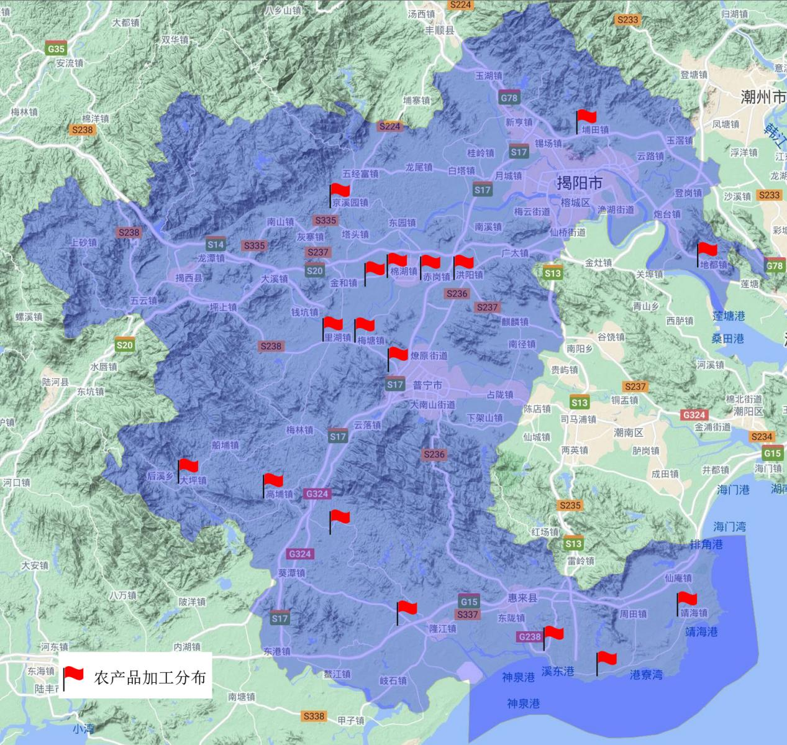

## 揭府〔2021〕45号

揭阳市人民政府关于印发揭阳市农业农村

现代化“十四五”规划的通知

各县（市、区）人民政府（管委会），市政府各部门：

《揭阳市农业农村现代化“十四五”规划》已经市政府六届107次常务会议审议通过，现印发给你们，请认真组织实施。实施过程中遇到的问题，请径向市农业农村局反映。

揭阳市人民政府

2021年12月14日

揭阳市农业农村现代化

“十四五”规划

“十四五”时期是我市加快实施乡村振兴战略，实现农业高质量发展、完善城乡融合发展体制机制、提升农业农村现代化水平的重要时期。为深入贯彻习近平总书记关于“三农”工作重要论述精神，落实党的十九届五中、六中全会重大部署，全面推进乡村振兴，加快农业农村现代化，依据《中华人民共和国乡村振兴促进法》《广东省推进农业农村现代化“十四五”规划》和《揭阳市国民经济和社会发展第十四个五年规划和2035年远景目标纲要》，衔接《中共揭阳市委 揭阳市人民政府关于推进乡村振兴战略的实施意见》，结合省委对揭阳“建设宜居宜业宜游的活力古城、滨海新城，努力打造沿海经济带上的产业强市”的发展定位，编制本规划。

## 第一章 与时俱进 准确把握发展新要求

“十四五”时期是全面建成小康社会、乘势而上开启全面建设社会主义现代化国家新征程的第一个五年，也是全面实施乡村振兴战略、加快农业农村现代化的关键五年，深刻认识和准确把握新发展阶段新使命、新机遇、新挑战，科学谋划和推进“三农”事业发展，是全市全面推进社会主义现代化建设的重要任务。

一、农业农村现代化发展基础进一步夯实

“十三五”以来，全市上下认真学习贯彻习近平新时代中国特色社会主义思想，落实党中央和省委省政府关于“三农”发展的重大部署，真抓实干，锐意进取，推动全市农业农村取得历史性成就、发生历史性变革。一是农业产业结构进一步优化。2020年全市粮食作物播种面积196.02万亩，产量80.85万吨，蔬菜产量209.28万吨，水果产量59.52万吨，基本保持稳定；茶叶产量2.51万吨，比2015年增长57.58%；全年畜禽肉产量13.39万吨，水产品产量14.54万吨。2020年全市第一产业增加值204.40亿元，比2015年增长21.89%，年均增长4.03%。农村居民人均可支配收入16312元，比2015年增长43.93%，年均增长7.55%。市级以上农业龙头企业56家，其中国家级1家、省级以上26家；国家级农民专业合作社3家。拥有中国“蕉柑之乡”“青梅之乡”“青榄之乡”“竹笋之乡”“荔枝之乡”的称号。埔田竹笋、普宁蕉柑、惠来荔枝、普宁青梅、吴厝淮山获得国家地理标志产品保护。二是一二三产融合进一步深化。成功举办“鲍鱼节”“荔枝节”“凤梨节”，打造“粤字号”农业知名品牌，推动产销对接，惠来鲍鱼“网络节+云展会”模式获省推广。积极推动农业与加工业融合、农业与“互联网+”融合、农业与乡村旅游融合，普宁市高埔镇代表揭阳市在全国农业产业强镇会议上作典型发言。全市已发展省级休闲农业与乡村旅游示范点6个、示范镇4个，“观瀑赏玉”乡村旅游等8条旅游线路被评为“广东省乡村旅游精品线路”，阳美社区、山湖村、新寮村等9个单位被认定为“省文化和旅游特色村”，揭西县京溪园镇和揭东区埔田镇被认定为“广东省旅游风情小镇”，揭西县山湖村被评为“全国乡村旅游重点村”。普宁市善德村被评为中国美丽休闲乡村。开展省级农业公园创建工作，共有2个4A级农业公园，1个3A级农业公园。普宁市被省农业农村厅列入“率先基本实现农业农村现代化试点县”。三是特色产业示范进一步凸显。全市已创建普宁青梅、惠来南药、揭东竹笋、揭西茶叶等4个省级现代农业产业园，普宁市青梅产业园已纳入国家产业园管理体系；创建揭东茶叶、揭西蔬菜、普宁蕉柑、惠来凤梨等10个市级现代农业产业园，建设“一村一品、一镇一业”项目153个，认定省级专业镇7个、专业村54个，培育发展青梅、竹笋、茶叶、蕉柑、凤梨、油茶、红萝卜、冬瓜、蕃薯、水产品养殖以及禽畜养殖等乡村特色产业，打造本土品牌，延伸农业产业链，提高农业产业的效率和竞争力。四是重要农产品供给进一步保障。制订出台《揭阳市促进农业产业化发展扶持办法》等文件，扶持发展农业产业。“十三五”期间，高标准农田建设项目总投资36754.71万元，建设总面积23.97万亩，高质量完成粮食生产功能区和重要农产品保护区划定工作。2016年以来，开展了水稻、玉米、生猪、能繁母猪、仔猪、蛋鸡、香蕉、龙眼、木瓜等政策性农业保险品种的承保工作，中央、省、市、县各级财政补助农户购买政策性农业保险达4453万元，大大减轻了农户购买保险负担，有效降低农户因灾造成的损失。全市共培育了省级“菜篮子”基地13个、市级“菜篮子”基地18个，提高了优质蔬菜供应及质量安全保障能力。全市规划建设屠宰厂（场）25家，其中大型屠宰厂15家、小型屠宰场5家、牛羊屠宰场5家。截至2020年12月31日，已确定经营主体的21家，确定建设地址的22家，已基本建成或完成改造的8家，屠宰改革工作有序推进。五是安全监测体系进一步健全。完成国家农产品质量安全追溯平台注册的“三品一标”的生产经营主体共42家；建立健全农资和农产品生产经营主体信用档案共542家。农产品监测总体合格率保持在97%以上，做到应免畜禽免疫率达到100%。2020年全市农作物种植面积298.9万亩，总防控面积950.3万亩次，共创建水稻、玉米、甘薯、茶叶等绿色防控示范区13个，示范面积0.29万亩，绿色防控应用面积131.1万亩，绿色防控覆盖率约39.6%，比2015年提高 13.5个百分点；水稻统防统治覆盖率约40.6%，比2015年提高近20个百分点。六是农业科技支撑进一步增强。“十三五”期间，“揭薯18”示范推广获省农业技术推广奖二等奖，“软枝大粒梅”“普薯30”“深两优5814”示范推广和“石磡乌榄矮化早结丰产”“果园台风灾后复壮改良技术”获省农业技术推广奖三等奖，完成揭阳市优质甘薯“揭薯16”“揭薯18”示范推广、揭阳市有机蔬菜现代化生产设施建设项目、揭阳市农业生产能力提升——支持粮食生产项目3个省级农业科技攻关示范项目。大力开展新品种试验示范，全市的水稻品种优质化率达到95%。加快构建新型职业农民队伍，开展农技培训、技术指导，共培育新型职业农民2750多人，培训农技人员360多人次。加大良种示范推广力度，建立水稻、甘薯、蔬菜、玉米、果树等高产示范点50多个。七是土地流转机制进一步完善。出台《揭阳市农村承包土地经营权流转示范片创建实施方案》《关于实行奖补措施进一步推动农村土地流转的实施方案》和《揭阳市农村承包土地经营权流转示范片补贴申报指南》，全市流转总面积49.23万亩，流转率40.12%，顺利完成省下达40%的任务。全面开展农村土地确权工作，已完成确权行政村1363个，完成率98.27%。全市实行农村家庭承包经营的耕地面积122.7万亩。八是脱贫攻坚战取得重大胜利。截至2020年底，全市建档立卡36998户、105844名相对贫困人口全部实现稳定脱贫，162个相对贫困村全部脱贫出列。2020年全市脱贫人口人均可支配收入从2015年的3841.64元提高至15501.26元，增长303.51%。全市162个相对贫困村居民人均可支配收入从2017年的12128.92元提高至2020年的21896.34元，增长80.53%。九是美丽乡村建设进一步夯实。基本实现干净整洁村全覆盖，累计创建美丽宜居村748个，共拆除各类危旧房、废弃猪牛羊栏、露天厕所茅房、乱搭乱建、非法违规广告25.65万宗、526.88万平方米；清理乱堆乱放14万宗，清理房前屋后和村巷道杂草杂物、积存垃圾29.77万吨，沟渠池塘溪河淤泥、漂浮物和障碍物21.53万吨。农村无害化卫生户厕普及率已达到100%，共建成农村公厕1166座，2020年度按实际需求新建或改造卫生公厕480座，超额完成省、市下达任务，被评为“全国厕所革命先进市”。全市3559个自然村完成雨污分流工程建设，完工率96.6%。全市1446个行政村已有1435个行政村实现集中供水。全市农村公路等级公路比率达到100%、路面铺装率达到100%，全面完成通200人以上自然村村道路面硬化。推进“农民工匠”做法得到中央农办、农业农村部肯定并推广。至2020年底，全市符合采用“农民工匠”法2107个，已采用“农民工匠”法建设2090个，采用率99.2%。扎实推进农房管控和乡村风貌提升，推动农村面貌发生“大变化”、颜值“大提升”。揭西山湖村被评为广东省第二届“十大美丽乡村”、普宁市南溪水乡被评为“广东美丽乡村精品线路”，揭西火炬村、普宁什石洋村、榕城西岐村被评为广东省特色名村。至2020年，新创建的示范村基本达到干净整洁村标准，省级示范片主体村基本达到美丽宜居村标准。揭东区新寮村以“文化、红色、生态”为主题，连片打造“院士故居、生态旅游康养城”。

## 二、农业农村现代化发展要求进一步显现

当前，世界百年未有之大变局深刻演化，新冠肺炎疫情带来的不确定性、不稳定性明显增强，“十四五”农业农村发展的新旧矛盾交织叠加、风险挑战前所未有。尤其是我市作为农业大市，农业农村基础差、底子薄、发展滞后的状况尚未根本改变，这与实施乡村振兴发展战略，实现农业农村现代化仍有很大差距，主要体现以下几个方面。一是农业产业集群程度偏低。目前我市农业经营主体总量仍处于全省落后水平，省级以上农业龙头企业、农民合作示范社我市均只占2.7%，且我市农业经营主体规模普遍偏小、支撑带动力不强、资源优势得不到有效转化。目前，我市产业虽有一二产，但大多产业都是以一产为主，三产开发不充分，品牌不响，市场影响力不强。二是土地流转仍较为困难。我市人多地少，长期以来以家庭为单位进行生产经营的传统模式仍占主导，农民思想观念陈旧，流转土地的意愿不强，制约产业的规模化、机械化发展。三是农产品质量安全监管难度大。农产品生产经营模式呈现“远距离、多环节、大流通”的特色，涉及收购、储藏、运输、销售等多个主体，加上农产品质量安全监测体系和执法体系建设滞后，规模化生产比重不高，源头监管较为薄弱。四是农业科技人才队伍薄弱。农业从业人员普遍学历低、职称低，农业科技人才不足。现有人员知识老化，缺乏现代生物、信息、管理知识来武装改造现代农业人才。科技创新意识有待于进一步增强，掌握和运用知识产权的能力和水平还不够高，特别缺乏综合性复合型人才，给科技成果转化带来一定难度。同时农产品科技含量不高，大大地制约了农产品的生产效益与综合竞争力。五是脱贫成果需持续巩固拓展。农村低收入人口还将长期存在，返贫、致贫风险不容忽视。一些地方发展基础仍然相对比较薄弱，部分扶贫项目带贫益贫能力不强。扶贫资产后期运营管理实现增值增效，接续推进全面脱贫与乡村振兴有效衔接任务艰巨，仍需久久为功不懈努力。六是资金投入不足亟需加强。“十三五”期间对“三农”投入虽有明显增加，全市各级涉农资金总投入70多亿元，但仍然适应不了农业农村现代化和乡村振兴的要求，加上揭阳市作为农业大市，农业基础仍不稳固，设施装备落后，耕地质量总体仍较低，生产力仍不高。农村集体经济薄弱，发展模式单一，在推进农村人居环境综合整治、雨污分流、道路建设、农村旧房改造等农村基础设施时，工程项目资金缺口较大，影响美丽乡村建设的开展。七是农民增收缺乏有效手段。揭阳作为人口大市、农业大市，农业、农村基础薄弱，农民收入偏低，技术技能有待进一步的提升，城乡经济发展的不充分不平衡问题依然突出，农村居民人均可支配收入低于全省平均水平。这些问题表明，揭阳市实现第二个百年奋斗目标最艰巨最繁重的任务依然在农业在农村，必须加快推进农业农村现代化，在百年未有之大变局中谋划打好主动仗。

## 三、农业农村现代化发展环境进一步优化

“十四五”时期，我市农业农村发展依然处于重要战略机遇期，在危机中育先机，于变局中开新局，推进农业农村现代化具有诸多有利条件。一是党中央、省委省政府和市委市政府高度重视“三农”工作。《国民经济和社会发展第十四个五年（2021－2025年）规划和2035年远景目标纲要》、2021年中央一号文件以及《广东省推进农业农村现代化“十四五”规划》等文件均提出坚持农业农村优先发展，全面推进乡村振兴，我市也出台一系列促进“三农”发展的相关政策文件，全市关注农业、关心农村、关爱农民的氛围更加浓厚，“三农”工作面临前所未有的发展机遇。二是乡村振兴面临前所未有的历史机遇期。2018年，中共中央、国务院印发《乡村振兴战略规划（2018－2022年）》、2019年印发《国务院关于促进乡村产业振兴的指导意见》、2020年农业农村部印发《全国乡村产业发展规划（2020-2025年）》，强调坚持农业农村优先发展方针，加快实施乡村振兴战略，以农业农村资源为依托，以农民为主体，以农村一二三产业融合发展为路径，地域特色鲜明、创新创业活跃、业态类型丰富、利益联结紧密，发展提升农业、繁荣农村、富裕农民的产业。政策驱动力明显增强，将有更多的资源要素向农村聚集，同时“新基建”改善农村信息网络等基础设施，城乡融合发展进程加快，乡村产业发展环境优化。三是市场消费结构的深刻变化引领产业转型升级。随着我国经济由高速增长阶段转向高质量发展阶段，市场驱动力增强，消费结构升级加快，城乡居民的消费需求呈现个性化、多样化、高品质化特点，休闲观光、健康养生消费渐成趋势，乡村产业发展的市场空间巨大。5G、物联网、区块链等与农业交互联动，新产业新业态新模式不断涌现，引领乡村产业转型升级。四是经济社会和乡村演变的趋势迸发出巨大潜力。“十四五”时期，我市城镇化进入快速发展与质量提升的新阶段，城市辐射带动农村的能力进一步增强，以工促农、以城带乡，城乡一体化进程的发展引起城市基础设施向农村延伸、城市生产要素向农村流动、城市新型流通方式向农村拓展，为农业农村提供发展机遇。

## 第二章   精准 谋划   科学制定发展新目标

## 一、指导思想

- 以习近平新时代中国特色社会主义思想为指导，按照“建设宜居宜业宜游活力古城滨海新城，努力打造沿海经济带上产业强市”的发展定位，以实施乡村振兴战略为总抓手，以推动高质量发展为主题，以发展精细农业、建设精美农村、培育精勤农民为主攻方向，以深化农业供给侧结构性改革为主线，突出产业集群成链，构建具有揭阳特色的现代农业产业体系、生产体系和经营体系，深入实施“九大攻坚”行动，加快推进城乡融合发展，加快农业农村现代化，促进农业高质高效、农村宜居宜业、农民富裕富足，满足人民日益增长的美好生活需要。

## 二、基本原则

1.坚持党的全面领导。毫不动摇坚持党对“三农”工作的全面领导，健全党的领导体制和工作机制，强化市县镇各级党委领导农村工作的主体责任，全面增强基层党组织的核心作用，确保党在农村工作中始终总揽全局、协调各方，为“三农”发展提供坚强的政治保障。

- 2.坚持立农为农。以农业农村资源为依托，发展优势明显、特色鲜明的乡村产业。把二三产业留在乡村，把就业创业机会和产业链增值收益更多留给农民。

3.坚持农民主体地位。培育勤劳作、精技艺、有情怀敢创业的新时代精勤农民，充分发挥农民主体作用和首创精神，尊重农民意愿，切实保障农民权益，持续增加农民收入，不断增进农民福祉，让农民群众有更多的获得感幸福感安全感。

4.坚持市场导向。充分发挥市场在资源配置中的决定性作用，激活要素、激活市场、激活主体，以乡村企业为载体，引导资源要素更多地向乡村汇聚。

5.坚持融合发展。发展全产业链模式，推进一产往后延、二产两头连、三产走高端，加快推进农业与现代产业要素跨界配置。

6.坚持绿色引领。践行绿水青山就是金山银山理念，促进生产生活生态协调发展。健全农产品质量标准体系，培育绿色优质品牌。

7.坚持创新驱动。利用现代化科技进步发展，改造提升乡村产业。创新机制和业态模式，增强乡村产业发展内在活力。

8.坚持城乡统筹。建立强农惠农投入的稳定增长机制，着力构建以工促农、以城带乡的长效机制，协调推进工业化、城镇化和农业现代化。

## 三、发展目标

（一）总体目标

“十四五”发展目标。全面实施乡村振兴战略，推进农村违法乱占耕地建房整治攻坚、高标准农田建设攻坚、种业翻身仗攻坚、农村生活污水治理攻坚、农村集中供水全覆盖攻坚、村内道路建设攻坚、美丽圩镇建设攻坚、渔港建设攻坚、金融支持乡村振兴攻坚等“九大攻坚”行动。以“链长制”机制创新为突破口，做大做强做优现代农业产业，着力构建具有揭阳特色的现代农业产业体系、生产体系和经营体系。进一步巩固脱贫攻坚成果，形成长效管护机制，促进农民增产增收。加快推进生态宜居、美丽乡村建设，着力打造揭阳特色精品村。到2025年，形成乡村产业体系健全完备、乡村产业质量效益明显提升、产业融合发展水平显著提高、农民增收渠道持续拓宽、乡村产业发展内生动力持续增强的农业农村发展新格局。

## （二）具体目标 任务

1.夯实重要农产品供给保障基础。加强农业基础设施建设，推进高标准农田建设，强化“菜篮子”市长负责制，推广良种良法生产技术。到2025年，全市粮食产能稳定在80万吨以上，培育省级“菜篮子”基地29个、市级“菜篮子”基地34个，支持建设2-3家生猪养殖、屠宰、加工、配送全产业链示范企业，支持高效安全、绿色环保的规模化畜禽标准养殖场12个。

2.拓展特色农业产业链。推动农业产业链“链长制”机制创新，做大一产，做强二产，做优三产，培育一批优势特色产业集群和现代农业企业，建设一批现代农业产业园，因地制宜发展“一村一品、一镇一业”，创响一批“粤字号”农业知名品牌。到2025年，新增省级以上农业龙头企业 10家，新增市级农业龙头企业 30 家，新增省级现代农业产业园 10个，新增市级现代农业产业园25个。

3.建设生态宜居美丽乡村。全面持续推进全域农村人居环境整治和“百村示范、千村整治”工程建设，广泛开展村庄清洁行动和绿化行动，持续开展农村厕所革命，梯次推进农村生活污水治理，完善农村垃圾分类处理和资源化利用，加快补齐农村基础设施和公共服务短板。做好传统古村落、传统民居的保护活化提升。到2025年，80%以上行政村达到美丽宜居村标准，建成一批特色精品村，打造32+N个宜居宜业宜游的传统古村落，提高人民群众的获得感、幸福感。

4.增加农民收入。推进农村“一二三”产业融合发展，加快构建新型农业经营体系，提高农业综合效益，提高农民经营性收入。支持农民工返乡创业，以创业带动就业，提高工资性收入。巩固完善强农惠农富农政策，增加农民转移性收入。健全土地承包经营权流转，引导农民依法自愿有偿流转土地承包经营权，增加农民财产性收入。到2023年，农村居民人均可支配收入达到2.1万元以上；到2025年，农村居民人均可支配收入达到 2.4 万元以上。

（三）2035年远景目标

全市乡村振兴取得决定性进展，基本实现农业农村现代化。农业现代化与新型工业化、信息化、城镇化协调同步，质量效益和竞争力迈上新的台阶，农业重点领域、关键环节核心技术取得较大突破；“链长制”工作机制常态化，“链长制”产业成为全市农业主导产业；揭阳特色宜居宜业乡村基本建成，绿色生产生活方式深入普及，乡风文明达到新高度，基本实现乡村治理体系和治理能力现代化；城乡区域发展差距和居民生活水平差距明显缩小，农民全面发展与共同富裕取得更为明显的实质性进展。

## 第三章   城乡融合   优化区域 发展新布局

遵循国土空间开发保护总体要求，以促进农业高质高效、乡村宜居宜业、农民富裕富足为目标，支持中心城区现代化引领区、惠来滨海经济提升区、揭西生态发展示范区、普宁三产融合创新区各展所长，联动发展，形成布局合理、重点突出、优势互补的新型区域新布局，协同推进农业农村现代化。

## 一、打造中心城区现代化引领区

依托城市发展基础，发挥机场、高铁、榕江口岸等区位交通优势，以产城融合为目标，大力发展都市现代农业，打造城区农业经济新样板，力争到 2025 年建成农业农村现代化示范引领区，带动全市农业农村高质量发展。

一是加快发展休闲旅游农业，推进农业由生产向生活服务、环境生态和休闲观光等多功能转变，推进一二三产业融合发展，提高第一产业效益。二是发展现代农业物流枢纽网络，积极培育建设集农产品交易、增值加工、物流、金融等于一体的农产品物流产业体系，推进农业与物流业融合发展。鼓励传统仓储、运输型农产品物流企业整合功能延伸服务，加快向现代农产品物流企业转型。三是全面实施美丽乡村建设，实施农村基本公共服务提升行动完善镇村两级公共服务设施布局，把乡镇建成服务农民的区域中心，打造可复制可推广的宜居宜业乡村样板。榕城区重点加强古村落普查保护，重塑水乡古村风韵，做活“水”字文章，打造一批美丽乡村品牌，建设生态宜居美丽乡村。空港经济区发挥区位交通优势，加快发展农产品商贸物流，加强农产品商贸物流基础设施建设，培育壮大农产品物流企业，畅通农产品物流通道。揭东区深入实施农业标准化规模化生产，推进特色优质农产品重要供应基地建设，大力发展“一镇一业”，加快实现竹笋、炒茶等优势产业集群化。

## 二、创建惠来滨海经济提升区

立足区域资源与产业优势，抓好种植和养殖两大农业主导产业，扎实推进南药、凤梨、冬瓜、红萝卜、油茶、番薯、大蒜种植和对虾、鲍鱼、种禽养殖等10个农业产业“万亩工程”，推进荔枝产业高质量发展，以保障农产品有效供给、推动区域城乡协调发展为主攻方向，主动对接大湾区大市场。力争到 2025 年在农产品供给优化、农村产业融合发展和区域协调发展等领域实现重点提升，推动农业农村高质量发展取得新成效。

一是重点建设东部沿海蓝色产业带渔港渔业经济和家禽产业链，将惠来鲍鱼从“小特产”升级为“大产业”，将惠来家禽打造成集种苗生产、规模养殖、屠宰加工、冷链物流、粪污综合利用的全产业链融合发展新模式，推进鲍鱼产业和家禽产业转型升级和高质量发展。二是着力发展渔港经济，加快惠来县神泉示范性渔港建设，完善渔港配套设施，发展水产品加工、冷链物流、数字交易、休闲体验等渔业二三产业，打造临海特色产业战略高地。三是强化保供能力，重点建设西部粮食生产功能区、重要农产品生产保护区，实施高标准农田建设工程，强化农业科技和装备支撑，建成粮食和重要农产品生产基地。四是推动城乡区域协调发展，统筹城镇和村庄规划建设，实施全域美丽乡村建设行动，启动驻镇帮镇扶村工作，推动城乡区域协调发展。

## 三、建设揭西生态发展示范区

以“产业生态化、生态产业化”为目标，深入实施可持续发展战略，立足“一园两区”发展新格局，坚持生态优先、绿色发展，力争到 2025 年建成生态发展示范区，以绿水青山生态环境和绿色优质农产品对接融入粤港澳大湾区，引领创造绿色健康新消费。

一是加强农村生态文明建设，调整优化生产生活生态空间，转变发展方式，控制开发强度，推进农业面源污染防治，强化土壤污染、水土流失等治理和修复。以农村耕地“灭荒”三年行动为契机，实施好“米袋子”培育工程，保障粮食安全供应。二是优化发展理念，深挖生态潜力，充分利用丰富的农业资源，以省市现代农业产业园为龙头，大力发展茶叶、蔬菜、生猪、橄榄、苦笋、南药、淮山、青梅等具有揭西特色的农业产业，把生态资源转变为经济资源，把生态效益转化为经济效益、社会效益，推动经济加快发展。三是深入推进电子商务进农村，鼓励电子商务企业建立农产品服务贸易电商平台，畅通农产品网上网下、国内国外销售渠道提升农业综合销售能力。四是将特色农业发展与全域旅游、新农村示范片建设有机结合起来，以示范村为点，串珠成链打造一批美丽乡村示范片，形成各具特色、各美其美的乡村景观带。大力发展休闲观光农业、农耕体验和生态康养产业，推动旅游与农业、林业、康养、研学等深度融合，把绿水青山打造成金山银山。

## 四、发展普宁三产融合创新区

按照农业“组织化、现代化、产业化”发展思路，做强做大富民兴村产业，深入实施“一村一品、一镇一业”工程，扶持特色农业集约化、产业化发展，加快创建国家现代农业产业园，因地制宜、连片集中打造田园综合体，以家庭农场、示范农民合作社、龙头企业等新型农业经营主体为依托，培育发展科学种养、农产品深加工、互联网+农业等新业态，大力发展现代精品农业，力争到 2025 年建成三产融合创新区。

一是以疏港铁路设站洪阳为契机，充分发挥靠近揭阳市区的区位优势和独特的资源禀赋，着手连片打造集花卉苗木、休闲农业和乡村旅游等特色产业为一体的特色农业和特色旅游集聚区。重点将洪阳、南溪、广太串连成片，以洪阳古镇文化、南溪水乡、广太园林为主线，开辟打造一条集文化、美食、休闲的精品旅游线路。二是提升西部片区发展效益，立足生态发展区功能定位，做足休闲农业、生态旅游、养老养生、特色农产品深加工等文章。推进培育创建省级休闲农业与乡村旅游示范镇（点）、广东农业公园，推动农旅、文旅、商旅全面融合，打造一批高品质的景区景点和旅游产品，推动一二三产业融合发展。三是建设美丽乡村。全域推进农村人居环境整治，打造美丽乡村示范点。

## 第四章 精准施策 推进农产品稳产保供

## 一、稳定粮食生产

落实粮食生产安全责任制，坚持党政同责，分区域分解和压实粮食安全责任。完善水稻生产支持政策体系，以普宁市、揭西县、惠来县等水稻生产大县为重点，建设水稻生产供给核心保障区，全面开展绿色高质高效提升行动。开展粮食高产创建活动，通过补贴提供服务，调动农民生产积极性。在稳定粮食生产的基础上，调整粮食生产结构，大力发展优质稻、优质番薯、甜玉米、马铃薯等高效粮食作物。支持新建或改造完善一批粮食仓储物流和应急保障设施。统筹整合供销系统农产品生产服务、冷链物流、销售渠道等优势资源，打造放心农产品直供配送网络。强化应急保障体系建设，完善“粮食应急物流协调指挥中心+骨干应急配送中心+乡镇应急供应点”联动保障机制。

区域布局（图1）：水稻重点种植区域为揭东区（玉湖镇、云路镇、霖磐镇、桂岭镇）、空港经济区（登岗镇、炮台镇）、惠来县（隆江镇、东陇镇）、普宁市（里湖镇、广太镇、赤岗镇、南溪镇、下架山镇）、揭西县（塔头镇、棉湖镇、凤江镇、五云镇）产区；薯类发展区域为惠来县（周田镇、溪西镇、仙庵镇）；玉米发展区域为揭西县（金和镇、五经富镇）、普宁市（梅塘镇、里湖镇、下架山镇、占陇镇）、揭东区（云路镇、锡场镇、新亨镇）；粮食加工重点发展区域为惠来县隆江镇、揭东区桂岭镇、普宁市燎原镇。

图1 粮食重点区域分布图

## 二、强化“菜篮子”市长负责制

加强重要农产品生产保护区和特色农产品优势区建设，确保重要农产品有效供给，落实各地“菜篮子”生产责任，加大对“菜篮子”投入，稳定“菜篮子”基地，优化品种结构，发展设施装备水平，调节上市档期，提升竞争能力，提高“菜篮子”有效供给能力。加快“菜篮子”产品优质化、集约化改造，满足群众多元消费需求。建设一批省级“菜篮子”基地和农产品出口示范基地。大力稳定提高生猪生产水平，严格落实扶持生猪生产的各项政策举措，推动生猪标准化规模养殖，实现生猪稳产保供。大力发展以草食动物为主的畜牧养殖业，推行健康生态养殖模式，提高畜牧业在农业总产值中的比重。主动融入粤港澳大湾区“菜篮子”工程建设，创新推广数字化农产品营销新业态和菜篮子“车尾箱”工程新模式，着力塑造“粤风浓郁、口碑优良、安全放心”的品牌形象。

区域布局（图2-4）：蔬菜重点发展区域为揭东区（埔田镇、新亨镇、锡场镇、云路镇）、普宁市（南径镇、麒麟镇、大坝镇、燎原镇、梅塘镇）、揭西县（坪上镇、金和镇、五经富镇、龙潭镇）、惠来县（靖海镇、神泉镇、溪西镇）；生猪生产发展区域为揭西县（五云镇、南山镇、龙潭镇）、揭东区（龙尾镇、新亨镇、埔田镇）、普宁市（里湖镇、马鞍山农场）、惠来县（葵潭镇、东埔农场）；鸡、鸭发展区域为普宁市大坝镇、惠来县（前詹镇、周田镇、东陇镇）、揭东区龙尾镇；狮头鹅发展区域为普宁市马鞍山农场；鲍鱼养殖及加工重点发展区域为惠来县（前詹镇、靖海镇）；虾养殖及加工重点发展区域为空港经济区地都镇和惠来县（前詹镇、靖海镇、岐石镇）；淡水鱼养殖重点发展区域为榕城区仙桥街道、普宁市洪阳镇、揭东区（玉滘镇、白塔镇）、揭西县（灰寨镇、京溪园镇、五经富镇）。

图2 蔬菜重点区域分布图

图3 禽畜重点区域分布图

图4 水产重点区域分布图

## 三、推进高标准农田建设

实施高标准农田建设攻坚行动。科学谋划农田建设规划，进一步健全农田建设制度，利用制度优势，完善标准体系，提升农田建设工作效能。推进耕地“宜机化”改造，促进高标准农田建设扩面、提质、优化。加强农田建设监督评价，强化高标准农田建设监测评价。强化农田保护与利用，完善高标准农田建后管护制度，加强高标准农田利用情况监测，提升耕地质量监管能力，以高标准农田建设为核心加强项目统筹实施，推进农田工程建设和耕地土壤培肥有机结合。积极探索创新农田建设新模式，将整区域推进、土壤改良、绿色农田、数字农田等示范项目作为“十四五”期间重要建设内容，鼓励多渠道筹资加大建设投入，探索农田建设健康发展与耕地资源永续利用的道路，打造高标准农田建设新模式、新标杆。

## 四、夯实农业生产能力基础

坚持耕地数量与质量并重，完善耕地保护补偿机制，推进建设占用耕地耕作层土壤剥离再利用，提升耕地质量，深入实施藏粮于地、藏粮于技战略，稳定提高粮食产能。严格实行土地用途管制，坚决遏制耕地“非农化”，严禁违规占用耕地和违背自然规律绿化造林、挖湖造景，严格控制非农建设占用耕地。防止耕地“非粮化”，明确耕地利用优先序，永久基本农田重点用于粮食特别是口粮生产。全面整治撂荒弃耕地复耕，建立全省撂荒耕地动态监测平台揭阳节点，开展经营主体承包流转撂荒耕地复耕补助试点，完成撂荒耕地复耕整治任务。加强农业基础设施建设。加强标准化养殖场、标准鱼塘建设。规范设施农业用地管理，支持设施农业健康发展，不断提高农业综合生产能力。推进农村水系综合治理，实施大中型灌区续建配套和现代化改造，建设节水改造工程、撂荒耕地水利工程，加强“五小”农村水利设施监管体系建设，推进大中型灌区、泵站标准化规范化管理及小水电安全生产标准化全覆盖。统筹整合农田水利等基本建设项目，重点完善田间渠系配套、雨水积蓄利用等小型农田水利建设，构建大中小微结合、骨干和田间衔接、长期发挥效益的农村水利基础设施网络。

## 五、推广良种良法技术

加强良种市场贸易发展，强化良种市场监管，建立健全区域性良种质量监管体系和信息追溯体系。建立健全良种应急储备调控制度。大力发展畜禽、优质番薯、甜玉米、马铃薯、水产等优良种苗的繁育推广应用，建设健康种苗生产基地，推进土地整治、土壤改良培肥、农田水利设施建设和田间道路配套，促进良种良法配套。完善全市农业技术集成应用和示范推广体系，支持各类社会力量参与建设提升基层农业技术推广体系。

专栏1 重要农产品供给保障工程

| 1.高标准农田建设。优先在粮食生产功能区和永久基本农田保护区开展高标准农田建设，因地制宜发展高效节水灌溉。 2.耕地数量与质量提升建设。完成撂荒耕地复耕整治任务，推进耕地质量保护与提升行动，健全耕地质量监测网络，提升土壤有机质含量和耕地质量等级。 3.稳定粮食生产。大力发展优质稻米生产，推广全过程绿色高质高效栽培模式，因地制宜发展薯类、鲜食玉米，优化粮食生产结构，粮食产能稳定在80万吨以上。4.加强“菜篮子”基地建设。推进蔬菜标准化基地创建，培育省级“菜篮子”基地29个、市级“菜篮子”基地34个。促进生猪产能恢复，支持建设一批年出栏1万头以上生猪养殖场（基地）。开展生猪屠宰标准化示范创建，支持建设2-3家生猪养殖、屠宰、加工、配送全产业链示范企业。大力发展以草食动物为主的畜牧业和鲍鱼、对虾等养殖业，支持高效安全、绿色环保的规模化畜禽标准养殖场12个，支持建设一批水产绿色健康养殖示范基地。 |
|---|

## 六、推动畜禽养殖和屠宰标准化生产

大力推进畜禽屠宰场现代化、标准化和信息化建设，按照“优布局、标准化、改模式、建冷链、减数量、强监管”的发展思路，积极推进屠宰行业改革工作。推动小型屠宰厂（场）向现代化屠宰企业、调畜禽向调肉品转型升级，加大屠宰厂技术改造和政策扶持，不断提升屠宰场屠宰技术水平，打造一批生猪屠宰标准化示范厂。推动生猪、家禽产业转型升级，支持建设标准化规模养殖场、养殖小区，促进畜禽养殖工厂化、园区化、产业化发展，打造生猪优势产区，恢复并稳定生猪产能，实现生猪养殖和屠宰环节无害化处理，加强市场监测与调控，确保生猪出栏量逐年实现稳中有升。采用能源环保型、能源生态型以及高床发酵型等养猪新模式，将一批规模化畜禽养殖场建设为畜禽废弃物管理示范区。

## 七、推进动物疫病强制免疫补助政策改革

通过改革重大动物疫病强制免疫补助实施机制，放开强免疫苗经营，推行强免疫苗流通市场化，建立养殖场户和第三方服务主体自主采购强制免疫疫苗、实施强制免疫财政直补的强制免疫新模式，有效激发市场活力，进一步落实畜禽养殖场动物防疫主体责任，化解强制免疫补助政策落实过程中存在的突出问题与风险，巩固提升强制免疫效果和财政资金使用效率。

逐步推进规模养殖场户重大动物防疫病强制免疫财政直补工作，全市所有规模养殖户实施“先打后补”，政府招标采购强免疫苗停止供应规模养殖场户。2025年，全面取消政府招标采购强免疫苗。

## 第五章 结构优化 实现农业做大做强

## 一、全面优化农业产业结构

## （一）做大一产，提升种养业规模化水平

做大一产，依据各地自然资源禀赋和种养习惯，科学谋划各地产业布局，宜粮则粮、宜菜则菜、宜养则养。充分利用各级土地流转扶持政策措施，重点是盘活土地资源，制定完善的政策措施和激励机制，全力推动土地集中流转。动员农户将土地统一向村集体（经联社）流转，再由村集体（经联社）依照有关规定开展招商，引入农业企业、农民合作社、家庭农场等主体进行规模化、集约化、现代化经营，积极发展“产业链”主导产业，形成种养业规模效应。

区域布局（图5-8）：青梅重点发展区域为普宁市（高埔镇、大坪镇、梅林镇、船埔镇、后溪乡）、揭西县坪上镇；荔枝重点发展区域为惠来县（葵潭镇、隆江镇、惠城镇）；龙眼重点发展区域为揭东区（玉湖镇、桂岭镇、云路镇）；菠萝重点发展区域为惠来县（葵潭镇、青坑林场）；蕉柑重点发展区域为普宁市（云落镇、梅林镇、南溪镇、洪阳镇、广太镇、赤岗镇）、橄榄重点发展区域为普宁市（梅林镇、里湖镇）、揭西县（大溪镇、灰寨镇）；茶叶重点发展区域为揭西县（五经富镇、京溪园镇、南山镇、良田乡）、揭东区（玉湖镇、新亨镇）、普宁市（大南山街道、里湖镇）、惠来县惠城镇；南药种植重点发展区域为惠来县（鳌江镇、东港镇、葵潭镇）、揭西县五经富镇、普宁市（大南山街道、高埔镇、里湖镇）；中药材加工重点发展区域为普宁市（流沙街道、池尾街道）；花卉重点发展区域为普宁市（洪阳镇、广太镇、南溪镇）。

图5 水果重点区域分布图

图6 茶叶重点区域分布图

图7 南药重点区域分布图

图8 花卉苗木重点区域分布图

## （二）做强二产，推动农业向精深加工发展

做强二产，提升农业深加工水平，以农产品精深加工为主攻方向，重点推动我市农业产业向精深加工发展，进一步延长产业链、提升价值链、拓宽增收链，积极培育农业新业态。以国家级、省级和市级现代农业产业园为载体，重点建设水果、蔬菜、竹笋、中药材、茶叶、海鲜产品、生猪养殖、花卉等现代农业产业园区和农产品加工园区，推进政策集成、要素集聚、企业集中、功能集合，打造青梅等跨县产业集群，将现代农业产业园打造为产加销贯通、贸工农一体、一二三产业融合发展的农产品加工示范园区，从产前、产中、产后各个环节升级传统农业产业链，加快实现“产业链”本地化，不断提升产品附加值。加强现代农业产业与食品加工业的融合，针对不同的产业，积极对接研究机构，根据市场需求创新加工方法，开发新产品，着力推动产地初加工和精深加工发展。加快补齐冷链仓储物流等基础设施短板，助力一二产发展。

区域布局（图9）：特色果蔬加工重点发展区域为普宁市（高埔镇、大坪镇、里湖镇、马鞍山农场）、揭东区埔田镇；特色肉制品加工重点发展区域为普宁市（赤岗镇、洪阳镇）；水产品加工重点发展区域为惠来县（靖海镇、前詹镇、神泉镇）、空港经济区地都镇；调味品和佐餐小菜加工重点发展区域为普宁市池尾街道、惠来县侨园镇、空港经济区地都镇；休闲食品加工重点发展区域为揭西县（凤江镇、棉湖镇）、普宁市（池尾街道、里湖镇、梅塘镇）。

图9 农产品加工重点区域分布图

## （三）做优三产，培育农业新业态

依据自然风貌、人文环境、乡土文化等资源禀赋，建设特色鲜明、功能完备、内涵丰富的乡村休闲旅游重点区。依托都市农业生产生态资源和城郊区位优势，大力发展现代都市农业，建设综合性休闲农业园区、农业主题公园、观光采摘园、垂钓园、乡村民宿和休闲农庄，满足城市居民消费需求，推动农业全产业链融合发展。大力发展旅游休闲与创意体验农业，推进“农业+”“渔业+”“林业+”，突出森林人家、健康氧吧、生态体验等业态，建设自然风景区周边乡村休闲旅游区。深入挖掘历史文化内涵、欢庆的民俗节日活动和多样的民族特色美食，培育一批美丽休闲乡村、文化和旅游特色村，发展民族风情游、民俗体验游、村落风光游等业态，建设揭西休闲农业示范县和一批旅游风情小镇，开发民族民俗特色产品，打造一批特色乡村旅游精品线路和美丽乡村示范区。培育发展美丽牧场、稻渔综合种养、休闲渔业、海洋牧场等新业态，开发“后备箱”“伴手礼”等旅游产品。支持农业科普教育、农事体验、农业文化示范基地建设，弘扬农耕文化，传承民间习俗，挖掘文化附加值。持续开展市级“十大特色农庄”培育创建工作，选定培育特色休闲农业经营主体，进一步提高我市休闲农业与乡村旅游品质，培育壮大乡村特色产业和休闲旅游业。加大三产融合力度，培育新业态，探索发展“中央厨房+冷链配送+物流终端”“中央厨房+快餐门店”“健康数据+营养配餐+私人订制”等新型加工业态，满足城市多样化、便捷化需求。

区域布局（图10）：休闲农业重点发展区域为揭西县（京溪园镇、五经富镇）、揭东区（白塔镇、玉湖镇、云路镇、埔田镇）、普宁市（大坪镇、高埔镇、里湖镇）、惠来县（侨园镇、葵潭镇）。

图10 休闲农业重点区域分布图

专栏2 农业全产业链建设工程

| 1.提升种养业规模化水平。立足区域资源与产业优势，提升优势农产品的种养规模，建设“米袋子”“菜篮子”“果盘子”“茶罐子”基地。建设20个高标准示范果园，10个生态茶园，5个特色花卉示范园，3个中药材生产基地。2.推动农业向精深加工发展。加快农产品产地初加工发展，支持新型农业经营主体改善储藏、保鲜、烘干、清选分级、包装等设施装备条件，提升商品化处理能力。实施农产品加工业提升行动，支持发展农产品深加工和特色加工。3.培育农业新业态。扶持发展乡村创意和康养农业，支持利用乡村闲置农房、田园等资源，建设产品认养、托管代种等共享农场，培育发展稻渔综合种养、休闲渔业、海洋牧场等新业态。4.建设现代农业产业体系。到2023年，新增省级现代农业产业园6个，新增市级现代农业产业园15个。到2025年，新建10个省级现代农业产业园和25个市级现代农业产业园，培育2个广东省特色优势产业集群，扶持150个村发展农业优势特色产业，建设10个农业产业强镇和农业专业镇，建成一批“一村一品”示范村镇。 |
|---|

## 二、实施农业科技提升计划

## （一）加快农业关键技术创新示范

引导和支持集群企业围绕育苗育种、原料种养、产品研发、装备研制、加工工艺、物流运输、质量控制等环节，充分运用新技术、新装备、新工艺、新模式，以发展有地方特色的优质、高产、高效、生态、安全农产品为目标，加强农业装备科技攻关，重点推进水稻生产和畜禽养殖全程机械化示范等农业装备以及农产品贮藏保鲜、畜禽屠宰、冷链物流、收割烘干等加工设施的关键技术创新及推广应用示范，完善研发支持及补助政策。开展设施园艺、蔬菜和花卉生产自动作业技术、设施生产和经营的协同管理技术研究，创制出具有自主知识产权的智能化新技术和新装备。针对设施园艺栽培和节能的需要，开展温室太阳能光热资源综合利用和高效节能技术研究和装备研发与应用。加强绿色农业科技创新，推进化肥农药减量增效、节水灌溉、农业废弃物资源化利用、种质资源评价与保存等关键技术研发，开发秸秆还田机械和装置并进行大面积示范推广，促进成果集成应用。建设现代化农产品冷链物流体系，提升农产品贮藏保鲜和供应能力。加大农村机电排灌、现代渔业技术装备、动植物品种改良、农业资源保护与开发利用、病虫害统防统治、重大动物疫病防控科技攻关和关键技术研究、农业气象灾害监测等关键技术的研发力度，提升预报、预警、防御、应急处置能力和水平。

## （二）打造农业科技创新平台基地

依托国家级、省级现代农业产业园，推动企业转型升级，建设国家农业高新技术产业示范区、国家农业科技园区、省级农业科技园区，吸引更多的农业高新技术企业到科技园区落户，着力培育农业国家高新技术企业，形成具有国内竞争力的农业高新技术产业。整合利用现有资源，积极组建和推动建设一批农业科技创新联盟、区域农业技术创新中心、农产品加工与贮藏重点实验室、保鲜物流技术研究中心及优势农产品品质评价研究中心、农产品加工技术研发公共服务平台等重大研发创新平台、成果转化与交易平台建设。支持农业高新技术企业建立高水平研发机构。加强与省农科院的交流，以共建揭阳分院为载体开展院地合作，加大产学研对接，建立全方位、多层次、宽领域的常态化合作机制。整合和完善各类科技资源，充分发挥重要公共科技资源优势，探索建设农业科技资源开放共享与服务平台。

## （三）推动农产品加工技术创新

以农产品加工关键环节和瓶颈制约为重点，研发一批集自动测量、精准控制、智能操作于一体的绿色储藏、动态保鲜、快速预冷、节能干燥等新型实用技术，以及实现品质调控、营养均衡、清洁生产等功能的先进加工技术。扶持一批农产品加工装备研发机构和生产创制企业，开展信息化、智能化、工程化加工装备研发。探索运用智能制造、生物合成、3D打印等新技术，集成组装一批科技含量高、适用性广的加工工艺及配套装备，提升农产品加工层次水平。

## （四）健全农业科技创新体系

培育符合现代农业发展要求的创新主体，建立健全各类创新主体协调互动和创新要素高效配置的农业科技创新体系。鼓励高校、科研院所建立一批专业化的技术转移机构和面向企业的技术服务网络，通过研发合作、技术转让、技术许可、作价投资等多种形式，实现科技成果市场价值。健全市、县、镇三级科技成果转化工作网络，支持县区大力发展技术交易市场。健全农业科技领域分配政策，落实科研成果转化及农业科技创新激励相关政策。面向绿色兴农重大需求，加强种业创新、现代食品、农机装备、农业污染防治、农村环境整治等方面的科研工作，开展重大科研联合攻关，开展技术集成、生态环保、推广示范、培训孵化与指导服务，培育具有国内竞争力的种业龙头企业，推动建设农业科技强市。

## （五）提升农业设施装备水平

加大农机购置补贴力度，推进水稻生产全程机械化，确保到2025年，每县（市、区）至少建成一个水稻生产全程机械化示范基地。加快高端农机装备和丘陵山区、果菜茶生产、畜禽水产养殖等农机装备的推广应用，提升渔业船舶装备水平。加快发展农业设施大棚、节水灌溉、控温、畜禽养殖自动化智能化、深水网箱智能平台、农产品仓储保鲜冷链物流、烘干、仓储冷库、水肥一体化、畜禽粪污资源化利用、农作物残余物废弃物再生循环利用等绿色装备技术，促进农机农艺融合，积极推进作物品种、栽培技术和机械装备集成配套，推进全市农机装备和农业机械化转型升级，提高农机装备智能化水平。实施渔港建设攻坚行动，加强渔港基础设施建设和标准化规范化管理，推进渔民减船转产和渔船更新改造，提升外海捕捞能力，推动海洋渔业经济转型升级。

## （六）构建新型助农服务体系

加强农机安全监理体系及农机社会化服务体系建设，大力培育发展经营性农业服务组织，鼓励供销、邮政、农业服务公司、农民合作社、行业协会等开展代耕代种代收、统防统治、烘干储藏等社会化和专业化服务，建立新型乡村助农服务示范体系，形成农业社会化服务集群平台。加快发展“一站式”农业生产性服务业，建设一批县域助农服务综合平台、镇村助农服务中心以及农机社会化服务组织。加大基层农技推广体系建设投入，健全基层农业技术推广体系，创新公益性农技推广服务方式，支持各类社会力量参与农技推广，全面实施农技推广服务特聘计划，加强农业重大技术协同推广。加快农业物质技术装备发展，形成推进现代农业物质技术装备建设的合力，实现助农服务产前、产中、产后全覆盖，生产、供销、信用一体化。

## （七）打好种业翻身仗

实施种业翻身仗攻坚行动。建立种业投入机制和种业创新机制，加快良种推广和成果转化，加快推进种业高质量发展。启动农业种质资源普查工作，用3年时间，摸清全市农作物、畜禽、水产养殖和农业微生物种质资源种类、数量、分布和主要性状等家底，发布种质资源普查报告。强化种质资源保护利用，有效收集保护一批珍贵、稀有、濒危、特有种质资源，重点推进地方优势特色资源开发利用，建设种质资源库（圃、场、区）和畜禽遗传资源保种场、保护区。

专栏3  农业科技创新提升工程

| 1.农业科技创新能力提升。引导和支持集群企业围绕育苗育种、原料种养、产品研发、装备研制、加工工艺、物流运输、质量控制等环节加强农业科技攻关，提升科技创新能力。2.推动农业机械化建设。推进主要农作物生产全程机械化和丘陵山区农田宜机化改造，推动全市农机装备和农业机械化转型升级，提高农机装备智能化水平。到2025年，每个县（市、区）至少建成一个水稻生产全程机械化示范基地。全市水稻耕种收综合机械化率达到 80.76% ，设施农业、畜牧水产养殖和农产品初加工机械化率达到 50% 左右。3.构建新型助农服务体系。加大支持力度，培育壮大市场化、专业化、规范化农业社会化服务组织，将先进适用的品种、投入品、技术、装备导入小农户。鼓励开展代耕代种代收、统防统治、烘干储藏等社会化和专业化服务。4.实施种业翻身仗攻坚行动。摸清全市农作物、畜禽、水产养殖和农业微生物种质资源种类、数量、分布和主要性状等家底。强化种质资源保护利用，推进地方优势特色资源开发利用。 |
|---|

## 三、实施农业龙头企业带动工程

## （一）发展壮大新型农业经营主体

按照大产业、大区域、大品牌、大科技、大企业、大市场的思路，以“抓龙头、补链条、延产业、育集群”为总体目标，推进创建一批国家级、省级现代农业产业园，推动市级现代农业产业园提质发展，形成国家、省、市产业园梯次发展格局。加快培育农商产业联盟、农业产业化联合体等新型产业链主体，打造一批产加销一体的全产业链企业集群。强化农产品市场体系建设。深化供销合作社综合改革，开展生产、供销、信用“三位一体”综合合作试点，健全服务农民生产生活综合平台。积极培育农民专业合作社等新型农业经营主体，通过推广“龙头企业+合作社（家庭农场）+农户”模式，提高经营主体带动能力。健全农业专业化社会化服务体系，通过服务组织将先进适用的品种、技术、装备、设施导入小农户，实现小农户和现代农业有机衔接。开展示范合作社、家庭农场申报创建和资质监测，用现代经营模式提高农业产业化水平。

## （二）实施农业龙头企业培育工程

出台县级农业龙头企业、农民合作示范社、示范家庭农场认定办法。支持骨干农业龙头企业立足农业优势产业区（带）布局，整合资源要素，在规模化基地建设、大型农机设备及加工设备购置、种养设施升级改造、冷链物流等环节谋划建设一批农业产业化重点项目。大力开展省、市级农业龙头企业创建申报工作，支持农业龙头企业牵头组建农业产业化联合体，完善订单带动、利润返还、股份合作、共设风险保障金等利益联结机制，带动家庭农场、农民合作社、小农户共享现代农业发展红利，让农民更多分享产业增值收益。

## （三）推进“跨县集群、一县一园、一镇一业、一村一品”项目

推进“跨县集群、一县一园、一镇一业、一村一品”建设，集聚资源、集中力量，创建省级现代农业产业园，围绕青梅、茶叶、竹笋、菠萝、荔枝、蕉柑、鲍鱼等打造优势农业产业带、优势特色产业集群，重点发展普宁市高埔镇、大坪镇、梅林镇、船埔镇、后溪乡和揭西县坪上镇的青梅产业带，揭东区玉湖镇、新亨镇和揭西县五经富镇、京溪园镇、南山镇、良田乡的茶叶产业带等跨县产业集群，埔田镇、锡场镇、新亨镇串联的竹笋产业带，葵潭镇、隆江镇、惠城镇串联的荔枝产业带，前詹镇、靖海镇、岐石镇串联的水产养殖产业带等优势特色产业集群。大力发展现代农业与食品产业，加快“一村一品、一镇一业”示范项目建设。通过实施产业兴村强镇行动，以村或镇连片建设，扶持乡村发展农业特色产业，打造“一村一品”“多村一品”，形成特色农业专业镇、“一村一品”微型经济圈，实现全市地区全覆盖。依托资源优势，选择主导产业，打造一批主导产业突出的专业镇村及农业产业强镇，形成一村带数村、多村连成片的发展格局。新增一批名特优新农产品，促进富民兴村。

## （四）培育提升农业品牌

按照“有标采标、无标创标、全程贯标”要求，实施农业品牌提升行动，加快形成以区域公用品牌、企业品牌、大宗农产品品牌、特色农产品品牌为核心的农业品牌格局。以质量信誉为基础，加强农业特色知名品牌的培育和创建工作，积极注册商标，扩大市场影响力。鼓励农业龙头企业、农民合作社参与“农博会”“农交会”等产销对接活动，推广“网络节+云展会”，开拓国内外农产品市场。持续办好“鲍鱼节”“荔枝节”“凤梨节”等，探索“产业+互联网+数字赋能”稳生产、拓销路之举，实现销量和价格提升双目标。树立质量和品牌意识，加强农业生产标准化的推广实施，加强农业标准宣传，提高生产者标准化生产意识。发动农业龙头企业或专业合作社等规模经营主体按标生产，实施“粤字号”农业知名品牌创建行动，大力发展绿色食品、有机农产品和地理标志产品，培育一批具有优势特色和全国知名农产品区域公用品牌、企业品牌和产品品牌。

## （五）完善品牌培育机制和支持保护体系

根据特定自然生态环境、历史人文因素，做好地理标志保护工作，强化品种品质管理，保护地理标志农产品，切实加强品牌的培育、认定、宣传、保护和推广，构建农产品品牌保护体系，打击各种冒用、滥用公用品牌行为，建立区域公用品牌的授权使用机制以及品牌危机预警、风险规避和紧急事件应对机制。引导农业产业化龙头企业、农民合作社、家庭农场等新型经营主体将经营理念、企业文化和价值观念等注入品牌，做大、做强、做优各级示范经营主体，更好地带动农业产业化经营又好又快发展。

专栏4  农业龙头企业带动工程

| 1.发展壮大新型农业经营主体。以家庭农场、农民合作社为重点，培育提升新型农业经营主体发展实力、经营活力和带动能力。2.培育农业龙头企业。大力开展省、市级农业龙头企业创建申报工作，支持农业龙头企业牵头组建农业产业化联合体。到2023年，新增省级以上农业龙头企业5家，新增市级农业龙头企业15家。到2025年，新增省级以上农业龙头企业 10 家，市级农业龙头企业30 家。3.农业品牌创建和宣传。扶持“菜篮子”基地；参加茶博会、农交会、农博会等产销对接活动；扶持企业农业品牌建设；举办宣传当地特色优势农产品“农民丰收节”“1221”市场体系建设产品推介会。4.品牌提升行动。支持现代农业产业园打造区域公共品牌，支持企业品牌、产品品牌创建，支持竹笋、茶叶、荔枝、菠萝、蕉柑、鲍鱼等优势农业品牌提升，打造一批“粤字号”农业知名品牌。 |
|---|

## 四、深入推进农业绿色发展

## （一）健全农产品质量安全监管体制机制

实施食品安全战略，推进农产品质量安全县创建工作，加强政府、企业（市场）和社会共建共管共治，提升食用农产品质量安全治理能力和质量安全水平。建设农产品质量安全智慧监管平台，完善农产品质量安全标准、监管体系，建立农产品质量分级及产地准出、市场准入制度。建立健全农产品质量安全风险评估、监测预警和应急处置机制。落实农产品质量安全属地管理责任、生产经营者主体责任，健全农产品质量安全监管体系、检测体系、追溯体系和信用体系。进一步推进屠宰行业改革，规范建设屠宰厂（场），全市培育8家以上标准化屠宰企业，屠宰行业结构布局进一步优化，规模企业屠宰量占全市屠宰总量的比例达到85%以上。理顺生猪屠宰经营管理体制，杜绝统购统销、划地经营、垄断经营等行为，强化生猪屠宰监管，推进畜禽屠宰标准化改造建设和信息化监管体系。加强农产品质量安全监管，严惩制售假冒伪劣农资和乱用肥药添加剂等违法违规行为。强化种植养殖、生产加工、销售餐饮、物流配送等全链条质量安全管控，建立数字化、信息化的生产监测系统，落实风险控制、安全追溯等制度。

## （二）提升农产品质量安全保障

加强农产品质量安全监测体系及平台建设，开展农产品质量安全监测，到2025年，全市主要农产品质量安全例行监测合格率稳定在98%以上。实施农产品追溯管理信息平台，实现农产品质量安全追溯管理，加强责任主体逆向溯源、产品流向正向追踪，推动上级农产品质量安全追溯平台对接、信息共享。促进各类追溯平台互联互通和监管信息共享，确保“舌尖上的安全”。

整合现有龙头企业等经营主体的冷链资源，加强农产品冷链物流设施建设，支持经营主体加强农产品冷链物流、仓储、保鲜等智能设施物流项目建设，构建集生产、仓储、运输、销售、配送于一体的农产品安全温控供应链体系，解决农产品出村进城“最初一公里”问题。

## （三）发展绿色农业

推进农产品生产投入品使用规范化，建立化肥农药减量增效示范区，规范农药使用，严控磷超标。积极推行减量化和农业清洁生产技术，推进农产品质量安全检测机构建设，规范生产行为，严控农药使用，净化产地环境，从源头提升农产品质量安全水平。加强农业投入品规范化管理，完善农药风险评估技术标准体系，严格饲料质量安全管理。探索农林牧渔融合循环发展模式，修复和完善生态廊道，恢复田间生物群落和生态链，建设健康稳定田园生态系统，建设农业绿色发展先行区。推进畜禽养殖废弃物资源化利用，推进秸秆还田综合利用，鼓励推广使用生物可降解地膜，建立农膜回收机制、农药包装废弃物回收及集中处理体系，推进加工副产物循环利用、全值利用、梯次利用，实现变废为宝、化害为利。加大近海滩涂养殖污染治理力度，逐步减少河流湖库、近岸海域投饵网箱养殖。

## （四）加强动物防疫体系建设

建立健全动物疫情防控体系，及时落实防控措施，落实防疫人员和经费保障，确保农产品生产安全。实施分病种、分区域、分阶段的动物疫病防治策略，持续抓好非洲猪瘟等重大动物疫病防控。加强政策引导和资金支持，充分调动社会力量参与动物疫病防治工作，探索建立统一、高效、富有活力的动物疫病防治社会化服务体系。

落实和完善动物疫病强制免疫补贴政策实施机制，进一步落实畜禽养殖场动物防疫主体责任，巩固提升强制免疫效果和财政资金使用效率。争取配足官方兽医，落实签约兽医制度，强化防疫检疫工作。深入开展种畜禽场动物疫病净化工作，逐步推进动物疫病区区域化管理和动物疫病净化，推动非洲猪瘟等动物疫病无疫小区建设。建立健全市、县两级动物卫生监督机构，配备相应检测检验仪器设备、提升动物疫病监测和检疫监督工作能力。全面落实强制免疫、动物疫情预警预报、疫病控制等防控措施。

专栏5  农产品质量安全保障工程

| 1.农产品质量安全追溯体系建设。完成农产品质量安全监测任务；开展“三品一标”培育和认证补助；农产品质量安全追溯体系建设，配套检测设备、应用培训宣传等；开展食用农产品合格证推广。2.发展绿色农业。推进化肥农药减量增效行动，开展水稻病虫统防统治和绿色防控示范创建。实施红火蚁阻截防控行动，开展柑橘黄龙病综合防控治理。支持实施畜禽粪污资源化利用项目，推进秸秆综合利用和农膜回收，实现秸秆综合利用率达 90% 以上，农膜回收率达 85% 的目标。3.动物疫病防控能力建设。提升动物疫病监测预警能力，加强非洲猪瘟、口蹄疫、高致病性禽流感、小反刍兽疫等重大动物疫病和水生动物疫病防控。完善重大动物疫病强制免疫和扑杀补助政策，积极推进病死畜禽无害化处理。 |
|---|

## 五、实施农业数字化转型升级

## （一）推动实施数字农业

推进“互联网+农机作业”，加快数字化、信息化、智能化升级改造，推进物联网、区块链、人工智能及大数据技术在农业生产各环节的集成应用，实现跨界配置农业与现代产业要素深度交叉融合，提升农业农村生产智能化、经营网络化、管理高效化、服务便捷化水平。开展重点领域5G+智慧农业应用试点，建设一批5G 智慧农业产业园。实施“互联网+”现代农业行动，大力发展数字农业、智慧农业、信任农业、认养农业、可视农业等业态，打造全市统一的数字农业产业云应用服务平台、农业物联感知平台、农业产业链“链长制”数字化运营管理平台，全面支撑“链长制”产业发展，树立并打造全省数字农业创新模式新高地和新标杆。

## （二）夯实农业农村信息化基础

加强农业农村信息化建设，积极推进信息进村入户，完善乡村信息网络基础设施。通过物联网、AI赋能仓储物流和田头仓储冷链物流站建设，推进“互联网+”农产品出村进城。健全农业投入品追溯系统，加强农业信息监测预警和发布，提高农业综合信息服务水平。以农村土地流转服务信息化管理平台为突破口，融入农村产权交易平台，加强土地经营权流转和规模经营的管理服务。

## （三）大力发展农村电子商务

引导电商、物流、商贸、金融、供销、邮政、快递等各类电子商务主体到乡村布局，构建农村购物网络平台。依托农家店、农村综合服务社、村邮站、快递网点、农产品购销代办站等发展农村电商末端网点，培育农村电子商务主体。在农业生产、加工、流通等环节，加快互联网技术应用与推广。推广云街云店SAAS云服务和“网络节+云展会”模式，鼓励互联网企业搭建产销衔接的农业产业链线上线下农业交易服务平台。

## （四）畅通农村快递物流通道

改善农村交通物流设施条件，推进“四好农村路”建设，深化农村公路管理养护体制改革，健全管理养护长效机制，完善安全防护设施，保障农村地区基本出行条件。推动城市公共交通线路向城市周边延伸，鼓励发展镇村公交。加快构建农村物流基础设施骨干网络，鼓励商贸、邮政、快递、供销、运输等企业扩大在农村地区的设施网络布局。加快完善农村物流基础设施末端网络，鼓励有条件的地区建设面向农村地区的共同配送中心。

专栏6  农业信息化提升工程

| 1.推动实施数字农业。培育壮大数字农业社会组织，推动农业区块链、大数据、物联网、人工智能在农业生产、加工、储运、销售、消费等领域的应用与创新。2.农村信息化基础设施建设。实施宽带乡村工程，推进交通干线 4G 网络全覆盖建设，推进 5G 网络入乡进村。实施信息进村入户工程，培育30个益农信息示范社。3.大力发展农村电子商务。依托农家店、农村综合服务社、村邮站、快递网点、农产品购销代办站等发展农村电商末端网点，培育农村电子商务主体。4.畅通农村快递物流通道。改善农村交通物流设施条件，加快构建农村物流基础设施骨干网络，加快完善农村物流基础设施末端网络，畅通农村快递物流通道。 |
|---|

## 第六章  风貌提升 实现农村美丽宜居

## 一、实施农村人居环境整治提升五年行动

## （一）巩固拓展农村人居环境整治成效

深入实施村庄清洁行动，持续推进“三清三拆三整治”，集中力量全面消灭农村卫生死角，建立完善卫生保洁网格化管理制度，健全农村人居环境整治长效管理机制，全面巩固提升农村环境基础整治成果，推动干净整洁村提质提标。扎实推进“厕所革命”，全面提升农村卫生厕所改造质量。健全农村生活垃圾收运处理体系，持续推进源头分类减量、资源化处理利用。落实农村人居环境整治建设与管护一体推进，到2025年全面建立村庄保洁机制和农村厕所、生活垃圾、污水处理设施设备运行维护机制。实施美丽圩镇建设攻坚行动，推动农村人居环境综合整治逐步扩大到镇区，提升乡镇基础设施和公共服务支农水平，实现镇村同建、同治、同美，加快提升镇域集聚辐射带动能力，把乡镇建设成为服务农民的区域中心。

## （二）加快补齐农村基础设施短板

实施农村道路畅通工程和村内道路建设攻坚行动。推进农村公路联网升级改造，到2025年三级及以上农村公路衔接高速公路、乡镇比例达到100%；推进农村道路建设项目由农民居住较为集中地区向全域自然村延伸，由主干道向田间地头延伸，实现自然村道路路面基本硬底化。实施农村生活污水治理攻坚行动。统筹农村改厕和农村生活污水、黑臭水体治理，全面开展情况摸查，建立多元长效投入和管护机制，因地制宜推进农村生活污水治理，到2025年全市农村生活污水处理率达到60%。深入开展农村“三线”整治，加强农村电力线、通信线、广播电视线“三线”维护梳理工作，鼓励有条件的村庄推进“三线”落地，到2022年行政村“三线”整治完成率达到75%，到2025年所有行政村完成“三线”整治。实施农村集中供水全覆盖攻坚行动。强化农村集中供水硬件设施建设，健全水质安全检测和运维管护机制，到2022年实现自然村集中供水全覆盖，农村住户自来水普及率达到99%。

## 二、建设彰显揭阳特色精美农村

## （一）建设生态宜居美丽乡村

全面提升村庄规划实用性，明确集聚提升、城郊融合、特色保护、撤并消失等村庄类型，优化村庄布局，顺应村庄发展规律和演变趋势，推动有条件、有需求的村庄重新编制“多规合一”实用性村庄规划。深入实施“百村示范、千村整治”工程，巩固提升“干净整洁村”质量，持续推行“农民工匠”法，加快“美丽宜居村”建设进度，鼓励各地以省级新农村示范片、“红色美丽乡村”为重要节点，集中连线连片打造美丽乡村集群，全面推进美丽乡村建设水平，到2025年全市80%以上行政村达到美丽宜居村标准，建成一批特色精品村。

## （二）全面提升乡村风貌

实施农村违法乱占耕地建房整治攻坚行动，严格落实“一户一宅”等宅基地管理规定，加强农村建房全程监管，2025年底前，农村宅基地和农房建设管理新秩序全面建立。分类施策有序推进农房管控和微改造，到2025年，全市60%以上存量农户完成微改造。因地制宜提升乡村风貌，制定村庄风貌提升指引，分类提升乡村风貌，开展特色景观微塑造，大力推进农村“四小园”建设。实施乡村风貌“四个一”示范行动，沿机场、高铁、高速公路、重要景区周边的村庄为重点，开展沿线一体化整治、农房微改造和绿化美化，每个县打造1个以上示范片（带），连片连线建设美丽乡村。重点加快揭西、惠来、揭东3个乡村风貌提升示范带建设进度。实施“万企兴万村”行动，鼓励企业和公益性团体参与推动乡村风貌提升。实施传统古村落保护活化三年行动计划，“一村一策”逐村提出保护活化提升方案，分类、分期有序推进传统古村落保护活化工作，到2023年年底前全覆盖完成经省级以上机构认定的32个传统古村落的保护活化提升工作，打造32+N个宜居宜业宜游的传统古村落，为全市历史文化的传承、地域文化特色的延续提供保障。

## （三）实施全域“五美”专项行动

统筹农村山水林田湖草海系统综合治理，对村域范围内工业园、农业产业园、田园、河湖水系、农房等村域空间进行全要素、全方位整治提升，开展净化、美化、绿化“三化”工程，全域推进“美丽家园”、“美丽田园”、“美丽河湖”、“美丽园区”、“美丽廊道”行动，到2025年，全面完成田园违规窝棚整治、园区改造升级，实现“河畅、水清、堤固、岸绿、景美”目标，“四沿”区域乡村面貌实现大变化、颜值大提升，建成一批沿线连片美丽乡村风貌带。

## 三、推动乡村公共服务提档升级

## （一）推动城乡基础设施建设一体化发展

着力推动各类基础设施进村（自然村）入户（农户）到田（农田）。强化农村及偏远地区信息通信基础设施建设，推动农村千兆光网、5G网络、移动物联网与城市同步规划建设。加大农村电网建设力度，巩固提升农村电力保障水平。加强乡村气象监测能力建设，优化和升级乡村自动气象站网，推进村村有气象观测。加强村级客运站点、文化体育、公共照明等服务设施建设。实施村级综合服务设施提升工程，明确乡村基础设施产权归属和运行管理责任，探索多元投入渠道，健全运营管护长效机制。

## （二）加快提升乡村基本公共服务水平

强化县镇村统筹农村基本公共服务供给，逐步实现标准统一、制度并轨。全面推进健康乡村建设，提升村级卫生站标准化建设和健康管理水平。持续提升乡村医生医疗服务能力，推动乡村医生向执业助理医师转变，采取派驻、巡诊等方式提高基层卫生服务水平。加强妇幼、老年人、残疾人等重点人群健康服务。完善城乡统一的居民基本医疗保险制度，推动城乡居民基本医疗保险待遇水平均衡。完善城乡居民基本养老保险待遇，稳步提高个人缴费和政府补助标准。推进城乡低保制度统筹发展。提高农村教育质量，多渠道增加农村普惠性学前教育资源供给，落实常住人口规模4000人以上行政村举办规范化普惠性幼儿园，改善乡镇寄宿制学校办学条件。加强对农村留守儿童和妇女、老年人、残疾人以及困境儿童的关爱服务。健全县镇村衔接的三级养老服务网络，加强农村养老服务设施建设。推进农村公益性殡葬设施建设。推进城乡公共文化服务体系一体化建设。完善乡镇综合文化中心和行政村文化中心建设，提升农家书屋、农村图书室，促进文体广场等文化设施标准化建设县自然村延伸。

## （三）开展乡村生活圈示范创建

规划建设一批乡村生活圈“邻里中心”，鼓励社会资本改造传统小商业、小门店、小集市等商业网点，积极发展养老托幼、文化教育、环境卫生等生活性服务业。开展乡村生活圈“新基建”试点，推动农村管理服务、基层治理数字化进程，探索乡村治理、教育、文化、医疗“数字化+”模式，建设便民惠民智慧服务圈。通过乡村生活圈示范创建，提高一站式服务农村社区综合体覆盖率、普惠性教育资源覆盖率、医疗卫生服务设施覆盖率和养老服务设施覆盖率。

## （四）修复保护乡村生态系统

促进人与自然和谐共生，修复保护农村生态环境，推进农业农村碳中和示范创建，全面提升农村生态文明建设水平。加快推动形成农业农村绿色发展方式，有效控制农业面源和重金属污染，严格落实禁养区、限养区有关要求，推进农村生态环境保护精细化管理。实施水土保持生态修复工程，开展以小流域为单元的水土流失综合治理和崩岗治理。加快推进实施美丽海湾建设，促进近海养殖绿色转型升级，建设人工鱼礁，开展增殖放流行动。开展农村水生态修复保护，恢复河塘行蓄能力，建成一批生态型河塘。开展湿地可持续利用示范，推进水环境综合治理。围绕农业农村碳中和技术与体系建设，开展减排、固碳、能源替代等技术示范和模式示范，创建一批碳中和示范村镇和示范企业。

专栏7 美丽乡村建设工程

| 1.健全农村人居环境整治长效管理机制，全面巩固提升农村环境基础整治成果，推动干净整洁村提质提标，到2025年全面建立村庄保洁机制和农村厕所、生活垃圾、污水处理设施设备运行维护机制。2.实施美丽圩镇建设攻坚行动，提升乡镇基础设施和公共服务支农水平，实现镇村同建、同治、同美，加快提升镇域集聚辐射带动能力。3.实施农村生活污水治理攻坚行动，统筹农村改厕和农村生活污水、黑臭水体治理，到2025年全市农村生活污水处理率达到60%。4.实施农村集中供水全覆盖攻坚行动，到2022年实现自然村集中供水全覆盖，农村住户自来水普及率达到99%。5.实施村内道路建设攻坚行动，推进农村道路建设项目由农民居住较为集中地区向全域自然村延伸，由主干道向田间地头延伸，实现自然村道路路面基本硬底化。6.建设揭阳特色精美农村。深入实施“百村示范、千村整治”工程，持续推行“农民工匠”法，加快“美丽宜居村”建设进度，到2025年全市80%以上行政村达到美丽宜居村标准，建成一批特色精品村。7.全面提升乡村风貌。分类施策有序推进农房管控和微改造，大力推进农村“四小园”建设和乡村风貌带建设，以“四沿”乡村为重点，每个县打造1个以上示范片（带），到2025年，全市60%以上存量农户完成微改造。8.实施传统古村落保护活化三年行动。到2023年，完成经省级以上机构认定的32个传统古村落的保护活化提升工作，打造32+N个宜居宜业宜游的传统古村落。 |
|---|

## 第七章  多措并举 实现农民富裕富足

## 一、“四轮驱动”增加农民收入

通过实施农业产业链“链长制”，大力发展特色优势、精品农业，提高农产品竞争力和价位，提高农民的家庭经营收入。完善财税、信贷、保险等支农发展政策，加强职业农民培训，实施“农村电商”“乡村工匠”工程，培育新型职业农民。健全机制体制，通过三产融合，形成以工促农、以城带乡、工农互惠、城乡一体的新机制，引导农村劳动力转移就业，增加农民的工资性收入。全面落实惠农兴农、助农增收政策，改革和完善农业的补贴制度，增加农村的公共服务，增加农民的转移性收入。同时推进农村的产权制度改革，保护农民的财产权利，增加农民的财产性收入。加快推广“订单收购+分红”“土地流转+优先雇用+社会保障”“农民入股+保底收益+按股分红”等多种利益联结方式，让农户分享加工、销售环节收益。鼓励行业协会或龙头企业与合作社、家庭农场、普通农户等组织共同营销，开展农产品销售推介和品牌运作，让农户更多分享产业链增值收益。鼓励农业产业化龙头企业通过设立风险资金、为农户提供信贷担保、领办或参办农民合作组织等多种形式，与农民建立稳定的订单和契约关系。

## 二、巩固提升农村消费水平

积极支持与引导农村居民消费，巩固提升传统消费，大力培育新兴消费，不断激发潜在消费，开拓农村消费市场。推动农村吃穿用住行等消费提质扩容，组织开展消费节、商品下乡，引导农村居民增加通信、文化娱乐、家电、汽车等消费，扩大乡村优质商品和服务供给，满足农民高品质消费需求。持续完善农村消费基础设施，优化农村消费环境。加大消费者权益保护力度，深入开展乡村放心消费创建活动，营造安全放心消费环境。建立有利于提高居民消费能力的收入分配制度，完善再分配调节机制，提高农村居民消费能力和消费预期。

## 三、扶持壮大村集体经济

实施提升薄弱村行动。对薄弱村着力给予资产性扶持，统筹整合资源、资金投向村集体经济项目，大力发展村集体参与的农民合作社，把财政资金支持形成的资产量化一定比例作为村集体资产，增强村集体经济“造血”功能。推进农村集体土地集约化利用。支持村集体利用未承包到户的集体“四荒”地、果园、养殖水面等与工商企业合作开发或通过公开招标等方式发展现代农业、休闲农业与乡村旅游项目。投资农贸市场建设。各地因地制宜、合理布局规划建设农贸市场，按照多方投资、多家兴建，谁投资、谁受益的原则，鼓励有经营能力的集体组织成员、法人、各级供销部门承包经营，为村集体提供稳定受益。增加土地流转受益。鼓励村集体统一经营农户自愿流转的承包地，实现土地规模化经营，增加集体经营受益。强化农村房屋设施市场化经营。探索宅基地有偿使用和退出机制，在保障“户有所居”的前提下，支持农民以合法的宅基地使用权和农房产权入股组建农民合作社，由村集体对原有宅基地及农房统筹整合利用，组织经营管理、提供公共服务等，获得合理受益和管理费用。支持农村集体闲置资源资本化运营。鼓励村集体整合利用政府帮扶资金、接受捐赠资金等，通过入股或者参股经营稳健的农业企业，优质公共服务项目或牵头兴办农民合作社等多种形式发展集体经济。拓宽发展壮大渠道。采取“企业（合作社）+集体”“集体+集体”“农户（股东）+集体”等方式充分利用农村资源，加快推广“资源变资产、资金变股金、农民变股东”改革，推进集体经济转型升级，推动集体资产增值保值。

## 四、构建多层次农村金融体系

推进与农业发展银行、农业银行、农商行、邮政储蓄银行等合作，逐步构建新型信贷担保模式，鼓励金融机构开发个性化、创新性金融产品和涉农信贷品种。“实施金融支持乡村振兴攻坚行动”，建立金融机构服务乡村振兴专项工作机制，充分发挥涉农金融机构支持乡村振兴作用。推动农村集体经营性建设用地使用权、承包地经营权、集体林权、集体资产股权等抵押贷款，大力开展温室大棚、养殖圈舍、大型农机等抵押质押贷款业务，将符合条件的家庭农场等新型农业经营主体纳入现行小微企业相关贷款税收减免政策范围。鼓励金融机构开展支持新型农业经营主体和农村新产业新业态的产品和服务创新。支持金融机构规范发展农业供应链金融业务，提升农业产业链整体金融服务水平。探索“一次授信、循环利用、动态监管”贷款全流程管理，开发适合农业农村需求的信用类贷款产品。大力推动农业保险扩面、增品、提标。扩大农业保险覆盖面，市内种植的所有水果品种100%纳入。提高保险保额标准，水稻由800元/亩提高至1000元/亩，能繁母猪由1000元/头提高至1500元/头，育肥猪由800元/头提高至1400元/头，森林由500元/亩提高至1200元/亩。到2023年，全市政策性农业保险基本覆盖全市种养业主要品种，收入保险成为我市农业保险的重要险种，农业保险深度（保费/第一产业增加值）达到1%，农业保险密度（保费/农业从业人口）达到290元/人；支持开办地方特色农业保险品种，探索推进区域产量指数保险、天气指数保险、价格指数保险试点等。到2025年基本建成与农业农村现代化发展阶段相适应、与农户风险保障需求相契合的多层次农业保险体系。

## 五、推进农村创新创业

依托现代农业产业园、农产品加工园、高新技术园区、电商物流园等，按照“政府搭建平台、平台聚集资源、资源服务创业”的要求，引导一批资源要素集聚、基础设施齐全、服务功能完善、创新创业成长快的创新创业园区和孵化实训基地建立“园中园”式农村创新创业园。依托各类园区、大中型企业、知名村镇、大中专院校等平台和主体，建设一批集“生产+加工+科技+营销+品牌+体验”于一体、“预孵化+孵化器+加速器+稳定器”全产业链的农村创新创业孵化实训基地。打造政策环境良好、工作机制完善、服务体系健全、创业业态丰富的农村创新创业典型县（市）。科学开发一批乡村公共服务类岗位，吸纳更多脱贫人口和低收入人口就地就近就业。

## 六、加强农村人才培养

创新人才支农机制，培育一批“田秀才”“土专家”“乡创客”等乡土人才，以及乡村工匠、文化能人、手工艺人等能工巧匠，领办家庭农场、农民合作社等，创办家庭工场、手工作坊、乡村车间等。实施新型职业农民培育提质增效行动，加强新型农业经营主体带头人轮训、现代青年农场主（农业职业经理人）培养、农村实用人才带头人培训和农业产业精准帮扶培训，发展各类农业农村人才，发展壮大高素质农民队伍。完善人才流动保障制度体系，推进农村科技特派员行动，鼓励高等院校、科研院所等事业单位专业技术人员下乡和乡贤企业家回乡创业。落实吸引人才返乡留乡政策支持体系，打通城乡人才培养交流通道，吸引各类人才投身乡村建设，推动乡村人才振兴。采取多种方式培育一批具有市场开拓精神、管理创新能力的乡村企业家。

## 七、大力培养高素质农民

建立健全高素质农民培养制度。建立健全教育培训、认定管理、人才服务和政策扶持“四位一体”衔接配套的高素质农民培育制度体系。推广“产学合作”“职业培训包”“互 联网+”等培训方式，提高培训便利度和可及性。分类开展农业农村人才职称评价，重点推动农业技术、农业工程技术、乡村工匠等农业农村专业人才职称评价工作。持续跟踪服务农民训后产业发展，开展项目推介、技术指导等延伸服务，落实乡村振兴产业贷款、农村产权抵押融资、地方特色农业保险等扶持政策，明确优先承接农业基础设施建设项目等，支持高素质农民发展。

分层分类实施教育培训计划。深入推进农民教育培训提质增效行动，加强市级农村实用人才带头人示范性培训、县级职业农民专项技术技能培训。全面落实新一轮家庭农场主轮训，开展农民线上直播培训。发展农民学历教育，组织有学历需求的参训人员与职业院校对接，探索涉农院校人才培养新机制新模式，推行农学结合、弹性学制，支持更多高素质农民提升学历层次。深入实施“广东技工”“粤菜师傅”“南粤家政”“乡村工匠”技能提升工程。

## 八、提升农民精神风貌

深入开展习近平新时代中国特色社会主义思想学习教育和“听党话、感党恩、跟党走”宣传活动，拓展新时代文明实践中心建设，大力弘扬社会主义核心价值观。持续开展“移风易俗、告别陋习、树立新风”主题实践活动，发挥村规民约作用，广泛开展乡风评议，倡导婚事新办、丧事简办，合理引导红白事消费，控制办事规模，把道德要求转化为公序良俗。发挥农民主体作用，深入挖掘传统农耕文化优秀的思想观念、人文精神、道德规范，传承发展岭南特色乡土文化、乡风民俗，增强农民群众对乡村文化的认同感和归属感。完善配置乡村公共文化服务设施和全民健身设施。常态化开展农民丰收节和各类乡村节庆、公共文旅、农民健身、公共卫生推广、科普宣传和耕读教育等活动，提高农民参与度和获得感、幸福感。继续开展文化惠民行动，促进各级公共文化机构开展送书、送演出、送展览、送讲座等送文艺下乡活动。充分发挥各级文化体育馆站的引领作用，组织动员农民群众和文体工作者创作更多反映农村生产生活的优秀文艺作品。

专栏8 农民持续增收工程

| 1.“四轮驱动”增加农民收入。推进农村“一二三”产业融合发展，加快构建新型农业经营体系，提高农业综合效益，提高农民经营性收入；支持农民工返乡创业，以创业带动就业，提高工资性收入；落实惠农兴农、助农增收政策，增加农民转移性收入；健全土地承包经营权流转，引导农民依法自愿有偿流转土地承包经营权，增加农民财产性收入。到2023年，农村居民人均可支配收入达到2.1万元以上；到2025年，农村居民人均可支配收入达到 2.4 万元以上。2.农村消费促进行动。实施乡村智慧新消费扶持行动，重点培育壮大“互联网+”消费新模式，支持建设一批门店宅配、“前置仓+提货站”、无接触配送等项目。深入开展乡村放心消费创建活动。3.构建新型信贷担保模式，大力推动农业保险扩面、增品、提标，服务好保障粮食安全、促进农业高质量发展、巩固拓展脱贫攻坚成果等重点任务。到2023年，全市政策性农业保险基本覆盖全市种养业主要品种，收入保险成为我市农业保险的重要险种，农业保险深度（保费/第一产业增加值）达到1%，农业保险密度（保费/农业从业人口）达到290元/人。到2025年基本建成与农业农村现代化发展阶段相适应、与农户风险保障需求相契合的多层次农业保险体系。4.加大农村人才培养力度。培育一批农村创新创业带头人，带动返乡入乡人员创业。统筹涉农高校、涉农职业院校等教育资源，推进高素质农民学历提升行动计划，以基层组织带头人、乡村产业带头人及青年农民为重点，实施定向培养计划。5.农村精神文明创建。开展“移风易俗、告别陋习、树立新风”主题实践活动，评选农村“星级文明户”“最美家庭”，创建若干个文明示范县（镇、村）。 |
|---|

## 第八章 巩固拓展 推进乡村振兴

## 一、稳定现行帮扶政策体系

在五年过渡期内严格落实“四不摘”要求，保持现行帮扶政策、资金支持、帮扶力量总体稳定，落实行业主管部门工作责任，巩固好“两不愁三保障”成果。稳定兜底救助政策，落实好教育、医疗、住房、饮水等民生保障普惠性政策，并根据脱贫人口实际困难给予适度倾斜。巩固优化产业就业等发展类政策，完善产业发展、就业扶持、技能培训、小额信贷支持措施，做好与乡村产业振兴政策衔接，建立健全巩固拓展脱贫攻坚成果长效机制。健全控辍保学工作机制，确保脱贫家庭义务教育阶段适龄儿童少年不失学辍学。有效防范因病因残返贫致贫风险，落实分类资助参保政策，做好脱贫人口参保动员工作。建立农村脱贫人口住房安全动态监测机制，通过农村危房改造等多种方式保障低收入人口基本住房安全。巩固好已建农村供水工程成果，强化农村供水工程维修养护，不断提升农村供水保障水平。

## 二、建立健全防返贫致贫监测帮扶机制

健全困难群众快速发现和响应机制，建立农户主动申请、部门信息比对、基层干部定期跟踪回访相结合的易返贫致贫人口发现和核查机制，对脱贫不稳定户、边缘易致贫户，以及因病因灾因意外事故等基本生活严重困难户，开展常态化监测预警，对收支变化和“两不愁三保障”及饮水安全情况，查漏补缺，动态清零，守住防止规模性返贫底线。建立健全防返贫预警机制，防止返贫致贫。坚持预防性措施和事后精准帮扶相结合，分层分类及时落实帮扶措施，对基本生活困难的及时纳入低保、特困人员供养等社会救助范围，对返贫的及时落实针对性帮扶举措。

## 三、完善扶贫资产后续管理

落实农业农村优先发展的总方针，稳定现有财政投入政策，根据乡村振兴需要和财力状况建立稳定增长的投入保障机制。进一步加大乡村振兴财政资金投入力度，加强涉农资金统筹整合，公共财政更大力度向“三农”倾斜。加强扶贫资产监督管理，做好经营性扶贫资产和公益性扶贫资产确权登记工作，健全扶贫资产管理台账和制度体系，探索创新运营管护机制。开展清资核产工作，明确扶贫资产的所有权和收益权，完善扶贫资产收益分配制度，经营性资产收益重点用于项目经营管护、巩固拓展脱贫攻坚成果、村级公益性事业，健全到村、到项目、到人的收益分配机制，强化镇村和行业部门监督责任，依法维护农户财产权利。

## 四、实施驻镇帮镇扶村工作

把镇村作为乡村振兴支持重点，整合对口帮扶、定点帮扶和社会力量帮扶等资源，统筹县域产业发展、基础设施、公共服务、基本农田、生态保护、城镇开发、村落分布等空间布局，加大财政、金融、土地等支持力度，统筹整合“千企帮千镇、万企兴万村”、农村科技特派员等，深入开展“党政机关+企事业单位+科研力量”组团式帮扶。重点提升脱贫攻坚成果水平，提升镇村公共基础设施水平，提升镇域公共服务能力，提升乡村产业发展水平，提升抓党建促乡村振兴水平。全面推进美丽圩镇建设，提升农村基本公共服务水平，推动农业产业集聚发展，把乡镇建成服务农民的区域中心，实现乡村振兴和新兴城镇化互促共进，镇村同建、同治、同美。

## 五、深入实施产业帮扶

注重帮扶产业长期培育，强化产业帮扶、就业帮扶，深入开展消费帮扶，激发困难群众内生动力。发展特色产业，深入发掘镇村优势特色资源，大力发展镇村经济，延长产业链条，抓好产销对接，引导资金、技术、人才、信息向欠发达地区的特色优势区聚集，健全社会力量参与机制，引导激励社会各界更加关注、支持和参与巩固拓展脱贫攻坚成果同乡村振兴有效衔接，特别是引导农业产业化龙头企业与欠发达地区合作创建绿色优质农产品原料基地，布局加工产能，深度开发特色资源，带动农民共建链条、共享品牌，让农民在发展特色产业中稳定就业、持续增收。深入开展消费帮扶，拓展欠发达地区产品流通和销售渠道。引导欠发达地区与产地批发市场、物流配送中心、商品采购中心、大型特产超市、电商平台对接，支持欠发达地区组织特色产品参加各类展示展销会，扩大产品影响，提高产品竞争力，让欠发达地区的特色产品走出山区、进入城市、拓展市场。

## 六、加强农村低收入人口帮扶

## （一）加强农村低收入人口监测

以现有社会保障体系为基础，对全市农村低保对象、农村特困人员、农村残疾人，以及因病因残因灾因意外事故等刚性指出较大或收入大幅多件导致基本生活出现严重困难人口等农村低收入人口开展动态监测。加强部门数据比对和信息共享，完善基层主动发现机制，建立健全农村低收入人口定期核查和动态调整机制。

## （二）拓展稳定增收渠道

强化就业优先政策，大力发展乡村旅游、休闲康养、电子商务、文创体验等农村新产业，延伸拓展扶贫产业链条，丰富乡村经济业态，拓展农民增收空间。积极开发就地就近就业岗位，继续办好扶贫车间，在农业农村基础设施建设领域推广以工代赈方式，引导有劳动能力低收入人口通过主动参与获得收益，对就业特别困难的人员通过公益性岗位进行托底安置。加强就业失业监测，建立失业事件处置及舆情引导机制。

## （三）提升自身发展能力

建立健全技能培训、信息推介、就业服务、预警监测综合服务体系。根据低收入人口多样化需求，高质量推进“粤菜师傅”“广东技工”“南粤家政”三项工程，加快实施“乡村工匠”“高素质农民培育”重点工程，鼓励涉农高校、职教中心开展多层次多形式的培训服务。健全帮扶项目与低收入群众参与挂钩机制，采取以工代赈、生产奖补、劳务补贴等方式，组织动员低收入群众参与帮扶项目实施。推广以表现换积分、以积分换物品的爱心公益超市等自助式帮扶做法。

## （四）分层分类实施社会救助

完善最低生活保障制度，科学认定农村低保对象，提高政策精准性。调整优化针对原建档立卡贫困户的低保“单人保”政策，将低收入家庭中的重病、重残人员参照“单人保”纳入低保范围，将符合条件的低收入家庭纳入教育、住房、医疗、就业等专项救助范围。对脱贫人口中完全丧失劳动能力或部分丧失劳动能力且无法通过产业就业获得稳定收入的人口，按规定纳入农村低保或特困人员救助供养范围，并按困难类型及时给予专项救助、临时救助等。健全低保标准制定和特困人员供养标准动态调整机制，落实特困人员救助供养制度。对基本生活陷入暂时困难的群众加强临时救助，对社会救助家庭中生活不能自理的老年人、未成年人、残疾人等提供必要的访视、照料服务。

## （五）完善养老保障和儿童关爱服务

继续实施城乡居民基本养老保险政府代缴保费政策，地方政府结合当地实际情况，按照最低缴费档次为参加城乡居民基本养老保险的低保对象、特困人员、返贫致贫人员、重度残疾人和精神智力残疾人等缴费困难群体代缴部分或全部保费。强化县乡两级公办养老机构对失能、半失能特困老年人的兜底保障。健全家庭经济困难学生资助体系，支持各地积极开展农村义务教育学生营养改善地方试点。加大对孤儿、事实无人抚养儿童、重病重残儿童等困境儿童、农村留守儿童及留守老人关爱保障力度。稳步提高困难残疾人生活补贴和重度残疾人护理补贴标准，实施残疾人家庭无障碍改造，做好就业帮扶、托养照护、康复服务。

## （六）加强医疗保障工作

坚持统筹发挥基本医疗保险、大病保险、医疗救助三重保障制度综合梯次减负功能。将农村特困人员、农村低保对象、农村低收入家庭救助对象等纳入城乡居民基本医疗救助范围，继续全额资助农村特困人员，定额资助低保对象、农村低收入家庭救助对象。对基本医疗保险、大病保险和其他补充医疗保险支付后，个人及其家庭难以承担的符合规定的基本医疗自负费用，给予适当比例补助。完善大病专项救治政策和县域内先诊疗后付费政策，优化高血压等主要慢性病签约服务。均衡城乡医疗保障待遇，建立健全城乡居民基本医疗保险门诊统筹制度，逐步提高门诊保障水平，减轻医疗费用负担。深入开展爱国卫生运动，加大传染病、地方病、慢性病防控力度。

专栏9 巩固拓展脱贫攻坚成果工程

| 1.稳定现行帮扶政策体系。全面落实巩固拓展脱贫攻坚成果过渡期的政策要求，健全有效衔接的工作推进体系，坚持“四个不摘”，保持现行帮扶政策、资金支持、帮扶力量总体稳定。2.完善返贫监测帮扶机制。健全困难群众快速发现和响应机制，对脱贫不稳定户、边缘易致贫户，以及因病因灾因意外事故等基本生活严重困难户，开展常态化监测预警，对收支变化和“两不愁三保障”及饮水安全情况，定期检查，及时发现，快速响应，动态管理。3.健全扶贫资产管理机制。按照明确所有权、放活经营权、保障收益权、落实监督权“四权分置”要求，做好经营性扶贫资产和公益性扶贫资产确权登记工作，健全扶贫资产管理台账和制度体系，探索创新多层次、多样化运营管护机制。 4.推进巩固拓展脱贫攻坚成果与乡村振兴有效衔接。深入发掘脱贫地区优势特色资源，引导农业龙头企业到当地合作创建绿色优质农产品原料基地，布局加工产能，深度开发特色资源，带动农民共建链条、共享品牌，让农民在发展特色产业中稳定就业、持续增收。5.“十四五”期间，对65个帮扶乡镇和26个涉农街道（场），平均每个每年2000万元的标准筹集资金，重点用于支持巩固拓展脱贫攻坚成果和推进乡村振兴、发展富民兴村产业、提升镇村公共基础设施水平和公共服务支农能力。 |
|---|

## 第九章  深化改革 释放发展动能

## 一、创建农业产业链“链长制”

以优势特色农业产业为重点，以县（市、区）为实施主体，依据各地自然资源禀赋，选准发展基础较好的现代农业主导产业，以“党政主导的工作机制+5项创新机制探索+N个农业产业服务平台搭建”的“G+5+N”模式，开展农业产业链“链长制”试点工作，探索新时期现代农业发展的新机制，推动乡村产业振兴。一是加强组织领导，凝聚产业发展合力。围绕强化地方党政主导的工作机制，出台市、县两级工作方案、工作规则、考核办法，完成组织架构的建设。市级由市委书记担任“第一总链长”，市委副书记、市长担任“总链长”，分管“三农”工作市委、市政府领导担任“副总链长”，各县（市、区）党委书记、县长（主任）分别担任县级“总链长”、“副总链长”；明确县级党委书记、县长（主任）及县级党委副书记、政府分管领导兼任具体产业的产业链“链长”，对产业全链条发展负总责。产业所在镇成立以镇委书记、政府（办事处）主要负责人担任的“链长”、“副链长”。二是创新机制保障，建立产业发展长效机制。深挖政策红利，促进政策措施向“链长制”集中，探索变事后补助为事中事前介入、变无偿使用为有偿使用、变直补企业为创造外部环境，提高财政资金使用效益；以现代农业产业园为“珠”，“珠”要为强链、补链服务，串珠成链，将产业园与产业链整体推进，既要建园，更要建链，争取园不离链，一体发展；围绕巩固拓展脱贫攻坚成果和乡村振兴有效衔接，引导扶贫资产运营与产业链建设有机结合，积极调动扶贫资产转投“链长制”产业；统筹整合省级以上涉农资金优先用于“链长制”；探索用好专项债券、政府债券、专项资金等投入“链长制”；市本级财政资金重点用于“链长制”前期工作开展和达标奖励，激发“链长制”各经营主体和社会资金加大投入；创新农村人才培养机制，解决农民创业缺技术、农村发展缺人才、农民大学生“双创”缺平台等问题。三是搭建服务平台，增添产业发展新动能。搭建科技、资金、信息、流通、土地、保险、金融7大平台，以平台载体建设为突破口全力激发产业发展活力。按照省农科院院地合作推进会部署，与省农科院共建广东省农科院揭阳分院和广东（揭阳）农业产业链研究院，搭建现代农科服务平台，落实“一条产业链一个专家团队”，全面提升“链长制”科技创新能力和产业支撑水平；对接省恒健公司，搭建金融投资服务平台，成立揭阳市农业产业发展子基金，探索创新国有资本运作方式，多渠道增加“链长制”基础性资金投入；对接省联通公司，搭建数字农业赋能平台，开展数字农业、智慧农业合作，共建全市农业产业链“链长制”大数据中心，以数字化建设助决策、促协同、提效率，全面促进“链长制”产业发展；与省供销社合作，搭建产品流通销售平台，建设区域性农业全产业链综合服务中心，实现联采联供联包联交，省内冷链物流宅配共同配送；对接省农垦总局，搭建土地综合利用平台，加快农垦系统土地资源开发利用，支持全市“链长制”产业的连片集聚发展；出台政策支持新型经营主体流转土地，扩大基地规模；与省人保等保险公司签订全面战略合作协议，搭建农业保险服务平台，为“链长制”产业生产、加工、销售等环节风险点提供精准、一揽子解决方案，提升产业抗风险能力。与省农业银行开展合作，推进金融信贷服务平台，开发了产业链个性化的服务和产品，提供全方位的金融服务。

## 二、深化农村土地综合改革

创新用地支农机制，保障农业农村发展用地供给。各县（市、区）安排不少于10%的用地指标保障乡村振兴新增建设用地需求，优先保障农村产业融合发展项目和农产品冷链、初加工、烘干、仓储、机库等设施建设用地。落实农村土地承包关系稳定并长久不变政策，衔接落实好第二轮土地承包到期后再延长30年的政策，全面完成土地承包经营权确权登记颁证工作，完善农村承包地“三权分置”制度。加强农用地用途管制，健全农村土地管理制度，探索具体用地项目公共利益认定机制，完善征地补偿标准，建立被征地农民长远生计的多元保障机制。建立健全依法公平取得、节约集约使用、自愿有偿退出的宅基地管理制度。在符合规划和用途管制前提下，赋予农村集体经营性建设用地出让、租赁、入股权能，明确入市范围和途径。建立集体经营性建设用地增值收益分配机制。持续深化农垦改革和集体林权制度改革，引导规范有序流转，鼓励发展家庭林场、股份合作林场。健全城乡统一的建设用地市场，规范农村建设用地及农村宅基地管理，明确审核和审批程序，建立土地征收公共利益用地认定机制，破解乡村发展用地难题。完善农民闲置宅基地和闲置农房政策，探索宅基地所有权、资格权、使用权“三权分置”，落实宅基地集体所有权，保障宅基地农户资格权和农民房屋财产权，适度放活宅基地和农民房屋使用权，稳慎推进农村宅基地制度改革，探索盘活利用闲置宅基地和闲置农房模式。实施村庄建设项目简易审批办法。节约集约有效利用农村零星分散的存量建设用地，建立县、镇、村三级土地流转信息体系，提高土地流转供求信息辐射面，发展多种形式的农业适度规模经营，推进农村承包土地经营权规范有序流转，切实解决我市农村承包地细碎化问题。

## 三、深化农村集体产权制度改革

加快推进农村集体产权制度改革，明确农村集体资产所有权，加强集体资产监督管理，推进经营性资产股份合作制改革，切实维护集体经济组织成员权益，建立健全农村集体经济组织，逐步构建归属清晰、权能完整、流转顺畅、保护严格的农村集体产权制度。健全农村集体经济运行机制，完善农村产权流转管理服务平台，提高农村集体资产运营效率，促进农村集体资产保值增值。发展新型农村集体经济，以发展特色产业、盘活土地资源等为抓手，拓宽农村集体经济发展路径，增强集体经济组织服务成员能力。运行“揭阳市农村集体产权流转管理服务平台”，全面规范农村集体资产管理。

## 四、创新农村管理模式

加大涉农资金统筹整合力度，推进乡村振兴综合改革试点，创新农村建设管理新模式，优化农村项目的审批、实施、管理等流程，持续推进农业农村领域“放管服”改革。制定基层政府在村（农村社区）治理方面的权责清单，推进农村基层服务规范化标准化。整合优化公共服务和行政审批职责，打造“一门式办理”、“一站式服务”的综合服务平台。在村庄普遍建立网上服务站点，逐步形成完善的乡村便民服务体系。推进乡镇协商制度化、规范化建设，创新联系服务群众工作方法。推进直接服务民生的公共事业部门改革，改进服务方式，最大限度方便群众。推动乡镇政务服务事项一窗式办理、部门信息系统一平台整合、社会服务管理大数据一口径汇集，不断提高乡村治理智能化水平。加快推动形成县域统筹规划布局、县乡村功能衔接互补的公共服务体系，提升城乡公共服务均等化水平。

## 五、构建农业综合执法体系

以构建权责明晰、上下贯通、指挥顺畅、运行高效的农业综合执法体系为目标，为全市实施乡村振兴战略、推进农业农村现代化提供有力的执法保障。全面加强农业综合执法队伍建设，落实行政执法“三项制度”，规范农业行政执法行为，完善执法内部、层级和外部监督机制，做到严格规范公正文明执法；通过录用法律专业人才，组织执法培训、开展执法技能竞赛活动，培养执法能手，提升办案能力；强化农产品质量安全、生猪屠宰、农资等领域违法行为的查处力度；建立乡村综合执法平台，农业执法巡查纳入镇、村网格化管理体系，强化现场监管；健全市、县、镇、村四级农业执法协作机制，加强信息共享、协查配合、案件移交移送；组建执法办案指导小组，协调指导镇、村实地办案。

## 六、推进城乡融合发展省级试点建设

贯彻省委“1+1+9”战略部署，强化以工补农、以城带乡，以协调推进乡村振兴战略和新型城镇化战略为抓手，以缩小城乡发展差距和居民生活水平差距为目标，以完善产权制度和要素市场化配置为重点，坚决破除体制机制弊端，促进城乡要素自由流动、平等交换和公共资源合理配置，加快形成工农互促、城乡互补、全面协调、共同繁荣的新型工农城乡关系，加快推进区域协调、城乡融合高质量发展。重点推进揭阳市揭东区城乡融合发展试点建设（市县试点），普宁市占陇镇城乡融合发展试点建设（中心镇试点）以及揭阳空港经济区砲台镇城乡融合发展省级试点建设（中心镇试点），形成符合实际、各具特色的改革路径和城乡融合发展模式，率先建立起城乡融合发展体制机制和政策体系，为全市、粤东乃至全省提供可复制可推广的典型经验。

## 七、推进率先基本实现农业农村现代化试点工作

加快推进普宁市率先基本实现农业农村现代化试点建设工作。加快构建农业农村发展新格局，推动区域全面协同发展；深入推进农业高质量发展，推动农业全面升级；全力建设潮汕（客家）特色美丽乡村，推动农村全面进步；着力提高农民素质和收入，推动农民全面发展；全面深化农业农村改革，激发乡村发展活力；完善“支农”制度框架体系，推动城乡全面融合。

专栏10  农村改革工程

| 1.以“链长制”机制创新为突破口，创建市、县级农业产业链，着力构建现代农业产业体系、生产体系、经营体系“三大体系”。到2023年，全市累计创建市级15条、县级25条以上农业产业链。到2025年，全市累计创建市级20条、县级41条以上农业产业链。2.推进农村承包土地经营权规范有序流转。稳定和完善农村基本经营制度，加快推进农村承包地经营权流转，探索成片集中流转土地，破解土地流转瓶颈，推进土地流转形成规模经营。揭西县开展农村土地承包经营权流转改革省级试点，力争试出揭阳经验。3.建设完善土地承包仲裁场所。分批建设完善规范化涉农县（市、区）农村土地承包仲裁场所，改善仲裁机构办公办案条件，提升土地承包经营纠纷化解能力。 4.推进农村集体经营性建设用地入市。研究出台相关政策，推进集体经营性建设用地就地入市或异地调整入市，推动集体经营性建设用地使用权和地上建筑物所有权房地一体、分割转让，建立集体经营性建设用地使用权转让、出租、抵押二级市场。 5.发展壮大新型农村集体经济。探索产业开发、资产租赁、服务创收、混合经营、要素投资、资产信托等新型农村集体经济实践模式。揭东区新型农村集体经济发展专项改革省级试点。 |
|---|

## 第十章  加强领导 健全保障机制

## 一、加强组织领导

各级党委政府要充分认识到“十四五”农业农村现代化的重要性和紧迫性，强化党领导农村工作的体制机制，把思想和认识统一到党的十九大精神上来，把行动统一到中央、省、市的有关要求和部署上来，成立农业农村现代化“十四五”规划领导小组，负责统一组织、指挥、协调规划的落实等各项工作。各地和各单位要密切配合、协同推进，建立高效顺畅的工作协调机制，形成社会力量支持、农民群众广泛参与的推进机制，加强统筹协调，确保各项措施落实到位。加强落实情况数据采集、市场调查、运行分析和信息发布，对规划实施情况进行跟踪监测，科学评估发展成效。

## 二、压实工作责任

各地各部门主要负责同志对农业农村现代化“十四五”规划目标任务落实负领导责任、监督责任，要将各项工作任务作为重要工作，对照目标任务、职责分工，将目标任务逐一具体到项目、落实到岗位、落实到个人，级级认领责任、层层传导压力，推进项目化、责任化落实，严禁打折扣、搞变通、不落实。各单位要聚焦重点项目，把握时机节点，倒排工期，挂图作战，坚持按照时间进度表完成相关项目建设任务，定期对标对表，确保规划建设工作按时、按质、按量完成。

## 三、实施项目带动

坚持以规划确定项目、以项目落实规划，谋划形成“十四五”规划项目库。通过实施项目库进行项目管理和绩效考核，核定财政资金补助额度，充分发挥项目实施效益，实现“十四五”规划设定的经济社会发展主要目标和战略任务，带动经济高质量发展。

## 四、制订扶持政策

各级各有关部门要加大对“十四五”农业农村发展的扶持力度，创新支持方式。要落实农业农村优先发展要求，优先保障“三农”投入，探索建立对农业优势产区的财政支持机制。要着力破解农业发展用地碎片化、流转难等难题，为实现“十四五”发展目标提供支撑保障。

## 五、落实经费保障

建立健全农业农村投入稳定增长机制，坚持把农业产业链“链长制”作为涉农统筹资金中财政支出的优先保障领域，发挥财政政策导向功能和财政资金杠杆作用，鼓励和引导金融资本、工商资本更多投向农业农村。整合资源，加强涉农资金的统筹，积极争取上级涉农项目资金支持，切实加大投入力度，集中资金保障“三农”重点工作、重点项目、重点工程的实施。所有项目资金优先支持农业产业链和美丽乡村建设，尤其是市级农业产业链，做到政策优先谋划、预算优先安排、项目优先保障、资金优先拨付。

## 六、发动社会参与

完善农民评议建设需求和监督项目实施等机制，畅通利益表达渠道，引导农民全过程参与投资项目规划、选址、立项、建设方案编制、招投标、施工建设、竣工验收。发挥工会、共青团、妇联、科协、残联等群团组织，以及各民主党派、工商联、无党派人士等积极作用，广泛动员企业、社会组织、公民个人参与规划实施，支持社会团体、基金会、社会服务机构等各类组织投身推动农业农村现代化建设事业。

## 七、开展评估考核

建立信息反馈机制，健全任务清单和实施台账制度。完善规划实施动态监测体系，适时对规划实施情况进行跟踪分析和动态评估，提出规划实施的调整依据和修订建议。建立各类风险预警与处置体系，落实农村重大决策事项风险评估机制。将规划落实情况纳入乡村振兴实绩考核范畴，重点考核规划重要指标实现、重要任务、重点项目、重大工程、重大政策落实等情况。

# 附件：揭阳市农业农村现代化“十四五”规划重点谋划项目

## 汇总表

附件：

揭阳市农业农村现代化“十四五”规划重点谋划项目汇总表

（合计100项，总投资3110519万元）

| 栏目 | 地区 | 序号 | 项目名称 | 建设内容 | 项目投资（万元） |
|---|---|---|---|---|---|
| 专栏1 重要农产品供给保障工程 | 惠来县 | 1 | 高标准农田建设项目 | 持续推进高标准农田建设，建设排灌渠道及田间道等。推进耕地“宜机化”改造，促进高标准农田建设扩面、提质、优化。 | 1350 |
| 2 | 水稻种植示范基地建设及粮食加工配套设施建设项目 | 引进优质水稻品种、安装太阳能杀虫灯、修缮改造机耕道路、挖机修沟通渠、农机整地，建设水稻种植示范基地。购置粮食加工及农机设备，配套水电气、消防等相关辅助设施,建成粮食加工生产线。 | 2500 |
| 3 | 县级“菜篮子”基地工程建设项目 | 培育县级“菜篮子”基地工程建设，扶持参加农业农产品交流活动，开展农产品质量安全风险监测和监督抽查，加强农产品质量安全监管巡查工作。 | 520 |
| 4 | 生猪养殖改扩建项目 | 建设升级改造生猪栏舍，配套风机水帘冷风机、自动喂料系统，污水处理工程等。 | 10600 |
| 揭东区 | 5 | 蛋鸡场扩建工程 | 新建标准鸡舍，雏鸡培育舍等现代化蛋鸡舍及配套设施，购置安装鸡笼和自动饮水设备等。 | 600 |
| 6 | 家兔养殖加工项目 | 家兔标准化示范养殖基地建设、屠宰加工厂房建设及生产设备引进、设施设备改造升级、冷藏保鲜库建设、兔肉产品推广及品牌打造、家兔养殖废弃物资源化利用等。 | 1700 |
| 7 | 现代化生猪养殖及配套项目 | 新建（扩建）现代化猪场建设、种猪引种投产、猪场环保设施配套、猪场防疫设施配套等。 | 26530 |
| 专栏1 重要农产品供给保障工程 | 揭西县 | 8 | 高标准农田建设项目 | 持续推进高标准农田建设，建设排灌渠道及田间道等。推进耕地“宜机化”改造，促进高标准农田建设扩面、提质、优化。 | 3473 |
| 9 | 水稻生态种植及稻谷加工项目 | 购置太阳能杀虫灯、粘虫板、插秧机、收割机等设备，建设水稻生态种植基地。引进烘干机、碾米机等稻谷加工设备，加强产品广告宣传力度，打造品牌。 | 500 |
| 10 | 番薯示范种植与加工项目 | 引种优质番薯品种，采用番薯－水稻或番薯－花生等轮作种植技术生产高品质番薯，开展节水灌溉，建设田头冷库，引进生产设备，进行产品加工。 | 500 |
| 11 | 优质蔬菜生产基地建设项目 | 建设优质蔬菜生产基地，配套喷灌设施，蓄水池，有机肥贮藏池，购置优质有机肥，旋耕机等农机，安装太阳能杀虫灯。建设田头果菜仓储保鲜冷库及配套设施。 | 1200 |
| 普宁市 | 12 | 丢荒地改造农田项目 | 通过土地流转，对丢荒地进行复垦，将丢荒地改造成优质水稻种植基地，进行水稻－番薯轮作示范种植。 | 500 |
| 13 | 高标准农田建设项目 | 持续推进高标准农田建设，建设排灌渠道及田间道等。推进耕地“宜机化”改造，促进高标准农田建设扩面、提质、优化。 | 3704 |
| 14 | 无公害蔬菜标准化生产示范基地项目 | 建设无公害蔬菜标准化生产示范基地，包括蔬菜大棚建设、铺设硬底化机耕路、修建蓄水池、安装喷灌系统、挖机修沟通渠、购置农用设备、病虫害绿色防控等。 | 650 |
| 专栏1 重要农产品供给保障工程 | 空港经济区 | 15 | 水稻标准化机械化生产示范推广项目 | 开展水稻标准化生产基地建设，发展农业机械化和设施农业。购买水稻收割机，履带自走式旋耕机，轮式拖拉机，高速插秧机，烘干机，无人植保机等。 | 500 |
| 16 | 生猪标准化规模养殖项目 | 新建标准化猪舍，配套产床、定位栏、水槽等设施，新建保育舍，配套保育床，新建消杀间、化验室。 | 3200 |
| 专栏2 农业全产业链建设工程 | 惠来县 | 17 | 发展荔枝特色产业项目 | 建设荔枝标准化种植示范基地，推广应用现代化栽培管理技术；探索基于“合作社+基地+农户”的联农带农生产新模式。建设荔枝良种采穗圃，引进培育冰荔、观音绿、仙进奉、井岗红糯等优良荔枝品种。冷库建设，配套冷链物流和管理系统。 | 1550 |
| 18 | 生态茶园及茶厂建设项目 | 建设生态茶园，修筑沟渠，新建硬底化道路，完善茶叶基地种植条件。扩建茶叶加工厂房，晒青埕。茶叶生产设备购买及设备更新。 | 2350 |
| 19 | 田头冷链物流及中央厨房建设项目 | 建设分拣中心和中央厨房，购置冷藏运输车等，对现有仓储保鲜保活设施设备进行自动化、信息化、智能化升级改造， | 1500 |
| 20 | 养殖基地升级扩建及定点屠宰项目 | 升级扩建标准化养殖基地，新（扩）建屠宰基地、养殖基地、冷库、物流贮藏库、饲料生产基地，建设标准化牛羊屠宰点。 | 1000 |
| 21 | 神泉港综合整治项目 | 修建入港和港区道路4200米，建设停泊200艘休闲渔船码头、南岸海洋旅游沙滩、海洋文化公园，港池疏浚350万立方米，港区岸线改造和绿化3000米，防波堤加固5200米。 | 105000 |
| 22 | 虾蟹养殖及捕捞海产品深加工项目 | 建设海产品数字加工厂房及配套生产线，推进虾蟹及捕捞海产品的深加工。 | 9000 |
| 23 | 休闲农业与乡村旅游示范点建设项目 | 与村民合作联营整修配套石砖民宿；建设木屋供观光旅游住宿；修建观光户外拓展健康步径观光梯及观光台；建设茶业博物馆及红色纪念馆；购置旅游观光车等。 | 5354 |
| 专栏2 农业全产业链建设工程 | 揭东区 | 24 | 提升农产品加工能力项目 | 引进先进的农产品加工生产线，对现有生产线进行技术改造。 | 6000 |
| 25 | 热风干生产技术设备改造项目 | 淘汰部分非油炸方便面生产设备，引进整条非油炸方便面生产线以及封箱机等配套生产设备，对非油炸方便面生产线进行升级改造。 | 2200 |
| 26 | 蒸蛋糕生产项目 | 购置蒸蛋糕生产线及新型自动数控包装线，对生产线进行生产自动化及节能改造。 | 2750 |
| 27 | 现代化农产品冷库及冷链物流建设项目 | 建设现代化绿色农产品冷库，其中包含聚氨酯冷库板、冷库门、冷风机、微电脑控温等配套设备。建设物流仓库、冷藏配送车间、农产品加工车间、冷冻、冷藏库、办公楼、综合楼等及其他配套设施。 | 15000 |
| 揭西县 | 28 | “一村一品、一镇一业”项目 | 支持发展农村特色产业，加快土地流转，带动农户增收，扶持新型经营主体。 | 600 |
| 29 | 柑橘种植示范基地建设及园区改造升级项目 | 建设柑橘种植示范基地，配套喷淋系统、太阳能杀虫灯等绿色病虫害防控设施。改造升级柑橘园区，购置有机肥改良土壤，园区道路升级硬化等。 | 500 |
| 30 | 橄榄标准化种植、加工及观光园区建设项目 | 橄榄标准化种植示范基地建设、橄榄冷链物流、仓储保鲜建设、品牌打造与电商平台建设、橄榄加工园区建设、橄榄休闲观光园建设等。 | 1850 |
| 31 | 设施葡萄优质高效栽培及生态观光园建设项目 | 建设优质高效葡萄示范栽培基地，种植观光花卉，修建硬化道路，配套喷灌系统，将老民房改造修缮为民宿，打造生态种植农业观光园。 | 600 |
| 32 | 新希望六和生猪养殖一体化全产业链项目 | 建设年产200万头生猪养殖配套的饲料加工、生猪屠宰、食品加工、冷链物流等为一体的全产业链项目。 | 405000 |
| 33 | 鱼类水产罐头生产及500吨冷库建设项目 | 引进炸鱼生产线，购置浸泡机、封口机、杀菌机等生产设备，生产鱼类水产罐头，加大产品的宣传推广，打造品牌。 | 550 |
| 专栏2 农业全产业链建设工程 | 空港经济区 | 34 | 潮汕传统果酒传承基地建设项目 | 修建潮汕传统果酒传承生产基地建设，投资建设研发生产技术中心。 | 500 |
| 35 | 邹堂梨脯传统工艺加工与品牌打造项目 | 购置梨脯加工切片机、蒸煮机、烘干机、包装机，改造邹堂梨脯生产车间，提升地方特色邹堂梨脯品牌，借助电商直播平台进行宣传推广，提高品牌知名度。 | 500 |
| 36 | 海水鱼健康养殖示范基地建设项目 | 改造海水鱼健康养殖基地，包括池塘清淤和池堤建设，购置增氧机、投料机、发电机，搭建温棚，引进马友鱼、尖头鱼、立鱼、乌鱼等特种鱼，新建水处理系统。 | 500 |
| 37 | 虾类绿色养殖及加工项目 | 升级改造虾类养殖基地，购置农产品质量安全追溯系统，改建质量安全检测实验室。新建冷库、虾干生产车间，购置自动生产线。 | 1500 |
| 普宁市 | 38 | “一村一品、一镇一业”项目 | 推进高质高效示范生产基地建设，推进农机装备和农业机械化转型升级，提高农机装备智能化水平。 | 1400 |
| 39 | 茶叶种植基地建设及加工项目 | 建设标准化茶叶种植基地，打造绿色生态茶园。建设茶叶加工厂房，引进先进茶叶生产设备。 | 500 |
| 40 | 狮头鹅规模化养殖及加工项目 | 新建高床育雏鹅舍、中鹅舍、大鹅舍，建设精准鹅饲料调配室，购置高床材料、通风设备、温控设备等。新建潮式卤鹅加工车间，配套卤鹅生产线，购置卤鹅加工设备，打造品牌，申请绿色食品认证，并进行宣传推广。 | 1000 |
| 41 | 甜油甘标准化种植示范基地及加工项目 | 完善甜油甘标准化种植基地建设，修建蓄水池，铺设硬底化道路，安装喷灌设备设施。建设油甘深加工示范园，完成油甘酒、油甘茶生产车间及配套基础建设，购置压榨机、烘干机、浸泡罐等生产设备。 | 650 |
| 42 | 新风味酱菜标准化生产基地项目 | 新建全透明、自动化新风味酱菜标准化生产车间，购置香菇菜、辣椒酱、沙茶酱生产线，配套食品安全保障设施设备。 | 1200 |
| 榕城区 | 43 | 榕城区生猪规模养殖及标准化屠宰项目 | 良种生猪扩繁推广基地、生猪标准化规模养殖、生猪标准化屠宰车间建设。 | 8500 |
| 44 | 榕城区建设示范家庭农场项目 | 建设示范家庭农场，发展休闲农业。 | 500 |
| 专栏3 农业科技创新提升工程 | 揭东区 | 45 | 鱼人工配合饲料研制与产业化应用项目 | 通过配方及工艺技术创新，研究适合鱼生长成活的全价人工苗种配合饲料，解决苗种开口问题，引进先进生产设备，建设全价高效人工配合饲料饲料技术生产线。 | 1100 |
| 空港经济区 | 46 | 山地运输机的研发及生产项目 | 开展山地运输机的研发及生产，可根据现场地形安装运输机，从而提高山坡、丘陵地区农产品运输条件，提高农业生产效率。 | 800 |
| 47 | 智能灌溉控制系统的研发及生产项目 | 开展智能灌溉控制系统的研发及生产，实现实地及远程手动控制灌溉施肥，通过系统结合采集到的温度、土壤湿度、肥力、光照程度等数据自主运算推荐灌溉施肥方案。 | 800 |
| 48 | 兰花种苗的组培研发项目 | 新建温室培育苗棚，建设完成将启动兰花种苗的组培研发，培育新种苗，面向粤东地区及周边和种植农户提供种苗。 | 500 |
| 普宁市 | 49 | 畜牧业转型升级项目 | 支持生猪规模养殖场建设，标准化养猪舍建设，畜禽粪污废弃物资源化利用等。 | 2190 |
| 50 | 农业装备能力提升项目 | 发展农业机械化和设施农业，提高水稻耕种收综合机械化率。 | 750 |
| 51 | 现代花卉栽培示范基地 | 建设蝴蝶兰、黄杨等花卉栽培示范基地，引种优质种苗，配套自动喷灌系统等现代化栽培设施设备和园路建设。 | 500 |
| 专栏4 农业龙头企业带动工程 | 揭阳市 | 52 | 10个市级现代农业产业园产业提升工程 | 继续创建揭东茶叶，普宁蕉柑、花卉、青梅，揭西中药材、青榄、蔬菜，惠来凤梨、家禽养殖，揭阳产业园蛋鸡养殖等10个市级产业园提质增效工程。 | 50000 |
| 53 | 农业品牌创建与宣传项目 | 扶持“菜篮子”基地建设；支持参加茶博会、农交会、农博会等产销对接活动。 | 550 |
| 惠来县 | 54 | 农业品牌创建和宣传项目 | 扶持企业农业品牌建设；举办宣传当地特色优势农产品“农民丰收节”“1221”市场体系建设产品推介和宣传。 | 2040 |
| 55 | 现代农业产业园项目 | 建设康美南药加工流通中心、南药创新融合发展示范区、林下立体高效南药种植示范区、现代化南药标准种植示范区、南药“发现之旅”休闲体验带5大功能区，打造万亩南药基地。 | 71000 |
| 揭东区 | 56 | 揭东区竹笋省级现代农业产业园 | 竹笋加工能力提升项目、科技研发与信息支撑项目、笋壳废弃物资源化利用项目、竹博园休闲竹业项目、产业园污水处理设施建设项目、主产区道路整治提升项目、揭东竹笋产业信息化建设项目、竹业公共区域品牌建设项目等。 | 30000 |
| 揭西县 | 57 | 揭西县茶叶产业园 | 建设以五经富镇为核心区，京溪园镇、南山镇为功能区总面积391.06平方公里的揭西县茶叶产业园。建设茶博物馆、体验馆、研学基地等。 | 30000 |
| 普宁市 | 58 | 普宁现代农业（青梅）产业园建设工程 | 建设青梅加工区、观光工厂、公寓、观光梅园、青梅农业公园、物流仓储、电子商务中心、食品检测中心、研发中心、服务中心、青梅产品交易中心、青梅产品展示中心、特产服务区、污水处理及相关配套设施等。 | 110061 |
| 专栏5 农产品质量安全保障工程 | 揭阳市 | 59 | 动物疫病防控物资设备及配套项目 | 采购动物疫病监测设备及安装配套设施；采购市、县级兽医实验室动物疫病监测检验试剂、耗材及仪器设备；购置全市的动物检疫证章标识、牲畜耳标等检疫物资；购置消毒药、防护服、口罩、手套、防护帽等防疫物资；订购动物强制性免疫疫苗禽流感疫苗、口蹄疫疫苗、羊小反刍兽疫疫苗等。 | 1825 |
| 惠来县 | 60 | 动物疫病防控体系建设项目 | 扶持大型规模养殖场或种猪场新建或改扩建预防重大动物疫病的设施设备。 | 1795 |
| 61 | 农产品质量安全追溯体系建设项目 | 开展农产品质量安全追溯体系建设配套设备、应用培训宣传等开展绿色食品、有机农产品、地理标志农产品品牌培育和认证。开具食用农产品合格证项目建设设备配套。 | 650 |
| 揭东区 | 62 | 农产品质量安全体系建设项目 | 开展农产品质量安全监测；完成当年度上级的所有农产品质量安全监测任务；实行“三品一标”补助；农产品质量追溯体系建设；完成农产品质量安全监督抽查任务量。 | 500 |
| 揭西县 | 63 | 农产品质量安全体系建设项目 | 开展农产品质量安全监测；完成种植产品、畜禽产品和水产品等农产品质量安全监测任务等。 | 750 |
| 普宁市 | 64 | 农产品质量安全追溯体系建设项目 | 1.完成农产品质量 安全监测任务；2.开展“三品一标”培育和认证补助；3.农产品质量安全追溯体系建设，配套检测设备、应用培训宣传等；4.开展食用农产品合格证推广。 | 1000 |
| 榕城区 | 65 | 农产品质量安全体系建设项目 | 完成农产品质量安全监测任务（包括例行监测）；补助辖区内已建立农产品质量安全追溯体系的企业。 | 600 |
| 专栏6 农业信息化提升工程 | 惠来县 | 66 | 数字农业试点县建设补助及农业信息化项目 | 推动“互联网+”农产品出村进城，推动5G智慧农业试验区、科创园、数字农业试点县建设，发展农业大数据、农业物联网、农产品质量安全追溯管理平台。开展推动农产品生产企业、农民专业合作社、家庭农场等推进益农信息。 | 3900 |
| 揭西县 | 67 | 数字农业建设 | 建立智能化数字化生产控制系统，运用大数据+云平台全面实施生产监控；建立统一的“云展”系统，用抖音、快手、微信等快捷的互联社交手段，建立网上展示与互动平台，充分展示智能生产、可追溯性管理等的实时场景。农业信息化建设。 | 550 |
| 普宁市 | 68 | 数字农业建设 | 深度挖掘青梅文化元素，结合普宁现有旅游资源，发展青梅休闲观光产业，实现一二三产业融合发展。 | 2300 |
| 专栏7 美丽乡村建设工程 | 惠来县 | 69 | 美丽乡村及特色精品村项目 | 打造42个特色精品村，科学编制美丽乡村建设規划，细化区域内生产、生活、服务的生态功能定位，明确垃圾、汚水、改厕、绿化等各类项目建设的要求。 | 105000 |
| 揭东区 | 70 | 村庄风貌提升项目 | 实施庄风貌提升，完成住房风貌整治，村庄布局合理，完善长效管护各类基础设施。外立面整饰、拆迁及配套设施。 | 5000 |
| 71 | 美丽宜居村及特色精品村 | 至2025年，打造21个特色精品村、145个美丽宜居村、6条美丽乡村精品线路，持续推进村庄环境综合整治、美化绿化、村道硬化、垃圾处理、污水处理、厕所改造、风貌提升、公共服务设施和特色产业的建设。打造新寮村“黄旭华院士展览馆",包含展馆主体工程、室内设备设施以及其他配套等工程。 | 220000 |
| 揭西县 | 72 | 生态宜居美丽示范县建设项目 | 创建生态宜居美丽示范县，全域推进村庄环境综合整治、美化绿化、村道硬化、垃圾处理、污水处理、厕所改造、风貌提升、公共服务设施和特色产业的建设，至2025年，全县280个行政村达到生态宜居美丽村，15%行政村达到特色精品村，打造6条美丽乡村精品路线。 | 240000 |
| 空港经济区 | 73 | 美丽宜居村建设项目 | 全域推进村庄环境综合整治、美化绿化、村道硬化、垃圾处理、污水处理、厕所改造、风貌提升、公共服务设施和特色产业的建设，至2025年，全区84个行政村全部达到生态宜居美丽村。全区15%行政村达到特色精品村。 | 50000 |
| 普宁市 | 74 | 乡村风貌提升项目 | 推进“四小园”建设，实施庄风貌提升，完成住房风貌整治，村庄布局合理，完善长效管护各类基础设施。 | 31400 |
| 75 | 乡村振兴--美丽宜居村建设项目 | 至2025年底前，80%以上行政村达到美丽宜居村标准，建成一批精品特色村。 | 148000 |
| 榕城区 | 76 | 村庄清洁行动及美丽乡村建设项目 | 开展辖区内行政村村庄清洁行动。行政村整村推进美丽乡村建设，围绕垃圾日清、污水处理、村道硬化、水岸同治、绿满家园、人畜分离、旧屋修缮、新屋戴帽等村容整洁“八项核心任务”，提升村庄风貌。 | 6500 |
| 77 | 美丽宜居村建设规划编制项目 | 完成46个村按美丽宜居村的标准，实施精准化、落地化的村庄规划编制。 | 920 |
| 专栏8 农民持续增收工程 | 惠来县 | 78 | 政策性农业保险项目 | 提高水稻、农房、能繁母猪、仔猪、育肥猪、肉鸡等农业保险各个险种承保覆盖率。 | 4720 |
| 揭西县 | 79 | 政策性农业保险项目 | 稳定生猪生产，政策性能繁母猪、仔猪、肉猪保险；水稻保险、农房保险、岭南特色水果保险保费补贴。 | 3000 |
| 普宁市 | 80 | 政策性农业保险保费补贴项目 | 提高农业保险（不含农房）各个险种承保覆盖率，农房保险应保尽保。 | 4000 |
| 专栏9 巩固拓展脱贫攻坚成果工程 | 惠来县 | 81 | 革命老区振兴发展项目 | 加强革命老区基础设施建设，提升基本公共服务水平，强化红色资源保护利用，推进乡村振兴。 | 150000 |
| 揭东区 | 82 | 革命老区振兴发展项目 | 加强革命老区基础设施建设，提升基本公共服务水平，强化红色资源保护利用，推进乡村振兴。 | 300000 |
| 揭西县 | 83 | 蜂产品的开发利用及生态产业园建设项目 | 研制蜜蜡唇膏、佛手蜜茶、蜂蜜梅饼、潮汕蜂蜜草粿等系列蜂产品，配套生产设施设备，打响产品品牌。建设一个集蜂产品现代化生产加工、蜜蜂文化展示、蜂产品休闲体验、旅游展示销售于一体的蜂产品生态产业园，打造健康旅游示范基地。 | 500 |
| 84 | 苦笋种植加工示范基地建设及品牌打造项目 | 筛选优良苦笋品种，建设苦笋种植示范基地，购置安装滴灌系统，完善排水沟渠，修建种植基地道路等。引进苦笋加工设备，设计苦笋包装，配套苦笋加工产品冷库。加大产品广告宣传力度，打造苦笋品牌。 | 500 |
| 85 | 中药材种植加工及科普园项目 | 建设金线莲、灵芝等中药材种植示范基地，引进洗涤、烘干、粉碎等中药材深加工设备，发展中药材加工。建设中药科普园，重点展示岭南中草药资源。将中草药产业与休闲度假相结合，建设中草药主题休闲养生园。 | 1000 |
| 普宁市 | 86 | 中药材标准化种植基地及中药材科普观光园项目 | 建设中药材标准化基地，种苗引进繁育，铺设节水设施，购置现代农业器械，改造园区交通。建设中药材科普示范观光园，配套良种繁育大棚，建设中药材文化馆，建设田间技术服务推广站。 | 1000 |
| 专栏10 农村改革工程 | 揭阳市 | 87 | 农业产业链“链长制”建设项目 | 成立广东省农业科学院揭阳分院，搭建“链长制”技术支撑服务平台；与省联通公司等开展数字农业、智慧农业合作，搭建“链长制”数字化运营管理平台。开展揭阳市农业产业链“链长制”组织培训、示范推广、信息宣传等工作。 | 3240 |
| 惠来县 | 88 | 鲍鱼市级产业链建设项目 | 优质鲍鱼新品种培育引进、惠来鲍鱼标准化育苗、高标准养殖池建设、海洋深水网箱养殖、鲍鱼现代化加工提升工程、鲍鱼省级、惠来鲍鱼仓储冷链物流配送中心建设、市级现代农业产业园建设培育、创建广东省鲍鱼产业强镇、鲍鱼产业新型经营主体培育、打造鲍鱼产业集约联盟、鲍鱼展示体验示范基地等。 | 100696 |
| 89 | 凤梨市级产业链建设项目 | 凤梨良种引进、标准化、数字化种植示范基地建设、凤梨产地初加工提升工程、凤梨仓储冷链物流配送中心建设、凤梨休闲农业旅游、凤梨产品云展会平台建设、惠来凤梨区域公共品牌建设、凤梨省级现代产业园建设培育、双创孵化基地建设等。 | 104560 |
| 90 | 家禽市级产业链建设项目 | 数字化肉鸡、种鸡基地升级改造、高标准养生态养殖场建设、现代化蛋鸡基地建设、优质肉鸡配套繁育技术、家禽科创（旱养肉鸭）生态园建设、智能活禽自动化定点屠宰、家禽仓储冷链物流配送中心建设、饲料厂、高效有机肥料厂建设、家禽专业村镇创建工程、家禽产业龙头企业培育工程等。 | 123620 |
| 91 | 农村集体产权制度改革项目 | 全县镇、村聘请第三方，协助开展集体产权制度改革。 | 9000 |
| 92 | 壮大村级集体经济试点项目 | 支持集体项目发展，选取部分村庄作为壮大村级集体经济试点单位，实施消除空壳村提升薄弱村经济收入。 | 3400 |
| 专栏10 农村改革工程 | 揭东区 | 93 | 揭东区炒茶产业链建设项目 | 茶叶省级现代农业产业园建设培育、茶专业村镇创建工程、茶产业龙头企业培育工程、揭东炒茶标准化种植规程编制、育苗示范基地建设、生态茶园标准化示范基地新建、设施设备提升建设、茶产品加工生产线建设、省级一二三产业融合示范基地建设、茶文化历史博览馆、科教体验馆、茶俗茶艺展示馆等建设等。 | 76301 |
| 94 | 揭东区油茶产业链建设项目 | 油茶省级、市级现代农业产业园建设培育、油茶专业村镇创建工程、油茶产业龙头企业培育工程、育苗示范基地建设、高标准种植场建设、揭东油茶深加工基地建设、油茶文化旅游体验示范基地等。 | 68200 |
| 95 | 揭东区竹笋产业链建设项目 | 竹笋标准化种植基地建设、培育壮大竹笋产业龙头企业、竹笋精深加工产品研发、更新升级加工企业的加工设备、竹笋产品电子商务平台开发、区域公用品牌宣传、强化企业品牌创建等。 | 1190 |
| 揭西县 | 96 | 揭西县茶叶市级产业链建设项目 | 规模化标准化种植园示范基地建设、良种茶树苗圃建设、野生茶树种质资源圃建设、茶叶加工设备设施升级、最美茶园景观打造示范、揭西炒茶文旅示范区建设、茶叶产业新型经营主体培育、揭西炒茶研究中心建设、茶叶企业品牌建设、揭西炒茶地理标志申请、“揭西炒茶”区域公用品牌建设等。 | 23180 |
| 97 | 揭西县生猪市级产业链建设项目 | 生猪高效养殖基地建设、生猪繁育推提一体化推广示范、生猪产品冷链物流建设、生猪产品展示示范基地、生猪饲料加工基地、生猪屠宰场食品加工基地、生猪产业链新型经营主体培育、优质生猪新品种培育、生猪监控大数据建设、“揭西生猪”区域公用品牌建设等。 | 341050 |
| 普宁市 | 98 | 扶持村级集体经济发展项目 | 实现项目村集体经济收入明显增加，村基层党组织凝聚力有所增强。主要用于对鼓励土地流转、零散土地整治、发展为农服务、物业经营等进行补助。 | 2000 |
| 99 | 普宁市蕉柑市级产业链建设项目 | 普宁蕉柑标准化种植基地建设、老柑园升级改造、蕉柑初级加工生产线建设、基地冷库仓储建设、焦柑信息化销售网络建设、蕉柑生态观光园建设、蕉柑出口基地建设等。 | 11700 |
| 100 | 普宁市青梅市级产业链建设项目 | 青梅高标准种植示范基地建设、育苗基地建设、优化品种结构、升级青梅加工设施、提升企业精深加工水平、培育壮大青梅产业新型经营主体、创建青梅集约产业联盟、搭建市场营销网络、培育壮大普宁青梅品牌、大力发展青梅休闲观光产业、青梅田园小镇建设、青梅数字农业示范建设等。 | 21100 |

公开方式：主动公开

## 分送：市委常委，市人大常委会主任，市政协主席，副市长。

## 抄送：市委有关部委办，市人大常委会办公室，市政协办公室，市纪委办公室，市法院、检察院、揭阳军分区，有关人民团体，各新闻单位，中央、省驻揭有关单位。

揭阳市人民政府办公室  2021年12月14日印发
