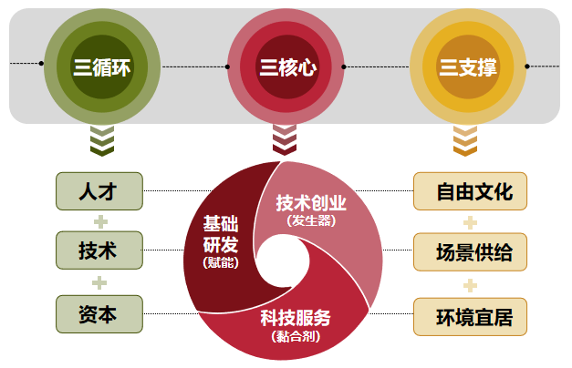

沈河区国民经济和社会发展第十四个五年规划和二〇三五年远景目标纲要

## 第一章 “十四五”时期发展基础

### 第1节 “十三五”期间主要成就

“十三五”期间是全面建成小康社会的决胜阶段。沈河区坚持以习近平新时代中国特色社会主义思想为指导，全面落实习近平总书记在辽宁考察和深入推进东北振兴座谈会上的重要讲话精神，树牢“四个意识”，坚定“四个自信”，坚决做到“两个维护”，贯彻国家、省、市决策部署，坚持稳中求进，勇于担当作为，扎实完成“十三五”规划确定的发展目标和重点任务，实现了经济社会平稳健康发展和人民生活水平持续提升。

一、综合实力稳步增长

“十三五”期间，沈河区主动应对复杂严峻的经济形势，经济实力稳步增强。一是经济总量稳健增长。2020年，地区生产总值达到977.6亿元，年均增长4.1%；服务业增加值达到858.9亿元，年均增长5.2%，占地区生产总值比重达87.9%；金融业增加值达到231.7亿元，年均增长6%。二是主要指标稳步提升。2020年，一般公共预算收入达到79.8亿元；社会消费品零售总额达到830.9亿元,总量达到全市1/4以上；进出口总额达到21.3亿元；实际利用外资达到1.1亿美元；城镇居民人均可支配收入达到5.38万元。固定资产投资累计完成958.4亿元。三是项目建设加快推进。搭建盛京皇城e家项目信息化管理平台，建立三级管家包保服务体系。提前完成盛京变电站等6个市重大基础设施建设项目征收，推动中国航发燃气轮机公司项目按时落地，激活停滞28年的富丽华大厦等11个重点项目，新增投资超300亿元。开展土地攻坚，完成11个地块征收和1817户棚改任务，处置8宗闲置土地。出让文化路北等13个地块，总成交额达82亿元。

二、产业结构持续优化

立足沈河经济发展实践，探索形成“一区四园”经济运行模式，梳理明确服务业发展细分领域，产业链培育更加精准，产业结构不断优化。一是金融产业支撑作用凸显。金融业贡献率和金融企业集聚度均居东北首位。金融商贸开发区集聚各类金融机构1831家，其中，持牌法人金融机构8家,占全市53%；拥有各类金融要素市场8家，占全市61.5%。二是文化旅游产业优化提升。突出“文化+”战略，开展“六个一批”工程，形成“一核两带四区”文化产业发展新格局。盛京皇城入选国家5A级旅游景区创建名单，中央里文化旅游景区加快建设，成立盛京皇城文商旅产业联盟，为企业搭建起跨部门、跨区域、跨行业的产业服务平台。大清不夜城、九号院等特色文化产业园（基地）加速建设。三是商贸产业转型升级持续推进。中街成功创建国家首批试点步行街，盛京龙城、益田假日世界等大型商业综合体实现业态升级。五爱、南塔千亿元市场加快建设，直播产业带荣获“全省第一批电商直播示范基地”称号。由敦煌网、速卖通搭建的跨境电商产业园加速发展，五爱—阿里国际商贸城成为辽宁首个线上市场。楼宇经济升级发展，包装策划30栋特色楼宇，亿元以上税收楼宇达到5座。“四带两圈”夜间经济格局基本形成。四是科创潜能逐步释放。依托中科院金属研究所、沈阳药科大学等科研院所资源，推进创新主体和双创平台加快发展，集聚高新技术企业110家，市级以上重点实验室83家，工程技术研究中心19家，市级以上双创平台18家，中韩大厦小微企业创业（辅导）基地被评为“国家小型微型企业创业创新示范基地”，青创空间被评为国家级“众创空间、科技孵化中心”。

三、民生事业蓬勃发展

“十三五”期间，就业、社保、教育等民生工作稳居全市前列。一是就业创业工作扎实推进。“创业求职365就业服务平台”完成升级改造，全区累计城镇新增就业6.9万人次。创业孵化基地专业化服务能力不断提升，获评“沈阳市先进创业孵化基地”称号。人力资源产业园持续做大做强，中智沈阳经济技术合作有限公司等一批人力资源企业落户沈河。二是社会保障水平逐步提高。截至2020年底，参加社会保险企业1.96万户，养老保险参保人数18.6万余人，工伤、失业、医疗、养老保险待遇不断调升，人均退休金增长至2757元，全部按时足额发放。“五位一体”社会综合救助格局基本形成，累计发放低保金1.54亿元。创新实践“先处置、后确权、再追责”工作模式，解决急难险重民生问题9029件，被《人民日报》专题报道。三是养老服务供给提质升级。建成社区养老服务站117个、区域性居家养老服务中心37个、养老机构21家，床位总量达到3443张。全市首家老年人医疗养护中心、“医养结合”居家养老服务中心新建落成，服务签约老年人突破10万人次。四是教育综合实力不断提升。建成省级示范高中3所，新建中小学2所、幼儿园4所，维修改造学校建设项目100余个，集团化学校覆盖率达100%。率先通过沈阳市教育现代化建设督导评估资格审定和沈阳市教育信息化建设督导评估，成为中国教科院教育综合改革实验区，荣获“全国中小学校责任督学挂牌督导创新区”“全国数字化学习先行区”等称号，国家义务教育质量监测结果位居全国前列、全省首位。五是卫生健康事业成绩斐然。区属15家医疗机构全部建成医联体。社区卫生服务高效供给，新建2个社区卫生服务中心，全区3个社区卫生服务中心连续4年荣获国家级称号，9个被授予省“国医堂”称号。构建新冠疫情防控体系，独立设置区疾病预防控制中心和卫生健康监督中心，应对突发重大公共卫生事件能力和水平不断提高。六是文化惠民工程全面落实。完成“国家公共文化服务体系示范区”创建工作。打造“梦想广场”、社区影院等基层服务文化休闲载体。累计举办满族文化节、读书讲座等系列文化活动3000余场，盛京皇城文化博览会、浑河之夏艺术节、“文化+最沈河”等成为彰显沈河魅力的文化品牌。七是系列品牌体育活动深入推广。全民健身氛围浓厚，健身场地和体育配套设施实现全覆盖。协办市级以上大型体育活动20余项，全民运动会、女子马拉松、徒步节等体育活动影响力不断增强。东陵武馆荣获省级“优秀全民健身组织”称号。

四、城区品质显著提升

“十三五”期间，不断补齐基础配套设施短板，市容市貌及管理水平大幅提升。一是“三城联创”工作任务圆满完成。3700余名机关干部和社区工作者、30余万名志愿者参与创城，连续三年圆满完成全国文明城市复查工作，高质量完成国家卫生城市技术评估迎检任务，顺利通过国家食品安全示范城市省级验收。二是东部地区建设全面提速。调整浑河沈河段防洪线，释放发展空间1.5平方公里，调整土地利用总体规划方案，新增建设空间约4平方公里。推行土地利用动态巡查制度，高效完成高官台东等14个棚改地块征收，累计出让土地29.2公顷，获评“全国国土资源节约集约模范县（市）”。三是基础设施配套日益完善。高标准完成802条街路养护工作；累计疏通924公里排水管渠，改造50余个积水点位；新增停车泊位7.4万个，施划停车泊位3.2万个，动静态交通压力有效缓解；新建改造各类公厕74座、垃圾转运站25座，城区污染物收运处置体系基本形成。四是老旧小区改造工作深入推进。完成295个老旧小区改造，惠及1300栋楼11.2万户居民。完成328万平方米住宅楼节能暖房工程。拆除改造老旧自行车棚6.7万平方米，建成186个“百姓乐园”和“居民之家”。完成75个电力弃管小区用电设施改造。小西小区、金生小区老旧住宅加装电梯正式投入使用。五是绿化亮化工作成效显著。园林绿地面积由2015年的1916万平方米增至2020年的2023万平方米；建成区绿化覆盖率由2015年的41.27%增至2020年的42.1%。完成16处绿地、101栋楼体夜间景观亮化。六是城区管理水平明显提升。强化城市网络化管理，确定111个责任网格，城市管理向“常态化精细管理”转变，数字化城管案件按时结案率达98%以上。完成环卫市场化改革，建立多方联动的立体监管模式，多种机械化环卫清扫和除运雪作业模式得到高效推行。智慧社区建设初具成效，全区111个社区纳入“沈河智慧E社区”微信服务平台。全面开展“楼道清洁革命、楼院整治行动”等打造美丽家园实践活动。

五、生态环境日益改善

## “十三五”期间，坚决落实中央环保督察整改要求，全力推进“蓝天、碧水、净土”工程，生态环境质量明显提高。一是环保督察和“回头看”整改任务全部完成。按期完成中央环保督察26项整改任务和282件信访案件处理，东部垃圾村治理工作获得中央环保督察组好评，人民网等多家媒体给予报道。二是空气综合治理成效显著。搭建散煤管控网格化监管体系，累计拆除燃煤锅炉237台。“散乱污”整治、建筑工地、沙场堆场等专项整治行动效果明显，空气质量优良天数年平均达268.5天。提前半年超额完成“十三五”期间二氧化硫、氮氧化物等主要污染物减排目标任务。三是水环境综合治理高效开展。全面落实河长制，推进“四方巡河”工作，完成5.6公里辉山明渠黑臭水体整治工程和8.8公里满堂河综合治理工程。完成5处水源地一级保护区风险排查整治，生活污水集中处理达到100%。四是土壤环境监管机制不断完善。积极推进净土行动，严格开展土壤污染调查和风险评估，完成东北制药六厂、东塔电镀厂等地块污染的风险管控，完成15个加油站防渗罐改造工程。

六、治理体系基本形成

“十三五”期间，深入践行“两邻”理念，共建共治共享的社会治理格局基本形成。一是平安建设成效显著。扫黑除恶专项斗争取得阶段性成果，命案防控机制运转顺畅，特殊人群服务管控到位，毒品重点整治工作经验在全国禁毒工作会议上交流推广。智慧沈河安全防控体系建设不断完善，自主研发“视频一张图”，在全市率先高质量完成“雪亮工程”。二是法律服务体系初步建成。率先打造“10分钟法律援助圈”，构建“服务中心—服务站—服务室”三级公共法律援助服务网络，公共法律服务平台、五里河街道百姓和律师视频连线等创新举措获得国家相关部委肯定。三是社区自治品牌高效运作。创新自治方法，社区议事厅、居民议事亭等专门协商机构在基层治理中作用突出。五色“装户图”排查法在防疫工作中展现创新价值。朱剪炉街道回民社区、马官桥街道福陵社区被国务院授予“全国民族团结进步模范集体”荣誉称号，南塔街道溪林社区被授予“第六届全国文明单位”。沈河区荣获“全国社区管理和服务创新实验区”等多项荣誉称号。四是社会组织成为社会治理和公共服务的重要力量。养老类社会组织高效运作。全区1111家社会组织参与“爱心服务联盟”，社会治理率超过50%，居民满意率达到90%以上。3个社区荣获“全国综合减灾示范社区”称号。五是信访稳定工作有效落实。推动城市版“枫桥经验”创新发展。依法建立11个信访长效工作机制，开展融冰行动、领导干部接访下访等活动，初访、积案、难案、缠案均得到有效化解。网上信访系统及时受理率和按期办结率均达100%。六是人大依法监督工作开创新局面。搭建“代表代言选民微平台”“人大代表工作微平台”“代表意见建议办理多方互动微平台”三方联动的民意诉求通道，建立“四办双询一联动”督办落实机制，群众反映问题得到实时解决、逐级解决。“为民工作平台”沈河模式得到全国人大肯定。七是政协民主监督成效显著。深入开展政协委员“进机关、进企业、进学校、进社区、进家庭”主题活动，聚焦盛京皇城改造、国资管理、企业服务、楼宇经济等方面，高效履行政治协商、参政议政职能。

七、改革创新持续深化

“十三五”期间，坚持向改革要动力，不断推动供给侧结构性改革，有效破除制约经济社会发展的思想和体制机制障碍。一是供给侧结构性改革不断深入。编制《沈河区供给侧结构性改革工作方案》，加快构建规模合理、结构优化的现代服务业体系。贯彻实施《沈阳市多规合一条例》，有效衔接发展目标、空间坐标和用地指标。切实推动要素平台建设，不断提高服务实体经济能力。二是营商环境持续改善。在全省率先实现33项便民事项“全区通办”，入选中国营商环境优化最佳实践案例。建成“沈河政务一站通”审批服务平台，涵盖全区2563项政务服务事项。“一窗式”政务服务沈河模式被辽宁日报、新浪网等主流媒体多次报道。率先推行“两集中、两不出”工作模式，全面开展“万人进万企”主题活动，各类平台涉企诉求办复率100%。三是政府和企事业单位改革有序推进。完成机关事业单位改革和街道行政区划调整，撤并4个街道办事处，166家事业单位精简至16家。构建“一站四所五中心”管理架构，实行条块并重的双重管理体制。完成市场监管体制改革。深化国有企业改革，建立“1+4+N”的国有资本投资管理运营模式,完成8户厂办大集体改革、13户僵尸企业处置工作以及275户国有企业人员社会化管理。四是园区体制机制改革探索深化。围绕金融商贸开发区，构建现代金融园区、皇城文旅园区、现代商贸园区、新兴科技园区“一区四园”的工作管理构架，逐步探索“小管委会+大平台公司”运营模式，在抓好产业促进、经济运行、招商引资、项目服务及指标统计等工作的同时，打破人才引进门槛，推行市场化的招聘和薪酬绩效机制。

### 第2节 “十三五”关键目标如期完成

聚焦全面建设幸福沈河，围绕打造富庶家园、精神家园、美丽家园、服务家园、平安家园“五大家园”发展目标，“十三五”规划共设置18项主要指标(约束性指标8项，预期性指标10项）。预计到2020年，14项主要指标符合规划进度要求，占比77.8%。

——打造富庶家园。“十三五”期间，地区生产总值年均增长4.1%，高于全市平均增速；服务业增加值总量持续增加，金融业增加值大幅提升；城镇居民人均可支配收入年均增长5.5%，高于地区生产总值增速。

——打造精神家园。“十三五”期间，文旅产业增加值占地区生产总值比重逐年提升。广泛开展学雷锋志愿服务，大力选树和培养先进典型。“国家公共文化服务体系示范区”创建顺利完成，文化惠民工程扎实推进，“两邻”理念深入人心。

——打造美丽家园。“十三五”期间，城区生态环境优化、基础设施完善、市容环境管理等工程取得新成就。2020年，建成区绿化覆盖率达到42.1%；主次道路机械化清扫率、主次道路湿式作业率均达100%；主次干道完好率、小巷道路完好率均保持在98%以上；提前超额完成二氧化硫、氮氧化物减排指标。

——打造服务家园。“十三五”期间，民生服务工程扎实推进，网格化管理、社会化服务水平明显提升，就业、医疗、教育、社保等服务工作全面发展。2020年，学前三年毛入学率达到100%，高中教育入学率达到99.6%；城镇登记失业率控制在4%以内。

## ——打造平安家园。“十三五”期间，安全生产、应急防灾、食品药品安全等监管能力明显增强。社会治理机制持续创新，荣获“全国社区服务创新实验区”称号。“视频一张图”“四网合一”等重点安防信息化工程扎实推进。

18项指标中，公共财政预算收入、固定资产投资、社会消费品零售总额、每千名老人拥有养老床位数量4项指标如期完成存在困难。主要原因：一是公共财政预算收入方面，首先，营业税是我区税收收入的主要来源税种，受“营改增”税制改革影响较大，2016年全区税收收入完成81.4亿元，其中营业税收入完成20.9亿元，占税收收入比重由2015年的40%降至25.7%；其次，2019年实施更大规模的减税降费政策，普惠性减税和结构性减税并举，减免税费合计10.54亿元；最后，2020年疫情期间，为保市场主体，帮助中小企业渡过难关，集中出台了一系列临时性减免税政策，对税收收入产生较大影响。二是固定资产投资方面，我区作为中心城区，部分在建项目受政策性影响未如期竣工投入运营，新开工建设储备项目较少，2020年土地费缺口达65.4亿元，拉低固定资产投资总量29个百分点，房地产投资下降53.9%，对固定资产投资指标产生巨大影响。三是社会消费品零售总额方面，“十三五”期间，形势变化对区域经济发展的影响较大，特别是面对新冠肺炎疫情，批发、零售、住宿、餐饮等传统贸易业在疫情期间经济活动基本停滞，经营损失无法弥补；加之我区社会消费品零售总额基数较大，保持高速增长存在一定困难。四是养老床位供给方面，沈河区人口老龄化程度加深，受政策、市场、投资、土地和养老观念等因素影响，每千名老人拥有养老床位未达到计划目标。

### 第三节“十三五”期间发展经验及问题

“十三五”期间，全区上下团结奋斗、拼搏进取，在产业发展、民生事业等方面取得了显著成就，在基层治理、文化惠民等领域先行先试，获得了诸多宝贵经验。

第一，坚持党的全面领导，推动理念创新。健全党委总揽全局、协调各方的党的领导制度体系，坚持把党的全面领导落实到全区治理的各领域各方面各环节，不断提高贯彻新发展理念的能力和水平，深入践行习近平总书记在考察多福社区时提出的“与邻为善、以邻为伴”的重要指示精神，党的政治领导力、思想引领力、群众组织力、社会号召力在经济社会发展中的作用得到充分发挥。

第二，坚持改善民生福祉，建设幸福沈河。始终围绕以人民为中心，全面推进幸福沈河建设，开创基层治理新局面。以打造幸福社区为核心，扎实提升就业、就医、就学、养老、救助、安全等综合服务水平，全力创建高品质城区，不断实现人民对美好生活的向往。

第三，坚持产业做大做强，抓实招商引资。立足稳中求进总基调，围绕全市产业部署，明晰产业定位，依托金融商贸开发区、五爱、南塔、中街等重点区域，推进产业链招商、平台招商、园区招商、以商招商，加快引进一批建链、补链、延链、强链项目，集聚龙头企业，配齐资源要素，释放产业集群活力。

第四，坚持区域个性挖掘，塑造特色优势。充分发挥中心城区区位优势、历史文化资源优势、超级IP优势，因势利导、创新突破，扎实推进优势特色资源整合开发，塑造社区治理、文化赋能、金牌教育等品牌形象，扎实推动“外塑形象、内培动力”，力促发展价值实现。

第五，坚持推进改革开放，优化营商环境。实施“走出去”“请进来”战略，积极扩大开放领域，提升开放质量。

全面贯彻落实供给侧结构性改革工作部署，探索构建高质量发展的体制机制，深化“放管服”改革，推行“管家式”服务模式，持续优化营商环境。

“十三五”期间，虽然全区在经济社会发展过程中取得了显著成就，但面向未来、紧跟趋势、对标自省，仍面临一定问题。

第一，有为政府和有效市场尚未有效融合。对标先进地区中心城区，市场的资源配置作用和导向作用没有充分发挥，政府与市场的融合发展效能有待挖掘，要素市场活力集聚与释放仍需持续发力，亟需加快激发内生动力和新旧动能转换，推动实现更高效益、更高质量发展。

第二，主导产业转型升级步伐略显缓慢。金融、文旅、商贸三大主导产业业态相对传统，新兴业态布局相对滞后。金融产业融通较弱、功能不足，文旅资源挖掘不深、利用不足，商贸产业链条缺位、创新不足，主导产业项目策划包装不精细，围绕产业链招商方式不多，成效尚不明显，产业要素配置仍然较为低效粗放，亟需加强产业链精准引培工作，切实推动产业结构转型升级。

第三，创新助力发展作用不明显。科技创新资源产业价值挖掘不够深入，创新创业孵化载体及科技服务体系建设进程仍需加快，高校及科研院所成果就地转化能力有待提高，现代化科技手段在生产生活过程中的运用和保障较为薄弱，亟需强化科技创新思维，推进创新链与产业链融合发展。

第四，社会管理与人民对美好生活的期待仍有差距。对标先进地区中心城区，社会事业、平安建设、城市运行等方面仍有较大提升空间，教育、卫生、养老等社会资源供给不均衡，亟需超前谋划，精准布局，有效提高公共服务均等化水平。

第五，中心城区城市形象及功能仍需完善。城区面貌还需持续改善，城区绿化亮化管护水平有待提升。重点区域基础设施建设仍需升级，“新基建”超前规划不足，智慧城市建设水平仍有提升空间，品牌特色楼宇形象不够突出，亟需加快特色楼宇品牌建设，布局智慧化、数字化管理项目，更高效地承载现代化中心城市运行功能。

## 第二章 “十四五”时期发展环境

“十四五”时期是我国从全面建成小康社会向基本实现社会主义现代化、实现“两个一百年”奋斗目标的历史交汇期，沈河区需放眼国际复杂之形势、综观国内转型之态势、举目辽宁振兴之局势、近看沈阳发展之阵势，认真谋划“十四五”时期提质升级的发展位势。

放眼国际，世界正面临“百年未有之大变局”，国际形势日趋复杂，国际环境处于合作或对立、开放或封闭的不稳定性不确定性中，世界多极化在曲折中发展，机遇和挑战并行。全球正处于新一轮科技革命和产业变革的转折期，创新全球化加深与逆全球化加速蔓延并存，科技实力的国际间竞争趋向白热化，技术的局部甚至全面封锁将成为我国开展国际创新合作面临的新常态。新冠疫情加速了全球产业链、供应链的重构步伐，局部冲突与区域经济一体化将长期并存，打造坚实稳固的伙伴关系、构建“人类命运共同体”、谋求和平与发展仍然是时代主题。

综观国内，中国经济已进入从高速增长转向高质量发展的新阶段，加快经济发展质量变革、效率变革、动力变革，实施创新驱动发展战略，深化供给侧结构性改革，构建现代化经济体系已成为新时代高质量发展要求。提升供给体系对国内需求的适配性，形成需求牵引供给、供给创造需求的更高水平动态平衡，将加快形成“以国内大循环为主体，国内国际双循环相互促进”的新发展格局。伴随新一轮经济地理重构，中心城市“虹吸效应”和“赋能效应”同时存在，优质高效的要素资源成为提升区域竞争的核心。

举目辽宁，以习近平同志为核心的党中央高度重视东北振兴，辽宁在国家发展大局中的战略地位更加重要，全面落实习近平总书记提出的优化营商环境、培育壮大新动能、科学统筹精准施策、支持生态建设和粮食生产、深度融入共建“一带一路”、补齐民生领域短板六个方面要求，成为辽宁长期坚持的使命任务。沈阳、大连在全省经济社会发展中的牵动作用更加突出，将形成以沈阳、大连“双核”为牵引的“一圈一带两区”区域发展格局，开创营商环境好、创新能力强、区域格局优、生态环境美、开放活力足、幸福指数高的振兴发展新局面。

近看沈阳，将以创建国家中心城市为目标，打造国家现代综合枢纽、国家先进制造中心、综合性国家科学中心、区域性金融中心、区域性文化创意中心，持续提升经济发展质量、效益和活力，加速完善要素市场化配置体系，大力推动产业链与创新链深度融合，不断壮大战略性新兴产业集群、推动新经济业态以及现代服务业蓬勃发展。自贸区、自创区、高新区等多主体联动、全方位推进的对外开放和创新发展局面正在加快形成。金融、科技、交通、信息、文化、贸易和对外交往的功能属性不断提升，为沈河在“十四五”时期推动经济社会高质量发展提供了战略导向。

综合来看，沈河区作为沈阳市中心城区优势明显，“3+2”产业结构清晰明确，“一区四园”经济管理工作架构运行良好，主导产业集聚效应持续放大，盛京皇城5A级景区建设步伐不断加快，践行“两邻”理念焕发生机，“文化赋能、两轮驱动”战略深入实施。未来五年，应充分考量区域人口规模，统筹推进产业链升级、产业生态构建、社会民生发展、品质城区建设、区域协同合作，主动谋划配齐中心城区城市功能和市场要素，形成产业发展、城市建设和人口集聚的良性循环，加快建设国家中心城市现代化中心城区。

## 第三章 “十四五”时期总体思路与发展目标

### 第一节 指导思想

高举中国特色社会主义伟大旗帜，深入贯彻党的十九大和十九届二中、三中、四中、五中全会精神，坚持以马克思列宁主义、毛泽东思想、邓小平理论、“三个代表”重要思想、科学发展观、习近平新时代中国特色社会主义思想为指导，深入落实习近平总书记关于东北、辽宁振兴发展的重要讲话和指示批示精神，全面贯彻党的基本理论、基本路线、基本方略，统筹推进“五位一体”总体布局，协调推进“四个全面”战略布局，坚定不移贯彻新发展理念，认真贯彻省委、市委要求部署，坚持稳中求进工作总基调，准确把握建设国家中心城市现代化中心城区的新目标，积极服务融入辽宁加快构建“一圈一带两区”区域发展格局和沈阳建设国家中心城市推进“一枢纽四中心”建设，以推动高质量发展为主题，以深化供给侧结构性改革为主线，以优化营商环境为基础，以改革开放创新为动力，以满足人民日益增长的美好生活需要为根本目的，以全面从严治党为保障，在国内大循环、国内国际双循环的新发展格局中，统筹发展和安全，继续实施文化赋能、两轮驱动发展战略，构建“一廊、一带、一通道、四园区”空间格局，形成功能完备、产城互动、东西协调的发展态势，着力布局“金融发展、文商旅融合、科技创新赋能”三个生态圈，重点建设金融中心和文化创意中心，同步推进现代商贸中心、新兴产业培育中心、优质教育医疗服务中心和现代时尚宜居中心建设。努力实现更高质量的经济和社会发展，奋力推进新时代全面振兴全方位振兴取得新突破，为全面建设社会主义现代化国家开好局起好步贡献力量。

### 第二节 基本原则

推动“十四五”时期经济社会发展，必须坚持问题导向、目标导向、结果导向，把握好以下原则。

——坚持党的全面领导。健全完善党领导经济社会发展的体制机制，善于从习近平新时代中国特色社会主义思想中找立场、找观点、找方法，不断提高贯彻新发展理念、构建新发展格局的能力和水平，为实现高质量发展、新时代全面振兴全方位振兴提供根本保证。

——坚持以人民为中心。坚持人民主体地位，牢牢把握共同富裕方向，始终做到发展为了人民、发展依靠人民、发展成果由人民共享，维护人民根本利益，激发全体人民积极性、主动性、创造性，促进社会公平，增进民生福祉，不断实现人民对美好生活的向往。

——坚持新发展理念。立足中心城区的区位优势和功能优势，把新发展理念贯穿发展全过程和各领域，深入实施创新驱动发展战略，构建新发展格局，切实转变发展方式，推动质量变革、效率变革、动力变革，实现更高质量、更有效率、更加公平、更可持续、更为安全的发展。

——坚持改革开放。突出改革推动、开放带动，坚决破除体制机制障碍，广泛汇聚资本和资源，持续增强发展动力和活力。加强思想建设，把解放思想贯穿改革开放全过程，坚持用科学理论武装广大党员干部头脑，使全区党员干部始终保持统一的思想、开放的思维、改革的决心、强大的凝聚力战斗力。

——坚持科技引领发展。坚持创新在现代化建设全局中的核心地位，把科技创新作为沈河发展的战略支撑，拥抱新科技、运用新科技、融合新科技，切实提升科技对产业升级、社会治理、民生保障等方面的支撑能力，让科技赋能经济发展，改变群众生活体验。

——坚持尊重市场主体地位。进一步厘清政府和市场边界，减少政府对资源配置和微观经济活动的直接干预。着力优化营商环境，树立全方位全天候全过程服务理念，激发市场主体活力，构建亲清新型政商关系。弘扬企业家精神，理解尊重爱护支持企业家，让企业家经济上有效益、社会上有地位、政治上有荣誉。

——坚持系统观念。加强前瞻性思考、全局性谋划、战略性布局、整体性推进，统筹国内国际两个大局，办好发展安全两件大事，着力固根基、扬优势、补短板、强弱项，注重防范化解重大风险挑战，加快推进治理体系和治理能力现代化，实现发展质量、结构、规模、速度、效益、安全相统一。

### 第三节 战略定位

“十四五”期间，沈河区立足外部发展环境和区情实际，着力挖掘产业辐射潜力和城市宜居红利，确立以金融中心和文化创意中心建设为核心，现代商贸中心、新兴产业培育中心、优质教育医疗服务中心、现代时尚宜居中心建设共同推进的战略定位，展现现代化中心城区新形象，助力沈阳国家中心城市建设，提升沈河区在沈阳现代化都市圈的首位度和贡献度。

——金融中心。立足现有金融资源优势，聚焦落实沈阳区域性金融中心建设的核心任务，以做强做大金融发展生态圈为导向，以打通金融功能全链条为主线，进一步集聚新业态金融机构，加大金融制度创新、产品创新、人才创新，推进金融开放升级，布局高水平资本要素交易平台，强有力服务区域主导产业发展，提升沈河区在东北地区的金融要素组织能力和品牌影响力，释放金融服务实体经济新活力。

——文化创意中心。抢抓沈阳建设区域性文化创意中心的历史机遇，依托深厚的历史文化积淀和丰富的旅游资源，以优化文商旅融合生态圈为导向，坚持构筑文商旅融合新业态的发展主线，突出文化赋能理念，实施“文化+”战略，强化产业链思维，落实文化产业数字化战略，深入挖掘整理盛京文化、民国文化等历史文化核心价值，加强特色文化创意产品开发和营销资源整合，培育创意产业，打造文化创意新高地。

——现代商贸中心。围绕沈河商贸载体多、发展历史久的优势，加快对接商贸新经济、新场景、新业态，推动沈河从传统商贸中心向现代商贸中心跃升。在“双循环”新发展格局下，搭建高水平开放平台，聚焦智慧仓储物流领域，推动商贸产业跨界融合孕育新动能、补链延链集聚新动能、区域联动释放新动能。

——新兴产业培育中心。依托区内高校科研院所资源集聚和创新人才荟萃优势，着力培育科技创新赋能生态圈，积极培育数字经济和农业科技两大新兴科技创新产业，大力推进产业主体集聚，不断加强场景要素应用，打通科技创新赋能产业发展路径，进一步强化科技创新服务支撑能力，不断提高科技助力经济社会发展作用，以科技创新催生新发展动能。

## ——优质教育医疗服务中心。以打造高品质现代化教育强区为目标，推进学前教育优质普惠发展，义务教育优质均衡发展，高中教育优质特色多样化发展，全面提升区域教育总体实力和对外影响力。加强公共卫生体系建设，深化医药卫生体制改革，完善疾病预防控制体系，加快优质医疗资源扩容和区域均衡布局，让广大人民群众享有公平可及、系统连续的预防、治疗、康复、健康促进等健康服务。

——现代时尚宜居中心。坚持把“两邻”理念充分融入现代化城区建设实践，大力实施“文化+”战略，推动城区软件和硬件双提升，不断满足人民对美好生活的向往，使和谐幸福、生态绿色、文化先进、智慧便利元素成为沈河城区发展的无形标签和集聚各类人才的重要名片，打造历史与现代交相辉映、传统与时尚完美融合的现代化时尚宜居城区。

### 第四节 发展目标

## 二〇三五年远景目标。党的十九大对实现第二个百年奋斗目标作出分两个阶段推进的战略安排，即到二〇三五年基本实现社会主义现代化，到本世纪中叶把我国建成富强民主文明和谐美丽的社会主义现代化强国。展望二〇三五年，沈河区将在沈阳市率先实现现代化，城区品位和发展能级再上新水平，进入国家中心城市中心城区第一集团行列。综合实力大幅跃升，经济总量迈上新台阶，产业转型升级取得重要进展，营商环境、生态环境、生活环境、产业生态更加优化，建成高效包容、美丽宜居、特色赋能的高能级高品位中心城区；对外开放水平持续提升，现代化经济体系趋于成熟，创新沈河、数字沈河建设走在全市前列，建成金融强区、文旅大区、商贸富区、教育名区、健康沈河，各项社会事业蓬勃发展，市民素质和社会文明程度不断提高；对外开放和区域协同的新局面基本形成，对外合作深度明显增强，辐射力、带动力、影响力大幅提升，发展首位度保持区域前列；人民生活更加美好，共同富裕取得更为明显的实质性进展。

## “十四五”时期发展目标。围绕推动沈阳新时代全面振兴全方位振兴取得新突破、努力建设国家中心城市的总目标和建设好沈阳现代化都市圈，高水平推进经济、科技、产业、民生、社会等提质升级工作，到2025年，基本配齐与沈阳建设国家中心城市地位相适应的发展要素，人口的数量、质量和结构与现代经济、社会发展的适应程度显著提高，人民对美好生活的需要、城市对现代产业的要求、社会对精神文化的诉求不断得到满足，基本建成高能级、高质量、高品质国家中心城市现代化中心城区，为我区2035年率先实现社会主义现代化奠定良好基础。

## 具体目标：

——经济综合实力显著增强。经济发展取得新成效，经济结构更加优化，“一区四园”支撑作用显著增强，区域创新引领、辐射带动、协同发展水平不断提升，地区生产总值、服务业增加值、社会消费品零售总额、一般公共预算收入等主要经济指标增速高于全市平均水平，经济综合实力位居全国副省级城市中心城区前列。

## ——全区营商环境更加优化。积极对标国内一流标准，持续推进“一网通办”，不断畅通政企沟通渠道，持续加快涉企审批服务标准化、一站式进程，着力营造“办事方便、法治良好、成本竞争力强、生态宜居”的营商环境，为各类市场主体投资兴业营造稳定、公平、透明、可预期的发展生态，不断提高营商环境市场化、法治化、国际化水平。

## ——市场主体活力充分激发。以市场主体获得感为评价标准，构建覆盖企业全生命周期的服务体系，对新产业新业态实行包容审慎监管，各类市场主体健康蓬勃发展，民营企业在市场经济中的主体地位进一步巩固。市场主体规模超过15万户，年均增长不低于7%，其中，企业法人户占比达到40%以上，全区规上企业总数达到1300户以上，各类金融机构2100户以上。

## ——创新驱动要素集聚释放。科技创新资源加速流动，产学研合作有序开展，创新主体支撑作用不断提升，创新创业生态环境持续优化，打造一批具备较强研发创新、创业孵化功能的产业技术创新平台、新型研发机构、专业产业创新园区等载体，人才队伍有效集聚，创新效率和创业活力持续提升，科技创新不断赋能产业迭代升级，创新成果更多更好地惠及民生事业。

——改革开放格局纵深推进。积极融入内外“双循环”发展格局，持续深化体制机制改革，以文化作为吸引力和驱动力，打造更利于改革开放的环境氛围，使市场主体更加充满活力。加强与“一带一路”沿线国家和RCEP国家贸易合作，增强开放意识，拓展开放格局，基本形成更高水平开放型经济新体制。

——产业竞争优势更加凸显。产业基础向高级化发展，产业链现代化水平明显提高，产业价值不断涌现，产业强区之本更加牢固。金融、文旅、商贸三大主导产业逐步完成补链、延链、强链，新兴科技产业逐步实现主体集聚、业态创新、融合赋能，“文化+”战略赋能主导产业不断升级。

——居民生活质量稳步提高。稳就业保民生工作有序推进，居民可支配收入稳定增长。社会救助、养老服务工作全方位高水平推进，公共服务体系和社会保障体系实现全覆盖，社会公共服务资源布局更加合理、供给更加有效，公共服务水平全国领先，社会文明程度得到新提高，社会主义核心价值观深入人心。

## ——教育医疗品质显著提高。教育资源更加均衡优质、丰富多样，各级各类教育优质协调发展，教育综合改革取得突破进展，区域教育总体实力明显增强，形成在省市和全国有影响力的教育品牌。基本医疗卫生服务和资源实现均衡布局，全面建成区域医联体，社区医院、智慧医疗配置齐全，中医药服务体系不断完善，突发公共卫生事件应对能力全面提升，区域医疗卫生服务中心影响力不断加强。

——品质城区功能不断升级。城市绿色生活生产环境综合承载能力显著提升，生态文明建设取得新进步。高效推进重点道路建设、综合管廊建设、海绵城市建设、智慧城市建设、城市更新改造、生态环境治理等重点工程，加强历史建筑街区保护开发，提升历史文化街区、核心商业区和生态旅游区建设水平，为城市发展注入时尚潮流、创意元素，达到与国家中心城市现代化中心城区功能相匹配的标准要求。

## ——社会治理效能显著提升。构建党委领导、政府负责、民主协商、社会协同、公众参与、法治保障、科技支撑的社会治理体系，数字化社会治理体系建设延伸到政府管理、基层协同、法治保障等各领域、全过程。防范化解重大风险、应对突发公共事件、防御自然灾害等能力明显提升，网格化管理、信息化支撑、精细化服务、法治化保障的现代化治理模式成效显著，基本形成以“两邻”理念为引领的共建共治共享的现代化治理格局。

## 表1  “十四五”时期经济社会发展主要指标

| 指标类型 | 序号 | 指标名称 | “十四五”预期目标 | 属性 |
|---|---|---|---|---|
| 经济综合实力 | 1 | 地区生产总值 | 年均增长5-7% | 预期性 |
| 2 | 一般公共预算收入 | 年均增长2% | 预期性 |
| 3 | 社会消费品零售总额 | 年均增长5%左右 | 预期性 |
| 4 | 固定资产投资 | 年均增长3%左右 | 预期性 |
| 产业竞争优势 | 5 | 服务业增加值 | 不低于GDP增速 | 预期性 |
| 6 | 金融业增加值 | 320亿元 | 预期性 |
| 7 | 商贸业营业收入 | 1000亿元 | 预期性 |
| 8 | 文化旅游业营业收入 | 100亿元 | 预期性 |
| 创新驱动要素 | 9 | 科技型中小企业数量 | 350家以上 | 预期性 |
| 10 | 高新技术企业数量 | 200家以上 | 预期性 |
| 11 | 省级以上孵化载体 | 15家以上 | 预期性 |
| 社会民生质量 | 12 | 城镇居民人均可支配收入 | 与经济增长同步 | 预期性 |
| 13 | 城镇登记失业人数 | 17000人以内 | 约束性 |
| 14 | 义务教育机构数量 | 50个 | 预期性 |
| 15 | 全区人均期望寿命 | 80.98岁 | 预期性 |
| 16 | 居民健康素养水平 | 30% | 预期性 |
| 17 | 每万人拥有养老服务床位数 | 359张 | 预期性 |
| 18 | 每千人公共文体服务设施面积 | 52平方米 | 预期性 |
| 品质城区建设 | 19 | 人均道路面积 | 11.2m2/人 | 预期性 |
| 20 | 智慧城市重点项目 | 5 个 | 预期性 |
| 21 | 5G网络覆盖率 | 100% | 预期性 |
| 22 | 固定污染源主要大气污染物排放控制 | 完成市政府分解指标 | 约束性 |
| 23 | 固定污染源主要水污染物排放控制 | 完成市政府分解指标 | 约束性 |
| 24 | 全区绿化覆盖率 | 42.3% | 约束性 |

## 第四章 “十四五”时期空间布局与优化

坚持功能升级、错位发展、产业集聚原则，在优化产业空间形态基础上，不断完善城区功能、推动东西协调、实现产业价值、塑造品牌符号，构建“一廊、一带、一通道、四园区”的发展空间格局和功能布局。

“一廊”：

——金廊都市现代商业聚集走廊。以青年大街为中轴，东至奉天街，南至浑河，西至三经街，北至北京街与长大铁路交汇处，全长7.2公里，规划面积约10平方公里，集聚分布有新地中心、市府恒隆广场、华强商业金融中心、宝能环球金融中心、嘉里中心、夏宫城市广场等众多品质商贸中心和特色楼宇。围绕“集聚与聚焦、价值与效益、品质与品牌”，加快提升金廊高品质的商业要素配置，形成沈阳乃至辽宁省具有人气聚集、融通资本、商业繁荣、传播文化、形象标杆等功能的“中央都市走廊”，配齐国家中心城市的金融中心和商业中心功能。
 “一带”：

——浑河北生态景观带。依托浑河北岸，联通新开河、南运河、辉山明渠、满堂河等河流，东至三环高速公路，西至青年桥，南至浑河北岸，北至沈水路，全长14公里，集聚分布有五里河公园、盛京大剧院等生态休闲要素。围绕“以人为本、以绿为底、以水为脉、以文为魂”，依托文体资源、生态载体，释放旅游观光、文化创意、体育赛事、生态康养、休闲娱乐等业态融合价值。西段重点提升五里河公园和盛京大剧院两大品牌载体利用效率，布局文化创意、体育赛事、艺术表演等项目；东段加速东部产城融合发展，布局市民文化广场、康养休闲主题公园、亲水游乐园等项目，提升沈阳建设国家中心城市的生态宜居功能。

“一通道”：

——区域东西联动大通道。发挥东西快速干道交通便捷优势，不断完善沈河域内西部和东部路段的干道功能，成为联络交通、协同发展的主动脉以及沈河西部与东部协调的大通道。围绕沈阳市总体规划布局，配合做好干道、桥梁以及东陵路、哈尔滨路等周边路网的联动，结合区内旅游景点、商贸枢纽、经济园区等发展需求，重点完善周边辅路、停车场等交通基础配套设施，探索布局智慧交通应用场景，联动东部加速推进产城融合发展。

“四园区”：

——现代金融园区。东至小北关街经小西路接奉天街，西至南三经街经北三经街接青年北大街，南至浑河中心线，北至沈阳北站铁道中心线，规划面积11.9平方公里。按照“集聚、创新、开放”发展原则，集聚新业态金融机构、功能性金融机构、金融要素平台等，丰富金融人才、研发机构、金融科技企业等创新资源，持续优化金融生态建设，推进金融对外开放和区域协同发展，强化金融服务本地及周边地区实体经济功能，建成区域金融中心。

——皇城文旅园区。东至东顺城街，西至西顺城街，南至南顺城路，北至北顺城路，规划面积1.69平方公里。以充分释放文旅产业价值为导向，深入挖掘文化内涵，推进历史文化资源保护利用，引进文旅运营、文化创意、智慧文旅等企业和项目，布局“文化+”业态。创建盛京皇城国家5A级景区，发挥中街国家级步行街影响力，打造区域文商旅产业融合发展核心区。

——现代商贸园区。东至凌云街，西至风雨坛街，南至浑河河道中心线，北至南顺城路，规划面积21.07平方公里。立足区位优势和商圈集聚的资源基础，坚持“智慧升级、模式创新、产业配齐、跨界融合、品牌塑造”的发展模式，完善商贸产业链，探索线上线下相结合，促进内外贸协同发展，推进五爱、南塔千亿级商圈建设，打造传统商贸向现代商贸转型先导区。

——新兴科技园区。东至东三环高速公路，西至佳和项目规划红线，南至浑河河道中心线，北至方凌路经凌云街、第三粮库铁道线、东贸路接沈吉铁路线，规划面积23.76平方公里。聚焦战略新兴产业，重点发展数字经济、农业科技两个细分领域，加快布局新型基础设施建设。搭建创新型平台载体，推动数字产业园区建设，促进“人产城”协同发展，建设智力密集型产业集聚区。

## 图1 沈河区“一廊一带一通道四园区”空间布局示意图

## 第五章 “十四五”时期生态圈构建与发展

## 围绕沈河区“金融中心、文化创意中心、新兴产业培育中心”的战略定位，立足破解金融中心建设中新兴业态布局不完整、金融功能释放不充分、金融要素联动不紧密的问题；破解文商旅融合发展中文化、旅游、商贸资源相互转化和融合带动效率不高、耦合深度不够、产业价值不大的问题；破解科技创新赋能产业发展中的载体建设薄弱、政策支持不精准、本地转化率不高的问题，着眼于新发展格局下沈河主导产业发展要素和环境因素链接，实现不同业态主体之间的融合协同发展，以“生态赋能型”发展模式引领高质量发展。

——做强做大金融发展生态圈：

提升金融发展生态管理水平。围绕建立数据统计和深化对话机制的工作方法，梳理金融生态体系情况，推动银企良性互动。一是加强金融业综合统计。完善金融数据的收集与整理工作，制定和完善金融产业名录，建设基础数据库。二是完善金融机构与政府部门对话机制，通过召开银企对接会、金融发展座谈会等多种形式交流互动，精准了解并快速响应金融机构及企业发展诉求。三是定期进行金融生态建设评估，多维度诊断金融机构、金融市场、金融产品要素、金融环境、金融监管等发展情况，形成《沈河区金融生态评估报告》。

注重金融发展生态规划设计。围绕打造“全国优化金融生态核心功能区”，构建“产业核心生态+产业服务生态+政府服务生态”的金融发展生态体系，完善以“一行两局”为引领，以总部型机构为主体，以非银行金融机构为补充，以金融中介、金融外包为产业支撑，以行业监管和产业促进等政府服务为保障的生态圈格局，着力配齐金融要素平台，推进要素市场建设，推动传统金融和新兴金融协同融合，发挥金融资源整合共享、优化配置和辐射带动作用。

做实金融发展生态支撑项目。全力推进传统金融转型、新兴业态培育、要素平台搭建、资本市场建设、金融对外开放五大金融生态建设工程。一是传统金融机构平台化转型工程。支持总部金融机构通过内部孵化分立和外部合作对接，孵化培育消费金融、财富管理、科技金融等金融业态。二是新兴金融业态引培工程。重点招引和培育供应链金融、金融科技、绿色金融等新兴业态项目。三是要素平台建设工程。搭建“一塬三平台”运营体系，推动易金融数据塬、数据管理平台、金融产品平台、企业服务平台建设。四是资本市场建设推进工程。积极推进沈阳联合产权交易所、辽宁股权交易中心、辽宁金融资产交易中心、农村综合产权交易中心等资本要素市场提档升级。五是金融生态开放融通工程。加强持牌外资金融机构和外币股权投资基金项目的引进，积极探索开展跨境金融业务。

图2 沈河区“十四五”时期金融发展生态图

——优化文商旅融合生态圈：

强化文商旅融合业态评估。重点开展产业业态价值评估、企业跟踪梳理等系列工作。一是全面梳理研究清前文化、民国文化、商贸文化等，做好文化内涵价值发现。二是开展资源生态元素整合，评估文商旅IP产业价值和品牌形象，开展IP矩阵、企业载体等资源的互动分析。三是搭建文商旅产业数据共享平台，关注住宿业、餐饮业、商贸业等关联企业发展情况，做好产业发展趋势和规模研判。

探索文商旅融合生态路径。围绕“人产城”和“文商旅”融合发展，推进文化产业数字化战略，构建文商旅“核心IP+产业业态+配套业态”融合发展生态。深入挖掘盛京皇城历史文化资源，推动五爱南塔商圈品质提升和功能升级，联动沈阳现代化都市圈旅游资源，围绕“超级IP、次级IP、联动IP”梯度矩阵，强化“餐饮、住宿、购物、娱乐、商务”等配套业态支撑作用。培育文旅综合体、网红经济、数字文创、智慧文旅等新兴业态，实施文化产业数字化战略，实现以文带旅、以旅促商、以商养文的良性循环。

## 推进文商旅融合生态支撑项目。着力推进一批重点项目，助力文商旅融合生态“升维”建设。一是实施文商旅融合发展工程，依托文商旅产业联盟等组织，打造“业界共治”平台，推动产业资源共享、跨界合作、融合发展。二是实施文商旅产业链精准招商工程，聚焦产业细分领域，实施精准引培。三是实施文商旅IP更新提升工程，推进“文化+”“数字化”战略，做好文化价值与旅游、商贸、数字技术等要素的结合，布局新场景、增加新业态、开发新产品、孵化新IP。四是实施文商旅空间品质提升工程，发挥皇城、五爱、南塔等载体集聚优势，提升文旅、商贸空间品质、载体功能，打造文商旅融合消费新场景。

## 图3 沈河区“十四五”时期文商旅融合生态图

——培育科技创新赋能生态圈：

## 盘点科技创新赋能生态要素。围绕科技创新生态建设，强化对科技创新“主体+载体+环境”要素的盘点与评估。一是立足产业链全景和科技创新生态建设，做好关键企业资源库和创新载体资源库的建设和更新。二是重点关注区内现有科技型企业的校企产学研合作情况，强化对重点企业、创新平台、人才团队等资源的跟踪梳理。三是对标省市要求和先进城市发展，定期从战略规划、工作体系、业态布局、场景供给等各个方面进行全面评估，发布科技创新要素和场景需求机会清单。

## 谋划科技创新赋能生态战略。围绕创建新兴产业培育区目标，把构建科技创新生态摆在重要位置，系统设计科技创新发展的顶层战略。从“基础研发+技术创业+科技服务”三核心、“人才+技术+资本”三循环和“自由文化+场景供给+环境宜居”三支撑等方面谋划科技创新生态建设。积极对接参与省市科技创新工作，充分发挥金融科技、产业金融等方面的赋能优势，不断释放现代商贸、智慧文旅、农业科技等方面场景潜能，提升科技创新资源、场景和生态的解构和重构水平。

实施科技创新赋能生态工程。坚持创新赋能产业升级的生态思维，切实提升科技创新赋能生态在现代化中心城区建设中的助推作用，重点实施三大科技创新工程。一是推进科技创新企业培育工程。围绕主导产业链重点实施民营企业、高新技术企业、高成长企业、平台化大企业四大培育计划，着力打造创新型企业群落。二是推进创新创业载体优化升级工程。依托区内楼宇资源和创新资源，布局一批高能级的研发创新平台和创业孵化载体，推动区内外科技成果本地转移转化。三是推进创新创业环境优化工程。围绕科创产业加强高水平创业人才及团队的引留培用，强化科创专项政策和应用场景支持，充分发挥科技金融资源优势，营造充满活力的双创氛围。

图4 沈河区“十四五”时期科技创新赋能生态图

## 第六章 “十四五”时期重点任务

### 第一节 构建产业生态新体系

围绕金融服务、高端商务、文化旅游、科技研发等国家中心城市核心功能，抢抓产业链、供应链重构机遇，重点发展金融、文旅、商贸三大主导产业和数字经济、农业科技两大新兴科创产业，推进实施“文化赋能”战略，锚定形成金融支撑、文商旅融合、科技助力发展的产业结构体系，精准擘画服务业细分领域发展蓝图，持续做强主导产业优势，不断提升产业生态现代化水平，有效助力沈阳现代化都市圈建设并更好发挥国家中心城市作用。

一、打通金融功能全链条

聚焦沈阳区域性金融中心建设，围绕“集聚、创新、开放”的发展路径，健全具有高度适应性、竞争性、普惠性的现代金融体系，助力沈阳现代化都市圈金融市场能级提升，力争全区金融业增加值在全市占比达到50%以上。

（1） 金融主体内培外引

1.构建金融机构引培体系。一是加大金融机构招商引资力度，促进社会各界协同招商，跟踪并争取新设立金融机构落户。二是营造金融业健康规范的营商环境，提高服务质量，打造政策洼地，促进金融机构做大做强。三是推动供应链金融、区块链金融等新金融模式与传统金融业态结合，重点引进大数据、云计算、人工智能等金融科技企业。

2.改革创新金融服务产业。一是推动银行类金融机构业务创新，积极开展知识产权质押贷款、股权质押贷款、供应链贷款等新型信贷业务，探索“银行+PE/VC（银行+私募股权投资基金/风险投资基金）”业务模式，开展投贷联动试点工作。二是推动证券业多元业务开展，重点支持证券公司、期货公司等开展资本市场服务、财富管理等新业务。三是鼓励保险业功能提升，推动保险机构深耕细分市场，推出养老保险、健康保险、责任保险、消费保险、物流保险、企业财险等多元化产品，加强再保险领域的创新力度。

3.集聚新兴业态金融机构。一是创建供应链金融示范区，重点引进由电商平台、物流企业、产业巨头、财务软件企业等平台化大企业建立的综合性供应链金融服务公司和嵌入式配套服务企业。二是构建科技金融服务矩阵，鼓励区内头部金融机构探索设立科技金融子公司、科技金融专营机构、科技担保、科技保险等机构，重点推出科技信贷和科技保险“组合拳”。三是推进金融科技应用发展，重点布局消费金融、大数据征信、智能投顾、区块链金融等新型金融业态，积极对接腾讯等龙头企业金融科技项目。

4.发展功能性金融机构。一是做大金融机构总部集群，持续吸引国内外银行、证券、保险金融机构在区内设立法人总部或区域总部，支持法人机构拓展布局，重点支持盛京银行加快A股上市步伐，支持辽宁振兴银行高起点运营，推动有条件的地方法人银行申请投贷联动试点。二是丰富功能性金融机构门类，支持资金托管中心、资产管理中心、信用卡中心等基础功能性机构落地发展，引进银行卡清算机构、养老金管理、健康保险等新型专业性金融机构。三是构建多层次金融机构体系，重点支持小贷、担保、融资租赁、保理等金融机构减量增质和兼并重组。

5.完善金融要素服务平台。一是充分发挥沈阳联合产权交易所、农村综合产权交易中心、辽宁金融资产交易中心、辽宁股权交易中心“一所三中心”平台功能，打造东北区域资本要素交易市场。二是畅通金融要素流通对接渠道，面向企业成长全周期全门类金融需求，构建“债券融资服务+股权融资服务+增值服务+政务信息服务”于一体的金融要素市场服务体系。三是围绕金控集团、银信互联、辽宁云创、农商行等机构，推动多门类金融基础设施建设，构建一站式金融服务平台矩阵，比照广东中小企业融资平台模式，加快推进易金融数据塬服务平台建设，提升企业融资对接效率。

（二）金融创新能力提升

1.推动金融产品创新。一是鼓励区内金融机构与国内外知名金融研究院、金融科技公司搭建金融“产学研”一体化平台，促进金融产品研发创新。二是支持金融机构、中介机构等与政府联合策划金融创新场景，以数字技术、智能技术赋能金融业创新发展。三是加快创新发展投贷联动、信用贷款和知识产权质押、资产证券化等服务产品，完善融资担保体系，提升区域信用水平，健全适应实体经济投融资需求的金融支持体系。

2.开展金融创新人才引培。一是立足区域性金融中心建设，大力引进海内外高端金融人才落户，营造良好的人才居留环境。二是支持金融机构、金融监管部门、知名高校联合组建金融人才培训中心，强化对相关金融从业人员进行常态化专业知识技能培训。三是支持金融机构向高校按需定制培养金融人才后备军，培养一批高复合型金融人才。

3.落实金融监管创新制度。一是落实国家、省、市金融监管部门统一部署和要求，建立准入和监管机制，设立金融监管部门联席会议制度，形成公安、信访、金融等多部门协同配合、分工合作的金融监管方式，提升风险防御化解能力和水平。二是推进金融风险预警制度创新，积极联动市级金融监管平台，利用大数据、区块链、人工智能等手段进行全区金融风险的科学预警、实时预警，提高金融风险应对能力。三是申请金融监管沙盒模式试点，探索在规定的安全空间内，金融科技企业可以测试其创新的金融产品、服务、商业模式和营销方式，无需在相关活动碰到问题时立即受到监管规则的约束，以市场化运作手段促进金融创新成果转化。

（三）金融对外开放升级

1.广泛开展金融合作。一是有序推进金融商贸开发区与东北亚等地区国际金融合作，重点在日本、韩国、新加坡等国家和地区建立友好合作园区，探索融入中蒙俄经济走廊金融资源配置枢纽建设。二是扩大跨境融资宏观审慎管理试点影响力，在巩固香港、韩国等成熟通道基础上，打通新加坡、日本等更多境外金融市场，为辽沈企业提供更加丰富和低成本的境外资金来源。三是推动建立东北亚金融合作交流平台，扩大“亚洲金融合作协会产业金融国际会议”影响力，探索设立东北亚金融合作论坛。四是筹建辽宁绿色金融发展联盟，吸引东北区域各地市、各产业主体等积极参与，定期召开绿色金融发展论坛、区域性金融创新大会等，形成金融产业发展共同体。

2.促进协同对外发展。一是强化与大连、长春、哈尔滨金融集聚中心联动，强化金融资本、金融技术、金融人才等要素资源高效流动，协同提升金融服务实体经济的能力。二是加强与上海陆家嘴、北京金融街、深圳前海等国内高层次金融中心的协调联动，提升沈河区金融市场开放度。

3.大力开展“走出去”和“引进来”。一是支持区内金融机构“走出去”参加高端金融交流活动，加强“沈河金融”的品牌宣传，积极争取国际性、全国性金融大会在沈河区召开。二是落实国家、省、市金融对外开放扶持政策，引导支持渣打银行、韩亚银行、东亚银行等外资金融机构设立人身保险、养老保险、证券、期货等公司。三是鼓励社会资本在区内设立人民币海外并购基金，并购海外优质标的助推东北地区金融产业升级。

二、构筑文旅融合新业态

聚焦沈阳区域性文化创意中心建设，深入实施“文化+”战略，促进文商旅深度融合，积极培育数字文化产业新型业态，推动沈河区由文化资源大区向文化旅游产业强区跨越。到2025年，“沈河文旅”品牌的影响力显著提升，全区文化旅游业营业收入突破100亿元。

（一）挖掘释放文化内涵价值

一是打造盛京皇城文化创意核心区，以盛京皇城综合保护利用工程为基础，丰富历史演艺体验、艺术商品交易、文化创意休闲等业态，找准文化、旅游和商业的最佳连接点，推动文商旅产业全链条深度融合，为文化创意、商业转型和旅游发展提供新引擎。二是鼓励支持社会组织、高校科研院所等围绕清前文化、民国文化等特色文化资源，搭建集文化研究、教学培训、文创演艺于一体的文化教育实践基地，开发一批具有沈河特质的文化产品。三是挖掘中街、五里河公园、嘉里城、彩电塔商圈等特色文商旅资源，创新规划文化旅游动线，做好住宿、餐饮、购物、娱乐等旅游基础配套，实现客流互动，释放文旅IP价值。

（二）促进文旅产业主体集聚

一是立足文旅资源基础优势，围绕“超级IP+次级IP”矩阵建设，引进文化研究与开发、文旅IP设计运营等企业。二是立足“文化+”产业生态，引进文化创意、文旅演艺、智慧文旅、文旅综合体等企业和项目，增强科技体验、情景体验、购物体验等。三是立足文旅品牌塑造，积极对接短视频、直播平台等新媒体，推动传统文旅“流量经济”升级。

（三）搭建文旅产业平台载体

一是围绕皇城里文化产业园、帅府红楼建筑群、声音公园、11号艺术园区等载体，策划一批以数字出版、动漫游戏、网络文化、数字艺术、创意设计为重点的新业态文化产业园、特色街区及网红打卡地。二是加快区文化体育中心“一场四馆”建设，采取社会化方式进行运营管理。创新布局版权交易平台、舆情研究中心等新型文化载体。三是鼓励社会力量围绕盛京皇城改造工程，兴办博物馆、艺术馆、咖啡馆、特色餐饮等，加强配套服务设施建设。依托盛京皇城服务中心，开发APP、小程序等智慧服务平台，推出旅游攻略、行程推荐、门票预约、智能导游等功能，提升游客旅游便捷度。

（四）布局“文化+”新业态

一是促进“文化+金融”发展，搭建金融文化产业服务平台，强化对重点文化旅游企业和项目的服务支撑，创新探索文化征信贷、文化领域保险等形式多样的文化金融产品。二是促进“文化+商贸”发展，围绕中街、五爱、南塔、青年大街、五里河公园等重点区域，差异化发展夜间经济，打造涵盖文化、商业、人文等多元素的夜经济示范街区。三是促进“文化+科技”融合，基于5G、超高清、增强现实、虚拟现实、人工智能等技术，发展云演艺、云展览、沉浸式体验等数字文化产业新型业态。推动区图书馆数字文化中心建设。加快小微型盛京皇城数字博物馆建设，打造沈河非物质文化遗产展示展演中心，定期举办“非遗云展览”。

（五）谋划推广文旅产品和品牌

一是加大对“老字号”商品、民族民俗旅游纪念品、数字文化产品的联合创新。二是围绕皇城5A级景区建设，加快构建民间艺术、群众艺术、时尚演艺等文旅产品体系，丰富实景演出、戏剧、影视、传统演艺等内容，举办“沈阳年·最皇城”系列品牌活动。三是促进皇城、中街、南塔等旅游资源与省内千山、红海滩等著名景点及旅游动线的互动，开展整合宣传营销，加强广告投放、网红推荐的交互性，逐步塑造城市级IP。

三、释放商贸转型新活力

坚持“设产销、线上下、内外贸”协同并进的发展思路，以商贸业转型升级为核心，推动产业链上下游逐步完善、线上线下业态有机结合、内外贸市场协同发展、生活性和生产性服务业转型升级。到2025年，力争全区社会消费品零售总额在全市占比达到30%以上。

（一）推动流转型市场向产地型市场转型升级

1.补齐商贸业功能短板。一是针对五爱、南塔两大商圈研发设计和生产制造等产业链上、中游薄弱环节，围绕商圈内销量大、销售额高的服装纺织和鞋帽箱包品牌资源，精准招引研发设计、定制化轻加工类总部企业。对接铁西、新民等商贸批发零售资源，共建服装鞋帽轻加工基地。二是强化商贸产业链的物流支撑体系建设，围绕传统物流转型升级需求，开放数字化场景，布局智慧仓储物流生态，集聚一批智慧物流类企业。

2.促进商贸产业链升级。一是重点引进新零售门店及技术支撑企业、跨境电商平台型运营公司等，布局无人零售、线上商城等全场景，推动金廊、中街、五爱、南塔等商贸商业街区建设“百亿级市场”和“千亿级商圈”。二是推进商贸产业链拓展外延，围绕沈阳都市圈建设，重点推进五爱、南塔等专业商圈与西柳批发市场、佟二堡批发市场、辽阳小北河等周边商贸市场的对接合作。探索搭建区域性商贸产业链综合管理服务平台，推动市场资源、物流配送整合共享。

3.加强商贸产业链共建。一是围绕产业链发展检验检测、信息咨询、法律服务、教育培训等商务服务类企业，构建以商贸为核心、商务服务为支撑的高度关联产业生态。二是支持引导平台公司、服务机构等多元主体联合组建产业联盟，通过共同协商、集中运营的方式，促进联盟单位之间资源共享。三是支持五爱、南塔、中街等商圈龙头企业与淘宝、京东、苏宁等大型电商平台以及抖音、快手等直播平台加强合作，探索建立订单分发、物流配送、利益分配等商品交易全流程管理运营模式。

（二）推动线下市场向线上下融合市场转型升级

1.推动传统商贸业数字化发展。一是优化商业网点布局，加快推动传统商业向主题型、体验式、智慧化商业中心转型。二是重点发展电子商务，推进辽宁省电商直播示范基地建设，支持大型商贸流通企业布局智能化、生态化电子商务平台，探索社区团购平台、区域性B2B平台等新型电商模式。打造沈阳华府青创电商直播基地。三是支持有条件的传统商贸企业延伸服务链条，转型或分设区域仓储服务商，力争与阿里零售、京东新通路等成为区域仓配合作伙伴，寻求新的利润机会。四是推进电子围栏信息化建设，以商圈为核心，跟踪、收集、存储、应用商贸业流量数据，为商场、门店、商户等提供大数据支持。

2.集聚线上线下新兴业态。一是加大政府扶持力度，支持传统商贸企业增加研发创新和智能设备投入，开展线上批发、线上预定、线上餐厅、无人配送等新兴服务业态。二是依托五爱直播大厦建设，集聚一批产品供给充足、播商集聚、配送服务完善的直播平台。三是促进“首店经济”发展，大力支持国内外知名品牌开设首店以及旗舰店等，创新经营模式、装修设计、主题定位。

3.塑造商贸特色品牌。一是打造中街商圈品牌，以夯实实体商业为基础，统筹做好大型商业综合体的节庆营销以及宣传推广工作，更新优化中街商业体多元主题风格设计，开展虚拟现实体验、快闪等娱乐互动，使中街步行街成为沈阳标志性网红打卡地，促进百货商场向专业化商场、主题购物中心和品牌展示中心等方向发展。二是鼓励五爱、南塔商圈市场主体通过股权收购等多种方式，整合大小商户塑造商圈整体品牌，实施“五爱南塔服务、五爱南塔制造、五爱南塔购物、五爱南塔商业文化”四大品牌建设计划。三是保护和推广“老字号”“沈阳特产”等品牌和产品，依托盛京皇城影响力，打造“老字号”店铺集聚区域，开展“老字号”产品推销活动，叫响中街大果、老边饺子、天益堂、亨得利、光陆电影院、萃华金店、胡魁章笔庄等“老字号”品牌。

（三）推动内贸市场向内外贸协同市场转型升级

1.促进内外贸企业经营一体化。一是依托五爱、南塔两大商圈的商品集散中心优势，不断拓宽与“一带一路 ”沿线国家和RCEP成员国的贸易渠道，积极布局品牌产品境外展示（贸易）中心、境外商品城、境外销售渠道。二是推动“资源共享、抱团出海”，探索建立由政府、企业、社会资本等多元主体联合建设的国际营销平台。

2.加强外贸主体引培和服务。一是加强重点外贸企业的培育扶持力度，建立“走出去”企业培育库，着力培育一批有品牌、有资本且具有较强国际竞争力的外贸企业。二是积极对接跨国公司、国内进出口500强、加工出口型等企业在沈河区设立区域总部、功能性总部机构以及优势民营企业总部。三是建立重点外贸企业跟踪服务机制，开展多种形式的外贸政策宣讲、进出口业务培训等公共服务，鼓励服务性商贸企业开展境外商标注册和国际认证，鼓励外贸经营权备案注册。

3.大力发展会展贸易。一是鼓励区内企业与境内外知名商会、协会、会展机构等开展交流合作，积极推进企业参与中国进出口商品贸易会、中国国际日用消费博览会、中东欧博览会等境内外重点品牌展会活动。二是支持各园区开展多形式特色会展活动，创新会展补贴方式方法，打造一批国内领先、国际知名的展览会项目品牌。

（四）推动生活性和生产性服务业转型升级

1.推进批零住餐企业升级。一是鼓励有条件的批发、零售实体店铺进行数字化改造，增强店面智能展示、场景体验等功能，开展线上下双渠道营销。二是支持绿色饭店、主题酒店、客栈民宿、快餐团餐等新型业态发展，完善中央厨房、线上平台、食品安全体系等配套。三是有序发展高端星级宾馆，大力发展本土连锁化经营餐饮酒店，积极发展经济型酒店和商务酒店，规范发展大众旅馆，提高住宿服务能力和水平。四是支持中餐快餐、早餐连锁企业壮大规模、塑造品牌，打造一批特色餐饮街区，培育一批名店、名品、名点、名小吃品牌。五是鼓励设立连锁经营总部，支持区内连锁经营企业兼并重组，通过商品互动、品牌整合、配送一体化等联结方式开展特许经营。

2.推动商务服务业企业发展壮大。一是鼓励重点商务租赁企业提升商业服务能级，增强商业综合体品质感和体验感，丰富物业管理、装修设计、资产管理等增值服务内容。二是引导律师事务所、会计事务所、审计事务所等商业服务机构开展兼并重组工作，不断提升行业集聚度。三是鼓励旅行社建设线上服务平台，引导旅行社以开拓国内市场为主，不断开展营销活动，调整业务方向，推出精品旅游线路，加大对沈河区旅游动线的宣传推介力度。四是支持区内广告创意、营销策划等传媒类企业积极参与盛京皇城、特色楼宇等品牌建设工作，拓展品牌包装、广告策划等业务范围。

3.做深“四带两圈”夜间经济发展格局。一是推动“四带两圈”夜间经济联动互补，探索构建中街、嘉里城、耍街、浑河北、彩电塔、五爱商圈的“吃、购、娱、体、住、演、赏、学”利益共享机制，推行夜间消费优惠券一体化、通用化、互拆化。二是精准挖掘夜间经济受众群体，在不断吸引主流消费的同时，创新适合老人、亲子、社会团体等人群参与的夜间经济业态，开发具有文化内涵和教育功能的夜间商业活动。三是以支付端为切入点，探索实施夜间经济电子围栏应用，引进一体化聚合平台。筹建“政府+运营商+商家+智库”的夜间经济发展联盟。

四、激发科创产业新动能

坚持把创新作为引领发展的第一动力，围绕数字经济和农业科技两大新兴科创产业领域，梳理挖掘创新链，布局打通产业链。

（一）构建数字经济产业生态

集聚一批前沿数字技术企业，创新布局一批数字技术应用类项目，引领现代化中心城区数字经济发展。

1.建设数字新型基础设施。一是积极引入5G通讯网络、数据中心、光纤通信等新型基础设施及关键配套项目，探索跨区域共建共享机制和模式。二是围绕数字基础设施建设，重点招引数字经济企业设立区域性研发中心、地区总部或分支机构，配齐数字经济产业服务链条。三是加快城市基础设施数字化升级，统筹推进市政公用设施、环卫设施、公共交通、安防应急、公共资源管理等城市基础设施联网化。

2.集聚数字技术创新主体。一是围绕物联网、5G等前沿数字技术，优先推动人工智能科创园以及大数据、数字文创等领域众创空间、孵化器等载体建设，承接哈尔滨工业大学、中科院自动化所等高校院所科技成果落地转化。二是强化数字经济产业空间发展保障，充分发挥沈河区楼宇资源和新兴科技园区土地资源优势，优先保障数字技术龙头企业和优质产业化项目用地供应，积极盘活存量闲置楼宇和厂房，为数字经济产业化、集群化发展释放空间资源。

3.塑造数字经济应用场景。一是组建沈河区数字场景创新中心，定期开展场景座谈会，征集各园区、主导产业领域数字应用示范项目，发布沈河区数字经济机会清单。二是主动释放政务数据和公共资源准入，率先在智慧政务、智慧城市、社会治理、消费升级等领域落地试点一批数字经济应用场景，推动区内金融、商贸、流通向网络化、专业化方向转型发展，推动教育、旅游、文化娱乐等向精细化、高品质方向转变。立足故宫、大帅府等皇城文旅IP资源，发布数字文创系列新经济场景。三是围绕五爱、南塔、皇城等重点区域的直播带货、旅游观光等商业应用，建设5G、VR/AR、AIoT（人工智能物联网）等可提供高传输速率、高流量密度需求的试验场景；围绕中街、金廊沿线等品牌商场，打造智能消费街区，引入无人货架、无人超市、无人餐厅、无人零售等新场景应用服务。

（二）深化农业科技创新发展

重点深耕生物科技和智慧农业两大细分领域，创新研发新型农业技术，推动创新主体引培和产业品牌塑造，加快农业科技产业发展。

1.推动创新资源要素集聚。一是支持新兴科技园区与区内外高校院所、企业共建或自建生物科技和智慧农业相关领域的协同创新平台，推进盛京农研院等新型研发机构、孵化器、众创空间等创新创业平台落地运营。二是加强与农大、生态所、农科院等高校院所联合，完善柔性人才引进机制和师生创新创业体系，集聚更多掌握核心技术的高层次人才和创新团队落户沈河。三是鼓励各类金融机构推出专注于农业科技相关领域的信用贷款、创业投资基金等科技金融产品，引导更多社会资本参与农业科技产业创新发展，切实打通农业科技领域“人才引领+技术孵化+金融助力”的产业价值链。

2.加强创新企业内培外引。一是编制泛农业科技产业招商动态项目库，重点引进生物育种、食品科技等生物科技企业以及智慧农机、农业大数据等智慧农业企业。二是强化对北京、西安等地区资源的精准招商，开展区内外平台型企业、行业协会、技术转移机构、孵化器的科技招商。三是支持鼓励区内外大型企业、高校、科研院所相关科研人员及团队到沈河创办科技型初创企业，培育一批具有高技术、高成长属性的农业科技创新型企业。

3.塑造农业科技产业品牌。一是积极与昌平农业科技园、中关村生命科学园、上海浦东农业科技园、武汉光谷生物城等国内一流生物类和农业类园区建立多层次、多元化战略合作关系。二是政府、院所、企业三方联合举办农业科技论坛、创新创业路演、新产品展览等品牌活动，提升农业科技产业影响力。三是加强与涉农区县合作，联合构建农业嘉年华、农业科技示范、绿色生态等多元化的农业科技体验综合体，推进农业科技产品生活化发展。

### 第二节 激活营商环境新优势

坚持市场化、法治化、国际化方向，牢固树立“人人都是营商环境，个个都是开放形象”理念，全力打造办事更方便、制度更健全、领域更开放、经营更舒适的一流营商环境。

一、优化办事方便环境

一是深入推进简政放权。落实“放管服”改革，梳理行政权力和责任清单，动态调整并及时面向社会公开。实行市场准入负面清单制度，全面清理废除妨碍统一市场和公平竞争的规定和做法。进一步降低准入门槛，深化“证照分离”改革，在项目投资、证明事项等领域，加快推行豁免审批，扩大承诺制实施范围。深化商事制度改革，提升企业登记注册便利化水平。按照“重心下移、减少层级、能放尽放”原则，推动资源下沉，服务前移，实现便民服务事项就近办理。

二是提升网上办事效率。以企业实际感受和“网上实办率”为主要检验标准，推进线上“一网通办”，线下“只进一扇门”“一窗办结”，现场“只提报一次”改革。打造“套餐化”服务流程，形成“一链办理”事项目录清单，全部实现“网上办”“马上办”“一次办”。提升政务服务大厅的导办智能化、受理标准化、评价科学化、数据可视化水平。

三是推行政务标准化建设。全面梳理区、街两级政务服务事项，编制政务服务标准化和需求侧指引，规范事项名称、权力类型、申报材料、内部流程等实施内容，依据法律法规变化实行动态调整，定期向社会公布。取消无法律依据及模糊兜底条款，审批时限平均压缩至法定时限的30%以下。

二、营造良好法治环境

一是夯实政策环境基础。深化法治沈河建设，落实国家、省、市优化营商环境条例和办法，巩固已有改革成效，梳理并复制推广优化营商环境的有效做法，配套出台营商环境政策。严格执行重大行政决策法定程序，加强对重大行政决策的合法性审查，确保程序合法、实体合法。

二是强化信用体系建设。持续开展诚信政府建设，加强政府采购、招标投标等重点领域的政务诚信。深入开展诚信街道、诚信社区、诚信街区、诚信企业创建活动，对接市信用信息共享平台，加快信用信息共享，强化诚信记录查询和信用服务应用，完善守信奖励、失信惩戒机制，加强企业信用建设，全面提升社会信用体系建设水平。

三是健全商事纠纷调解机制。落实完善行政调解、行业性专业性调解、司法调解联动的多元化纠纷化解工作体系，建立健全调解与公证、仲裁、行政裁决、行政复议、诉讼等衔接联动机制。充分发挥公证职能作用，构建具有充分中立性、适法性、效力性保障的调解创新机制。

## 四是创新监管评价方式。在“双随机、一公开”监管基础上，创新探索“互联网+监管”等监管手段。针对新产业、新业态，探索分类监管、推行柔性执法、规范行政裁量，推进包容审慎监管。以放管并重、放管结合为原则，推动政府管理从“事前审批为主”向“事中事后监管为主”转变。

三、增强成本竞争力

一是降低企业经营和交易成本。全面实施市场准入负面清单制度，健全完善与之相适应的准入、审批、事中事后监管等机制，协同推进市场准入制度改革。落实涉企收费事项的清理，动态调整涉企收费目录清单。从财政支持、流程优化、平台搭建等方面着力，落实减税降费政策，多措并举全面降低企业用工、用地、物流和融资等综合性成本，提高市场竞争力。

二是多途径打通政企联络通道。持续探索制度化、常态化政企沟通渠道，扩大“万人进万企”服务范围和服务方式，依托96125市民服务热线，整合全区为民服务系统资源平台，持续推动为企服务综合平台应用，将民生诉求的“接诉即办”与企业诉求的“主动服务”有机结合。

三是落实企业政策供给与兑现。探索完善商会、行业协会、企业等参与涉企政策文件制定模式，为企业提供个性化“政策包”服务，推动由“人找政策”到“政策找人”的服务转变。全面梳理需要使用财政资金支付的各项优惠政策和产业促进政策，编制政策兑现事项清单。

### 第3节 培育创新引领新主体

面向产业链、创新链、人才链融合发展需求，搭建完善创新载体平台，推动企业梯队培育，着力塑造楼宇经济特色品牌，全方位支撑产业高质量发展。

一、培育壮大企业梯队

一是支持民营企业做优做强。严格落实国家、省、市对民营企业的各类扶持政策，促进民营企业向高价值企业发展。建立与民营企业的常态化沟通机制，了解企业发展需求，采取“一事一议、特事特办”的方式方法，解决企业生产经营中的难题。优化改善民营企业平等使用土地、劳动力、资本、技术、数据等生产要素环境，推动中小企业纳入大企业研发、生产等协作配套体系。

二是扩大高新技术企业和科技型中小企业规模。围绕主导产业发展，做好项目申报、资本对接等服务。完善企业动态管理和跟踪服务机制，落实科技型中小企业、高新技术企业研发费用税前加计扣除等税收优惠支持政策，鼓励符合条件的科技型中小企业申报高新技术企业。

三是加强高成长企业引进培育。建立高成长企业培育库，围绕主导产业转型升级和新兴科技产业培育发展，引进培育具有高成长属性的雏鹰、瞪羚、独角兽企业，并做好动态跟踪和服务工作。联合第三方机构开展商业模式研讨打磨服务，定期组织高成长企业开展技术研讨、咨询决策、资源链接等活动，促进市场资源和信息互联互通。

四是支持企业平台化升级。引导区内龙头企业探索战略投资、资源共享等平台化发展模式，利用自身资本、品牌、渠道等优势，重点在五爱、南塔商圈与中小企业建立研发设计、生产销售、资源链接等深度融合关系，提升内部研发设计能力，垂直整合产业链上下游初创企业。

%1、 建设创新载体平台

一是积极布局技术创新平台。全面落实省市新型研发机构奖励政策，推进高校院所、龙头企业等共建新型研发机构，打通技术研发、企业孵化、人才培养、资源链接等功能。实施“名校名院名企”链接计划，积极推动区外数字经济、智慧农业、生物科技等领域重点高校院所、企业在沈河区布局研究所、实验室等创新平台。

二是构建孵化创新载体。推动“众创空间-孵化器-加速器-产业基地”全链条孵化体系建设，引导社会资本围绕主导产业新建一批科技企业孵化器，引入专业运营团队，配备技术咨询、投融资、创业辅导等专业化服务功能，推动孵化载体实现专业化和市场化发展。支持有条件的众创空间和孵化器延伸专业化服务链条，构建“孵化+加速”“加速+产业园”等多功能组合孵化载体。

三是强化军民科技协同创新。鼓励驻区军工单位、科研院所和民口企业（单位）共建具有军民两用前景技术的重点实验室和工程中心，重点瞄准智能制造、新材料等领域进行军民两用技术和前沿技术开发。推进中科院金属所与国防科工局共建先进材料创新中心。依托中国航发沈阳发动机研究所，推进航空用复合材料、关键零部件的研发和产业化。扶持有条件的民口企业（单位）与军工单位建立“产学研用”合作机制，加快军民两用高新技术研发成果双向转移和应用。支持民口企业（单位）在国家先进技术转化应用公共服务平台、辽宁省军民融合公共服务平台开展“线上”供需信息发布与对接，实现军民融合资源互通共享。

%1、 创造人才集聚优势

一是发展壮大人力资源产业。充分发挥劳动力要素市场在人力资源配置中的决定性作用，借鉴上海人力资源产业园建设经验，按照集聚产业、拓展业态、孵化企业、培育市场的原则，优化沈河区人力产业园运营服务模式，在人社、税务、市场监管等审批环节实现一站式服务。鼓励入驻企业在人力资源外包、猎头、管理咨询和战略咨询开展业务创新，力争到2025年，人力资源产业占GDP比重达到4%以上。

二是集聚新经济人才梯队。完善人口数据动态监控，以实现人口规模与区域经济发展相适应为目标，科学制定人才引培计划，提高人口质量水平。扩大新经济人才集聚规模，构建一支能上能下的“技能人才+产业人才+领军人才”队伍。围绕主导产业创新发展，梳理紧缺人才目录，充分对接国家创新人才推进计划、“兴辽英才”计划，深入实施“盛京人才战略”，着力引进创新创业领军人才、科研团队。开展中青年科技英才培育工程、引博工程，优化人才结构比例。

三是优化人才居留环境。探索在重点人才引进地区配套设立人才工作站，建立健全以创新能力、质量、贡献为导向的科技人才评价体系，完善以知识、技能、管理等创新要素参与利益分配的激励机制。谋划建设人才公寓，为重点人才提供社保、医疗、住房、子女入学等一站式服务。

四、释放楼宇经济活力

一是开展特色楼宇品牌塑造工程。围绕特色楼宇功能，实施个性化绿化亮化等景观改造工程，塑造特色楼宇形象符号，完善周边基础设施配套。举办与特色楼宇定位相符合的产业峰会、论坛等活动，研究探讨特色楼宇的发展策略。全面升级特色楼宇宣传途径，创建特色楼宇公众号、APP和短视频社交软件账号等，加大流量媒介精准宣传力度，设计制作具有特色的楼宇宣传手册。

二是加强楼宇发展资金支持。设立楼宇发展专项资金，支持楼宇建设涵盖政策宣传、企业登记、劳动保障、非公党建等方面的综合性服务平台。建立楼宇智慧化管理平台，加强政府对楼宇企业、闲置面积、特色化率等数据的收集和应用。鼓励楼宇产权方组建或引进专业招商运营团队，探索多类型招商方式，搭建楼宇内“人才社区”等社交空间，形成企业集聚微生态。

三是形成楼宇经济带动效应。发挥楼宇经济的空间集聚效应、联动效应和辐射效应，大力发展总部经济，复制推广相关经验。对接地产商咨询五大行，寻求在招商引资、楼宇规划服务等方面合作。开展楼宇星级评选，强化企业入驻、属地注册、产业特色集聚、经济贡献等指标，形成“楼宇业主、物业公司、入驻企业”三方联动的考核奖励机制。普及楼宇工作标准化、制度化，复制推广发展经验至购物中心、商业街区、产业园区、酒店等领域。

### 第四节 塑造开放协同新格局

把握国内国际“双循环”发展需求，在对外贸易、国际招商、区域协同等方面找准着力点，实施高水平对外开放，开拓合作共赢新局面。

1、 主动融入“一带一路”

支持企业参与境外经贸合作区建设，通过自建、并购、合资、参股等方式开展境外经营活动，在境外建设一批品牌推广展示中心、集散配送分拨中心、区域批发市场、市场零售网点、售后服务网点等平台，全面提升与“一带一路”沿线国家以及RCEP成员国贸易往来的水平。组织区内企业参加中国国际进口博览会、中国进出口商品交易会、辽宁出口商品（日本大阪）展览会、沈阳名优产品“一带一路”海外行等境内外展会活动。

2、 推动国际招商模式升级

创新国际招商渠道和模式，充分利用远程推介、视频会议、“云签约”等信息化招商手段，主动参与沈阳市在德法、日韩、港澳等重点国家和地区开展的投资推介活动，对接重点地区并邀请团组来沈投资和洽谈交流活动。制定出台中介招商奖励办法，重点奖励在国际招商工作中做出突出贡献的中介机构。

3、 科学谋划区域协同发展

一是深化推进对口友好合作。加深京沈合作，学习借鉴西城区在支持金融企业和人才加速集聚、金融要素市场健康发展、行业协会效能发挥、金融监管机构稳控风险等方面的先进经验，促进沈阳金融商贸开发区与北京金融街全面合作。选派街道干部、社区工作者到西城区学习智慧化网格平台应用、促进居社互动等先进经验。在旅游互动、市场营销等方面深化与西藏安多县玛曲乡结对帮扶工作。

二是积极融入省内联动发展。立足沈阳现代化都市圈建设，依托金融要素平台，全面提高金融支持实体经济发展力度。对接辽宁沿海经济带物流通道、科技创新、旅游合作、开放平台建设，融入沈阳和大连协同发展格局，助力沈阳港多式联运中心建设。深入对接“大连海创周”，积极引入金融、科技等海外高层次人才。探索通过“飞地经济”模式，不断优化产业布局。

三是积极参与市内协同发展。围绕沈阳市“区域性金融中心”建设，深化与和平区在资本要素交易平台共建、金融人才联合培养等方面的合作。探索与浑南区高新技术产业资源的产融互动创新，扎实推进供应链金融、科技金融等壮大发展。推动盛京皇城与棋盘山风景区、清福陵等文旅载体合作，探索推进文旅动线整合营销、品牌共享。以业态互补、品牌共创为导向，强化与大东区协同共建中街、东中街。着力推动与沈抚新区、沈北新区、于洪区、苏家屯区在教育领域的合作，输出沈河优质教育品牌。

### 第五节 打造品质城区新场景

以建设现代时尚宜居中心为目标，加快推进基础设施建设、生态环境改善和城区综合治理，顺应人民群众对美好生活的新期待，构建美丽沈河。

一、持续完善道路交通建设

一是加快东部交通路网建设。结合保利海上五月花、高官台西、高官台东地块、中金启城等地区周边路网现状，加快推进道路新建及改扩建工程，充分连接东部新建小区道路与市政道路，加密次支路网，打造“内畅、外联、互通、高效”的东部交通路网。

二是畅通中心城区交通网络。打通断头路，配合做好市政道路衔接二环相关项目。完善中街、五爱、南塔、北站等重点区域的慢行交通设施，逐步形成出行安全顺畅、基础设施健全、配套服务突出的城市功能支撑体系。加大重点街路和其他区管二级路养护力度，逐年完善三级及以下街巷路建设，确保市政道路完好。

二、更新升级城区基础设施

一是完善基础配套设施。加大公共配套设施的统一规划和改造升级，不断提高基础设施的配套能力和承载能力。加强基础设施维修养护，提高养护维修现代化水平和机械化使用率。做强做大公用集团等国有企业，逐步完善市政设施维护市场化运作机制。

二是推进老旧小区改造。提高老旧小区完善类升级改造投资占比，引入社会资本对具备条件的老旧小区进行提升类升级改造。重点推进北站和皇城地区老旧小区改造，实施屋面防漏维修、保温、立面涂装修饰等工程。协调推进配电设施改造、供水管网改造、燃气老旧管网改造、线缆入地和小区周边排水管线改造、加装电梯等工程。开展小区内道路整修、绿化提升等公共环境提升，提升老旧小区管理品质。

三是加快公共停车场建设。立足全域城市化发展战略和交通现状，加强对建筑物配建停车设施的监管，落实公共停车场用地计划，重点结合交通路网探索“P+R”停车场（驻车换乘停车场）模式。搭建完善智慧停车信息平台，优化车位预约、设施共享、停车缴费、停车资源管理等全流程服务，有效解决“停车难”问题。

三、不断提升城区治理水平

一是提升城市综合治理能力。实施城区网格化、精细化管理，加强行业监管力度，形成市民参与、全方面监督的社会参与机制。推进环卫系统智慧化平台与城市管理网格化平台深度融合。提高垃圾分类信息化水平，提高运营管理能力，建立政府依法监督、第三方专业监督和社会公众参与监督的生活垃圾分类全过程监管体系。制定公厕电子地图，实现公厕智慧化升级。加强交通路网安全运营管理，提高应急情况处置能力。推进市容环境综合整治，提升背街小巷等薄弱区域市容管理水平。

二是提高城区绿化亮化形象。实施“增绿”行动，重点推进智乐公园、青年公园、五里河公园等新建改造工程。加强存量绿地管理和植物保护，开展生态景观示范路等项目建设。实施“亮化工程”，加强浑河沿岸、皇城地区、特色景点等灯光色彩塑造，丰富水岸联动旅游线路。

三是建立健全河道管理总框架。打造由防洪安全保障体系、水资源保护和河道生态环境保障体系、城市河道智慧型管理体系构成的河道管理总框架。加快水务设施安全监控系统建设，构建信息化采集系统，强化河道及排水设施应急抢险工作。分批次实现雨污混接点摘除，完成积水点改造，打通排水设施断头路，实现市政排水管网畅通。

四是推进土地规划和征收工作。完善节约集约用地机制，健全闲置和低效用地的利用调节机制，统筹解决闲置土地、批而未供土地等问题。完成农村乱占耕地建房专项整治工作，遏制“大棚房”问题反弹，巩固违建别墅整改成果。开展西华北里、药科大学、马官桥北、河滩地等重点地块土地攻坚。

四、积极推进智慧城区建设

一是全力建设新型基础设施。建设5G基站、IPv6网络基础设施和智能化终端，支持5G网络部署和商用推广，推动整体网络能力升级。重点在公共停车场、大型交通枢纽、商业楼宇聚集区、医院、学校、休闲娱乐场所等周边规划建设新能源充电站。

二是完善城区数字治理。依托市民公共服务综合指挥平台，加强城区数字化、智能化、精细化管理。加快推进“城市大脑”建设，健全跨部门数据共享机制，对辖区城市事件、部件进行全方位实时感知和主动预警。支持开放数据应用场景，有序推进城区公共数据集开放，在惠民服务、精准治理等领域提升社会化应用水平。

## 三是科技助力便民惠民服务。提升数字技术在便民惠民领域的创新应用，统筹规划智慧社区建设，构建线上线下相结合的智慧社区服务模式。推进智慧生活“一码畅享”，开发智慧社区终端、社区网格APP等，集中提供公共服务、志愿服务等，布局一批智慧社区电商新零售、社区巡逻机器人、智慧健康养老等服务项目，促进居民享受便捷的社区生活服务。推动数字技术赋能民生，完善公共服务“一网通办”，打造网上政务中心，推行“一门通、一指通、一机通”服务模式，促进居民办事便捷化、民生供需智能化。

五、全面优化区域生态环境

一是推进抗霾攻坚工作。继续实施“蓝天工程”，降低二氧化碳排放量，开展臭氧污染防治。强化烟尘、餐饮油烟、汽车尾气等废气源头管控和扬尘污染控制。推广新型建材，发展绿色经济，倡导低碳生活方式。

二是打好水系污染防治攻坚战。落实污水治理行动计划，确保区内生态景观河全部达到水质考核标准。强化环保执法监管，严控污水超标排放，加大饮用水源地周边环境整治，确保居民饮水安全。严格落实“河长制”，推进水生态文明建设。

三是强化土壤污染治理。实施土壤污染防治行动计划，开展土地污染评估，有效管控城市建设用地土壤环境风险，严控新增土壤污染，实施土壤环境分级分类管理。推进污染企业原址土壤污染修复。建立健全危险废弃物精细化管理、无害化处置体系，提升危险废弃物处置的科学性和实效性。

### 第六节 保障民生供给新体验

坚持以人民为中心，深入践行“两邻”理念，提高基本公共服务均等化水平，形成“党建引领、政府主导、社会参与”的民生保障新格局。

一、全力推动稳就业促创业

一是关注重点就业群体。坚持把稳就业放在首位，实施更加充分、更高质量的就业创业。精准帮扶就业困难群体，开展残疾人、失业人员等群体再就业援助，确保困难家庭高校毕业生全部就业，零就业家庭动态为零。深入挖掘企业用工需求，支持企业稳岗拓岗，不断扩大岗位供给。采取有效手段，使拖欠农民工工资问题得到根本遏制。

二是坚持创业带动就业。实施大学生创业引领计划，支持灵活性就业，落实小额担保贷款、创业带头人补贴等优惠政策，推动创业孵化基地完善创业指导、技术咨询、资本对接等专业化服务。支持劳动者通过临时性、非全日制、季节性、弹性工作等多种形式实现就业。“十四五”时期，实现城镇新增实名制就业7万人以上，发放小额贷款4000万元以上，扶持创业带头人1000人以上，创业带动就业达到6000人以上。

三是提高就业服务信息化水平。升级完善“沈河创业求职365就业服务平台”，拓展云宣讲、云面试等“互联网+就业”服务功能。探索多形式的线上就业服务模式，定期开展“直播带岗”活动，打造“场景直播”体验公司实景。常态化开展政策解读、职业能力培训、行业分析等线上微讲堂。

二、持续提高社会保障能力

一是扩大社会保险覆盖范围。规范企业参加社会保险，有效提高居民参保率，确保社会保险金稳步增长。落实生育、医疗两险合并工作，提高居民大病保险报销比例。落实失业保险援企稳岗补贴，扩大保障范围，及时发放失业补助金。

二是推进新型养老模式先行先试。积极建设与人口老龄化进程相适应的“居家为基础、社区为依托、机构为补充、信息为辅助、医养相结合”的养老服务体系。培育专业的养老护理人员队伍，重点发展养老金融、养老地产等新业态，促进社会力量逐步成为养老服务机构建设主体。到2025年，每个社区至少建设1个社区养老服务站，全区居家养老服务中心总数达到50个以上，全部实现社会化运营。

三是完善社会救助和社会优抚。完善以政府为主导、最低生活保障为基本、分类救助为延伸、专项救助为配套、临时救助为补充的“五位一体”社会综合救助体系以及区、街道、社区、网格四级社会综合救助平台。推进低保规范化管理，确保低保调标年均不低于3%。落实对高龄老人、计划生育特殊家庭等特殊群体的社会福利和救助，支持残疾人事业发展，大力发展慈善事业。完善区域退役军人服务保障体系。落实男女平等基本国策，坚持儿童优先原则，加强对特殊困难妇女儿童帮扶，切实保障妇女儿童合法权益。

%1、 率先实现教育现代化

一是优化教育资源配置。通过新建、改扩建、接收小区配套园、租赁或借用其他公共资源、购买民办学位等多种方式增加公办存量，回收小区配套幼儿园9所，新增公办学位2430个。在北站、南塔、方家栏、东部地区规划新建、改建、扩建7所中小学校，新增优质学位总量9190个。启动“两自一包”学校办学自主权改革，加强与中国教科院、省市科研机构、社会第三方教育咨询机构等开展合作共建。

二是全面落实立德树人。坚持“五育”并举，全面发展素质教育。深入开展“小微成长工程”，突出德育实效。加强对学生科学素养、信息素养和创新能力的培养，提升智育水平。大力实施体育美育提升工程，促进体教、艺教结合。把劳动教育贯穿家庭、学校、社会各方面。

三是高质量发展各类教育。推进星级幼儿园建设，促进学前教育普惠学位增容，普惠性幼儿园覆盖率达到80%以上，公办幼儿园在园幼儿占比达到50%。实施义务教育阶段集团化办学，推动优质学校覆盖率达到100%，力争首批通过国家县域义务教育优质均衡发展督导评估。落实高考综合改革，分类开展省级特色高中、优质示范性高中、教育教学改革典型学校等创建。继续关心和支持特殊教育，促进民族教育、民办教育高质量发展以及校外培训机构规范化发展。提升社区居民继续教育覆盖面及质量，打造数字化终身教育实施模式和终身教育品牌。支持开展政府主导、部门协作、学校组织、家长参与、社会支持的家庭教育工作，打造全国品牌。

四是加快信息时代教育变革。实施教育信息化2.0行动计划，推进学校网络基础设施与多媒体终端配置更新换代。开发升级沈河教育云平台，研发区域教学互动平台和学习资源超市，推进人工智能、大数据等前沿技术赋能教育教学过程。建设区级和学校的智能学习和体验中心，推行场景式、体验式等学习方式。加强教育的定制化和精准化研究，试点建设一批智慧教育创新标杆学校，形成一批示范课例。

五是建设高素质教师队伍。完善教师准入和招聘制度，全面推进教师队伍科学化、规范化、专业化、年轻化，积极推动师风师德建设。实施教育家型卓越校长和教师成长计划，推进领航工程建设，加快形成区域教师专业人才梯队新格局。稳步推进中小学教师“县管校聘”管理制度改革和教师交流。实行教师关爱计划，增设教师心理测评项目，逐步提高教师工资待遇。

四、丰富文化惠民工程

## 一是实施文明创建工程。深入开展习近平新时代中国特色社会主义思想学习教育，推动形成适应新时代要求的思想观念、精神面貌、文明风尚、行为规范。推动理想信念教育，加强爱国主义、集体主义、社会主义教育，弘扬东北抗联精神、抗美援朝精神、劳模精神、雷锋精神。大力推进公民道德建设，拓展沈河区新时代文明实践中心建设。健全志愿服务体系，深化群众性精神文明创建活动。

二是完善公共文化服务内容。促进区、街、社区三级公共文化阵地建设，拓展文图两馆馆藏资源线上阅读等数字化功能，持续推进国家公共文化服务体系示范区建设，实现公共文化服务均等化发展。在社区文化活动室打造“有声”图书馆、公共文化智能一体机等体验式服务新空间。围绕盛京皇城创编系列精品演艺作品，打造“印象”级实景演出。常态化开展送演出、送辅导、送电影、送图书进社区活动，保障外来务工人员、农民工等群体基本文化权益。定期举办“盛京皇城文化旅游博览会”“中街文化旅游购物节”“沈阳国际文化旅游节”等高知名度系列文化活动，发展积极健康的网络文化。

五、促进特色体育事业发展

一是完善体育基础设施建设。完善全民健身公共服务体系，推进“十分钟社区健身圈”建设，依托车棚、小区、公园等改造项目，打造社区多功能体育场馆、街道体育广场、区体育主题公园。依托青年公园、万柳塘公园、五里河公园，大力发展冰雪运动，建设区冰球馆。布局智能健身步道，维修更新公共健身设施，确保安全使用。

二是打造体育品牌活动。与社会资源联合举办大型体育活动，筹划“冰雪系列赛”等特色体育活动。举办区全民运动会、垂直马拉松、健身国际徒步节等高知名度体育活动，开展跨年嘉年华体育运动项目。引入知名赛事运营公司，提高专业体育赛事承办能力，打造沈河区体育赛事品牌。

六、积极推进健康沈河建设

一是实施健康中国行动。坚持大卫生大健康的理念，加强综合干预，普及健康知识，推动医疗卫生体制改革成果惠及更多群众。完善医疗卫生行业综合监管制度，推进医疗卫生行业治理体系和治理能力现代化。

二是优化基本公共卫生服务体系。保障基本公共卫生事业投入，全面改善基层医疗机构设施设备条件，加快建设分级诊疗体系，在东部地区引进或新建三级医院和社区卫生服务中心。持续推进“国家优质服务基层行”活动和区域医疗联合体建设，推进家庭医生签约服务。严格控制“四害”密度，建立科学有效的病媒生物防治体系。

三是提高突发公共卫生事件应对能力。强化预警监测、风险评估、流行病学调查、应急处置等能力建设，加强应急物资储备，持续做好新冠肺炎疫情常态化防控。完善重大传染病、慢性病、职业病、精神疾病防控管理体系。落实医疗机构公共卫生责任，建立医防协同机制。落实区疾控中心能力提升项目，完成区人民医院感染病科建设。

四是发展医疗服务新业态。配置医用机器人等高端诊疗设备，推动5G远程医疗、移动问诊、在线医疗等智慧医疗服务发展。进一步完善“沈河区区域人口健康信息平台”建设，逐步实现医疗服务、卫生监督、疾病预防控制、医学科研和信息报告等场景应用。

五是促进中医药传承创新发展。建设以区中医院为龙头，各级各类中医医疗机构和其他医疗机构中医科室为骨干，集预防保健、疾病治疗和康复于一体的中医药服务体系。健全符合中医药特点的服务模式，加强中医药人才培养，打造优秀中医药团队，持续提升沈河中医影响力。

六是落实生育和妇幼保健政策。细化人口系统管理应用，强化人口监测，优化母婴服务水平。“十四五”末期，人均期望寿命达到80.98岁，婴儿死亡率控制在6‰以下，孕产妇死亡率控制在11/10万以下，国家免疫规划疫苗免疫接种率达到95%以上，居民健康素养水平达到30%。

### 第七节 创新社会治理新模式

始终把党的领导作为社会治理和改革创新的坚强核心，推进依法治区、社区治理、社会组织、平安沈河、体制机制改革，提升社会治理法治化、社会化、智能化、专业化水平。

一、优化完善依法治区体系

一是全面建设法治政府。依法履行政府职能，推进全区政府机构、职能、权限、程序、责任法定化。健全城区管理综合执法机制，完善公安、综合行政执法、生态环境监管等部门的工作协作机制。健全行政机关内部重大决策合法性审查机制、决策后评估纠错制度和责任追究制度，建立科学有效的权力运行制约和监督体系。

二是构建公共法律服务体系。完善“中心、街道、社区”三级法律援助服务网络建设，更好地发挥律师事务所、基层法律服务所、公共法律服务中心功能。改善基层司法所基础条件，建立社区专职法律服务社工队伍和权威法律专家团队。加强《民法典》的普及宣传，开展法制宣传教育进机关、进学校、进企业、进社区、进家庭活动，提高普法水平。

二、提升现代社区治理能力

## 一是深入践行“两邻”理念。按照“先社区治理后社会治理、先小邻和睦再大邻和谐”的工作思路，探索实践“两邻”理念的方法与路径，在全区111个社区开展社会结构分析，实施“党建聚邻、和谐睦邻、文化亲邻、服务暖邻、社会助邻”五大工程。党建聚邻即发挥社区党组织书记“领头雁”作用，引导党员在践行“两邻”理念中走在前、做表率。和谐睦邻即推动邻里和谐、典型示范，广泛开展“和美之家”“和睦单元”“和气楼道”“和谐社区”及民族团结示范社区建设，搭建邻里相识相知、互信互助、守望和睦的组织平台。文化亲邻即建设社区特色文化载体、举办特色文体活动，搭建邻里沟通桥梁。服务暖邻即建立多功能社区共享服务载体，打造实践“两邻”理念的便民利民社区生活圈。社会助邻即建立专家评审和群众评议相结合的评估机制，梳理实践“两邻”理念的成熟案例及经验，打造一批先进样板社区，在全市、全省、全国进行复制推广。

二是加大社区治理工作力度。厘清政府与社区组织的权责边界，开展“全市通办”，形成权责清晰、网格管理、共建共治工作格局。建立社会矛盾排查预警机制、风险防控协同机制，完善民主选举、民主协商、民主决策、民主管理、民主监督制度。加强社区党组织与群团组织、社会组织、驻社区单位等多元主体的协调联动，探索联盟制、会员制等新型工作模式，试行社区党组织书记备案管理制度，完善社区党组织书记轮训机制。

三是完善社区自治体系。做好第十届社区居民委员会换届工作。推进滨河街道多福社区、南塔街道溪林社区创新社区治理服务试点工作，完善《沈河区社区工作者管理考核方案》。优化联系服务、诉求办理、纠纷化解、矛盾调处等群众工作机制，畅通群众参与社会治理渠道，重点做实做活“评理说事点”“居民议事亭”社区自治载体。

三、创新发展社会组织体系

一是加强社会组织培育。围绕公益慈善、社区服务、就业服务、养老服务和医疗服务类社会组织，加强沈河区社会组织孵化基地专业化服务能力，培育一批服务好、能力强、公信力高的品牌社会组织。鼓励社会资本积极设立科技创新、行业协会和产业联盟类社会组织，探索业界共治模式。

二是强化社会组织管理评价。推进社会组织形成统筹协调、体系完整、制度健全、员工参与的规范化管理模式，提高诚信体系建设。全面实现社会组织登记、年检、日常监管、信息披露、公众投诉等管理过程的信息化建设，引进第三方机构开展社会组织等级评估。到2025年，力争全区3A级以上社会组织达到20个。

三是促进社会组织参与社会治理。完善政府牵头、财政支撑、多部门联动的政府购买社会组织服务机制，优先推动与专业能力强、品牌效应好的社会组织在养老服务、社区服务、公共服务等方面达成合作，支持社会组织参与社会治理、承接公益为民项目。到2025年，全区社会组织达到2000个以上，评选出20个精品公益为民服务项目。

四、不断加快平安沈河建设

一是营造和谐稳定社会环境。全面落实总体国家安全观，全力维护政治安全和社会稳定。重点打击危害政治安全的挑衅滋事、非法集会、传播政治谣言等干扰破坏活动。抓好信访矛盾源头化解，推进信访“减存控增”攻坚行动，深化“全社会调解”工作模式。建立矛盾排查预警、风险防控、责任分级、监督评价机制，依法规范信访接访、化解、处置等工作。畅通群众表达诉求主渠道，做好重要时段信访稳控。

二是防控化解社会治理风险。围绕“重点人、重点地区、重点事”，落实好“组织、机制、力量”三项保障，推进扫黑除恶常态化机制化。抓好特殊人群服务管理，实时关注社区矫正对象动态，完善吸毒人员管控网络。开展校园周边整治行动，对火车站、汽车站等重点区域进行联防巡查，加强景区、商区、夜市等重点区域管理，加大对非法投、融资活动的防范和打击力度。严格落实“一案一整改”，完善社会立体化治安防控体系和命案防控工作机制。

## 三是提高市域社会治理水平。壮大“盛京义勇”等平安志愿者队伍，健全举报奖励、公益反哺等激励机制。建设集大数据汇集更新、身份识别验证、民生综合查询、点餐式便民服务等前沿功能于一体的智慧沈河综合治理平台，改造升级沈河区综治中心。发展新时代“枫桥经验”，不断完善集“人防、物防、技防、心防”四位一体的新时代防控格局。深化市域社会治理现代化工作，建设更高水平的平安沈河。

四是打造安全生产生活环境。加快安全生产网格化和应急管理信息化建设，落实安全生产责任，抓好建筑工地、特种设备、危化品等安全专项执法，杜绝较大以上安全生产事故。加强重点区域消防隐患排查整改，搭建智慧消防平台，在东部增设消防站，所有社区建成微型消防站。完善食品药品快检系统和追溯体系，创建国家“食品安全示范城”。提高动态监测和实时预警能力，强化应急培训演练和物资储备，提高防灾减灾救灾能力。

五、深入推进体制机制改革

一是持续推进供给侧改革。充分发挥市场的资源配置作用，围绕土地、劳动力、资本、技术、数据五大要素，优化金融要素助力实体经济发展机制，集聚劳动力补充城区人口红利，提高土地使用效率，破除区内技术要素转化瓶颈，推动政府数字化改革，完善联通各部门的大数据平台建设，打破信息孤岛，共享政务数据，推进数字政府建设。

二是深化经济园区管理体制改革。鼓励经济园区差异化探索“管委会+平台公司”运营模式，坚持政企分开、政资分开，强化平台公司招商引资、投融资、资本运营等功能。探索建立皇城文旅园区“业界共治+法定机构”治理新模式，凝聚业界力量，体现业界意志，推动皇城文化旅游区高质量发展。

三是深入推进国资国企改革。建立完善“大党建格局”，推进党建工作与生产经营深度融合，促进国有资产保值增值。完善“1+4+N”国有资本投资运营管理模式，理顺企业股权关系，全面开展清产核资，完善法人治理结构，逐步实现政企分开。加强企业经营风险管控，开展问题企业、空壳企业处理。推进国有企业混合所有制改革工作，制定实施五年计划，适时对具备条件的二三级子企业进行混改。完善国有资本运作机制，建立国有企业债务风险跟踪监控和预警机制，管好国有资本的布局投向，制定投资项目负面清单，引导企业聚焦主业投资，健全国有企业目标考核机制。

## 四是探索干部激励制度改革。优化干部绩效评价方式，构建“KPI（关键绩效指标）+OKR（目标与关键成果法）”绩效评价体系，完善园区层面、部门层面、个人层面的KPI和OKR指标。聘请实操经验丰富的专家对干部进行定期培训授课，提升干部个人工作能力。在园区探索建立“基础薪酬+绩效薪酬+任期激励”的薪酬制度，确定基础薪酬水平和绩效薪酬总量，激励干部承担更大责任、做出更大成绩。

## 第七章 保障措施

### 第一节 加强党的领导

充分发挥党组织“把方向、管大局、保落实”作用，强化区、街道、社区党组织三级联动，逐级明确党建工作职责任务，不断增强城市基层党建整体效应。牢固树立正确的选人用人导向，努力提升干部特别是年轻干部政治能力、调查研究能力、科学决策能力、改革攻坚能力、应急处突能力、群众工作能力、抓落实能力，引导基层党组织和广大党员在“十四五”规划实施中发挥战斗堡垒和先锋模范作用。构建监督体系、推进治理体系，以“两个体系”建设的贯通融合，一体推进不敢腐、不能腐、不想腐，营造风清气正的良好政治生态。

### 第二节 提升干部能力

## 注重干部队伍建设，更加注重干部创新思维和市场意识培养，引导干部摆脱思维定势、路径依赖，在思想观念、业务素质、精神状态方面全面跟上时代步伐。加强年轻干部培养选拔，从振兴发展和岗位职责的需求出发，拓宽专业化人才选拔渠道，推进干部作风转变，强化以干成事论英雄、以解决实际问题论能力、以高质量发展项目和高水平制度创新成果论业绩的鲜明导向，引导广大党员干部把全部精力用在抓好抓实各项工作上，建设忠诚干净担当的高素质专业化干部队伍。

### 第三节 落实为民服务

## 坚持全心全意为人民服务的根本宗旨，牢记人民对美好生活的向往就是我们的奋斗目标，认真解决群众关心关注的痛点、难点、堵点问题，不断增强人民群众的获得感、幸福感、安全感。创新联系群众机制，鼓励党员干部沉到基层、融入群众，将“两邻”理念贯彻到基层工作实践中，切实提升社区“两邻”理念实践中心为民服务的能力和效果。务实办好民生实事，坚持问需于民、问计于民、问效于民，加快推进各类民生工程建设。

### 第四节 健全落实机制

成立沈河区“十四五”规划实施工作领导小组，督促规划落地实施，解决规划实施过程中出现的重要问题，争取国家、省、市更多资源倾斜。健全规划制定的衔接协调机制，加强下级规划与上级规划衔接、专项规划与发展规划衔接、相关专项规划与毗邻区域规划的衔接，形成科学完整的规划体系。建立规划落实机制，细化分解“十四五”规划重点任务，明确阶段性目标、责任部门、推进措施等内容，确保各项任务有序展开。

### 第五节 做好资金保障

积极争取国家、省市层面的项目支持和专项资金支持，探索多元化资金投入，优先安排民生改善、教育投入、科技创新、生态环保、公共服务等领域重点项目资金。加强财政资金预算与规划实施的有机衔接，财政支出优先满足社会公共需求，科学安排基本建设预算，保障重点项目建设。完善政府财政资金使用监督管理机制，加强财政专项资金管理，压减非急需、非刚性支出，杜绝行政成本浪费，全程跟踪管理重大项目资金使用情况，提高资金使用透明度。

### 第六节 推进重大项目

## 落实省、市项目谋划工作要求，优化重大项目布局，在金融、商贸、文旅、科技等领域规划实施一批带动性、辐射性、支撑性强的重大项目，实现项目开工、谋划、储备的梯次配备和有效衔接，进一步增强项目投资对经济增长的关键支撑作用。落实项目管家制度，建立项目责任制，按照“一项目一专员”机制，加强对重点项目建设工作的日常跟踪管理，确保重大项目按期推进，为全区经济社会高质量发展打下坚实基础。

### 第七节 完善统计监测

建立符合沈河区主导产业特点的统计指标体系，研究制定经济综合实力、产业、创新、民生、城区等方面的统计范围和统计指标，强化行业运行监测，加强全区经济结构分析。推动行业主管部门、经济园区、街道办事处联动，实现统筹调度和数据共享。综合运用基础数据与特色数据，确保数据的真实性、准确性、完整性和及时性，科学反映全区国民经济和社会发展轨迹。

### 第八节 强化监督考评

建立规划实施督查机制，定期向区人大及其常委会等报告任务进展情况。健全规划评估考核体系，组织实施“十四五”规划中期评估和期末评估，中期评估要全面检查规划实施效果和各项政策措施落实情况，提出强化规划实施的对策和建议，期末评估要提升形势研判、目标设计、政策选择的能力，全面保障规划实施科学性与可实施性。落实政协民主监督，发挥新闻媒体、群众社团的监督作用，提高规划实施民主化和透明度。

## 附录

| “十四五”时期重点项目 |
|---|
| 序号 | 产业领域 | 项目名称 | 实施年限 | 建设内容 | 牵头单位 |
| %2 | 金融 | 易金融数据塬金融服务平台项目 | 2021-2023 | 招商引资类金融产业升级服务生态项目：围绕“政府牵头、企业操盘、多主体参与”的联合共治方式，基本形成“数据组织+分析研判+地推撮合”的金融服务实体经济功能链条，通过有效组织、联合共治,建设金融供需两侧的数据集聚高地。 | 现代金融园区 |
| %2 | 金融 | 大家置业金融中心项目 | 2019-2025 | 投资类金融产业配套服务生态项目：项目位于青年大街101号，凯宾斯基酒店北侧，占地面积4.16万平方米，建筑面积61.6万平方米，计划投资85亿元，建设富有竞争力的金融总部大厦。 | 现代金融园区 |
| %2 | 金融 | 富力IFC金融中心项目 | 2018-2022 | 投资类金融产业配套服务生态项目：项目位于友好街7号，占地面积2.93万平方米，建筑面积37.88万平方米，计划投资40亿元，建设集金融中心、高端公寓、现代商业为一体的开发区金融集聚中心。 | 现代金融园区 |
| %2 | 金融 | 宝能环球金融中心（四期）项目 | 2018-2025 | 投资类金融产业配套服务生态项目：项目位于青年大街272号，占地面积1.77万平方米，建筑面积34万平方米，计划投资42亿元，建设集写字楼、商场、酒店、酒店式公寓为一体的地标性建筑。 | 现代金融园区 |
| %2 | 金融 | 方圆基金大厦项目 | 2021-2022 | 招商引资类金融产业升级服务生态项目：项目位于悦宾街1号（方圆大厦），建筑面积4.8万平方米，计划投资0.5亿元，打造以基金为主导的产业聚集区，通过整合基金产业链上下游资源，构建基金行业生态圈。 | 金融局 |
| %2 | 金融 | 资本市场服务基地项目 | 2021-2022 | 招商引资类金融产业升级服务生态项目：项目位于市府大路258-1号(辽宁股权交易中心13-14层)，建筑面积0.3万平方米，计划投资0.5亿元，打造上海证券交易所资本市场服务辽宁基地。 | 金融局 |
| 序号 | 产业领域 | 项目名称 | 实施年限 | 建设内容 | 牵头单位 |
| %2 7 | 金融 | 银行总部大厦项目 | 2021-2022 | 招商引资类金融产业核心生态项目：项目位于青年大街96号（福佳大厦），建筑面积20万平方米，计划投资2亿元，打造集银行总部办公及内部培训为一体的总部大厦。 | 金融局 |
| %2 | 金融 | 财富管理中心项目 | 2021-2022 | 招商引资类金融产业核心生态项目：项目位于友好街9号（工商银行沈阳分行大楼），建筑面积7.08万平方米，计划投资2亿元，打造以私募基金、资产管理、私人银行等金融机构为主的财富管理中心。 | 金融局 |
| %2 | 金融 | 金融研究院项目 | 2021-2022 | 招商引资类金融产业升级服务生态项目：项目位于惠工街124号（中韩大厦），占地面积0.5万平方米，建筑面积4.12万平方米，计划投资0.3亿元，与辽宁大学等单位合作成立辽宁金融研究院，打造具有东北一流水平的金融理论研究、人才培训、发展咨询和政策智库平台。 | 金融局 |
| %2 | 金融 | 新地中心金融后援服务中心项目 | 2021-2022 | 招商引资类金融产业升级服务生态项目：项目位于友好街10号（新地中心），建筑面积0.7万平方米，重点招引金融领域专业孵化运营商，为金融机构提供科技外包和产品服务，协助金融机构建立业务管理系统、智能AI服务平台等。 | 金融局 |
| %2 | 金融 | 沈阳农商银行金融科技大厦项目 | 2021-2022 | 招商引资类金融产业核心生态项目：项目位于北站路140号(沈阳农商银行总部大厦)，建筑面积0.6万平方米，面向“金融+”大数据、区块链、人工智能、物联网等技术应用，引进前沿技术领域金融科技独角兽企业，与本地金融机构合作建设金融科技创新研发平台。 | 金融局 |
| %2 | 金融 | 财富中心改造提升工程项目 | 2021-2022 | 招商引资类金融产业核心生态项目：项目位于北站路55号（财富中心），依托辽宁振兴银行、韩亚银行沈阳分行、渣打银行等存量法人机构和区域总部，引进配套总部、功能总部以及实际分支机构。 | 金融局 |
| %2 | 金融 | 友利银行项目 | 2021-2022 | 招商引资类金融产业核心生态项目：项目位于北站地区，建筑面积0.1万平方米，设立友利银行沈阳分行。 | 现代金融园区 |
| 序号 | 产业领域 | 项目名称 | 实施年限 | 建设内容 | 牵头单位 |
| %2 | 金融 | 和合期货公募基金项目 | 2021-2023 | 招商引资类金融产业核心生态项目：项目位于北站地区，计划投资20亿元，设立公募基金。 | 现代金融园区 |
| %2 | 金融 | 华夏方圆信用评估有限公司项目 | 2021-2022 | 招商引资类金融产业升级服务生态项目：项目位于北站地区，引进华夏方圆信用评估有限公司。 | 现代金融园区 |
| %2 | 金融 | 财富共赢集团（深圳）有限公司项目 | 2021-2023 | 招商引资类金融产业升级服务生态项目：项目位于北站地区，计划投资1亿元，通过政府、银行、企业等产销终端有机结合，建设供应链金融平台项目。 | 现代金融园区 |
| %2 | 金融 | 商品通项目 | 2021-2022 | 招商引资类金融产业升级服务生态项目：项目位于北站地区，吸引国内外知名的大宗生产资料商品生产、流通企业及金融机构、行业咨询服务机构汇聚入驻，设立供应链金融的产业园区和金融平台。 | 现代金融园区 |
| %2 | 金融 | 壹账通项目 | 2021-2022 | 招商引资类金融产业升级服务生态项目：项目位于北站地区，建设金融全产业链科技服务云平台。 | 现代金融园区 |
| %2 | 金融 | 供应链金融服务中心项目 | 2021-2025 | 招商引资类金融产业核心生态项目：通过政府支持、第三方搭建，将核心企业、商业银行、保理公司、担保公司、征信机构连接在一起，形成供应链金融生态圈。 | 现代金融园区 |
| %2 | 金融 | 中天嘉华项目 | 2021-2023 | 招商引资类金融产业核心生态项目：项目位于北站地区，建筑面积2.4万平方米，计划投资1亿元，提供第三方财富管理服务。 | 现代金融园区 |
| %2 | 金融 | 科技金融小镇项目 | 2021-2025 | 招商引资类金融产业核心生态项目：通过政府支持、企业建设运营，打造涵盖创业孵化、企业成长、产业集聚、创业投资的金融科技产业生态，推动互联网技术与金融信息深度融合，建设集基金发行服务、股权转让服务、实体经济金融服务、科技金融研究交流等服务于一体的科技金融高地。 | 现代金融园区 |
| 序号 | 产业领域 | 项目名称 | 实施年限 | 建设内容 | 牵头单位 |
| %2 | 金融 | 中国银行辽宁省分行金融大厦项目 | 2021-2022 | 招商引资类金融产业核心生态项目：项目位于北站地区，计划利用独栋楼宇，打造中国银行辽宁省分行总部大厦。 | 现代金融园区 |
| %2 | 金融 | 金融展示馆项目 | 2021-2022 | 投资类政府服务生态项目：项目位于悦宾街1号（方圆大厦一层），建筑面积0.15万平方米，计划投资0.1亿元，联合各类金融服务机构打造一站式、公益性综合金融服务与展示平台，通过集聚更多优质金融资源，为企业提供综合金融服务。 | 现代金融园区 |
| %2 | 文旅 | 华润万象生态文旅城项目 | 2021-2023 | 招商引资类文旅产业配套业态项目：项目位于河滩地地块，计划投资100亿元，建设马戏艺术中心、演艺嘉年华、科创产业孵化中心、万象天地商业区以及产业附属设施，打造集文旅产业、商贸产业、科技创新产业和生态休闲产业等多业态为一体的大型城市综合体。 | 现代商贸园区 |
| %2 | 文旅 | 中街文化产业基地项目 | 2021-2021 | 招商引资类文旅产业新业态项目：项目位于朝阳街89号（御点江山大厦），计划投资1.8亿元，打造文创、网红、电竞、直播文化产业基地。 | 皇城文旅园区 |
| %2 | 文旅 | 国际青少年交流中心项目 | 2021-2022 | 招商引资类文旅产业配套业态项目：项目位于万泉街14号，计划投资0.47亿元，依托同泽男中旧址，打造国际青少年交流中心。 | 皇城文旅园区 |
| %2 | 文旅 | “作业帮”教育项目 | 2021-2022 | 招商引资类文旅产业新业态项目：项目位于北站地区，建筑面积0.1万平方米，计划投资1亿元，建立“作业帮”东北分公司项目。 | 现代金融园区 |
| %2 | 文旅 | 那·里文化产业园项目 | 2020-2021 | 投资类文旅产业新业态项目：项目位于东陵路143甲，占地面积0.2万平方米，建筑面积0.51万平方米，计划投资1亿元，建设文化创意产业园区。 | 新兴科技园区 |
| 序号 | 产业领域 | 项目名称 | 实施年限 | 建设内容 | 牵头单位 |
| %2 | 文旅 | 盛京皇城基础设施改造项目 | 2020-2022 | 投资类超级IP升级改造项目：项目位于中街地区，计划投资20亿元，一是旅游交通专用标识、生态停车场和地下停车场等旅游交通提升工程；二是游客中心、游客咨询点、标识系统、3A级旅游厕所等服务提升工程；三是增设具有旅游区文化特色的住宿、餐饮等综合服务提升工程；四是沈阳故宫、张氏帅府等国保单位文物建筑修缮保护等特色文化提升工程；五是实现免费WIFI全覆盖、景区5G全覆盖等信息化提升工程；六是建立安全救援与应急处置等旅游安全提升工程。 | 皇城文旅园区（创建办） |
| %2 | 文旅 | 北赞美术馆项目 | 2020-2022 | 投资类次级IP打造项目：项目位于北站一路43号环球金融中心，建筑面积1.2万平方米，计划投资1.2亿元，通过展览展示、文化交流、公益讲座等方式传承中国优秀文化遗产，打造沈阳地区重要文化地标。 | 现代金融园区 |
| %2 | 文旅 | 得一版画工坊项目 | 2020-2022 | 投资类文旅产业新业态项目：项目位于北站一路43号环球金融中心，建设面积0.4万平方米，计划投资1亿元，建设包括版画工坊、版画体验馆、版画与印刷设计工作室、造纸与雕版印刷非遗文化馆和文化餐饮等融为一体的体验中心。 | 现代金融园区 |
| %2 | 文旅 | 沈河区文化体育中心项目 | 2019-2022 | 投资类超级IP打造项目：项目位于江东街89号，规划建设用地面积为9.79万平方米，建筑面积为9.14万平方米，计划投资10亿元，主要修建体育场、健身馆、图书档案馆、体育馆、文化馆。 | 区文旅中心（区金融集团） |
| %2 | 文旅 | 中晨电影小镇项目 | 2019-2022 | 投资类文旅产业新业态项目：项目位于东陵路25号，占地面积3.27万平方米，建筑面积16万平方米，计划投资3.51亿元，建设以电影产业为核心的文化产业发展平台，打造文化、旅游、拍照观光风景地。 | 新兴科技园区 |
| 序号 | 产业领域 | 项目名称 | 实施年限 | 建设内容 | 牵头单位 |
| %2 | 文旅 | 中街皇城玫瑰亚朵酒店改造项目 | 2020-2021 | 投资类次级IP打造项目：项目位于中街路201号，占地面积0.34万平方米，建筑面积1.46万平方米，计划投资1.2亿元，通过清代传统装饰文化与现代酒店企业文化的完美融合，打造中街最高端酒店品牌。 | 皇城文旅园区 |
| %2 | 文旅 | 头条胡同、官局子胡同改造工程项目 | 2020-2021 | 投资类次级IP打造项目：项目位于北中街路123-2号（1-7轴），新建面积0.37万平方米，改造面积为0.38万平方米，计划投资1.1亿元，打造集民俗休闲、文化旅游、美食体验、非遗展示为一体的文商旅融合项目。 | 皇城文旅园区（创建办） |
| %2 | 文旅 | 红楼群民国历史文化专题展区项目 | 2020-2023 | 投资类次级IP打造项目：项目位于朝阳街少帅府巷48号，占地面积1.1万平方米，建筑面积1.18万平方米，计划投资1.33亿元，将红楼群七栋建筑打造成辽宁近代史、张学良和冯庸生平、东北民国服饰文化、东北精品文物等历史文化主题陈列区。 | 皇城文旅园区 |
| %2 | 文旅 | 生态文旅小镇项目 | 2022-2025 | 招商引资类文旅产业新业态项目：项目拟选址金家街沿线（马北、农开院、古井路-2甲）地块，结合区域自然生态资源，打造城市休闲度假目的地。 | 新兴科技园区 |
| %2 | 文旅 | 大清不夜城项目 | 2020-2023 | 投资类文旅产业新业态项目：项目位于正阳街与盛京路交汇处，占地面积0.52万平方米，计划投资3.5亿元，以满清文化盛京演艺为主，建设文化数字博物馆，带动文化旅游商业融合发展。 | 皇城文旅园区 |
| %2 | 文旅 | “声音公园”项目 | 2021-2023 | 投资类文旅产业新业态项目：项目位于南三经街25号，计划投资1.2亿元，以“叁叁工厰”项目为主导，发展青创孵化、音乐教育、演职人员培养基地等文化商业产业。 | 现代商贸园区 |
| %2 | 文旅 | 美达未来生活体验馆项目 | 2021-2023 | 投资类文旅产业新业态项目：项目位于中街路中和里1号，占地面积0.41万平方米，建筑面积1.4万平方米，计划投资1.5亿元，融合盛京古城文明与现代文化，引入主力店、品牌旗舰店、专营店，打造未来生活体验馆。 | 皇城文旅园区 |
| 序号 | 产业领域 | 项目名称 | 实施年限 | 建设内容 | 牵头单位 |
| %2 | 文旅 | 沈阳美术馆项目 | 2021-2023 | 投资类次级IP打造项目：项目位于富民桥西地块，占地面积2.5万平方米，建筑面积3.2万平方米，计划投资1.1亿元，通过展览展示、艺术讲座、文化交流、书画培训活动等方式提供娱乐、游玩、文化体验等多种服务，丰富市民文化生活。 | 现代商贸园区 |
| %2 | 文旅 | 中街特色文旅街区小镇项目 | 2022-2025 | 投资类超级IP升级改造项目：项目位于久光百货北侧，由福建三盛集团投资建设，占地面积3.1万平方米，建筑面积20万平方米，拟打造特色文旅街区小镇。 | 皇城文旅园区 |
| %2 | 文旅 | 盛京传奇体验馆项目 | 2022-2025 | 招商引资类文旅产业新业态项目：项目位于朝阳街老久华地块，占地面积0.69万平方米，计划投资1.5亿元，打造以“盛京传奇”为主题，集娱乐性、趣味性、知识性为一体的文旅综合体。 | 皇城文旅园区 |
| %2 | 文旅 | 奉天文化科技主题园项目 | 2022-2025 | 招商引资类文旅产业新业态项目：项目位于正阳街116号，占地面积3万平方米，计划投资3亿元，规划建设文化科技主题产业园区（整体运作），文创产业孵化器（文创空间）等项目。 | 皇城文旅园区 |
| %2 | 文旅 | 睿亲王府项目 | 2021-2023 | 招商引资类次级IP打造项目：项目位于北中街路123号，占地面积0.23万平方米，计划投资1亿元，依托历史文化建筑，复建睿亲王府文化广场。 | 皇城文旅园区（创建办） |
| %2 | 文旅 | 盛京龙城改造项目 | 2019-2021 | 投资类文旅产业配套业态项目：项目位于北中街路116号，占地面积3.2万平方米，建筑面积16.2万平方米，计划投资1.6亿元，通过整体改造，二次招商，打造原生IP主题体验购物中心。 | 皇城文旅园区 |
| 序号 | 产业领域 | 项目名称 | 实施年限 | 建设内容 | 牵头单位 |
| %2 | 文旅 | 沈阳星青年文化创意园项目 | 2020-2021 | 招商引资类文旅产业新业态项目：项目位于惠工街121-3号，建筑面积1万平方米，计划投资0.1亿元，发展文化创意产业。 | 现代金融园区 |
| %2 | 文旅 | 盛京皇城展示体验中心项目 | 2020-2021 | 招商引资类文旅产业新业态项目：项目位于中街地区，拟通过对盛京皇城的历史、三年布局规划、招商政策、存量商业业态转型升级等内容进行沉浸式展示展览，提高宣传效果。 | 皇城文旅园区（创建办） |
| %2 | 文旅 | 沈阳路公共空间活化与主题氛围包装项目 | 2021-2022 | 招商引资类文旅产业配套业态项目：项目位于中街地区，计划投资10亿元，通过风貌和场景塑造、文化和科技融合、产品和业态创新，对沈阳路及周边胡同的公共空间进行改造提升，包括风貌整饬、夜景亮化、互动体验节点打造等。 | 皇城文旅园区（创建办） |
| %2 | 文旅 | 盛京皇城沉浸式展演体验中心项目 | 2021-2022 | 招商引资类文旅产业新业态项目：项目位于中街地区，建筑面积0.9万平方米，计划投资4亿元，以盛京盛景、满城故事为主题，打造沉浸式文化展演项目。 | 皇城文旅园区（创建办） |
| %2 | 文旅 | 盛京皇城亮化提升项目 | 2021-2022 | 投资类超级IP升级改造配套项目：项目位于中街地区，计划投资0.1亿元，对中街、沈阳路、大帅府、沈阳故宫、怀远门、抚近门、皇城边界等重要点位进行夜间灯光照明提升改造。 | 皇城文旅园区（创建办） |
| %2 | 文旅 | 都城隍庙城市文化公园项目 | 2021-2022 | 投资类次级IP打造项目：项目位于中街地区，计划投资1.2亿元，以沈阳历史文化为根基，以盛京都城隍庙景观再现为主体格局，通过科技化手段的数字体验中心，打造文化体验+商业运营的综合体项目，塑造“传承文化、科技再现”的“城市会客厅”体系。 | 皇城文旅园区（创建办） |
| 序号 | 产业领域 | 项目名称 | 实施年限 | 建设内容 | 牵头单位 |
| %2 | 文旅 | 通天街提升改造工程项目 | 2021-2022 | 投资类超级IP升级改造配套项目：项目位于通天街，改造面积1.5万平方米，计划投资1.3亿元，主要建设通天街基础设施、地面铺装、绿植景观改造、汗王宫保护盖、中心庙北皇家绿地公园、九门遗址公园等，启动地下二层停车场设施建设，新增车位400余个。 | 皇城文旅园区（创建办） |
| %2 | 文旅 | 中心庙绿地F座、钟楼南巷线地下工程项目 | 2021-2022 | 投资类超级IP升级改造配套项目：项目位于中街地区，建筑面积1.1万平方米，计划投资0.45亿元，对中心庙绿地F座地下两层进行加固维修，打通钟楼南巷及大家庭通天街段地下，与都城隍文化广场联通。 | 皇城文旅园区（创建办） |
| %2 | 文旅 | 兴隆大家庭立面及商业建筑提升改造、北中街景观提升项目 | 2021-2022 | 投资类文旅产业配套业态项目：项目位于中街地区，计划投资0.35亿元，对兴隆大家庭立面进行提升改造，新建东面商业建筑，对北中街路地面、立面、绿植等进行提升改造。 | 皇城文旅园区（创建办） |
| %2 | 文旅 | 井字街路综合提升建设项目 | 2021-2022 | 投资类文旅产业配套业态项目：项目位于中街地区，计划投资0.7亿元，对正阳街、朝阳街、沈阳路、九门路的市政基础设施、地面、立面、亮化工程、城市家居及街头小品进行提升改造。 | 皇城文旅园区（创建办） |
| %2 | 文旅 | 盛京皇城路灯改造项目 | 2021-2022 | 投资类超级IP升级改造配套项目：项目位于中街地区，计划投资0.4亿元，实施皇城内主要街路及东、西、南、北顺城路路灯改造工程。 | 皇城文旅园区（创建办） |
| %2 | 文旅 | 盛京皇城胡同改造二期工程项目 | 2021-2022 | 投资类超级IP升级改造配套项目：项目位于中街地区，计划投资0.92亿元，对帅府东巷、秋爽胡同、翰墨轩胡同等胡同铺装、绿化、亮化、环境等设施进行改造提升。 | 皇城文旅园区（创建办） |
| 序号 | 产业领域 | 项目名称 | 实施年限 | 建设内容 | 牵头单位 |
| %2 | 文旅 | 中街西段立面改造提升工程项目 | 2021-2022 | 投资类超级IP升级改造配套项目：项目位于中街地区，建筑面积0.6万平方米，计划投资0.2亿元，对中街路西段15户商家建筑立面进行改造提升。 | 皇城文旅园区（创建办） |
| %2 | 文旅 | 盛京皇城游客服务中心建设项目 | 2021-2022 | 投资类文旅产业配套业态项目：项目位于中街地区，计划投资0.5亿元，利用盛京龙城一楼大厅建设一级游客服务中心，以故宫、帅府、怀远门、抚近门、故宫西朝房等游客服务站为辅助，建设一主多辅的“1+N”旅游区游客服务中心。 | 皇城文旅园区（创建办） |
| %2 | 文旅 | 北中街路及皇城内小区改造提升工程项目 | 2021-2022 | 投资类超级IP升级改造配套项目：项目位于中街地区，计划投资0.7亿元，对北中街路及皇城内小区进行改造提升。 | 皇城文旅园区（创建办） |
| %2 | 文旅 | 1953楼体改造项目 | 2021-2022 | 招商引资类文旅产业新业态项目：项目位于中街地区，计划投资0.5亿元，引入社会资本投资进行改造，产业方向为创意文化。 | 皇城文旅园区（创建办） |
| %2 | 文旅 | 后陵前堡地块项目 | 2021-2025 | 招商引资类文旅产业配套业态项目：项目位于东部地区，占地面积15万平方米，用地性质为商住用地，产业方向为文化旅游、养老地产。 | 新兴科技园区 |
| %2 | 文旅 | 河滩地地块项目 | 2021-2025 | 招商引资类文旅产业配套业态项目：项目位于东部地区，占地面积106.5万平方米（含非住宅），用地性质为商住用地，产业方向为文化旅游、商业综合体开发。 | 新兴科技园区 |
| %2 | 文旅 | 古井路2甲地块项目 | 2021-2025 | 招商引资类文旅产业配套业态项目：项目位于东部地区，占地面积2.77万平方米，用地性质为居住用地，产业方向为文化旅游、养老地产。 | 新兴科技园区 |
| 序号 | 产业领域 | 项目名称 | 实施年限 | 建设内容 | 牵头单位 |
| %2 | 文旅 | 金家屯地块项目 | 2021-2025 | 招商引资类文旅产业配套业态项目：项目位于东部地区，占地面积10.12万平方米，用地性质为商住用地，产业方向为文化旅游、养老地产。 | 新兴科技园区 |
| %2 | 文旅 | 农开院地块项目 | 2021-2025 | 招商引资类文旅产业配套业态项目：项目位于东部地区，占地面积32.13万平方米，用地性质为商住用地，产业方向为文化旅游、养老地产。 | 新兴科技园区 |
| %2 | 文旅 | 农大中专部地块项目 | 2021-2025 | 招商引资类文旅产业配套业态项目：项目位于东部地区，占地面积14.88万平方米，用地性质为商住用地，产业方向为文化旅游、养老地产。 | 新兴科技园区 |
| %2 | 文旅 | 数字创业产业园项目 | 2021-2022 | 招商引资类文旅产业新业态项目：项目位于文艺路32号（万科春河里亚朵酒店），建筑面积0.3万平方米，计划投资5亿元，引入电竞赛事、5G资源功能和企业主体，打造5G+数字创业产业园。 | 金融局 |
| %2 | 文旅 | 北方传媒文化创意大厦项目 | 2021-2025 | 招商引资类文旅产业新业态项目：重点关注“文化 +创意 +科技”知识密集型、智慧主导型文化产业，引进影视创作、数字出版、动漫影视、文化传媒等相关企业。 | 区商务局 |
| %2 | 商贸 | 市府恒隆总部大厦项目 | 2021-2022 | 招商引资类金融产业配套服务生态项目：项目位于斗姆宫4号及18号（市府恒隆大厦），占地面积9.2万平方米，建筑面积80万平方米，计划投资2亿元，建设总部大厦项目，打造以商贸、房地产、文旅、律所等多行业总部办公为主的综合型大厦。 | 金融局 |
| %2 | 商贸 | 沈阳恒隆市府广场（二、三期）工程项目 | 2020-2025 | 投资类金融产业配套服务生态项目：项目位于斗姆宫4号及18号，总建筑面积32.84万平方米，其中地下建筑面积15.9万平方米，计划投资28.7亿元，建设金融、传媒、咨询等高端服务业总部。 | 现代金融园区 |
| %2 | 商贸 | 沈阳华府新天地二期D组团1区项目 | 2019-2022 | 投资类金融产业配套服务生态项目：项目位于哈尔滨路168号，占地面积2.4万平方米，建筑面积19.5万平方米，计划投资13亿元，建设高档国际会议中心。 | 现代金融园区 |
| 序号 | 产业领域 | 项目名称 | 实施年限 | 建设内容 | 牵头单位 |
| %2 | 商贸 | 沈阳华府新天地二期D组团2区项目 | 2019-2022 | 投资类金融产业配套服务生态项目：项目位于哈尔滨路168号，占地面积2.4万平方米，建筑面积19.5万平方米，计划投资13亿元，建设高档国际会议中心。 | 现代金融园区 |
| %2 | 商贸 | 宝能环球金融中心（一期）项目 | 20139-2023 | 投资类金融产业配套服务生态项目：项目位于青年大街272号，占地面积2.36万平方米，建筑面积43万平方米，计划投资27亿元，建设商业、住宅综合体。 | 现代金融园区 |
| %2 | 商贸 | 宝能环球金融中心（二期）项目 | 2019-2023 | 投资类金融产业配套服务生态项目：项目位于青年大街272号，占地面积0.69万平方米，建筑面积14万平方米，计划投资21亿元，建设商业、住宅综合体。 | 现代金融园区 |
| %2 | 商贸 | 宝能环球金融中心（三期）项目 | 2020-2021 | 投资类金融产业配套服务生态项目：项目位于青年大街272号，占地面积1.02万平方米，建筑面积16万平方米，计划投资20亿元，建设商业、住宅综合体。 | 现代金融园区 |
| %2 | 商贸 | 华强金廊城市广场（1.1期）项目 | 2019-2023 | 投资类金融产业配套服务生态项目：项目位于青年大街236号，占地面积8.4万平方米，建筑面积100万平方米，计划投资10亿元，建设酒店、写字间商业综合体。 | 现代金融园区 |
| %2 | 商贸 | 华强金廊城市广场（1.2期）项目 | 2019-2023 | 投资类金融产业配套服务生态项目：项目位于青年大街236号，建筑面积43.98万平方米，计划投资60亿元，建设酒店、写字间商业综合体。 | 现代金融园区 |
| %2 | 商贸 | 华强金廊城市广场(2期) 项目 | 2021-2025 | 投资类金融产业配套服务生态项目：项目位于青年大街238号，建筑面积61万平方米，计划投资100亿元，建设商业、酒店式公寓商住综合体。 | 现代金融园区 |
| %2 | 商贸 | 润汇新千年商业中心项目 | 2019-2022 | 投资类金融产业配套服务生态项目：项目位于惠工街与悦宾街交叉路口，占地面积0.64万平方米，建筑面积6万平方米，计划投资7亿元，南侧塔楼为精装修酒店式公寓，北侧塔楼为写字楼，建设商业、SOHO式公寓商业综合体。 | 现代金融园区 |
| 序号 | 产业领域 | 项目名称 | 实施年限 | 建设内容 | 牵头单位 |
| %2 | 商贸 | 新华世纪房地产天玺广场二期项目 | 2018-2022 | 投资类金融产业配套服务生态项目：项目位于市府广场北侧，占地面积0.3万平方米，建筑面积6万平方米，计划投资5亿元，功能定位为写字楼、公寓。 | 现代金融园区 |
| %2 | 商贸 | 夏宫城市广场二期项目 | 2018-2021 | 投资类金融产业配套服务生态项目：项目位于青年大街209号，建筑面积10.04万平方米，计划投资14.6亿元，由新加坡维信集团（WBL集团）在原夏宫旧址上建设集甲级写字楼、五星级酒店、名品旗舰商业、酒店式公寓和豪华住宅于一体的大型城市综合体。 | 现代金融园区 |
| %2 | 商贸 | 群升创新型数字产业集群（NDC）项目 | 2021-2023 | 招商引资类科技服务项目：项目位于文化路135-149号，建筑面积20万平方米，本着盘活存量，用新型数字产业带动传统商业转型升级的理念，借鉴杭州、广州等地发展相关产业经验做法，打造“双创+产业+基地+N”的产业集群。 | 现代商贸园区 |
| %2 | 商贸 | 翰林路18号项目 | 2022-2025 | 招商引资类商业配套服务项目：项目位于北翰林路18号，占地面积1.2万平方米，将运输、分拨、配送、办公、商住等有机结合，促进五爱商贸业转型升级。 | 现代商贸园区 |
| %2 | 商贸 | 五星电器东北总部项目 | 2021-2023 | 招商引资类商贸“线上下”融合升级项目：项目拟选址青年大街197号（友谊时代广场），改造面积6万平方米，京东作为五星电器实际控股人，计划打造面向线上线下全渠道、智能化的家电购物体验项目。 | 现代商贸园区 |
| %2 | 商贸 | 步阳商业广场项目 | 2021-2023 | 招商引资类商业配套服务项目：项目拟选址文化东路12号，建筑面积7.5万平方米，引入新型中高端酒店品牌，融合文化、主题、轻奢等重要元素，打造南塔商圈高端写字楼或中高端连锁酒店。 | 现代商贸园区 |
| %2 | 商贸 | 国科和汇项目 | 2021-2023 | 投资类商业配套服务项目：项目拟选址广宜街2号，占地面积1.28万平方米，建筑面积3.76万平方米，计划投资5.5亿元，打造以商贸、文旅、健康为主导产业的商业综合体。 | 现代商贸园区 |
| 序号 | 产业领域 | 项目名称 | 实施年限 | 建设内容 | 牵头单位 |
| %2 | 商贸 | 沈阳航空总部项目 | 2021-2022 | 招商引资类商贸智慧物流升级项目：项目拟选址高登酒店南侧，启动沈阳海关闲置楼宇，建筑面积1万平方米，计划投资1.1亿元，推进沈阳航空公司商业运营，进一步发展壮大沈阳国际航空旅客运输、国际航空物流能力。 | 现代金融园区 |
| %2 | 商贸 | 热闹路北商业中心项目 | 2022-2025 | 招商引资类商业配套服务项目：地块位于金廊沿线，按规划路由南至北划分为热闹路北-1、-2、-3共3个地块，土地面积4.2万平方米，将建设金廊沿线商业综合体。 | 新兴科技园区 |
| %2 | 商贸 | 越秀二期商业中心项目 | 2021-2022 | 投资类商业配套服务项目：项目位于南塔街165号，建筑面积1.98万平米，计划投资2.25亿元，建设商业楼宇。 | 现代商贸园区 |
| %2 | 商贸 | 万科大都会项目 | 2021-2025 | 投资类金融产业配套服务生态项目：项目位于敬宾街5号，占地面积1.45万平方米，建筑面积8.23万平方米，计划投资7亿元，建设集住宅、高端写字楼及商业为一体的多元业态楼群。 | 现代金融园区 |
| %2 | 商贸 | 北方出版集团配送中心地块项目 | 2021-2024 | 投资类商业配套服务项目：项目位于文萃路249号，占地面积3.3万平方米，建筑面积7.65万平方米，打造高品质住宅,完善公共服务配套,提供优质教育设施。 | 现代商贸园区 |
| %2 | 商贸 | 裕景二期项目 | 2019-2023 | 投资类金融产业配套服务生态项目：项目位于青年大街与中山路交汇处，占地面积4.3万平方米，建筑面积68万平方米，计划投资20亿元，规划建设为集超五星级酒店、超5A级写字间、国际商业中心、酒店式公寓、高端城市住宅、大型停车场等多维业态的大型国际都市综合体。 | 现代金融园区 |
| %2 | 商贸 | 原亚玛达电器商场项目 | 2021-2025 | 招商引资类商贸“线上下”融合升级项目：项目位于中街路15号，建筑面积4.79万平方米，共有10层，143个车位，计划引进知名电商企业入驻，打造中街地区最大的电商线下销售平台。 | 皇城文旅园区 |
| 序号 | 产业领域 | 项目名称 | 实施年限 | 建设内容 | 牵头单位 |
| %2 | 商贸 | 人力资源产业园项目 | 2021-2022 | 招商引资类商业服务项目：以人力资源产业园为依托，成立运营公司，通过规划产业园发展框架，在人社系统“服务快办”行动基础上，整合人力资源服务事项，以优惠扶持政策吸纳规模人力资源服务机构入驻。 | 区人社局 |
| %2 | 商贸 | 万科春河里亚朵酒店项目 | 2020-2021 | 投资类商业配套服务项目：项目位于文艺路26号，改造面积0.9万平方米，计划投资1.5亿元，定位为亚朵S智能化高端商务酒店。 | 现代金融园区 |
| %2 | 商贸 | 五矿沈河金城亚朵酒店项目 | 2020-2021 | 投资类商业配套服务项目：项目位于文化东路18号，改造面积0.5万平方米，计划投资1亿元，定位为亚朵S智能化高端商务酒店。 | 现代金融园区 |
| %2 | 商贸 | 保利海棠东地块项目 | 2021-2022 | 投资类商业配套服务项目：项目位于东部地区，占地面积1.21万平方米，用地性质为商住用地，产业方向为商业住宅开发。 | 新兴科技园区 |
| %2 | 商贸 | 朗琴湾西商业项目 | 2021-2022 | 投资类商业配套服务项目：项目位于东部地区，占地面积1.9万平方米，用地性质为商住用地，产业方向为商业住宅开发。 | 新兴科技园区 |
| %2 | 商贸 | 石化院地块项目 | 2021-2023 | 投资类商业配套服务项目：项目位于东部地区，占地面积4万平方米，用地性质为商住用地，产业方向为商业住宅开发。 | 新兴科技园区 |
| %2 | 商贸 | 保利达四期地块项目 | 2021-2025 | 投资类商业配套服务项目：项目位于东部地区，占地面积6万平方米，用地性质为商住用地，产业方向为商业综合体开发。 | 新兴科技园区 |
| %2 | 商贸 | 海上五月花东地块项目 | 2021-2025 | 投资类商业配套服务项目：项目位于东部地区，占地面积23.45万平方米，用地性质为商住用地，产业方向为地产商业开发。 | 新兴科技园区 |
| 序号 | 产业领域 | 项目名称 | 实施年限 | 建设内容 | 牵头单位 |
| %2 | 商贸 | 马官桥北地块项目 | 2021-2025 | 投资类商业配套服务项目：项目位于东部地区，占地面积12.8万平方米，用地性质为商住用地，产业方向为文化旅游、养老地产、商业综合体开发。 | 新兴科技园区 |
| %2 | 商贸 | 东陵街道地块项目 | 2021-2025 | 投资类商业配套服务项目：项目位于东部地区，占地面积8.2万平方米，用地性质为商住用地，产业方向为商业综合体开发。 | 新兴科技园区 |
| %2 | 商贸 | 东贸路南地块项目 | 2021-2025 | 投资类商业配套服务项目：项目位于东部地区，占地面积7.5万平方米，用地性质为商住用地，产业方向为商业综合体开发。 | 新兴科技园区 |
| %2 | 商贸 | “仁恒居+馆”项目 | 2021-2021 | 招商引资类商业配套服务项目：项目位于夏宫时代广场裙楼，建筑面积3.2万平方米，计划投资1.2亿元，主要经营高端家居文化产品。 | 现代金融园区 |
| %2 | 商贸 | 沈阳茶马电子商务项目 | 2021-2025 | 招商引资类商贸“线上下”融合升级项目：项目企业拟在沈河区注册成立新公司，依托五爱、南塔等商圈实体商贸业，发展跨境电商产业，为广大商户提供跨境出口渠道，助力线上线下批发零售业务协同发展，助推传统商贸转型升级。 | 现代商贸园区 |
| %2 | 商贸 | 五爱市场步行街提升工程项目 | 2021-2022 | 招商引资类商业配套服务项目：项目位于热闹路65号，对五爱、南塔商圈的特定街区开展改造提升工作。 | 现代商贸园区 |
| %2 | 商贸 | 五爱南塔直播产业带项目 | 2020-2025 | 招商引资类商贸“线上下”融合升级项目：项目位于五爱地区，建立集培训、孵化、选品、直播、场景等功能于一体的供应链直播基地。 | 现代商贸园区 |
| %2 | 商贸 | 华润医疗器械产业园项目 | 2021-2025 | 招商引资类科技创新场景供给支撑项目：拟引进华润医药商业集团医疗器械有限公司，建立医疗器械产业园项目。 | 现代商贸园区 |
| 序号 | 产业领域 | 项目名称 | 实施年限 | 建设内容 | 牵头单位 |
| %2 | 商贸 | 原辽报办公楼高端酒店项目 | 2021-2022 | 招商引资类金融产业配套服务生态项目：项目位于北三经街339号原辽报办公楼，计划投资1亿元，建设四星级酒店。 | 现代金融园区 |
| %2 | 商贸 | 卓越跨境电商大厦项目 | 2021-2025 | 招商引资类商贸“线上下”融合升级项目：重点招引从事跨境电商平台、大宗贸易电子交易中心搭建的科技企业，以及为本地企业提供国际市场信息咨询且开展销售运营的专业外贸服务公司、市场营销咨询公司及进出口代理公司。 | 区商务局 |
| %2 | 商贸 | 佳兆业智慧服务业大厦项目 | 2021-2025 | 招商引资类科技创新场景供给支撑项目：重点关注依托网络技术、数字技术、虚拟拟现实技术、人工智能技术等新媒介、新技术手段开发文旅产业的企业和项目，包括软件企业、自由行服务平台、旅游大数据、自助游资讯及预订平台等企业 。 | 区商务局 |
| %2 | 商贸 | 中韩大厦国家创业孵化基地项目 | 2021-2025 | 招商引资类商业配套服务项目：重点针对符合沈河区招商方向的雏鹰型企业，打造国家创业孵化基地。 | 区商务局 |
| %2 | 科技 | 人工智能科创园项目 | 2022-2025 | 招商引资类科技服务生态项目：项目拟选址高官台西地块，建筑面积9.58万平方米，拟引进人工智能、电子信息、医疗大健康、数字动画等方面企业。 | 新兴科技园区 |
| %2 | 科技 | 科技成果转化中心项目 | 2021-2022 | 招商引资类科技创新基础研发与转化项目：项目位于哈尔滨路168号（华府新天地），建筑面积80万平方米，计划投资0.3亿元，与沈阳化工大学合作成立新材料成果转化中心，促进新材料技术研发和成果转化。 | 金融局 |
| %2 | 科技 | 哈工大大数据产业园项目 | 2022-2025 | 招商引资类科技服务生态项目：项目拟选址高官台东-2地块，占地面积19.47万平方米，建筑面积51.85万平方米，计划投资55亿元，建设人工智能研究院、产业核心区、产业孵化区、科教基地、智慧社区。 | 新兴科技园区 |
| 序号 | 产业领域 | 项目名称 | 实施年限 | 建设内容 | 牵头单位 |
| %2 | 科技 | 沈阳药科大学科技园项目 | 2020-2022 | 投资类科技服务生态项目：项目位于文化路103号，计划投资1.2亿元，围绕生物医药研究开发和专业技术服务领域及产业，投资建设企业聚集区、专业孵化器、众创物理空间和配套基础设施，吸纳新型业态企业及从事药物发现、研究、评价、注册和相关专业技术服务的企业、机构和团队入驻。 | 现代金融园区 |
| %2 | 科技 | 设计仿真大楼项目 | 2021-2023 | 投资类科技服务生态项目：项目位于万莲路1号，占地面积1万平方米，建筑面积6万平方米，计划投资4.96亿元，用途为科研实验大楼。 | 现代商贸园区 |
| %2 | 科技 | 高官台东-3地块项目 | 2021-2025 | 招商引资类科技配套服务项目：项目位于东部地区，占地面积34.7万平方米，用地性质为商住用地，产业方向为科技园区、商业综合体开发。 | 新兴科技园区 |
| %2 | 科技 | 新希望国际农业科技智谷项目 | 2021-2025 | 招商引资类科技服务核心生态项目：项目位于马官桥地区，占地面积107.5万平方米，计划投资100亿元，产业方向为智慧农业、食品科技、环境科技等。 | 新兴科技园区 |
| %2 | 科技 | 九木“智慧校园”项目 | 2021-2022 | 招商引资类科技创新场景供给支撑项目：项目位于北站地区，计划投资1.12亿元，在沈阳地区打造智慧校园项目。 | 现代金融园区 |
| %2 | 科技 | “哈罗”共享单车项目 | 2021-2022 | 招商引资类科技创新场景供给支撑项目：项目位于北站地区，成立沈阳哈行网络科技有限公司。 | 现代金融园区 |
| %2 | 科技 | 小视科技项目（南京） | 2021-2025 | 招商引资类科技创新场景供给支撑项目：项目计划投资10亿元，主要开展数字新基础设施、智慧安防等项目建设。 | 现代商贸园区 |
| %2 | 科技 | 高官台-3智慧健康未来社区项目 | 2021-2025 | 招商引资类科技配套服务项目：项目以全龄康养为主题，构筑CCRC 持续照护体系、全龄健康体系、医疗产业体系三大板块，打造东三省首个智慧健康未来社区。 | 新兴科技园区 |
| 序号 | 产业领域 | 项目名称 | 实施年限 | 建设内容 | 牵头单位 |
| %2 | 科技 | 阿斯利康创新中心项目 | 2021-2025 | 招商引资类科技创新场景供给支撑项目：项目位于沈阳药科大学科技园2号楼，建筑面积0.4万平方米，建设阿斯利康创新中心的创新展示平台和国家级实验室，打造东北医药创新项目展示中心。 | 新兴科技园区 |
| %2 | 科技 | 盛京现代农业先进技术研究院项目 | 2021-2025 | 招商引资类科技服务核心生态项目：项目计划投资0.2亿元，建设盛京现代农业先进技术研究院，推动“研究院+转化基地”建设。整合地区农业科技资源，推动农业科研机构与涉农企业合作，打造现代农业技术和模式升级的平台化企业。 | 新兴科技园区 |
| %2 | 科技 | 农业大学智慧农业科技园项目 | 2021-2025 | 招商引资类科技服务核心生态项目：项目以沈阳农业大学为依托，打造包含智慧农业科技园、农业科研中心、农业大数据中心的农业科技园区，通过创新资源整合+基础设施搭载+智慧平台搭建，聚集农业科技创新主体。 | 新兴科技园区 |
| %2 | 科技 | 中化智慧农业平台项目 | 2021-2025 | 招商引资类科技创新场景供给支撑项目：项目计划投资1亿元，积极引入中化集团智慧农业板块相关项目，通过其自主研发的智慧农业系统，运用大数据实时跟进农户土地状况，并且搭建食品溯源体系，助力东北农业现代化发展。 | 新兴科技园区 |
| %2 | 科技 | 东北亚农业科技创新中心项目 | 2021-2025 | 招商引资类科技服务核心生态项目：项目依托农业领域的全产业链优势、全球资源优势和龙头引领作用，结合整个东北地区农业产业基础和沈河区农业科研院所资源，聚焦智慧农业和农业科技创新领域，打造农业科技创新园区。 | 新兴科技园区 |
| %2 | 科技 | 农业5G应用联合创新实验室项目 | 2021-2025 | 招商引资类科技创新场景供给支撑项目：项目发挥省农科院多学科创新研究优势和辽宁联通信息资源与技术优势，布局“5G+农业”，打造5G技术在农业各场景的应用研发与推广的智慧农业示范基地。 | 新兴科技园区 |
| 序号 | 产业领域 | 项目名称 | 实施年限 | 建设内容 | 牵头单位 |
| %2 | 科技 | 数字经济技术研究院项目 | 2021-2025 | 招商引资类科技服务核心生态项目：项目拟建设包含人工智能研究院、产业核心区、产业孵化区、科教基地、智慧社区等多位一体的数字经济技术研究院，实现“数字”与“智能”的规模化产业聚集。 | 新兴科技园区 |
| %2 | 科技 | 亿达未来产业园项目 | 2021-2025 | 招商引资类科技创新场景供给支撑项目：拟引进亿达集团，建立亿达未来产业园项目。 | 现代商贸园区 |
| %2 | 科技 | 沈阳茂业中心智慧科技大厦项目 | 2021-2025 | 招商引资类科技创新场景供给支撑项目：围绕智慧政务、智慧城市、智慧医疗、智慧教育、工业互联网等“智慧+”领域，重点招引一批数字技术应用类的科技小巨人、独角兽企业和平台型科技企业，打造智慧科技产业集聚平台。 | 区商务局 |
| %2 | 社会事业 | 实验学校东校区项目 | 2021-2022 | 投资类优质教育医疗服务中心支撑项目：项目位于东陵路八家子9-1地块，占地面积2.05万平方米，计划投资0.65亿元，一期建筑面积1.08万平方米，其中地下0.17万平方米、体育馆0.17万平方米；二期教学楼建筑面积0.45万平方米、综合楼建筑面积0.91万平方米、地下面积0.34万平方米、200米环形跑道。 | 区教育局 |
| %2 | 社会事业 | 朝阳一校北校区项目 | 2021-2022 | 投资类优质教育医疗服务中心支撑项目：项目位于南苇巷41号，占地面积1.23万平方米，计划投资0.68亿元，建筑面积1.52万平方米，地下部分面积0.41万平方米、运动场馆0.12万平方米、200米环形跑道。 | 区教育局 |
| %2 | 社会事业 | 沈阳市第七中学南校区项目 | 2021-2022 | 投资类优质教育医疗服务中心支撑项目：项目位于南塔街与南塔西街交汇处，占地面积2.31万平方米，计划投资1.5亿元，建筑面积3.70万平方米，地下部分面积1.35万平方米，200米环形跑道。 | 区教育局 |
| %2 | 社会事业 | 方凌小学项目 | 2020-2021 | 投资类优质教育医疗服务中心支撑项目：项目位于方南路19号，占地面积1.23万平方米，计划投资0.77亿元，建筑面积1.52万平方米，建设功能齐全的标准化小学。 | 区教育局 |
| 序号 | 产业领域 | 项目名称 | 实施年限 | 建设内容 | 牵头单位 |
| %2 | 社会事业 | 东部高品质中小学项目 | 2021-2022 | 投资类优质教育医疗服务中心支撑项目：项目位于东部民族学校地块，计划投资2.07亿元，建设高品质学校。其中小学：占地面积1.89万平方米，建筑面积2.72万平方米，其中地上建筑面积1.59万平方米、地下建筑面积1.13万平方米；中学：占地面积2.11万平方米，建筑面积2.76万平方米，其中地上建筑面积1.62万平方米、地下建筑面积1.13万平方米。 | 区教育局 |
| %2 | 社会事业 | 盛京华侨医院项目 | 2021-2022 | 投资类优质教育医疗服务中心支撑项目：项目位于乐郊路北（庆余B区），建筑面积2.8万平方米，计划投资4亿元，对庆余家园B区大楼装修改造，按照三甲医院的功能配置建设门诊科室齐全的综合性医院。 | 现代商贸园区 |
| %2 | 社会事业 | 老旧小区改造工程项目 | 2021-2025 | 投资类现代时尚宜居中心支撑项目：项目计划投资5亿元，分期对60个老旧小区进行改造。 | 区房产局 |
| %2 | 社会事业 | 沈河区排水防涝工程项目 | 2020-2021 | 投资类现代时尚宜居中心支撑项目：项目由市本级全额投资0.65亿元，对大南街等21处积水点位实施改造。 | 区城管局 |
| %2 | 社会事业 | 沈河区污水补短板改造工程项目 | 2020-2021 | 投资类现代时尚宜居中心支撑项目：项目由市本级全额投资0.18亿元，对丰乐一街、丰乐二街、文柳路、方圆街、东新路等6处积水点进行改造。 | 区城管局 |
| %2 | 社会事业 | 沈河东部地区排水系统雨污混接改造工程项目 | 2020-2021 | 投资类现代时尚宜居中心支撑项目：项目由市本级全额投资0.11亿元，对和睦路新惠街交叉路口等93处进行雨污混接点位摘除改造。 | 区城管局 |
| %2 | 社会事业 | 智乐公园项目 | 2021-2023 | 投资类现代时尚宜居中心支撑项目：项目东至新泰街、西至铁路、南至规划路、北至新立堡路，占地面积28.5万平方米，其中体育用地1.92万平方米，绿地12.47万平方米，水面10.53万平方米，计划投资0.8亿元，建设高品质休闲娱乐公园。 | 区城管局 |
| 序号 | 产业领域 | 项目名称 | 实施年限 | 建设内容 | 牵头单位 |
| %2 | 社会事业 | 垃圾分类工程项目 | 2020-2022 | 投资类现代时尚宜居中心支撑项目：项目计划投资0.2亿元，设立智能环保屋、可回收智能箱、厨余垃圾分类回收箱等设施。 | 区城管局 |
| %2 | 社会事业 | 金家街西养老项目 | 2020-2023 | 投资类现代时尚宜居中心支撑项目：项目位于东陵路与金家街交汇处北侧，占地面积6万平方米，计划投资4亿元，建筑面积2.7万平方米，打造高端养老项目。 | 新兴科技园区 |
| %2 | 社会事业 | 青年公园景观提升工程项目 | 2021-2022 | 投资类现代时尚宜居中心支撑项目：项目计划投资0.8亿元，对湖面及中央“宝葫芦”区域的水体、驳岸、栈道、栈桥、亭廊进行改造，对公园沿青年大街及文艺路的沿街进行铺装、景观小品，种植，灯光进行改造提升。 | 城管中心 |
| %2 | 社会事业 | 五里河公园景观提升工程项目 | 2021-2022 | 投资类现代时尚宜居中心支撑项目：项目计划投资0.3亿元,对五里河公园滨水栈道、市民广场、慢行步道、绿化景观和灯饰亮化进行改造提升。 | 城管中心 |
| %2 | 社会事业 | 大道高级中学校园升级扩建项目 | 2021-2022 | 投资类优质教育医疗服务中心支撑项目：项目位于方家栏路62号，计划投资0.4亿元，对大道高级中学校园和教学场地进行提升改造。 | 区教育局 |
| %2 | 社会事业 | 校园信息化建设项目 | 2021-2022 | 投资类优质教育医疗服务中心支撑项目：项目计划投资1.2亿元，对区内学校进行信息化改造提升。 | 区教育局 |
| %2 | 社会事业 | 新增幼儿园学位改造项目 | 2021-2022 | 投资类优质教育医疗服务中心支撑项目：项目计划投资0.16亿元，对金地峯汇配套幼儿园、旭辉铂宸府配套幼儿园、锦城邻里配套幼儿园进行内部装饰装修。 | 区教育局 |
| %2 | 社会事业 | 素质教育学校改建幼儿园项目 | 2021-2022 | 投资类优质教育医疗服务中心支撑项目：项目计划投资0.1亿元，改造原素质教育学校1-4层为幼儿园。 | 区教育局 |
| %2 | 社会事业 | 沈河区中小学维修改造项目 | 2021-2025 | 投资类优质教育医疗服务中心支撑项目：项目计划投资1亿元，对区内中小学的电气、消防、操场、厕所、食堂等基础设施进行维修改造。 | 区教育局 |
| 序号 | 产业领域 | 项目名称 | 实施年限 | 建设内容 | 牵头单位 |
| %2 | 社会事业 | 沈河区人民医院发热门诊提升改造工程项目 | 2021-2022 | 投资类优质教育医疗服务中心支撑项目：项目位于正阳街200号，计划投资0.12亿元，建筑面积0.1万平方米，改造发热门诊、肠道门诊、传染病科和预防接种门诊，并配套相应设备设施。 | 区卫健局 |
| %2 | 社会事业 | 沈河区中医院东部院区新建项目 | 2021-2023 | 投资类优质教育医疗服务中心支撑项目：项目位于东部地区，计划投资0.8亿元，建筑面积0.6万平方米，建设配套社区卫生服务中心。 | 区卫健局 |
| %2 | 社会事业 | 沈河区第二中医院治未病中心建设项目 | 2021-2023 | 投资类优质教育医疗服务中心支撑项目：项目位于南塔街26号，计划投资0.05亿元，建筑面积0.1万平方米，组建治未病中心，配套相应医疗设备设施。 | 区卫健局 |
| %2 | 社会事业 | 沈河区东陵社区卫生服务中心安宁疗护病房建设项目 | 2021-2023 | 投资类优质教育医疗服务中心支撑项目：项目位于东陵路20号，计划投资0.03亿元，建筑面积0.2万平方米，开展内部设施配套改造。 | 区卫健局 |
| %2 | 社会事业 | 沈河区惠民医院康养疗中心建设项目 | 2021-2023 | 投资类优质教育医疗服务中心支撑项目：项目位于小南街南乐郊路32号，计划投资0.02亿元，建立康养疗三位一体的医疗科系。 | 区卫健局 |
| %2 | 社会事业 | 沈河区智慧医疗信息化建设提升项目 | 2021-2023 | 投资类优质教育医疗服务中心支撑项目：项目位于大南街华岩寺巷14号，计划投资0.05亿元，对医疗卫生信息化平台进行整体升级、软件系统和硬件设备更新。 | 区卫健局 |
| %2 | 社会事业 | 沈河区丰乐社区卫生服务中心能力提升项目 | 2021-2023 | 投资类优质教育医疗服务中心支撑项目：项目位于泉园三路223号，计划投资0.03亿元，更新基层社区卫生服务中心医疗设备。 | 区卫健局 |
| %2 | 社会事业 | 沈河区妇婴医院迁址建设项目 | 2021-2023 | 投资类优质教育医疗服务中心支撑项目：项目拟选址万莲路52号，建筑面积0.6万平方米，计划投资0.35亿元，对沈空房产实施改造，并配套相应设备设施。 | 区卫健局 |
| 序号 | 产业领域 | 项目名称 | 实施年限 | 建设内容 | 牵头单位 |
| %2 | 社会事业 | 沈河区疾病预防控制中心服务能力提升项目 | 2021-2023 | 投资类优质教育医疗服务中心支撑项目：项目位于大南街华岩寺巷14号，计划投资0.08亿元，以职业病防治检测为重点，提升疾控中心整体能力。 | 区卫健局 |
| %2 | 社会事业 | 沈河区卫生健康监督中心建设项目 | 2021-2023 | 投资类优质教育医疗服务中心支撑项目：项目位于团结路103号，计划投资0.02亿元，改造原有房产，建设卫生健康监督中心。 | 区卫健局 |
| %2 | 社会事业 | 沈河区妇幼保健中心建设项目 | 2021-2023 | 投资类优质教育医疗服务中心支撑项目：项目位于团结路103号，计划投资0.02亿元，改造原有房产，建设妇幼保健中心。 | 区卫健局 |
| %2 | 社会事业 | 沈河区精神卫生服务中心新建项目 | 2021-2023 | 投资类优质教育医疗服务中心支撑项目：项目计划投资0.6亿元，建设沈河区精神卫生服务中心。 | 区卫健局 |
| %2 | 社会事业 | 沈东急救分中心提升改造建设项目 | 2021-2025 | 投资类优质教育医疗服务中心支撑项目：项目拟选址东部地区，建筑面积0.12万平方米，计划投资0.06亿元，建设沈东急救分中心。 | 区卫健局 |
| %2 | 社会事业 | 沈河区东大营街医院医养结合项目 | 2021-2023 | 投资类优质教育医疗服务中心支撑项目：项目位于东大营街31号，建筑面积0.8万平方米，计划投资0.2亿元，建设医养结合项目。 | 区卫健局 |
| %2 | 社会事业 | 居家养老服务设施建设项目 | 2021-2025 | 投资类现代时尚宜居中心支撑项目：项目计划投资0.06亿元，建设5处居家养老服务中心和10个社区养老服务站。 | 区民政局 |
| %2 | 社会事业 | 沈河区文物修缮项目 | 2021-2023 | 投资类文旅产业新业态项目：项目建筑面积0.9万平方米，计划投资0.47亿元，对盛京城址、宋耀珊旧址、奉天咨议局旧址、同泽男中和伪满警察署旧址5处省市级文物建筑本体进行保护性修缮。 | 区文旅局 |
| 序号 | 产业领域 | 项目名称 | 实施年限 | 建设内容 | 牵头单位 |
| %2 | 社会事业 | 盛京遗址公园项目 | 2021-2023 | 投资类文旅产业新业态项目：项目位于西顺城街至正阳街、顺垣巷12-26号段，计划投资2亿元，利用城墙遗址建立城墙纪念馆，以两处城墙遗址为起始点，向周边延伸，在北顺城内街设立多处历史文化符号，打造城墙遗址公园。 | 区文旅局 |
| %2 | 社会事业 | 东三省总督府博物馆项目 | 2021-2023 | 投资类文旅产业新业态项目：项目位于盛京路82号，计划投资1.5亿元，还原总督府历史风貌，陈列三任总督生平史料，建设博物馆和展陈馆。 | 区文旅局 |
| %2 | 社会事业 | 肇新窑业博物馆项目 | 2021-2022 | 投资类文旅产业新业态项目：项目位于惠工街92号，计划投资0.04亿元，建筑面积0.2万平方米，建设窑业博物馆和杜重远纪念馆、展陈馆。 | 区文旅局 |
| %2 | 社会事业 | 智乐公园冰球馆项目 | 2021-2022 | 投资类文旅产业新业态项目：项目计划投资0.22亿元，结合智乐公园改造，在公园内新建冰球馆。 | 区文旅局 |
| %2 | 社会事业 | 东部全民文体活动体验基地项目 | 2021-2023 | 投资类文旅产业新业态项目：项目位于新立堡西街东平巷68号，计划投资0.1亿元，改造沈阳开明书画院为全民文体活动体验基地。 | 区文旅局 |
| %2 | 社会事业 | 黄金小镇博物馆项目 | 2021-2023 | 投资类文旅产业新业态项目：项目位于西顺城街72号(原五交化大白楼)，计划投资0.1亿元，建设集黄金珠宝文化展览、加工、实物展示、销售于一体的体验馆。 | 区文旅局 |
| %2 | 社会事业 | 沈河区数字化文化中心项目 | 2021-2023 | 投资类文旅产业新业态项目：项目位于奉天街113号，计划投资0.1亿元，建设成集文化、休闲、娱乐为一体的文化综合体。 | 区文旅局 |
| %2 | 社会事业 | 沈河区公共文化服务及演艺中心项目 | 2021-2023 | 投资类文旅产业新业态项目：项目计划投资0.22亿元，建筑面积0.6万平方米，建设剧场、美术展厅、非遗展厅、综合培训室等。 | 区文旅局 |
| %2 | 社会事业 | 沈河区非遗展演展示中心项目 | 2021-2023 | 投资类文旅产业新业态项目：项目位于朝阳街127号，计划投资0.15亿元，建筑面积0.2万平方米，建设非物质文化遗产保护展演、展示、体验和互动中心馆。 | 区文旅局 |
| 序号 | 产业领域 | 项目名称 | 实施年限 | 建设内容 | 牵头单位 |
| %2 | 社会事业 | 嘉育养老中心项目 | 2021-2023 | 投资类现代时尚宜居中心支撑项目：项目位于望云寺路79号，计划投资0.04亿元，建筑面积0.22万平方米，建设居家项目、养老机构等。 | 区民政局 |
| %2 | 社会事业 | 沈河区福利院项目 | 2021-2025 | 投资类现代时尚宜居中心支撑项目：项目计划投资1.7亿元，建筑面积0.7万平方米，建设福利院，预计床位300张。 | 区民政局 |
| %2 | 社会事业 | 社会组织服务发展中心建设项目 | 2021-2025 | 投资类现代时尚宜居中心支撑项目：项目计划投资0.06亿元，建筑面积0.3万平方米，建设社会组织服务发展中心。 | 区民政局 |
| %2 | 社会事业 | 爱心广场项目 | 2021-2025 | 投资类现代时尚宜居中心支撑项目：项目计划投资0.03亿元，在区、街道、社区、小区分别建设爱心广场、爱心超市、爱心小屋等基础设施。 | 区民政局 |
| %2 | 社会事业 | 社区改造提升项目 | 2021-2025 | 投资类现代时尚宜居中心支撑项目：项目计划投资0.023亿元，对康壮社区、帅府社区、永环社区、永顺社区、双路社区5个社区办公用房进行改造提升。 | 区民政局 |
| %2 | 社会事业 | “两邻”理念展示馆项目 | 2021-2025 | 投资类现代时尚宜居中心支撑项目：项目位于大南街353-1号，计划投资0.01亿元，在多福社区建设践行“两邻”理念展示馆和体验中心。 | 区民政局 |
