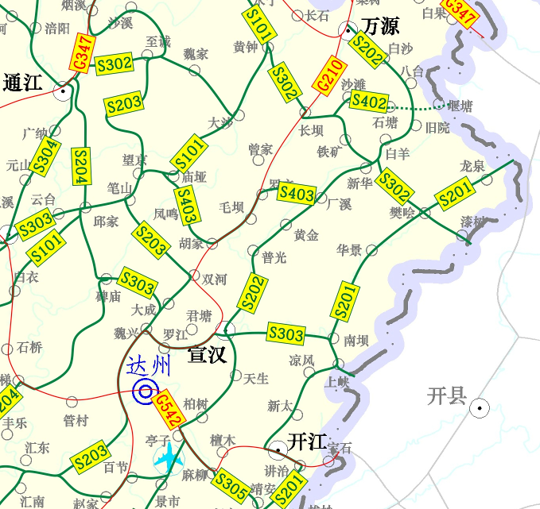

宣汉县“十四五”综合交通运输发展规划

(征求意见稿）

宣汉县交通运输局

2022年1月

目 录

## 第1章 概述      1

- 1.1 规划背景      1

- 1.2 编制依据      2

- 1.3 规划范围      5

## 第2章 经济社会发展      6

- 2.1 自然资源      6

- 2.2 经济发展      9

- 2.3 人口社会      12

## 第3章 交通运输发展基础      14

- 3.1 “十三五”发展成就      14

- 3.2.1 综合交通网络日趋完善      14

- 3.2.2 运输保障能力大幅增强      21

- 3.2.3 交通治理能力不断提高      23

- 3.2 存在的主要问题      24

## 第4章 交通发展机遇      28

- 4.1 发展形势      28

- 4.2 发展要求      30

- 4.3 需求分析      32

- 4.4 发展阶段      35

## 第5章 发展思路      37

- 5.1 指导思想      37

- 5.2 基本原则      37

- 5.3 总体思路      38

- 5.4 发展目标      41

## 第6章 重点任务与资金需求      44

- 6.1 重点任务      44

- 6.1.1 着力推进对外通道提能扩容      44

- 6.1.2 着力推进交通干线改造提升      48

- 6.1.3 着力推进农村公路联网互通      54

- 6.1.4 着力推进枢纽站场优化完善      56

- 6.1.5 着力推进运输服务转型升级      58

- 6.1.6 着力推进行业治理提质增效      60

- 6.1.7 着力推进生态优先绿色发展      62

- 6.2 资金需求      64

- 6.2.1 投资匡算      64

- 6.2.2 资金平衡      65

## 第7章 保障措施      67

- 附表      70

## 第1章 概述

## 1.1 规划背景

“十四五”时期是我国全面建成小康社会、实现第一个百年奋斗目标之后，乘势而上开启全面建设社会主义现代化国家新征程、向第二个百年奋斗目标进军的第一个五年，也是交通运输由“基本适应”向“提质增效”转换，基础设施网络改善、运输服务水平提高和转型发展的重要时期。根据达州市第五次党代会精神和《开展交通运输三年大会战加快建设全国性综合交通枢纽实施方案》，未来要以实施万达开交通一体化“五双工程”和1小时达州“三高一快”建设为重点，构建以达州为中心，畅达东西、贯通南北的综合交通通道和四向通达、全域开放的对外经济走廊，形成交通大通道、大网络、大枢纽。

宣汉作为达州重要的卫星城市，在支撑全市建设四川东出北上综合交通枢纽和川渝陕结合部区域中心城市的新征程中具有独特的区位发展优势。为深入学习贯彻党的十九届五中全会、省委十一届八次全会和达州市第五次党代会精神，及时组织编制《宣汉县“十四五”综合交通运输发展规划》，以期通过聚力建设“内联外畅”立体交通网络，进一步确立宣汉综合交通次枢纽地位，变交通区位优势为竞争发展强势，有力支撑宣汉全面高质量发展，全面开启建设社会主义现代化宣汉新征程。

交通运输是国民经济和社会发展的基础性、先导性、服务性行业，是经济社会发展的“先行官”。《宣汉县“十四五”综合交通运输发展规划》是国民经济和社会发展五年总体规划在综合交通运输领域的具体细化和落实，是统筹全县“十四五”时期综合交通运输发展的纲领和行动指南，是实现交通强国、交通强省建设在宣汉开好局、起好步的重要保障。同时，本规划可作为宣汉编制交通专项规划、确定重大项目、实施建设计划的基本遵循，对于完善畅达交通体系，支撑宣汉深度融入成渝地区双城经济圈和万达开川渝统筹发展示范区，协同创建城宣万革命老区振兴发展示范区，全力争创全国县域经济百强县和川渝毗邻地区高质量发展引领示范区，全面建设繁荣美丽新宣汉具有十分重要的意义。

## 1.2 编制依据

以国家、省、市相关经济社会和交通运输规划为依据，编制宣汉县综合交通运输十四五发展规划。具体包括：

1.《中共四川省委关于深入学习贯彻习近平总书记对四川工作系列重要指示精神的决定》（川委发〔2018〕16号）（2018年6月30日中国共产党四川省第十一届委员会第三次全体会议通过）；

2.《中共四川省委关于全面推动高质量发展的决定》（川委发〔2018〕17号）（2018年6月30日中国共产党四川省第十一届委员会第三次全体会议通过）;

3.《关于实施“一干多支”发展战略推动全省区域协同发展的指导意见》（川委发〔2018〕25号）；

4.《中共四川省委关于制定四川省国民经济和社会发展第十四个五年规划和二〇三五年远景目标的建议》（2020年12月4日中国共产党四川省第十一届委员会第八次全体会议通过）；

5.《交通强国建设纲要》；

6.《关于贯彻落实<交通强国建设纲要>加快建设交通强省的实施意见》；

7.《关于加快推进川东北经济区振兴发展的实施意见》;

8.《中共达州市委四届六次全会公报》;

9.《中共达州市委关于深入贯彻省委十一届三次全会精神全面推动高质量发展加快建设四川东出北上综合交通枢纽和川渝陕结合部区域中心城市的决定》;

10.《强化“示范”担当 放大“中心”优势奋力打造成渝地区双城经济圈北翼振兴战略支点》（2021年10月13日达州市第五次党代会报告）;

11.《争创全国“百强县” 勇当创副“主力军” 为全面建设社会主义现代化宣汉而努力奋斗》（2021年9月13日宣汉县第十四次党代会报告）;

12.《中国西部重要综合交通枢纽建设实施方案》;

13.《开展交通运输三年大会战加快建设全国性综合交通枢纽实施方案》；

14.《国家公路网规划（2013年—2030年）》；

15.《国家物流枢纽布局和建设规划》（发改经贸〔2018〕1886号）；

16.《川陕革命老区振兴发展规划》（发改地区〔2016〕1644号）；

17.《四川省高速公路网规划（2019—2035年）》；

18.《四川省普通省道网布局规划（2014—2030年）》；

19.《西部陆海新通道总体规划 》；

20.《国家乡村振兴战略规划（2018-2022年）》；

21.《四川省乡村振兴战略规划（2018-2022年）》；

22.《四川省港口集疏运体系布局规划》；

23.《四川省通用机场布局规划（2016-2030）》；

24.《中长期铁路网规划》；

25.《达州市国民经济和社会发展第十四个五年规划纲要》；

26.《公路“十四五”发展规划》；

27.《四川省“十四五”综合交通运输发展规划》；

28.《四川省“十四五”公路水路交通运输发展规划》

29.《达州市“十四五”综合交通运输发展规划》；

30.《宣汉县国民经济和社会发展第十四个五年规划和二〇三五年远景目标纲要》；

31.其他相关规划和文件。

## 1.3 规划范围

规划范围：宣汉县全域，共37个乡镇，面积4271平方公里。

规划对象：包括铁路、公路、水路、通用航空等多种运输方式，统筹考虑与民航机场的衔接。

## 第2章 经济社会发展

## 2.1 自然资源

宣汉位于四川盆地东北大巴山南麓，川、渝、鄂、陕结合部，渠江水系上游，幅员面积4271平方公里，辖37个乡镇，常住人口95.41万人，设有三墩、漆树、龙泉、渡口4个民族乡，是全省土家族人口最多的地区。

图2-1 宣汉县交通区位图

地形地貌复杂。宣汉县地域辽阔，地形复杂，总体地貌“七山一水两分田”，山地面积占到辖区面积的85.1％。山势逶迤，由东向西南倾斜绵延，东北高西南低，平均海拔780米，最高海拔2349米、最低海拔277米。

图2-2 宣汉县地形地貌

生物资源多样。全县现有生物资源达1200多种，其中：森林植被资源有450多种，草山草坡植被资源94种，种植业150余种、616个品种，野生动物80多种。饲养动物也较丰富，家畜猪、牛、羊为主，宣汉黄牛为国家地方役牛良种。

矿藏资源丰富。矿产资源品种多、储量大、质量好，既有优势，又有特色。已探测到的资源达28种，其中浅层天然气储量十分丰富，开发前景广阔，预计储量1.5万亿立方米，系西南地区天然气气田中心、国家“西气东输工程”重要基地；原煤储量达1.6亿吨，发热量6000大卡以上；富钾卤水储量达1.3亿立方米，是国家盐化工业基地自贡黑卤的10倍；此外，还有大理石30亿立方米，石灰石30亿立方米，石英石3000万立方米，硫磺矿867万吨，铁矿1800万吨等。

水能资源充足。属嘉陵江水系，前、中、后河纵横全境于城东汇为州河，县内流域面积占全县幅员88%，天然落差16.6—327米，年均流量34-160立方米/秒，水能发电蕴藏量达35.8万千瓦，年电能资源31.4亿千瓦时。4条干流可通航，通航里程302.5公里，可行驶载重1.5—10吨船只。

图2-3 宣汉县流域水系及水利工程分布图

旅游资源富集。宣汉历史文物丰富，自然景观秀丽，是全国著名的绿色生态、历史文化、红色旅游胜地。境内群山环绕，峰峦叠翠，森林覆盖率达48%，江口湖、巴山大峡谷等著名景区风光旖旎，环境优美。同时，王维舟故居“静远堂”、红三十三军成立纪念碑和红军语录碑林等红色旅游景区是著名的爱国主义和革命传统教育基地。

图2-4 宣汉县旅游资源分布图

图2-5 宣汉县旅游景区景点

## 2.2 经济发展

“十三五”时期是宣汉发展砥砺奋进、开拓进取、富有成效的五年。面对国内外复杂形势和严峻挑战，县委、县政府坚持以习近平新时代中国特色社会主义思想为指导，深入实施“三大战略”，强力推进“双核双区”，决战决胜脱贫攻坚，如期全面建成小康社会，全县经济社会发展和各项事业取得新的重大成就，“繁荣美丽新宣汉”建设呈现崭新局面。2015—2020年，宣汉县GDP年均增速达12.3%。2020年，实现地区生产总值400.2亿元，同比增长5.4%；产业结构持续优化，第三产业发展较快，第一、第二、第三产业结构比由2010年的29.4:43.2:27.4变为2020年的19.8:39.8:40.4。

表21 宣汉历年经济增长情况

| 年度 | GDP（亿元） | 增长率（%） | 其中 | 人均GDP（元） |
|---|---|---|---|---|
| 第一产业 | 第二产业 | 第三产业 |
| 2010 | 124.55 | 15.8 | 36.60 | 53.85 | 34.10 | 11885 |
| 2011 | 163.99 | 15.6 | 44.02 | 80.52 | 39.45 | 15619 |
| 2012 | 198.18 | 13.8 | 47.09 | 105.87 | 45.21 | 19653 |
| 2013 | 231.08 | 10.7 | 50.82 | 129.15 | 51.11 | 22880 |
| 2014 | 250.56 | 8.9 | 23.61 | 140.44 | 56.51 | 24565 |
| 2015 | 223.96 | -6.7 | 55.31 | 103.45 | 65.20 | 21843 |
| 2016 | 242.53 | 8.4 | 59.01 | 103.04 | 80.49 | 23531 |
| 2017 | 266.65 | 8.8 | 61.59 | 105.74 | 99.32 | 25763 |
| 2018 | 300.63 | 8.6 | 61.70 | 122.27 | 116.66 | 29176 |
| 2019 | 369.91 | 8.0 | 69.61 | 141.36 | 158.93 | 36159 |
| 2020 | 400.21 | 5.4 | 79.80 | 159.23 | 161.58 | 39100 |
| 年均增长率 |
| 2010-2015 | 12.5% | — | 8.6% | 13.9% | 13.8% | 12.9% |
| 2015-2020 | 12.3% | — | 7.6% | 9.0% | 19.9% | 12.4% |

数据来源：历年《宣汉县国民经济和社会发展统计公报》。

图2-6 宣汉历年全县生产总值趋势图

图2-7 宣汉历年人均国民生产总值趋势图

图2-8 宣汉历年三次产业结构变化趋势图

## 2.3 人口社会

近年来，宣汉县人口呈逐年下降趋势，根据第七次全国人口普查公报，2020年全县常住人口95.4万人，其中，男性人口占51.47%，女性人口占48.53%。全县城镇化率仅为42.35%，低于全国的43.37%、达州市的45.52%。

表 22 宣汉县历年人口及城镇化率

| 年度 | 人口（万人） | 人口增长率（%） | 城镇化率（%） |
|---|---|---|---|
| 2010 | 129.51 | 0.79 | 29.40 |
| 2011 | 131.09 | 1.22 | 28.10 |
| 2012 | 132.76 | 1.27 | 32.70 |
| 2013 | 131.19 | -1.18 | 34.30 |
| 2014 | 132.26 | 0.82 | 35.80 |
| 2015 | 131.90 | -0.27 | 36.81 |
| 2016 | 132.34 | 0.33 | 38.22 |
| 2017 | 129.96 | -1.80 | 39.40 |
| 2018 | 129.48 | -0.37 | 40.75 |
| 2019 | 127.82 | -1.28 | 42.35 |
| 2020 | 95.41 | — | — |

注：2019年及以前为户籍人口数据，2020年为常住人口数据。

图2-9 宣汉县人口变化趋势图

## 第3章 交通运输发展基础

## 3.1 “十三五”发展成就

“十三五”时期，按照全省公路水路交通“十三五”发展规划和《达州市“十三五”综合交通运输发展规划》，宣汉全面贯彻落实新发展理念，深入推进交通扶贫开发攻坚，加快改善综合交通运输发展条件，全县综合交通建设完成投资约81.9亿元，在拉动经济增长、促进改善民生等方面发挥了重要作用。总体来看，宣汉县公路水路交通发展水平已较“十二五”期有较大提升，为决胜脱贫攻坚和助力经济社会发展提供了有力支撑保障。

## 3.2.1 综合交通网络日趋完善

目前，全县正逐步形成以铁路和高速公路为骨架，普通国省干线为支撑，农村公路和内河水运为基础的综合交通网络，初步构建外联内通的交通运输发展格局。

1.铁路

“十三五”期，宣汉境内已建成襄渝铁路及其复线铁路，从县域西部东北向西南方向通过，北接京广线，南接成渝线、达成线，在县域胡家镇设有宣汉三级火车站，毛坝、石柱槽两个作业站以及普光中石化支线货运站。

2.公路

“十三五”以来，宣汉县积极完善高速公路布局，强化普通国省干线提档升级，着力完善农村公路网络覆盖。截至2020年底，全县公路总里程已突破6674公里，其中二级及以上公路占12.8%，已实现全县37个乡镇全部通水泥（油）路，建制村通硬化路率100%。其中，按照行政等级划分，现有国道156km、省道452km、县道1010km、乡道1612km、村道3444km。按照技术等级划分，高速公路83km、一级公路3公里、二级公路343km、三级公路91km、四级公路6115km、等外公路39km。按照路面类型分，有铺装路面6600km（沥青混凝土路面681km、水泥混凝土路面5919km），简易铺装路面34km，未铺装路面39km。

## 表31 宣汉县公路网基本情况统计表

| 分类 | 通车里程(公里) | 所占比重 |
|---|---|---|
| 公路总里程 | 6674 | 100% |
| 行政等级 | 国 道 | 156 | 2.3% |
| 省 道 | 452 | 6.8% |
| 县 道 | 1010 | 15.1% |
| 乡 道 | 1612 | 24.2% |
| 村 道 | 3444 | 51.6% |
| 技术等级 | 高速公路 | 83 | 1.2% |
| 一级公路 | 3 | 0.0% |
| 二级公路 | 343 | 5.1% |
| 三级公路 | 91 | 1.4% |
| 四级公路 | 6115 | 91.6% |
| 等外公路 | 39 | 0.6% |

## 图3-1 宣汉县公路行政等级结构图

## 图32 宣汉县公路技术等级结构图

## 表32 宣汉县公路路面类型情况统计表

| 行政等级 | 合计 | 按路面类型分 |
|---|---|---|
| 有铺装路面（高级） | 简易铺装路面 （次高级） | 未铺装路面（中级、低级、无路面） |
| 合计 | 沥青混凝土 | 水泥混凝土 |
| 合计 | 6673 | 6600 | 681 | 5918 | 34 | 39 |
| 国道 | 155 | 155 | 155 |  |  |  |
| 省道 | 452 | 423 | 295 | 128 | 29 |  |
| 县道 | 1010 | 993 | 211 | 781 | 6 | 11 |
| 乡道 | 1612 | 1588 | 17 | 1571 |  | 24 |
| 村道 | 3444 | 3440 | 1 | 3439 |  | 4 |

## 图33 宣汉县公路路面类型结构图

——高速公路布局日趋完善。在已建成G65包茂高速公路（75公里）、G5012恩广高速公路（10公里）的基础上，积极抢抓全省高速公路网规划调整机遇，将城口经宣汉至大竹至邻水（宣汉境68公里）、通江经宣汉至开州（宣汉境85公里）高速公路纳入《四川省高速公路网规划（2019高速公路网年）》方案。截至2019年底，宣汉县境内已建成高速公路85公里、规划待建153公里，初步形成县域高速公路“井”字形布局形态，有效提升了对外交通联系能力。

图34 宣汉县高速公路规划布局图

——国省干线结构持续优化。普通国省干线公路提档升级加快推进，“十三五”时期已先后新改建S302线巴山大峡谷快速通道、S202线宣七公路、XS19线南峰路等项目，干线公路服务水平和通行能力进一步提升。截至2019年底，县域内规划布局的G210、S303、S201、S202、S203、S302、S403等普通国省干线共511公里，其中：普通国道73公里，已基本达到二级及以上技术标准；普通省道438公里，三级及以上公路占比达到52.9%，略高于全省平均水平。

图35 宣汉县普通国省道规划布局图

——农村公路扶贫提前收官。聚焦“两不愁、三保障”，以通乡油路、通村硬化路、畅返不畅整治为重点，强化措施和要素保障，全力推进农村公路建设。“十三五”时期，新建改建县乡村道路2200多公里，已实现100%的乡镇、建制村通水泥（油）路，90%的社通硬化路，提前一年实现农村公路双百发展目标。截至2020年底，全县农村公路总里程6066公里，其中四级及以上公路占比达到99.4%，农村公路覆盖范围和通达深度明显提升。

3.水路

“十三五”时期，宣汉县重点开展整治航道，乡镇客渡码头、客运管船站建设，内河水运基础设施建设不断完善。截至2020年底，全县洲河、双溪河、碑牌河等内河航道通航里程共302.5公里，其中60公里为七级航道，有客运码头10座、货运码头6座，海巡艇5艘。2016～2020年，渡改桥项目加快实施，共完成渡改公路桥11座、渡改人行桥12座，取消52个公益性渡口，全县渡口已由“十二五”末的27个减少到目前的8个，进一步改善了水运通行条件。

4.航空

宣汉境内目前没有民用及通用航空机场，但独特的区位优势和便捷的交通条件，使宣汉可1小时内到达达州金垭机场，便捷联系全国各主要大、中城市。

5.运输场站

以改善贫困地区和农村地区出行条件为重点，加快客货运枢纽、县级客运站、乡镇客运站、村级招呼站等道路运输站场体系建设，积极推进道路客运基本公共服务均等化发展。全县共建有三级以上公路货运场站（物流中心）1座，一级客运站1个、二级客运站1个、三级客运站2个、乡镇客运站15个、村级招呼站（牌）125个，进一步完善了县乡村三级道路客货运输站场体系。

## 3.2.2 运输保障能力大幅增强

1.运输结构持续优化

综合运输结构更趋合理，公路运输总体保持平稳。2020年，全县公路客运量628万人次，较“十二五”期末减少28%，公路客运周转量49265万人公里，较“十二五”期末增加44%；随着其他运输方式的快速发展，公路货运量逐年下降，全年公路货运量634万吨，较“十二五”期末减少25%，公路货运周转量79731万吨公里，较“十二五”期末减少15%。

水路运输方面，随着渡改公路桥、渡改人行桥工程的加快实施，客渡船数量持续减少；同时，受宏观经济形势和能源需求疲弱态势，水上货运规模日益萎缩。2020年，全县水路客运运输吐量32万人次、周转量365万人公里， 分别比“十二五”末期减少36%和44%。

2.运输网络覆盖面广

充分考虑出行特征，积极拓展客运市场，班线客运通达能力明显提升，城乡客运一体化进程显著加快。截至2020年底，全县开行客运班线112条，客运线路平均日发班次790班次/日。其中，高速公路客运线路条数6条，市际客运班线1条，县际客运班线18条，农村客运线路55条（平均日发班次450班次/日），已实现100%的乡镇和建制村通客车，城乡客运基本公共服务均等化程度明显提升。

3.枢纽站场更加完善

随着基础设施的不断完善，运输发展环境不断优化，城乡客运和农村物流得到较快发展。2016-2020年共计新改建公交首末站1个、停靠站186个，公共交通出行分担率达到89%，城市公众出行服务水平大幅提升；截至2020年底，已累计建成农村客货运站点54个、农村客运招呼站牌496个，为推动城市工业产品下乡和农村农产品进城打下坚实基础。

4.装备水平显著提升

全县营运载客汽车中高级车辆占比达85%，同比提升90%。货车大型化趋势明显，营运货车平均吨位由“十二五”末的3.75吨提高至“十三五”末10.3吨。危险货物运输车辆达128辆，基本实现了危险货物运输车辆专业化。全县共有船舶70艘，其中，客渡船65艘、旅游船舶5艘。

5.便民措施深入推进

全县所有高速公路车道已实现ETC全覆盖，所有高速公路收费站车道完成高清车牌识别改造，实现收费站移动支付全覆盖。网约车，共享单车、分时租赁等规范发展，多式联运、甩挂运输、网络货运、城市共同配送等加快发展，已开通定制客运试点线路1条。

## 3.2.3 交通治理能力不断提高

1.管养能力持续加强

牢固树立“建设是发展，养护也是发展”的理念，针对农村公路养护管理难的问题，制定出台一系列农村公路养护管理办法，理顺乡村道路管养机制，明确乡村两级道路养护职能职责。加快推进养护体制改革，积极推行辖区公路“路长制”，推动农村公路养护管理常态化，建成宣汉县养护和应急保通中心，新改建公路养护站6个，实施普通国省干线公路大中修工程61.8公里。

2.安全生产形势保持稳定

“十三五”期，全系统未发生重特大安全生产事故，较大以上等级道路运输行车事故死亡人数同比明显下降。实现“两客一危”重点车辆动态监控，监控入网率达100%。通客车建制村生命安全防护工程及时补充排查，改造大中小各类病危桥5座，国省干线公路按规定设置固定超限检测点，加大超载超限整治力度。积极推进水上交通安全监控室建设改造，以及海事巡逻艇、防洪系锚设施等巡航救助一体化项目建设，水上安全监管及应急保障能力明显提升。

3.绿色交通理念深入践行

着力推进结构性、管理性、技术性节能减排，截至2020年底，全县清洁能源及新能源公交和出租车占比分别达到100%和26%，公路水路运输碳排放较“十二五”分别下降90%。积极推动绿色生态公路、水路建设，重点生态功能区公路建设全部实施生态恢复，公路绿化率达到75%，交通建设对生态环境影响得到有效控制。

4.行业改革创新深入推进

深入推进“放管服”改革，取消行政审批事项25项，调整优化审批事项25大项、103小项，群众满意率和按时结办率均达100%。扎实开展公路路面执法，巩固公路“双超”治理成果，持续开展打击非法客运综合整治行动，整顿规范客运市场秩序。积极吸引社会资本，通过整合涉农资金、采取银行贷款、发动收益村民捐资等方式，拓宽项目筹资来源，推动农村公路建设。

## 3.2 存在的主要问题

尽管“十三五”期，全县综合交通运输发展已取得显著成就，但对标交通强国“四个一流”发展目标，按照主动融入成渝地区双城经济圈、加快万达开川渝统筹发展示范区交通一体化发展要求，对标宣汉奋力争创全国“百强县”、勇当达州创副“主力军”的总体发展目标，交通运输发展仍然存在一些短板和薄弱环节，主要表现在以下方面：

1.对外大容量通道尚不健全

宣汉县主要对外联系通道包括G65包茂高速、G0512恩广高速以及襄渝铁路，由于建成通车时间较早，通道“能力不强、结构不优”问题较为突出。特别是襄渝铁路作为国家铁路网南北纵向干线，设计速度仅为160公里/小时，县域目前尚缺乏高铁连接，远不能满足县域快速铁路客运出行需求；G65包茂高速达陕段，以最短距离连接成都、重庆、西安三座城市，目前仅为双向四车道高速公路标准、设计时速80公里/小时，建成以来交通量增长较快、服务水平偏低，同时由于距离城区较远，高速公路服务带动县城发展的能力不强；而作为既有高速公路扩容复线的城口经宣汉至大竹至邻水、通江经宣汉至开州高速公路，目前未开展前期工作，对外大能力快速综合运输通道尚不完善，支撑区域主动融入成渝地区双城经济圈等国家战略的能力仍显不足。

2.普通公路技术等级仍然不高

一是普通国省道技术等级偏低，特别是“十三五”期由于国省干线公路网调整后，新增普通省道中仍存在四级公路205公里，S302线樊哙至漆树段、河坝至万源铁矿界段，S403线胡家至红峰段亟待提档升级；二是农村公路通行能力不足，乡镇间、建制村间联网程度低，尚不能实现互联互通连接，距离满足村民“抬脚有路、出门上车”还有较大差距，部分路段附属设施严重缺失、路面破损严重、安防设施少，特别是黄金—凤林路面较窄，花池—红峰、芭蕉—上峡等路面破损率达60%以上；三是各级路网衔接转换效率较低，目前只有中河流域、东北部和天生片区约25个乡镇能较快到达高速公路，县域西北部、中东部乡镇上高速绕行时间较长，同时，部分公路街道化严重，城镇交通与过境交通相互干扰，对于全面支撑县域经济发展较为乏力。

3.综合交通协调发展有待加强

各种运输方式尚未实现融合发展，枢纽及集疏运能力有限，比较优势和组合效率有待进一步提升。货运物流组织化程度低，甩挂运输、多式联运等先进、集约、高效的运输组织模式发展缓慢，尚缺乏主导公路运输市场的大型运输企业，物流效率低、破损占比高，难以组织规模化和网络化的运输。农村客运便捷性、舒适度不高，“开得通、留不住、乘车贵”矛盾依然突出，城乡客运发展不均衡、网络不协调、衔接不顺畅、运输效率不高等问题较突出，城乡客运一体化有待进一步完善。公路干线运输集约化程度不高、组织方式有待优化，县级货运站、乡镇配送网点覆盖率低，货运流通单向性特征明显、时效性不强。

4.交通刚性要素制约日趋明显

国家正加快组织建立“多规合一”的国土空间规划体系，即将启动乡镇片区国土空间规划，作为各类开发保护建设活动的基本依据。按照《自然资源部关于做好占用永久基本农田重大建设项目用地预审的通知》（自然资规〔2018〕3号），“省级高速公路”、“连接深度贫困地区直接为该地区服务的省级公路”等确实无法避让永久基本农田的允许纳入用地预审受理范围，其他普通省道由于缺乏用地指标，升级改造等前期工作推进缓慢；在深化财税体制改革、防范化解地方政府隐性债务风险等多重因素影响下，普通公路建设资金筹集困难、养护资金保障严重不足，造成公路建设标准、质量不高，日常管养水平较低；同时，随着环保督察力度的不断加大，公路建设用砂石等地材价格一涨再涨，且主要需从万源、开州等周边县市区供给，增加了建设成本，影响了建设工期，公路建设的外部因素和刚性约束进一步增强。

## 第4章 交通发展机遇

## 4.1 发展形势

当今世界正经历百年未有之大变局，新冠肺炎疫情全球大流行促使大变局加速演进，第四次产业革命引发前所未有的网络化、信息化、数字化、智能化和绿色化，世界各国各地之间互联互通成为大趋势。国际力量对比深刻调整，和平与发展仍然是时代主题。同时单边主义、保护主义、霸权主义对世界和平与发展构成威胁，中美战略博弈成为常态，显性对抗压力空前加大，世界进入动荡变革期，不稳定不确定因素明显增加。但我国经济稳中向好、长期向好的基本面没有改变，国家新一轮西部大开发，构建以国内大循环为主体、国内国际双循环相互促进的新发展格局和成渝地区双城经济圈等战略的实施，注定“十四五”的五年必将是国内经济、格局、发展重塑的五年。

从国家层面看，当前我国经济已由高速增长阶段转向全面推进高质量发展阶段，党的十九大报告提出建设现代化经济体系是跨越关口的迫切要求和经济发展的战略目标，必须以供给侧结构性改革为主线，推动经济发展、质量变革、效率变革、动力变革，提高全要素生产率。“一带一路”、长江经济带、新时代西部大开发、国内国际双循环新格局、西部陆海新通道、川陕革命老区振兴发展等战略的实施，给交通运输创造了良好的发展机遇，将有利于充分发挥四川沟通西南西北、连接国内国外的独特区位优势，助推优化交通基础设施布局，强化与周边地区互联互通，有效引领中国西部地区发展、拓展全国经济增长新空间，融入全方位对外开放发展新格局。

从全省层面看，省委十一届三次全会作出全面推动高质量发展的决定，提出必须全面落实新发展理念，实施“一干多支”发展战略，对内形成“一干多支、五区协同”区域协调发展格局，对外形成“四向拓展、全域开放”立体全面开放格局，奠定经济强省坚实基础。十一届三次全会提出将聚力提升以综合交通为重点的现代基础设施体系，壮大区域发展重要支点，支持达州建设东出北上综合交通枢纽和川渝陕结合部区域中心城市，十一届七次全会提出推动成渝地区双城经济圈建设，支持达州与成渝双核联动，促进成渝地区双城经济圈北翼振兴，将有利于达州进一步完善交通基础设施网络、构建现代综合交通运输体系，加快融入成渝地区双城经济圈交通运输一体化发展。

从全市层面看，达州市第五次党代会确定了建设“交通物流中心”的战略目标，《开展交通运输三年大会战加快建设全国性综合交通枢纽实施方案》提出要加快推进机场扩能、铁路突破、高速成网、航运贯通，进一步畅通东向通道经万州联结长江中游、长三角，北向通道经西安直达京津冀，南向通道经重庆联结北部湾，西向通道密切与成都联系，西北向通道经巴中广元通达兰州，构建以达州为中心，畅达东西、贯通南北的综合交通通道和四向通达、全域开放的对外经济走廊，有利于宣汉依托自身地处成都、重庆、西安三大国家中心城市辐射影响交会地的区位优势，积极推进交通基础设施共建共享，尽快打通高速公路、高速铁路“大动脉”，进一步联通乡道、村道等“毛细血管”，提高交通互联互通水平，加快对接“一干”、融入“一圈”、助力“一市”共同发展。

## 4.2 发展要求

抢抓机遇、加快发展，全面提升宣汉在全市乃至全省区域发展格局中的优势地位，进一步适应经济社会发展新形势，充分发挥好交通作为发展先行官的重大使命，对今后一个时期宣汉的综合交通运输发展提出新的更高要求。

（一）支持达州建设四川东出北上综合交通枢纽，要求宣汉加快完善对外综合运输通道

省委十一届三次全会作出了“支持达州建设东出北上综合交通枢纽和川渝陕结合部区域中心城市”的新部署，为达州发展指明了前进方向、带来了重大机遇。宣汉是达州、广安、重庆等城市往北联系西安等关中城市群的必经之地，是全市交通基础设施的重要承载地，特殊的区位和条件就要求宣汉站在服务全省、全市发展全局的高度，大力推进高速公路、通用机场等重大交通基础设施建设，完善对外综合运输大通道，推动达州建设四川东出北上综合交通枢纽。

（二）深度融入成渝地区双城经济圈和万达开川渝统筹发展示范区，要求加快推进城乡交通互联互通

县委、县政府提出全面推动宣汉高质量发展，深度融入成渝地区双城经济圈和万达开川渝统筹发展示范区，协同创建城宣万革命老区振兴发展示范区，建设繁荣美丽新宣汉，为县域经济社会发展标定了新的坐标。在完成全面建成小康任务的发展基础上，当前城乡发展的不协调仍然是宣汉经济社会发展面临的重要问题，城乡融合发展的交通基础条件仍显薄弱，这就要求宣汉要加快推进重要干线公路提档升级，进一步完善区域间的交通要道，提高乡镇对外联系效率，着力补齐农村公路短板，提升乡镇间、乡镇内连通水平，充分发挥交通运输对经济社会发展的先行引领作用。

（三）建设全国知名旅游目的地和全国巴文化高地，要求宣汉加快提升出行服务品质

大力实施“全域旅游”战略，“十四五”期将突出巴山大峡谷文旅扶贫景区龙头带动作用，着力打造“五马归槽”国家级森林康养度假区，统筹推进马渡关石林、洋烈水乡、峨城竹海等景区提档升级，修缮荔枝古道、盐茶古道等历史遗迹，构建全县“一区四圈”全域旅游新格局。交通运输是旅游业发展的基础支撑和先决条件，旅游产业的大力发展必然带来多元化、个性化、高品质的运输需求。这就要求宣汉要加强重要旅游景区与机场、车站、码头等交通集散地的联系，加快创新运输模式和产品，完善旅客联程运输系统，提高综合运输服务质量和效率，为游客提供更加优质的运输体验。

（四）支持建成全国新能源新材料基地，要求宣汉加快推进物流降本增效

加快全县经济社会转型发展、均衡发展，做大做强普光经济开发区，到2025年初步建成全国首个锂钾综合开发示范园区和全国首个微玻纤全产业链示范园区，全力争当川东北经济区县域发展领头羊，为全县经济高质量发展明确了方向路径，同时也要求宣汉要着力优化货运主通道结构，积极发展集约化物流，大力发展多式联运，促进各方式间物流信息共建共享，完善货运集疏运体系，推进大宗货物及中长距离货物运输向铁路、水运和管道转移。

## 4.3 需求分析

1.客运需求特征

（1）对外客流需求快速增长。省委十一届三次全会提出要深入推进全面开放合作，坚定把“四向拓展、全域开放”作为四川融入全球经济格局、抢占未来发展制高点的关键之举强力推进，扩大开放是加快发展的必由之路。随着“一带一路”建设、长江经济带发展，以及成渝地区双城经济圈建设等重大战略深入推进，达州及宣汉将主动承接东部沿海发达地区、成渝发展双核的产业转移，积极参与国际国内合作，将极大增强经济活力和新引力，与周边经贸往来与人员交流合作均将更为频繁，跨区域客运市场需求广阔，全社会客运需求将保持持续旺盛的发展态势。

（2）城际客流需求日趋活跃。针对四川发展缺乏强有力的支点，区域发展差异明显，为全面推动高质量发展，奋力推动治蜀兴川再上新台阶，省委、省政府作出“一干多支、五区协同”的重大部署，支持成都建设全面体现新发展理念的国家中心城市，同时壮大区域发展重要支点。随着“主干”引领带动、“多支”竞相发展、“干”“支”协同联动发展格局的逐渐发展，首位城市与各市（州）之间、市（州）与市（州）之间、市（州）与县（区、市）之间交流合作将更加频繁，经济往来进一步加强，由此产生的以城际为主的客流将逐步活跃，同时城际交通网的加快完善，也将促进城际间客运需求进一步膨胀。

（3）城乡客运需求逐步激发。在全面建成小康社会的基础上，加快推进新型城镇化建设、统筹区域和城乡发展是乡村振兴发展甄略的重要任务。随着把城乡作为一个整体，统筹安排城乡规划、产业发展、基础设施、公共服务和社会管理，并有序推进农业转移人口市民化、统筹解决农业转移人口的住房、就业、养老、子女教育等问题，城乡分割分治的二元结构将被逐步打破，城乡之间生产要素的自由流动更加频繁，转移人口由于身份转变和生产生活方式转变带来的个体出行需求也更加强烈。交通运输作为基础、服务性行业，将向广大农村地区继续延伸和覆盖，出行条件的不断改善，将使市域和农村客运需求得到进一步激发。

（4）多样化出行需求不断增加。交通基础设施的不断完善，人们的出行方式将有更多选择。随着成南达万高铁、城口经宣汉至大竹至邻水高速公路的建成通车，以及水上旅游的加快发展，综合运输市场结构将发生重大调整，铁路和水路客运出行总量呈上涨趋势。同时，由于宣汉旅游资源丰富，在全域旅游和文旅强省建设的大背景下，宣汉县未来旅游需求旺盛，“交通+旅游”融合发展等新业态新模式潜力巨大，且以娱乐、购物、健身、休闲等为目的的城乡间出行需求也将明显增多，对交通出行和品质服务的要求将由“走得了”向“走得安全、走得便捷、走得舒心”转变。

2.货运需求特征

（1）货运需求总量稳步增加。省委、省政府提出加快建设经济强省，要求推动新旧动能转换，加快产业转型升级，构建高端突破、优势凸显的现代产业支撑。工业经济的快速发展为货物运输提供了广阔的市场空间，特别是随着宣汉工业转型提升，“一区四园”竞相发展格局基本形成，锂钾、微玻纤新材料、天然气硫磺、金属新材料“四驾马车”齐头并进，要求货物运输提供高质量的运输组织服务。乡村振兴战略实施，以“特色农产品出口、进城，工业品下乡”等新兴运输货物量将呈现快速增长态势，高时效的农副产品快速转运需求将急剧增长。

（2）现代物流转型发展迫切。服务业充分发展是现代产业发展的趋势，是产业结构优化升级的重要抓手，也是交通运输长远发展的重要增长点。随着产业结构调整与产品结构升级，大宗物资运输比重降低，一般消费品、轻质化和高附加值货物比重增加，重量轻、货值高、体积小、批次多、对服务要求高的货物运输量将大幅增长，要求传统货运在满足基本运输需求基础上，能提供更多配送、仓储、包装等附加服务，进一步降低实惠物流成本，推动物流降本增效，实现传统货运向现代物流的转型发展。

（3）多式联运需求更加旺盛。为支撑“一干多支、五区协同”发展战略，全省提出要强力推进以立体交通为重点的开放大通道建设，打造现代综合交通运输体系。市委、市政府要求聚力建设四川东出北上综合交通枢纽，以达州为中心构建“五向综合运输大通道”。建设现代综合交通枢纽的关键之一是要加强铁路、公路、水路、航空等多种运输方式的有效衔接，实现各种运输体系的高效整合，特别是随着产业结构升级，发展多式联运以节约物流成本的需求也逐渐显现，各种运输方式将发挥各自技术特长、优势互补，实现货运无缝衔接的需求也将进一步凸显。

## 4.4 发展阶段

从交通运输行业自身实际看，宣汉县交通运输行业发展取得显著成绩，交通基础设施建设进程不断加快，总体仍处于基础设施大规模集中建设阶段，并正在进入加快构建综合交通运输体系、努力促进交通运输全面发展的转型阶段，交通运输发展将呈现出新的趋势与特征。

1.完善交通基础设施网络的加速期

当前宣汉交通基础设施总量不足、质量不高，仍然是制约宣汉经济社会发展的最大瓶颈，“十四五”期基础设施建设仍是宣汉交通运输发展的重中之重。宣汉交通未来将继续加大交通基础设施建设力度，提升基础设施供给能力和服务能力，加速完善交通基础设施网络。

2.巩固交通脱贫攻坚成果的关键期

在“十三五”全面完成交通脱贫攻坚的基础上，“十四五”期仍然是宣汉巩固脱贫攻坚成果，打好减贫“接续战”的关键时期。宣汉交通未来将继续改善贫困地区交通状况，提升交通基本公共服务均等化水平，支撑乡村振兴发展和创建国家脱贫后高质量发展创新改革试验区。

3.推进交通运输高质量发展的起步期

“十四五”时期，宣汉县在全力推进基础设施建设的同时，要顺应全国交通运输发展由基本适应向提质增效转变趋势，兼顾交通高质量发展，注重各种运输方式高效衔接，注重生态环保和资源集约利用，注重新一代信息技术在交通领域的推广应用，为实现交通现代化奠定基础。

## 第5章 发展思路

## 5.1 指导思想

以习近平新时代中国特色社会主义思想为指导，深入学习党的十九届五中全会、省委十一届八次全会精神，贯彻落实达州市第五次党代会和宣汉县第十四次党代会精神，以供给侧结构性改革为主线，以改革创新为根本动力，以满足人民群众日益增长的美好生活需要为根本目的，以促进交通运输发展提质增效、转型升级为基本导向，坚持深化市场化改革、扩大高水平开放，加快构建安全、便捷、高效、绿色、经济的现代化综合交通体系，为全力争创全国县域经济百强县和川渝毗邻地区县域高质量发展示范区，全面建设经济发达、生态优美、人民富足的现代化宣汉当好“先行官”。

## 5.2 基本原则

1.稳中求进，适度超前。按照构建现代综合交通运输体系的总体部署，在满足现阶段客货运输需求的基础上，着眼于经济社会发展的阶段性目标和需求增长趋势，前瞻性、全局性、战略性、整体性谋划，布局实施一批着眼长远、事关全局的重大基础设施项目，提高交通运输的战略支撑力，并处理好发展速度、规模与资金、资源环境承载力的关系。

2.服务大局，服务民生。以服务经济社会发展全局为中心，以满足新时代人民群众对美好出行的新要求作为落脚点，持续增进广大人民群众福祉，强化交通运输对宣汉重大发展战略的引领支撑作用，抓好保障和改善民生的各项工作，推进社会事业全面发展，努力实现社会公共服务均等化，增强人民群众的获得感、幸福感、安全感。

3.统筹融合，注重衔接。注重方式之间的统筹协调，发挥综合交通基础设施网络效应和规模效应，提升交通运输整体性和协调性，促进基础互通，实现各区域间均衡协调发展。宜路则路、宜水则水，促进综合运输走廊内空间资源的共用共享。优化综合交通枢纽布局，提高各种运输方式衔接和组合效率。

4.集约绿色，优化供给。深入贯彻在发展中保护、在保护中发展的理念，充分考虑宣汉资源禀赋条件及环境承载力，以国土空间规划为依据，注重节约集约利用土地、水域等资源，促进交通与自然和谐共生。切实转变发展方式，坚持面上保护、点上开发原则，充分利用存量资源，扩大优质增量供给，以最小的资源消耗和环境代价实现供需动态平衡，打造交通运输发展与生态环境保护双赢局面。

## 5.3 总体思路

交通运输是经济社会发展的“先行官”，是支撑总体发展战略部署的重要载体和依托。“十四五”期，宣汉综合交通运输发展需坚持问题导向、需求导向、发展导向，按照“畅通道、优路网、强衔接、提品质、促融合”的总体思路，全面加快交通基础设施网络建设，构建安全、便捷、高效、绿色、经济的现代化综合交通体系。

——畅通道。畅通多向多路径联结的综合运输走廊，全方位融入国家重大战略，以大通道促进大发展。依托襄渝铁路、G65包茂高速公路、G5012恩广高速公路，加快推进城口经宣汉至大竹至邻水高速公路、通江经宣汉至开州高速公路前期工作，积极谋划争取西安至重庆高铁，宣汉火车站经普光、南坝、开州至云阳货运铁路专线建设，推动打通高速公路、高速铁路“大动脉”，进一步加强与成都、西安、重庆联系，积极融入成渝地区双城经济圈战略、加快万达开川渝统筹发展示范区建设。

——优路网。在强化对外运输大通道的基础上，进一步完善区域交通网络的优化布局，重点构建布局合理、功能完善的干线交通网络。围绕推动区域经济社会一体化发展，加强联系成都都市圈、重庆都市圈的重大交通项目建设，积极承接产业转移；围绕构建高品质干线公路网，加快推进普通国省干线公路提档升级，进一步推动与周边地区快速通道建设，提升基础设施互联互通水平；围绕城乡发展不平衡、乡村振兴发展以及省委培育一批中心城镇，优化农村公路路网结构，推动城乡交通协同发展达到新高度。

——强衔接。充分发挥枢纽站场在交通网络中的衔接转换作用，加强综合交通运输枢纽建设，优化区域枢纽场站布局，促进铁路、公路、水运等多种运输方式的相互衔接，提升各种运输方式的组合优势和整体效能，提高综合运输效率，方便公众出行，降低运输成本。进一步完善城市交通与对外交通的衔接，优化城市和乡镇普通国省干线公路过境的布局，缓解城区交通压力，减少安全隐患，支撑城市空间拓展和布局优化。

——提品质。加快推动出行运输服务快速化、便捷化、安全化，进一步提升运输服务品质。构建以铁路、公路为主的快速客运网络，提升旅游客运水平；加快完善通畅、便捷、可靠的乡村运输网络，改善农村客货运输和快递配送条件，推进城乡交通一体化进程；大力发展多式联运，着力调整运输结构，推动结构性、制度性、技术性、管理性四个维度降低物流成本、提升物流效率。

——促融合。围绕推动“交通+旅游”融合发展，突出发挥区域旅游资源禀赋优势，按照“典型带动、示范引领”的原则，进一步完善景区景点“快进”网络，优化旅游风景廊道等“慢游”体系，培育交通新增长点；加快智慧交通建设，提升交通管理信息化水平，加强多种运输方式间协调联动，为公众出行提供高效服务；积极推进交通运输环境保护和节能减排，构建绿色循环低碳综合交通运输体系，实现交通运输发展与生态环境和谐统一。

## 5.4 发展目标

到2025年，全县综合交通运输发展水平显著提升，通道能力更充分、路网结构更合理、衔接转换更顺畅、运输服务更高效、支撑保障更有力，全面适应“全国新能源新材料基地、全国知名旅游目的地和全国巴文化高地”总体定位，支撑经济发达、生态优美、人民富足的现代化宣汉建设需要。

1. 通道能力更充分

规划铁路、高速公路前期工作全面启动，建成及在建铁路总里程达到163.5公里、高速公路里程达到238公里，县域内“井”字型高速公路网、“干”字型铁路网初具形态，为2030年前对外开放大通道全面建成，便捷联系成都、西安、重庆等西部中心城市奠定坚实发展基础。

2. 路网结构更合理

普通国省道全部达到二级及以上技术标准，干线等级结构进一步优化，形成全县乡镇场镇连接高速公路一小时交通圈；有序推进通组硬化路建设，农村公路覆盖广度和深度显著提升，建制村通村公路通畅率达到100%，实现常驻人口30户以上村民小组100%通硬化路，有效支撑乡村振兴战略实施和现代农业产业发展。

3.衔接转换更顺畅

基本形成布局合理、功能完善、衔接顺畅的枢纽站场体系，建有功能完善的县级客运站4个、集散型公路货运站（物流园区）7个、水运码头4个，各乡镇均建有乡镇客运站和农村物流配送点，各种运输方式间、城乡交通间的有效衔接，基本实现客运“零距离换乘”、货运“无缝对接”。

4.运输服务更高效

城乡客运网络和物流网络更加健全，基本建成美丽清新、安全绿色、便捷优质、精细管理的乡村客运服务体系，确保农村客运“开得通、留得住”；形成以县乡公路为依托、乡镇为中心的农村便利支线运输网，农村快递网点覆盖全部乡镇，基本满足城市配送和农村物流服务需求。

5.支撑保障更有力

公路养护能力显著增强，安全防护水平进一步提升，重要干线公路监测检测覆盖率达100%；逐步消除渡口安全隐患，改善广大沿河邻水群众生产生活条件，交通安全生产态势保持平稳；绿色交通体系建设持续推进，交通运输碳排放强度较2020年底下降5%；行业管理信息化水平明显提高，交通运输许可事项“不见面”审批率100%。

表5-1 “十四五”期宣汉县综合交通运输发展规划指标表

| 领域 | 具体指标 | 2020年 | 2025年 | 指标类型 |
|---|---|---|---|---|
| 通道能力 | 铁路建成及在建里程（公里） | 37.5 | 163.5 | 预期性 |
| 高速公路建成及在建里程（公里） | 85 | 238 | 预期性 |
| 普通国道二级及以上比例（%） | 97.9 | 100 | 预期性 |
| 路网结构 | 普通省道三级及以上比例（%） | 52.9 | 100 | 预期性 |
| 乡镇通三级及以上公路比例（%） |  | 100 | 预期性 |
| 建制村通等级公路比例（%） |  | 100 | 预期性 |
| 衔接转换 | 县级客运场站数量（个） | 1 | 4 | 预期性 |
| 县级客运站、旅游码头无障碍设施覆盖率（%） |  | 100 | 约束性 |
| 货运枢纽（物流园区）数量（个） | 1 | 7 | 预期性 |
| 村级物流快递公共取送点（个） | 54 | 497 | 预期性 |
| 支撑保障 | 重要干线公路路网监测覆盖率（%） |  | 100 | 约束性 |
| 一般灾害情况下应急救援到达时间（小时） |  | =<2 | 约束性 |
| 交通运输碳排放强度下降率（%） |  | 5 | 预期性 |
| 交通运输许可事项“不见面”审批率（%） |  | 100 | 预期性 |

## 第6章 重点任务与资金需求

## 6.1 重点任务

“十四五”期，宣汉县将立足交通运输发展实际和阶段性特征，围绕市委市政府、县委县政府重大战略部署，坚持完善交通基础设施，提升运输服务品质，强化科技创新引领，提高安全保障水平，全力加快推进“七个着力”建设，即：着力推进对外通道提能扩容、着力推进交通干线改造提升、着力推进农村公路联网互通、着力推进枢纽站场优化完善，着力推进运输服务转型升级、着力推进行业治理提质增效、着力推进生态优先绿色发展，加快构建安全、便捷、高效、绿色、经济的现代化综合交通体系。

## 6.1.1 着力推进对外通道提能扩容

抢抓“交通强国、交通强省”发展机遇，依托全省“四向八廊”战略性综合交通走廊布局，以建成东出北上综合交通枢纽和川渝陕结合部区域中心城市为引领，围绕打通出宣大通道，加速推进“一空一铁两高三快速” 建设，着力打造川渝陕结合部重要交通节点，形成联系成渝、京津冀、长三角和珠三角等各大经济区的综合运输大通道，全面融入“一带一路”和长江经济带。

1.适时启动通用机场建设

根据《四川省通用机场布局规划（2016—2030年）》，积极加强宣汉通用机场的选址研究，争取“十四五”期启动通用机场建设，协同万源、开州、城口开发低空资源，进一步完善全县综合立体“大交通”发展格局。

2.积极争取对外铁路建设

积极加强向相关部门汇报衔接，加快推进渝西高铁前期工作，全力配合项目开工建设，并在宣汉境内设樊哙站、宣汉南站，推动宣汉全面融入“八纵八横”国家高速路网，实现到成都、西安、重庆1小时交通圈，极大提升宣汉在川渝陕三省结合部的交通区位优势；积极争取宣汉火车站经普光、南坝、开州至云阳货运铁路专线建设，加快推进项目前期工作，力争“十四五”末期开工，推进铁水联运发展，进一步拓展东向出川通江达海新通道，与既有襄渝铁路等铁路干线共同构成县域铁路对外运输网络，构建区域性综合交通枢纽。

3.积极推进高速公路扩容

积极抢抓发展机遇，密切跟踪G65包茂高速达陕段、G5012恩广高速巴达段交通量增长情况，结合发展需求加快推进高速公路扩容改造的前期工作，力争“十四五”期启动通（江）平（昌）宣（汉）开（州）、城（口）宣（汉）大（竹）邻（水）高速公路建设，进一步提升西连成都、北上西安运输通道效能，支撑万达开川渝统筹发展示范区建设，推动渝东北和川东北地区一体化发展。

4.加快推动快速通道建设

规划研究建设通川区魏家—宣汉县城—南坝—开州区、宣汉县城—天生—开江、万源龙潭河—宣汉巴山大峡谷—开州雪宝山等快速通道项目，加强高速公路、干线公路与城镇道路之间的良好衔接，推动各级路网之间有效转换，形成区域内高效畅达、功能清晰、等级合理的道路网络体系，打造空铁公综合立体快速的出宣大通道。

| 专栏1 对外通道重点项目 |
|---|
| 一、通用机场 根据《四川省通用机场布局规划（2016—2030年）》，规划布局宣汉县二类及以上通用机场，作为川东北通用机场群的重要组成部分，以川东北经济区为服务重点，通过提供短途客货运、农林作业、低空旅游、航空运动、飞行培训等通用航空服务，支撑川东北经济区建设国家重要的特色农产品基地、生态文化旅游区、川陕革命老区振兴发展示范区，打造川渝陕甘结合部的区域经济中心。二、铁路干线渝西高铁：是重庆至西安的高速铁路，是西三角（重庆、西安、成都）环形高速铁路通道的一部分，同时还是国家铁路网规划中的“八纵八横”之包（银）海通道的重要组成部分，更是西南地区北向快速客运大动脉。线路全长约538公里（宣汉境127公里），设计时速350公里/小时，西安到重庆仅需2小时。宣汉火车站经普光、南坝、开州至云阳货运铁路：起于宣汉火车站，经普光、南坝、重庆开州区，止于云阳县（复兴场）长江水运码头，建设标准Ⅰ级、双线、160km/h。路线全长约150公里，其中宣汉境内约58公里，拟在南坝镇附近设火车站。三、高速公路城（口）宣（汉）大（竹）邻（水）高速公路：项目是G65包茂高速四川段的重要复线，路线起于重庆市开州区，经达州市宣汉县、开江县、梁平区、达川区、大竹县、广安市邻水县接重庆市三环高速，全长约273公里（其中，四川境227公里、宣汉境68公里），按照双向4车道、25.5米宽、设计速度80km/h高速公路技术标准建设，预计总投资369亿元。通（江）平（昌）宣（汉）开（州）高速公路：项目是G5012恩广高速平昌至川渝界段的重要复线，路线起于巴中市通江县，经平昌县、达州市宣汉县，止于重庆市开州区。路线全长约140公里（其中，四川境115公里、宣汉境85公里），按照双向4车道、25.5米宽、设计速度80km/h高速公路技术标准建设，预计总投资183亿元。四、快速通道宣汉县城—通川区魏家快速通道：全长约19公里，按照设计速度80km/h、一级公路技术标准建设，估算总投资17.268亿元。目前正加快开展前期工作，力争2023年前开工建设，在“十四五”期完成建设投资8.634亿元。宣汉县城—天生—开江快速通道：全长约18.9公里，按照设计速度80（60）km/h、一级公路技术标准建设，估算总投资25.16亿元。目前正加快开展前期工作，力争2022年前开工建设，在“十四五”期完成建设投资16.38亿元。万源龙潭河—宣汉巴山大峡谷—开州雪宝山快速通道：全长约35.7公里，按照设计速度60km/h、二级公路技术标准建设，估算总投资15.7亿元。目前正加快开展前期工作，力争2023年开工建设，在“十四五”期完成建设投资7.85亿元。 |

## 6.1.2 着力推进交通干线改造提升

围绕构建“一核一副三城多极”同城半小时交通圈，加快建设县域一体化交通网络，持续推进县域国省干线提档升级，加快推动交通干道延伸覆盖所有重点乡镇、重要产业节点、重要旅游节点和交通枢纽，优化城镇过境公路，加强干线公路与城市道路的良好衔接，构建高效率普通干线公路网。

1.推动改善普通国省道通行条件

加快推进普通国省干线公路提档升级，推动G210、S201、S202、S203、S403线等未达标路段改造建设，进一步优化城镇过境段线位走向，增强重要通道瓶颈路段通行能力，有效提升县域普通国省道通行效率。2021—2025年间，适时启动实施普通国省道新改建工程166公里，其中普通国道40公里、普通省道126公里，实现普通国省干线公路全部达到二级及以上标准。

2.加强交通干线互联互通建设

因地制宜地实施普通干线公路关键路段提升改造工程，加快宣汉县成至南坝复线、黄金经峰城至南坝、普光工业园区至双河、胡家至土主等一批县域交通干线项目建设，构建便捷高效的县域干线快速交通网，提升交通运输服务产业发展能力，实现各层次公路交通网规模和服务能力充分适应经济社会发展需求，布局结构、技术结构、功能结构优化合理，在物理和逻辑上高效衔接。

3.加快推动旅游风景道规划建设

加强规划和建设引导，放大公路的旅游、景观功能，促进“交通+旅游”融合，支撑全域旅游发展。加快启动一批连接洋烈水乡景区、峨城山旅游景区、马渡关石林风景区、花果山旅游景区等旅游通景公路建设，共计94公里、3.3亿元，进一步推进干线公路对重要旅游节点的延伸覆盖，大力改善旅游交通条件；加快马凤路、大香路等7条公路改造提升，共计65.4公里、总投资2亿元，通过统筹布设沿线旅游驿站、观景台、停车区、服务区等配套服务设施，加快打造一批旅游风景道，既有效连接中心城镇和主要乡村旅游点，又能形成旅游产业在道路的空间集聚，实现综合交通运输网络的有效衔接。

4.积极推进内河航道等级提升

抢抓国家加快长江经济带建设、打造长江黄金水道的机遇，加快宣汉境内前河、中河、后河和洲河共302.5公里航道整治工程前期工作，适时提升航道等级；加大航道养护资金投入，提高养护质量和水平，完善水上安全配套设施，统筹公路水路交通协调发展。

五、大力实施支线铁路配套工程

加快推进普光经开区配套铁路及货运站建设，力争尽快建成普光化工园区铁路专线1.8公里，年货运量380万吨，加快实现大宗物资快速集散。

| 专栏2 交通干线重点项目 |
|---|
| 一、普通国省道1．G210线毛坝镇至宣汉城区升级改造工程：全长39.7公里，按照设计速度80（60）km/h、一级（二级）公路技术标准改造建设，估算总投资19.77亿元。目前正加快开展前期工作，力争2023年开工建设，2025年前建成。2．S202线普光镇至清溪镇升级改造工程：全长15.3公里，按照设计速度40km/h、二级公路技术标准改建，估算总投资2.6亿元。目前已完成初步设计编制工作，力争2022年开工建设，2023年前建成。3．S201线上峡经凉风至开江界段改造工程：全长20.6公里，按照设计速度40km/h、二级公路技术标准改建，估算总投资5.2亿元。目前已完成工可研究编制工作，力争2022年开工建设，2024年前建成。4．S403线红峰镇至万源界段改造工程：全长15.7公里，按照设计速度40km/h、二级公路技术标准改建，估算总投资2.8亿元。目前已完成初步设计编制工作，正开展施工图设计，力争2022年开工建设，2023年前建成。5．S202线柏树至通川界段改造工程：全长9.96公里，按照设计速度40km/h、二级公路技术标准改建，估算总投资1.35亿元。目前正加快开展前期工作，力争2022年开工建设，2023年前建成。6．S203马渡关镇至双河镇段改造工程：全长27公里，按照设计速度40km/h、二级公路技术标准改建，估算总投资4.86亿元。目前正加快开展前期工作，力争2023年开工建设，2024年前建成。7．S403线厂溪镇至万源界段改造工程：全长18.6公里，按照设计速度40km/h、二级公路技术标准改建，估算总投资3.62亿元。目前正加快开展前期工作，力争2024年开工建设，2025年前建成。8．S201线龙泉乡至樊哙镇段改造工程：全长7公里，按照设计速度40km/h、二级公路技术标准改建，估算总投资1.26亿元。目前正加快开展前期工作，力争2024年前开工建设，2025年前建成。9．S202线宣汉城区绕城段新建工程：全长2.9公里，按照设计速度60km/h、二级公路技术标准建设，估算总投资2.2亿元。目前正加快开展前期工作，力争2022年前开工建设，2023年前建成。10. S202线宣汉城区至西渝高铁站新建工程：全长9.28公里，按照设计速度80km/h、一级公路技术标准建设，估算总投资9.28亿元。目前正加快开展前期工作，力争2022年前开工建设，2024年前建成。二、交通干线1．黄金经峰城至南坝快速通道：全长约38.8公里，按照设计速度60km/h、二级公路技术标准建设，估算总投资12.8亿元。目前正加快开展前期工作，力争2024年前开工建设，在“十四五”期完成建设投资8.32亿元。2．胡家至土主公路：全长约3.2公里，其中隧道长2.2公里，按照设计速度60km/h、二级公路技术标准建设，估算总投资2.02亿元。目前正加快开展前期工作，力争2023年前开工建设，2025年前建成。3．宣汉县城至南坝复线：全长约31.42公里，按照设计速度60km/h、二级公路技术标准建设，估算总投资13.04亿元。目前正加快开展前期工作，力争2022年前开工建设，2023年前建成。4．普光工业园区至双河快速通道：全长约5.4公里，按照设计速度60km/h、二级公路技术标准建设，估算总投资2.43亿元。目前正加快开展前期工作，力争2022年前开工建设，2024年前建成。三、旅游公路（一）通景公路1．洋烈水乡景区至磐石互通连接线：路线连接洋烈水乡景区至达川区磐石高速路互通，全长约9.8公里，按照三级公路技术标准改造建设，估算总投资2940万元，计划于2022年开工建设、2023年建成。2．洋烈水乡景区至州河大桥连接线：路线连接洋烈水乡景区至S303线州河大桥，全长约35公里，按照三级公路技术标准改造建设，估算总投资1.05亿元，计划于2024年开工建设、2025年建成。3．峨城山旅游景区连接线：路线连接峨城山景区至S202线东乡镇路口，全长约16公里，按照四级公路技术标准改造建设，估算总投资0.16亿元，计划于2022年开工建设、2023年建成。4．马渡关石林风景区连接线：路线连接马渡关石林景区至S303线宁乡路口，全长约16公里，按照三级公路技术标准改造建设，估算总投资0.32亿元，计划于2021年开工建设、2022年建成。5．花果山旅游景区连接线：路线连接花果山景区至S202线天生镇新芽村路口，全长约17.2公里，按照三级公路技术标准改造建设，估算总投资0.688亿元，计划于2021年开工建设、2022年建成。6．红峰镇至五马归槽连接线：路线连接五马归槽景区至S403红峰镇场镇，全长约18.67公里，按照四级公路技术标准改造建设，估算总投资0.74亿元，计划于2022年开工建设、2023年建成。（二）旅游风景道1．马凤路：项目连接马渡关石林3A级旅游景区，全长17公里，按四级公路技术标准原路改造，估算投资5100万元。力争2022年开工建设，2023年前建成。2．大香路：项目连接香炉山3A级旅游景区，全长11.6公里，按四级公路技术标准原路改造，估算投资3480万元。力争2022年开工建设，2023年前建成。3．茶圣路：项目连接圣水桃园3A级旅游景区，全长9公里，按四级公路技术标准原路改造，估算投资2700万元。力争2022年开工并建成。4．蓝莓路：项目连接双河蓝莓谷旅游景区，全长6公里，按四级公路技术标准原路改造，估算投资1800万元。力争2023年开工并建成。5．高峰路：项目连接茶河高峰岩旅游景区，全长7.5公里，按四级公路技术标准原路改造，估算投资2250万元。力争2024年开工并建成。6．杨君路：项目连接君塘花仙谷旅游景区，全长5公里，按四级公路技术标准原路改造，估算投资1500万元。力争2023年开工并建成。7．东洋路：项目连接洋烈水乡4A级旅游景区，全长9.3公里，按四级公路技术标准原路改造，估算投资2790万元。力争2022年开工并建成。四、内河航道加快前河、中河、后河和洲河共302.5公里航道整治前期工作。五、支线铁路普光化工园区支线铁路及货运站项目，全长约1.8公里，年货运量380万吨，估算投资6.1亿元。计划于2022年底开工建设、2023年建成投入使用。 |

## 6.1.3 着力推进农村公路联网互通

实施农村公路提档升级，打造四通八达的农村交通路网。扎实开展“四好农村路”“最美乡村路”建设。稳步推进建制村联网路、村内通组路建设，打通各毗邻乡镇、村“断头路”，畅通“微循环”。着力推进农村公路窄路加宽、安保工程建设，提高农村公路覆盖广度和深度，提升农村道路安全保障能力。加快建设乡村旅游路、产业路，有序推进通村组道路硬化、油化工程，服务农业农村振兴发展。继续大力推动农村交通基础设施建设，提升生命安全防护水平，为实现农业农村现代化提供坚实保障。

1.推动农村公路广覆盖

继续推进“四好农村路”建设，巩固脱贫攻坚成果，支撑乡村振兴发展。加快推进常住人口30户以上村民小组通硬化路和建制村联网路建设，推动农村公路向进村入户延伸，优化完善农村公路网络，进一步扩大覆盖范围，形成广覆盖的基础交通网，构建区域协调发展交通新格局。

2.加快农村公路改善提升

加快破损通乡油路、通村硬化路维修整治，着力推进旅游路、资源路、产业路建设，带动农村经济发展。大力推进民生工程，继续实施农村公路渡改桥建设，加快推进村道危桥改造，大大改善群众交通出行条件，消除渡运安全隐患。积极实施农村公路安保工程，加快农村公路独立桥梁建设，提高安全保障能力，保障农村客运安全运行，整体改善农村交通条件，有效服务农业经济发展。

3.完善公路沿线服务设施

结合农村公路改造或养护，有序构建统一规范、清晰完善的农村公路网标识体系，打造一批集客运点、公厕、停车场、休息场所和农产品直卖场于一体的多功能乡村驿站，有效提升出行舒适性。开展路域景观绿化品质提升工作，与美丽乡村建设和人居环境整治相结合，在具备条件的地方因地制宜地建设路侧绿色生态廊道、慢行道，结合当地文化，形成独具特色的主题路段，打造美丽农村路，有效提升公路窗口形象。

| 专栏3 农村公路联网工程 |
|---|
| “十四五”期，共计新改建农村公路2464公里。其中，自然村通硬化路994公里，通乡公路改善提升210公里，通村公路改善提升246公里，乡村旅游路、产业路461公里，农村联网公路553公里。同时，实施农村公路安保工程730公里，危桥改造10座、346延米，新改建桥梁31座、1376延米。 |

## 6.1.4 着力推进枢纽站场优化完善

围绕打造重要交通节点，以满足人民群众对美好出行的需求为导向，以推动客货运输高效衔接转换为重点，积极推进客货运输站场码头建设，增强交通运输服务保障能力，进一步完善现代枢纽站场体系。

1.积极推进一批运输枢纽建设

统筹考虑运输量、运输线路布局和地理区位等要素，着力完善客货运输站场体系，科学布局并大力发展一批重要客运枢纽和物流中心。统筹考虑各种运输方式的高效衔接，建设天生高铁客运站、巴山大峡谷游客接待中心，以及新华、峰城、南坝等客运枢纽站，构建一体化的旅客换乘体系；发挥物流园区的大集聚、大中转作用，建设东乡、柳池、土主等一批重点乡镇物流园区（中心），形成一体化货运枢纽体系，支撑产业转型升级和城市物流配送健康发展。

2.加快农村客货运站点建设

积极推进一批农村客运站点（港湾站、招呼站）、站牌等基础设施建设，加强城市换乘中心、县城客运站和乡镇公交站点有效衔接，进一步提升城乡公交客运服务水平；以农村客货运站场、农村邮政网点为依托，布局规划建设一批农村货运物流站点，有效服务农业产业升级和农村居民生活。

3.加强水运码头改造提升

结合生产生活需要，加强内河水运码头整治，改造提升洋烈水乡客运码头、东林（片区）客运码头、东乡镇北门客运码头，以及清溪镇古门潭渡口、柳池镇官渡河渡口等码头渡口16个；围绕支撑“交通+旅游”融合发展，新建东乡镇谢生坝、峰城镇白岩滩等服务水上观光娱乐、度假休闲的旅游客运码头8个，合理增设旅游服务设施和功能，提升公路与水路联运效能，缩短乘客换乘距离；大力实施民生工程，新修建黄石乡、东林乡、普光镇等地便民码头16个，进一步改善农村群众出行条件。

| 专栏4 重点枢纽站场 |
|---|
| 1、 客货运输站场1.客运站场新建天生高铁客运站、土黄高铁客运站、巴山大峡谷游客接待中心，加快南坝客运站、新华客运站、峰城客运站、普光客运站、清溪客运站、塔河客运站、五宝客运站、马渡客运站、君塘客运站、庙安客运站、南坪客运站、红峰客运站等提升改造。2.货运站场  加快柳池物流园改扩建，新建土主物流园、东乡物流中心、南坝物流中心以及497个农村物流站点。二、内河水运码头加快洋烈水乡客运码头、东乡镇北门客运码头、东林乡客运码头、洋烈新村渡口、清溪镇清坪渡口、东乡镇梅家沟渡口、清溪镇古门潭渡口、清溪镇丝螺渡口、柳池镇马汉溪渡口、柳池镇官渡河渡口、清溪镇沙家嘴渡口、东乡镇龙背河渡口、黄石乡长滩河码头、普光镇牛角溪码头、柳池镇符家梁码头、普光镇兴浪河渡口建设，新建黄石乡修家坝便民码头、黄石乡鹅拱溪便民码头、黄石乡破石溪便民码头、黄石乡长滩河便民码头、东林乡马中滩便民码头、东林乡街道便民码头、东林乡田家崖便民码头、普光镇千子河坝便民码头、普光镇一碗水便民码头、清溪镇陈家坝便民码头、清溪镇黄岭滩便民码头、清溪镇二浪滩便民码头、柳池镇官渡便民码头、东乡镇明月村黄角树便民码头、东乡镇沙湾河便民码头；新改建东乡镇谢生坝旅游码头、洋烈水乡符家坝旅游码头、峰城镇白岩滩旅游码头、清溪镇旅游码头、普光镇旅游码头、溪口湖大坝旅游码头、溪口湖邓家坪旅游码头、溪口湖铁门槛旅游码头。 |

## 6.1.5 着力推进运输服务转型升级

围绕城乡居民出行更便捷、更公平，货运与现代物流业更具竞争力，大力发展多样化的客运服务有效提升公众出行满意率，加快推动货运与物流业转型发展，促进运输市场更加开放、更具活力、更加集约，综合运输能力明显增强，先进运输方式广泛应用。

1.优化城际客运系统服务

完善城际客运服务网络，提升城际客运服务水平，构建优质高效的城际客运服务系统。以县城客运站为重要依托，适时开通宣汉至周边大中城市的城际客运直达班线，加强与成渝双城经济圈、关中平原城市群的快速联系，增强在商贸、旅游、文化等方面合作力度，实现联动互惠发展。强化多种运输方式协同联动，因地制宜开展客运班线、铁路客运联程联运服务，加强联程客运各环节班次时刻和数量的对接，促进不同环节的旅程高效衔接。

2.推进城乡客运一体化服务

按照统筹城乡一体化发展的思路，加快建设和完善以城区为中心的城乡客运网络和以乡镇为中心的农村客运网络，实现乡镇公交通达率达100%，建制村通客车率达100%，满足城乡居民出行需求，促进基本公共服务均等化。进一步提高农村客运的运营组织水平和服务水平，引导农村客运公司化、集约化、规范化经营，结合实际需求，开行隔日班、周班、节日或赶集班等固定或者非固定的客运班线。进一步完善农村客运发展的体制机制，加大各级财政对农村客运发展的支持力度，制定相关财政补贴政策，逐步缩小城乡客运票价差距，基本实现农村和城市居民的出行均等化服务。

3.发展现代物流运输服务

加快完善物流网络，拓展物流服务功能，提高物流技术装备水平，推广应用甩挂运输、多式联运、冷链运输等先进运输组织方式，促进现代物流发展，构建经济高效的物流服务系统。依托物流园区和物流中心，构建具有行业特色的第三方物流和物流信息平台，逐步实现全县现代物流配送和冷链物流体系全覆盖。统筹交通运输、农业、邮政、商务、供销等农村物流资源，按照“资源共享、多站合一、功能集约、便利高效”的原则，构建城乡高效配送体系，加快完善市、镇（乡）、村三级农村物流网络节点体系，鼓励农村客运班线发展小件快运服务，支持农产品冷链物流发展。

## 6.1.6 着力推进行业治理提质增效

以可持续发展为理念，以信息化为手段，以完善安全应急管理体系、推进交通法制建设和健全公路养护管理体制为重点，增强宣汉县交通运输行业现代化管理能力。

1.加大交通运输执法力度

深入推进交通执法体制改革，确定合理的执法队伍人员，探索综合执法的改革思路，拓宽用人渠道，严把入口关，吸收一批法律和管理专业的优秀从业者加入到交通执法队伍。建立灵活的交通执法机制，加强和公安交警等相关政府职能部门的联系，建立信息共享平台，与公安部门领导干部定期沟通。积极鼓励创新，针对执法人员严重不足的现象，大力开展电子化执法，推广网上行政许可审批，健全行政处罚的计算机软件系统，探索电子监控、同步录音和录像取证在交通执法中的作用，简化法律文书，规范行政执法的自由裁量权。

2.加强公路养护管理建设

科学划分高速公路、国道、省道、和农村公路的养护管理职责，建立权责明晰、精简高效、监管严谨、运转协调、分工合理的公路养护管理体制。加大养护发展投入，大力促进养护管理规范化、科学化，重视预防性养护，推广养护新材料、新技术、新设备。积极探索公路养护机构协调机制，合理引入市场机制，处理好养护公益性服务与市场高效配置资源的关系。建立完善以公共财政为主的非收费公路养护保障机制。加大公路保护工作的力度，加强对超限超载车辆的治理，提高路政管理设施与装备水平，推进路政管理信息化，提高路政管理规范执法和文明服务的能力。

3.增强安全应急保障能力

进一步完善应急救援体系、管理体制、工作机制，健全应对各类自然灾害、重大公共卫生事件、交通安全事故等交通应急救援预案。强化交通运输应急保障能力，继续加快和完善公路水路客货运应急指挥系统建设，实现对全县重点路段、重点运输企业安全实时监控的全覆盖，完善涵盖公路、水路、城市客运、工程建设等领域的安全监管与应急管理预案体系，提高交通运输应急保障系统的时效性和可操作性。

4.提升交通安全监管水平

加强货物运输安全管理，开展危险货物运输普查工作，构建重大危险源动态监管体系，完善安全评估制度，加强对重大危险源登记建档、检测、评估和监控工作的监督检查和指导，加强对重点运输车辆使用性质的核查，保持对道路危险品运输市场监督和管理。加强交通行业质量监管力度，以工程质量、生产安全以及行业管理三个方面为抓手，加强交通行业的质量监督管理力度，为行业的安全发展提供强有力的保障措施；注重交通从业单位、人员的资质（格）管理，指导交通工程从业单位职工的技术培训；安全质量一把抓，时刻强调交通工程施工现场安全监管。

| 专栏5 行业治理重点项目 |
|---|
| 一、公路养护管理新改建养护管理站10座，新建中型机养中心2座，依托高速公路服务区、客运站场等新改建交通厕所30座。。二、安全监管及应急救援系统海事巡逻艇：在后河北门、州河洋烈、后河清溪、前河三河等水域，新增购置海事巡逻艇4艘；应急救助设施建设：为加强境内航道全面安全管理与监控，在通航河段群众习惯性出行船舶停靠点、人口聚集区、重要航道区间点等地方新建宣汉县水上安全应急救助点，力争2021年开工、2022年建成。 |

## 6.1.7 着力推进生态优先绿色发展

以节能减排为重点，推动绿色循环低碳的价值取向贯穿交通运输发展的全过程和各领域，提高资源利用效率，加强生态保护和污染治理，积极打造绿色循环低碳交通运输体系，加快推进绿色交通建设。

1.积极推进绿色交通发展

大力推进结构性节能减排，着力优化交通运输资源配置和运力结构，切实提高运输组织水平，加快发展公共交通、铁路等低能耗交通运输方式，减少公路车辆行驶里程和能源消耗以及排放等，增加铁路货运量在全社会货运量中占比，实现单位运输量能耗有效降低。积极引导技术性节能减排，鼓推广应用高能效、低排放运输装备，研究制定营运车辆优惠补贴制度，加快新能源车船配套公共设施建设。

2.推进资源节约集约利用

强化交通基础设施与国土空间规划的有效衔接，统筹生态敏感、地形复杂、城镇密集地区通道布局，切实实施综合交通枢纽与周边用地一体化规划和开发，节约利用土地、岸线、廊道等资源。积极推动废旧路面、沥青等材料循环再生，推进邮件快件包装绿色化、减量化、可循环，提高资源综合集约利用。推广共享交通模式应用，探索交通资源、交通工具、交通服务共享形态，提高资源利用效率。

3.推广绿色技术装备应用

推广新材料、新设备、新工艺、新技术在交通基础设施建设养护方面的应用，加快淘汰落后生产方式，提高建养工程科技含量。持续推进老旧柴油货车和施工机械等提前淘汰更新，推动柴油货车尾气排放深度治理。推广使用新能源运载工具，提高新增车船中新能源装备占比。推进综合客运枢纽、一般公路运输站场、公交客运站等各类运输场站充电桩等基础设施建设，强化绿色交通支撑保障。

4.完善绿色发展监管机制

联合相关部门形成跨部门联合执法工作机制，加强交通基础设施全生命周期环境监管和污染控制，降低对生态环境不利影响。建立激励机制，对参与交通运输绿色发展工作的客货运单位在行业资质、市场信誉等方面给予政策倾斜，提高企业参与绿色交通发展的积极性。

## 6.2 资金需求

## 6.2.1 投资匡算

经初步测算，宣汉县“十四五”期间综合交通运输建设计划投资176.8亿元，其中：通用航空4.5亿元、普光铁路支线货运站6.1亿元、公路152.4亿元、内河水运0.7亿元、运输场站9.0亿元，养护及其他专项4.1亿元。

表6-1 “十四五”期宣汉县综合交通投资匡算表

| 序号 | 项目类别 | 资金需求（万元） | 占比（%） |
|---|---|---|---|
| 1 | 铁路（普光支线） | 61000 | 3.4 |
| 2 | 通用航空 | 45000 | 2.5 |
| 3 | 公路 | 1524138 | 86.2 |
| 4 | 其中 | 普通国省道 | 553589 | 31.3 |
| 5 | 交通干线 | 586730 | 33.2 |
| 6 | 旅游公路 | 126420 | 7.1 |
| 7 | 农村公路 | 257399 | 14.6 |
| 8 | 水运码头 | 7060 | 0 |
| 9 | 公路客运场站 | 47000 | 0.7 |
| 10 | 货运站（物流园区） | 42880 | 2.4 |
| 11 | 养护及其他专项 | 41200 | 2.3 |
| 合计 | 1768278 | 100 |

## 6.2.2 资金平衡

根据“十四五”期国家和省交通建设资金的投向，结合县级财力实际，积极做好资金统筹平衡。铁路主要依靠国家投资；通用机场主要吸引社会投资；高速公路建设主要采用BOT等方式；普通国省干线公路积极争取部省补助资金；农村公路、重要枢纽站场建设在争取国省补助资金的基础上进一步拓展融资渠道，通过县级财政、贷款、招商引资等方式统筹解决。

1.大力争取各级财政支持。加强向交通运输厅汇报对接，积极争取将更多的普通国省道、运输场站、农村公路和养护工程项目纳入交通运输部和省级“十四五”综合交通运输发展规划，进一步争取中央和省级资金支持。积极争取县委、县政府加大对交通建设的财政资金投入，特别是向经济效益明显的重点项目倾斜。

2.努力创新投融资模式。在继续采取国家投资、市场融资等政策的同时，探索创新“力创新投融资模式。在继续采取国家投补助”“股权合作+EPC+补助”等建设模式在交通建设上的应用。将公路建设与其他见效快、收益高的产业打捆招商，政府与企业各自出资，共担风险、共享收益，采取出让公路冠名权、广告权、资源开发权等方式，多方筹集农村公路建设和养护资金等。加强金融投资政策研究，充分利用国家开发银行、国家商业银行和其他金融信贷机构的政策性贷款和商业贷款，最大限度争取支持。

3.科学降低建设成本。狠抓项目管理，在项目建设前需周密安排、科学部署、合理计划、优化设计、控制规模，避免重复建设和反复建设，通过施工招投标制度，选择实力雄厚，管理规范的企业，在保证质量的前提下尽量降低造价，节省项目总投资。

“十四五”期，全县综合交通建设初步资金平衡方案为：争取部省补助资金22亿元，县级财政18.5亿元，银行贷款、招商引资等其他方式筹集136.3亿元。

## 第7章 保障措施

交通运输“十四五”发展规划事关宣汉交通运输行业发展大计，是指导未来五年行业科学发展的纲领性文件和行动指南，为保障规划落实提出以下六点措施和建议。

（一）加强组织领导。宣汉县综合交通运输“十四五”发展规划事关宣汉交通运输行业发展大计，要主动加强向县委、县政府汇报，将行业发展上升至党委政府部署，切实加强组织领导，上下联动，紧密配合，分解细化规划确定的主要目标和重点任务，明确各部门责任分工，确保规划落到实处。规划涉及的公路、铁路等相关部门要加强沟通配合，制定和完善相关配套政策措施，为规划实施创造有利条件。

（二）强化项目管理。要细化工作方案，制定交通年度重点任务清单，分项目、分批次、有序实施。根据清单制定重点项目前期工作计划，加快规划选址、用地、环评、水保等方面前期工作和项目审批进度，加强与自然资源、环保等部门沟通衔接，充分领会意向政策，加大征地拆迁、砂石材料供应等要素保障，推动项目尽早开工建设。深化部门互动、上下联动，整合各方力量，形成合力。全面落实生态安全质量管理责任和廉政责任，努力打造品质工程、平安工程和阳光工程。

（三）拓宽投融资渠道。主动加强向交通运输厅、市交通运输局汇报衔接，及时掌握国家和省“十四五”规划政策机遇，争取将事关宣汉县发展的重大项目纳入国家和省规划盘子争取支持。探索创新“BOT+EPC”“BOT+EPC+补助”“股权合作+EPC+补助”等建设模式在交通建设上的应用。将公路建设与其他见效快、收益高的产业打捆招商，政府与企业各自出资，共担风险、共享收益。加强金融投资政策研究，充分利用国家开发银行、国家商业银行和其他金融信贷机构的政策性贷款和商业贷款，最大限度争取支持。

（四）加强人才建设。进一步加强交通运输专业人才引进和培养，建设结构优化、素质优良的人才队伍，为全县交通运输科学发展和转型升级提供人才保障和智力支持。通过制定相关政策、建立激励机制，营造有利于人才聚集和成长的发展环境。根据生产、工作的实际需要，有目的、有针对性开展各类岗位培训、专业技术人员的知识、技术更新教育，全面提高交通职工队伍的政治素质和业务水平，充实交通职工队伍。

（五）强化督导考核。建立规划执行情况监测、评估和调整工作机制。实行规划项目建设进度定期报送制度，密切跟踪规划实施情况，及时协调解决实施过程中遇到的重大问题和困难，确保规划有序推进。持续监测规划实施中的内外部环境，及时把握交通运输发展出现的新情况、新问题，组织开展规划执行情况全面评估，适时调整规划和相关政策，进一步增强规划的指导性和可操作性。

（六）营造良好氛围。交通建设最终目的是为了促进地方经济社会发展，为了让广大群众享受到高品质的交通基本公共服务，交通建设需要各部门密切配合、统筹协调、共同完成。规划实施过程中需要加强舆论宣传引导，巩固已有的交通发展成果，继续发扬全社会办交通的优良传统，营造大众积极广泛参与交通建设的良好氛围。同时，完善交通规划、建设、运营管理过程中的公众参与和监督机制，做好相关信息公示公开，保障群众可以通过合理的程序和渠道参与实施和监督工作。

# 附表

附表1：宣汉县“十四五”铁路建设项目

| 序号 | 项目名称 | 规模（公里） | 技术标准 | 建设性质 | 投资总额（万元） | 规划期投资（万元） | 建设时序 | 备注 |
|---|---|---|---|---|---|---|---|---|
| 开工年 | 完工年 |
| 1 | 西安至重庆高速铁路 | 127 | 高速铁路 | 新建 | —— | —— | 2022 | 2027 | 国家投资 |
| 2 | 宣汉火车站经普光、南坝、开州至云阳港支线铁路 | 150 | I 级，160km/h | 新建 | —— | —— | 2025 | 2028 | 国家投资 |
| 3 | 普光经开区铁路支线及货运站建设 | 1.8 |  | 新建 | 61000 | 61000 | 2022 | 2023 |  |
| 合计 | 61000 | 61000 |  |  |  |

附表2：宣汉县“十四五”航空建设项目

| 序号 | 项目名称 | 建设内容 | 建设性质 | 投资总额（万元） | 规划期投资（万元） | 建设时序 | 备注 |
|---|---|---|---|---|---|---|---|
| 开工年 | 完工年 |
| 1 | 宣汉通用机场 | 塔台、跑道、停机坪等设施 | 新建 | 45000 | 45000 | 2024 | 2025 |  |
| 合计 | 45000 | 45000 |  |  |  |

附表3：宣汉县“十四五”公路建设项目

| 序号 | 项目名称 | 里程 （公里） | 技术标准 | 建设性质 | 投资总额（万元） | 规划期投资（万元） | 建设时序 | 备注 |
|---|---|---|---|---|---|---|---|---|
| 开工年 | 完工年 |
| 一、高速公路 | 153 |  |  | 3366600 | —— |  |  |  |
| 1 | 城口经宣汉至大竹至邻水高速公路（宣汉段） | 68 | 高速公路 | 新建 | 1496600 | —— | 2023 | 2027 | BOT招商 |
| 2 | 通江经宣汉至开州高速公路（宣汉段） | 85 | 高速公路 | 新建 | 1870000 | —— | 2025 | 2029 | BOT招商 |
| 二、国省干线 | 166.07 |  |  | 553589 | 553589 |  |  |  |
| 1 | G210线毛坝镇至宣汉城区升级改造 | 39.75 | 一、二级公路 | 新建 | 197700 | 197700 | 2023 | 2025 |  |
| 2 | S202线普光镇至清溪镇升级改造 | 15.3 | 二级公路 | 改建 | 25922 | 25922 | 2022 | 2023 |  |
| 3 | S201线上峡经凉风至开江界段升级改造 | 20.6 | 二级公路 | 改建 | 52154 | 52154 | 2022 | 2024 |  |
| 4 | S403线红峰镇万源庙垭界升级改造 | 15.7 | 二级公路 | 改建 | 28260 | 28260 | 2022 | 2023 |  |
| 5 | S202线柏树至通川界升级改造 | 9.96 | 二级公路 | 改建 | 13553 | 13553 | 2022 | 2023 |  |
| 6 | S203线马渡镇至双河镇升级改造 | 27 | 二级公路 | 改建 | 48600 | 48600 | 2023 | 2024 |  |
| 7 | S403线厂溪镇至万源界升级改造 | 18.58 | 二级公路 | 改建 | 36200 | 36200 | 2024 | 2025 |  |
| 8 | S201线龙泉乡至城口界段升级改造 | 7 | 二级公路 | 改建 | 12600 | 12600 | 2024 | 2026 |  |
| 9 | S202线宣汉城区至绕城段新建工程 | 2.9 | 二级公路 | 新建 | 22000 | 22000 | 2022 | 2023 |  |
| 10 | S202线宣汉城区至西渝高铁站新建工程 | 9.28 | 一级公路 | 新建 | 116600 | 116600 | 2022 | 2024 |  |
| 三、快速通道 | 152.4 |  |  | 884170 | 586730 |  |  |  |
| 1 | 万源龙潭河经巴山大峡谷至开州快速通道 | 35.7 | 二级公路 | 新建 | 157000 | 78500 | 2023 | 2027 |  |
| 2 | 宣汉县城经天生至开江快速通道 | 18.9 | 一级公路 | 新建 | 251600 | 163800 | 2022 | 2026 |  |
| 3 | 宣汉县城至南坝复线工程 | 31.415 | 二级公路 | 新建 | 130390 | 130390 | 2021 | 2023 |  |
| 4 | 宣汉城区至通川区魏家快速通道 | 19 | 一级公路 | 新建 | 172680 | 86340 | 2023 | 2027 |  |
| 5 | 胡家至土主快速通道 | 3.2 | 二级公路 | 新建 | 20200 | 20200 | 2023 | 2025 |  |
| 6 | 黄金经峰城至南坝快速通道 | 38.8 | 二级公路 | 新建 | 128000 | 83200 | 2024 | 2026 |  |
| 7 | 普光工业园区至双河快速通道 | 5.4 | 二级公路 | 新建 | 24300 | 24300 | 2023 | 2024 |  |
| 四、旅游公路 | 159.4 |  |  | 126420 | 126420 |  |  |  |
| （一）通景公路 | 94 |  |  | 106800 | 106800 |  |  |  |
| 1 | 洋烈水乡景区至磐石互通连接线 | 9.8 | 三级公路 | 改建 | 9800 | 9800 | 2022 | 2023 |  |
| 2 | 洋烈水乡景区至州河大桥连接线 | 35 | 三级公路 | 改建 | 35000 | 35000 | 2024 | 2025 |  |
| 3 | 峨城山旅游景区连接线 | 16 | 三级公路 | 改建 | 16000 | 16000 | 2021 | 2022 |  |
| 4 | 马渡关石林风景区连接线 | 16 | 三级公路 | 改建 | 32000 | 32000 | 2022 | 2023 |  |
| 5 | 花果山旅游景区连接线 | 17.2 | 三级公路 | 改建 | 14000 | 14000 | 2023 | 2024 |  |
| （二）旅游风景道 | 65.4 |  |  | 19620 | 19620 |  |  |  |
| 6 | 马凤路 | 17 | 四级公路 | 改建 | 5100 | 5100 | 2021 | 2022 |  |
| 7 | 大香路 | 11.6 | 四级公路 | 改建 | 3480 | 3480 | 2022 | 2023 |  |
| 8 | 茶圣路 | 9 | 四级公路 | 改建 | 2700 | 2700 | 2022 | 2022 |  |
| 9 | 蓝莓路 | 6 | 四级公路 | 改建 | 1800 | 1800 | 2023 | 2023 |  |
| 10 | 高峰路 | 7.5 | 四级公路 | 改建 | 2250 | 2250 | 2024 | 2024 |  |
| 11 | 杨君路 | 5 | 四级公路 | 改建 | 1500 | 1500 | 2023 | 2023 |  |
| 12 | 东洋路 | 9.3 | 四级公路 | 改建 | 2790 | 2790 | 2022 | 2022 |  |
| 五、农村公路 | 2463.7 |  |  | 257399 | 257399 |  |  |  |
| 1 | 自然村通硬化路 | 994 | 四级 | 新改建 | 49702 | 49702 | 2021 | 2025 |  |
| 2 | 通乡公路改善提升 | 210 | 二、三、四级 | 新改建 | 42000 | 42000 | 2021 | 2025 |  |
| 3 | 通村公路改善提升 | 245.7 | 四级 | 新改建 | 12549 | 12549 | 2021 | 2025 |  |
| 4 | 乡村旅游路、产业路 | 461 | 三、四级 | 新改建 | 92200 | 92200 | 2021 | 2025 |  |
| 5 | 农村联网公路 | 553 | 三、四级 | 新建 | 27650 | 27650 | 2021 | 2025 |  |
| 6 | 农村公路安保工程 | 729.808 | —— | 新建 | 24000 | 24000 | 2021 | 2025 |  |
| 7 | 危桥改造 | 10座、346延米 | —— | 改建 | 1730 | 1730 | 2021 | 2025 |  |
| 8 | 桥梁新改建 | 31座、1376延米 | —— | 新改建 | 7568 | 7568 | 2021 | 2025 |  |
| 合计 |  |  |  | 5188178 | 1524138 |  |  |  |

附表4：宣汉县“十四五”内河水运建设项目

| 序号 | 项目名称 | 建设内容 |
|---|---|---|
| 建设规模 | 所在水域 | 总投资（万元） | 规划建设年份 |
| 开工年 | 完工年 |
| 一、航道建设项目（含航电枢纽、航道整治、船闸建设） |  | —— |  |  |
| 1 | 内河航道整治 | 302.5公里航道整治前期研究 | 前河、中河、后河和洲河 | —— | 2026 | 2028 |
| 二、渡口码头提档升级改造（含库湖便民码头） |  | 2740 |  |  |
| 1 | 洋烈水乡客运码头 | 泊位3个 | 洲河 | 600 | 2021 | 2022 |
| 2 | 东乡镇北门客运码头 | 泊位1个 | 后河 | 100 | 2022 | 2023 |
| 3 | 东林乡客运码头 | 泊位1个 | 洲河 | 100 | 2022 | 2023 |
| 4 | 洋烈新村渡口 | 泊位1个 | 洲河 | 100 | 2022 | 2023 |
| 5 | 清溪镇清坪渡口码头 | 泊位1个 | 后河 | 100 | 2022 | 2023 |
| 6 | 东乡镇梅家沟渡口 | 泊位1个 | 后河 | 100 | 2023 | 2024 |
| 7 | 清溪镇古门潭渡口 | 泊位1个 | 后河 | 100 | 2023 | 2024 |
| 8 | 清溪镇丝螺渡口 | 泊位1个 | 后河 | 100 | 2023 | 2024 |
| 9 | 柳池镇马汉溪渡口 | 泊位1个 | 后河 | 100 | 2023 | 2024 |
| 10 | 柳池镇官渡河渡口 | 泊位1个 | 后河 | 100 | 2024 | 2025 |
| 11 | 清溪镇沙家嘴渡口 | 泊位1个 | 后河 | 100 | 2023 | 2024 |
| 12 | 东乡镇龙背河渡口 | 泊位1个 | 前河 | 100 | 2024 | 2025 |
| 13 | 黄石乡长滩河码头 | 泊位1个 | 前河 | 100 | 2024 | 2025 |
| 14 | 普光镇牛角溪码头 | 泊位1个 | 后河 | 100 | 2024 | 2025 |
| 15 | 柳池镇符家梁码头 | 泊位1个 | 后河 | 100 | 2024 | 2025 |
| 16 | 普光镇兴浪河渡口 | 泊位1个 | 后河 | 100 | 2024 | 2025 |
| 17 | 黄石乡修家坝便民码头 | 泊位1个 | 前河 | 40 | 2021 | 2022 |
| 18 | 黄石乡鹅拱溪便民码头 | 泊位1个 | 前河 | 40 | 2021 | 2022 |
| 19 | 黄石乡破石溪便民码头 | 泊位1个 | 前河 | 40 | 2022 | 2023 |
| 20 | 黄石乡长滩河便民码头 | 泊位1个 | 前河 | 40 | 2022 | 2023 |
| 21 | 东林乡马中滩便民码头 | 泊位1个 | 洲河 | 40 | 2021 | 2022 |
| 22 | 东林乡街道便民码头 | 泊位1个 | 洲河 | 40 | 2022 | 2023 |
| 23 | 东林乡田家崖便民码头 | 泊位1个 | 洲河 | 40 | 2023 | 2024 |
| 24 | 普光镇千子河坝便民码头 | 泊位1个 | 后河 | 40 | 2022 | 2023 |
| 25 | 普光镇一碗水便民码头 | 泊位1个 | 后河 | 40 | 2022 | 2023 |
| 26 | 清溪镇陈家坝便民码头 | 泊位1个 | 后河 | 40 | 2021 | 2022 |
| 27 | 清溪镇老街便民码头 | 泊位1个 | 后河 | 40 | 2021 | 2022 |
| 28 | 清溪镇黄岭滩便民码头 | 泊位1个 | 后河 | 40 | 2021 | 2022 |
| 29 | 清溪镇二浪滩便民码头 | 泊位1个 | 后河 | 40 | 2021 | 2022 |
| 30 | 柳池镇官渡便民码头 | 泊位1个 | 后河 | 40 | 2021 | 2022 |
| 31 | 东乡镇明月村黄角树便民码头 | 泊位1个 | 后河 | 40 | 2021 | 2022 |
| 32 | 东乡镇沙湾河便民码头 | 泊位1个 | 后河 | 40 | 2021 | 2022 |
| 三、水上旅游码头建设 |  | 3900 |  |  |
| 1 | 东乡镇谢生坝旅游码头 | 泊位4个 | 州河 | 500 | 2021 | 2025 |
| 2 | 洋烈水乡符家坝旅游码头 | 泊位5个 | 州河 | 500 | 2021 | 2025 |
| 3 | 峰城镇白岩滩旅游码头 | 泊位3个 | 白岩滩水库 | 300 | 2021 | 2025 |
| 4 | 清溪镇旅游码头 | 泊位2个 | 后河 | 300 | 2021 | 2025 |
| 5 | 普光镇旅游码头 | 泊位2个 | 后河 | 300 | 2021 | 2025 |
| 6 | 溪口湖大坝旅游码头 | 泊位6个 | 前河 | 1000 | 2022 | 2025 |
| 7 | 溪口湖邓家坪旅游码头 | 泊位3个 | 前河 | 500 | 2022 | 2025 |
| 8 | 溪口湖铁门槛旅游码头 | 泊位3个 | 前河 | 500 | 2022 | 2025 |
| 四、水上安全设施 |  | 420 |  |  |
| 1 | 海巡艇 | 1艘16米 | 后河北门 | 120 | 2021 | 2022 |
| 2 | 海巡艇 | 1艘16米 | 州河洋烈 | 120 | 2021 | 2022 |
| 3 | 海巡艇 | 1艘7.18米 | 后河清溪 | 40 | 2021 | 2022 |
| 4 | 海巡艇 | 1艘7.18米 | 前河三河 | 40 | 2021 | 2022 |
| 5 | 应急救助点 | 泊位1个及160㎡仓库 | 前河三河 | 100 | 2021 | 2022 |
| 合计 |  | 7060 |  |  |

附表5：宣汉县“十四五”运输站场建设项目

| 序号 | 项目名称 | 规模 | 技术标准 | 建设性质 | 投资总额（万元） | 规划期投资 （万元） | 建设时序 | 备注 |
|---|---|---|---|---|---|---|---|---|
| 占地面积（平方米） | 设计能力（万人（吨）/日） | 开工年 | 完工年 |
| 一、客运场站 | 121800 | 95000 |  |  | 47000 | 47000 |  |  |  |
| 1 | 天生高铁客运站 | 36000 | 10000 | 一级站 | 新建 | 10000 | 10000 | 2023 | 2025 |  |
| 2 | 巴山大峡谷游客接待中心 | 15000 | 10000 | 二级 | 新建 | 8000 | 8000 | 2022 | 2023 |  |
| 3 | 南坝客运站 | 15000 | 10000 | 二级 | 改扩建 | 8000 | 8000 | 2023 | 2024 |  |
| 4 | 新华客运站 | 1800 | 5000 | 三级 | 改扩建 | 1000 | 1000 | 2023 | 2024 |  |
| 5 | 峰城客运站 | 1800 | 5000 | 三级 | 改扩建 | 1000 | 1000 | 2023 | 2024 |  |
| 6 | 普光客运站 | 1800 | 5000 | 三级 | 改扩建 | 1000 | 1000 | 2023 | 2024 |  |
| 7 | 土黄高铁客运站 | 36000 | 10000 | 一级 | 改扩建 | 10000 | 10000 | 2023 | 2024 |  |
| 8 | 清溪客运站 | 1800 | 5000 | 三级 | 改扩建 | 1000 | 1000 | 2023 | 2024 |  |
| 9 | 塔河客运站 | 1800 | 5000 | 三级 | 改扩建 | 1000 | 1000 | 2024 | 2025 |  |
| 10 | 五宝客运站 | 1800 | 5000 | 三级 | 改扩建 | 1000 | 1000 | 2024 | 2025 |  |
| 11 | 马渡客运站 | 1800 | 5000 | 三级 | 改扩建 | 1000 | 1000 | 2024 | 2025 |  |
| 12 | 君塘客运站 | 1800 | 5000 | 三级 | 改扩建 | 1000 | 1000 | 2024 | 2025 |  |
| 13 | 庙安客运站 | 1800 | 5000 | 三级 | 改扩建 | 1000 | 1000 | 2024 | 2025 |  |
| 14 | 南坪客运站 | 1800 | 5000 | 三级 | 改扩建 | 1000 | 1000 | 2024 | 2025 |  |
| 15 | 红峰客运站 | 1800 | 5000 | 三级 | 改扩建 | 1000 | 1000 | 2024 | 2025 |  |
| 二、货运站场 | 599500 | 40000 |  |  | 42880 | 42880 |  |  |  |
| 1 | 柳池物流园 | 133400 | 10000 | 二级 | 改扩建 | 5000 | 5000 | 2022 | 2025 |  |
| 2 | 土主物流园 | 150000 | 10000 | 二级 | 新建 | 9000 | 9000 | 2022 | 2025 |  |
| 3 | 东乡物流中心 | 150000 | 12000 | 二级 | 新建 | 6000 | 6000 | 2021 | 2024 |  |
| 4 | 南坝物流中心 | 66700 | 8000 | 三级 | 新建 | 3000 | 3000 | 2021 | 2024 |  |
| 5 | 各项目村物流配送点 | 99400/497 |  | 五级 | 新建 | 19880 | 19880 | 2021 | 2025 |  |
| 合计 |  |  | 89880 | 89880 |  |  |  |

附表6：宣汉县“十四五”养护及其他专项建设项目

| 序号 | 项目名称 | 建设规模 | 建设性质 | 投资总额（万元） | 规划期投资（万元） | 建设时序 |
|---|---|---|---|---|---|---|
| 开工年 | 完工年 |
| 1 | 养护管理站 | 10座 | 新改建 | 6000 | 6000 | 2021 | 2023 |
| 2 | 机养中心 | 2座 | 新建 | 4200 | 4200 | 2022 | 2024 |
| 3 | 旅游厕所 | 30座 | 新改建 | 1000 | 1000 | 2021 | 2025 |
| 4 | 养护工程 | 大中修200公里 | 路面维修整治 | 30000 | 30000 | 2021 | 2025 |
| 合计 |  | 41200 | 41200 |  |  |
