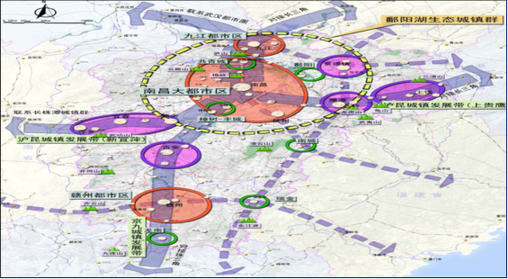

南昌市红谷滩新区国民经济与社会发展第十三个五年规划纲要

# 第一篇  站在历史新起点

“十二五”期间,红谷滩新区的经济、社会和文化等各方面都取得了长足发展,为下个阶段发展奠定了良好的基础,与此同时,新区面临的内外环境已出现了较大变化,特别是在实施环鄱阳湖生态城市群规划、实施南昌大都市区战略和赣江新区有望纳入国家级战略的背景下,红谷滩新区需要更加明晰自身的阶段特征与发展优势,科学判断自身发展的功能定位与区域角色。

## 第一章  奠定发展新基础

“十二五”时期是红谷滩新区发展历程中极不平凡的五年,在市委、市政府的正确领导下,红谷滩新区工委、管委会以围绕打造“居住之城、工作之城和生活之城”的战略任务,按照“生态、低碳、智慧、文化”的发展定位,以“建设全省金融商务区”、“红谷滩二次开发”和“三年强攻计划”等为抓手,大力推进建设新城的现代服务产业体系,激活了新城内在活力,实现了又好又快发展,在经济、社会和文化等各方面初步将红谷滩新区打造成一座“魅力新城”,比较圆满地完成了“十二五”规划确定的主要目标与重点任务,为红谷滩新城建设和发展奠定了良好基础。

### 第一节 主要成绩

(一)经济保持快速增长,综合实力稳步提升

“十二五”期间,红谷滩新区经济保持快速增长,综合经济实力迅速增强。与“十二五”初期比较,红谷滩新区的地区生产总值、财政总收入、地方财政一般预算收入和社会消费品零售额总额均实现了翻番,全社会固定资产投资总额业增长1.56倍,5项指标增速均排全南昌市第1位。2015年预计地区生产总值达到237.6亿元,“十二五”期间地区生产总值年均增速为11.42%。2015年财政总收入将达到72亿,财政总收入年均增长38.4%,地方财政一般预算收入将达到32亿,地方财政一般预算收入年均增长33.2%,全社会固定资产投资总额年均增长20.9%,“十二五”期间累计达到1556.6亿元。在对外开放方面,“十二五”期间累计实际利用外资7.5亿美元,累计实际利用内资已突破450.53亿大关。

图1  红谷滩新区各项主要经济指标走势图

(二)人口规模大幅增长,产城融合步伐加快

截止“十二五”末,红谷滩新区的常住人口达到50万左右,户籍人口达到20万左右,特别是随着九龙湖新城建设的稳步推进,将大大提高吸纳承载周边人口的能力。人口的大幅增长为繁荣新区提供了最基本的保障,为产城融合奠定了坚实的基础。“十二五”期间,红谷滩新区重点培育金融保险、楼宇经济、总部经济、文化创意、软件和服务外包、商贸物流、会展旅游等现代服务产业,特别是通过打造建设全省金融中心,累计引进人民银行江西分行、工商银行江西分行等区域金融总部机构172家,金融商务区集聚力度显著提高。尤其是在2015年成功举办了红谷滩金融商务区首届金融沙龙和长江中游城市群首届金融峰会,极大地提升了红谷滩金融商务区的知名度和美誉度。

同时,万达广场、绿地中心和世茂广场等城市综合体先后开业,红谷滩新区商业繁荣度明显提升;香格里拉、喜来登等酒店如期开业,城市品位进一步彰显;另外,慧谷创意产业园、华南城电子商务产业园和用友江西智慧产业示范园日渐成熟,万达文化旅游城与绿地国际博览城等重点项目进展顺利,产城融合步伐明显加快。

图2  红谷滩新区第三产业结构变化图

(三)九龙湖新城建设稳步推进,新城城市框架全面成形

作为“十二五”期间“二次开发”的主战场,红谷滩新区紧抓省级行政中心搬迁、西客站高铁经济建设等带来的机遇,按照“文化之城、低碳之城、生态之城和智慧之城”的定位,初步将九龙湖新城打造成行政面积达100平方公里,可容纳50万左右人口的城市雏形。首先,九龙湖新城22条城市主次干道全部竣工,形成由高快速路、交通性主干道、生活型主干道共同构成的“九横八纵”干道网络,给排水、电力、通讯、燃气等市政管网铺设到位,西客站路网一期工程全面完工,九龙湖隧道工程基本完成;其次,九龙湖新城已引进南昌国际体育中心、南昌西客站、南昌万达文化旅游城、南昌绿地国际博览城等60余个重点项目,加快推进了九龙湖新城建设力度;同时,红谷滩新区把民生设施规划放在重中之重,高标准规划布点17所中小学,目前南师附小和外国语学校初、高中部已开工建设,规划引进大型医院1所、社区卫生服务中心3所,省妇幼保健院已开工建设。

(四)城市综合治理更加精细,智慧城市建设稳步推进

按照打造“经济发展强起来和城市建管强起来”并进的样板,和建设“居住之城、生活之城、工作之城”的要求,完善城市管理精细化管理体系,精心打造精品景观工程,促进城市管理综合治理更加精细。完成了九龙湖新城核心起步区路网道路与西客站周边路网绿化工程,以及九龙湖湖体、赣江市民公园和长天广场等绿化景观工程,扎实推进中央商务区、九龙湖核心区和飞虹路等亮化工程,确保城市机械化清扫率达到75%以上。在全面推进智慧城市建设方面,已建成“一个中心、一条热线、两个平台和六大系统”的智慧网络,成为省、市关于智慧城市建设的示范工程。全面完成了数字城管53个四级数字城管平台建设,构成了与智慧城管系统相结合的双系统运作模式,其中,“大城管”城市管理基础平台与“大数据”统计分析评价决策辅助平台已投入使用,为决策提供有力的数据支撑,“全定位”GPS人员车辆指挥调度系统与“全参与”全民城管系统基本开发完成。

(五)社会事业全面进步,公共服务水平大幅提升

“十二五”期间,红谷滩新区社会事业全面进步,公共服务水平大幅提升。在教育事业方面,制定出台了加快推进优质教育全覆盖实施方案,云溪学校被评为南昌市社会主义新农村“数字校园示范校”,生米中学被评为南昌市社会主义新农村(特色)示范学校;全区中考成绩总平均分排名全市第一,优秀率、及格率、低分控制率等各项指标均明显改善。在文化事业方面,成功举办了两届江西国际标准舞全国公开赛、首届全国精品话剧展演、文化大讲堂、文化惠民“双百”工程、“文化四季风”等文化活动。承办了两届中国ATP国际网球挑战赛、“谁是球王”中国足球民间争霸赛、南昌市CBO篮球俱乐部锦标赛等体育赛事。荣获国家体育总局颁发的“全国群众体育先进单位”称号、2013年全省全民健身广场舞展示最佳组织奖、南昌市全民健身排舞大赛一等奖等奖项。在卫计事业方面,翠林社区获全国“人口计生基层群众自治示范村居”,成功打造了沙井街办、红谷世纪花园社区等5个全省第一批健康教育示范基地,全面启动了“单独二孩”政策。

同时,红谷滩新区“三中心”(便民惠民中心、卫生服务中心、文体活动中心)建设进入全面发力阶段,在全市率先实现了区、街两级网上审批和电子监察系统全覆盖,制定了街道级综合文体活动中心标准化建设方案,其中凤凰洲文体活动中心已对外开放,沙井街道与红角洲管理处文体活动中心进入选址报批阶段,完成了龙岗花园和云溪花园等社区卫生服务站基础建设。

(六)平安新区建设取得实效,民生保障水平大幅提升

“十二五”期间,通过推进了信息化、动态化条件下的治安防控体系建设,大力开展了矛盾纠纷排查调处,平安新区建设取得实际成效。在信访救助方面,通过开展“防范打击盗窃、毒品、暴力犯罪”、“夏秋无声风暴”、打击整治“黄赌毒”和“利剑”等专项行动,大力加强了社会治安防控体系建设,同时推进“民调评警”不断提升公安服务水平,确保了全区未发生重特大群体性事件、治安事件和较大以上安全事故,有力维护了辖区社会稳定。在户籍制度改革方面,按照“分类实施、完善配套、有序推进、尊重自愿”的原则,进行了“一元化”登记工作,推进户籍制度与其他相关政策的配套衔接。

到2015年,红谷滩新区实现城镇就业率达到95%,征地农民养老保险覆盖率、城镇基本医疗保险覆盖率和城镇失业保险覆盖率均达到100%,社会保障覆盖率和保障水平进一步提高,全面实现应保尽保目标,被征地农民养老保险参保1.8万人,城镇居民医疗保险参保5.9万人。

(七)环境建设力度加大,生态文明建设成果突出

“十二五”期间,红谷滩新区把建设生态文明作为更高层次的长期奋斗目标,形成了生态环境稳步提升、生态人居特色彰显、生态社会日益进步、生态制度长效确立的良好局面。通过推进了昌樟高速、国体中心周边、九龙湖片区道路景观绿化,城市森林覆盖率达到43.46%,人均公园绿地面积达15.8平方米,红谷滩新区建成区城市绿地面积约1564.64公顷,城市绿地率达43.46%,绿化覆盖面积约1646.40公顷,绿化覆盖率达45.73%;公园绿地面积约275.91公顷,人均公园绿地面积达15.8平方米,均超过全市平均水平。同时,市政配套重点完善一批污水处理厂与垃圾中转站,重点提高机械化清扫率和市容特色班覆盖面,全区城市生活污水处理率达到95%,城市生活垃圾无害化处理率达到100%,特别是随着供水能力30万吨/日的牛行水厂和日处理污水能力40万吨的红谷滩污水处理厂的正常营运,红谷滩新区的生态环境得到明显改善。

(八)体制机制不断创新,区域发展焕发活力

“十二五”期间,根据红谷滩新区功能发展定位,不断推进体制机制创新,坚持精简统一效能,稳步推进大部制改革,2012年完成红谷滩新区工委、管委会“三定方案”,近期经过不断争取,又有效推进了区工委、管委会及区直属事业单位机构编制升级,通过优化配置、增减平衡等手段,有效缓解了红谷滩新区机构编制日益紧张的矛盾,建立了精干高效的政府组织体系;通过清理规范了一批行政审批事项、精简审批环节和压缩审批时限,全面提升红谷滩新区行政效能,为企业和群众提供更优服务;通过承接省市下放的审批服务事项,特别是全市第九轮审改下放的128个审批事项,加大简政放权力度,扩大镇(街)处对辖区范围内行政事务的管理和处置权限;通过不断优化政务服务环境,鼓励工商、税务及街办等相关部门主动提供上门服务,帮助入驻金融企业现场解决困难。同时,通过“实在实干实绩”用人导向,着力培养选拔一批优秀年轻干部,强化党风廉政建设,全面落实好“两个责任”。其中,红谷滩新区干部在线学习中心成为全省首个区级干部在线网络学习平台。

### 第二节 主要不足

(一)需进一步提升城市集聚辐射功能

从南昌大都市区架构视角下来看,南昌各区县经过多年发展与沉淀,形成了各自资源配置能力和聚集辐射功能,如高新区集中了全市五大战略性支柱产业中的四个,在全省十大战略性新兴产业高新区有六个,已成为江西省与南昌市市战略性新兴产业发展的主要聚集地。经开区高端产业集聚区已具备电子信息、汽车机电、生物医药和新材料4个“百亿产业集群”,以及食品饮料和家电2个“五十亿级产业集群”,产业集群及辐射周边城市的功能十分凸显。而红谷滩新区仅仅经历15年的奋斗历程,且早期的发展重点集中于城市建设与空间拓展方面,虽然在“十二五”期进入了繁荣成熟期,初步具备“四个中心”的雏形(新行政中心、新居住中心、新金融中心和新商业中心),然而,红谷滩新区要成为南昌大都市的首善之区和南昌市唯一的中央商务区(CBD),其城市建设、文化内涵和集聚辐射功能有待进一步提升,城市开放度和区域影响力有待进一步提高。

(二)需进一步平衡协调城市功能布局

截止“十二五”末,红谷滩新区包括中心区、红角洲和凤凰洲在内的50平方公里建成区,还包括九龙湖新城的100平方公里,是典型的“带状”城市,需要加强统筹协调和整体推进的思路,形成有机整体,避免建成区域与新建区域单兵突进的发展态势,将建成区的经济形态尽快拓展延伸到九龙湖新城,逐步培育九龙湖的商贸流通、办公、居住、休闲功能。同时,通过统一整体规划,科学定位各片区的主体功能,促使红谷滩新区内部片区有机错位发展。另外,配合地铁1号线与2号线的开通,红谷滩新区需要充分挖掘地下空间,统筹布局地下空间功能。一些城市功能布局项目可能涉及多方利益,要考虑开发商、业主及其他权利主体的利益,也要兼顾政府的产业发展、社区服务配套等公共利益,特别是要协调好功能布局项目中存在平衡难、确认难和推进难的“三难”问题。

(三)需进一步挖掘服务型经济潜力

“十二五”期间,红谷滩新区已从建筑和房地产业“一支独大”迈向服务经济“多点开花”的新阶段,服务产业的空间密度和产出效率都大大提高,第三产业已成为红谷滩新区的主导产业。然而,服务型经济有待进一步挖掘,首先,需抓住消费升级机遇,重点布局新兴服务业(新技术、新产业、新业态、新模式),挖掘“互联网+”潜力发展新型商贸业态,例如与电商协同推进线上线下相结合的商场新业态,借助成熟平台实现实体店线上支付、线下消费。其次,需依托高铁经济、地铁经济与智慧经济的建设,来提高服务经济的辐射力度与深度,实现红谷滩新区从功能中心到服务中枢,再到智慧新城的转变,成为具有国际水准的现代化都市新中心。再次,需深化“产城融合”的城市经济提升理念,建设城市综合新平台,打造新兴服务经济增长极。城市化是服务业发展的重要推手,产城融合水平是服务业发展的重要因素,因此,需明确“产城融合、服务业优先”的城市发展战略,以“比较优势”原则发展好平台经济与总部经济。

(四)需进一步强化基础设施保障能力

“十二五”期间,随着红谷滩新区人口的迅速增加与需求的提高,基础设施保障能力与市民的要求还存在一些差距。一是交通基础建设通达率不够,已建工程运能效率低,不仅新区与老城区、新建区和湾里区等周边区域的交通网络不够完善,红谷滩新区内部的交通网络运载能力也落后于市民的需要,特别是在中心区,上班高峰期堵车、塞车和打车难以成为常态;二是节水型水资源保障工程建设压力大和保障水平不高。随着红谷滩新区“三化”进程进一步加快,工业用水和城镇用水急剧增长,水资源过度开发和水环境压力将会增大,节水工程及城镇居民供排水工程、工业用水保障工程和城镇废水处理、重复利用工程建设的压力进一步加大;三是社会治理能力有待提高,随着红谷滩新区特别是中心区建设的趋于成熟,加上南昌西站开通运行,省级行政中心即将搬迁转移,人气、商气聚集的同时社会治理与城市管理的压力巨大。

(五)需进一步激活科技创新能力

“十二五”以来,红谷滩新区产业的原始创新能力依然不足,企业的自主创新能力较弱,新技术、新产品研发水平不高,主要表现在三方面:一是企业技术创新主体地位还没有真正确立,企业在技术创新决策、投入、科研组织和成果转化中的主体作用还不突出,以企业为主的产学研结合不够紧密,产学研用结合的有效机制还没有建立,科技与经济结合问题还没有从根本上解决。二是创新资源不足急需引起重视,关键及核心技术研发能力和系统集成能力仍显薄弱,不足以支撑经济增长,与南昌其他区县相比还存在差距,资金投入和高素质人才储备有待加强,对高素质专项人才的吸引力仍处劣势。三是人才结构和布局不尽合理,高层次人才、高技能人才匮乏问题仍很突出,党政机关、教育、卫生单位人才较多,企业等基层人才严重缺少;传统专业人才较多,掌握现代高新技术的人才很少。

## 第二章  面对发展新环境

### 第一节 发展形势

十八大以来,以习近平同志为总书记的新一届中央领导集体,根据新形势、新变化、新要求,先后提出了一系列重大战略谋划,提出“两个一百年”的奋斗目标,强化“三期并存”的发展阶段(即我们正处在全面建成小康社会的关键时期,处在转变发展方式和深化改革的攻坚时期,同时还处在大有可为的战略机遇期),作出了“四化同步”的路径设计和“五位一体”总体布局,特别是提出了“一带一路”、长江经济带等对南昌及红谷滩新区发展密切相关的一系列对外开放和区域合作战略构想,这些变化是我国战略机遇期内涵、条件、要求的新变化,也必将对红谷滩新区在“十三五”期间的经济社会发展产生重要深远影响。

同时,“十三五”也是全面深化改革取得新突破的五年。十八届三中全会已经明确提出,到2020年在重要领域和关键环节改革上必须取得决定性成果。在行政管理体制、财税体制、投资管理体制、资源产品定价机制、金融体制、户籍制度等领域,改革将会取得积极进展,而投融资模式创新问题、民营资金进入问题、国资国企改革问题、区划调整问题、市区两级事权调整问题、存量用地二次开发等问题在“十三五”都有可能破题。

另外,“十三五”也是我国经济将进入新常态的五年,经济发展表现出四个特征:一是中高速,“十三五”将进入经济速度换挡期,经济增速已经告别过去长时期两位数增长的阶段,进入到7%至7.5%左右的中高速增长阶段;二是中高端,“十三五”时期经济增长将更多地以国内需求增长替代外贸需求来支撑,产业结构将呈现向服务型经济发展的转变,工业结构将呈现向先进制造业发展的转变;三是新动力,到“十三五”时期,投资的边际效应减弱,且后续资金保障压力较大,发展模式要逐步转向更多依靠创新驱动、大众创业;四是新风险,目前已经出现了楼市滑坡、地方债偿还等风险的苗头,需要对房地产开发、地方政府融资进行统筹谋划,建立长效发展新机制,同时还需应对公共安全、社会突发事件等社会风险。

### 第二节 发展机遇

(一)环鄱阳湖生态城市群规划将凸显红谷滩新区绿色低碳的优势与特色

环鄱阳湖生态城市群是我国长江中游城市群的重要功能区域,也是绿色城镇化的国家级示范区。它要求立足于区域内良好的生态环境本底条件,建立起社会经济发展与自然相融合的发展模式,将山水文化融合到城乡发展建设,在国内率先建成生态环境一流品质的城市群。通过建立起绿色城镇化发展机制,实现产业多元化发展路径,创新公共服务均等化和社会保障机制,建成新型城镇化示范区。

环鄱阳湖生态城市群规划的实施,与红谷滩新区定位为低碳绿色发展形成相互呼应,因此,红谷滩新区最有条件作为鄱阳湖生态城市群的桥头堡,形成构建长江绿色生态走廊、建设美丽中国的典型范本,同时,环鄱阳湖生态城市群规划的实施将促使红谷滩新区充分挖掘丰富的生态宜居资源,积极发展旅文化旅游经济,拓展面向环鄱阳湖生态城市群的市场,建成生态旅游、文化体验、休闲娱乐和养身健康为一体的、品质一流的生态宜居城市,另外,环鄱阳湖生态城市群规划的实施将促使红谷滩新区率先破除制约发展的体制机制障碍,不断激发经济发展内生动力,进一步增强社会创造力和凝聚力,带动全市与全省同步全面建成小康社会。

| 专栏一 环鄱阳湖生态城市群规划 |
|---|
| 以鄱阳湖和赣、抚、信、饶、修五条水系廊道组成的自然生态网络为本底,以网络化,开放式交通体系为骨架,以昌九一体化为重点,以景德镇、鹰潭、新余和抚州等区域性中心城市为支撑,以滨湖田园风光城镇为补充,强化中心城市集聚和辐射功能,统筹协调区内的资源配置、城市功能和规模、产业结构和布局,统筹规划城市群内各城市的基础设施和公共服务设施,提高基础设施网络化、公共服务均等化水平,强化城市间联系与协作,努力将环鄱阳湖生态城市群建设成为中国大湖流域生态人居环境建设的示范区,全国低碳经济创新发展的示范区和全省开放崛起的引领示范区。 |

(二)赣江新区有望纳入国家级战略将凸显红谷滩新区区域功能

赣江新区是昌九一体化的重要载体,将促使南昌与九江共同构建长江经济带的新兴经济增长极,在国家发展“一带一路”、建设长江经济带、设立上海自贸区的重要契机下,已具备了为设立国家级新区的条件与基础。

推进赣江新区建设,将促使红谷滩新区更好融入到南昌与九江都市区一体化发展中,进一步提升红谷滩新区承东启西、沟通南北的区域功能和产业梯度转移纽带作用,更好地推动红谷滩新区经济增长空间从内陆拓展到沿海沿江,促进南昌市一江两岸格局协调健康发展,实现国家依托长江黄金水道打造中国经济新支撑带的战略部署。同时,红谷滩新区将立足区位优势和自身环境优势,积极争取国家级新区的产业优惠政策,引进吸引一批重大科技专项和高附加值产业集群落地,特别是集创新、创业和服务为一体的战略性新兴产业,提升经济发展质量,促进产业科技创新能力提高。

| 专栏二 国家级新区:赣江新区基本概况 |
|---|
| 按照江西省发展和改革委员会提出的《江西赣江新区总体方案》确定赣江新区的主体功能区范围包括:南昌市青山湖区蛟桥镇,新建的乐化镇、樵舍镇,面积266.73平方公里;九江市永修县的涂埠镇(县城)、艾城镇,共青城市的茶山街道、甘露镇、江益镇,面积198.39平方公里,总面积465.12平方公里。赣江新区除了包括推动新型工业化、新型城镇化发展的主要开发主体单元外,也包括部分城乡生态过度地带,以更好地推动相关功能一体化建设。同时规划建设设定协调区,协调区将主体功能区的开发建设相关的城乡过度地带、相关小城镇的纳入,作为实现城乡空间资源统筹配置的协调区。新区将南昌经开区至共青城以东的滨湖地区纳入,以体现生态文明建设的要求;此外,考虑将推动南昌西部梅岭的保护与合理开发,也将其纳入赣江新区统筹规划建设,以探索生态文明下的新型城乡关系。 |

(三)南昌大都市区战略将优化红谷滩新区集聚辐射功能

根据《南昌大都市区规划》,南昌大都市区还将包括抚州市的临川区、东乡县,宜春市的高安市、丰城市、樟树市、奉新县、靖安县,上饶市的余干县和九江市的永修县,总面积约2.3万平方公里,而南昌大都市核心区面积包括南昌市辖区、新建区和南昌县,总面积为4700平方公里,将大大拓展南昌市的外部空间和地理范围,突破行政区域区域对南昌发展的制约,南昌大都市区定位为江西省核心增长极、长江中游区域中心、具有国际知名度的生态人文都市,这将极大地提升优化红谷滩新区的集聚辐射功能。

首先,南昌大都市区战略将极大提升南昌市作为省会核心城市的辐射能力,而红谷滩新区是支撑南昌大都市区、带动鄱阳湖生态经济区、辐射和服务全省的唯一区域性中央商务区(CBD),特别是随着省级行政中心搬迁至九龙湖板块,红谷滩新区成为继市级行政中心入驻后的省级首脑机关所在地、政要人物聚集中心,承担这承接老城区公共服务产品转移,创造一流的政务环境的重大责任,理所当然成为全省唯一的中央政务区(CPD)。

其次,红谷滩新区已具有总部基地、金融大街等良好的总部经济基础,特别是全省绝大多数金融机构省级总部已近集聚在红谷滩新区,而南昌大都市区战略将极大提升红谷滩新区总部经济的集聚力度,为省级优势企业和国外公司驻华地区的企业总部、营销总部、采购总部、投资总部、研发总部集聚红谷滩新区提高很好机遇。

再次,由于红谷滩新区具有较高标准的城市建设成为新南昌城市形象的标志区,同时,红谷滩新区一直倡导绿色低碳生活方式,成为南昌市生态宜居的首先之地,因此,南昌大都市区战略将吸引更多的中高端人士集聚于此,这将大大推动红谷滩新区在城市建设、社会管理和文化魅力等各方面全面发展。

| 专栏三 南昌大都市区概况 |
|---|
| 南昌大都市区包括南昌市域,抚州市的临川区、东乡县,宜春市的高安市、丰城市、樟树市、奉新县、靖安县,上饶市的余干县和九江市的永修县,总面积约2.3万平方公里。南昌大都市区核心区范围包括南昌市辖区(包括新建区)和南昌县,总面积4700平方公里。定位:江西省核心增长极、长江中游区域中心、具有国际知名度的生态人文都市。城市职能:主要包括国际生态宜居城市、内陆开放型经济新高地、全国重要先进制造业基地、全国重要的综合交通枢纽和全国商贸物流中心。推动南昌向新兴科技与休闲经济城市方向转型,注重科技、区域性金融贸易、休闲旅游、文化创意、现代物流等职能发展。 |

(四)南昌市产业结构加速升级将加快红谷滩新区“服务经济”兴起

当前,南昌市的许多制造企业的专业服务基本外包化,制造业和服务业之间彼此依赖的程度日益加深,另一方面,服务经济中的制造业对服务的关注热情也是空前高涨,促使大量服务经济的新兴业态不断涌现成熟,服务经济规模处于快速扩张阶段,是南昌市加快战略性新兴产业发展、推动产业结构的优化调整的关键因素。从南昌大都市区的发展来看,亟需与全市先进制造业、战略性新兴产业等配套的服务经济兴起。服务业正成为一个至关重要的竞争手段和提供形成巨大竞争优势的关键潜力,具体范畴包括物流、金融、电信、运输、旅游、体育、商贸、餐饮、物业、信息、文化等行业服务,以及以政府事业单位等为主发挥职能的公共服务:如教育、医疗卫生、人口和计划生育、社会保障等。在整个南昌市服务产业发展中,红谷滩新区具有天然的区位优势、后发优势和城市功能优势,这为红谷滩新区建设开放型服务经济高地,引进高端生产要素,进一步推动服务经济产业扩容升级,提升在南昌市产业链中的地位提供了难得机遇。

(五)南昌市重大领域改革持续推进将为红谷滩新区充分释放制度红利

“十三五”时期,南昌市的体制机制环境将发生重大变化,将会在一些关键领域持续推进改革,经济社会发展活力将得到更加充分的释放。在此大背景下,红谷滩新区可通过行政管理体制改革进一步理清政府与市场的界限,通过供给侧改革进行结构调整,充分发挥好市场在资源配置上的决定性作用,以提高发展要素配置效率。同时,通过投资管理体制改革,推动更多领域向民间资本开放,更好地激发民间资本的活力,以提高投资效益。通过金融体制改革将构建更加高效的融资渠道,确保实体经济、小微企业和“三农”发展等领域得到更多的金融支持,降低发展的资金成本。另外,通过抓住户籍制度改革、职业培训等加快外来流动人口市民化进程,更加充分挖掘人口数量与质量的红利。

在对外开放方面,增强抓住加深对外开放机遇提升整合利用生产要素的能力。通过进一步放宽外商投资准入,推进服务领域的投资自由化,为服务业领域利用外资、引入技术和引进人才等高端生产要素创造有利条件。促进具备实力的企业更好地利用资本、品牌和技术等方面的优势,加快拓展海外市场规模,提升参与国际产业分工的水平,不断地向全球产业价值链的高端攀升。

### 第三节 发展挑战

“十三五”期间,推动我国经济增长的传统红利弱化,经济增长率将下降一个台阶,特别是我国经济社会发展中长期积累的失衡和矛盾集中显现,产业结构调整进入攻坚期。因此,红谷滩新区自身发展还面临着诸多瓶颈亟待解决。

(一)经济可持续增长的支撑动力不牢固

“十三五”时期,红谷滩新区经济运行将保持平稳增长的“新常态”,支撑经济高速增长的动力不足,下行压力较大,一是“三驾马车”的拉动作用减弱。从投资来看,基础设施大规模建设的时代已经过去,“十三五”将处在低速增长状态,而房地产投资增速将大幅回落,工业投资受制于商务成本上升和建设用地负增长,预估仍将在低位运行。二是新的增长点尚处于培育期,服务经济产业仍处于培育中,新增长点尚有很大不确定性,特别是受全市经济增速放缓和体制机制改革滞后的影响,经济发展势头回落,且高端服务业竞争优势不明显,对经济增长的支撑力有所下降。

(二)建设服务经济体系面临其他行政区的挑战

构建红谷滩新区的现代服务经济体系需要跳出红谷滩区域,在更大范围内来谋划,但由于各行政区经济的存在,红谷滩新区与周边其他区域的产业同构现象所带来的企业之间的无序竞争,降低了区域的整体效益,也制约着红谷滩新区现代产业体系的构建。从南昌市其他区县的产业发展规划看,产业同构化趋向比较明显,金融业、总部经济、商贸物流、文化创意产业和科研教育产业等成为老城区发展的热点,同质竞争导致行业的利润普遍下降,从而影响产业的升级和创新,延缓了行业乃至整个产业的转型。

(三)维护社会稳定压力增大

“十三五”时期,红谷滩新区正处于城市转型深度调整期,内生性社会矛盾有可能不断累积。一是经济增长放缓带来的就业压力将增加社会不稳定因素,实体经济特别是中小企业依然面临巨大困难,企业用工需求可能放缓,特别是弱势群体的就业将会更加困难。二是改革利益分配不均和社会阶层结构多样化的矛盾加剧。随着社会意识的日趋多元,转型发展中各种制度性摩擦和冲突增大,加上基层治理体系与治理能力薄弱,导致群体性事件发生的风险加大。三是随着人口规模不断扩大和人口结构日益多元,居民对公共产品的需求更趋多元化,对公共服务供给能力和服务水平提出了更高要求。

(四)社会转型发展对社会治理体系提出更高要求

“十三五”时期是红谷滩新区社会结构加速转型的时期,价值观更趋多元化、利益诉求更趋复杂化,特别是大数据、移动互联网等信息技术的迅猛发展,对思维方式、生产方式、交往方式、生活方式等各领域带来全方位颠覆性的变化,迫切需要建立完善顺应时代要求的社会治理体系,但政府长期以来重管理、轻服务、更轻社会治理,导致目前社会治理体系不完善,难以应对日趋复杂的社会发展形势。社区服务管理体制存在着职责定位不到位、过度行政化、各条线各自为战、治理机构不健全等问题。社会组织培育工作任重道远,总量结构不尽合理、独立性不强、发展不平衡等问题仍然突出。“十三五”时期,社会加速转型发展将给红谷滩新区社会治理体系带来较大的考验,也是红谷滩新区当前亟需直面的一大挑战和矛盾。

(五)城市化推进与公共服务有效供给不足矛盾突出

“十三五”时期是红谷滩新区城市扩容增效稳步推进的时期,特别是九龙湖将迎来较大人群流入,据初步保守推算,在“十三五”时期新增城市常住人口 30 万人以上。根据国务院发展研究中心的测算,每新增一名城市人口所需的财政资金成本至少为 15 万元,这意味着,在“十三五”时期,红谷滩新区政府需要额外提供 450 亿元的财政资金用于公共服务,因此,城市化推进与公共服务有效供给不足的矛盾将制约“十三五”时期红谷滩新区的经济社会发展,特别是涉及民生的基础教育、医院和文化设施等公共服务供需矛盾突出。同时,在管理体制机制上,建成区与新开发区发展存在“争资源”、“两张皮”现象,不利于红谷滩新区统筹规划、集中力量办大事。

### 第四节 阶段特征

(一)基本建成“四个中心”的冲刺期

“十三五”期间红谷滩新区要建成具有全省影响力的行政中心、具有中部影响力的商务中心、具有全省影响力的金融中心和生态与人文融合的文化中心,从目前来看,“四个中心”的辐射力及资源配置能力上还有一定差距,因此,红谷滩新区要顺应南昌大都市区发展的新趋势,以时不我待的精神,全力冲刺和实现基本建成“四个中心”的目标,要紧紧围绕打造南昌大都市的核心区,加快集聚一批功能性机构,着力打造一批功能性平台,突破一批功能性政策,在“四个中心”上取得决定性进展,为南昌市建设核心增长极提供有力支撑。

(二)服务经济升级的关键期

“十三五”时期,红谷滩新区要抓住服务经济新兴业态兴起,加快推进服务经济扩容升级,实现经济运行由高速增长向平稳增长、增长动力由投资驱动向创新驱动、经济结构由房地产主导向服务经济主导转变,打造区域经济一体化背景下的竞争新优势。要以增强自主创新能力为核心,抓住建设具有较大影响力的科技创新中心的重大契机,全面深化科技体制改革,充分释放创新活力,大力推动创新驱动发展。要抓住产业变革的新机遇,加快形成以服务经济为主的产业结构,占领未来产业发展的制高点。要适应资源环境紧约束的要求,在推进结构调整上下功夫,强化节能减排降碳,推进建设用地减量化,彻底摒弃高投入、高消耗、高排放的发展模式。

(三)社会治理创新的转型期

“十三五”时期,不同群体对“社会公平、公正”等社会秩序和利益格局的诉求进一步凸显,对更高层次的公共服务的需求将明显增加,这无疑对政府的治理提出新的要求,特别是随着红谷滩新区的城市规模不断扩大,市民权利意识日趋提升,诸如环境污染、公共卫生、信息泄露等问题都将可能产生意想不到的后果,传统的社会治理思维已经不能适应发展需要,红谷滩新区要适应社会发展的新趋势,进一步转变社会治理理念,在改进社会治理方式、构建共治格局上下更大力气,更加注重系统治理、源头防范、多方参与,加强基层社区治理能力,充分发挥社会组织的功能,促使更多的微观主体参与到社会治理中,形成和谐有序、弹性适应的社会发展局面。

(四)全面建成小康社会的收官期

按照中央要求,2020年我国要实现全面建成小康社会的宏伟目标,小康社会作为全局性愿景,涵盖了经济社会发展各个方面,具有系统性。从当前所处发展阶段及具备的基本基础条件来看,红谷滩新区应当在这一进程中处于领先地位,随着经济持续快速发展,已经为实现这一目标奠定了坚实基础。按世界银行标准,当前红谷滩新区已进入中高收入地区的行列,“十三五”时期,要在保持经济平稳发展的同时,更加注重公共服务均等化,更加注重社会文化进步,更加注重生态环境治理,更加注重公平正义与社会和谐稳定,更加注重民生保障和人民生活改善,为全面建成较高水平的小康社会提供有力保障。

# 第二篇  谋划发展新局面

“十三五”期间,红谷滩新区需立足于“四个中心+四个承载区”的功能定位,通过强化“双核双带三园四板块”的区域空间格局,实施服务经济立区、金融中心强区、智慧城市领区和文化旅游兴区四大战略,纳慧聚源,顺势崛起,最终将把红谷滩新区打造成南昌大都市的首善之区。

## 第三章   功能定位

根据红谷滩新区资源禀赋、城市形象、发展优势和发展方向,结合南昌市功能核心区行政区划的要求,红谷滩新区“十三五”期间的功能定位是“四个中心+四个承载区”,即辐射全省的行政中心、具有中部影响力的商务中心、具有全省影响力的金融中心和生态与人文融合的文化旅游中心,以及昌九一体化核心功能的承载区、南昌核心增长极的典范区、低碳智慧生态文明的引领区和产城融合的示范区。

### 第一节 四个中心

辐射全省的行政中心。“十三五”期间,随着省级行政中心搬迁至九龙湖板块,红谷滩新区成为继市级行政中心入驻后的省级首脑机关所在地,要高标准、高水平地做好对省级机关、厅局等的服务保障,全力承接好老城区公共服务产品转移,加快区内公共服务配套建设,不断增强服务能力,创造一流的政务环境,提供安全稳定的社会环境和优美宜居的生态环境,进一步提升城市综合承载力。

具有中部影响力的商务中心。“十三五”期间,红谷滩新区要着力深化商务服务示范中心建设,力争把红谷滩新区建设成为面向全省、辐射中部的 “商务服务示范中心(CBD)”,积极引进国际知名的咨询、会计、律师等中介机构,争取将红谷滩新区建成中部专业服务门类最齐全、国际化程度最高的地区之一,逐步提高城市发展总部经济的综合配套能力,形成较好的总部经济示范效应,提升红谷滩新区对企业总部的吸引力。

具有全省影响力的金融中心。红谷滩新区已入驻金融机构企业达到了172家,具有丰富的金融发展基础和资源聚集度,成为全省品种最齐全、创新最活跃、环境最完善的金融中心核心功能区。要继续促进驻赣金融机构和监管部门、全国性金融分之机构入驻,同时充分发挥金融决策、管理、结算、信息等资源优势,高标准完成全省金融商务区建设,提升品牌价值,扩大影响力,不断增强金融服务全市、服务全省和辐射中部地区的能力。

生态与人文融合的文化中心。红谷滩新区傍依几十公里赣江沿线,拥有前湖、九龙湖和碟子湖等自然景观资源,同时新区高校林立,10余所高校20万师生是新区重要的人文资源,要把生态资源和人文资源作为最宝贵的资源,突出山水文化、红色文化、水都文化和田园文化,促进多元文化融合,组织串联红谷滩新区的公共空间和人文景观资源,巩固和提升新区文化的影响力和竞争力,打造具有较高影响力与辐射力的生态与人文融合发展的文化中心。

### 第二节 四个承载区

昌九一体化核心功能的承载区。按照“做强南昌、做大九江、昌九一体、龙头昂起”这一要求,红谷滩新区要根据自己的禀赋条件,更加深入嵌入到昌九一体化中,为实现“龙头昂起”作出应有的贡献,特别是在做强发展平台方面,积极吸引国际性组织、公司区域总部、国际会展等高端要素集聚,承接全市发展空间拓展、高端资源要素配置、高端活动承载等新增功能,努力成为全省城市形象的“引领者”。

南昌核心增长极的典范区。全面承接南昌老城及中心城区疏解功能,突出商务、文化、教育、医疗及行政办公等城市综合服务功能,吸引符合高标准城市要求的优质服务资源集聚,大力发展与南昌市城市功能相适应的高端商务、金融保险、现代物流、文化创意等产业,转变经济发展方式,深度调整产业结构,使之成为南昌核心增长极中最具磁力的区域,成为中部城市群合作发展的重要节点。

低碳智慧生态文明的引领区。坚持“人本、绿色、低碳、和谐”的发展理念,突出赣江滨水特色,瞄准世界标准,强化基础设施建设,提升公共服务水平,统筹城乡发展,促进人口、资源、环境协调,大力发展绿色、低碳、循环经济,加快构建绿色生态产业体系,积极倡导生态文明生活方式,着力建设经济与生态协调发展的现代化新区,为全国低碳经济发展和生态文明建设发挥示范引领作用。

产城融合的示范区。按照产业结构布局合理、城市服务功能完备、生态环境优势明显的要求,通过重点打造慧谷创意产业园、华南城电子商务产业园和用友江西智慧产业示范园等重点项目,吸引新的投资,加快产业升级转移,带动红谷滩新区现代服务业的发展,稳步推进产城融合建设,最终成为名副其实的居住之城、生活之城与工作之城。

## 第四章   指导思想与发展原则

### 第一节 指导思想

深入贯彻落实党的十八届三中、四中全会精神,高举中国特色社会主义伟大旗帜,以邓小平理论、“三个代表”重要思想、科学发展观为指导。落实省委提出的“发展升级、小康提速、绿色崛起、实干兴赣”十六字方针,紧紧抓住南昌打造核心增长极和省级行政中心搬迁入驻等重大发展机遇,以“优化提升建成区,全力攻坚新城区”为重点,全面实施“服务立区、金融强区、智慧领区、文化兴区”战略,努力推进红谷滩新区四个中心建设(辐射全省的行政中心、具有中部影响力的商务中心、具有全省影响力的金融中心和生态与人文融合的文化中心),纳慧聚源,顺势崛起,把红谷滩新区打造成南昌大都市的首善之区,成为服务经济繁荣、金融服务领先、文化旅游魅力彰显和绿色生态鲜明的宜居新城。

### 第二节 发展原则

在未来发展中要遵循以下七个原则:

坚持融合发展。要深化对区域内中心区、红角洲、凤凰洲和九龙湖新开发区的不同地区基本情况和发展状况的认识,明确发展定位和工作重点,建立完善统筹协调机制,加快推进空间融通、资源融汇和文化、产业、体制机制的融合,努力推动区域又好又快发展。

坚持率先发展。要注重打牢工作基础、巩固发展优势,坚持工作的高标准,着力实现经济发展优质化、风貌保护精细化、社会建设人文化、城市面貌精致化,力争使全区各项工作走在全市前列,充分发挥全市功能核心区的引领示范作用。

坚持创新发展。要充分解放思想、深化改革,坚持与时俱进,勇于探索、敢于尝试、善于创新,在工作理念、工作机制和工作方式上,积极开辟新领域、创造新经验、展现新水平,使各项工作体现时代性、把握规律性、富于创造性。

坚持开放发展。要按照南昌建设为长江经济带重要节点城市的要求,强化开放意识、培养世界眼光、开拓国际视野,以更加系统的全局观念、更加长远的战略思维,充分利用各方面资源优势促进区域发展,不断提高区域开放幅度与开放深度。

坚持绿色发展。要注重区域人口、资源、环境的协调可持续发展,弘扬生态文明理念,加快转变经济发展方式,实施人口调控与功能疏解同步推进,大力发展循环经济,倡导低碳生活方式,切实推进资源节约型、环境友好型社会建设。

坚持品牌发展。品牌是战略性资产,是核心竞争力的重要源泉。切实以品牌立区提领全区的产业发展、城市建设和环境改善,特别要围绕城市资源品牌化,把红谷滩作为最大的品牌和资源,精心打造,悉心经营,不断增强红谷滩新区的凝聚力和归宿感。

坚持共享发展。要始终坚持以人为本,彰显人的主体地位,全面提升社会建设水平,大力推进公共服务均等化,加强和完善社会治理,妥善协调各方面利益关系,促进社会公平正义。要不断完善区域资源的统筹协调整合机制和共驻共建共享机制,让全区人民共享改革发展成果、共享城市美好生活。

## 第五章  发展战略与空间布局

### 第一节 发展战略

“十三五”期间,要大力实施“服务立区、金融强区、智慧领区、文化兴区”发展战略,加快推动发展方式转变,全面提升城市发展品质。

实施“服务经济立区”战略。力争用3-5年左右时间,促使红谷滩新区服务产业转型升级,形成高能级、广辐射的服务经济型为主体的产业结构。通过发展“四新”经济为重点(“新技术、新产业、新业态、新模式”),加快培育“四新”企业,营造与国际接轨和有利于发挥市场决定性、灵活性作用的制度环境。稳步推进服务业扩大开放,探索育幼养老、建筑设计、会计审计、商贸物流、电子商务等领域开放;推进金融、教育、文化、医疗等领域有序开放,加快推进教育培训、医疗服务、投资管理、增值电信、旅游服务等开放领域的项目备和落地;扩大服务业内部新产业、新业态、新模式规模,提升服务业发展能级;吸引服务业公司在红谷滩新区设立地区总部,以及采购物流和研发中心;鼓励本土服务企业走出去,面向全球开拓市场,分享全球化红利。

实施“金融中心强区”战略。利用相对完善的中央商务区基础设施沉淀,紧紧抓住全球金融产业结构调整和中国经济发展转型的有利时机,力争用3-5年时间,把红谷滩新区金融中心建设成为金融功能全面、金融产业发达、交通高效便捷、配套设施完善、生态环境优美和产业结构优化的新型金融商务区。以金融的强大牵引力和辐射力带动产业走向高端、高效、高辐射,增强对经济社会发展的支撑能力,使之成为在国内具有重要影响的区域性金融商务中心和全球绿色金融商务试验区,同时,作为拉动南昌大都市区的新引擎,成为促进江西科学发展、绿色崛起,建设富裕和谐秀美江西的示范区。

实施“智慧城市领区”战略。充分利用国家智慧城市试点城区的机遇,立足红谷滩新区的现状和发展前景,通过3-5年时间,运用下一代互联网、物联网、云计算、无线宽带等先进技术,整合信息资源,进行综合利用,全面推进信息基础设施、生态环境、社会民生、产业经济、城市管理五大领域智慧城市规划建设, 构建以智慧新设施为“树根”、智慧新技术为“树干”、智慧新产业为“树枝”、智慧新应用和新生活为“树叶”的智慧城市“树型”框架,智慧城市运行体系初步形成,实现信息网络广泛覆盖、智能技术高度集中、智能经济高端发展、智能服务高效便民,成为江西领先、全国有特色、达到国家住建部“三星”水平的中国智慧城市建设先进示范区。

实施“文化旅游兴区”战略。文化旅游软实力是红谷滩新区发展的重要支撑和持久动力,要以文化兴区为目标,以文化旅游产业园为先导(万达文化旅游城、绿地国际博览城),以文化项目为支撑,通过市场运作为纽带,倾心塑造红谷滩新区的文化品牌,改造提升传统文化旅游产业,积极发展新型文化业态,不断提高文化旅游产业的影响力和对经济社会发展的贡献率。“十三五“期间,在以万达文化旅游城开业为标志,以赣江西岸生态风光带为轴线,争取将红谷滩新区初步建成为省内城市旅游的目的地。

### 第二节 空间布局

根据红谷滩新区城市空间优化及现代化智慧新城建设时序安排,按照“统筹规划、合理布局、完善功能、特色鲜明”的原则,坚持区域经济优势互补、主体功能定位清晰、国土空间高效利用、人与自然和谐共处,完善城市化布局和形态,强化新城产业功能,增强城镇公共服务和居住功能,构建“双核双带三园四板块”的区域空间格局。

双核:即中心区的中央商务区(CBD)和九龙湖的中央政务区(CPD)。中心区的中央商务区(CBD)。集中力量打造以金融业为核心的经济增长极。充分发挥金融街功能集聚、政策集合、服务集成的效应,拓展产业发展空间,丰富产业内涵,完善基础设施,提升服务质量,努力建设具有中部影响力的金融中心。促进总部楼宇经济发展,加快绿地中心、万达广场、莱蒙都会和世茂广场等城市综合体建设和运营,促进中心区繁荣繁华。

九龙湖的中央政务区(CPD)。“十三五”期间,随着省级行政中心搬迁至九龙湖板块,是继市级行政中心入驻后的省级首脑机关所在地、政要人物聚集中心,充分利用基于政府所在地重要性的“都厅效应”,高标准、高水平地做好对省级机关、厅局等的服务保障,全力承接好老城区公共服务产品转移,加快区内公共服务配套建设,不断增强服务能力,创造一流的政务环境,提供安全稳定的社会环境和优美宜居的生态环境,突出打造服务全省的中央政务区(CPD)。

双带:即沿赣江的产业布局和沿西外环昌九快速通道的经济发展通道。充分利用赣江沿线形成的滨水风光带、绿色开敞空间和亲水空间,主要布局旅游文化、绿色办公、生态居住、展览展示和温馨的休闲场所等,集中体现南昌动感都会形象和体现红谷滩新区区域产业繁荣和实力。对红谷滩CBD局部沿江路的线位进行调整,扩大滨江公园的面积,同时开发利用地下空间,形成多元立体的城市活力T台,展现更加具有未来感的城市CBD形象。充分利用南昌大都市建设的契机,紧抓西外环城高速(昌九快速通道)快速通道带来的物流人流,依托于湾里区、新建区和南昌县空间对接的地理优势,主要布局现代物流、服务外包、现代商贸、文化创意等产业。

三园:即慧谷创意产业园、华南城电子商务产业园和用友江西智慧产业示范园。一是慧谷创意产业园,在前期运营基础上,重点抓好园区招商工作,力争引进大型的成熟企业,形成龙头效应。二是华南城电子商务产业园。通过P2P线上线下的扶持,促进园区健康发展,重点搭建统一的招商平台,通过推介会、座谈会等方式,引进电子商务、软件开发等企业。三是用友江西智慧产业示范园。通过行业协会,开展系列的招商活动,吸引一批优秀的软件及互联网企业进驻。同时,建立健全园区专业化服务平台,把园区建设成为中国最具影响力的智慧产品研发与发布中心。

四板块:即中心区、凤凰洲、红角洲和九龙湖新城。一是在努力把中心区打造成为南昌市繁荣繁华的标志性商务中心外,强化中心区的行政办公、商业、会展、文化和居住等城市一级功能设施的城市综合中心,把中心区发展成为体现南昌现代化滨江城市风貌和形象的最具标志性的区域。二是优化凤凰洲“一轴、二带、三区”的布局,充分利用凤凰洲具有良好的生态环境与完善的公共设施功能,更加明确定位凤凰洲生态宜居的功能,提高凤凰洲片区的入住率。三是要利用红角州的自然地貌形态与高校林立特点,把红角州打造成集高教、科研、旅游、体育和高级商住功能为一体的生态新城示范区。四是有步骤推进九龙湖片区建设,同时抓住省级行政中心搬迁的机会,强化九龙湖新城的行政服务、交通枢纽、文化旅游和生态宜居的复合城市功能。

## 第六章  发展目标

综合国内外发展环境、南昌市发展战略要求和红谷滩新区的发展阶段,红谷滩新区“十三五”时期发展总体目标是:到2020年,基本建成具有辐射全省的行政中心、中部影响力的商务中心、全省影响力的金融中心和生态与人文融合的文化中心;形成较为成熟的服务经济体系;建成国家水准的智慧新城;全面建成具有较高水平的小康社会。

二、具体目标和主要指标

综合考虑区域发展的外部环境和现实基础,“十三五”时期经济社会发展的主要目标如下。

——经济综合实力显著增强。“十三五”期间, GDP增长速度可以保持年均9%~12%的水平, 调整的区间为3个百分点,“十三五”期末实现GDP接近或达到377千亿元;财政总收入年均增长12%;地方一般公共预算收入年均增长8%;全社会固定资产投资年均增长18%;社会消费品零售总额年均增长14%;利用外资实际到位资金年均增长8%。

——服务型经济体系基本成形。服务经济为主的产业结构全面形成,高端化、集约化、服务化水平显著提升,经济特色更加突出,产业结构进一步优化升级,与区域功能定位相适应的高端产业和总部经济优势进一步扩大,综合实力和竞争力显著增强,三次产业比例调整为 0.2 : 19 : 80.8,服务业增加值占生产总值的比重达到80%,金融产业增加值比重达到15%以上,文化创意产业增加值比重达到5%以上,自主创新能力显著增强,科技进步对经济增长的贡献率大幅提高。

——智慧城市综合功能跨越升级。全面推进智慧新城建设,使得基础设施更加完善,交通更加顺畅,管理更加高效,环境更加优美,文化魅力和人文精神更加彰显,产业发展与居住新城建设、人口分布与社会事业发展加快融合,地上空间与地下空间开发不断协调,城市功能性开发、综合配套水平和现代化综合管理水平明显提高。城市的辐射带动作用明显增强。红谷滩新区常住人口达到76万人,户籍人口达到71万。

——人民生活质量全面提高。社会保障体系覆盖城乡,基本公共服务能力增强,基本达到全面小康社会的总体要求。形成比较完善的现代国民教育体系、科技和文化创新体系、全民健身和卫生医疗体系以及食品药品安全监管体系,城镇失业率控制在3.5%以下,城镇养老保险、医疗保险与失业保险100%全覆盖;生活更加宽裕,城乡居民收入持续增长,人民生活质量明显提高,“十三五”期间,城镇居民人均可支配收入年均增长10 %。

——社会环境保持和谐稳定。初步建立公共服务型现代政府与先进的社会治理结构,社会主义民主法制更加完备,人民的政治、经济和文化权益得到切实尊重和保障,法治政府建设目标基本实现。基层民主政治更加健全,社会秩序更加良好,有法可依、有法必依、执法必严、违法必究原则全面落实。

——生态文明建设取得显著成效。绿色发展、循环发展、低碳发展得到有力推进,环保投入相当于全市生产总值的比例保持在6%左右,绿化覆盖率达到46%,万元生产总值能耗控制在0.25以下,城市空气环境优良率达到90%,城镇生活污水无害化处理率与城镇生活垃圾无害化处理率达到100%,主要污染物排放量削减全面完成国家下达的指标。

“十三五”规划主要目标安排(20个指标)

| 类别 | 指标名称 | 2020年目标 | 年均增长(%) | 属性 |
|---|---|---|---|---|
| 经济实力 | 地区生产总值(亿元) | 377 | 9-12 | 预期性 |
| 财政总收入(亿元) | 140 | 12 | 预期性 |
| 地方一般公共预算收入(亿元) | 63 | >8 | 预期性 |
| 全社会固定资产投资(亿元) | 800 | >18 | 预期性 |
| 社会消费品零售总额(亿元) | 350 | 14 | 预期性 |
| 实际利用外资额(亿美元) | 3 | 8 | 预期性 |
| 人均可支配收入(元) | 40000 | 10 | 预期性 |
| 产业结构 | 三产比例 | 0.2:19:80.8 |  | 预期性 |
| 服务业增加值(%) |  | >80 | 预期性 |
| 金融产业(%) |  | >15 | 预期性 |
| 文化旅游产业(%) |  | >5 | 预期性 |
| 社会建设 | 户籍人口(万) | 71 | 2 | 预期性 |
| 常住人口(万) | 76 | 2 | 预期性 |
| 城镇登记失业率(%) |  | <3.5 | 约束性 |
| 城镇养老、医疗与失业保险覆盖率(%) |  | 100 | 约束性 |
| 生态文明 | 城镇生活污水无害化处理率(%) |  | 100 | 约束性 |
| 绿化覆盖率(%) |  | 46 | 约束性 |
| 万元地区生产总值能耗(吨标煤) |  | 0.25 | 约束性 |
| 城市空气环境优良率(%) |  | 90 | 预期性 |
| 城镇生活垃圾无害化处理率(%) |  | 100 | 约束性 |

# 第三篇  提升服务经济辐射力

“十三五”期间,红谷滩新区需进一步强化服务经济体系。要按照服务经济高端化、功能化与区域化的发展方向,加快经济发展方式转变,积极发展非公经济与特色经济,逐步构建布局合理、特色突出、协调健康的以金融业为核心,以商业、文化创意产业和旅游业为重点,多元共生融合发展的现代产业体系,不断提升服务经济的竞争力和辐射力,提高经济质量和效益的内容,推动供给侧改革,最终走向高端引领、创新驱动和绿色发展的轨道。

## 第七章  建设具有中部影响力的商务中心

### 第一节 提升省级商务和贸易功能

着力提升现代商务能级。着眼城区综合功能提升,切实加快推进商业商务与文化融合发展,充分发挥商业繁荣城市、集聚人气、支撑商务、服务生活的功能作用。依托市级商业中心、轨道交通站点和大型社区,加快形成由市级商业中心-地区商业中心-特色商业街-社区商业网点构成的区域商业网络体系,特别是加快新城社区便利性特色服务网点的建设。市级商业中心重点引进国际一线品牌和一流专业运营商,增强品牌培育营销功能。进一步完善万达广场、绿地广场、联发广场等形成区域商圈,积极发展主题百货、品牌专卖、休闲娱乐、特色餐饮,提升综合消费能级。特色商业街以增强专业特色为重点,社区商业以便民利民为导向,整合、开发轨道交通站点周边地区社区商业资源,完善菜场、生活服务点等社区配套服务业配置。保持餐饮业有序繁荣,鼓励有实力的企业连锁发展。推动商旅文融合发展,提升商业区的文化、休闲、娱乐功能,充分发挥文化和旅游对商业的带动作用。以增强商业功能为重点,逐步有序完善九龙湖板块的商业布局。

聚焦贸易核心功能。依托华南物流城等专业市场,加快将红谷滩新区建设成南昌贸易中心的重要承载区,重点提升贸易运营与控制、采购与分销、国际品牌营销等功能,积极发展国际服务贸易、贸易信息咨询、贸易融资等功能,不断增强红谷滩新区贸易的核心功能和集聚辐射能力。加快贸易功能性平台建设,积极吸引一批商品中心和行业分销中心落户,加快搭建集资讯、物流配送、结算融资等功能于一体的综合贸易服务平台,支持专业性贸易咨询服务机构做大做强。加快发展电子商务,重点扶持电子支付、安全服务、物流信息等企业发展,优化电子商务生态环境。充分发挥“数字新区”优势,推进数字化和实体商贸融合发展,鼓励在线购物、在线旅游等业态、模式创新,推进龙头电子商务平台做大做强。

优化提升服务产业结构。以推进南昌市服务业示范区为抓手,加快形成以现代服务业为主体的产业体系。根据发展现状、未来发展潜力和商贸商务功能提升的需要,进一步明确相关行业的发展重点。专业服务业在加快引进各类企业管理服务机构及外企代表处的同时,要大力发展广告、咨询、市场研究、会计审计等与贸易紧密相关的专业服务。做大做强专业服务、信息服务、现代商贸、航空及物流等基础较好的重点行业;努力壮大会展旅游、金融服务等贸易支撑行业;加快发展文化创意、教育培训、医疗保健、社区服务、家政服务等有发展潜力的现代服务业新增长点,带动社会服务业发展。大力促进国内外知名会展企业和品牌会展落户红谷滩,做强做大重点专业会展和品牌会展。

加快发展与国际经贸与商务相关的法律服务,重点促进法律服务外包、国际贸易仲裁、反倾销、知识产权保护等行业发展。信息服务业在积极发展电子商务的同时,顺应新一代信息技术发展趋势,加快软件开发、电信服务和数字内容等产业发展;鼓励高性能宽带网、新一代移动通讯技术的应用和推广。社会服务业重点发展具有国际特色的教育培训、医疗康复、文化休闲、体育健身等业务,提高社会服务业对区域经济社会发展的贡献度;推进区域性国际教育、医疗服务平台建设。

### 第二节 发展楼宇经济

发展楼宇经济。一是提升楼宇“集聚度”,坚持产业化、特色化、多元化发展,不断聚合高端消费,聚焦高端产业,形成配套齐全、设施先进的楼宇经济聚集区、中央商务区,并不断调整优化产业结构,实现多产业均衡发展。二是提升产城“融合度”,统筹协调并合理布局城市功能、产业业态,为楼宇经济发展提供商务服务、生活服务支撑。三是提升要素“贡献度”,通过楼宇招商、腾笼换鸟、盘活存量等,不断提升楼宇经济的税收产出和对红谷滩新区财政的贡献占比,提高楼宇的经济效益。

做强城市综合体。把握城市综合体发展方向、规模和速度,因地制宜形成不同特色城市综合体错位发展、优势互补的良好局面。在地铁沿线中大力发展依托地铁客流带动沿线物业增值的轨交综合体型城市综合体;在人口密集的居住功能区中大力发展居住型城市综合体;在商务中心区大力发展以甲级写字楼为主的商务型城市综合体;在外围地段发展融商业和娱乐休闲为一体的商业型城市综合体。出台政策,进一步加大扶持力度,注重市场的培育工作。加强后续经营、管理和监管,降低城市综合体运营风险。引导银行、基金、民间资本参与城市综合体建设,加大支持力度。

### 第三节 培育总部经济

充分利用区域经济的分工转移契机和红谷滩新区的城市形象、地域区位及高端人力优势,按照经济高端化、功能化、区域化的发展方向,重点发展服务经济体系为主总部经济,培育面向江西、辐射全国、国际领先的VR(虚拟现实)总部基地,在已建成区需要构建以金融业为核心,以商业、文化创意产业和旅游业为重点,多元共生融合发展的总部经济生态,在九龙湖区域规划建设区域性总部、楼宇集聚区。

适度吸引我国中部范围内的企业总部,发展政府主导的服务经济区域总部聚集区,重点发展金融保险业的分公司总部、制造业的营运总部、研发总部、区域营销采购总部和民间资本投资总部,积极发展与总部经济共生的会计、法律、知识产权、咨询等服务业,争取稳定巩固已入区一批,本土发展壮大一批,招商吸引一批,提高企业总部的集聚效应和整体辐射力,促进总部经济发展的集约化和规模化。

一是以提升城市综合服务功能为主线,坚持整体促进与重点扶持相结合,培育和引进相结合,招商吸引一批,稳定巩固一批,发展壮大一批,加快形成企业总部的集聚效应,促进总部经济发展的集约化和规模化。二是坚持市场主导与政府扶持相结合,充分发挥政府各项资源优势加速总部企业落户;坚持引进做强与培育品牌相结合,吸引国内外总部企业落户,引导具有发展潜力和竞争优势的企业扩大业务领域;坚持突出重点与整体推进相结合,建设“总部经济带”。三是建立比较完善的总部企业发展环境、政策框架和服务体系,广泛吸引跨国公司、国内外大企业、大集团来红谷滩新区设立地区总部、研发中心、运营中心、采购中心,经过3-5年的努力,使区内VR(虚拟现实)总部基地基本成型,总部企业数量明显增多,总部企业的持续发展能力明显增强,总部经济的规模效应明显提高。

| 专栏四 总部经济重点项目及产业空间分布示意图 |
|---|
| 项目名称 | 项目性质 | 占地面积 | 规模及总投资 | 建设内容 |
| 中国工商银行江西省分行 | 金融 | 15.9亩 | 10万㎡/         5亿 | 营业大楼 |
| 北京银行南昌分行 | 金融 | 15.7亩 | 10万㎡/         6亿 | 营业大楼 |
| 中国江西移动红角洲生产基地 | 综合类 | 约100亩 | 5.3万㎡/5.5亿 | 办公楼 |
| 人民日报江西分社网络信息楼 | 办公 | 12亩 | 0.95万㎡/3亿 | 办公楼 |
| 总商会综合体 | 五星宾馆 | 186.3亩 | 70万㎡60亿 |  |
| 江西慧谷·用友南昌产业园 | 科技园区类 | 600亩 | 49万㎡60亿 | 写字楼及配套 |
| 沃尔玛山姆会员店项目 | 商业类 | 70亩 | 1亿美元 | 大型商业购物中心 |
| 南昌国际博览中心 | 商业会展 | 2714亩 | 365万㎡/270亿 | 会展商业综合 |

## 第八章  建设省级金融中心

### 第一节 巩固金融商务区集聚功能

当前,红谷滩新区金融商务区已汇聚了金融机构(企业)172家, 其中,新金融类金融企业103家,成为全省金融机构数量最多,业态最丰富,层次最高端的金融集聚区。“十三五”期间,红谷滩新区要以加快红谷滩全省金融商务区建设为核心,促进驻赣金融机构和监管部门、全国性金融分支机构和高端中介机构入驻,高标准完成全省金融商务区(红谷滩新区)建设。加快规划建设金融产业服务园(高新区)。错位发展老城区金融服务机构,构建配套互补的金融业发展格局。

着力提升机构集聚度和质量。实施“五个一”的精准招商策略,即筹划并落实一个招商网站、一本招商手册、一部招商宣传片、一个招商项目库、一支招商团队,对金融发展存在的短板,在海内外筛选出潜在招商对象,实行“一事一议”和“一对一”专人负责制。着力“引大、引强、引品牌”,重点引进金融机构(企业)全国性与区域性总部,鼓励金融机构(企业)在金融商务区设立一级法人(分支)机构。

努力提升金融中心的辐射效应。依托新区智慧产业项目,构建全省金融资源信息共享平台,建立企业法人库、银企对接平台、征信系统、担保体系、风投基金,畅通金融对产业的支持通道。设立金融创新基金,为区内金融机构提供创新风险补偿与创新业绩奖励,引导、扶持金融机构加强产品与业务创新,培育新的业务与利润增长点。

强化行政服务精细程度。新区金融办会同行政服务中心,为区内机构提供包括选址、注册、日常运作、证照维护、年检、招商宣传、业务拓展、咨询顾问及平台建设等服务。深入开展常态化“暖企行动”,及时了解企业需求,及时解决企业难题。举办金融与管理高层论坛及培训班,为企业提供学习交流平台。建立金融商务区官方网站、微博、微信,并进行有效管理,及时发布各类法规政策及经济金融信息,畅通政企、企企交流。

### 第二节 大力发展新兴金融产业

加强对中小企业的金融服务。以银行小企业金融服务专营机构建设为突破口,鼓励发展多样化的小企业金融服务专营模式,发展供应链金融等各类信贷业务,加大对中小企业的资源投入和信贷支持。集合小额贷款公司、村镇银行、融资性担保公司和金融(融资)租赁公司,为中小企业提供多样化的融资渠道。积极鼓励中小企业、民营企业利用多层次资本市场融资,引导企业到主板、创业板及新三板上市,加大发行中小企业集合债等债券力度。鼓励组建融资超市等中小企业融资服务机构,创新银企对接平台,建设中小企业融资综合性辅助体系。

搭建科技金融服务体系。发挥科技风险投资基金作用,为处于初期阶段的科技型企业发展提供资金支持。鼓励现有创投机构及科技风投引导基金吸引更多社会资本参与风险投资。完善金融服务体系,满足不同发展阶段的科技型企业融资需求。鼓励和引导银行业金融机构建立适合科技型企业特点的风险评估、授信尽职和激励约束机制,开发并推广知识产权质押贷款等金融服务产品。支持保险、担保、融资租赁等行业有针对性的服务科技型企业有效需求。以资本市场为平台,为科技型企业搭建可持续发展路径。借助证券、会计、律师等中介服务机构,为科技型企业提供智力支持和专业服务,完善公司治理结构,提高公司经营管理能力。

加强对民生的金融服务。服务就业创业方面,支持微型企业发展,全面落实微型企业贷款及担保扶持政策,推广创业贷款产品,健全金融机构服务微型企业的考核和评价机制。切实发挥小额担保贷款促进创业带动就业的作用,扩大实施范围,重点支持失业人员、返乡农民工、创业妇女等群体,不断推广青年小额贷款、农村青年创业贷款和助学贷款等贷款品种,做好困难就业群体、贫困人口就业再就业的金融支持与服务工作。服务保障性住房建设方面,加快建立以直接融资为主要渠道的保障性住房融资新模式,不断拓展保障性住房建设资金来源,积极引进社保资金、保险资金直接投资,发行投向公租房建设的企业债融资,探索发行公租房建设融资票据。探索利用房地产投资信托基金等运作手段,为保障性住房建设和可持续运行提供保障。

加强企业信用体系建设。各职能部门应坚持依法行政,严厉执法检查,切实改变失信企业违法成本低的问题,让违法分子付出高昂代价,规范市场经营环境。通过建立统一的企业诚信信息数据库,建立企业诚信数据平台,对企业奖惩等信息进行整理,依法在网上予以公示,公开查询方式,简化查询流程,建立良好的信用信息披露制度。引导企业和群众积极参与企业诚信体系建设,切实发挥工商联主管的各行业协会(商会)的作用,提倡行业自律,加强行业内部、企业间的相互监督,营造“诚信为本、守信为荣、失信为耻、全民守信”的信用环境,将“信用红谷滩”建设扎实推进,形成公平公开公正的信用环境和诚信红谷滩的氛围。

### 第三节 深化金融创新

发展新型金融体系。打造江西股权投资基金高地,积极引导设立私募股权投资基金、风险投资基金和产业投资基金。组建一定规模的股权投资政府引导基金,通过参股、合作等政策引导,吸引股权投资基金落户,形成股权投资基金产业集群。探索打造1-2个金融控股集团,形成上千亿元的总资产规模,提高金融资产的利用效率和整体活力,提升金融对外扩张能力。加快培育具有较强承保能力的融资性担保机构,建立扶优限劣的良性发展机制,逐步形成运行高效的融资性担保体系新区。推进小额贷款公司行业稳健发展,加强规范管理,扶持重点小额贷款公司做大做强,建立健全小额贷款公司退出机制。支持信托公司、金融(融资)租赁公司、汽车金融公司健康运行,争取新设立消费金融公司及一批企业财务公司

加大金融体制机制创新。争取省市支持,建立健全长期化、制度化的共促金融创新工作机制,争取各类金融创新优先在红谷滩新区开展。鼓励跨银行、证券期货、保险机构业务合作,探索开展综合经营试点。争取外汇管理体制突破,创新股权投资基金外汇资金联合监管方式,争取开展外资股权投资基金试点。建设统筹城乡金融体制,不断创新“三权”抵押贷款和地票融资机制,加强金融监管、财政、银行、担保、保险等部门和单位合作,建立健全金融运行风险和收益分担机制。

加大金融机构创新。积极推进汽车金融公司、货币经纪公司、非金融支付机构等各类新型机构在红谷滩新区创新试点。支持小额贷款公司创新融资功能,争取小额贷款公司在改制成为社区银行、挂牌、上市等方面取得突破,探索设立专门为小额贷款公司融资服务的机构。研究设立再担保机构,加快推进“三权”抵押政策性融资担保公司发展,探索建设农村资产管理平台。积极设立证券投资基金管理公司和资产管理公司。

加大金融服务和产品创新。鼓励银行大力开发电子银行、银行卡等金融载体的功能和渠道,积极创新理财、代理、托管、结算、咨询等中间业务服务和产品,研发推广中小企业动产质押、货押融资、内保外贷、联保联贷、业主循环贷款等金融产品。充分利用银行间市场,大力推进直接债务融资创新,探索发行“区域集优”债务融资票据等新型债务融资工具。推进金融服务外包业务,发展壮大金融服务外包企业,构建完善的金融行业服务外包产业链。推广责任保险,进一步扩大农业保险和其他涉农保险的覆盖面,大力发展企业年金、职业年金和补充医疗保险,积极创新和发展满足人民群众多层次需求的商业健康、养老保险产品,提高保险社会治理功能。探索开展银行和小额贷款公司信贷资产转让等试点。

## 第九章  建设文化旅游中心

“十三五”期间,红谷滩新区要更加快发展休闲文化、会展和生态特色旅游。建设城市商业夜市,完善旅游要素配置,培育旅游服务企业,提高旅游业的带动力和综合效益。加大旅游形象、品牌宣传力度,充分宣传红谷滩新区丰富的旅游资源;打造一批有影响力的文商旅融合发展项目:南昌国际展览中心、江西省展演中心、省博物馆、省文化图书城、南昌国际体育中心等一大批高端产业项目对发展壮大旅游经济、全面提升城市旅游文化品位起到积极作用;积极开展旅游节庆活动,创出红谷滩新区山水城区的旅游品牌,提升红谷滩新区旅游的整体形象;重点发展会议旅游产品、休闲度假产品、商务休闲旅游产品和都市观光旅游产品,重点巩固发展三个旅游产业板块。

都市观光板块。定位于城市休闲旅游核心板块,以秋水广场为城市景观展开,以现代都市观光为主的旅游活动,依托万达广场、绿地中心、世茂广场、联泰广场等商业中心和精品商业集聚区,开展以高端商品消费、游憩购物为主的旅游活动。旅游景点:秋水广场、赣江市民公园(一、三期)、绿地中心、万达广场、世茂广场、台湾美食一条街、滨江酒吧街等。

文化会展旅游板块。定位于红谷滩新区旅游、会展产业发展的新增长点,主要依托绿地国际博览城、万达文化旅游城、九龙智慧城、南昌市国展中心、红谷之星摩天轮、南昌瓷板画博物馆、南昌国体中心等布局开展以都市观光、商务会展、创意文化、体育为主的旅游活动。

农业观光旅游板块定位于农业休闲旅游板块,以生米镇的休闲旅游农业为依托,通过文化梳理与文化挖掘形成红谷滩特色的农业观看旅游项目,积极推广“5+2”旅游活动(5天城市生活与2天田园生活)。旅游项目:观光农业(水果采摘、花卉观赏等);休闲农业(农趣手工艺品DIY、农耕体验和农产品加工等);乡村度假(田园旅游和民俗休闲村落等)

## 第十章  建设重点产业功能区

### 第一节 优化四大板块产业功能

提升中心区商务商贸功能。坚持“商务、商贸、居住”功能特征,以精心打造商务核心区为抓手,强化中心区的行政办公、商业、会展、文化和居住等城市一级功能设施的城市综合中心,把中心区发展成为体现南昌现代化滨江城市风貌和形象的最具标志性的区域,努力把中心区打造成为南昌市繁荣繁华的标志性商务中心与核心区。完善重大项目推进机制,加大现有开竣工项目推进力度。按照整体设计、分步推进的思路,对接南昌市战略、争取市里支持,积极推动商务核心区整体功能再上一个台阶。

推进中心区商贸功能创新。以万达广场、绿地广场和联发广场等形成的商圈为核心,积极引进集成店、体验店等新型业态,发展一批国际品牌和国货精品店,不断提升以顶级和中高端为特征的商业中心能级。借鉴国际先进经验和理念,引进境内外一流开发商,高起点规划设计,高标准开发建设,打造一批标志性精品楼宇,重点推进_等项目建设。加强特色步行商业街建设, 将位于世纪中央城一、二期中间的红谷后街定位为“综合型特色商业街”,丰富购物、休闲、美食、娱乐、文化等功能。对局部沿江路的线位进行调整,扩大滨江公园的面积。同时开发利用地下空间,用作地下商业和地下停车等,形成多元立体的城市活力T台,展现更加具有未来感的城市CBD形象。

优化凤凰洲功能布局。优化“一轴、二带、三区”布局。一轴是指以丰和北大道为发展轴;“二带”即赣江、瀛上河等两条滨江、滨水带;“三区”是指公共设施区、临江发展控制区和居住区三大功能。充分利用凤凰洲具有良好的生态环境,完善的公共设施和碟子湖、保利国际高尔夫花园的绿色湖景,以丰和北大道为依托,沿江依湖呈带状拓展。依据现有自然资源和产业资源,该区产业发展定位为商业零售业、商务服务业、住宿餐饮服务业、文化体育和娱乐业等四大产业集群。引导居住住宅、居住人口的多元化,鼓励多种类型的住宅建设,满足中产业发展所需的居住配套,结合轨道交通,有序发展地铁经济,促进新城社会结构的平衡与和谐,提高凤凰洲片区的入住率。加大力度推进铜锣湾商业广场、凤凰商业街、义乌丽晶小商品城、建材市场、家居广场、中航大厦等商业、商务产业、南昌市赣江市民公园三期、江西省人民医院红谷滩分院等重点工程。

挖掘红角州片区的综合生态活力。利用红角州的自然地貌形态,提升综合生态活力,提升园林景观档次,建设前湖和卧龙山为核心建立绿色生态和休闲中心,构筑城市森林生态保障体系,把红角州打造成集高教、科研、旅游、体育和高级商住功能为一体的生态新城示范区。随着省级行政中心入驻,需进一步加强集商务服务业、住宿餐饮服务业、信息传输、计算机服务和软件业、文化、体育和娱乐业等五大产业集群建设,同时,提升华南城现代物流仓储市场功能区、国体中心周边商贸、居住、高层次文化体育为核心的功能区,努力将红角洲将成为红谷滩新区集高教、科研、旅游、体育和高级商住为一体的生态新城。加速推进在建大型项目省地税局数据处理中心、省公安指挥中心、省交通监控中心、省减灾震灾中心、人民日报江西分社网络信息楼、绿湖酒店、文化城、水城艺术村、省二附医院、用友软件产业园二期、喜来登餐饮服务培训中心、宝马车行、正荣地产、新宇地产等。加大协调力度推进待建的大型项目绿腾地产、民航地产名门世家、华硕地产、赣铁公司、少年宫、九龙湾地方铁路、九龙会、女子学校、武警训练基地等。

强化九龙湖新城的复合城市功能。以打造发展升级的“四个样板”为目标,坚持高起点规划、高标准建设,全面推进九龙湖新城建设,并适时拓展九龙湖新城建设范围。九龙湖片区的开发建设将拓展红谷滩新区城市发展空间、提升城市功能和为红谷滩新区的发展带来新的增长点。要高起点做好九龙湖的总体规划,分阶段有步骤的推进九龙湖片区建设,逐步培育九龙湖的商贸流通、办公、居住、休闲功能,把九龙湖打造成南昌都市圈的区域交通枢纽。一是稳步推进四个功能区建设。在昌樟高速以西、320国道以东,利用南昌华南城项目,建设现代物流仓储市场功能区;在昌樟高速以东、西客站以北,利用南昌国际体育中心的辐射力,建设商贸、居住、高层次文化体育为核心的功能区;在昌樟高速以东、西客站以南,建设以居住、娱乐休闲为主的功能区;在昌樟高速以东、九龙湖周边,建设以旅游、度假为主的功能区,并预留特定的发展区。二是强化九龙湖的区域交通枢纽功能,顺应高铁时代新机遇,积极融入“高铁旅游圈”,将西客站打造成汇集高铁、公路、城市轨道等多种交通方式的综合交通枢纽,利用综合交通枢纽运营过程中产生的巨大人流、物流、资金流、信息流,促进区域服务产业的集聚,带动其它新型产业的综合发展。三是促进九龙湖片区的旅游服务产业快速发展。依托绿地国际博览城、万达文化旅游城、九龙智慧城等积极开展以都市观光、商务会展和创意文化等为主的都市观光旅游,四是加快完善公共服务配套,着力配置及建设好教育、卫生、商业、市民中心等公共服务资源,使九龙湖新城区不仅成为人口的导入地,更是百姓幸福生活的目的地。加快促进产城融合,推动产业招商及项目建设,引进一批带动性强、影响力大的引领性项目,促进人气有效提升。五是农村区域强化布局特色农业基地、现代农业示范区以及公共服务体系和市场性服务体系,选择布局部分适宜的回乡创业园区,促进城乡一体化。通过巩固生米镇区域内的农村道路、农田水利等基础设施促进传统农业向现代农业及农业观光旅游转型。

### 第二节 重点推进三园两城建设

华南电子商务产业园。是江西推进工业化发展战略和南昌打造中部地区现代制造业基地急需的项目,是江西省重大建设工程项目。建设内容包括主题商贸、电商基地、商业配套、仓储物流、配套居住五大区域,将建成一个以电子商务为引领的综合商贸物流中心。目标建成后将成为江西省、和中部地区知名专业市场之一,逐步发展成江西和中部地区在原材料、工业产品的交易、展示、批发、物流服务、会展和中介服务等综合性、符合型的专业化、现代化、大规模的专业市场城和卫星城。

慧谷创意产业园。产业园定位为集动漫、设计、研发、电子商务、互联网+、培训、文化、展示于一体的科技创意园区,促进南昌动漫业、软件业、电子商务、互联网、服务外包等产业快速发展。园区特别引进江西互联智园公司打造了一座6900㎡左右的“味粽”创客空间,发展成为南昌创客空间的创业创新的新中心。

用友软件基地。项目拟分两期建设,主营业务为软件(代码)开发(全国业务),软件(呼叫)服务(全国业务),企业与政府软件客户化开发、服务、销售以及市场营销。在“十三五”期间,用友软件基地将打造成为一个交通便捷、功能完善、环境优美,集工作、商务、生活为一体的创智生活新社区。

绿地国际博览城。是江西省重大重点工程项目、南昌九龙湖新城建设的重大项目。创建成为中南部地区规模最大、功能最全、规格最高,集展览、会议、信息交流、商贸洽谈等各种功能于一体的国际综合会展中心,另外,博览城将成为南昌构建世界级VR(虚拟现实)产业基地的所在地。在3-5年内,基地将培养1万名专业技术人才,发起10亿元人民币为总规模的虚拟现实天使创投基金,落实100亿元人民币规模的虚拟现实产业投资基金。

万达文化旅游城。项目总占地4170亩,总建筑面积480万平方米,总投资400亿元,江西省近三十年来投资最大的单体项目,南昌万达城的建设将改变南昌城市定位,使之成为中国文化旅游名城。其中,万达茂总建筑面积19万平方米,集旅游、文化、商业于一体的旅游综合项目。海洋馆建筑面积约2万平方米,亚洲第一的超大型海洋馆。商业中心建筑面积约13万平方米,荟萃国内外一流品牌。电影乐园引进世界最新电影科技娱乐项目,是中国设施最先进的电影城之一。

| 专栏五 三园两城项目介绍 |
|---|
| 名称 | 项目面积及投资 | 项目进度 | 预期效果 |
| 华南电子商务产业园 | 项目园区位于红谷滩新区九龙湖板块,规划用地面积3000亩,总建筑面积428万平方米,总投资超100亿元人民币. | 规划分三期,前两期在“十二五”期间完成,第三期在“十三五”初完成,现已开工一期建设,总投资为50亿元,其中固定资产投资为43亿元。 | 在项目完成三期建设后,预计年交易额将突破300亿元,并在3年内可以达到或超过400亿元,给当地政府的税收贡献达到和超过10亿元。 |
| 慧谷创意产业园 | 项目位于红角洲高校园区,占地面积260亩、规划总建筑面积约27.7万平方米,总投资约15亿元。 | 一期3.6万㎡于2010年6月建成开园;二期12.8万㎡已封顶,计划2016年3月开园招商;三期11.3万㎡计划2018年6月建成开园。产业园定位为集动漫、设计、研发、电子商务、互联网+、培训、文化、展示于一体的科技创意园区, | 创客空间已开展创业培训800余人次,举办创业群英汇22期,逐渐成为南昌创客空间的创业创新的新中心。 |
| 用友软件基地 | 用友软件红谷滩新区产业基地占地约600亩,投资总额约70亿元。 | 项目拟分两期建设,主营业务为软件(代码)开发(全国业务),软件(呼叫)服务(全国业务),企业与政府软件客户化开发、服务、销售以及市场营销。项目2016年建成,设计容纳1万人同时办公。 | 到2016年总投资约60亿(业务运营投资:57亿、基地建设投资:12.3亿),致力打造成为一个交通便捷、功能完善、环境优美,集工作、商务、生活为一体的创智生活新社区。 |
| 绿地国际博览城 | 项目位于南昌市红谷滩新区九龙湖新城九龙大道以东、赣江大道以西,总建筑面积约400万平米,总投资约300亿元人民币,将建设成集会展会议、风情小镇、文化、旅游、商务、商业、居住七位一体的城市综合性地标建筑群。 | 项目于2013年6月13日签约,2013年8月8日开工, 2018年8月整体竣工。 | 2016年绿地国际博览中心整体建成运营后,将实现经济价值近600亿元,累计可创造政府税收140亿元,人口导入18万,其中会展项目拉动经济198亿元,实现税收80亿元,填补就业5万人,商务商业拉动经济240亿,实现税收36亿,填补就业4.5万人。 |
| 万达文化旅游城 | 东临城运大道(北沿赣江南大道)、西至九龙大道、国体大道。项目总占地4170亩,总建筑面积480万平方米,总投资400亿元,规划有文化、旅游、商业、酒店、滨湖酒吧街五大内容. | 南昌万达城项目计划于计划于2016年正式开业。 | 项目建成后,可同时容纳5万名游客,预计年接待游客2000万人次,将成为中国首个开业的万达文化旅游城项目,直接创造3万个就业岗位,预计年收入60亿元,年纳税超过6亿元。 |

### 第三节 促进产城融合发展

主动融入赣江一体化。积极融入赣江一体化发展,对接赣江新区,参与赣江新区规划建设,以昌九产业合作示范区建设为依托,将“四大商圈”、“三个产业园”和“二个重点功能城”纳入赣江新区的核心范围,促进产业互补对接,引导产业分工协作,实现园区板块对接,促商务商贸、金融服务、电子商务、文化创意、城市旅游、会展等优势产业联合发展、错位发展,推动服务外包、文化创意、金融服务、总部经济等现代服务业基地建设,成为区域性创客空间。

强化基础设施对接。加强统筹协调,共同构建昌九一体化发达完善的基础设施体系,科学规划建设轨道交通网络,强化红谷滩新区在昌九一体化建设中的重要枢纽地位。强化城市城际轨道交通线路的衔接,构建与赣江新区的快速连接通道。强化物流基础设施,加强沿线陆海港口、仓储基地等资源整合,积极拓展与昌九港口货运码头的对接,努力构建连通昌九以及赣闽的物流大通道。开行“快运”货物班列,完善铁海联运、陆海联运等多式联运集成设施,建设面向长三角、珠三角的现代商贸物流服务体系。

构建开放型经济体制。坚持市场化改革方向,积极融入国家、江西省以及南昌市重大开放战略布局,加快转变政府职能,健全服务体系,提升贸易便利化水平,营造法治化国际化市场环境,形成国际国内要素有序自由流动、资源高效配置、市场深度融合的开放合作新机制。同时,围绕推进企业国际化、园区国际化、人才国际化,以构建更高水平的开放型经济体系为目标,以放宽外商投资市场准入、创新利用外资管理模式、全面推进贸易便利化和改革对外投资管理体制为重点,着力培育国际经济竞争与合作新优势,全面提升开放型经济的质量和水平,确保红谷滩新区开放型经济走在全市的前列。

# 第四篇  打造生态智慧的宜居新城

“十三五”期间,红谷滩新区要按照南昌市“揽山入城”的计划,增强赣江北岸区域的纵深感,打造“一江两岸”的城市布局形态。要通过优化完善城市建设与公共服务功能,着力提升新城活力与吸引力;要更加注重统筹协调已建成区与九龙湖新城在基础设施建设、产业发展与空间布局方面的关系;要逐步推进海绵城市建设与创造绿色低碳宜居环境、推行智慧政务建设、智慧城管建设与智慧人社建设以及提倡智慧生活模式,最终打造成生态智慧的宜居城市。

## 第十一章  推进智慧生态的城市建设

### 第一节 统筹协调建成区与新城区城市建设

遵循低碳绿色循环理念,统筹推动建成区与九龙湖的城市规划、城市建设和城市管理,以红谷滩新区城市综合承载能力和环境容量为基本依据,推动城市外延扩张与内涵提升并重,科学划定城市开发边界,实现生产空间集约高效、生活空间宜居适度和生态空间山清水秀。要进一步通过推进城市建设来提升赣江北岸的现代化气息,增强红谷滩新区区域的纵深感,延伸拓展南昌市“一江两岸”的新城城市面貌

已建成区(中心区、凤凰洲和红角洲)。要盘活用好存量土地资源,增加公共绿地和公共空间,控制建筑容量和建筑高度,充分挖掘地下空间,提高土地利用效率和产业附加值,实现土地的高校集约利用。进一步推动已建成区功能升级,结合各自功能布局,因势利导,不断完善综合服务功能,有效改善人居环境。大规模植入服务业元素,突出总部经济、商业商务、文化创意与会展旅游等功能,提高城市综合竞争力与经济发展的延续性,建设充满生机活力的现代化新区。

推进红角洲及凤凰洲片区支路、区间路建设,新建、改建赣江北大道延伸、丰和北大道延伸等,加快推进建成区市政基础设施优化提升工作,优化已建成区的道路交通系统,构建宜居宜业的现代交通服务体系,通过项目建设改善对外交通节点,通过加强微循环系统建设完善内部路网设施,通过完善轨道交通线网和公交站点提高便捷出行。

九龙湖新城。以打造发展升级的“四个样板”为目标,坚持高起点规划、高标准建设,全面推进九龙湖新城建设,并适时推进九龙湖建设范围。加快完善公共服务配套,着力配置及建设好教育、卫生、商业、市民中心等公共服务资源,使九龙湖不仅成为人口的导入到,更是百姓幸福生活的目的地。加快推进基础设施建设,确保核心起步区市政路网框架全部形成。加快促进产城融合,推进产业招商及项目建设,引进一批带动性强、影响力大的引领项目,促进九龙湖人气有效提升。

深入推进西客站片区路网二期及二期加密工程建设;全面推进九龙湖核心起步区路网二期63条共62公里次干道、支路建设,启动九龙湖核心起步区路网三期5条共13.2公里主干道建设。建设智慧停车物联网平台,实现停车诱导、车位预定、电子自助付费、快速出入等功能,同时打造立体车库,推进建设停车楼、地下停车场、机械式立体停车库等集约化的停车设施。

### 第二节 逐步加强海绵城市建设

遵循生态优先等原则,将自然途径与人工措施相结合,在确保城市排水防涝安全的前提下,最大限度地实现雨水在城市区域的积存、渗透和净化,促进雨水资源的利用和生态环境保护,逐步推进海绵城市建设。

保护原有生态系统。最大限度地保护红谷滩新区原有的河流、湖泊、湿地、坑塘、沟渠等水生态敏感区,留有足够涵养水源、应对较大强度降雨的林地、草地、湖泊、湿地,尽最大量维持城市开发前的自然水文特征,同时对已经受到破坏的水体和其他自然环境,运用生态的手段进行恢复和修复,并维持一定比例的生态空间。特别在九龙湖新城开发建设中,要保留足够的生态用地,控制城市不透水面积比例,最大限度的减少对城市原有水生态环境的破坏。

统筹低影响开发雨水系统、排水系统及超标雨水径流排放系统。通过低影响开发雨水系统实现对雨水的渗透、储存、调节、转输与截污净化等功能,有效控制径流总量、径流峰值和径流污染,同时应与低影响开发雨水系统共同组织径流雨水的收集、转输与排放,另外通过选择自然水体、多功能调蓄水体、行泄通道、调蓄池、深层隧道等自然途径或人工设施构建等,建设超标雨水径流排放系统,应对超过雨水管渠系统设计标准的雨水径流。

海绵城市建设智慧化。将海绵城市建设与智慧城市建设结合起来,重点放在社会效益和生态效益显著的领域,结合物联网、云计算、大数据等信息技术手段,实现智慧排水和雨水收集,对管网堵塞采用在线监测并实时反应;对城市地表水污染总体情况进行实时监测;通过暴雨预警与水系统智慧反应,及时了解分路段积水情况,实现对地表径流量的实时监测,并快速做出反应;通过集中和分散相结合的智慧水污染控制与治理,实现雨水及再生水的循环利用等。

### 第三节 创造绿色低碳的宜居环境

全力推进绿化工程建设,改善人居环境。以“净化、绿化、美化”为重点,全面推进人居环境综合整治。保护和扩大城市绿地、水域、湿地空间,全力推进九龙湖新区22条道路绿化工程、九龙湖综合整治工程、九龙湖片区绿道系统工程、赣江市民公园四期景观绿化工程、虎心山公园等绿化工程建设,提升人居生活环境绿化质量,到2020年建成区绿地率达到46%。

加强自然生态修复与环境保护。以九龙湖综合整治工程为试点,引进瑞士路面初期雨水净化技术,加强对路面初期雨水的净化,保护母亲河—赣江的水源。积极推进红谷滩新区污水处理厂二期工程建设,大力实施污水配套管网工程,以及雨污水管网混接整治工程,促进污水再生水利用。大力推进餐厨垃圾资源化利用和无害化处理。

建立健全河湖管理与保护制度。以南昌市实施河湖管理“河(湖)长制”加快推进水生态文明建设为契机,建立健全河湖管理与保护制度,重点做好前湖、九龙湖、碟子湖以及乌沙河等的整治工作。针对乌沙河、前湖水源整治,加强跨界流域水质及水量断面监测,建立跨行政区的水环境保护奖惩机制。在环境敏感区、生态脆弱区、水环境容量不足的区域,制订比国家标准更严格的水污染排放标准。

### 第四节 建设信息化网络基础设施

适应向信息社会迈进的新要求,抓住信息技术变革和深化应用的新机遇,大力推进信息网络基础设施和信息资源开发利用,为智慧城市建设奠定坚实基础。建设全面覆盖的感知网络,推进传感器全面部署,扩大包括RFID感知、位置感知、视频感知网络方面、环境感知网络等感知监控网络覆盖范围,实现城市动态实时监控。

完善无线宽带网络建设。进一步建设无线宽带WIFI,加大热点覆盖密度,实现对CBD中心区、政府办公区、高校区及各大商场、文化旅游区域、南昌西客站等重点公共区域的WIFI网络无缝覆盖,并完善与3G网络的应用融合。打造无线红谷滩,建设广覆盖的LTE 4G无线网络,同时在红谷滩中心区的公共活动区域建设WIFI无线网络,方便百姓生活。通过政府购买服务方式,鼓励第三方(如运营商)在公众场所建设无线局域网WIFI,并向公众免费开放,把实惠便利让给百姓,实现政府向惠人民政府的转变。

提高宽带网络覆盖水平和效能。一是不断提高宽带网络覆盖水平,使各类有线和无线形式的宽带网络覆盖全城。支持运营商建设3G、TMB、CMMB作为“无线城市”主体网络,以WLAN作为热点区域高速接入的补充技术,全面实现无线互联网在室外全覆盖和室内深度覆盖。提高主要公共场所WLAN覆盖率,在大专院校、交通枢纽、商业集中区、公共活动中心等主要公共场所要提高普及应用。二要提高宽带网使用效能,提高户均网络接入水平,使城市家庭使用网络的平均带宽达到30M以上;提高平均无线网络接入带宽,使室外网络连接的平均实际带宽水平达到5M以上。

推进下一代互联网建设。以下一代互联网架构(IPV6)的推广为契机,积极推动各大运营商加快“光进铜退”进程,建设集IP化、宽带化、融合化为一体的“城市光网”,具备“百兆到户、千兆进楼”的网络服务能力,为红谷滩新区搭建一条信息高速公路。加快建立基于城域网的地址规划模型,协调各大网络运营企业做好IPV6地址规划工作,开展新一代互联网(IPV6)部署试点,实现新旧网络平滑过渡,为各类智慧应用构建一个灵活、高效、安全、高扩展的网络传输系统。

| 专栏六 信息化基础设施工程 |
|---|
| 实现光纤到户,建设覆盖红谷滩新区整个新城的高速高带宽基础网络,搭建智慧红谷滩的信息化神经中枢。 |

## 第十二章  推进城市智能化管理

十三五期间,红谷滩新区的城市运行与管理结合数字化、网络化、智能化高新技术和系统,迅速提升城市功能和管理现代化水平,推进红谷滩新区政府职能转变,完善社会治理和公共服务,建设服务型政府。建设智慧政务体系,构建基于政务信息资源整合及共享平台的政务外网公众综合服务平台及政务内网政务综合服务平台,实现信息海量集中、实时共享,业务处理跨部门高效协作,随时随地的服务获取,真正的实现执政为民,服务于明的政务目标。

### 第一节 智慧政务建设

智慧政务是以城市级数据中心为载体,构架基础数据库和各类专业数据库,通过整合政府IT资源,向社会提供公共云服务。遵照《红谷滩新区智慧城市建设规划》,打造政府跨部门的“政务服务平台”,依托电子政务外网、政务内网,面向企业及公众的事务处理、事务查询等的公众服务平台;面向公务员的内部信息发布、培训教育、相互交流和资源共享,使政府工作人员通过各种终端,随时随地登录统一平台达到获取所需信息或服务。

建设政务云数据中心。采用虚拟化等新技术,通过整合、扩展、完善,建设政务云数据中心,广泛推行基础设施共享服务、平台共享服务、应用共享服务,实现技术资源整合共享。建设政务物联网数据中心,依托现有电子政务基础设施,根据各部门物联网应用扩展需求,建设全区机关统一的政务物联网数据中心,为部门基于物联网的应用系统集中提供网络通信、数据存储、信息处理及系统运行服务,避免各部门分散建设物联网数据中心。

整合完善政务网络平台。整合各部门涉密网络,形成全区统一的涉密信息传输管理平台,建设由红谷滩新区门户主站,各区直部门、镇(街道、管理处)和社区(村)子站组成的独立门户群。建设联系全区党政机关的政务办公内网,大力发展内网决策指挥、办公管理、信息共享、业务协同等各类应用。严格按照信息系统分级保护要求,落实安全保密措施,完善身份鉴别、访问控制、责任认定体系,确保内网应用安全。按照信息系统等级保护要求,完善以病毒防范、漏洞管理、入侵防范、信息加密、访问控制等为重点的安全防护体系;完善以安全审计、系统监控、接入控制等为重点的安全管理体系。

建设移动电子政务平台。根据机关移动办公、移动执法需求,适应手持设备智能化和移动通信技术快速发展的形势,规划建设移动政务安全接入平台和应用服务平台,形成有线无线互为补充、安全可靠、统建统管、充分共享的移动电子政务平台。按照国家和省电子政务发展总体规划,以手机客户端和PC客户端为主要载体,以关注民生、服务百姓为宗旨,基于最先进移动互联网技术,汇聚各级政府公共资源、相关企事业单位、行业的智慧城市建设成果,为市民提供本地化、全方位、一站式的智慧服务,建设集形象展示,信息公开、便民惠民、网上办事、政民互动等为一体的面向市民的公共服务平台。力求将“智慧服务”融入城市民生的方方面面,实现城市运行的全面和谐。

### 第二节 智慧城管建设

整合现有的数字化、信息化基础资源,综合运用物联网、云计算服务等新一代高科技技术手段,建立城市管理各环节全面感知、智能分析、信息共享、协同作业的统一平台,在城市公共设施精细化管控、公共安全应急预警、执法管理强化监督、环境卫生网络监测等方面,全面提升和完善城市管理功能。

底层传感网络建设。通过集成多种信息传感设备,构建底层传感网络。底层传感网络建设,是借助各种智能节点终端实现对监测对象的信息采集,通过传感网关将信息进行汇聚,并上传至核心网络。

核心业务库建设。是指通过整合业务数据库、业务支撑数据库、空间数据库、实时数据库,构建数据平台。数据平台包含智慧城管系统的所有数据信息,主要包含业务数据、业务支撑数据、空间数据和实时数据四个部分。

多业务平台建设。通过整合业务逻辑功能、数据运算、数据传输、数据存储的一个信息集成处理环境。是将分散、异构的应用和信息资源进行聚合,通过统一的访问入口,实现结构化数据资源、非结构化文档和互联网资源、各种应用系统跨数据库、跨系统平台的无缝接入和集成,提供一个支持信息访问、传递、以及协作的集成化环境,实现个性化业务应用的高效开发、集成、部署与管理。

完善智慧红谷滩指挥中心建设。中心系统建设内容主要包括指挥中心大屏幕显示系统、音视频系统、集中操作管理系统、指挥调度系统、综合布线系统、计算机网络系统、视频监控系统、入侵报警系统、门禁系统、集群对讲系统、机房改造工程等11个子系统。为全区各部门业务应用系统提供统一的硬件平台、网络资源、安全保障和运维服务,所有平台和网络由智慧红谷滩指挥中心统一托管、统一维护,统一城市突发事件应急指挥调度。

有序推进“数字城管”建设。在原有数字城管系统基础上进行升级,加强红谷滩新区智慧城管两大基础系统(“大城管”城市管理基础系统、“大数据”统计分析决策系统)和两个拓展系统(“全参与”全民城管系统、“全定位”GPS人员车辆指挥调度系统)建设,逐步达到红谷滩新区全覆盖(中心区、凤凰洲、红角洲、九龙湖),并进行系统试运行使得红谷滩新区数字城管平台成为南昌市的一张名片。同时建立一支城管保障队伍,健全对城管执法人员的检查监督机制和纪律约束制度,督促城管执法人员自觉接受权力机关、人民群众的监督,切实加强和改进执法作风,确保严格执法、秉公执法、文明执法,全面提升城市管理水平。

### 第三节 智慧人社建设

建设人力资源和社会保障公共服务系统。以“智慧城市”平台为基础,借助互联网优势,克服地域和时间的限制,实现各项业务24小时不间断网上经办,建设企业应用终端,对辖区就业人员登记、社保缴纳核查、劳动监察维权、岗位供需服务进行扁平化管理。融合“智慧红谷滩”手机APP,以移动技术作为接入方式,满足人民群众公共服务信息的快速查询、服务结果的及时反馈。部署人力资源和社会保障自助服务一体机,最大限度地拓宽业务办理查询渠道,实现“数字化经办、零站式服务”,降低企业和群众经办成本。

建设人力资源和社会保障数据交换平台。按照统一管理的应用管理权限和数据访问权限,实现跨技术体系、跨网络区域应用系统的通讯、互连与集成,对各类应用系统及业务相关部门的数据交换提供支持,形成开放共享、标准一致的人力资源社会保障信息资源共享体系,满足各相关部门之间的信息共享和业务协同需求,无缝对接省、市人力资源和社会保障核心业务系统。完善信息安全体系,建设身份认证系统,支持多种渠道(CA认证、手机短信验证、U-Key认证等)人员身份鉴权和业务经办人员鉴权身份认证。

建设人力资源和社会保障决策管理平台。基于数据仓库技术ETL(Extraction-Transformation-Loading),以人力资源社会保障各类业务数据、联网监测数据、外部交换数据为基础,建立统一的数据整合服务平台,为业务管理与决策提供数据抽取、清洗、质量检查、整理整合等应用服务,全面掌握辖区企业及群众就业择业、社保缴纳、劳动维权、岗位供需、人才发展等方面的动态数据,并对各项政策执行情况及效果进行监测预警,为经济社会发展决策部署提供供科学、准确、及时的基础支持。

## 第十三章  提倡智慧生活模式

到2020年,通过智慧城市建设,完善“城市公共管理平台”和“市民公共服务平台”功能。逐渐形成完善的社会公共服务体系,注重保障和改善民生,系统推进民生幸福工程,实现公共服务均等化,使全市人民共享改革发展成果,增强广大市民的幸福感。深入建设市民卡工程,实现社会保障全覆盖,完善社会保障、公共交通、公用服务、商盟支付等4大应用功能,通过建设市民融合服务平台、建设智慧医疗工程、推广智慧社区建设和智慧文化教育体系等多种业务领域扩大“市民卡”的应用范围。

### 第一节 市民卡应用建设

市民卡工程是一个跨部门整合类工程。红谷滩新区“智慧社区系统”在社区生活、社区服务、社区治理等方面重点建设“一卡、一库、两平台、六系统”,创建“绿色、宜居、幸福”社区。其中一卡即智慧生活卡,智慧生活卡可以身份识别、门禁管控、人口数据采集、群租管理、志愿者认证、诚信体系、物业缴费、周边消费、社交网络等。

推进市民卡整合系统建设。市民卡外围系统整合是要对外围系统的网络、硬件、软件等进行建设或改造,使其与市民卡业务系统无缝衔接,为市民卡提供良好的应用环境。推进市民卡管理系统建设。市民卡管理系统通过对市民卡的制作、授权、发售、监管等全过程监管实现市民卡全程管理。推进市民卡运营系统建设。市民卡运营系统通过对各个社会整合领域部门的综合管理,实现对市民卡在注册、支付消费、个人授权等信息与相应领域行业的企业或单位的对应系统进行验证、同步。

### 第二节 智慧医疗建设

建设人口健康专网。建设覆盖南昌市红谷滩新区的高速网络设施,满足智慧医疗专网在高并发压力下的海量数据传输,保障数据实时畅通和安全。建设基于居民的电子病历和健康档案的基础资源库,结合其他相关机构提取的信息,经过加工、重组为各类主题数据资源库,为全区的医疗服务、公共卫生安全及监管、业务协同、分析决策等业务提供最全面、最科学的数据支撑。基于南昌市市级人口健康信息平台实现整合区级及医疗机构和卫生监管单位的各类信息系统。实现全区的医疗资源共享、数据交换、信息传输等各类服务。

建设人口医疗服务协同应用。基于两大资源库为居民提供便捷、全程、廉价的医疗卫生服务,缓解“看病难,看病贵”。基于市级平台开展全区居民基础健康档案和诊疗信息的共享,实现重复医疗行为监管,实现区级医院和市级、省级医院的双向转诊、预约挂号、预约诊疗等服务。

建设基层医疗卫生管理机构系统。建设符合国家、省、市、区基层医疗卫生管理机构业务要求,集社区卫生、公共卫生、医疗服务为一体的应用系统,支持与各类上报系统(慢病上报、传染病上报、处方管理)的自动对接,支持市级医院双向转诊、预约服务的对接,支持家庭医生签约服务,支持家庭医生上门随访服务,实现区域内居民健康的闭环管理。在中心区引进一个大型全科医院、完善沙井卫生医疗服务中心、规范一批社区医疗服务站点,实现小恙不出社区、小病不出街道、大病不出区的目标。

建设公众健康服务门户。建立公众健康惠民服务网站,建立健康红谷滩手机APP,建立红谷滩健康微信服务,为居民提供健康信息查询、健康咨询服务、预约挂号、智能导医、检查检验结果查询、签约医生健康服务等多项便民、惠民功能。建立面向医疗业务指标分析、公共卫生指标分析、药品使用监管分析、综合卫生资源分析系统,实现科学监管和智慧决策;基于业务系统数据,开展智能基层医疗机构绩效考核和人员绩效考核系统。

### 第三节 智慧社区建设

人口基础数据库建设。以建设人口基础数据库为突破口,以“五大基础库+综合业务库”,以业务驱动为原则,以“智慧红谷滩公共数据目录”为指引,分步推进、逐步完善。一是智慧红谷滩的各个应用要实现与公共信息平台的对接,开放数据接口,提供公共数据。二是加强智慧应用的推广使用,在使用中采集、录入业务数据和公共数据,采集录入基础数据,在使用过程中保持数据的鲜活性和准确性。三是五大基础库同省、市相关系统做好接口对接与数据共享,从现有应用系统中获取、交换所需数据。四是加强数据处理与分析,实现公共数据的唯一性、准确性、完整性。

推进智慧社区系统建设。即在社区生活、社区服务、社区治理等方面重点建设“一卡(智慧社区卡)、一库(社区综合信息库)、两平台(社区公共服务平台和社区管理平台)、六系统(便民健康、居家助老、社区安全、智慧家居、智能快递和志愿者服务)”,创建“绿色、宜居、幸福”社区。从居民基本需求开始,以居家养老、社区安全、智能快递为主要推动点,逐一推进。具体而言,社区居民只要用电脑或手机就可以实现智能化。如出门后忘记关电灯或水龙头,就可以通过手机来关电或关水。社区居民还可以通过这个智慧系统打的、叫外卖、防盗、缴费等。

社区区内自治服务体系建设。通过对社区安保、社区物业服务系统的建设实现社区自身内部的服务管理体系。在智慧社区中,除目前社区已普遍建设的电视监控系统、电子巡更系统、周界防范与报警系统,还将增加出入口管理系统、停车管理与诱导系统、门禁系统等系统,以增加智慧社区的智能化程度和安全性;智慧社区物业通过建立社区建筑、物业设施、设备的维护管理的自动监控和集中管理,在此基础上结合对业主信息和工程文件信息集中管理和分析,应用计算机网络技术实现三位一体的智能物业管理。远程抄表、基础设施自动报修、视频监控和自动预警等综合服务将使人们的生活更加方便、快捷、安全。

社区家庭自我服务体系建设。加快普及智能家居系统的建设,通过灯光控制子系统、窗帘控制子系统、背景音乐控制子系统、可视对讲和安防报警、家电控制管理等系统实现家具智能化,让家居生活更加舒适、安全、有效。以智慧红谷滩手机客户端为抓手,提供智慧红谷滩市民服务平台构建一站式、融合式公共服务平台。提供与政府互动交流,可向红谷滩新区各部门咨询、投诉、建议,并第一时间推送回复情况。提供婚育、户籍、教育、就业、社保、健康、住房、交通等热点服务事项信息查询,并主动推送个人办事进度、办理结果。逐步整合政府行政部门公用事业部门和商业服务部门的各类资源。

# 第五篇  共享平安和谐新城

“十三五”期间,红谷滩新区要通过推动教育优质均衡发展、加快健康红谷滩建设、营造安全稳定环境和增强公共文化体育服务等为人民提供优质民生服务;通过拓宽就业渠道、提高就业质量、完善养老服务体系和住房保障体系建立红谷滩新区保障体系;通过发展壮大社会组织,推进和谐社区建设和构建社会矛盾调解机制创新社会服务治理 。

## 第十四章  提供优质民生服务

### 第一节 推动教育优质均衡发展

深入推进教育综合改革。坚持教育优先发展,全面贯彻党的教育方针,把立德树人作为教育的根本任务,努力办好人民满意的教育。一是加强义务教育区级层面统筹。加强优质学校在人口导入区布点办学,实施公办学校校长教师交流轮岗制度,探索免费教育向学前教育和高中教育拓展。二是优化学前教育与早期教育发展。把学前教育与早期教育列为教育发展的重点领域,加强规划编制与资源投入,以现代教育理念引领学前教育更好发展。三是鼓励社会力量兴办教育。完善财政、税收、金融和土地等优惠政策,健全政府补贴、政府购买服务、助学贷款、基金奖励、捐资激励等制度,鼓励引导社会力量捐资、出资办学,加大对国际著名教育资源的引入,促进以独立举办、共同举办等多种形式兴办教育。

提升基础教育均衡化发展水平。规划建设全国乃至世界知名中小学,吸引国际先进教育资源,促进教育领域的国际交流与合作。推进已有基础教育硬件设施达标升级,高标准建设一批中小学校和公办幼儿园,建成在全市有影响的民族学校和特殊教育学校,打造一批品牌学校。通过采用“请进来、走出去”等方式造就高素质、专业化的教师队伍。通过“名校办分校”、“优秀教师支教”等方式扩大优质教育资源覆盖面,促进区域教育协调发展。加强对外来务工人员随迁子女接受义务教育的服务与管理,提升公共教育服务均等化水平。建立财政支出向基础教育倾斜的长效机制,保障教育投入依法增长。

加快发展职业培训和成人教育。重点推进与新城产业发展需要相适应、符合劳动力市场需求、提高农民转移就业能力的职业教育和培训,构建以中等职业教育为特色、高等职业教育为支撑点、学历教育与职业培训并举、灵活开放的职业教育体系。发挥已建培训学校的积极作用,新建一批高质高效的实习实训基地。积极实现名校联办,打造一批具有红谷滩新区特色的中小学品牌,同时引进高水平的国际学校,开展高端教育培训,同时也解决子女无法享受高水平国际教育,制约着外资人士来红谷滩新区工作等问题。加大政府对学习型城市建设的统筹领导,健全区、乡镇、村三级农村成人教育网络,加强成人教育中心、乡镇和村成人学校建设,建立灵活开放的终身教育体系,积极开展继续教育和学习型组织建设,创建学习型新城区。

### 第二节 加快健康红谷滩建设

深化医药卫生体制改革。按照保基本、强基层、建机制要求,重点推进医疗保障、医疗服务、公共卫生、药品供应、监管体制综合改革,为群众提供安全有效方便价廉的公共卫生和基本医疗服务。一是优化医疗资源配置。按照合理分级诊疗模式,加强医疗资源纵向整合。继续改革医保支付方式,在现有医保总额预付制基础上,探索按病种、按项目等多种医保支付方式。二是加强社区卫生。做实社区卫生服务机构,维护和促进居民健康职能,全面推行家庭医生制度,加快推进居民电子健康档案建设。三是大力推进社会办医。鼓励社会资金投向多元医疗需求服务领域,优先支持非营利性医疗机构发展。

完善医疗服务体系。积极引入三级甲等大型综合型医疗机构和专科医院,结合社区卫生服务机构、乡村卫生所室、民营医疗机构和大中专院校医院医务所室等医疗机构的发展,完善红谷滩新区的医疗服务机构布局,打造特色的15分钟医疗救治圈。同时,实施“互联网+”医疗工程,以“智慧医疗”为抓手,重点完善医疗保障、医疗服务和医疗监管等环节,推动医疗卫生信息共享和业务协同、大健康数据库建设和应用,促进远程医疗诊断和药品电子追溯服务,完善医疗服务体系。

健全公共卫生体系。遵照国家卫计委规范的提议和结合红谷滩新区的实际,完善公共卫生体系建设,具体包括医疗救治体系、疾病预防控制体系、卫生监督体系、信息保障体系、财政保障体系五大体系建设。进一步加快公共卫生体系建设,通过建设以涵盖医政管理、卫生监督、疾病预防控制、卫生信息管理和突发事件应急处置指挥的公共卫生服务中心为龙头,打造以街道管理处社区卫生服务中心、乡镇卫生院为分支中心,防保站为枢纽,社区卫生服务站健康管理责任医生和街道社区公共卫生信息员为网底,最终建立具有“职责明确,功能完善,灵敏高效,运转协调,覆盖城乡”特点的公共卫生体系。

### 第三节 营造安全稳定环境

构建统一协调的城市公共安全体系。建立社会治安综合治理机制、应急事件预警机制和重大突发事件调处机制,深入开展平安红谷滩建设活动,加强社会治安综合治理,努力形成打防控一体化的社会治安长效机制。加大公共安全宣传教育力度,建设公共安全宣传教育培训场所,普及防空防灾避险知识。加强安全生产管理和食品、药品、餐饮卫生等的市场监管,强化综合交通安全管理,确保人民群众健康安全。

加强新区安全运行机制建设。从红谷滩新区实际出发,强化重点领域和薄弱环节的安全管理,严守城市安全底线。一是强化食品药品安全监管。整合食品生产、流通、消费环节监管力量,健全食品安全监管网络,完善食品原产地可追溯制度。完善食品安全信用体系、法律法规和标准体系建设。二是强化安全生产监管。落实“三个责任”即企业法人主体责任、政府部门监管责任和基层属地管理责任,完善法规政策、技术服务,严防重特大安全事故发生。三是强化立体化社会治安防控。充分运用信息化手段和巡逻管控、户籍管理等多种方式,加强重点地区、重点场所的社会治安综合治理,深化平安社区建设。

营造安全稳定环境。强化对人员密集场所等重点地区和消防安全等重点领域的隐患排查,制定地下空间管理办法,防止重特大事故发生。加强社会治安综合治理,严密防范和打击各种违法犯罪活动,维护社会稳定和谐。

### 第四节 增强公共文化体育服务体系

着力完善公共文化服务体系,提高公共文化服务能力,开展丰富多彩的文化活动,营造健康向上的社会环境,满足广大人民群众日益增长的多元文化需求。围绕“开放、融合、创新、和谐”的主题,培育社会文明风尚,塑造红谷滩新区人文精神,增强发展活力。

完善公共文化服务体系。加强公共文化设施建设,着力打造区级公共文化活动场所,按照“功能完善、设施齐全、环境一流”标准,红谷滩新区应运用好新城建设机遇,进一步推动产城融合,省文化中心涵盖新的省图书馆、博物馆和科技馆,红谷滩新区富集更多的省会功能。在九龙湖片区精心打造辐射全区的公共文化活动中心,同时完善乡镇(街道)、社区(村)的公共文化设施。到2020年,达到人均拥有公共图书馆藏书0.6册至1.5册,千人拥有公共图书馆坐席0.3个至2个,千人拥有公共图书馆建筑面积6至23平方米,千人拥有文化广场用地面积100平方米、体育场地用地面积250平方米,基本建成覆盖城乡、便捷高效、保基础、促公平的现代公共文化服务体系。同时引进和创作优秀的文艺作品,重点围绕文艺演出、读书看报、电影放映、文体活动、展览展示、教育培训等方面,加大优秀公共文化服务的供给。

大力推进全民健身。在巩固“全国群众体育先进单位”的基础上,加快群众体育发展。推进体育健身场所免费开放,在乡镇(街道)、社区(村)实现公共体育健身设施全覆盖;加大赛事活动的引进、举办,扩大竞技体育群众基础;加快校园体育的发展,切实加强青少年体育工作,确保学生校内每天体育活动时间不少于1小时。以此达到丰富人民群众精神文化生活,形成健康文明的生活方式,提高全民族身体素质、健康水平和生活质量,促进人的全面发展,促进社会和谐和文明进步的目标。

加快文化体育产业发展。在我国经济发展进入新常态的新形势下,大力发展文化体育产业,以产业的形式推动文化体育加快发展,培育新型文化业态,扩大和引导文化消费,重点打造文化创意、健康体育、休闲会展等产业发展,做好产业服务,出台有利于文化体育产业发展的优惠倾斜政策,鼓励社会和民间资本投资文化体育产业,实现公共文化服务与文化产业、体育健身与体育产业协调发展。

塑造新区人文精神。大力培育社会文明风尚,深入开展精神文明建设,加强社会主义核心价值体系的宣传和教育,形成全社会共同的理想信念、基本的道德规范。加强未成年人的思想道德教育长效机制建设,营造有利于青少年健康成长的良好社会环境。实施公共文明引导行动,推进社会诚信建设,广泛开展志愿服务,营造关爱友好、互助互信的良好社会氛围。深入开展文明城区创建活动,开创全国文明城区建设新局面。建设体现文化内涵的城市景观,展示城市发展脉络。

## 第十五章  完善社会保障体系

### 第一节 提供优质就业服务

推动更高质量就业。实施积极的就业政策,强化创业带动就业,充分发挥服务业和非公经济对就业的带动作用。一是完善创业扶持政策,落实税费减免、创业小额贷款、大学生创业“零首付”、创业孵化和跟踪服务等举措,探索设立创业保险制度,健全鼓励创业和扶持小微企业、非正规就业组织发展的体制机制。二是完善就业服务体系。加强公共就业服务机构和队伍建设,改进工作机制,提高服务效率。完善人力资源市场管理制度,健全人力资合理流动机制,更好发挥市场配置人力资源的决定性作用。此外,健全公平就业的法律体系和监督机制,规范招人用人制度,创新劳动关系协调机制。

多渠道促进就业。贯彻落实“就业优先”战略,以加强就业公共服务体系建设和完善培训体系为重点,积极做好就业服务和就业援助工作。加强人力资源开发,完善培训体系,增加资金投入,发展职业培训和创业培训,全面提高劳动者就业能力、创业能力和职业转换能力,特别是要加强对生米镇农村劳动力职业技能培训,有序引导农村剩余劳动力寻职求职。完善困难群体就业政策和创业扶持政策,发挥好税收政策和专项资金的引导作用,鼓励失业人员自谋职业、自主创业。完善就业援助工作机制,完善城镇零就业家庭动态管理和长效帮扶机制,由新城建设而产生的公共服务岗位优先配置给困难人群。加强规范用工监管,加大劳动维权力度,建立多部门联动的综合协调执法体制,落实工作职责,加大对违法违规企业行政强制力度,保障劳动者合法权益。

### 第二节 提高社会保障水平

完善新区社会保障体系。在不同保障制度衔接与整合的基础上,进一步扩大社会保障体系的覆盖面,简化社会保险结构层次,改变目前社会保障多轨运行的模式。完善社保基金多元筹资机制,促进企业年金和职业年金发展。有机整合最低生活保障制度、社区综合帮扶、医疗救助等多方面专项救助制度,全面推广“支出型贫困”救助。更多通过提供教育基金、教育贷款、就业援助等形式,提高困难人群的“造血自救”和长远发展能力。

加强多层次养老服务体系建设。立足“居家养老为主、社区养老和机构养老为辅”格局,提升养老服务的能力与水平。一是加强养老服务设施和队伍建设。继续推进养老机构及床位建设,完善社区养老服务平台,扩容社区照料服务项目。二是大力发展老年护理服务。充分利用社区卫生服务中心床位、养老机构床位、家庭病床提供老年护理服务。将护老中心、老年大学和老年医院相结合,为老年人提供“一站式”全程养老护理服务。三是积极培育养老产业。鼓励民营养老机构提供多层次养老服务。制定支持民间资本投资养老服务的税收政策。支持发展老年家庭服务业、老年旅游业、老年消费品产业等老龄产业。四是加快养老服务设施建设。养老服务设施与住宅同步规划、同步建设、同步验收、同步交付使用。

完善“四位一体”住房保障体系。加快推进大型居住社区和保障房基地配套建设,完善交通、商业、教育、医疗等配套设施,提升保障房社区人气和便利度。探索建立多层次、多渠道、可持续的融资机制,引入保险、社保、信托等社会资金投资保障房建设。完善保障房供应分配机制,精确开展保障房限量调查和需求登记,避免资源浪费,并适度扩大住房保障受益面。根据实际情况,加强各类保障性住房房源的转化,提高保障房的运行效率。

## 第十六章  创新社会服务治理

### 第一节 发展壮大社会组织

加大对社会组织培育扶持力度,培育发展一批符合社会需求的公益社会服务机构。积极探索建立公益资金募集使用机制,切实解决社会组织资金匮乏的问题。构建“枢纽型”社会组织工作体系,逐步实现政社分开、分级分类管理,进一步提高社会组织为公众提供服务的能力。完善区、街两级社会组织服务平台,建立社会组织的联络、合作机制,积极引导驻区国际社会组织和全国性行业协会参与区域建设。

建设新城区的社会组织体制。积极营造有利于社会组织作用发挥的制度环境。一是完善社会组织管理体制。推进社会组织逐步与主管部门在机构、人员、资产、财务等方面彻底分开。以工会、共青团、妇联和科协、社联、残联等人民团体和群众组织为骨干,认定发展一批“枢纽型”社会组织。

优化社会组织结构和布局。积极发展公益性服务组织,有序发展基金会组织,培育社区志愿服务类、慈善公益类、生活服务类、社区事务类、文体活动类、消费维权类等社会组织和群众活动团队,规范有偿服务类市场中介组织,加强学会、研究会等学术性社团的建设,组建消费维权机构,有效解决消费投诉,最大程度维护消费者合法权益。

强化对社会组织的政策扶持。厘清基本公共服务业与社会福利之间的关系,制定政府职能转移、购买社会组织服务和社会组织承接服务资质目录,在财政专项经费支出中扩大购买服务比例。探索关于公益性捐赠、非营利性社会组织减免税等方面的税收优惠政策。建立全市社会组织服务平台,为社会组织提供公共服务产品推介、信息发布、政策咨询、培训交流等服务。

引导社会组织加强自身建设。进一步完善法人治理结构,落实民主选举,实行民主决策、民主管理、民主监督,使之成为权责明确、运转协调、制衡有效的法人主体;加强诚信自律建设,提高社会组织诚信度和公信力。

### 第二节 推进和谐社区建设

加大体制机制改革力度。一是推进街镇体制改革。剥离街道经济发展职能,行政执法类、专业管理类等事务由区级条线部门统一负责,街道不再直接参与。二是大力推进协商民主。在党(工)为领导下的“居民自治平台”,由原来传统的“自上而下”行政命令式的管理模式,转变为政府提供与居民需求相结合的“上下结合”的服务模式,强化居民自治意识,实现居民自我教育、自我管理、自我服务模式。街道层面做实 “社区委员会”,整合街道党政部门、属地单位、居民等多元主体,积极发挥议事、协商、评议、监督功能。

完善社区治理模式。构建以党组织为核心、以居委会为载体、以服务站为依托、以社会组织为补充、居民广泛参与的现代社区治理格局。完善社区服务设施,采取多种方式逐步实现社区办公和服务用房达标。落实社区基本公共服务指导目录要求,建设“一刻钟社区服务圈”,全面推进社区规范化和社区公共服务平台建设。健全社区矫正和帮教安置工作体系,聚合社区、社会组织、志愿者力量,提高社区矫正效能。

完善基层矛盾调处机制。健全基层社会舆论信息和利益表达机制,及时全面掌握社会舆论动态,搞好社会舆论引导和监督;健全完善信息预警、基层矛盾排查调处、综合化解和应急处置等四个机制,切实解决群众实际生活中存在的问题。

### 第三节 构建社会矛盾调解机制

构建社会矛盾调解机制。进一步完善人民调解、劳动争议调解、司法调解和行政调解的联动机制,形成“大调解”工作格局。建立完善基层人民调解组织,基本形成以区人民调解中心为枢纽,以街道人民调解委员会为骨干,社区调解为基础,新型的行业性、区域性、专业性调解委员会为补充的上下联动、优势互补的多元调解组织体系,发挥调解人员的民间性和灵活性作用,及时发现并化解矛盾。建立区信访代理中心、各部门和街道信访代理分中心、社区居委会信访代理工作站三级全程代理机构,为信访人提供便捷高效服务。

构建和谐平安的管理体系。继续大力实施“平安网络全覆盖”工程,扎实有效地推进综治维稳和平安创建工作,保障社会稳定大局。加强社会治安综合治理。不断把平安新区、平安村、平安社区创建工作引向深入,积极推进和谐平安联创中心创建、“交通事故速裁法庭”建设,抓好住宅小区治安环境专项治理工作,增强各职能部门参与社会治安综合治理工作的主动性;全力抓好矛盾纠纷排查调处工作,加强源头预防预警工作,推动各级领导接访包案,加强信访事项督查督办工作。

创新公共服务供给模式。更多更好地利用社会资源,逐步形成多元开放、有序竞争的公共服务供给格局,增强公共服务的供给能力。通过项目购买、补贴、奖励等多种形式,扩大政府购买公共服务项目范围,逐步实现公共服务社会化、专业化,提升公共服务的质量和效率。整合律师、公证、法律服务工作者、志愿者等资源,提供法律顾问、矛盾调处、法制宣传等法律服务,加大对老年人、残疾人等群体的法律援助,深化和丰富法律服务功能,满足群众日益增长的法律服务需求。

# 第六篇  深化改革释放活力

“十三五”期间,红谷滩新区要紧紧围绕发挥市场资源配置的决定性作用,积极培育市场主体,加快完善市场体系和市场机制,努力营造有利于服务经济发展的制度环境,着力推进改革、开放和创新三项关键任务,推动发展型政府向服务型政府转变,深化法治红谷滩建设,依法严格规范地方政府治理机制,创新治理体制,提升政府治理能力,改善发展环境,力争在重点领域和关键环节取得重大突破。

## 第十七章  加强法治政府建设

### 第一节 加强依法治区建设

全面推进法治政府建设。全面落实《南昌市法治政府建设指标体系》。深化行政审批制度改革,推进简政放权。建立健全权力清单、责任清单、市场准入负面清单制度,做到“清单”之外无职权、法定职责必须为、法无授权不可为和有权必有责。健全完善依法行政决策及决策风险评估机制。健全重大决策草案听取意见制度和重大行政决策合法性审查制度,实行重大行政决策终身责任追究制度和决策违法倒查机制。加强对政府内部权力的制约,规范权力运行程序。严格实行行政执法人员持证上岗和资格管理制度,落实行政执法责任制,推行执法流程网上管理。全面推进政务公开。

保证公正司法。认真贯彻中央关于公正司法的部署要求,积极稳妥推进司法体制改革,加强司法规范化建设,努力让人民群众在每一个司法案件中感受到公平正义。确保审判权、检察权依法独立公正行使。坚决执行领导干部干预司法活动、插手具体案件处理的记录、通报和责任追究制度,落实行政机关负责人出庭应诉制度,落实司法人员履行法定职责保护机制。进一步优化司法职权配置,推进严格司法。健全公安机关、检察机关、审判机关、司法行政机关各司其职,侦查权、检察权、审判权、执行权相互配合、相互制约的体制机制。

加强公务员队伍建设。按照政治坚定、业务精通、清正廉洁、作风优良的要求,树立大局意识,培育国际化视角,提高履职能力,提升服务水平。加强作风建设,树立执政为民意识,提高政治理论素养,努力提升依法行政、规范服务的业务能力和办事水平。加强勤政廉政建设,按照标本兼治、综合治理、惩防并举、注重预防的要求,建立健全教育、制度、监督并重的惩治和预防腐败体系。

加强党风政风建设。进一步完善基层党风政风监督检查机制,促进基层反腐倡廉建设。加强党员干部的廉政教育,重点加强基层干部对廉政、居务、财务等相关知识的培训,提高基层干部综合素质。注重发挥各级党政领导干部的示范表率作用,形成上级带下级、领导带干部、干部带党员、党员带群众的生动局面,推动党风政风建设新要求落地生根。通过定期、定点联系走访群众,在党群间搭起一座座“连心桥”。探索扁平化管理方式,简化审批程序,下放管理权限,持续激发动力活力,推动简政放权向纵深发展,提高行政效能,落实岗位责任制,转变政府作风,探索提高行政效率、方便群众办事的有效途径,着力打造阳光法治服务政府。

### 第二节 推进法治社会建设

推进法治社会建设。深入开展法治宣传教育。抓住领导干部这个“关键少数”,严格落实领导干部学法制度,推进领导干部带头遵法、学法、守法、用法。认真落实法治教育纳入国民教育体系和精神文明创建内容,创新普法形式,推进媒体公益普法,扩大公民法治教育覆盖面。建设覆盖城乡的法律服务体系。普遍建立法律顾问制度,把公共法律服务纳入公共服务发展规划,推进法律服务向基层延伸,推动城乡法律服务均等化,扩大公共法律服务覆盖面。深入开展平安红谷滩建设,以提高公众安全感和政法部门群众满意度为抓手,通过系统治理、依法治理、综合治理、源头治理,确保人民安居乐业、社会安定有序。

构建社区治理体系。按照理顺关系、完善结构、提高效能的基本思路,扎实推进社区管理体制改革。从推进职能扁平化入手,深入推进社区管理体制综合改革,创新社区治理体制。通过调整街道职能、完善社区功能,逐步建立区直接管理与服务社区的工作体制。街道负责辖区内综合管理和协调落实工作,引导社区居民依法自治。社区在街道的指导、支持和帮助下,承办直接为居民服务事项。坚持权随责走、费随事转、人随事迁,调整街道职能配置,优化街道机构设置,精简街道工作人员;健全社区服务体系,完善社区服务设施,增强社区服务功能,充实社区工作力量,提升城乡社区居民依法自治水平。

深入开展全民普法教育。不断提高公民社会主义法治理念和法律素质。认真落实法治教育纳入国民教育体系和精神文明创建内容,创新普法形式,推进媒体公益普法,扩大公民法治教育覆盖面。实行国家机关“谁执法谁普法”的普法责任制,建立法官、检察官、行政执法人员、律师等以案释法制度,推进普法教育扎实开展。推进领导干部、公务人员学法,推进国家机关人员学法常态化、长效化、制度化。积极做好在中小学设立法治知识课程的相关衔接配套工作,进一步加强法治教师、法治副校长和法治辅导员队伍建设。进一步完善学校、社会、家庭“三位一体”的法治教育网络。

## 第十八章  推进重点领域改革

### 第一节 建设规范透明公共财政

大力推行公共财政预算管理的科学化、法治化、民主化与精细化。依托于法治化框架逐步建立公开、完整、透明的财政预算制度,从其编制、审议、批准到执行,建立有效合理的权力制衡、民意表达、规范严密的决策及监督机制的制度安排。通过公共财政建设实现公共资金使用的决策和管理运行的民主化和法治化,以理财的民主化推动整个社会的民主化和法治化,要落实于预算管理的科学化、精细化,财政管理部门对此已有系统化的部署和工作要求。强化政府债务管理预警体系,建立规范的政府举债融资机制和借、用、还一体化债务管理机制,增强风险控制能力

建设规范透明公共财政。完善全口径预算管理体系,强化财政内部管理监督,建立预算编制、执行、监督相互分离、相互制衡的机制,开展绩效考评管理制度改革,推行政府、部门预决算信息公开,做好财政资金平衡保障和风险管理,改进年度预算控制方式,建立跨年度预算平衡机制,实行中期财政规划管理,充分发挥预算工具作用,实施滚动平衡,支持各项事业发展。

### 第二节 深化投融资体制改革

深化投融资体制改革。加强政府投资管理,健全政府投资决策机制和项目法人约束机制,逐步推行政府投资项目公示制度和投资信息发布制度,完善投资监管体系。规范备案管理,支持重点、关键领域的产业项目建设,进一步落实企业投资自主权。鼓励和引导社会资本进入城市基础设施、公共服务等领域,建立市场主导型投融资体制。

统筹安排、科学制定政府性投资计划,强化政府性投资项目的全过程监管,不断提高政府性投资项目的社会效应。进一步盘活现有投融资资源,加快投融资体制改革和创新,支持民间资本进入可以市场化运作的基础设施和市政公用事业领域,引导民间资本进入医疗、教育和文化等公共服务领域,着力化解建设需求和资金供给之间的现实矛盾,努力形成政府、企业、社会多元化投融资体制和机制。

稳步推进深化财税制度改革,建立公开、透明、规范、完整的预算体制,完善政府债务风险控制措施;着力深化金融体制改革,整合金融资源,加强对科技型、创新型、创业型小微企业的金融支持力度,支持金融机构向小微企业提供融资、结算、理财、咨询等综合性金融服务。

大力发展混合所有制经济。最大限度地增强国有经济活力、控制力、影响力,激发民营经济活力和创造力。一是完善国资流动整合机制。以市场公开竞争为基础,形成公开、透明、规范的国资评估和价格形成机制。建立由市政府授权、市国资委监管下的国资流动平台,授权对被投资国企进行资本化运作,理顺国资流动的决策和操作程序,完善国企整体或核心业务上市机制,形成国资向公众公司转变的基本模式。二是拓宽混合所有制发展路径。充分运用股份制改革、开放性市场化双向联合重组、股权激励和员工持股等多种方式,促进混合所有制经济发展。三是支持民营经济健康发展。坚持权利公平、机会公平、规则平等,废除对非公有制经济各种形式的不合理规定,放开一般竞争性领域和自然垄断行业的竞争性业务的民资控股限制,保障民资平等参与市场竞争。

推进大众创业、万众创新。积极推进慧谷产业园、南昌用友产业园、华南城电商基地等创业创新基地健康发展,拓展绿地心客众创、味粽空间、汉昀孵化器、南大汇智创客等各类众创空间。一是降低准入门槛。为大众创业、万众创新开辟“绿色通道”,切实保护创业者权益,引导风险投资、创业投资等资金投向创业创新领域和企业。二是完善扶持政策。鼓励和扶持各类群体创业创新,健全创业服务体系,扶持中小微企业,引导中小企业走专业化、特色化发展之路,促进中小企业结构调整和转型升级,研究探索鼓励天使投资等创新创业的普惠税制。发挥政府创业投资引导基金作用,鼓励更多社会资本发起设立创业投资、天使投资和股权投资。三是推广模式创新。加快发展“互联网+”创业网络体系,构建低成本、便利化、开放式的众创平台,促进众创、众包、众扶、众筹等创新模式的支撑平台发展,打造专业化、市场化的众创空间。推动广泛参与的众包分工,营造互助互扶的众扶生态,发展灵活高效的众筹融资,发展一批科技企业孵化器、大学科技园。

## 第十九章  提高区域开放水平

### 第一节 实施新一轮高水平对外开放

加快构建开放型经济空间新格局。充分发挥南昌作为“长江中游城市群”中心城市,而红谷滩新区作为南昌市“城市会客厅”的独特区位优势,积极接轨上海自贸区的制度创新与产业布局,加快承接上海、广东以及港台等地服务产业转移,着力形成多点支撑、多区域联动、全方位深层次参与的对内对外开放新格局。

加快形成对外经济发展新方式。优化利用外资结构,加大战略性新兴产业和现代服务业招商力度。有序放开外资育幼养老、健康服务、休闲旅游、文化教育、商贸流通、电子商务等领域的外资准入限制。探索建立国际国内一流人才自由流动平台与配套服务体,引导贸易产业链向研发设计、销售服务延伸。

积极承接国际会展与活动。积极争取与产业发展相关的国际论坛、会议在红谷滩新区举办。加强新城与其他友好城市往来,扩大国际交流,积极吸引国际产业组织、学术组织和公益组织等国际交流合作组织入驻新城,积极承接国内外具有影响力的会议、展览,积极争取国际论坛、国际会议在新城举办,汇集一批知名会展品牌。

提高利用外资的质量与水平。改善投资环境,拓宽外资利用渠道,优化外资利用结构,创新外资利用方式。拓展引资领域,加强现代服务业领域的外资吸引与利用,扩大文化创意、金融服务、医疗康体、旅游休闲等新兴产业利用外资规模,积极吸引全球知名跨国公司地区总部及职能部门入驻。

### 第二节 积极嵌入昌九一体化建设

构建“一带一路”内陆开放型新高地。南昌是中部地区最靠近东部海港的省会城市,构建与中三角、长三角及海峡西岸城市群核心城市更加紧密的“通勤圈”。与中三角城市间形成“2.5小时交通圈”,与长三角城市间形成“一日通勤圈”,承接产业转移,促进人员交流、旅游休闲以及服务外包产业发展。

积极推进赣江新区申报和规划建设,将赣江新区打造成为我省对接“一带一路”的战略通道、长江经济带的战略支点、长江中游城市群的战略支撑、中部地区崛起的战略高地、江西经济社会跨越发展的引爆点、新一轮全方位扩大开放的战略平台。

一是依托南昌省会城市和九江沿江优势,发挥承东启西、连接南北的区位和交通优势,主动参与长江经济带分工协作,大力承接东部产业转移,积极融入“一带一路”开放新格局,培育一批具有国际竞争力的核心企业和知名品牌,着力建设长江经济带重要先进制造业基地、商贸物流中心和国际生态旅游休闲度假区。

二是加快重点领域和关键环节改革取得率先突破,着力破除思想观念和体制机制束缚,着力提高政府行政效能,不断激发社会创造活力和科技成果转化能力,促进红谷滩新区跨越式发展,为加快中部地区崛起探索有效路径。

三是充分发挥红谷滩新区滨湖亲水、生态优美的特点,着力优化城镇空间形态和布局,提升城市品位和管理水平,增强城镇综合承载能力,积极创新农业人口就近城镇化有效途径,促进产城融合、城乡一体发展,努力建设与山脉水系相融合的滨湖临江宜居宜业新城。

四是深入实施鄱阳湖生态经济区战略,牢固树立生态文明理念,以保护鄱阳湖“一湖清水”为重点,加强区域内江河湖泊管理和保护,大力发展绿色、低碳、循环经济,加快构建绿色生态产业体系,积极倡导生态文明生活方式,着力建设经济与生态协调发展的现代化新区,为全国低碳经济发展和生态文明建设发挥示范引领作用。

# 第七篇  为新城崛起护航

## 第二十章  完善配套保障措施

实现未来五年的发展目标,需要不断完善规划实施机制,探索建立符合红谷滩新区发展战略要求的绩效管理体系,进一步提高政府的统筹调控和灵活应对能力,确保各项重点目标任务按照规划分步实施、全面实现。

构建政策协调机制。围绕服务产业发展、智慧新城建设、民生保障、资源节约、环境保护等重点领域和关键环节,做好政策制定、实施和绩效评估,给市场主体以正确导向和合理预期。坚持“区别对待、择优而取”的服务经济产业政策导向,完善服务经济产业发展政策体系,扩大产业政策集成效应,引导产业集群发展和布局优化。

加强财政资金保障。编制实施好年度财政预算,为规划实施和目标任务完成提供有力的资金保障。积极组织财政收入,增强财政保障和支付能力。不断优化财政支出结构,建立财政支出优先满足社会公共需求的保障机制,加大义务教育、医疗卫生、社会保障、公共安全、生态环境等领域的财政投入力度。合理安排基本建设预算,保障城市建设和发展需要。厉行勤俭节约,严格控制行政成本。

合理利用土地资源。坚持优化增量、盘活存量,加强土地资源管理,提高土地集约节约利用水平。统筹开发、合理利用地上地下空间,引导各类设施高效用地,推动空间资源的可持续发展。优化土地供应结构,发挥市场在土地资源配置中的基础性作用,优先保障重点功能区开发、公共服务改善、重大基础设施和产业项目等领域的土地需求。

激活大学园区的人力资源潜力。主动对接红谷滩新区内高校与科研机构的人力资源,鼓励高校和科研院所与其他单位组建协同创新体、产业创新联盟,打造一批创新平台、团队和成果转化基地,建立完善科技资源共享机制,构建产学研用协同创新体系,为红谷滩新区发展提供“智力保障”。

创新人才发展机制。坚持服务发展、人才优先、以用为本、创新机制、高端引领、整体开发的原则,创新人才培养、引进、使用、评价机制,完善人才薪酬、社保、医疗、住房、子女教育等配套服务措施。搭建集群化发展平台,建立高端化服务体系,大力引进和培养一批经济社会发展领域亟需的高端领军人才、紧缺专门人才、创新型人才。

## 第二十一章  推动重大项目建设

积极推动重大项目建设,组织实施好一批关系全局和长远发展的重大项目,通过项目实施促进规划落实。

建立和完善项目储备库。积极梳理和筛选规划涉及的重点项目,合理安排公共服务设施、市政基础设施和产业项目,纳入年度投资计划,推荐重大项目进入市级项目储备库。优先安排列入“南昌市重大建设项目”的基础设施和环境整治等项目,积极争取市级政策、资金支持。

积极推进项目建设。发挥规划指导作用,加强重大项目的总体设计和规划。积极听取各方意见,深入开展项目前期论证。坚持建设项目招投标制度,完善政府投资项目代建制。在市政基础设施、公共服务等领域大力推行政府与社会资本合作的PPP模式。加强项目审计工作,认真做好政府投资项目的监督和稽查,提高政府资金使用效率。

加强项目管理。完善项目审批制度,缩短项目审批时间;认真梳理产业发展、公共服务、环境保护等方面的工程,完善区域经济社会发展项目库,筛选一批重大项目优先布局实施;合理安排项目建设时序,统筹安排项目建设进度;加强对重大项目建设的审核监督,加强项目的质量监督、安全监督。

加快项目实施。发挥重点项目对经济社会发展的带动作用,集中全区力量,组织和实施好一批重点项目。以加快城市建设为着力点,优先建设新城道路交通、水电气热、公共服务等基础设施项目,推进新城核心区等功能区的重点项目建设;以改善和保障民生为出发点,安排落实好一批满足民众基本需求的公共服务项目;以加快转变经济发展方式为主线,加快重点产业项目建设。

## 第二十二章  加强规划实施管理

按照统筹协调、分工负责的原则,完善规划体系,分解落实规划目标任务,加强督促、检查和绩效评价,动员全社会共同参与,确保规划顺利实施。

完善规划体系。加强规划体系建设,注重规划衔接,形成以规划纲要为主导、综合规划为支撑、专项规划为基础,层次分明、功能清晰的规划体系。更加注重规划体系的灵活性,充分调动各部门的积极性和创造性,鼓励相关职能部门根据自身发展需求制定专项规划,并纳入规划体系。

分解落实目标任务。全面落实《规划纲要》确定的指标体系和重点任务,按照稳步推进、分类管理原则,将规划指标和任务分解、落实到各个政府部门。合理安排规划实施的阶段重点和建设步骤,围绕《规划纲要》目标和任务,制定年度发展计划,明确进度要求,确保规划目标、任务的最终完成。

落实评价考核监督制度。健全规划的年度、中期评估制度,将规划实施目标分解到年度计划,列入政府督查考核,与部门工作绩效挂钩。加强规划实施的过程跟踪和效果分析,对规划进行动态调整和修订,建立发展规划绩效考核持续改进机制,重点加强调控目标的监测预警。
