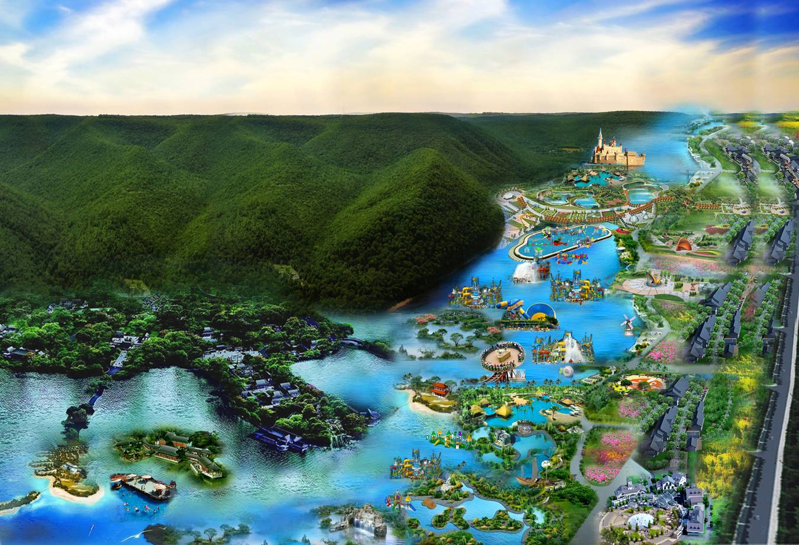

永春县“十二五”旅游产业发展规划

永政文〔2012〕145号

永春县旅游事业局

北京金必德经济管理研究院

金裕德品牌旅游设计规划院

2012年

目  录

## TOC \o "1-2" \h \z \u  HYPERLINK \l "_Toc274592236" 前 言 PAGEREF _Toc274592236 \h 1

## HYPERLINK \l "_Toc274592237" 一、永春县旅游产业现状及发展环境分析 PAGEREF _Toc274592237 \h 2

HYPERLINK \l "_Toc274592238" （一）“十一五”永春旅游产业发展的总体情况 PAGEREF _Toc274592238 \h 2

HYPERLINK \l "_Toc274592239" （二）“十二五”永春旅游产业的发展环境分析 PAGEREF _Toc274592239 \h 4

## HYPERLINK \l "_Toc274592241" 二、永春县旅游产业发展的优劣势分析 PAGEREF _Toc274592241 \h 7

HYPERLINK \l "_Toc274592242" （一）永春县旅游产业发展的优势分析 PAGEREF _Toc274592242 \h 7

HYPERLINK \l "_Toc274592243" （二）永春县旅游产业发展的劣势分析 PAGEREF _Toc274592243 \h 9

## HYPERLINK \l "_Toc274592244" 三、永春县旅游产业发展的指导思想和目标 PAGEREF _Toc274592244 \h 11

HYPERLINK \l "_Toc274592245" （一）永春旅游产业发展的指导思想 PAGEREF _Toc274592245 \h 11

HYPERLINK \l "_Toc274592246" （二）永春旅游产业发展的战略定位 PAGEREF _Toc274592246 \h 11

HYPERLINK \l "_Toc274592247" （三）永春旅游产业发展的主要目标 PAGEREF _Toc274592247 \h 12

HYPERLINK \l "_Toc274592248" （四）永春旅游产业发展的基本原则 PAGEREF _Toc274592248 \h 13

## HYPERLINK \l "_Toc274592249" 四、永春县旅游产业发展总体布局和线路设计 PAGEREF _Toc274592249 \h 14

HYPERLINK \l "_Toc274592250" （一）永春“一心四区”旅游格局及重点项目策划设计 PAGEREF _Toc274592250 \h 14

HYPERLINK \l "_Toc274592251" （二）永春旅游线路及大型主题旅游活动的策划设计 PAGEREF _Toc274592251 \h 42

## HYPERLINK \l "_Toc274592252" 五、永春县“十二五”旅游产业发展的主要措施 PAGEREF _Toc274592252 \h 48

HYPERLINK \l "_Toc274592253" （一）完善旅游管理体制建设，统筹全县旅游产业发展 PAGEREF _Toc274592253 \h 48

HYPERLINK \l "_Toc274592254" （二）推进现有景区提档升级，提高景区项目整体水平 PAGEREF _Toc274592254 \h 49

HYPERLINK \l "_Toc274592255" （三）加大旅游招商引资力度，做好旅游项目规范管理 PAGEREF _Toc274592255 \h 51

HYPERLINK \l "_Toc274592256" （四）加快公共服务设施建设，提升城镇整体旅游形象 PAGEREF _Toc274592256 \h 53

HYPERLINK \l "_Toc274592257" （五）大力发展乡村休闲旅游，推进美丽乡村建设工程 PAGEREF _Toc274592257 \h 55

HYPERLINK \l "_Toc274592258" （六）促进旅游配套产业发展，拉动县域旅游消费增长 PAGEREF _Toc274592258 \h 57

HYPERLINK \l "_Toc274592259" （七）提升景区项目融资能力，扩大王牌景区的知名度 PAGEREF _Toc274592259 \h 60

HYPERLINK \l "_Toc274592261" （八）强化旅游目的地形象塑造，培育永春的旅游品牌 PAGEREF _Toc274592261 \h 61

HYPERLINK \l "_Toc274592262" （九）培养引入旅游专业人才，提高旅游行业管理水平 PAGEREF _Toc274592262 \h 66

前 言

本规划是以《永春县国民经济和社会发展第十二个五年规划纲要》为纲领，以《贯彻落实国务院关于加快发展旅游业意见重点工作分工方案》、《福建省人民政府关于进一步推动旅游产业发展的若干意见》、《福建省文化旅游业2010-2012年发展规划》、《泉州市贯彻落实<国务院关于支持福建省加快建设海峡西岸经济区的若干意见>的实施意见》和《海峡西岸旅游区发展总体规划》为重要指导，在对永春县的旅游资源，以及安溪县、德化县和泉州市、厦门市、福州市、南平市、三明市的旅游资源和游客市场做了充分的考察调研和深入了解的基础上，并结合对美国、日本、韩国、泰国、印度、斯里兰卡、香港、澳门、台湾及珠江三角洲、长江三角洲旅游城市的先进做法和成功经验，针对永春县“十二五”期间旅游产业的发展所制定的总体发展规划文件。

本规划结合了福建省建设海峡西岸旅游区和泉州市推进海西文化旅游名城建设的发展形势，立足永春县的旅游资源优势，明确了“十二五”期间永春旅游产业的战略定位和发展目标，对全县旅游产业的总体布局、重点旅游项目、精品旅游线路和大型主题旅游活动进行了全新的策划设计，并制定了一系列推动和保障旅游产业快速发展的主要措施。力争将旅游产业培育成为永春县的新兴战略性支柱产业和绿色经济增长点，加快推进永春海峡西岸知名生态旅游目的地和福建省优秀旅游强县的建设。

# 一、永春县旅游产业现状及发展环境分析

## （一）“十一五”永春旅游产业发展的总体情况

永春县地处泉州市东南部，晋江东溪上游，县内生态环境优美，森林覆盖率高达69.2%。同时，永春县还是中华武术白鹤拳的发源地，福建省著名侨乡之一，人文资源丰富，拥有永春纸织画、永春芦柑、永春老醋、永春佛手茶等享誉全国的特色产品。目前，全县拥有牛姆林一个国家级旅游景区，百丈岩、魁星岩、乌髻岩和仙洞山普济寺风景区四个国家级旅游风景区，北溪、观山两个国家农业旅游示范点，以及东溪大峡谷、外山云河谷两个新建成的旅游景区。其中，牛姆林是省级自然保护区、科普教育基地和生态教育基地、福建省保留最完好、最具特色的原始森林群体之一。另外，全县已有星级酒店3家、旅行社及营业部6家、筹建旅游车队1个、并有在建和拟建的高星级酒店、旅游度假项目10多个，旅游产业初具规模。

表1-1：永春县代表性旅游资源分布情况

| 资源类别 | 具体资源 | 资源位置 | 资源类别 | 具体资源 | 资源位置 |
|---|---|---|---|---|---|
| 生态旅游资源 | 牛姆林 | 下洋镇 | 文化旅游资源 | 文庙 | 县城 |
| 云河谷 | 外山乡 | 白鹤拳博物馆、武馆 | 五里街镇 |
| 东溪大峡谷 | 呈祥乡 | 古街 | 五里街镇 |
| 北溪桃花谷 | 岵山镇 | 巽来庄 | 五里街镇 |
| 宗教旅游资源 | 魁星岩 | 石鼓镇 | 三角街 | 蓬壶镇 |
| 百丈岩 | 蓬壶镇 | 福兴堂 | 岵山镇 |
| 乌髻岩 | 锦斗镇 | 沈家大院 | 蓬壶镇 |
| 普济寺 | 蓬壶镇 | 郭氏家庙 | 横口乡 |
| 雪山岩 | 呈祥乡 | 东关桥 | 东关镇 |
| 岱山岩 | 一都镇 | 农业观光旅游资源 | 金斗洋茶园 | 湖洋镇 |
| 船山岩 | 横口乡 | 葡萄园 | 湖洋镇 |

“十一五”期间，全县游客接待人数和旅游总收入保持年均10%以上的增长速度，旅游产业发展取得了长足的进步，旅游产业对全县经济的贡献率稳步提升。2009年全县共接待境内外游客135万人次，实现旅游总收入7.1亿元，分别比去年同期增长31.1%和31.5%，其中牛姆林景区接待游客5.3万多人次，实现旅游总收入461万元。2010年全县预计接待游客160万人次，旅游总收入7.5亿元。

表1-2：“十一五”期间永春旅游业发展总体情况

| 指标 年度 | 2006年 | 2007年 | 2008年 | 2009年 | 2010年 |
|---|---|---|---|---|---|
| 旅游人数（万人次） | 78.3 | 87 | 103 | 135 | 160 |
| 旅游总收入（亿元） | 4.1 | 4.55 | 5.4 | 7.1 | 7.5 |

目前，永春旅游市场的核心客源主要以泉州、厦门、福州三地的自驾车游客为主，其次来自广东、台湾、浙江等福建省周边地区的游客也在逐渐增多。以牛姆林景区为代表的永春旅游品牌已在福建省内享有了一定的知名度。“十一五”期间，永春县先后举办了两届北溪桃花文化节、永春生态旅游推介会暨牛姆林对外开放十周年庆典、国际旅小姐大赛泉州特别赛区总决赛、2010年泉州文化旅游节等大型活动，取得了较好的宣传效果。2010年永春县获得“中国最具生态魅力旅游县”和“中国青年喜爱的海西旅游目的地”荣誉称号，永春生态健康游、乡村休闲游、果园采摘游等时尚健康游也已逐渐成为泉州市乃至福建省旅游的一大品牌。如今在福建省加强海西旅游建设的发展机遇下，永春旅游产业即将迎来又一个快速提升阶段。

## （二）“十二五”永春旅游产业的发展环境分析

1、市场环境分析

——闽台旅游合作不断推进，海峡旅游市场空间大。福建省政府贯彻《国务院关于支持福建省加快建设海峡西岸经济区的若干意见》，先后出台了《关于进一步推动旅游产业发展的若干意见》和多项入闽旅游和赴台旅游奖励政策，并成功举办了首届海峡旅游论坛，积极对接海峡两岸旅游精品线路，加大海西旅游在台湾地区的宣传效应，取得了较好的成效。2009年经福建口岸赴台旅游人数达10.8万人次，约占大陆居民赴台旅游总数的17.8%；同时，福建全省共接待台湾游客123.4万人次，约占台胞来大陆旅游总数的27%。可以预见，随着海西旅游的大力发展和闽台旅游合作机制的不断完善，未来全国经福建赴台旅游和台湾入闽旅游的游客人数都将继续大幅增长。

——乡村休闲旅游和温泉度假旅游有望成为海西旅游新热点。随着人们对休闲度假旅游消费需求的逐渐扩大，从福建省发布的多项推进旅游产业发展的工作文件中也不难看出，在城市周边大力发展休闲农业、森林人家、水乡渔村、“农家乐”等乡村旅游产品和加快建设一流的温泉旅游度区等发展要求不断出现。2010年上半年出台的《福建省温泉旅游发展总体规划》也已初步明确了全省温泉旅游发展的总体布局。可见，乡村休闲旅游和温泉度假旅游在未来很可能成为福建省各地提升生态旅游产品，创新旅游消费的新热点。

——泉州立足商务休闲旅游，高端旅游度假区项目竞相上阵。泉州市作为福建省的经济发达地区，民营企业众多，商务活动丰富，聚集了大量的商务人士，因此，商务休闲旅游市场在泉州前景广阔。据调研了解，目前在安溪、永春、德化等地都有多个涵盖高尔夫球场、温泉养生、主题公园、旅游地产的高端旅游度假区项目准备投资落户，而开发商无一例外都是瞄准了泉州的商务休闲旅游市场。可以预见，随着海西旅游发展热潮的到来，泉州市作为闽中商务休闲旅游区的核心，将迎来高端旅游度假区项目在泉州市各地区的“圈地运动”，而为商务人士打造精品休闲旅游度假区也将成为泉州市各地区发展旅游的重要抓手。

2、产业环境分析

——海西旅游强调山海联动，区域整合协作发展。福建省政府在《关于进一步推动旅游产业发展的若干意见》中明确提出构筑闽东北(福州、莆田、宁德）、闽西南（厦门、泉州、龙岩、漳州）、闽西北（南平、三明）三大旅游协作区，形成优势互补、山海联动、竞相发展格局等多项举措。并组织编制了《海峡西岸旅游区发展总体规划（2010-2020年）》，规划区域范围涉及福建、广东、浙江、江西四省二十三个地市，制定了连接长三角、珠三角地区的“三轴八区”总体空间布局，提出打造“蓝色海滨、绿色山林、多彩文化、特色都市”四大主导旅游产品系列。由此可见，海西旅游区未来的规划发展将突出强调福建省内和省外的区域合作，有助于福建旅游打破各地市各谋发展，厦门、武夷山、永定土楼等旅游品牌独大的发展局限。

——泉州突出闽南特色文化展示，打造海西文化旅游名城。在《泉州市贯彻落实<国务院关于支持福建省加快建设海峡西岸经济区的若干意见>的实施意见》中，泉州市明确提出了要发挥闽南文化核心区的优势，建设海西文化旅游名城的战略定位。并进一步指出要做足泉州作为全国首批历史文化名城和“海上丝绸之路”起点的文章，挖掘包括郑成功文化、妈祖文化和南音、南戏、南建筑、南少林、南派工艺“五南”在内的多元闽南文化特色。可以预见，泉州市在海西旅游中立足闽南文化展示的发展定位，在今后的发展中必将催生出一批集闽南文化展示、观光体验为主的旅游产品和项目。

——整合安永德生态旅游资源，构建泉州绿色生态旅游圈。以武夷山、三明为代表的生态旅游作为福建省的主导旅游产品对海西旅游发挥着重要作用。此次泉州市在贯彻落实《国务院关于支持福建省加快建设海峡西岸经济区的若干意见》的实施意见中明确提出要将文化融入生态旅游产品，发展特色自然文化旅游的发展思路。这也对安溪、永春、德化三个以发展绿色生态旅游为主的地区提出了更高的要求。一方面这三个生态旅游重点县要发挥各自的文化和产业优势，突出特色错位发展，打造精品生态旅游项目；另一方面还要加强三县旅游线路的对接和旅游产品的联合营销，共同构建泉州绿色生态旅游圈。

3、政策环境分析

——全省加大旅游支持力度，各地不断推出新的旅游项目。厦门市编制了《厦台旅游产业对接规划》吸引台商投资旅游业，促成全国首家台资旅行社在厦门设立；南靖出台对新建星级酒店的土地税收优惠政策力争吸引20多家旅游酒店落户建设；三明市召开全市旅游产业发展大会，学习“泰宁路径”县域旅游经济发展模式，颁发旅游工作目标责任书；泰宁申报世界自然遗产，宁德申报世界地质公园也已取得重大进展。随着各地方政府对旅游工作的加强重视，各地也都加大了对旅游项目的招商引资力度，2009年福建全省在建及新开工的旅游项目共335个，总投资额达412亿元，其中超亿元项目有93个。

# 二、永春县旅游产业发展的优劣势分析

## （一）永春县旅游产业发展的优势分析

1、交通网络快速发展，未来区位优势明显。永春距泉州市区60公里，距厦门机场140公里，游客从泉州到永春仅需一小时，从厦门到永春也仅需1.5小时。同时，泉三高速的开通也为游客从三明到永春旅游创造了良好的交通条件。未来五年随着莆永高速、厦沙高速、长汀-泉州快速铁路通达永春，永春县的交通区位优势将为永春旅游业带来前所未有的发展机遇。

2、生态旅游资源丰富，旅游发展后劲十足。县内以牛姆林为代表的森林生态资源，以云河谷、东溪大峡谷为代表的峡谷生态资源均植被完好、自然环境优美、动植物资源丰富，集山谷、森林、岩石、水体等资源于一体，是都市人群远离城市喧嚣，回归自然的绝好去处。如此丰富的生态旅游资源为永春发展休闲度假旅游奠定了坚实基础，旅游发展前景看好。

3、宗教信仰种类多样，朝圣旅游基础较好。全县拥有如魁星岩、百丈岩、乌髻岩、普济寺、雪山岩、船山岩等众多宗教旅游资源，寺庙众多且历史悠久、建筑风格独特，每年都会吸引不少香客前来朝拜，宗教朝圣旅游的发展基础较好。其中，百丈岩每年接待20多万香客，是县内规模最大、香火最旺的寺庙。

4、物产资源较为丰富，绿色餐饮独具特色。县内拥有永春芦柑、永春佛手茶、永春老醋、永春纸织画、永春漆篮等众多特色物产资源。其中，永春老醋为我国四大名醋之一，永春纸织画是中国四大传统家织之一。同时，县内风味小吃种类多样，已经初步形成了风格各异的地方农家菜，如石鼓白鸭汤、老醋猪脚等，均可作为旅游特色餐饮。

5、文化旅游资源多样，深度开发潜力较大。永春作为南拳武术的代表白鹤拳的发源地，拥有白鹤拳武术文化博物馆、白鹤拳武馆、武术学校等武术文化资源。同时，作为福建省著名侨乡之一，县内还保留有福兴堂、沈家大院等华侨商人的旧居，建筑风格独特、建造工艺及文化价值高。而永春纸织画、漆蓝等制作技艺，以及被称为东方古代音乐“活化石”的南音等民俗文化也具备进一步挖掘的空间。

6、县内侨乡资源丰富，华侨探亲游客众多。作为福建省著名侨乡之一，永春籍海外华侨、华人及港澳台同胞达120万人，在历史上素有“无永不开市”之美称。目前在岵山镇、五里街镇、蓬壶镇、湖洋镇等地均保留有不少特色侨胞古居，有待修缮保护并进行适当的旅游开发。同时，众多海外侨胞不定期归国探亲，也将构成永春旅游客源的重要组成部分。

7、县领导重视旅游业，作为支柱产业扶持。2009年全县共投入4000多万元资金用于完善各旅游景区景点的基础设施建设。2010年初全县确立了由县委书记王远东亲任组长，叶一帆县长任第一副组长，县四套班子分管领导任副组长的旅游产业发展工作领导机制，为我县旅游发展奠定了坚定的组织保障，并正式出台《永春县进一步加快旅游业发展的暂行规定》。另外，全县旅游项目的招商引资工作效果显著，已有永春高端生态健康养老项目、七八场温泉度假酒店、介福太阳城国际生态度假区等多个大型旅游项目准备落户永春。

## （二）永春县旅游产业发展的劣势分析

1、全县缺乏统一布局，项目存在同质化竞争。目前县内多个乡镇都邀请知名院校进行相应的旅游区规划，并在积极开展旅游项目的招商引资工作。但由于全县旅游产业缺乏统一布局，以致出现了各乡镇各自为政发展旅游，生态旅游项目存在同质化竞争，高尔夫球场、高端旅游地产项目重复建设的现象。

2、景点规模小且布局散，缺少大项目的带动。县内大部分旅游景点的规模都相对较小，对周边地区的酒店、餐饮、购物、娱乐消费的带动力有限，且景点分布较散，未能形成景区间的联动发展。全县缺少旅游大项目的引入，带动永春旅游的大发展。虽然牛姆林景区经过多年发展，已具备一定的品牌知名度，但景区的带动力仍十分有限，

3、景区普遍好看不好玩，主题体验项目欠缺。县内的大部分旅游景区还处于起步阶段，对景区内旅游项目的设计、包装仍显不足，普遍缺乏娱乐性的体验项目，使得游客在景区容易产生审美疲劳，感觉单调乏味，致使游览时间较短，除景区门票外，不能有效带动餐饮、购物、娱乐等多样化的旅游消费。

4、文化旅游资源开发少，旅游产品较为单一。目前县内的旅游产品大多都以生态旅游产品为主，永春县所特有的白鹤拳文化、古名居文化、闽南民俗文化等均没有得到深入挖掘和丰富展示，旅游产品单一化，与安溪、德化、三明等同样发展生态旅游的县市相比，缺乏具有当地特色旅游文化魅力的问题。

5、旅游配套产业发展慢，旅游产业链不够完善。目前全县共有涉旅酒店8家，客房数499间，床位数952个，其中三星级酒店仅3家，旅游星级酒店和度假酒店数量少，旅游接待能力不足。餐饮、娱乐、购物等旅游配套产业也未形成规模，旅游商品的开发滞后和旅游购物场所的缺失使得众多永春特色产品无处购买。另外，特色餐饮场所的建设和武术文化、民俗文化的表演展示也有待进一步加快推进。

6、导游和管理人员较少，旅游行业人才匮乏。目前县旅游局仅有6名管理人员，旅游行业的管理人员有待增加。同时，景区导游人员、旅游社导游人员、宾馆服务人员等旅游行业的服务人员也较为短缺，在旅游旺季时供给严重不足，极大地限制了永春旅游的快速发展。

7、景区缺乏市场化运作，管理机制有待创新。目前县内的部分大景区是由所在乡镇政府直接管理，由于没有引入专业的旅游投资和管理公司负责景区的专业化管理和市场化运作，有碍景区创新发展和旅游市场开发。同时，针对各乡镇盲目引进旅游项目，旅游资源重复开发等问题，亟需建立起全新的旅游管理机制，对景区和旅游项目进行有效地统筹管理和市场化运作。

# 三、永春县旅游产业发展的指导思想和目标

## （一）永春旅游产业发展的指导思想

坚持科学的发展观，按照国务院关于加快发展旅游业的意见和海峡西岸旅游区发展总体规划，遵循县委提出的“奋力发展特色山地经济，加快建设现代宜居侨乡”的战略定位，立足绿色生态旅游优势，将生态旅游与文化旅游相结合，突出表现永春的武术文化和侨乡文化，以招商引资为抓手，打造精品生态休闲旅游项目和高端商务休闲度假项目，促进永春旅游区域品牌知名度的提升和商贸服务业的快速发展，在“十二五”期间将旅游产业培育成为有丰富内涵和独特品牌影响力的新兴带动型支柱产业和绿色经济增长点。

## （二）永春旅游产业发展的战略定位

1、总体定位。“十二五”期间，充分利用绿色生态旅游资源优势，深入挖掘特色武术文化和侨乡文化，瞄准全省及广东、台湾和东南亚地区的大量都市人群和华侨，重点发展“侨乡生态文化娱乐旅游”和“温泉养生康体度假旅游”，同时积极倡导房车旅游和汽车露营等休闲度假旅游新方式。将永春打造成为福建省的“都市桃源”和“海峡西岸旅游度假后花园”，与安溪、德化共同构成“泉州绿三角”生态度假旅游经济圈。

2、市场定位。“十二五”期间，永春旅游业的目标市场应以泉州、厦门、福州等省内主要城市和广东、浙江、江西等省外邻近城市为核心客源市场，以港澳台地区，尤其是台湾地区，以及印尼、新加坡、马来西亚等泉州海外华侨聚集的东南亚地区为主要拓展市场，重点开拓自驾车游客、家庭游客和商务旅行游客市场。同时，抓住海西旅游的发展机遇，积极培育和拓展中西部和北方地区的国内客源市场，以及日韩等海外市场。

3、旅游品牌定位。针对“十二五”期间要重点开拓的自驾车游客、家庭游客和商务旅行游客市场，突出永春的生态旅游优势，以及未来的主题公园、温泉养生旅游优势和白鹤拳武术文化旅游新优势，将永春旅游品牌定位为“多彩山林，旅游永春”，充分体现都市人群远离喧嚣都市，在永春畅享绿色生态美景的永春旅游品牌新形象。

## （三）永春旅游产业发展的主要目标

“十二五”期间，永春县旅游产业发展要着力实现三大突破：一是实现旅游项目规划建设的突破，大力推动精品生态休闲旅游项目和高端商务休闲度假旅游项目、文化旅游、乡村旅游等景区项目的落地建设，加强旅游项目的招商引资力度，力争引入并建成3-6个投资超亿元的旅游大项目，推出一批高起点规划、差异化主题、文化特色突出、服务管理水平高、综合带动力强的精品旅游项目。

二是实现旅游景区等级的突破，做到“提A、增亮”。“十二五”期间要将牛姆林景区升级为国家AAAAA级旅游景区、国家自然保护区、国家森林公园和国家风景名胜区，并将五里街武术文化名镇打造成为海西魅力名镇之一。全县力争打造1-2个国家级风景名胜区，1个国家AAAAA级旅游景区，2-4个国家AAAA级旅游景区。

三是实现旅游相关第三产业建设的突破，力争引入1-2家五星级酒店（含温泉主题酒店），3-4家四星级酒店，4-5家乡村度假酒店，发展5-6家三星级酒店和连锁酒店，并建设2-3家大型旅游购物场所，引入6-8家地接旅行社。

力争到2015年末，全县旅游接待总人数达到450万人次以上，旅游总收入突破25亿元，较“十一五”末分别实现增长181.25%和233.33%。发展成为海峡西岸知名的生态旅游目的地和福建省优秀旅游强县。

表2：“十二五”期间永春旅游业总体目标测算表

| 指标 年度 | 2011年 | 2012年 | 2013年 | 2014年 | 2015年 |
|---|---|---|---|---|---|
| 旅游人数（万人次） | 192 | 230.4 | 288 | 360 | 450 |
| 旅游总收入（亿元） | 9.3 | 11.53 | 14.99 | 19.49 | 25.34 |

说明：以2010年全县旅游接待总人数160万人次，旅游总收入7.5亿元为基准。2011-2012年，旅游人数年增长比率为20%，旅游总收入增长比率为24%；2013年至2015年末，旅游人数年增长比率为25%，旅游总收入年增长比率为30%。表中数字按此比率测算。

## （四）永春旅游产业发展的基本原则

——旅游项目突出特色，差异化发展的原则。在全县策划设计旅游项目和进行旅游项目招商引资的过程中，始终坚持旅游项目符合市场需求，主题鲜明、特色突出，与县内及周边县市旅游项目差异化发展的原则，避免出现旅游项目同质化导致的重复建设和恶性竞争的现象。

——集中旅游优势资源，统一布局发展的原则。在进行旅游开发，布局发展旅游业的过程中，坚持在生态环境、人文历史文化、温泉养生等多种优势资源较为集中的地区进行重点布局，各地区遵循全县旅游统一布局发展的原则，集中力量整合优势资源，做好景区建设，提高旅游经济效应。

——重视文化挖掘，以特色文化支撑旅游的原则。转变单纯发展绿色生态旅游的发展思路，重视对永春武术文化和侨乡文化等特色文化的挖掘和提炼，在旅游产品中加强特色文化的展示和融入，坚持以特色文化为旅游品牌塑造的核心，支撑旅游产业长久发展的原则。

——旅游资源保护与开发并重，可持续发展的原则。在重视旅游项目策划创意和规划建设的同时，始终把对自然生态环境、历史文化遗产、传统特色民居、宗教场所等旅游资源的保护摆在首位，对旅游资源进行合理地开发和利用，坚持可持续发展的原则。

# 四、永春县旅游产业发展总体布局和线路设计

## （一）永春“一心四区”旅游格局及重点项目的策划设计

1、永春县旅游的总体布局。围绕“大城关”战略，实施“一心四区”即“一个旅游接待中心，四个重点旅游区”的空间发展战略，构建“县城住、全县游”的旅游发展新格局。

表3-1：“十二五”永春县旅游发展总体布局设计

| 旅游功能区 | 旅游功能区范围 | 旅游功能区特色 |
|---|---|---|
| 旅游接待中心 | 县城 | 武术和侨乡名人文化的展示中心游客居住、购物的集散中心 |
| 重点旅游片区 | 以五里街镇、石鼓镇、岵山镇为主的县城周边旅游区 | “武术名镇、温泉乐谷”武术文化温泉娱乐旅游区 |
| 以下洋镇、横口乡为主的西部旅游区 | “森林世界，猴山乐园”森林氧吧休闲娱乐度假区 |
| 以外山乡、东关镇、湖洋镇、介福乡为主的东部旅游区 | “闽南水乡，度假胜地”风情小镇和运动休闲度假区 |
| 以呈祥乡、蓬壶镇、锦斗镇为主的中部旅游区 | “高山避暑，朝圣养生”峡谷探险朝圣疗养度假区 |

图1：永春“一心四区”旅游总体布局图

2、永春县城旅游建设的规划设计

（1）重点区域：永春县城主城区

（2）主题定位：发挥县城作为政治文化中心的窗口作用，将县城打造成为代表永春特色的武术和侨乡名人文化展示中心，以及游客居住、购物的旅游接待中心和集散中心。

（3）发展思路：强化县城的文化展示窗口作用，通过雕塑群、景观设计、场馆建设、文化表演、文体活动等多种表现形式将永春的特色文化在县城进行集中展示，使游客一进入永春县城就能感受到浓厚的文化氛围。同时，着力完善旅游产业链，在县城大力推进酒店、餐饮、购物、娱乐等旅游相关第三产业的发展，加快星级酒店和度假酒店的引入建设，并选址规划建设以旅游接待功能为主的特色旅游购物场所，依托丰富的特色小吃打造永春的娱乐夜经济。将永春县城建设成为泉州市和海峡西岸的山水生态名城。

（4）核心项目：永春主题文化广场、侨乡历史文化博物馆和民俗文化艺术表演中心、城市运动公园、桃溪休闲娱乐长廊、小吃和名优产品购物街、七八场温泉度假酒店。

图2-1：永春文化广场效果图（参考图）

——永春主题文化广场：在县城中心区域选址建设永春主题文化广场。将广场划分为绿色生态区、体育武术区和侨乡文化区，在广场上设置标志性的大型牌坊，以及代表永春白鹤拳和侨乡名人形象的雕塑群，并保留充分的草坪绿地和休闲活动用地。文化广场主要用来供当地居民和游客练习白鹤拳，开展体育活动和南音演奏、跳舞等文艺民俗活动，以及举办各类节庆和赛事活动，成为游客和市民向往的文化主题广场。

图2-2：侨乡历史文化博物馆和艺术表演中心效果图（参考图）

——侨乡历史文化博物馆和民俗文化艺术表演中心：依托现有的文化中心和人民会堂规划建设侨乡历史文化博物馆和民俗文化艺术表演中心，建筑风格应融合马来西亚、印尼、新加坡等永春华侨较为集中地区的华侨建筑元素。在侨乡历史文化博物馆中设立永春华侨名人馆，主要展示永春籍侨胞名人的传奇故事，以及由他们所带入的海派文化在永春建筑、工艺、艺术、饮食等各个方面所表现出的突出影响。民俗文化艺术表演中心主要用于举办各种民俗文化演出、演奏会、大型歌舞表演等，形成白天游景区，晚上看演出的旅游氛围。

——桃溪休闲娱乐长廊：拓宽县城桃溪两岸建设用地，在桃溪两岸规划建设具有印尼、马来西亚、新加坡、菲律宾等侨胞海外聚集地风情的水岸风光餐厅、桃溪酒吧、咖啡厅等特色休闲娱乐场所，打造桃溪休闲娱乐长廊，为中外游客提供晚间休闲娱乐的好去处。改善河岸灯光效果，开展桃溪游船旅游项目，设计“永春号”游船作为政府接待指定用船，设计风格各异的印尼号、马来西亚号等仿古游船作为游客接待用船，并发动县内的知名企业冠名游船，举办首船开游活动，吸引游客和当地居民坐船游览永春县城的美丽夜景，在船上饮茶交流或举办派对等活动。

图2-3：桃溪休闲娱乐长廊效果图（参考图）

——永春小吃和名优产品购物街：在县城商业区集中规划打造一条永春小吃和名优产品购物街，聚集石鼓白鸭汤等各类当地特色餐饮店，以及永春芦柑、永春佛手茶、永春纸织画、永春漆篮、永春武术纪念品等各类名优产品的销售店铺和购物超市。将商铺按照统一的特色侨乡建筑风格进行新建或改建，并在步行街设置代表纸织画制作过程和白鹤拳招式等的各式雕塑。将购物街打造成为游客到永春体验特色小吃，购买各类名优产品的集中地，形成旅游消费商圈。

图2-4：永春小吃和名优产品购物街效果图（参考图）

——城市休闲运动公园：将留安山公园改建为永春城市休闲运动公园。以人为本完善道路设施，分别设置自行车道、步行道、行车道和盲道。在半山腰要设置登山休息座椅、观景台和诗词侨乡文化长廊。对险要的山坡要增设防护网，防止石头滚落伤害游客和居民。全新设计公园内的园林景观，添置简易运动器材和秋千、荡椅、水车，以及独木桥、木墩走廊等拓展训练设施。在山顶依托茶园和观景台，建设休闲茶楼和特色竹屋餐厅，作为游客休憩和商务宴请的特色餐饮场所和观赏永春县城全景的好去处。

图2-5：城市运动公园效果图（参考图）

——七八场温泉度假酒店：在原七八场所处的山谷地带，依托幽静唯美的绿色生态环境，融合闽南文化特色，建设高端温泉度假酒店。强调酒店建筑与生态环境的融合，设计亲近大自然、功能多样的私密式生态温泉池以及健康理疗室。吸引泉州、厦门、广东台湾等地区的高端商务人士和游客到永春体验生态温泉，放松身心休闲度假。

图2-6：七八场温泉度假酒店效果图（参考图）

3、永春县城周边旅游区的规划设计

（1）重点区域：五里街镇、石鼓镇、岵山镇

（2）主题定位：以五里街镇的白鹤拳文化，石鼓镇的温泉资源和岵山镇的古民居资源为核心，在县城周边打造以“武术名镇、温泉乐谷”为特色定位的武术文化温泉娱乐旅游区。

（3）发展思路：将县城周边旅游片区作为永春旅游的文化高地，突出白鹤拳文化、闽南特色民居建筑文化和纸织画、漆篮等南派工艺文化的观赏和休闲体验，依托五里街武术名镇的打造，推出系列永春特色文化旅游产品，并将文化旅游与温泉娱乐、农家乐休闲度假游有机结合，让游客在感受永春特色文化魅力的同时，放松身心享受温泉娱乐的快感，走进特色古民居品尝农家美食。力争将五里街武术文化名镇打造成为海西魅力武术名镇，并积极计划申报国家文化遗产。

（4）核心项目：五里街武术名镇（主打产品）、永春温泉欢乐谷主题公园（主打产品）、魁星岩文化旅游区（特色产品）、北溪桃花谷景区新建改造项目（特色产品）、永春福兴堂华侨名宅博物馆（特色产品）、五里街历史文化古街（基础产品）、五里街镇仰贤古民居群（基础产品）。

——规划建设五里街武术名镇：一是做好中华武艺大观园项目的建设。依托中华武艺大观园的建设，邀请知名影视导演和武打明星到中华武艺大观园参观留影，积极筹备以永春白鹤拳为题材的影视剧作品，争取发展成为国内动作题材影视剧作品的全新拍摄基地，打造海西武术影视拍摄基地。并重点招商建设以白鹤拳为中心的文武学校和一批各种不同武林派别的武馆，面向全国乃至海外的武术爱好者进行招生，定期举办中华白鹤拳擂台赛、国际武术邀请赛等高水平的武术赛事，组织各大新闻媒体进行宣传报道，宣传突出永春白鹤拳的影响和社会地位。

二是组建永春白鹤拳武术队。由资质较深的老拳师担任教练，在全县进行武术队人员的选拔、培训和考核，组建一支专业水平高、年轻有朝气的永春白鹤拳武术队，代表永春到北京、日本、韩国、东南亚等地进行白鹤拳表演和武术交流，并积极参与世界武博运动会等大型武术赛事活动，提高永春白鹤拳在国内外的知名度；

三是将大羽村打造成为“海西武术第一村”。修建带有显著白鹤拳标志的村门，选址恢复重建方七娘故居和祠堂，将演武场改建为白鹤拳博物馆。对大羽村内保存较为完好的古民居进行保护和维护，通过修缮改造一批可以接待游客的“拳师之家”、“武林客栈”、“好汉酒楼”，增添白鹤拳文化元素，通过在院内设置拳桩、沙袋、刀枪棍棒十八般兵器等练武设施，由当地的习武人士向游客传授简单的白鹤拳招式，接待游客饮茶就餐，傍晚欣赏白鹤拳武术表演赛和皮影戏、露天武术电影，让自驾游和组团游客参观、体验白鹤拳文化的魅力。

图2-7：五里街武术名镇标志性大门效果图（参考图）

——建设海峡两岸最大的永春温泉欢乐谷主题公园：利用石鼓镇的温泉资源和得天独厚的山谷自然生态环境，瞄准大众消费市场，尤其是家庭游客市场，开发建设温泉欢乐谷项目。建筑特色突出体现闽南和东南亚建筑风格的融合，在下游设计配备具有大型水上滑梯、冲浪、水上飞车等项目的温泉水上娱乐区和温泉泳池区，在上游建设温泉城堡和山谷丛林温泉养生汤池等特色温泉疗养区，并组建专业文艺表演团队，每晚在水上舞台上演精彩的文艺演出。将永春温泉欢乐谷打造成为中国海峡两岸最大的温泉欢乐谷主题公园，成为集水上娱乐、温泉养生、餐饮休闲、文化演出为一体的大型综合温泉休闲娱乐场所。每年吸引上百万游客前往永春温泉欢乐谷周末度假旅游消费。

图2-8：石鼓温泉欢乐谷效果图（参考图）

——规划建设魁星岩文化旅游区：以魁星文化和宗教朝拜为核心，规划建设魁星岩文化旅游区。一是新建魁星楼，在楼内展示魁星公的传奇故事和历史上永春地区状元、秀才的经典故事；二是新建状元桥，出售状元牌供游客在拜完魁星后购买，系于状元桥栏上以表许愿；三是扩建改造魁星广场，在广场上模拟重现古时科考考场和“魁星点斗，金榜题名”的场景，吸引游客体验古时参与科考考试和中榜的难忘过程，留影纪念。

——北溪桃花谷景区新建改造项目：一是丰富景区内的观赏性植物种植品种，提高景区的四季观赏价值，以弥补目前景区旺季持续时间短的问题；二是对景区入口处的农家乐片区按照统一的标准进行合理的规划改造，统一建筑风格，改善居住条件和卫生环境，引导居民通过种植观赏性花草美化院落，突出体现桃花谷农家乐的特色；三是新建演出剧院或广场，策划举办大型闽南歌舞文艺演出；四是投资建设桃花谷风情度假酒店，提高景区的旅游接待能力。

——修缮永春福兴堂华侨名宅博物馆：对福兴堂及其周边的闽南传统古民居进行统一的保护和维护。重点对福兴堂进行修缮和适当改造，安排专职管理人员、讲解人员和保安人员，将福兴堂作为“永春华侨名宅博物馆”进行对外开放，展示其精美的建筑工艺、宝贵的文化价值和传奇的华侨名人故事。同时，吸引投资商对福兴堂周边保存较完好的特色古民居进行修缮和合理改造，作为高档会馆或高档特色食府对外营业。使福兴堂一带成为游客到永春了解闽南古民居建筑文化的重要旅游目的地和政府接待、商务接待的重要文化场所。

——规划建设五里街历史文化古街：首先，启动五里街古街保护修复工程，邀请知名规划设计院制定五里街古街改造方案，成立五里街历史文化古街保护修复工程管委会，做好居民的搬迁安置工作，对古街进行全面的修缮和改造，以及配套基础设施建设。其次，改造后的历史文化古街应在主街道恢复前店后宅的传统格局，进行纸织画、漆篮等永春特色工艺品的制作和展示，增设白鹤拳武术博物馆、武术家族祠堂、武术表演舞台和广场，武师茶楼和客栈，并将修缮后的武公祠等老武馆对外开放供游客参观和与老拳师交流请教；其三，要设立白鹤拳武术纪念品、佛手茶、南音乐器、竹工艺品等特色商铺，以及五里街咯摊等特色传统小吃店铺和茶馆、餐厅、客栈等休闲场所。力争通过对五里街古街保护修复工程的持续投入和规划打造，使五里街历史文化古街成为“海西历史文化名街”。

——修缮五里街镇仰贤古民居群：对五里街镇仰贤村的古民居群实行系统盘查和登记，进行整体保护和修缮。重点实施对巽来庄土楼的修缮工程，恢复巽来庄土楼的建筑格局，丰富内部的历史文化展示内容。并在巽来庄周边挑选部分保存较为完好、文化价值较高的古民居进行合理的改造再利用，作为接待游客的闽南特色农家乐场所，供游客走进古民居体验当地的特色美食和建筑风情。

4、永春西部旅游区的规划设计

（1）重点区域：下洋镇、横口乡

（2）主题定位：以牛姆林优越的自然生态环境和丰富的动植物资源为核心，在西部旅游区规划打造以“森林世界，猴山乐园”为特色定位的森林氧吧休闲娱乐度假区。

（3）发展思路：以牛姆林现有景区为核心，扩展景区规划范围，提升景区的观赏性和体验性，积极申报牛姆林国家自然保护区、国家森林公园和国家风景名胜区，并规划开发华南地区最大的猴山乐园和船山岩风景区等多样化的特色旅游项目，做好旅游交通建设，构建全新的牛姆林旅游休闲度假区。实行联票制，在溪塔格区域建设牛姆林旅游区游客接待中心和旅游商品的一站式购物中心，推出连接旅游区各个景区的牛姆林旅游专线巴士，并在景区内开辟牛姆林汽车营地，设置可供租用的房车，探索发展房车旅行和汽车露营等新型旅游方式。未来五年，牛姆林森林公园和猴山乐园的门票价格力争达到100元以上，接待游客人数要力争突破100万人次，整个牛姆林旅游区每年的门票及相关收入力争突破7亿元。

（4）核心项目：牛姆林森林公园（主打产品）、牛姆林猴山乐园（主打产品）、牛姆林船山岩风景区项目（特色产品）。

——重点规划建设牛姆林森林公园：一是在现有基础上，适当扩大景区范围，做好牛姆林森林公园的总体规划和旅游景区项目的设计规划，丰富景区内的看点和体验内容。将牛姆林森林公园的景区出入口设置在溪塔格区域，安排游客从景区入口处乘电瓶车抵达现牛姆林景区的入口处，开始观光游览。并择优选址投资修建观光缆车，让游客从高空领略牛姆林森林公园丛林叠翠的美景，形成连接空中和陆地的观光游览环线。并增设玻璃车身的悬挂式森林穿梭列车、森林走廊、林间索桥、听鸟阁、船型竹屋、森林探险奇遇记4D影院等项目，增强景区的趣味性和体验性。

图2-9：牛姆林森林公园入口处效果图（参考图）

二是建设牛姆林汽车营地。分别开设房车露营区、汽车露营区和帐篷露营区，游客可租赁不同标准和配置的房车，体验舒适的房车露营生活，晚间打开房车的天窗，享受躺在床上看星星、听鸟鸣的浪漫。并可在汽车营地建设开放式的小足球场、网球场等休闲运动场地，供露营的自驾车游客体验户外运动的快感。

图2-10：牛姆林汽车营地效果图（参考图）

三是规划建设牛姆林森林氧吧休闲度假区。邀请知名建筑设计师设计与自然合一、风格独特的休闲度假别墅、帐篷酒店和建在树上可供游客观景和特色居住的“树屋”和“树上餐厅”，让游客享受和体验在树上的观景风光，感受与众不同的旅游魅力。并在别墅区设置接触森林大自然的私密SPA水疗屋和森林冥想区，开设户外森林瑜伽体验课程，吸引高端游客到牛姆林感受森林氧吧的别样舒适。

图2-11：牛姆林帐篷酒店效果图（参考图）

图2-12：树屋效果图（参考图）

四是进一步完善景区内的基础设施建设，强调与森林自然环境融为一体的生态建筑风格，更新游客指示牌，完善进山线路，在观景区增设木制凉棚、座椅和躺椅，在游览路线中合理设置休息区和餐饮购物区，并适当增设公共卫生间。在游客进入景区后为每位游客配备电子导游设备，在游览过程中根据游客所处位置进行景观景点和动植物科普知识的讲解。

——重点规划建设牛姆林猴山大型乐园：瞄准儿童青少年和家庭旅游消费市场，在牛姆林景区周边的溪塔、长汀、新村地区择优选择地点，将牛姆林景区内现有的猴群迁移繁殖，招募专业的驯猴员，对猴群进行驯化和训练，建设猴山乐园大型旅游主题公园。主题公园分为猴子迎宾仪仗队、猴群娱乐表演区、猴山王国观赏区、猩猩表演广场和猴山游乐场五个核心区域。

一是在猴群娱乐表演区设计猴群迎宾仪仗队、猴警巡游、猴子爬杆比赛、猴子杂技表演、幽默剧场、猴群交友宴会、猴子乐队表演等娱乐观赏项目；二是在猴山王国观赏区建设齐天大圣孙悟空的水帘洞、花果山、皇宫、别墅、游泳池、花园，以及为惩罚犯下错误的猴子设置的拘留所等猴山王国特色活动场所；三是在猩猩表演广场，每天由专业的驯养员带领猩猩进行表演，上演猩猩招待宾客、猩猩练体操、猩猩玩音乐、猩猩打太极拳、猩猩斗牛、猩猩玩抢椅子游戏等精彩绝伦，让人捧腹大笑的系列节目，吸引大量的少年儿童和家庭去观赏演出；四是在猴山游乐场设置有摩天轮、筋斗云飞车、大力金刚转椅、金箍棒大摆锤等大型游乐设施。让游客在与活泼可爱的猴群亲密接触，欣赏猴群和猩猩表演的同时，玩转大型游乐项目，购买各种猴山乐园旅游纪念品。

另外，可与福建东南卫视、旅游卫视等电视台节目合作，到永春猴山乐园取景，拍摄“走进猴山乐园之猴王的故事”、“走进猴山乐园之猴国趣事”、“走进猴山乐园之猩猩的故事”等系列节目。并可举行“猴国技能挑战赛”邀请电视台进行现场报道，由驯猴员分别带领各自培训的猴子组成参赛队，上台挑战各项高难度动作和任务，邀请观众上台与参赛队员互动表演等，让成千上万的游客在猴山乐园捧腹大笑，消除疲劳，快乐体验与旅游消费。

图2-15：牛姆林猴山乐园效果图（参考图）

——规划建设牛姆林船山岩风景区：依托船山岩的奇特景观和宗教朝拜旅游吸引力，整合周边的湿地和茶山资源，规划打造船山岩风景区。一是开辟景区游览道，着力完善景区基础设施建设，做好各项安全保障措施。二是策划设计景观景点，将船山岩的传奇故事以雕塑、壁画、山石景观等形式进行展示，引起游客的好奇。三是利用湿地和茶山资源，开发观光休闲旅游项目，让游客体验“观湿地、进茶寨、品茶香、吃茶饭、买茶品”的快乐。

5、永春东部旅游区的规划设计

（1）重点区域：外山乡、湖洋镇、东关镇、介福乡

（2）主题定位：以云河谷景区和湖洋旅游度假区、小湖洋水上娱乐度假区、国际太阳城度假村等大型旅游项目为核心，在东部旅游区规划打造以“闽南水乡，度假胜地”为特色定位的风情小镇运动休闲度假区。

（3）发展思路：重点做好云河谷景区扩建项目的策划设计和招商引资工作,同时抓好湖洋度假区、小湖洋水上娱乐度假区和介福海峡国际太阳城度假区等投资规模较大的旅游度假区项目，促进几个度假区项目的差异化错位发展，全力推进项目的建设进程。并依托金斗洋茶园、天绿葡萄基地等生态农业示范点，开展农业观光休闲旅游。

（4）核心项目：规划建设云河谷浪漫风情小镇（主打产品）、湖洋生态健康养老度假区（主打产品）、介福海峡国际太阳城度假区（特色产品）、小湖洋水上娱乐度假区（特色产品）、农业观光休闲旅游项目（基础产品）。

——重点规划建设云河谷浪漫风情小镇:云河谷浪漫风情小镇主要定位为情侣、家庭休闲度假旅游主题公园。利用云河谷景区入口处前方的广阔区域和保有的部分古民居，按照统一的闽南建筑风格，规划建设云河谷风情小镇，作为云河谷景区的延伸扩建项目，与现有景区一同构成全新的云河谷旅游区，形成“游云河谷，逛浪漫风情小镇”的全天式情侣、家庭休闲度假旅游模式。

一是在风情小镇建设百年好合爱情寺庙、情侣许愿墙和百年好合爱情锁等旅游项目，吸引天下有情人专程到云河谷祈求爱情，求缘合家，挂上象征百年好合的爱情锁，并在小镇内设立闽南风格的结婚礼堂，举办民族风情的结婚典礼，同时要建立闽南侨乡风格的情侣风雨桥，定期策划举行篝火晚会、浪漫情人节、集体婚礼等主题活动。二是在风情小镇内建设闽南水乡记忆走廊、甜蜜小巷、浪漫风情购物街、休闲广场等，并开发周边水库资源，建立水上情侣泛舟和浪漫湖景观赏区，开设情侣茶吧、小吃店、甜品店、咖啡馆和特色餐厅等餐饮消费场所。三是要在风情小镇周边地区规划开展美丽乡村农家乐旅游活动，吸引游客同时前往闽南风格的农家乐、侨家乐休闲度假。

图2-16：云河谷浪漫风情小镇效果图（参考图）

——重点规划建设湖洋生态健康养老度假区:瞄准由人口老龄化和大量都市人群面临亚健康问题所带来的养生养老消费市场，依托永春湖洋镇桃美村和桃源村得天独厚的自然生态环境，规划建设集山地高尔夫球场、休闲运动主题公园、高端医疗养生会所、专业医疗机构、田园度假酒店、高档别墅为一体的高端生态健康养老度假区，吸引泉州、厦门、福州等周边城市的中老年高端消费群体和永春乃至泉州市的众多海外华侨及其亲属到度假区在接受短期或中长期的医疗养生服务和养老护理服务的同时，在这里放松度假，参与各项休闲运动。

——规划建设介福海峡国际太阳城度假区：依托项目所在地的山体地形地貌条件和良好的水体资源，定位高端旅游消费市场，规划建设台式木球场、六大国际标准网球场、水上游乐园和休闲SPA、康体休闲保健医疗会所、花海主题公园、闽南石雕风情园、大型艺术广场、水岸休闲酒吧，以及高星级度假酒店、小洋房、景观高级公寓等旅游度假设施，打造精品旅游度假区。

——规划建设小湖洋水上娱乐度假区:瞄准当地和周边城市的年轻消费群体，以及企业员工培训市场，在小湖洋水上娱乐度假区内规划建设有冲浪池、滑水池等大型水上娱乐设施，别具特色的户外汽车电影院，以及自助烧烤区、酒店住宿区。并设置具有挑战性、考验团队精神的水上拓展训练区，设计水上滚筒、水上飞梯、水上转盘等项目，与福建东南卫视、湖南卫视、浙江卫视等电视台开设的水上智勇大冲关节目合作，加强宣传效果。打造集水上娱乐、拓展训练、汽车电影院为一体的特色水上娱乐体验度假区。

——规划建设农业休闲观光体验旅游项目:以金斗洋生态茶园、天绿葡萄基地为示范点，完善基础设施建设，开辟观赏走廊，发展农业休闲观光体验旅游，积极融入到云河谷景区、湖洋度假区、小湖洋水上娱乐度假区等周边景区的旅游线路中。在金斗洋生态茶园建设集茶园观光、制茶体验、茶艺表演、品茶、购茶、吃茶饭、住宿为一体的特色度假村；扩大天绿葡萄基地的种植面积，丰富葡萄品种，每年定期策划举办永春葡萄采摘节，吸引全县和周边地区的城市人群到葡萄园亲手采摘新鲜的葡萄，参与葡萄采摘大赛和有关文艺表演活动，并鼓励发展以各种葡萄美食为特色的农家乐和侨家乐。

6、永春中部旅游区的规划设计

（1）重点区域：呈祥乡、蓬壶镇、锦斗镇

（2）主题定位：以东溪大峡谷、雪山高山茶园，以及百丈岩、普济寺等宗教朝圣旅游资源为核心，在中部旅游区规划打造以“高山避暑，朝圣养生”为特色定位的峡谷探险朝圣疗养度假区。

（3）发展思路：充分发挥中部地区高海拔地带气候宜人的独特优势，依托东溪大峡谷、雪山岩、百丈岩等现有景区，整合高山茶园、名贵花卉苗木、梯田、温泉等特色资源，将茶文化、宗教文化和养生文化相结合，开发东溪大峡谷户外探险、雪山茶田养生度假、百丈岩朝圣休闲度假等主题特色突出的休闲度假旅游项目。抓好重点旅游项目的规划设计和招商引资工作，发展高山避暑特色养生度假旅游。

（4）核心项目：东溪大峡谷户外探险项目（主打产品）、雪山茶田养生度假村（主打产品）、百丈岩综合旅游区（主打产品）、三角街商贸历史文化街区（基础产品）。

——规划东溪大峡谷户外探险项目，举办海峡两岸攀岩挑战赛。在东溪大峡谷景区及周边可拓展区域择优选址推出峡谷攀岩、溯溪、蹦极、飞伞等惊险刺激的户外运动体验项目。积极联合各大户外运动俱乐部，发展成为福建地区户外探险推荐活动地点，吸引众多户外运动爱好者和年轻游客慕名前来，在欣赏美景后体验艰难攀登峡谷岩壁和从高山峡谷飞跃而下的快感。在永春每年举办一届海峡两岸攀岩挑战赛旅游节庆活动，邀请海峡两岸的攀岩高手前往永春东溪大峡谷进行徒手攀岩大赛，并组织中外媒体进行广泛的宣传报道，扩大永春旅游品牌的知名度和影响力。

图2-17：东溪大峡谷户外探险项目效果图（参考图）

——规划建设回归自然雪山茶田养生度假村:依托呈祥乡雪山一带的高山茶园和雪山岩的资源优势，按照国家级旅游景区的标准，规划打造集茶田观光、茶叶加工、高山云海风光、宗教朝圣、会议接待、健康疗养、度假酒店为一体的回归自然茶田养生度假村。在度假村内开辟茶田观赏道路，设置山地自行车租赁处，供游客骑自行车驰骋在高山茶园和山林云雾之间。并设计与自然生态环境融为一体的茶田休闲长廊，让游客在欣赏茶田风光过后，停下来在休闲长廊休息品茗茶叶的芳香，欣赏茶艺表演，购买雪山禅茶茶叶产品。在养生度假区，将茶文化、宗教文化、武术文化与养生文化相结合，吸引有经验和有实力的投资商建设一家具有国际特色、五星级的高山养生度假风情酒店，接待国内外高端游客，并承办各类大型会议和高端论坛。

图2-18：雪山茶田养生度假村整体效果图（参考图）

——规划建设百丈岩综合旅游区:一是以百丈岩景区为核心，将百丈岩山脚下毗邻泉三高速公路区域纳入景区规划范围，利用周边种植的花果资源，以及可开发的温泉资源和东风水库，建设台湾现代农业观赏区、世界名桂花卉观赏区、温泉度假酒店、美食城，以及康体等健康产业项目，构建全新的百丈岩综合旅游区。

二是在蓬壶高速道口附近区域规划建设百丈岩旅游购物服务中心，作为旅游区出入口，并修建连接农业观赏区和百丈岩景区的观光缆车。使游客进入旅游区后可乘坐观光缆车到百丈岩景区朝圣祭拜，到农业观赏区亲手采摘台湾水果，欣赏名贵花木，然后到温泉度假酒店和康体中心放松身心体验温泉疗养，形成一体化连带式旅游消费。将百丈岩综合旅游区打造成为国家级旅游景区。

——修缮建设三角街商贸历史文化街区：立项对蓬壶镇的三角街进行修复和改造，按照三角街的骑楼式建筑风格，对商铺店面进行改良和翻新，由镇政府对商铺实行统一管理，规划打造具有永春侨乡风格的三角街商贸历史文化街区。在三角街上恢复建设一些小型化的民俗博物馆、家族祠堂、戏楼和茶楼，供游客在三角街观光旅游购物休闲，并延续镇上在三角街五天一次的“赶集”活动，逐渐恢复三角街在民国时期作为蓬壶镇商贸集散中心的繁荣。

表3-2：“十二五”期间重点旅游项目规划建设计划表

| 建设期 |  | 重点项目 | 旅游产品类 型 | 规划目标 |
|---|---|---|---|---|
| 近期：2011-2012年，重点推进县城和牛姆林景区及五里街武术名镇的旅游项目建设 | 1 | 牛姆林国家森林公园 | 主打产品 | 国家风景名胜区 |
| 2 | 牛姆林猴山乐园主题公园 | 主打产品 | 国家AAAAA级景区 |
| 3 | 五里街武术名镇 | 主打产品 | 海西魅力名镇 |
| 4 | 七八场温泉度假酒店 | 特色产品 |  |
| 5 | 桃溪休闲娱乐长廊 | 特色产品 |  |
| 6 | 永春文化广场 | 基础产品 |  |
| 7 | 侨乡文化博物馆和艺术表演中心 | 基础产品 |  |
| 8 | 小吃和名优产品购物街 | 基础产品 |  |
| 9 | 城市运动公园 | 基础产品 |  |
| 10 | 五里街镇仰贤古民居群 | 基础产品 |  |
| 11 | 金斗洋、天绿农业观光旅游 | 基础产品 |  |
| 中期：2013-2014年，旅游项目快速建设和旅游业高速增长期 | 12 | 永春温泉欢乐谷主题公园 | 主打产品 |  |
| 13 | 云河谷浪漫风情小镇 | 主打产品 | 国家AAAA级景区 |
| 14 | 东溪大峡谷户外探险项目 | 主打产品 |  |
| 15 | 雪山茶田养生度假村 | 主打产品 | 国家AAAA级景区 |
| 16 | 百丈岩综合旅游区 | 主打产品 | 国家AAAA级景区 |
| 17 | 湖洋生态健康养老度假区 | 主打产品 |  |
| 18 | 魁星岩文化旅游区 | 特色产品 |  |
| 19 | 北溪桃花谷景区新建改造项目 | 特色产品 |  |
| 20 | 福兴堂华侨名宅博物馆 | 特色产品 |  |
| 21 | 小湖洋水上娱乐度假区 | 特色产品 |  |
| 远期：“十二五”末，完成旅游项目的配套建设和旅游业持续发展期 | 22 | 牛姆林船山岩风景区 | 特色产品 |  |
| 23 | 介福国际太阳城度假村 | 特色产品 |  |
| 24 | 五里街历史文化古街 | 基础产品 |  |
| 25 | 三角街商贸历史文化街区 | 基础产品 |  |

## （二）永春旅游线路及大型主题旅游活动的策划设计

1、永春旅游线路的策划设计

——永春县精品旅游线路设计。依托四个重点旅游区的特色定位，以县城为游客居住、购物的旅游接待中心和集散中心，重点开辟海西武术魅力名镇游旅游线路，牛姆林天然氧吧休闲娱乐游旅游线路，云河谷浪漫风情游旅游线路，呈祥乡雪山生态养生度假游旅游线路，宗教朝圣休闲观光游旅游线路、侨乡文化美丽乡村体验游旅游线路和高端运动疗养度假游七条精品旅游线路，形成“县城住、全县游”的旅游发展新格局。

表3-3：“十二五”期间永春精品旅游线路设计

| 精品旅游线路 | 线路设计 | 目标人群 |
|---|---|---|
| 海西武术魅力名镇游 | 县城-海西武术第一村-中华武术大观园-五里街历史文化古街-仰贤古民居群（巽来庄土楼）-北溪桃花谷 | 大众游客 |
| 牛姆林天然氧吧休闲娱乐游 | 县城-牛姆林国家森林公园-猴山乐园-温泉欢乐谷；县城-牛姆林森林公园-船山岩风景区-猴山乐园-温泉欢乐谷 | 学生、家庭大众游客 |
| 云河谷浪漫风情游 | 县城-云河谷风景区-云河谷风情小镇-小湖洋水上娱乐度假区 | 青年情侣游客 |
| 雪山生态养生度假游 | 县城-东溪大峡谷景区-雪山岩-雪山茶田养生度假村 | 中青年游客 |
| 宗教朝圣休闲观光游 | 县城-魁星岩-百丈岩生态休闲度假村-普济寺、仙洞山 | 宗教信仰游客 |
| 侨乡文化美丽乡村体验游 | 仰贤村-华侨陵园-福兴堂-东关古桥-三角街-沈家大院 | 中老年游客 |
| 高端运动疗养度假游 | 县城温泉度假酒店-福兴堂华侨名宅博物馆-湖洋度假旅游区 | 高端游客 |

图3：“十二五”期间永春精品旅游线路设计图

——永春县旅游线路的总体设计。依据县内各大旅游景点及旅游项目的特色定位、区位布局和交通便利程度，从旅游市场需求的角度出发，永春一日游、周末两日游、三日游的旅游线路具体设计如下：

表3-4：“十二五”期间永春旅游线路的总体设计

|  | 旅游线路设计 | 主题类别 |
|---|---|---|
| 一日游线路 | 牛姆林旅游区精品游：牛姆林国家森林公园、猴山乐园 | 生态旅游、休闲娱乐 |
| 海西武术魅力名镇游：海西武术第一村、中华武术大观园、五里街历史文化古街、仰贤古民居群（巽来庄土楼）、福兴堂 | 武术文化、民俗文化、侨乡文化体验 |
| 云河谷浪漫风情一日游：云河谷风景区、云河谷风情小镇 | 山水、古镇休闲观光 |
| 永春生态温泉欢乐游：县城、石鼓温泉欢乐谷 | 水上娱乐、温泉疗养 |
| 周末两日游线路 | D1:游县城及武术名镇（海西武术第一村、中华武术大观园、五里街历史文化古街、仰贤古民居群、北溪桃花谷、福兴堂），宿县城；D2:游牛姆林国家森林公园、猴山乐园、石鼓温泉欢乐谷 | 武术、侨乡文化体验，生态观光、休闲娱乐 |
| D1:游县城及武术名镇（海西武术第一村、中华武术大观园、五里街历史文化古街、仰贤古民居群、北溪桃花谷），宿县城；D2:游云河谷风景区、云河谷风情小镇、东关古桥、福兴堂 | 武术、侨乡文化体验，山水、古镇休闲观光 |
| D1:游县城及武术名镇（海西武术第一村、中华武术大观园、五里街历史文化古街、仰贤古民居群、北溪桃花谷、福兴堂），宿县城；D2:游东溪大峡谷、雪山岩、雪山茶田养生度假村 | 武术、侨乡文化体验，高山峡谷探险，茶文化养生度假 |
| D1:游县城及武术名镇（海西武术第一村、中华武术大观园、五里街历史文化古街、仰贤古民居群、北溪桃花谷、福兴堂），宿县城；D2:游三角街商贸历史文化街区、沈家大院、百丈岩生态休闲度假村 | 武术、侨乡文化体验，宗教朝圣、休闲度假 |
| D1:游县城、福兴堂华侨名宅博物馆，宿温泉度假酒店；D2:游湖洋度假旅游区 | 侨乡文化体验，高尔夫运动，疗养度假 |
| 三日游线路 | D1:游县城及武术名镇（海西武术第一村、中华武术大观园、五里街历史文化古街、仰贤古民居群、福兴堂），温泉欢乐谷，宿县城；D2:游牛姆林森林公园、猴山乐园、船山岩风景区，宿牛姆林度假区；D3:游云河谷风景区及风情小镇、小湖洋水上娱乐度假区 | 武术、侨乡文化体验，森林、山水休闲观光，水上娱乐、温泉疗养 |
| D1:游县城及武术名镇（海西武术第一村、中华武术大观园、五里街历史文化古街、仰贤古民居群、福兴堂），温泉欢乐谷，宿县城；D2:游牛姆林森林公园、猴山乐园、船山岩风景区，宿牛姆林度假区；D3:游东溪大峡谷、雪山岩、雪山茶田养生度假村 | 武术、侨乡文化体验，森林、山水休闲度假，峡谷探险、茶养生 |
| D1:游县城及武术名镇（海西武术第一村、中华武术大观园、五里街历史文化古街、仰贤古民居群、福兴堂），温泉欢乐谷，宿县城；D2:游东溪大峡谷、雪山茶田养生度假区，宿雪山茶田养生度假村；D3:三角街商贸历史文化街区、沈家大院、百丈岩生态休闲度假村 | 武术、侨乡文化体验，峡谷探险、茶养生度假，宗教朝圣、生态农业、休闲娱乐 |

2、永春大型旅游活动的策划设计

——策划举办“永春白鹤拳武术挑战赛”大型活动。联合国家体育总局、中国武术协会、福建省武术协会和台湾武艺文化研究协会，每年在永春共同策划举办“永春白鹤拳武术挑战赛”，邀请内地、香港、澳门、台湾、日本、韩国、东南亚的白鹤拳拳师齐聚永春，比武交流，为观众献上一场场精彩的白鹤拳比赛，力邀中央电视台体育频道对比赛进行直播报道。在比赛期间，举行海峡两岸青少年白鹤拳表演、武术文化论坛、拜师仪式、武馆开馆仪式等各类白鹤拳文化交流活动，丰富活动内容，加强对永春白鹤拳文化和永春打造海西武术名镇的宣传报道力度。

——策划举办牛姆林汽车露营音乐节。依托牛姆林得天独厚的森林生态环境和自驾车游客基础，每年“五一”假期在牛姆林景区的汽车营地，将房车旅行、汽车露营与森林休闲旅游、美食、音乐相结合，策划举办每年一届为期三天的牛姆林汽车露营音乐节。将房车旅行和汽车露营作为永春生态休闲旅游的新亮点和倡导的旅游新方式大力对外宣传和推介，吸引更多的自驾游爱好者和年轻游客到牛姆林天然氧吧体验汽车露营和房车旅行的快乐和舒适。

活动期间，安排露营游客游览牛姆林景区，体验森林穿梭、野战CS、高空滑索、滑草、射箭等户外活动，并在露营区开设自助生态美食长廊，配备自助烧烤设备，设置让露营游客排排坐的长桌宴。同时，邀请国内外有实力的音乐人、青年歌手和乐队到牛姆林汽车营地轮流进行精彩的现场演出表演。并在晚间组织开展猜灯谜、花灯花车展等丰富多彩的露营体验活动。

——策划举办“寻找永春白鹤拳传人”海内外大型选秀活动。依托中华武术大观园、海西武术第一村等武术文化旅游项目的建设，策划举办“寻找永春白鹤拳传人”海内外大型选秀活动，邀请国内外武术界的知名人士到永春进行交流教学，吸引广大年轻武术爱好者竞相到永春学习永春白鹤拳，以此提高永春作为白鹤拳发源地的知名度，促进海西武术魅力名镇的打造。

一是开设永春白鹤拳训练营，邀请国内外武术界的知名人士交替担任训练营的武师，对加入训练营的年轻武术爱好者进行集中培训，讲述白鹤拳文化，教授白鹤拳法要领。二是将参赛者进行分组，举办“寻找永春拳传人”系列擂台赛，实行小组积分制，每组前三名选手进入淘汰赛阶段，最终决胜出比赛前三名优胜选手，成为新一代永春白鹤拳传人。三是力邀叶问的长子叶准和知名演员甄子丹亲临活动现场与选手进行交流，并到海西武术第一村祭拜白鹤拳创始人方七娘，大大提高永春武术名镇的知名度和影响力。

——策划举办“猴山乐园猴群盛装大游行”活动。依托华南地区规模最大的猴山乐园旅游项目，在国内首创“猴山乐园猴群盛装大游行”活动，吸引广大儿童青少年游客和新闻媒体的关注，打响猴山乐园的知名度。并在活动期间，推出针对儿童、学生游客的系列寒暑期旅游特惠活动，拉动永春寒暑假旅游市场。

一是每年制定特色主题，为猴群分别穿上造型独特、色彩鲜明、身份各异的服装，由驯养员带领群猴在猴山乐园内举行盛装大游行，并大游行队伍中安排各种精彩表演。如游客们会惊奇的发现猴群游行队伍中，有的猴子穿着滚轴鞋，有的猴子踩着滑板，还有的猴子正在花车上表演杂技。二是开展猴山彩车大游行，策划制作小型花车、灯车、彩车、花轿等组成猴子彩车大游行方阵，由小山羊拉车、猴子驾驶，在猴山乐园内进行巡游表演，吸引游客围观欣赏。三是在猴群盛装大游行结束后策划举办温馨的猴王婚礼，为猴王和王后穿上特制的结婚礼服，奏响婚礼进行曲，在驯猴员司仪的主持下，猴王和王后共同走上红地毯，邀请游客作为它们的见证人，见证它们成为眷属。四是与品牌服装企业联合策划举行别开生面的“猴群时尚秀场”活动，由驯猴员带领猴子们身着造型各异的时尚服装，走上T形台展示服装，由游客选举出当天的“猴群秀场明星”，吸引游客们争相与猴群明星们合影留念。

——策划举办“云河谷七夕浪漫情人节”活动。每年的七夕，在云河谷浪漫风情小镇策划举行“云河谷七夕浪漫情人节”活动。在风情小镇上的闽南风格结婚礼堂举办民族风情的集体婚礼。设计推出别具特色的“七夕相会爱情纪念锁”，吸引情侣们到风情小镇购买纪念锁，领取化妆舞会的门票。晚间在云河谷风情小镇上演“董永和七仙女的爱情舞台剧”，并制作董永和七仙女、罗密欧和朱丽叶等各式情侣面具，举办大型化妆舞会，吸引情侣们带上风格各异的面具，在优美欢快的音乐中翩翩起舞，掀起云河谷七夕浪漫情人节活动的高潮。

# 五、永春县“十二五”旅游产业发展的主要措施

## （一）完善旅游管理体制建设，统筹全县旅游产业发展

全县要进一步转变思想观念，充分认识到旅游产业作为“十二五”期间重点培育的战略性支柱产业，对全县交通建设、酒店、房地产、商贸等第三产业，以及都市精品农业和现代宜居侨乡建设发展的巨大拉动作用。要树立旅游先行、旅游优先的发展原则，着力完善旅游管理体制建设，统筹规划建设局、交通局、林业局、农业局、环保局、工商局、文化局等部门进行支持和配合。为推动旅游产业的快速发展提供组织保障，加强旅游项目的规划开发和管理，加快培育发展永春旅游产业。

1、成立旅游产业发展指导委员会，统筹协调旅游产业发展。建议由县委书记或县长担任旅游产业发展指导委员会主任，县旅游局、规划建设局、交通局、工商局、林业局、环保局、文化局等相关部门领导担任委员会成员，并邀请知名旅游产业规划专家加入指导委员会，共同对重要旅游投资项目的策划和开发建设进行科学指导。从集中力量打造精品旅游项目和精品旅游景区，推动全县旅游产业快速发展的角度出发，统筹协调各乡镇因地制宜发展旅游产业，形成旅游项目差异化定位、各乡镇紧密合作的良好发展态势。

2、转变景区管理模式，加强景区的市场化运作和管理。在旅游景区的经营和管理上，转变目前县内核心景区由县旅游局或景区所在乡镇政府承担景区运营的管理模式，加强景区的市场化运作和管理。设立牛姆林景区管委会，负责对牛姆林景区的日常管理，由县旅游局局长担任管委会主任；同时做强做大现有永春生态旅游开发服务有限公司，负责牛姆林等景区旅游项目的开发建设和市场化运作。并扶持云河谷、东溪大峡谷等景区所在的乡镇政府加大对景区新开发项目的招商引资力度，吸引有实力的旅游开发商在当地成立旅游开发公司，推进旅游景区的企业化经营和市场化运作。

3、扩大县旅游局人员编制，设立乡镇旅游办公室。为加快推进旅游产业的快速发展，应进一步强化县旅游局在旅游发展中的管理职能，抽调优秀人员到县旅游局，扩大人员编制，将县旅游局人员增加到10-15人，并改善交通设备。同时，在五里街镇、石鼓镇、岵山镇、外山乡、呈祥乡、湖洋镇、蓬壶镇等重点旅游发展乡镇设立乡镇旅游办公室，加强乡镇旅游管理。

4、加大旅游产业投入，设立旅游产业专项资金。“十二五”期间，要建立10亿元的旅游产业发展专项资金，其中40%由政府逐年投入，60%由社会和企业共同投入，推动永春旅游产业的发展。专项资金重点用于重要景区项目设计规划、重大旅游项目的贷款贴息补助、旅游基础配套设施建设、旅游品牌宣传推广、旅行社引进客源奖励和旅游专业人才的引入培养，以推进旅游产业的快速发展。

## （二）推进现有景区提档升级，提高景区项目整体水平

“十二五”期间，全力推进牛姆林、云河谷、东溪大峡谷、北溪桃花谷、百丈岩、魁星岩等现有景区在旅游项目策划、基础设施建设、景区服务管理水平等多个方面的提档升级，提高现有旅游景区的档次和规模，力争培育和发展出一批国家和级旅游景区，并积极争创国家级风景名胜区。

1、强化景区内旅游项目的创意策划，丰富特色体验项目。邀请知名旅游规划设计院和专业的旅游开发公司，以游客市场需求为导向，对牛姆林、云河谷、东溪大峡谷、百丈岩、北溪桃花谷、魁星岩等现有景区内的景观景点和旅游项目进行全新的创意策划，制定全新的景区旅游项目规划和旅游产品市场开发规划。突出景区的主题定位，投资建设具有一定震撼力的景观景点和具有独创性的旅游体验项目，如在魁星岩修建国内规模最大的魁星公立像，在牛姆林景区内建设可供游客特色居住的“树屋”等，增强景区卖点吸引游客的关注。

2、加大景区基础设施建设投入，注重细节的特色化设计。一是进一步完善景区内的道路建设，在完善景区道路条件、旅游环路建设、旅游交通工具的配备和停车场建设上加大资金投入。尤其是在牛姆林景区观光缆车建设，以及云河谷和东溪大峡谷景区游览环路的建设上，给予高度重视，着力通过转变景区游览方式，减轻游客游览的疲惫感和乏味感。同时，进一步扩大景区的停车场规模，确保景区停车场面积能够满足旅游高峰期时的需求。

二是加快推进景区游客服务中心的建设和改造工作。按照级景区游客服务中心建设标准，重点抓好牛姆林、云河谷、东溪大峡谷、百丈岩等核心景区游客服务中心的建设和改造工作。在景区游客服务中心的硬件设施、景区形象宣传设施、信息咨询台设置，以及游客休息区和旅游商品购物区建设等方面进行完善和提升。

三是在景区内的指示牌、围栏、休息座椅、竹子引泉、垃圾桶、公用厕所等基础设施建设的材质选择和造型设计上，更为突出细节的特色化和人性化设计。如为体现景区开发建设对生态环境的特别保护，为在景区游览栈道上存活的树木统一设计简易的木制围栏，防止游客随意拉拽；在登山道路旁设置竹竿护栏、木制护栏等环保设施；在景区内设置有绿色生态特色的石板道、沙石道、木板道，设计特色化的竹制躺椅，供游客在游览过程中躺下来欣赏自然美景。

3、加强对景区周边旅游资源的整合，扩大景区规模。着力引导牛姆林、云河谷、东溪大峡谷、百丈岩等现有核心景区，加强对景区周边地区的古民居、古街、生态茶园、水果种植基地、水库、林场、温泉等旅游资源的整合，延伸景区游览线路，配套开发风情小镇、茶园观光、生态采摘、水上娱乐、温泉养生、农家乐等相应的休闲度假旅游项目。在扩大景区规模的同时，推动现有的观光型景区向休闲度假型景区发展。

4、引入先进管理理念，提高景区服务管理水平。鼓励县旅游局人员和景区经营管理者多走出去学习，到深圳、江苏、浙江、海南和台湾、香港、澳门、新加坡等旅游管理理念先进地区的景区进行考察交流。在现有核心景区的管理上，树立以游客为中心的服务宗旨，着力实现景区的服务设施统一风格、服务人员统一着装、服务职能和岗位细分化、服务质量管理标准化、特色项目服务个性化，全面提高景区的服务管理水平。

## （三）加大旅游招商引资力度，做好旅游项目规范管理

“十二五”期间，进一步加大对旅游项目的招商引资力度，明确重点鼓励投资的旅游项目及优惠政策，吸引有成功经验和有实力的旅游开发投资商到永春进行旅游投资，打造精品旅游项目。同时，抓好对全县旅游项目的规范管理，避免出现项目一拥而上、抢占资源、盲目开发的发展局面，确保旅游产业的长期可持续化发展。

1、建立旅游重点鼓励投资项目库，制定优惠政策。依据“十二五”期间全县旅游产业发展的战略定位和“一心四区”旅游发展新格局的确立，建立“十二五”旅游重点鼓励投资项目库，进行对外公布，重点投资建设生态休闲娱乐旅游和商务休闲旅游精品项目。并制定优惠政策，对列入旅游鼓励投资项目库的项目依据投资额在优先优惠用地、减免税费、投资奖励、简化办事程序、加大政府基础建设投入等多个方面给予政策倾斜，吸引旅游投资商聚焦永春旅游发展，投资旅游项目。

2、成立旅游招商引资小组，实行定向精准招商。由主管旅游产业的副县长带队，成立旅游招商引资小组，根据“十二五”期间旅游重点鼓励投资项目库，通过对比考察规划理念先进、运作较为成功的同类型景区项目，在国内外着重选中一批有相关旅游项目投资运作成功经验且有实力的投资商，实行快速绑定、全力推进、特事特办的定向精准招商，抓好重点旅游项目的招商引资工作。

3、构建全县旅游项目管理系统，加强项目规范管理。建立全县旅游项目的网络信息管理系统，做好全县旅游项目详细信息的登记，将项目涉及的可研报告、立项文件、项目策划内容、投资建设方案等项目资料汇总生成旅游项目档案，并抓好项目进度的动态跟踪管理，形成定期的旅游项目投资报告和项目总结。同时，对重要旅游投资项目在规划建设阶段经由旅游产业发展指导委员会对项目给出指导意见，依据指导意见对项目的建设和运营进行监督管理。

## （四）加快公共服务设施建设，提升城镇整体旅游形象

“十二五”期间，在抓好旅游项目建设的同时，围绕“一心四区”的旅游发展新格局，全面推进旅游交通道路、旅游公共标识系统、旅游服务中心、自驾车营地、资源环境保护设施等旅游公共服务设施建设，强化与重点旅游项目之间的功能配套，提高景区线路的交通便捷程度和旅游服务质量，提升整体旅游形象。

1、加强重点旅游项目连接交通干线的旅游公路建设。着力改善乡镇道路条件，重点推进五里街镇大羽村、仰贤古民居群、岵山镇福兴堂、湖洋旅游度假区、东关镇小湖洋水上娱乐度假区等重点旅游项目连接乡镇交通干线的旅游公路建设，改善路面条件并拓宽路面，确保旅游大巴可以顺畅通行。同时，随着莆永高速、厦沙高速、长汀-泉州快速铁路通达永春，积极推进牛姆林、云河谷、东溪大峡谷、百丈岩、湖洋旅游度假区等重点旅游项目连接高速道口、快速铁路站口等交通主干线和各旅游项目之间的县内旅游公路建设。并进一步联合安溪县、德化县，推进县与县之间旅游快速干道的建立，建议设立从泉州、厦门到永春、安溪、德化的旅游观光铁路电车。

2、完善旅游交通服务设施和旅游公共标识系统。围绕重点旅游项目建设，在高速公路出口，县内各主要交通干线的出入口、交叉路口，以及景区、度假区周边主要自驾车道路上，更换和新建一批与周围环境相协调、风格统一、位置醒目的公共旅游交通标识，提供主要景区、度假区的简繁体、中英文服务指引标志。并在境内各交通站点、高速公路服务区及主要交通干道上的加油站等处，设立便于游客查询的旅游告示牌，为自驾车游客提供方便。同时，开通从县城汽车站出发，连接牛姆林、云河谷、东溪大峡谷、百丈岩等重点旅游区的旅游专线客车，方便县内及周边城市的散客出行。

3、推进县城旅游服务中心建设。在县城游客较为集中居住停留的区域，选择位置醒目的地点建设永春旅游服务中心。旅游服务中心的建筑风格设计应融合永春白鹤拳文化和侨乡文化特色，在服务功能上具备旅游宣传、信息咨询、投诉受理、紧急救援、日常接待服务、旅游交通和旅游商品展销等方面功能。向游客免费发放永春旅游交通地图和永春旅游手册等旅游宣传资料，并开设旅游服务热线，为游客提供24小时的旅游信息咨询、投诉受理，以及汽车维修、旅客紧急救援等服务。

4、大力扶持自驾车营地建设。“十二五”期间，进一步拓展自驾车游客市场，依托县内旅游交通干线和牛姆林、云河谷、东溪大峡谷等主要旅游景区，借鉴国际先进经验，参照中国汽车流通协会汽车俱乐部分会指定的《自驾车基地标准》有关要求，由财政补贴部分建设资金，选址规划建设一批风格各异、特色显著的自驾车营地，为自驾车游客提供餐饮、露营、汽车保养与维护、旅游信息服务、医疗与救援等综合配套服务。探索发展房车旅游，在自驾车营地配备不同规格和标准的房车，向自驾车爱好者出租，教授房车安全驾驶技巧及设备使用方法，倡导房车旅游的休闲旅游新方式。

5、完善旅游资源环境保护设施。一是加强对森林动植物、山体植被、河流、水库、绿地等生态旅游资源的环境保护，做好防护林建设、山体阔叶林植被、河道绿化等山体滑坡地质灾害防治工作，并增设与周围环境相协调，美观实用的护网、护栏、警示牌、垃圾桶等环境保护设施，禁止私自占用和开发使用。二是加强对县内古民居资源的保护，对全县的古民居进行系统盘查，登记备案，并采取相应的保护和维护措施。在具有宝贵文化价值的重点文物保护单位和传统古民居范围内安装监控摄像头，实行严格的电子监控保护。

## （五）大力发展乡村休闲旅游，推进美丽乡村建设工程

近几年，乡村旅游在我国开展地如火如荼，越来越多的城市人在闲暇时会选择到乡村吃农家饭，体验当地传统的民俗文化，回归自然、回归体验。“十二五”期间，永春也应发挥生态环境优越，特色农产品和特色餐饮丰富的优势，着力建设一批美丽乡村，规划设计形式各异、特色鲜明的乡村旅游产品，大力发展乡村休闲旅游，将乡村旅游培育成为永春旅游的一张新名片。

1、确定一批乡村旅游示范村，统一进行基础设施和房屋改造。对生态环境、旅游资源、生态农业、民俗文化、交通区位、新农村建设等多方面条件进行综合考量，在全县范围内确定一批发展前景较好的乡村，作为全县的乡村旅游示范村。由县政府和所在乡镇政府扶持示范村率先发展乡村休闲旅游，邀请规划设计单位根据各个乡村旅游示范村的特色，对示范村基础设施建设、房屋改造、园林绿化、污水处理等进行统一规划设计，大力改善示范村整体环境。

根据各村情况，重点做好居民房屋改造工作，统一实施“三改”、“四园”的房屋院落改造标准。“三改”即改厨房、改厕所、改下水道，“三园”即绿化美化花园、果园、菜园和茶园，同时还要为农村居民安装太阳能热水器，新建户用沼气池，帮助居民进行庭院的园林绿化。并要做好行车道、登山道、自行车道、慢跑道的道路设置，水塘、公共绿地、路灯、停车场的建设，以及垃圾桶安装、垃圾分类回收处理和污水净化处理等方面的工作，高标准地维护好乡村旅游示范村的自然生态环境。

2、依托都市精品农业产业，大力发展生态美食农家乐。以仰贤村、塘溪村、北溪、天绿葡萄园基地、横口金山寨等为代表，依托永春盛产的芦柑、枇杷、荔枝、葡萄、茶叶、西红柿、黄瓜、辣椒，以及石鼓白鸭等各种农产品，开展农业休闲观光旅游，让游客可以和当地居民一起走到田里、茶园里体验耕地、农田灌溉、修剪和采摘。鼓励和引导当地居民利用自家生产的农产品做出各种生态美食，并为每道特色菜取上形象生动、新颖的菜名，全村统一对外进行宣传，大力发展生态美食农家乐。

3、丰富民俗旅游体验内容，为乡村旅游注入新活力。引导当地农村居民将纸织画、漆篮等传统民俗工艺，南音演唱、白鹤拳操练以及“请仙”等传统民俗活动作为旅游产品，融入到乡村旅游中向游客进行展示，吸引游客观看、体验，亲手学习制作漆篮、简易纸织画等工艺品作为旅游纪念品带回家，跟村里会打白鹤拳的师傅一起学几招打白鹤拳的架势等等。同时，还可在民俗文化基础较好的乡村修建永春民俗博物馆、家族博物馆、纸织画制作工坊等民俗旅游场馆，进一步丰富乡村旅游产品。

## （六）促进旅游配套产业发展，拉动县域旅游消费增长

“十二五”期间，着力完善旅游产业链，围绕“县城住、全县游”的旅游发展新格局，以县城为核心，促进酒店、餐饮、旅行社、商贸购物、休闲娱乐业等旅游配套产业的快速发展，推进旅游特色商品的系统开发，有效拉动旅游消费增长。

1、吸引酒店集团投资建设中高端酒店，提高酒店档次。未来五年，抓住海西旅游的发展机遇，依托海西武术名镇、猴山乐园、温泉欢乐谷等一系列重点旅游项目的投资建设，以及构建“县城住、全县游”旅游新格局的发展契机，积极与有实力的各大酒店集团进行沟通洽谈，在优惠用地上给予一定政策倾斜，吸引有实力的酒店集团投资建设1-2家五星级酒店（含温泉主题酒店），在县城投资建设3-4家四星级酒店，并在现有基础上，发展和新建5-6家三星级酒店和连锁酒店。同时，依托温泉资源和牛姆林度假区、湖洋度假区、雪山茶田养生度假村等重点休闲度假旅游项目，吸引投资商投资建设4-5家中高端度假酒店，促进休闲度假旅游产业的发展。

2、鼓励开店经营永春特色餐饮，培育特色餐饮品牌。发挥各乡镇特色饮食丰富的优势，鼓励当地的餐饮企业或个人到泉州市、厦门市等周边城市开店经营石鼓白鸭汤、老醋猪脚等永春特色小吃餐饮，逐渐提高永春当地特色小吃餐饮的知名度，着力培育出石鼓白鸭汤、五里街咯摊等一批特色餐饮品牌。并出台相关标准，规范和改善县内特色餐饮店的卫生条件和就餐环境。

3、加快旅游特色商品开发，建设旅游购物点。一是鼓励莉芳茶厂、北崆茶厂、宏顺食品饮料公司、永春老醋公司、瑞丰食品有限公司、金蕾食品有限公司等农副产品加工生产企业，仙都竹木制品有限公司等竹木加工企业和小商品生产企业，以及纸织画、漆篮等民间手工艺作坊，共同开发安全、轻便、设计独特、包装精美的永春名优特色产品和旅游纪念品。推出“永春十大名优特色产品”，即永春芦柑、永春佛手茶、永春水仙、永春白番鸭、永春岵山荔枝、永春枇杷、永春麻笋、永春老醋、永春纸织画、永春漆篮，作为面向游客重点推荐的旅游购买商品。

表4-1：永春名优特色产品和旅游纪念品开发体系

| 旅游商品种类 | 可开发旅游商品系列 |
|---|---|
| 旅游纪念品 | 白鹤拳武术小人系列纪念品、猴山乐园猕猴玩偶系列纪念品、云河谷情侣纪念品、百丈岩宗教信物、巽来庄土楼模型等 |
| 特色农产品 | 永春芦柑、永春佛手茶、永春水仙、永春白番鸭、永春岵山荔枝、永春枇杷、永春麻笋、永春老醋、醋饮料、食用菌等 |
| 特色工艺品 | 纸织画、漆篮、竹工艺品、木雕、瓷器等 |
| 旅游文化制品 | 白鹤拳文化系列丛书、永春华侨名人传记等；牛姆林、云河谷、东溪大峡谷、百丈岩、北溪桃花谷等景区的精美画册、字画、光盘；各景区景点明信片等 |
| 其 它 | 南音乐器、闽南特色服饰等 |

二是重点将县城小吃和名优产品购物街、五里街古街、三角街商贸历史文化街区打造成为特色旅游休闲购物街，纳入到旅游线路中，向游客进行宣传推介。同时，围绕牛姆林、猴山乐园、云河谷、东溪大峡谷、百丈岩等核心景区，规划建设一批景区旅游购物点，重点销售各类特色旅游纪念品。

三是可在岵山、蓬壶、湖洋等高速路口出口处区域新建水果驿站，作为旅游大巴和自驾车的休息站。将岵山荔枝、永春芦柑、早钟枇杷等永春当地的优质农产品和果干、果饼、果汁饮料等特色农产品的精深加工产品在水果驿站进行集中展示和一站式销售，吸引游客在水果驿站停留休息的同时品尝、购买永春的特色农产品。

4、丰富县城休闲娱乐场所，打造旅游夜经济。以永春文化广场、桃溪休闲娱乐长廊、小吃和名优产品购物街为晚间主要休闲娱乐活动场所，吸引游客到永春文化广场感受永春特色武术、侨乡文化，与居民一起练拳、跳集体舞，欣赏一场民间的南音演奏表演；或是到桃溪休闲娱乐长廊感受侨乡的异国风情，桃溪泛舟赏夜景；或者到小吃和名优产品购物街品尝永春特色小吃，选购名优特色产品。

5、与各大旅行社加强合作，扩大地接旅行社规模。未来五年，积极加强与福建国旅、福建康辉、福建中青旅、福建春秋国际旅行社等各大旅行社的合作，给予旅行社一定的优惠价格，争取将永春精品旅游线路纳入到福建主要旅游线路中。同时，着力扶持旅行社发展，在旅行社引进客源奖励等方面给予适当的优惠政策支持，鼓励个人或企业组建旅行社，扩大地接旅行社规模，由县旅游局等相关管理部门协助各旅行社协调好各景区、酒店、餐饮、旅游车辆与旅行社之间的对接关系，开辟系列永春精品旅游线路。

## （七）提升景区项目融资能力，扩大王牌景区的知名度

“十二五”期间，新景区项目的投资建设和现有景区的升级改造都面临着大量的资金投入，现有景区二次开发所面临的资金瓶颈和新景区项目的投融资问题也将日益凸显。未来五年，要依托牛姆林的品牌知名度和全县规划建设一批旅游新项目的发展契机，吸引外来资本投入，促进景区项目的企业化经营。同时实行政策引导，加强金融系统对旅游龙头企业和重点项目的信贷支持，提升景区项目的融资能力，进一步扩大王牌景区的知名度。

1、政府以旅游资源入股，吸引外来资本投入建设王牌景区。在牛姆林、云河谷、东溪大峡谷、猴山乐园、温泉欢乐谷等主打景区项目的打造上，探索建立政府以资源入股，投资者以资金入股的模式成立景区旅游开发管理公司，吸引国内外有实力和类似成功经验的投资企业、旅游设计公司和大型旅行社集团投资打造王牌景区项目，形成政府与企业合作开发、利益共享的开发经营模式。如可在景区经营期内，按实际门票收入的一定比例作为政府资源入股收益，按景区门票收入扣除政府所得的剩余部分，以及景区内除门票收入之外的其它旅游项目的收入作为投资者收益。同时，与投资者规定一定的经营期限，待经营期满后，所开发旅游资源仍由政府收回，如投资者有意继续经营，在同等条件下可享有优先开发经营权。

2、鼓励金融系统加大对旅游龙头企业和重点项目的信贷支持。引导牛姆林、云河谷、东溪大峡谷、百丈岩等核心景区以景区经营权或景区门票收入抵押的方式，积极争取银行贷款，用于景区的开发建设和品牌打造。并鼓励金融担保公司对重点旅游项目贷款提供担保，由政府出面帮助旅游龙头企业与金融机构协调融资问题，引导金融机构转变观念，加大对旅游龙头企业和重点项目的融资授信支持，放宽贷款额度，提供优惠利率。

3、出台优惠政策，对王牌景区和重大项目给予贷款贴息补助。 “十二五”期间，对王牌景区和重大旅游投资项目，在贷款贴息补助、减免税费、补偿基础设施建设投资、降低旅游开发建设项目各项规费等方面给予一定的旅游产业优惠政策支持。并积极为重大旅游项目、生态保护项目争取旅游国债资金、国家及省市旅游产业发展资金等政策性资金的贷款支持，帮助王牌景区和重大旅游项目筹集资金。

## （八）强化旅游目的地形象塑造，培育永春的旅游品牌

“十二五”期间，围绕“多彩山林，旅游永春”的永春旅游品牌定位，瞄准目标市场，加大对永春旅游品牌在各大主流媒体的宣传推广投入，通过景区捆绑宣传、节庆假期旅游活动营销、区域联合推介、建立全县旅游营销系统等多种手段，强化旅游目的地的形象建立和宣传推广，逐渐提高永春旅游品牌的知名度和影响力。

1、加大主流媒体宣传投入。结合“十二五”期间新建的一批旅游重点项目，拍摄全新的永春旅游宣传广告，并聘请专业机构，策划设计永春旅游品牌形象的品牌标识系统和平面宣传广告，在各大主流媒体进行宣传投放。

——主流电视媒体：针对目标市场，在央视、台湾电视台、凤凰卫视、广东电视台、深圳卫视、旅游卫视等国内和台湾、香港地区的主流电视媒体，以及福建东南卫视、泉州电视台、厦门电视台等省内主流电视媒体进行广泛投放，并积极与电视媒体合作，拍摄有关永春旅游的专题节目。提高永春旅游品牌的知名度和对公众的吸引力。

——主流平面和网络媒体：将全新的永春旅游形象平面宣传广告和旅游宣传材料，在中国旅游报、泉州晚报、厦门商报、东南早报、海峡都市报和《时尚旅游》、《新旅行》、《华夏地理》、《旅行者》等主流报刊和旅游杂志媒体，以及新浪网、搜狐网、新华网、福建旅游之窗等主流网站和全省旅游宣传推介材料中，进行宣传投放和展示。

——主流航空宣传渠道：针对商务游客和省外大众游客市场，做好航空渠道的宣传推广工作。积极与中国民航、南方航空、东方航空、厦门航空的主流航空杂志出版社合作，邀请杂志出版社派记者到永春进行考察走访，在主流航空杂志上刊登推介永春旅游的专题文章。并力争在福州机场、厦门机场、晋江机场或机场附近交通要道区域，增设展示永春旅游品牌形象的宣传广告牌，吸引游客的注意力。

——主流广播电台媒体：针对省内的自驾车游客市场，联合福建电台都市生活、海峡之声广播电台、福建交通广播、福州人民广播电台、厦门人民广播电台、泉州人民广播电台等省内主流广播电台，就永春推行房车旅游、汽车露营的旅游新亮点和牛姆林汽车露营音乐节、猴山乐园猴群盛装大游行、云河谷七夕浪漫情人节、永春白鹤拳武术挑战赛等大型旅游活动等进行有关的宣传推介报道，扩大自驾车游客市场。

2、实行景区项目捆绑宣传。在永春旅游对外宣传广告和材料，以及旅行社的导游词中，针对产品类型和细分市场，对核心景区项目进行捆绑宣传推广，扩大品牌影响力。

——永春三大生态旅游景点：借助牛姆林景区已具备的品牌知名度，将牛姆林森林公园与云河谷、东溪大峡谷作为“永春三大生态旅游景点”进行捆绑宣传，带动云河谷、东溪大峡谷两大主打生态旅游产品的品牌知名度，支撑海西知名生态旅游目的地的打造。

——永春三大特色文化魅力看点：将海西武术魅力名镇和仰贤古民居群、福兴堂华侨名宅博物馆作为“永春三大特色文化魅力看点”进行捆绑宣传，突出永春旅游品牌的文化内涵，彰显永春的特色武术文化和侨乡文化。

——永春三大家庭欢乐体验游目的地：针对家庭游客市场，将猴山乐园、温泉欢乐谷、百丈岩生态休闲度假村作为“永春三大家庭欢乐体验游目的地”，对外进行捆绑宣传，突出永春作为都市桃源的品牌定位，有力拉动福州、泉州、厦门以及广东、台湾、香港等城市和地区的家庭旅游消费市场。

——永春三大高端商务休闲度假首选地：针对高端商务游客市场，将七八场温泉度假酒店、湖洋旅游度假区和雪山茶田养生度假村作为“永春三大高端商务休闲度假首选地”，进行捆绑宣传推广，增强对高端商务游客的吸引力，有力提升永春旅游品牌新形象。

3、抓好节庆假期旅游活动营销。重点抓好“永春白鹤拳武术挑战赛”、“牛姆林汽车露营音乐节”、“寻找永春拳传人”大型选秀活动、“猴山乐园猴群盛装大游行活动”、“云河谷七夕浪漫情人节”五个大型主题旅游活动的策划、组织、筹办，以及活动的宣传推广工作。同时，积极发动各乡镇结合重点旅游景区在元旦、春节、五一、十一、中秋节、寒暑假等节假日期间，策划举办各类旅游宣传推广活动和旅游促销活动，扩大假期旅游市场。

表4-2：永春特色旅游活动策划及时间安排一览表

| 活动时间 | 活动名称 | 活动主题 | 目标市场 |
|---|---|---|---|
| 元旦、春节 | 温泉欢乐谷特惠嘉年华活动 | 水上娱乐、温泉养生 | 大众、家庭市场 |
| 初春（3-4月） | 北溪桃花谷桃花节 | 赏桃花、摄影比赛、野餐、互动活动 | 年轻游客、情侣、摄影爱好者 |
| 端午节 | 永春白鹤拳武术挑战赛 | 武术比赛、游武术名镇 | 武术爱好者 |
| 百丈岩祈福、桃溪赛龙舟活动 | 朝拜、赛龙舟、美食 | 大众游客市场 |
| 五一黄金周 | 牛姆林汽车露营音乐节 | 房车露营、音乐演出生态观光、户外运动 | 自驾车游客年轻游客 |
| 暑假假期 | 猴山乐园猴群盛装大游行活动 | 欢乐体验、互动活动 | 大众、家庭市场 |
| 东溪大峡谷户外探险比赛 | 峡谷探险、风景观光 | 户外运动爱好者 |
| 小湖洋水上拓展训练营活动 | 拓展训练、汽车电影 | 企业、学校培训 |
| 天绿葡萄园葡萄采摘节 | 葡萄采摘、特色农家乐 | 大众游客市场 |
| 桃溪异国风情啤酒节 | 游船、美食、娱乐互动 | 大众游客市场 |
| 七夕情人节 | 云河谷七夕浪漫情人节活动 | 赏美景、游风情小镇 | 情侣、年轻游客 |
| 十一黄金周 | 中国泉州（永春）旅游节 | 文艺表演、体验活动 | 大众游客市场 |
| 永春“天然氧吧，多彩山地”房车旅游节 | 感受永春精品旅游线路体验房车旅游新方式 | 自驾车游客 |
| 中秋节 | 永春乡村生态农家乐美食节 | 游海西武术魅力名镇、体验特色生态农家乐 | 大众、家庭市场 |
| 其 它 | 寻找永春拳传人的大型选秀活动 | 永春拳培训、比赛 | 武术爱好者 |

4、加强区域合作联合推介旅游项目。一是积极推进与台湾旅游协会和各大台湾旅行社的合作，依托新建的大型主题公园和旅游项目，鼓励台湾旅行社开辟到永春的精品旅游线路，并共同筹办绿色生态旅游、侨乡文化研究、武术文化交流等系列旅游节庆和旅游推介活动，加大永春旅游在台湾地区的宣传力度，利用两岸三通的旅游发展契机，大力扩大台湾旅游市场。

二是加强与安溪、德化的区域合作，构建生态旅游圈，共同打造“泉州绿三角”旅游品牌。积极与各大旅行社联系，联手推出“泉州绿三角”精品生态旅游线路和系列旅游特惠产品，并联合三地的旅游龙头企业，报团参加国内旅游交易会、国际旅游交易会、海峡旅游博览会等大型旅游博览会，进行联合宣传推介，实现互促共赢，提高三地旅游品牌知名度和影响力。

三是发挥交通区位优势，主动加强与三明市，尤其是与泰宁县的区域合作，积极融入泉州-泰宁-武夷山和厦门-泰宁-武夷山的精品生态旅游线路，将永春作为承接泉州市、厦门市与泰宁县的旅游中转站，争取加入到泉州、厦门连接泰宁、武夷山旅游线路的联合推介中，进一步拓展旅游市场，促进永春旅游品牌知名度的提升。

5、建立全县旅游营销系统。一是在县内的高速公路、交通干道、汽车站和景区、度假村周边交通要道上，设立展示永春旅游形象的广告牌，扩大旅游永春的影响力；二是在县内的各大酒店、餐厅、购物、休闲娱乐活动场所，统一使用“多彩山林，旅游永春”品牌标识，在各大酒店、餐厅、购物场所配备永春旅游手册和旅游形象卡片等旅游宣传材料，让游客在永春停留时处处能够接触到实用的旅游信息，方便游客出行游玩；三是提倡县委、县政府领导，以及各政府机关、部门干部等，带头使用统一标有“多彩山林，旅游永春”品牌标识的名片，设立旅游永春的礼品系列，在开展公务接待的同时，起到宣传推广永春旅游品牌形象的作用；四是县旅游局与生产、制作永春佛手茶、永春纸织画等“永春十大名优特色产品”的品牌企业进行合作，在县内小吃和名优产品购物街、五里街古街和景区购物点等旅游购物场所销售的旅游商品上，统一标有“多彩山林，旅游永春”的旅游品牌标识，加深游客对“多彩山林，旅游永春”品牌的认可度。

6、扩大与各大城市旅行社的合作，开展旅游永春的营销推介活动。要与泉州、厦门、武夷山、福州、三明、台湾、广州、深圳等地的各大旅行社紧密合作，开辟各大旅行社到永春旅游的精品线路，建立旅游营销网络，为各大旅行社提供优质的游客接待服务。并定期组织旅行社到永春考察旅游景点景区，虚心听取旅行社对永春旅游发展的意见和建议，做好永春旅游的品牌推介活动。

## （九）培养引入旅游专业人才，提高旅游行业管理水平

“十二五”期间，加大对旅游专业人才引入和培养的相关投入，重点引入和培养导游人员、行业管理人员、旅游服务人员等优秀人才，做好对永春农家乐、侨家乐的农民进行旅游接待、餐饮服务的培训工作。组织各大景区的负责人、大型农家乐侨家乐的经营者、乡镇分管旅游的乡镇长到先进地区参观考察，提高旅游管理水平，抓好旅游人才队伍建设，为旅游产业的可持续发展提供足够的人才保障。

1、与省内旅游院校加强合作，建立旅游人才引进平台。积极与福建师范大学旅游学院、福建商业高等专科学校旅游系、泉州华侨大学旅游学院、泉州师范学院旅游管理专业、厦门工商旅游学院、厦门旅游职业中专学校等省内旅游院校建立联系，在永春牛姆林、云河谷、东溪大峡谷、百丈岩等核心景区建立实习实践基地。并结合永春旅游业的人才需求，积极联合省内旅游院校以短期培训、开设专场招聘会等形式，搭建旅游企业、县旅游部门、酒店等单位与各省内旅游院校人才的沟通和引进平台。

2、制定导游人员培养计划，壮大导游人员队伍。加快制定永春导游人员培养计划，将导游资格考试培训、导游知识培训、导游语言培训、茶艺培训、文艺表演训练、导游实习上岗、导游评比等纳入到导游人员培养计划中。积极取得泉州市旅游局和省内旅游院校的支持，在全市乃至全省范围内吸引人员加入永春导游人员培养计划，制定出每年具体的导游人员培养目标和计划。在参加培训期间，为学员提供免费的住宿安排，并给予学员一定的补助费用。

同时，出台永春导游人员奖励办法，在核心景区导游人员接待游客的奖励上，比照省内旅游先进地区的导游人员待遇，给予一定比例的上浮调整，或由政府给予导游人员一定的补贴奖励。力争通过导游人员培养计划和永春导游人员奖励办法的实行，吸引更多的旅游人才关注永春旅游的发展，到永春的各大景区、旅行社和永春旅游服务中心担任导游人员，壮大永春导游人员队伍。

3、推进旅游从业人员培训工作，规范旅游服务市场。强化旅游从业人员的专业化培训和资格认证，与泉州市旅游局培训中心联系，邀请有关专家、教授，通过年审培训、在岗培训和岗前培训等形式举办专业学习班，组织旅游从业人员参加专业学习班，获得行业内的各项有关资格认证，逐渐在全县各旅游相关单位推行持证上岗、游客满意度调查、服务综合考评等管理制度，提高旅游从业人员的专业水平和职业素养，进一步规范旅游服务市场。

4、组织旅游管理人员外出交流学习，提高经营管理水平。定期选派县旅游局人员和景区管理人员等到重庆、四川、云南、海南、广东、安徽、山东、江西等国内旅游快速发展地区和台湾、香港、新加坡、马来西亚等拥有先进旅游管理理念的国家和地区考察当地的景区和旅游项目，与当地旅游管理部门人员进行交流。通过不断地组织旅游管理人员外出交流学习，开阔视野，借鉴学习先进的发展理念和管理办法，提高我县旅游管理人员的经营管理水平。

5、建立旅游稽查大队，提高旅游应急快速反应能力。对全县各景区的项目建设、旅游接待、旅游纪念品的销售、旅游服务投诉等进行稽查和管理。实行24小时快速处理游客投诉、游客救援等紧急问题，快速执行旅游应急预案，规范督察各景区旅游接待标准的落实和实施，维护建立良好的永春旅游秩序和环境。
