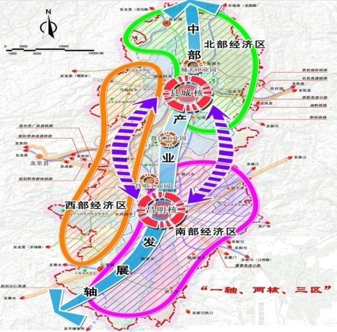

贵州省贵定县国民经济和社会发展

第十三个五年规划纲要

前言

“十三五”（2016-2020年）时期，是贵定县加快实现科学发展、后发赶超、同步小康的关键时期。贵定县国民经济和社会发展第十三个五年规划纲要是根据《中共贵定县委关于制定贵定县国民经济和社会发展第十三个五年规划的建议》编制，主要阐明县委战略意图，明确政府工作重点，引导市场主体行为，是未来五年我县经济社会发展的宏伟蓝图，是各部门依法履行职责、编制专项规划、制定实施年度计划和政策措施的重要依据。对于推动贵定县在新的机遇环境下实现守底线、走新路、奔小康具有重要指导意义。

# 第一篇 贯彻落实五大发展理念，同步全面建成小康社会

## 第一章 发展成就

“十二五”时期，是我国实现“两个一百年”奋斗目标历史进程中具有鲜明里程碑意义的五年，同时也是我县迎接挑战、奋起直追、彰显成效的五年。五年来，我县坚持以邓小平理论、“三个代表”重要思想和科学发展观为指导，深入贯彻落实习近平总书记系列讲话精神和中央、省、州及县委各项决策部署，在县委的正确领导下，在县人大、县政协的监督支持下，按照“一个目标、五个重点、一条主轴、四大基地”的发展思路，紧跟国家深入实施西部大开发和国内外产业向中西部加快转移的重大战略，积极抢抓“一圈两翼”和“两高”经济带的发展机遇，在困境中奋进，在挑战中前行，在创新中突破，较好完成了“十二五”规划制定的各项目标任务（见表1），实现了全县经济社会的快速持续健康发展，为“十三五”时期的加速发展奠定了坚实的基础。

五年来的奋起直追，实现经济实力大提升。 抢抓新一轮西部大开发、国发 2 号文件出台等重大历史机遇，大力弘扬“追赶、领先、跨越”的新时期精神，以攻克项目、增比进位和同步小康为载体，全县上下你追我赶、竞相跨越，共建繁荣、绿色、和谐、幸福的新贵定。“十二五”期间，我县国民经济保持了平稳较快增长，年均增速高于全国水平。全县地区生产总值由2010年的28.73亿元增加到2015年的69.76亿元，年均增长18.35%；财政总收入2010年至 2013年按老口径计算年均增长41.06%；按新口径计算从2013年的24.22亿元增加到2015年的31.38亿元，年均增长13.83%；工业总产值由23.97亿元增加到109.4亿元，年均增长35.48%；社会消费品零售总额由6.03亿元增加到15.11亿元，年均增长20.17%；城镇居民人均可支配收入由1.06万元增加到2.27万元，年均增长16.3%；农村居民人均可支配收入由3755元增加到8025元，年均增长16.4%；小康社会实现程度预计达到96%左右；主要经济指标均实现翻番增长。优势产业实现新发展，围绕“县城-盘江-沿山-昌明-云雾”发展主轴，推动三次产业融合发展，积极建设“商贸物流集散基地、现代农业特色基地、养生休闲度假基地、产业转移承接基地”四大基地，初步形成了“两园区六产业”的工业布局，昌明经济开发区和沿山农林科技产业园等一批产业园加快建设，阳宝山、金海雪山、云雾茶旅等休闲旅游景区快速发展，成功举办中国贵州第二届现代物流高峰论坛暨商贸物流博览会--陆港分论坛以及首届中国稻雕艺术节等具有国内外影响力的重大活动，引进阿里巴巴、老干妈、天福、珠海港等著名企业。

五年来的坚持不懈，展现城乡建设新面貌。紧紧抓住“高铁”经济时代到来的机遇，以综合交通网络体系建设为龙头，全面迈开城乡建设的大步伐。五年来，贵广高速贵定站、沪昆高铁贵定北站相继建成。大力实施特色城镇化战略，着力推进县加快城镇化发展“15+85”工程，县城建成区达到9.2平方公里，比2010年增加3平方公里，城镇化率由38%提高到46.3%。建成东外环、金南大道、书香大道等一批市政道路，新建改造市政道路25.87公里，县城至昌明同城化快速干道一、二标段建成通车。昌明镇列为国家新型城镇化综合试点镇，盘江镇被增补为省100个示范小城镇，积极探索1个示范小城镇带动N个美丽乡村的“1+N”发展模式，建成10个特色新村，累计实施“一事一议”奖补、“四在农家·美丽乡村”小康寨建设等项目1304个、总投资2.63亿元。加快交通、水利基础设施建设，花甲水库、乐芒水库、小河水库、上冲水库等一批重大水利项目开工建设；县城经都六至新安等一批交通路网设施建成通车，县城环西路、昌明至云雾、德新至新巴干线公路改建加速推进，实现所有行政村通村、通组油路（水泥路）建设；电力、通讯设施建设进一步加大，城乡发展基础得到新改善；累计投入水利资金7亿元实施各类水利工程119处，解决8.39万农村居民安全饮水问题。

五年来的拼搏进取，换来人民生活大改善。民生事业和社会治理全面发展，人民群众获得感、幸福感、安全感不断增强。城镇居民人均可支配收入和农村居民人均可支配收入分别由“十一五”末的10660元和3755元增长到22678元和8025元，全面建成小康指数从2012年的76.6%提高到2015年的96%。通过实施困难群众住房保障项目、提高城乡困难群众最低生活保障标准、加大扶贫开发、实施财政补贴“一事一议”、“四在农家.美丽乡村”等一批惠民工程，群众生产生活明显改善，全县累计减少贫困人口4.52万人，减贫摘帽乡7个。先后建成贵定中学、省医护校、贵定二小新校区等一批重大项目，全面实施教育“9+3”计划和“4+2”工程，九年义务教育巩固率提高到94%。建成新县人民医院，县人民医院和县中医院通过国家“二甲医院”评审，新农合参合率稳定在96%以上，累计参合112.3万人次，总受益224.1万人次，补偿资金达3.70亿元。新增城镇就业2.75万人，城镇登记失业率控制在4.2%以内。基本社会保险覆盖率达90%以上，城乡低保标准每年按不低于10%增长。建成县社会福利中心和云雾、昌明、新巴敬老院，启动实施殡葬“三位一体”改革。建成城镇保障性住房5751套24.93万平方米，改造农村危房5966户。人民生活品质显著提高。社会和谐安定有序，公共安全保障更加有力，信访矛盾纠纷化解“四级三化两评议一回访”机制得到省、州充分肯定。

五年来的大刀阔斧，取得改革开放新突破。优化行政区划调整，除保留现有的新巴镇外，将其余19个乡镇行政区调整为5镇2街道办，进一步促进人口集聚、产业聚集和资源共享，促进县域经济快速发展。大力推进公共资源管理体制改革，组建县公共资源交易中心，整合工程建设项目招投标、矿业权出让、国有产权交易、政府采购等平台，建立完善统一规范的公共资源交易平台。推行政府向社会购买公共服务改革试点，降低公共服务成本。推进镇（街）财政管理体制改革。组建项目投资管理中心，实施投资项目并联审批制度改革。设置市场主体“三证联办窗口”，通过“一窗受理、内部流转、并列办理、一窗发出”模式，实行“三证合一”简化办事程序。组建县国有资产管理和金融工作局，阳宝山开发项目成为全省第一个PPP融资项目。加强对外合作，主动融入贵阳都市圈及黔南州“一圈两翼”建设，与广州增城建立对口帮扶合作关系。加大招商引资力度，全县招商引资到位资金累计达312.97亿元，是“十一五”时期的10.48倍。

五年来的兼顾发展，孕育生态环境新景象。这五年来，贵定县按照习总书记的指示，坚持走“绿水青山就是金山银山”发展之路，制定绿色贵定建设三年行动计划，营造林比“十一五”增长30%。分别完成水土流失和石漠化治理560平方公里、882平方公里，森林覆盖率从48%提升到55%。甘溪森林公园被评为“国家生态文明教育基地”和“贵州省生态文明教育基地”称号，国家林业局批准设立贵定甘溪国家森林公园和贵定摆龙河国家湿地公园，获得全国首批、全省唯一的“全国森林旅游示范县”称号。全面落实减排工作任务，全县生产总值亿元GDP能耗下降4.63%，主要污染物排放总量稳定控制在省、州指标范围内。全力推进森林保护“六个严禁”和“六个一律”环保“利剑”执法行动，严格执行主要河流水环境保护“河长制”，集中式饮用水源地水质达标率为100%。建成县城环境空气自动站，县城环境空气质量达标率为100%，可持续发展能力和生态文明建设水平进一步提高。

五年的成就来之不易，积累的经验弥足珍贵，创造的精神财富影响深远。五年实践启示我们，加快推进跨越赶超、富民强县、全面小康，必须坚定不移地与以习近平同志为总书记的党中央保持高度一致 ，坚持县委领导，自觉接受人大、政协监督，做到发展方向不偏航、汇聚合力奔小康；必须坚定不移地守住发展和生态两条底线 ，坚持既要绿水青山又要金山银山、绿水青山就是金山银山，做到两条底线一起守、两个成果一起收；必须坚定不移实施新型工业化、新型城镇化、农业现代化和信息化“四化同步”战略，不断调适理念、政策和方法，做到既强优势又补短板，持续保持明显高于全省全国的发展速度；必须坚定不移地用好改革开放关键一招，以开放倒逼改革，以改革促进开放，为加快发展注入新动力、增添新活力、拓展新空间；必须坚定不移地以同步小康创建为载体，全面点燃各族群众干事创业的热情，进一步增强了民族自信心、自豪感和凝聚力。必须坚定不移地把改善民生作为根本出发点和落脚点，大力实施扶贫攻坚第一民生工程，协调推进社会事业发展，着力保障和改善民生，创新社会治理体系，不断满足人民群众对幸福生活的新期待。

在充分肯定成绩的同时，我们也清醒地认识到，全县经济社会发展中还存在的一些困难和问题：一是经济总量小，基础较为薄弱，发展活力不充分，以工业化带动城市化发展的格局尚未形成。二是工业经济规模偏小，工业经济缺少大企业、优企业支撑；农业产业化程度不足，农产品附加值较低；旅游产业尚未形成支柱，生态旅游服务产业起步较晚，开发仍处在产业链低端。三是人才、科技等高端要素支撑薄弱。人才引进机制不够完善，企业管理人才、技术人才、科技创新人才等都较短缺。加之科技投入力度不足，重视支持科技工作的环境氛围尚未形成，科技对经济社会发展的驱动作用不够。四是对内对外开发力度尚不足，融资、招商及项目合作等仍需加强。五是经济下行影响，新常态新政策下，用地、资金和环境资源等发展“瓶颈”制约加大。六是社会事业发展不平衡，社会保障和民生工作还需要进一步强化，特别是城乡基础设施建设需要继续加大投入。七是扶贫开发力度不够，精准扶贫、精准脱贫的工作任重道远。

这些困难和问题，我们要在县委的正确领导下，在县人大和县政协的监督帮助下，要高度重视，采取有效措施逐步加以解决。主动适应经济发展新常态，坚定信心，抢抓机遇，团结拼搏，务实创新，扎实工作，以压力换动力，以动力换爆发力，以爆发力谋大发展，布局谋篇，为“十三五”开好头，确保后发赶超、同步建成小康而努力奋斗。

表1：贵定县“十二五”规划纲要主要指标进展情况表

| 类别 | 指标 | 2010年 | 2014年末 | 2015年末 | 预期完成情况 |
|---|---|---|---|---|---|
| 经济增长 | 生产总值(亿元) | 28.7 | 62.42 | 69.76 | 已完成 |
| 财政总收入(亿元) | 3.49 | 29.46 | 31.18 | 达到目标进度 |
| 固定资产投资(亿元) | 13.09 | 71.03 | 85.61 | 完成增进速度 |
| 社会消费品零售总额(亿元) | 6.03 | 11.04 | 15.11 | 已完成 |
| 招商引资(亿元) | 10.2 | 79.2 | 110.08 | 已完成 |
| 结构调整 | 三次产业比重 | 15:1:46.9:37.99 | 15.14：44.52：40.34 | 13.71:44.91:41.36 | 未完成 |
| 城镇化率(%) | 38 | 42.5 | 46.3 | 已完成 |
| 粮食总产量(万吨) | 9.95 | 8.05 | 8.09 | 未完成 |
| 城乡建设 | 乡镇通油路率（%） | 90 | - | 100 | 已完成 |
| 农村人口人均有效灌溉面积（亩） | 0.69 | - | 0.74 | 达到目标进度 |
| 人民生活 | 农民人均纯收入(元) | 3755 | 7197 | 8025 | 达到目标进度 |
| 城镇居民人均可支配收入(元) | 10660 | 20486 | 22678 | 达到目标进度 |
| 城镇登记失业率(%) | 3.97 | 3.03 | 3.27 | 达到目标进度 |
| 城镇新增就业人数(万人) | 0.17 | 0.54 | 0.7 | 已完成 |
| 社会建设 | 人口自然增长率(‰) | 6.52 | - | 5.57 | 达到目标进度 |
| 年末常住人口总数(万人) | 23.11 | - | 29.74 | 达到目标进度 |
| 九年义务教育巩固(%) | - | 93 | 94 | 提前达到目标进度 |

## 第二章 面临形势

“十三五”时期，是贵定县可以大有作为、加快发展的重要战略机遇期，是实现扶贫攻坚、同步小康的决胜时期。面向未来，贵定县发展既迎来许多新趋势新机遇，也面临诸多新问题新挑战。综合研判国内外发展形势以及我县所面临的机遇与挑战，“十三五”时期，世界经济在深度调整中复苏，和平与发展、合作与共赢这一时代潮流不会改变，新一轮科技和产业革命蓄势待发，孕育着新产业、新业态、新模式。我国经济发展进入了速度变化、结构优化、动力转换的新常态，加快实施“四个全面”、大数据与网络强国、创新创业等国家战略，经济稳中向好趋势没有改变。随着“一带一路”、长江经济带、珠江-西江经济带、黔中经济区、高铁经济带的规划建设和国发2号文件、新一轮西部开发、实施精准扶贫、支持民族地区加快发展等重大政策的落实，为我县深化区域合作、实现跨越式发展提供了重要机遇。同时，面对日益复杂的国际环境以及日趋激烈的区域竞争，工业化水平低、城镇化率低仍是我县发展的两大短板，也是制约我县同步全面建成小康社会的重大瓶颈；加之经济下行压力加大、高端要素不足、创新能力不足、基础设施及基本公共服务供给不足、区域南北发展不平衡、贫困人口多、生态环境质量不高等问题制约，总体来看，“十三五”时期我县同步全面建成小康社会任务艰巨。

“十三五”时期，我们应正视自身基础薄弱、发展条件不成熟等诸多不足，结合当前我县所处经济发展阶段的实际特征，以推动提升新型工业化和城镇化水平为两大突破口，充分挖掘发展潜力，培育发展动力，创新发展思路，突破发展瓶颈，拓展发展空间，力求在更高水平上推动贵定实现跨越式发展，奋力开创经济社会发展新局面，确保同步全面建成小康社会。

## 第三章 总体要求和发展理念

“十三五”时期我县经济社会发展的总体要求是：高举中国特色社会主义伟大旗帜，以马克思列宁主义、毛泽东思想、邓小平理论、“三个代表”重要思想、科学发展观为指导，深入贯彻党的十八大和十八届三中、四中、五中全会和习近平总书记系列重要讲话精神，以及省委十一届六次全会、州委十届七次全会、县委十二届七次全会精神，按照中央“四个全面”战略部署和五大发展理念，以“守底线、走新路、奔小康”为工作总纲，坚持省委主基调主战略，积极对接国家“一带一路”和长江经济带等发展战略，以绿色化为引领、信息化为支撑、创新为突破口，统筹推进新型工业化、新型城镇化、农业现代化、信息产业化、旅游产业化加速发展，着力提高工业经济、城镇人口、民营经济和县域经济“四个比重”，全力促进经济总量、质量双提升，努力做到生态良好、生产发展、生活富裕，实现县域经济活跃、镇（街）繁荣发展、全面同步小康、群众切身满意的全面小康社会。基本要求是：

——坚持创新发展，建设智慧贵定。把创新摆在发展全局的核心位置，深刻认识创新是引领发展的第一动力，深入实施创新驱动战略，发挥科技创新在全面创新中的引领作用，优化劳动力、资本、土地、技术、信息、管理等要素配置，推动大众创业、万众创新，培育发展新技术、新产业、新业态，释放新需求、创造新供给，在加快发展中转换发展动力，重点在发展质量、效益上取得新突破。

——坚持协调发展，建设和谐贵定。把协调摆在发展全局的主要位置，深刻认识协调是持续健康发展的内在要求，正确处理速度与质量效益、经济与社会、城市与农村、绿水青山与金山银山、改革发展与稳定、总体战略与具体路径措施的关系，促进“四化同步”和“三产融合”协调发展，着力解决发展中存在的不平衡、不协调、不和谐、不可持续问题，不断增强全县经济社会全方位发展的整体性。

——坚持绿色发展，建设生态贵定。把绿色摆在发展全局的突出位置，深刻认识绿色是永续发展的必要条件和人民对美好生活追求的重要体现，全面落实节约资源和保护环境的基本国策，既要金山银山，又要绿水青山，坚守发展和生态两条底线，以绿色化为引领，巩固提升生态文明建设成果，推进生态建设产业化、产业发展生态化，加快建设资源节约、环境友好“两型”社会，发展现代山地特色高效农业和山地旅游业“两山”经济，让人民群众分享“生态红利”和“绿色福利”，实现百姓富和生态美的有机统一。

——坚持开放发展，建设活力贵定。把开放摆在发展全局的前沿位置，深刻认识开放是繁荣发展的必由之路，坚持以开放倒逼改革，以改革激活发展，统筹考虑国际国内两个市场，做好对内合作与对外开放，以大力发展“两高”经济为突破，主动融入贵阳大都市圈、“泛都匀经济圈”，积极探索内陆开放发展新模式，建立健全域开放体制机制，推动“引进来”与“走出去”取得重大进展，打造开放合作新平台，拓展开放发展新空间，加快构建开放型经济新格局，建设成为西南连接华南、华东的区域性重要枢纽城市，贵州省内陆开放合作的投资热土。

——坚持共享发展，建设幸福贵定。把共享摆在发展全局的根本位置，深刻认识共享是中国特色社会主义的本质要求，把增进人民福祉，促进人的全面发展作为根本的出发点和落脚点，坚持民生优先，全面加快小康社会建设，强化精准扶贫，加快民营经济发展，健全社会保障体系，积极推进基本公共服务均等化，提升社会治理能力，维护公平正义，使人民群众在共建共享发展中有更多获得感、幸福感、安全感，确保同步全面建成小康社会。

## 第四章 发展目标

总体目标：“十三五”时期是贵定县同步全面建成小康社会的关键时期，要牢牢守住发展和生态两条底线，促进经济总量、质量、均量“三量”齐升，实现生产发展、生活富裕、生态良好“三生”融合，建成一个黔中产业发展独特、经济实力强劲、政治文明进步、文化繁荣发展、城乡环境优美、生态环境良好、社会持续稳定、民族团结和谐、绝对贫困消除、人民安居乐业的小康贵定。（见表2）

战略目标：把贵定打造成川黔——贵广——南亚国际物流大通道重要枢纽城市、西南内陆开放合作示范城市、国际知名的佛教文化圣地，西南装备生产制造基地，打造全国电子商务发展示范县、全国森林旅游示范县、贵州全年性旅游示范县、贵州小城镇建设整县推进示范县、三次产业融合和农业“接二连三”发展示范县、国际知名的稻雕艺术之乡。“十三五”期间争取贵定县撤县建市。

——经济发展和结构调整实现新跨越。到2020年，全县生产总值突破140亿元，在2015年基础上实现“翻番”，年均增长14%左右；固定资产投资年均增长25%以上，其中产业投资占固定投资比重要达到70%以上；一般公共财政预算收入年均增长14%以上。新型工业化与信息化深度融合，农业现代化加快推进，工业经济主导作用更加明显，物流、旅游等现代服务业蓬勃发展。第二产业增加值年均增长15%左右；第三产业增加值年均增长17.5%左右，社会消费品零售总额年均增长12%以上，文化产业增加值占比在5%以上。

——城乡功能布局和基础设施建设实现新跨越。城市功能进一步完善，新型城镇化综合试点经验得到有效复制推广，“一轴两核三区”的城乡空间结构持续优化，产城景融合和城乡一体化发展有效推进，以“两高”为特色的综合立体交通体系基本形成，一批城乡重大基础设施建成使用，综合承载力显著增强，城镇化率达到52％以上。

——扶贫攻坚和民生改善实现新跨越。扶贫攻坚加快推进，到2018年末，全县现有农村贫困人口全部实现脱贫。就业更加充分，城乡收入分配差距缩小，“十三五”期间，城镇登记失业率控制在4.2%以内，城镇居民人均可支配收入年均增长9%以上，农村居民人均可支配收入年均增长11%以上，城乡居民收入比控制在2.4左右。民生保障水平得到显著提升，基本社会保险实现全覆盖。到2020年，职工养老、医疗、工伤、失业、生育五大保险参保人数达到10.7万人，基金征缴突破2.1亿元，城乡养老保险参保人数达到16.53万人。文化事业繁荣发展，文化产业发展壮大。全民文明素质不断提高，基本建成覆盖城乡的公共文化服务体系。社会管理制度进一步健全，社会治理能力得到提升，社会更加和谐稳定。

——生态建设和环境保护实现新跨越。资源节约型和环境友好型社会建设取得重大进展，主体功能区布局基本形成，生态文明建设取得新成效。到2020年，森林覆盖率达65%以上；城乡污水处理率达90%以上，城镇生活垃圾无害化处理率达90%以上；生态环境各项指标达到省州要求，节能减排目标得以实现，人居环境舒适优美。

——改革创新和开放合作实现新跨越。全面深化改革加快，在重点领域和关键环节改革上取得决定性成果，强化科技创新在引领全面创新中的核心作用，促进大众创业、万众创新。每年全县重大改革创新工作25项以上。开放合作平台和合作机制更加完善，推动“引进来”与“走出去”取得重大进展，内陆开放型经济发展开创新局面。

表2：“十三五”时期贵定县经济社会发展主要指标表

| 类别 | 指标 | 2015年 | 2020年 | 年均增长(%) | 属性 |
|---|---|---|---|---|---|
| 经济增长 | 生产总值(亿元) | 69.76 | 140 | 14左右 | 预期性 |
| #第一产业(亿元) | 9.58 | 12.23 | 5 | 预期性 |
| 第二产业(亿元) | 31.33 | 63.16 | 15左右 | 预期性 |
| #规模以上工业增加值 | 22.97 | 46.2 | 15左右 | 预期性 |
| 第三产业(亿元) | 28.85 | 64.61 | 17.5左右 | 预期性 |
| 公共财政预算收入(亿元) | 6.1 | 11.05 | 14以上 | 预期性 |
| 固定资产投资(亿元) | 85.61 | 261 | 25左右 | 预期性 |
| 社会消费品零售总额(亿元) | 15.11 | 26.63 | 12以上 | 预期性 |
| 引进县外到位资金(亿元) | 110 | 335 | 25左右 | 预期性 |
| 结构调整 | 三次产业比重 | 13.73∶44.91∶41.36 | 8.74:45.11:46.15 | - | 预期性 |
| 文化产业增加值占GDP比重(%) |  | 5以上 |  | 预期性 |
| 民营经济比重(%) |  | 60以上 |  | 预期性 |
| 每万人人才资源数（人） | 809 | 1303 | 10以上 | 预期性 |
| 城镇化率(%) | 46.3 | 52 | - | 预期性 |
| 类别 | 指标 | 2015年 | 2020年 | 年均增长(%) | 属性 |
| 民 生 建 设 | 农村居民人均可支配收入(元) | 8025 | 13522 | 11以上 | 预期性 |
| 城镇居民人均可支配收入(元) | 22678 | 34893 | 9以上 | 预期性 |
| 城镇登记失业率(%) | 3.27 | 4.2以内 | - | 预期性 |
| 城镇新增就业人数(人) | 7002 | [50000] |  | 预期性 |
| 脱贫人数 | 12000 | [56700] |  | 预期性 |
| 区划调整前行政村通油路（水泥路）率 |  | 100 |  | 预期性 |
| 人口自然增长率(‰) | 5.57 | 6 |  | 约束性 |
| 生态环境 | 单位生产总值能耗降低 | - | - | 省、州下达指标 | 约束性 |
| 单位生产总值二氧化碳排放降低 | - | - | 省、州下达指标 | 约束性 |
| 主要污染物排放减少 | - | - | 省、州下达指标 | 约束性 |
| 城市生活污水处理率（%） | 85.7 | 90 | - | 预期性 |
| 城镇生活垃圾无害化处理率（%） | 89.1 | 90 | - | 预期性 |
| 森林覆盖率（%） | 55 | 65 | 2以上 | 预期性 |
| 注: 地区生产总值和城乡居民收入绝对数是按2010年价格计算,速度按可比价格计算。 |

# 第二篇 深入实施工业强县战略，全力推进新型工业化发展

坚持新兴产业增强扩张与传统产业存量提升“两手并举”，加快新型工业化与信息化“两化融合”，推动产业链、创新链、资本链“三链耦合”，构建以大物流、大旅游为主体，大工业为支撑，大农业为基础的“四位一体”的特色产业体系，实施“大物流驱动、大旅游带动”产业发展战略行动，促进一二三产业融合发展，以提升产品质量安全为目标，构建市场、政府、社会三位一体产品质量治理体系，切实提高各产业市场竞争力，实现工业强县的战略目标。

| 专栏1：“四位一体”特色产业体系 |
|---|
| 大物流：公海铁联运、大宗商品物流、农特产品冷链物流、跨境电商、农村电商物流等特色物流业，以及电子商务、信息技术服务、人力资源服务等生产性服务业。大旅游：佛教文化旅游、健康养生旅游、自然生态体验旅游、乡村休闲旅游等特色旅游业，以及批发零售服务、住宿餐饮服务、教育培训服务、文化服务等生活性服务业。大工业：装备制造、新型建材、大数据电子信息、生物医药及医疗器械制造等战略性新兴产业，烟草制品加工、矿产加工、印刷包装、食品加工等传统优势产业。大农业：茶产业、果蔬产业、山地生态畜牧业、特色农产品加工业。 |

## 第五章 加快培育壮大战略性新兴产业

依托昌明经济开发区以及高铁经济带动，大力推动装备制造业、新型建材产业以及以大数据为引领的电子信息产业和以大健康为导向的生物医药及医疗器械制造业的发展，加快培育我县经济增长新动力。

### 第一节 大力发展装备制造业

大力发展机械装备制造。依托昌明经济开发区，推动浙商产业园、闽商产业园等特色装备制造产业园区建设，大力发展适应西南地区发展需要的矿山工程机械、冶金机械、建筑机械制造、施工(商用)电梯等高端装备制造，就近为矿产开采及煤化工、磷化工等产业提供机械安装、租赁及配件销售；以黔力重工、贵州鑫轩贵、水电八局等为载体，实施一批重大技改扩能项目，积极发展钢构产业、风电配套产业，着力打造特色机械装备制造产业集群，成为西南装备生产制造基地。

加快发展现代物流装备制造。承接贵定县建设贵州（昌明）国际陆港的发展需要，以昌明经济开发区打造贵广南亚物流大通道重要内陆节点为契机，充分发挥未来产业基础优势，积极吸引国内具有物流装备集成制造的大型龙头骨干企业，支撑贵定海陆联运区域中心建设。

| 专栏2：装备制造业发展重点领域 |
|---|
| 机械装备制造业：矿用机械、机电设备制造、建材建筑装备；能源装备制造业：钢结构产业、风电配套产业、电力装备产业；现代物流装备制造业：仓储物流装备、装卸物流装备、智能化系统集成及关键部件配套装备等。 |

### 第二节 培育发展新型建材业

培育发展新型建材产业。以节能、节土、环保、改善建筑物装饰功能为中心，以墙体材料革新为突破口，依托联和能源硅工业产业园，着力优化提升建材产业结构，大力发展硅系新材料及下游产业，带动其他新材料制造业的发展，把贵定建成服务环贵阳经济圈的重要绿色建材基地，全力打造贵州一流的绿色节能新型建材产业集聚示范区。

推动新型建材企业做大做强。积极支持企业开展技术研发和创新，重点研发和生产建筑切块、轻质板材、非粘土砖、高档涂料、PVC管材、塑料型材等产品，鼓励企业开展节能技改和清洁生产审核，扩大对固体废弃物的无害化利用范围和利用量，鼓励并引导企业向标准制定、产品营销、产品检测等新型科技建材产品的服务环节延伸，推动一批新型建材产业做大做强。

### 第三节 积极发展大数据电子信息产业

牢固树立数据是资源、运用是核心、产业是目的、安全是保障的“四大理念”，从基础设施、系统平台、应用平台、增值服务、配套端产品五个产业链层级，制定自上而下、相互联动的大数据产业发展规划。坚持以规划为“龙头”,统筹抓好大数据资源开发利用、产业技术创新和成果转化、高端人才引进和培养、产业配套升级、大企业培育和大项目带动等五大重点工作。制定大数据产业招商引资、招才引智优惠政策，创建良好的大数据发展环境。

培育发展大数据电子信息产业。推进与贵阳、贵安新区大数据产业错位互补发展，建立以大数据应用服务为核心，以大数据存储处理加工、智能终端制造为补充的大数据产业体系。依托贵安新区数据中心和信息产业园以及黔南州超算数据中心的多重辐射优势，创新大数据电子信息产业发展模式，围绕“大项目-产业链-产业群-产业基地”的发展模式，以贵定县“领略中国”农产品大数据中心、农村淘宝、阿里巴巴等项目建设为契机，加快推进农产品交易电商平台和企业数据中心建设，形成一批农业大数据存储、分析、应用、加工等服务企业，带动电子信息产品制造、智能终端制造、大数据应用等产业发展，积极发展为大数据产业配套的电子信息制造业。以环“两贵”经济带为主体，加快发展新型电子元器件、锂电池材料、印制电路板、特种通讯设备、信息机电、LED 等电子信息制造业，开发大数据智能终端产品，为我县及贵阳、贵安新区大数据产业提供配套支撑。不断提升产业发展层次和集聚水平，打造全国电子商务发展示范县。

提升大数据电子信息产业应用水平。着力提升全县信息化水平以及“互联网+”服务贵定经济的能力，以贵定昌明经济开发区、农林科技产业园、金海雪山及千户布衣魅力小镇等为重点载体，重点推进一批综合性网络工程、信息化与农业现代化融合工程以及智慧景区、智慧园区、智慧物流工程的建设，着力推进重点领域大数据示范应用，全面提升大数据服务贵定经济的能力。

| 专栏3：大数据电子信息产业发展重点领域 |
|---|
| 电子信息产品制造：集成电路与电子元器件，大功率的厚薄膜集成电路设计、制造、封装与测试技术，动力锂电池材料、半导体电子浆料、电子铜箔、高性能磁性材料、芯片产品等。智能终端制造：显示面板、显示模组、控制电路等配套产业，家用视听、汽车电子、电力电子、健康电子、信息安全等设备研发。大数据应用：拓展大数据在工业制造、商贸流通、电子商务、旅游业等行业领域的应用，搭建“大数据+工业”、“大数据+商贸物流”、“大数据+电商”、“大数据+旅游”等应用平台。 |

### 第四节 加快培育生物医药及医疗器械制造业

积极发展特色生物医药产业。充分发挥我县生态环境、气候资源优势，依托森林湖中药材基地、香榧基地，刺梨基地、大鲵产学研基地，大力推进发展特色医药加工制造业，促进医药医疗与养老养生融合，构建药食结合、医养互补的产业格局。重点培育壮大民族医药产业，以贵州金象公司、贵定胡三帖药械公司为支撑，着力扶持一批龙头企业做大做强，将现有的药品品牌转化为生产力，加快推动特色生物医药产业的发展。

推动医疗器械制造业发展。充分利用国内人口老龄化对医疗服务的强大需求，以及贵州省、黔南州重点实施的大健康发展战略，积极引进国内大型医疗制造装备企业，开展医疗装备产业链培育建设，推动成套智能网络检查设备、智能化护理设备、康复设备及数字医疗、远程医疗、移动医疗等新型医疗服务产品生产，并适时推进医疗设备、医疗器械高新技术产业化基地建设。

| 专栏4：保健医药产业重大工程 |
|---|
| 特色药材加工制造：香榧、石斛、金银花、黄柏、中药材加工制造。生物医药加工制造：高浓缩VC口服液、纯中药制剂萃取（含片、胶囊）、谷维素提取制药、富硒姜茶等。医疗器械：做大敷贴（胡三贴）、老年服务终端监控设备、医用高分子材料等。 |

## 第六章 着力改造提升传统优势产业

坚持优结构、促转型、增效益为主线，重点对城北工业园区现有传统优势产业进行改造升级，加快推动烟草产业、矿产加工、印刷包装、食品饮料等传统支柱产业的技术改造和升级，强化自主研发和引进，强化节能减排，着力加强政策支持和引导，全力保障重点规模企业生产要素，增强传统优势工业发展实力。

### 第一节 着力改造提升烟草加工业

顺应产业发展趋势，加快推动烟草加工业改造升级，强化卷烟工业优势地位。全力支持贵定卷烟厂做强做优，加大技改投入，加快推进15.5万平方米的烟叶醇化库、30万大箱卷烟异地技改项目建设，提升贵定卷烟厂的核心竞争力。着力提高产品档次，调整产品结构，从中低档次向中高档次发展，巩固卷烟工业，提升发展水平。

### 第二节 优化提升矿产品加工业

重点加强对矿产品加工企业的资源整合，推进规模开采，提高资源利用率。依托我县丰富的高钙石灰石资源，以贵定海螺盘江水泥公司440万吨的水泥项目为支撑，强化节能减排。注重延长产业发展链条，加快引导重晶石加工业从超微粉加工向钡盐产品等化工产品系列方向发展，增加产品附加值。着力推动粉石英及硅藻土的深加工开发。

### 第三节 加快提升印刷包装、食品加工等传统轻工业

积极推动印刷包装、食品加工等传统产业转型升级，推动扩大玻璃瓶、纸箱包装业生产规模，扩大蔬果产品储藏和加工技术应用，着力推动农产品精深加工业发展，提升食品加工产业效益。加大对传统微型轻工企业扶持，采取有效措施，积极协调解决企业在建设和生产经营中出现的贷款、土地、用工等各种问题，加快培育出一批发展势头强的规模企业。

| 专栏5：传统轻工业改造提升重点领域 |
|---|
| 烟草制品加工：加快推进15.5万平方米的烟叶醇化库、30万大箱卷烟异地技改项目建设，提升贵定卷烟厂的竞争力，到2020年实现工业产值50亿元以上。矿产加工：碳酸钙精深加工（碳酸钙造纸、纳米碳酸钙）。印刷包装：食品用玻璃瓶、纸箱包装、瓷品、印贴、商标印刷。食品加工：重点建设老干妈油制辣椒产业园、沿山农特产品科技园、云雾茶产业园、创新智慧粮食核心产业园。 |

## 第七章 繁荣发展现代服务业

大力发展现代服务业，以特色物流业为引领，加快发展生产性服务业，促进产业结构调整升级；以特色旅游业为先导，加快生活性服务业发展，促进消费结构升级。

### 第一节 加快发展生产性服务业

以产业转型升级需求为导向，充分发挥生产性服务业专业性强、创新活跃、产业融合度高、带动作用显著等特点，加快生产性服务业创新发展，以农村淘宝、大数据应用、大众创业等为突破口，大力发展电子商务、信息技术服务及人力资源服务等生产性服务业，创建电子商务示范县，促进生产性服务业与农业、工业等在更高水平上有机融合，推动全县产业结构优化调整。

### 第二节 加快发展生活性服务业

以增进人民福祉、满足人民群众日益增长的生活性服务需要为主线，以改善全县旅游服务水平和质量为突破，大力发展批发零售服务、住宿餐饮服务、教育培训服务、文化服务等生活性服务业，着力解决供给、需求、质量方面存在的突出矛盾和问题，推动生活性服务业便利化、精细化、品质化发展。

## 第八章 大力推动产业集群化发展

围绕打造特色产业体系目标，推动产业集群化发展，促进资源要素向产业园区集聚，完善园区基础设施及公共服务体系，培育发展各类市场主体，提高产业园区承载力。

### 第一节 推动产业园区提质提效

以高铁经济发展为契机，努力做大做强昌明经济开发区，推动沿山农林科技园“接二连三”发展，加快各镇街产业园区发展，加快园区内水、电、路、通讯等基础设施建设，不断改善产业园区营商环境。到“十三五”期末，昌明经济开发区产值规模力争达到500亿元以上，其他各镇街产业园区产值规模达到100亿元以上，沿山农林科技产业园打造成为省级农林产品种植、加工、销售的“接二连三”示范区。

### 第二节 加快产业集群化发展

加大招商引资力度，推进重点项目建设，围绕园区主导产业和龙头企业，促进产业上下延伸、系统配套，衍生或吸引更多相关企业集聚。“十三五”时期，全县每年向上争取各类项目资金10亿元以上，每年通过政府性融资平台融资15亿元以上，固定资产投资年均增速不低于25%，产业投资占固定资产投资比例逐年提高。积极培育壮大特种装备制造、新型建材、烟草加工等产业，形成特色产业集群，努力提升骨干企业的技术水平，鼓励企业联手打造区域品牌，不断提高企业和品牌知名度，实现规模和效益的双提升。

### 第三节 培育发展各类市场主体

坚持把激发创新创业活力，促进市场主体发展作为繁荣城乡经济、夯实产业发展基础的重要举措，培育发展充满活力的中小微企业，鼓励支持民营经济发展。“十三五”期间每年引进1家以上500强企业入驻、新增30个以上工业项目投产，每年新增培育2000万元以上规模企业15家以上，每年培育发展中小微企业、农民专业合作社、个体工商户等各类市场主体达1500户以上，每年申报获批准的省级以上著名商标、品牌产品各10项以上。

# 第三篇 深入实施城镇化带动战略，构建城乡区域发展新格局

以人为本的新型城镇化是现代化的战略支撑所在。“十三五”时期，贵定县要以昌明镇纳入国家新型城镇化综合试点为发展契机，充分发挥在沪昆、贵广两大经济带交汇处的区位优势，优化城乡空间布局，统筹城乡一体化发展，促进产城融合，努力走出一条西部经济欠发达地区和少数民族聚居地区新型城镇化发展的新路子。力争到2020年，全县城镇化率达到52%以上。

## 第九章 优化城乡区域空间布局

按照“县城宜居、昌明宜业、沿山和盘江宜游、云雾宜农、德新和新巴加快发展同步小康”的发展思路，以县城为中心，昌明为次中心，盘江、沿山、云雾等为重点镇进行科学配置，合理布局，做大县城、做精城镇、做美乡村，加快推动县域内部统筹协调以及县域外部区域协调，深入实施多元区域合作战略，全面构建城乡区域协调发展新格局。

### 第一节 优化城乡空间格局

结合各镇街发展特色及现状基础，“十三五”时期，着力构建“一轴、两核、三区”的城乡空间格局。依托连接县城-昌明的同城化干道，以三次产业融合发展为动力，积极构建县城—盘江—沿山—昌明—云雾中部产业发展轴，形成串联全县产业发展的经济主轴。充分发挥我县高铁、高速、铁路交通优势及昌明省级经济开发区平台载体优势，全力构建县城“宜居”核心和昌明“宜业”核心，形成带动全县经济发展的两个辐射源。围绕区域中心小城镇定位，结合各城镇资源特色优势，重点推动县域南部、西部和北部经济片区的特色化发展，着力构建以云雾为中心的南部“宜农”经济区、以盘江、沿山为中心的西部“宜游”经济区以及以德新、新巴为中心的北部“山地特色”经济区，形成支撑全县错位、互补、特色发展的空间载体。

图1：“十三五”时期贵定县城乡空间布局图

### 第二节 构建特色小城镇体系

充分发挥各镇特色优势，重点强化县城、昌明核心城镇辐射带动作用和盘江、沿山、云雾特色重点小城镇支撑作用，挖掘县域北部小城镇山地特色，构建优势突出、功能互补、紧密联系的特色新型小城镇体系。

强化核心城镇的辐射带动作用。县城“宜居”综合服务核心。充分发挥贵新高等级公路和长沙至昆明客运专线、湘黔铁路等交通区位优势，坚持老城区改造和新区开发“双轮驱动”，强化县域内部综合服务功能，集中力量实施路网拓展、城市综合体建设、棚户区改造、河道景观打造等工程，加快从基础设施形态开发向功能开发和全面开发转变，提高县城对周边镇村尤其是北部片区的辐射带动力，丰富城区商贸、服务功能，着力完善城市公共配套，力争做到在县城步行15分钟以内可达学校、市场、社区医院、广场、公园，将县城建设成为以商贸、交通运输、服务业为产业支撑，城市功能较为完善，集休闲、人居为一体的全县政治、文化、经济中心。昌明“宜业”经济产业合作核心。围绕昌明省级经济开发区、省级示范小城镇和国家新型城镇化综合试点镇的开发建设和要求，依托夏蓉、黔桂铁路新线、“两高”交通优势及省级经济开发区建设的优势，结合国家新型城镇化、国家建制镇示范试点的政策机遇，统筹做好昌明城镇建设与园区产业发展，强化对外合作及经济产业发展功能，同时通过同城化快速干道与县城、城北园区互动、互补，积极融入贵阳双龙临空经济区辐射区域，将昌明打造成为贵广-南亚物流大通道上的重要节点，黔南州先进制造业服务基地，贵定南部区域商贸、经济中心，建成贵州山地特色交通枢纽型、工贸园区型、产业聚集型小城镇，并辐射周边县市。

加强重点特色小城镇的支撑作用。按照“100个示范城镇”小而精、小而美、小而富、小而特的要求，提高小城镇品质和服务功能，重点增强盘江省级示范小城镇连接城乡、聚集产业、承接人口、辐射带动的能力，充分发挥沿山宜游，云雾宜农的主导功能，争取沿山、云雾进入下一批贵州省示范小城镇。盘江旅游休闲度假型小城镇：以盘江省级示范小城镇建设为契机，大力挖掘民族文化和乡村旅游资源，探索推进产城景一体、产城景互动、产城景融合的发展模式，重点发展休闲娱乐文化产业和现代生态观光农业，建成连接县城和昌明两个中心，带动中部旅游休闲综合产业发展的小城镇。云雾茶旅结合型小城镇：重点依托县城—昌明同城化市政道路和“两高”临近乡镇的机遇，围绕“区域性中心城镇”、“贵州最美茶乡”和“生态云雾”三张名片定位，突出特色、聚集优势、加快发展，形成“一心（城镇核心区）一带（现代农业产业密集发展带）一片（茶产业核心片）一区（生态文明建设环境保护区）”的空间布局。加快推进“云雾山现代农业产业园区”建设，以茶产业和蔬菜种植产业为抓手，打造生态蔬菜基地示范区，做大做强“中国苗岭贡茶之乡”等品牌，深入挖掘茶产业链发展潜力。积极谋划“昌明-云雾”一体化发展，将云雾镇建设成为昌明工业园区不可缺少的重要后花园，全力打造县城南部的茶旅结合型中心小城镇。沿山养生养老健康度假型小城镇：依托贵定摆龙河国家湿地公园和沿山农林科技产业园等资源载体，进一步加快市政和公共基础设施建设，大力开发特色土特产品和特色美食，重点发展休闲养生、健康养老、医疗保健及生态营养等健康产业，建成养生养老健康度假型特色小城镇。

突出县域北部小城镇的山地特色。结合北部自然环境特点，北部地区将重点发展以高山有机牛羊养殖为重点的生态草食畜牧业，打造贵州乃至全国知名的山地生态畜牧综合示范基地。德新镇：紧紧围绕高寒生态高效生态农业示范区建设，以绿色化、有机化、健康化为特色，重点打造以黄龙山为核心的山地生态畜牧综合体，通过畜牧业引擎带动加快发展生态烤烟、富钼蔬菜、中药材、水苔等特色产业，着力打造全省高山有机牛羊养殖基地和富钼蔬菜示范种植基地，重点建成安全餐桌的绿色小镇；探索健体的生态小镇和体验国家非物质文化遗产的苗族长衫龙的神奇小镇。新巴镇：着力培育高寒耐旱经济作物特色产业，重点打造精品烤烟、香榧、紫皮大蒜、酥李、刺梨等一批特色农业品牌，成为全县精品烤烟示范区和全省香榧种植示范基地；建好独木河动植物生态科普示范基地，将独木河申报为省级湿地公园，开发独木河水上观光、休闲度假和生态旅游资源，拓展新巴与洛北河漂流、阳宝山等周边景点的有机联接，打造集农业、旅游为一体的特色和谐之镇、创新绿色之镇。

### 第三节 加强区域协调发展

增强县域外部区域协调发展。深入实施多元区域合作战略，构建“东进、西融、南拓、北联、中调”的区域空间格局，更加突出“西融”和“南拓”，增强城镇化发展的外部动力。充分利用沪昆、贵广两大高铁及兰海、夏蓉两大高速带动形成的经济走廊，积极推动落实与长江经济带及珠江-西江经济带沿线地区的合作框架协议，加强贵定县综合交通枢纽建设，深化与沿线城市的交流和产业合作，着力承接东部产业转移，吸引更多企业入驻贵定发展，扩展合作范围和领域，提高贵定对外开放程度。借助环贵阳城市带和都匀城市圈的双重辐射带动作用，进一步强化中心枢纽地位，加快建设贵定至龙里、贵定至都匀、贵定至惠水快速公路建设，推动贵阳、都匀区域协作，构筑“贵阳—龙里—贵定—都匀”黔中城市群东部核心发展带。

加快推进县域南北统筹协调发展。结合贵定县产业布局调整和区域功能定位，重点加大对北部两镇的政策支持和倾斜力度，加快推进北部片区的基础设施建设、公共设施配套和产业用地开发，充分发挥农民主体作用，着力保障和改善民生。采取南部带动北部的策略，以打造旅游经济带为契机，以线带点，将南部以“金海雪山”、云雾贡茶文化旅游创新区为代表的旅游景点与北部阳宝山、独木河等旅游资源开发相衔接，整体打包推广，加强南北经济联系，从而实现区域的协调发展。

| 专栏6：“东进、西融、南拓、北联、中调”区域空间格局 |
|---|
| 东进：依托沪昆高铁、兰海高速，向东加强与福泉、麻江、凯里等城市的合作，对接长江经济带及沪昆高铁经济带。西融：依托沪昆高铁、贵广高铁、兰海高速、夏蓉高速等交通大动脉，借助贵阳“东扩”战略，全面融入贵阳大都市圈，加强与龙里等地合作，加快构建“贵惠长龙”环贵阳经济带。南拓：依托贵广高铁、夏蓉高速及同城化干道，加快昌明经济开发区建设及高铁经济区开发，强化与都匀、平塘、独山、三都等地合作，对接珠江-西江经济带及贵广高铁经济带。北联：依托沪昆高铁、兰海高速，以贵新高速北移为契机，承接贵阳大都市圈辐射带动，加快北部新巴德新两镇发展，经贵阳对接成渝经济圈及渝新欧、蓉新欧等中欧国际通道。中调：优化调整县城功能布局，通过同城化干道等交通网络，强化县城-昌明两个发展核的辐射带动效应和联动效应，加快县域内部同城化步伐，提升空间承载能力。 |

## 第十章 提升城镇综合承载能力

加大大型基础设施建设投入力度，提升城镇基础设施保障能力，加快城镇公共服务设施建设速度，构建完善的城镇基本公共服务体系，实施城镇智能化建设工程，增强城镇化承载能力，全面提升全县城镇化可持续发展水平。

### 第一节 加强城镇基础设施建设

着力加大新型城镇化发展的交通、能源、水利等外部保障能力建设，重点强化交通运输网络建设，加快县城至昌明城市快速路、贵定至龙里城市快速路，建成“三横一纵”县域干线公路网，不断提高现有省道、县道通行能力，强化贵定与周边城市的交通联络以及内部城镇与乡村的联系。增强水利保障能力建设，依托花甲、乐芒、小河水库、河山墩、高梁坝、音寨、新民、石门等骨干水源工程建设、引提灌工程和地下水（机井）利用工程为主的水利建设三大会战，从根本上解决贵定工程性缺水问题，有效保障工业和城镇化发展用水需求。着力加强骨干电网建设，全面优化电网布局。加快建设安全高效便利的城镇基础设施网络体系，重点实施交通、给水、排水、电力、电信、垃圾污水处理等城镇基础设施提升工程，推进县城区地下综合管廊建设，统筹各类市政管线规划、建设和管理，解决反复开挖路面、架空线网密集、管线事故频发等问题，全面提高城镇基础设施运行效率和城镇化发展质量。

### 第二节 推进城镇公共服务设施建设

加快教育设施建设。拓展实施教育“9+3”计划，加快桃花小学、贵定县八一幼儿园、昌明幼儿园建设以及贵定二小新校区建设；加快推进建设一所优质普通高中学校，在县城或昌明建设一所职业技术学院，在各乡镇建设一批标准化农村寄宿制中小学校，满足全县多层次教育发展需求。加快医疗设施建设。充分发挥中医药特色优势，将县中医院打造为国家中医院建设试点，积极建设“远程医疗”，大力发展“智慧医疗”，全面提升公共卫生和医疗卫生水平。加快文体设施建设。改善贵定县体育中心设施环境，在县城建设全民健身中心，在各乡镇结合广场或空地建设篮球场、康体设施等。“十三五”时期，全面建成贵定图书馆、贵定博物馆、贵定县体育综合训练馆、贵定县科技馆、贵定县数字化影视传媒放映发行中心、贵定县民族文化艺术会展中心“四馆两中心”。加强城市公共停车场建设系统规划，完善老城区公厕等配套设施建设。全面推进城镇棚户区改造。做好城镇棚户区改造与城镇规划的衔接，加大城镇棚户区改造的土地供应力度，有序开展旧住宅区综合整治，多渠道筹集棚户区改造资金，每年完成城镇棚户区改造1500户以上。

### 第三节 加强智慧贵定建设

实施智慧贵定大数据建设工程。以大数据建设为基础，推进数据资源开放共享和社会化运用，提升“互联网+”行动计划服务贵定经济的发展，依托黔南州“光网黔南、满格黔南”工程，将贵定县建设成为全省信息化建设示范县。在“十三五”期末，实现全县城镇区域光网全覆盖，各村寨实现互联网全覆盖，到2020年实现“村村通宽带、户户能上网、村村都建信息站”等农村信息化目标。着力推进新型信息化应用，重点推进一批综合性网络工程、信息化与农业现代化融合工程、旅游景区信息化建设工程等信息化应用项目，推进智慧旅游、智慧农业、智慧医疗、智慧交通和智慧安全等工作的开展。

推动城镇化与信息化融合发展。加强“大数据”在贵定城市规划、建设、管理、公共服务及社区管理等方面的引领和支撑作用，促进城市规划管理信息化、人口信息动态化、基础设施智能化、公共服务便捷化、产业发展现代化、社会管理精细化。全面推行数字城镇管理。依托智慧城市建设，广泛应用信息化技术，推行数字城镇管理，引入社区网格化管理模式，科学设置城镇社区，健全社区基层服务管理机制，发动群众共同参与城镇管理，促进“三网融合”，城镇管理过程控制实现全天候、无缝隙、精细化。

## 第十一章 加快城乡一体化发展

城乡发展不平衡是严重制约我县同步全面建成小康社会目标实现的重要因素。“十三五”时期，贵定县应着力实施小城镇建设整县推进工程，加快推进城乡农业转移人口市民化以及城乡基本公共服务均等化，加快推进全县城乡统筹协调发展。

### 第一节 加快小城镇建设整县推进

突出山地特色，加快推进镇村联动发展。突出落实“五个整县推进行动”，实施小城镇建设整县推进行动，美丽乡村小康寨建设整县推进行动，农村村寨环境综合整治整县推进行动，“互联网+精准扶贫”整县推进行动及村村有项目、村村开发出产业基地和镇镇街街抓好产业园区发展整县推进行动。着力促进城乡客运一体化，试点行政区划调整前20个乡镇城乡客运一体化，逐步向全县行政村推进，在“十三五”期末，实现“村村通客运目标”。因地制宜引导建设城镇聚合型社区、强村带动型社区、村企共建型社区。积极探索示范小城镇带动多个“美丽乡村”建设的“1+N”联动发展模式，将县城、昌明以及其他有条件的城镇作为城乡统筹发展的融合点，推进城乡统一的人力资源、土地、金融等要素市场建设，构建特色小城镇体系，成为贵州小城镇建设整县推进示范县。

### 第二节 加快推进农业转移人口市民化

以人的城镇化为核心，积极贯彻落实党中央“三个1亿人”行动计划，加快推进户籍制度改革，健全农业转移人口落户制度，创新户籍制度管理，全面统一城乡户籍登记制度，实行户口登记一元化，健全完善居住证制度，全面放开落户限制。加强农业转移人口市民化保障能力，加快推进城镇常住人口基本服务全覆盖，配套做好农业转移人口市民化的公共服务配套保障，逐步实现同城同权、同城同酬、同城同保、同城同教。健全农业转移人口市民化机制，合理确定县、镇两级政府职能，建立农业转移人口成本分担机制，完善农业转移人口社会参与机制，让农业转移人口更能融入社会，解决贵定县半城镇化问题。

### 第三节 促进城乡基本公共服务均等化

加大政府投入力度，完善支农惠农体系，以解决农村公共服务数量不足、质量不高为重点，实行公共财政向农村教育、科技、文化、卫生、交通出行和社会保障事业倾斜，推进基础设施和公共服务向农村延伸，逐步建立起覆盖城乡、功能完善、管理有效、水平适度的基本公共服务体系，切实提升农村社会保障水平和城乡综合服务功能和承载力。按照省、州统一要求，有序引导农业转移人口落户城镇。

# 第四篇 全力推进大扶贫攻坚行动，走上科学脱贫致富之路

按照“扶产业、强基础、提素质、优保障、保生态、促开放”的基本要求，把扶贫工作作为第一民生工程，认真贯彻落实贵定县“1+13+2”精准扶贫配套政策和“33668”扶贫攻坚行动计划，牢固树立科学扶贫理念，坚持“政府主导、社会参与、自力更生、开发扶贫”的发展原则，着力完善扶贫开发体制机制，全面推进精准扶贫科学治贫，重点推进特困地区和特困群体的攻坚脱贫，确保到2018年，全面消除绝对贫困，加快脱贫致富奔康步伐。

## 第十二章 加快完善扶贫开发体制机制

着力提升扶贫开发的法治化水平，强化制度约束和规范，形成“全面覆盖、制度规范、责任清晰、信息透明、多方参与”的扶贫开发大格局。

### 第1节 完善扶贫开发责任机制

强化扶贫开发责任制，构建县、镇、村三级基本责任分工体系，认真研究落实队、户的责任对口帮扶机制，将责任落实到人。落实精准扶贫责任制。严格领导责任，各级党（工）委、党组书记对精准扶贫工作负总责，严格落实精准扶贫第一责任人职责。建立责任清单，各级领导干部每年年初要制定精准扶贫责任清单，落实工作任务。各级党员领导干部要坚持每年到扶贫联系点开展调研，深入基层深入群众了解情况，解决问题，推广经验。每年选派机关优秀青年干部到贫困村任“第一书记”，按省州部署选派同步小康驻村工作组到村开展帮扶，实现贫困村“第一书记”、同步小康驻村工作组选派全覆盖，帮助解决基层突出问题，强化基层组织建设，助推基层发展，形成精准扶贫的合力。

### 第二节 完善扶贫开发工作机制

加快构建专项扶贫、行业扶贫、社会扶贫有机结合的“三位一体”大扶贫格局，进一步整合社会资源，形成脱贫攻坚的合力。全面推行结对帮扶到村到户，实行不脱贫不撤队、未小康不脱钩。广泛动员社会各方面力量，认领帮扶贫困村，开展点对点精准包干扶贫，实现社会力量对贫困村帮扶全覆盖。实行贫困人口收入级差分类扶持、脱贫路径分类管理。对无业可扶无力脱贫的“两无”贫困人口，以济困为主，强化社会保障兜底功能，对有劳动能力的贫困人口，注重发挥产业化扶贫效应，同时鼓励创业创新，着力提升贫困人口的就业率和创业能力。发挥市场在扶贫资源配置中的决定性作用，变“简单扶持到户”为“重在效益到户”，搭建政、企、民、社合作平台，依托公司（企业）+合作社+贫困户+基地等加快扶贫开发模式创新，调动市场主体带领贫困农户脱贫致富的积极性，加快脱贫致富的步伐。

### 第三节 完善扶贫开发考评机制

完善扶贫开发考评奖惩机制。积极构建政府主导、社会参与的多元考核评价机制，充分发挥社会公众和帮扶对象在扶贫开发考评奖惩工作中的重要作用，鼓励高校、研究机构等开展社会性扶贫开发监测、调查、分析、评价等活动。继续落实中央、省“摘帽不摘政策”的相关奖励措施，确保贫困退出任务如期完成。将扶贫开发贯彻落实情况作为对党政领导班子和领导干部实绩考核的重要内容，考核评价结果在每年全县扶贫开发工作会议上进行通报。对农村扶贫开发工作取得突出成效的镇、村干部，给予表彰奖励。加强对财政扶贫资金的管理与审计，建立精准扶贫项目台账制度，确保扶贫责任落到实处。加强精准扶贫信息平台日常监测管理，对年度贫困退出工作成效进行监测和评估，对弄虚作假、欺上瞒下的，依照有关规定严肃处理。对巩固脱贫工作不力、贫困发生率不降反升、不能按期退出的，要严格追究责任。

## 第十三章 深入推进精准扶贫科学治贫

围绕“到2020年基本消除绝对贫困现象”的重要目标，以9个贫困乡镇51个贫困村5.67万贫困人口为工作重点，全面推动精准扶贫，开展科学治贫，提高扶贫工作的针对性和统筹性，加快脱贫致富步伐。

### 第一节 因地制宜深入推进产业扶贫

坚持扶产业就是扶根本的理念，大力推进产业扶贫，提升自主脱贫能力。按照宜农则农、宜游则游、宜商则商的原则，围绕我县茶叶、刺梨、烤烟、蔬菜、大鲵、乡村旅游等等特色产业优势，重点通过发展种养业、加工业、旅游业、流通业、劳务经济等五个途径，因地制宜深入推进产业扶贫。充分利用我县地、气、水等山地资源，大力发展现代山地特色高效农业，帮助贫困农户就地发展生产增收。依托农特食品加工基地建设以及乡村旅游、农村电商的发展，帮助贫困农户实现就业创业增收。注重引导和支持企业到贫困地区投资兴业，注重发挥扶贫产业基地的带动效应。加快推动“一村一品”工程建设，通过发挥扶贫龙头企业、农民专业合作社和互助资金组织的带动作用，帮助贫困农户发展生产，带动贫困农户增收创收。通过“电商下农村+精准扶贫”等模式，创建电子商务示范县，搭建“农产品出山、工业品下乡”的流通平台。

### 第二节 实施扶贫生态移民工程

加大易地扶贫搬迁工程实施力度，统筹扶贫和生态两个功能，重点向51个贫困村倾斜，优先搬迁建档立卡贫困农户。全面完成我县15000人的移民搬迁，精准做好移民搬迁安置。以就业和增收为核心，移民的安置去向和地点以县城、集镇、旅游服务区、中心村、有就业岗位的产业园区为主，其中重点放在县城和集镇。对具有一定经济基础且发展适应能力强的群众或者有一技之长适合劳务经商的群众，就近在条件好的农业园区和中心村安置。强化易地扶贫搬迁工作机制，落实省、州易地扶贫搬迁政策，提高贫困户补助标准，实行住房建设差别化补助政策。严格执行土地增减挂钩政策，用好用活农业开发政策。发挥政府主导作用，在全县范围内整合各方面资源和力量，统筹安排建房、搬迁、就业、保障、配套和生态修复等关键环节工作，合力推进易地扶贫搬迁工程的实施。

### 第三节 大力推进教育、医疗精准扶贫

建立优先帮扶贫困村教育发展机制，加强贫困村学校规划，优先支持建设贫困村义务教育学校，同步实现标准化和现代化远程教育，让贫困村群众子女能就近享受公平优质教育资源。对搬迁移民集中安置点的学校、幼儿园给予重点支持。建立精准扶贫学生档案，强化动态管理，精确瞄准扶贫对象。构建全县贫困学生资助精准扶贫工作体系，并形成长效工作机制。针对学前教育、义务教育、普通高中教育、中等职业教育和普通高等教育不同阶段，出台具体减免、补助、奖励等不同组合的教育资助扶贫政策。全面铺开扶贫帮扶网络，多渠道筹集贫困生资助资金，动员社会力量 “一对一”贫困帮扶。加快推进农村贫困人口医疗救助保障水平精准扶贫，构建完善医疗救助政策体系，提高农村贫困人口医疗救助保障水平，通过基本医疗保险、大病保险、医疗救助“三重医疗保障”，遏制和减少农村“因病致贫、因病返贫”，更好地保障我县贫困人群与全国人民同步实现同步小康。

### 第四节 全面推进财政金融精准扶贫

大力实施财政金融支持精准扶贫行动，积极整合扶贫专项资金、涉农资金等各类资源与金融扶贫资金相匹配，拓宽扶贫开发资金支持渠道，促进精准扶贫。财政扶贫方面，着力实施基础设施建设扶贫行动、农业产业化扶贫行动，积极实施财政性融资优惠政策，强化涉农资金、扶贫资金监管，确保专项扶贫资金发挥社会效益。金融扶贫方面，加大精准扶贫信贷投放力度，实施贫困农户发展生产小额“特惠贷”，全面推行支农再贷款杠杆化运作模式，降低贫困农户和扶贫开发主体融资成本。设立扶贫贷款担保基金和风险补偿机制，着力解决贫困对象贷款难问题。优惠农村金融环境，实施精准扶贫建档立卡户摸底评级授信工程，完善县域内金融组织体系，改善农村支付结算环境，全面满足农村多元化金融服务需求。

## 第十四章 重点推进特困地区和特困群体攻坚脱贫

推进同步小康大建设行动，加大对中南部村寨发展的指导扶持力度，确保该地区村寨更好更快发展，加大对德新、新巴发展的重点投入和产业开发力度，加大该地区的基础设施建设、产业培育、就业等支持力度，深入实施特困地区和特困群体扶贫开发攻坚工程，将扶贫资源向重点贫困地区和对象倾斜，加快推进特困群体的攻坚脱贫。

### 第一节 保证特困地区扶贫设施先行

按照特困地区基础设施先行的原则，着力推动北部片区和少数民族聚居贫困村基础设施建设，切实改善特困地区贫困群众的生产生活条件，确保全县统筹协调同步进入全面小康。制定重点扶贫项目清单，优先推动重点项目向交通、电力、水利等紧贴民生的公共事业倾斜，向少数民族聚居贫困村及特困地区倾斜，使重大项目建设成果及早惠及特困地区。依托现有骨干道路，推进乡村道路改造升级，加快产业路、断头路建设，实现县域南、北道路互联互通。依托现有水利基础设施体系，加快骨干水源、农村饮水源、五小水源建设步伐，结合湿地、山塘涵养水源，完善渠系配套，加快特困地区水利基础设施建设，彻底解决特困地区工程性缺水问题。依托现有电力通信网络，推动用电公共服务的普及，加快通信网络基站建设，提升通信网络覆盖率。

### 第二节 抓好特困群体兜底脱贫

加强扶贫开发和农村低保制度衔接，发挥社会救助制度兜底功能，确保“两无”人口等特困群体共享全面小康成果。加大分类施保力度，大幅提高特殊困难群体基本生活保障水平。对纳入低保的老年人、重度残疾人、重病患者、在校学生、单亲家庭成员等特殊困难群体，在发放基本保障金的基础上，分类别增发特殊困难补助金给予生活保障。对农村低保中的季节性缺粮户实施好粮食救助。实施贫困残疾人精准扶贫，着力构建残疾人精准扶贫长效机制，大力推进残疾人“五保户”、丧失劳动能力的重度残疾人分户单独享受低保待遇和一级重度残疾人家庭享受护理补贴等政策落实力度，切实加快我县贫困残疾人脱贫攻坚进程。

# 第五篇 积极实施大物流升级扩容行动，打造交通经济新引擎

依托贵定县位于贵阳、都匀两大经济圈交界处，珠三角、长三角通往大西南交汇处的区位优势，以及“五铁两高一航空”的交通优势，通过物流“一手拉生产、一手牵消费”的杠杆效应，加快发展农特产品冷链物流、大宗商品物流、农村电商物流等特色物流业，促进信息流、资金流、技术流等高端要素集聚，进而推动商贸流通、先进制造、金融保险等产业的发展，增强县域发展活力。

## 第十五章 加快推进国际物流大通道建设

紧抓国家“一带一路”战略机遇，按省、州现代物流规划布局，以贵州（昌明）国际陆港项目建设为核心抓手，着力推动珠海港与四川遂宁铁路口岸互联互通，全力推动构建海陆联运的国际物流大通道，发展流量经济和口岸经济，打造川黔——贵广——南亚国际物流大通道重要枢纽城市。

### 第一节 加快推动贵州（昌明）国际陆港建设

充分认识贵州（昌明）国际陆港项目建设的重要性，重点加强对项目建设的领导和协调，加大对贵州（昌明）国际陆港项目的支持与扶持。加快推进贵州（昌明）国际陆港国际商品展示交易中心、大西南物流分拨中心、贵州（昌明）国际陆港大通关综合服务平台三大功能载体建设。积极推进“黔南州陆港物流公共信息中心”建设，打造全州县物流信息服务平台。将贵州（昌明）国际陆港建设为全国第一个跨国、跨省区的低碳生态、智慧和谐的无水港区（陆港），成为国内拥有引领作用的第三代物流园区功能的国际陆港。

### 第二节 积极推动海陆物流通道联通

依托贵定承东启西的区位优势，重点加强与沿海、沿边地区的合作。以贵州（昌明）国际陆港为核心，向南加强与北部湾、珠三角地区港口口岸及南亚瓜达尔港合作，向东加强与长江经济带中游内河港口及公路铁路口岸合作，向北积极加强与四川遂宁、陕西西安、甘肃兰州、河南郑州等铁路公路口岸合作，向西加强与贵阳经济圈、云南及中巴、孟中印缅两个经济走廊沿线口岸合作，构建立足大西南，面向南亚及东盟地区的全方位海陆联运大格局，近期加快推动珠海港——贵州国际陆港——四川遂宁铁路口岸“三位一体”的海陆联运体系建设，通过互联互通汇集大西南资源，实现广货北上，北货南下，对接南亚市场，共建国际物流大通道。

## 第十六章 构建特色优势物流产业体系

充分发挥贵定特色农产品资源优势，有效对接西南地区工矿原材料等大宗商品物流服务需求，依托昌明经济开发区和农村电商产业发展基础，大力推进具有贵定特色的物流业态发展，使商品流通与交通联通有机衔接，打造我县经济发展的新引擎。

### 第一节 大力发展农特产品冷链物流业

充分发挥我县特色农产品优势，加强与国内外知名电子商务平台合作，依托贵州（昌明）国际陆港物流大通道建设，大力推动农特产品冷链物流业发展，实现与国际、国内农产品中、高端市场有效对接，加快打造贵定优质农产品品牌。加大对农产品冷链物流基础设施建设投入，积极吸引社会资金、技术、人才、项目投向贵定冷链物流市场，支持第三方冷链物流企业发展。着力加强与国内外先进冷链物流组织、金融机构、营销网络平台合作，积极打造区域性综合农产品冷链物流基地，构建全州乃至西南地区农特产品集散配送中心。

### 第二节 积极发展大宗商品物流业

以贵州（昌明）国际陆港及贵定铁路综合物流货运站建设为契机，加快现代物流与现代仓储集中化建设，整合现有工业、商业、仓储和运输等资源，提高物流配送的社会化、组织化和信息化水平。依托昌明经济开发区装备制造、新型建设等重要产品的生产基地和市场，加快推动昌明货运站改扩建进程，建设西南最大的综合性现代仓储物流中心，打造一个集支付、清算、物流、仓储、贸易和技术为一体的大宗商品物流集散基地，进行大宗生产资料的储运、配送及交易，服务全县，辐射周边县市乃至整个大西南地区。以公铁联运为纽带，降低物流成本，满足大宗物资运输需求。

### 第三节 提升发展农村电商物流业

依托农村电子商务发展，重点加强电子商务物流仓储配套体系建设，提升全县农村电商物流业发展水平。加快提升传统商贸物流服务水平，鼓励商贸物流企业提高配送的规模化和协同化水平，着力培育一批信誉良好、服务到位、运行高效的本土快递物流企业，提高物流配送服务能力。加快完善城乡配送服务网络体系，推动形成集物流园区、配送中心、末端配送网点为一体的三级配送节点。充分发挥供销、邮政以及社会第三方物流的网络、信息和服务优势，通过政策引导和市场开发，在全县建立方便用户的新型农村商贸物流配送系统，为商贸品下乡和农产品进城构建快速流通渠道，打通电子商务进农村的物流通道，实现全县电子商务农村服务网络体系和物流体系全覆盖。

## 第十七章 着力提升全县物流业发展水平

围绕建设西南海陆联运区域中心发展目标，加快推动全县物流基础设施建设，积极培育一批骨干物流企业，在资金、人才、政策等多层面给予支持与扶持，全力提升全县物流业发展水平。

### 第一节 加快完善物流基础设施

重点加强公路与城镇道路网、与铁路站场的对接，以完善县域骨干公路，建设产业经济路、旅游交通路和通村联系路为重点，加快物流基础设施建设。加快推进昌明铁路综合物流货运站场建设，完善高铁及铁路站场周边路网。依托不断完善的交通网络体系，整合现有物流资源，在昌明、城北新区等重要交通节点以及云雾现代农业产业园、沿山农林科技产业园等重要产业基地合理布局和规划建设物流园区、仓储、冷链系统等物流基础设施项目。依托贵州陆港大通关公共信息平台的构建，加快推动“黔南州陆港物流公共信息中心”建设。加强信息网络、结算管理等配套设施建设，提高物流业标准化、规范化、现代化水平，实现传统物流向现代物流转变。

### 第二节 强化物流业发展要素支撑

全面强化物流业发展的要素支撑，从资金、人才、土地、政策等多方面支持全县物流业快速发展。积极引导金融部门加大对物流业的信贷支持力度，开展各类以动产、不动产、权利为抵（质）押品的信贷业务。加快制定人才激励政策，引进一批急需的物流人才，积极推广物流行业标准、教育培训、从业人员资格认证等工作，造就一批内生型人才，为全县物流业快速发展提供智力保障。落实现代物流发展扶持政策，积极探索解决涉及物流企事业的有关税赋，土地使用等政策的有效途径，针对性制定和出台优惠政策措施，加大对物流业发展的政策、土地扶持力度。通过市场机制和政策引导，依托贵州（昌明）国际陆港建设，借力招商引资和对现有物流资源的有效整合，加快培育一批骨干物流企业，全力提升我县物流业发展水平和市场竞争力。

# 第六篇 积极实施大旅游转型提质行动，塑造贵定旅游新形象

依托贵定县“门户型”交通区位条件，深入挖掘我县山水生态景观资源、民族民俗文化资源以及生态农业观光资源，全面优化县域资源空间布局，创新构建特色旅游产业体系，着力将贵定县打造成为以乡村休闲旅游、佛教文化旅游和健康养生旅游为特色的贵阳都市圈生态休闲旅游集散中心，打造“生态、禅修、养生”三张旅游名片，成为全国森林旅游示范县、贵州全年性旅游示范县。

## 第十八章 大力优化旅游空间发展布局

加快整合优势旅游资源，结合我县交通、区位等区域空间优势，按照“优内、联外”的空间发展战略，全面优化我县旅游发展空间布局，主动加强与省、州旅游发展的联动对接，形成县内、县外有机衔接、互动融合的旅游发展大格局。

### 第一节 优化县域旅游空间布局

按照“一核两山、三个重点、六大区域”的发展目标，以洛北河风景名胜区为核心打造“金海雪山”及阳宝山，致力推进“金海雪山”乡村休闲观光养身度假游；洛北河惊险刺激游与阳宝山佛教文化感悟游；云雾现代农业连动平塘科普体验游、甘溪国家森林公园与摆龙河国家湿地公园自然生态体验游相结合的景区景点建设。努力打造佛教文化、山水风光、民族生态、田园观光、休闲养生、自然公园等多元素融合的精品旅游区域，构建互联互通、“快进慢游”、“全域旅游”、“全年性旅游”的发展格局，实现旅游发展大联动。

### 第二节 拓展县域旅游市场空间

积极拓展旅游业区域发展空间，主动将贵定旅游业发展融入省、州旅游业发展大格局中谋划，以目标客户需求为导向，依托沪昆、贵广高铁，积极对接长三角、珠三角旅游客源地，加强与高铁沿线及邻近省区的交流合作，构建高铁沿线黄金旅游走廊，积极加强与贵阳龙洞堡国际机场、贵阳北站等区域性交通枢纽对接合作，探索设立异地候机楼及直通班车，完善旅游接待设施，提升服务水平，吸引国内外高端游客。依托毗邻贵阳区位优势，注重与周边县市旅游资源整合，联动发展，积极推动智慧旅游工作开展。推进贵定旅游产业全年性旅游、协作性发展，形成国际国内联动、县内县外衔接、互动融合的特色旅游发展大格局。2016年，贵定县旅游人数不少于430万人次，以后逐年按照30%以上人数增长。

## 第十九章 创新构建特色旅游产业体系

推进自然旅游资源与民族文化资源开发深度融合，实施精品旅游路线打造工程，积极培育率消费新热点，重点开发佛教文化感悟游、乡村休闲养生度假游、农耕文化体验游、民族风情领悟游、户外运动探险游等多层次、全年性旅游模式，构建彰显贵定特色的旅游产业体系。

### 第一节 大力发展乡村休闲旅游（生态名片）

发挥毗邻贵阳和生态环境、民族文化优势，紧扣社会主义新农村建设，“四在农家·美丽乡村”项目建设主题，重点发展以农业观光、农事体验为重点的都市城郊型特色精品旅游，将贵定打造成为环贵阳都市乡村休闲度假重要目的地。充分利用茶叶、刺梨、酥李、生态蔬菜等具有的“赏花、摘果”等休闲观光功能，大力发展农业观光、农事体验、休闲度假等新型乡村旅游业态。重点依托金海雪山项目，加快建设盘江、沿山观光休闲旅游基地。依托云雾贡茶文化旅游项目，以云雾山现代农业产业示范园为载体，加快推动云雾醉美茶乡休闲旅游基地建设。依托斗篷山国家级风景名胜区，建设原生态旅游观光体验基地。到2018年云雾茶旅一体化生态农业旅游区创建为AAAA级景区，“金海雪山”景区创建为AAAA级景区。

### 第二节 着力推动佛教文化旅游（禅修名片）

依托阳宝山的宗教历史文化、宗教文化历史遗址等旅游资源，以阳宝山宗教历史文化旅游度假景区建设为抓手，将阳宝山建设成为以佛教历史文化为主题，其他教种为辅助，集宗教朝圣、生态观光、禅修养心、养生度假等功能为一体的国内外知名的禅修清修、养生养心佛教文化度假胜地。到2018年，阳宝山文化旅游区要创建成AAAAA级景区。深入挖掘我县特色民俗文化资源，以中国稻雕文化艺术节活动为抓手，全面提升稻雕艺术节的品牌效应和影响力，打造国际知名的稻雕艺术之乡，辐射带动国家非物质文化遗产苗族长衫龙、布依山歌十八调等特色民俗传统文化的繁荣发展，丰富我县旅游业文化内涵，形成以佛教文化为核心，特色传统民俗文化为支撑的文化旅游胜地。

### 第三节 培育发展健康养生旅游（养生名片）

探索推进旅游与大健康产业深度融合，积极发展休闲养生、健康养老、医疗保健及生态营养等健康产业。依托“四季花谷”等项目，重点建设高端休闲康体养老体验区。依托贵定洛北河风景名胜区和摆龙河国家湿地公园，探索建设面向全国的养老养生基地，加快完善基地内的住宿、餐饮、医疗、保健、娱乐等配套设施，引导餐饮企业、农家乐等机构针对人们日益增长的养生保健需求积极开发特色养生保健、生态养生食品，满足人们全方位的养生保健需求。“十三五”期间，建成10个以上品牌性、特色性的养生度假基地（中心）和3个以上养生健康保健度假疗养中心。

## 第二十章 加快提升旅游业综合竞争力

依托重点旅游项目，加快实施旅游服务配套完善工程，进一步强化旅游产业体制转型，全面提升我县旅游业服务水平，积极实施品牌宣传营销工程，着力提升旅游业品牌知名度和竞争力，不断扩大消费规模，提高消费质量和水平，加快旅游业发展。

### 第一节 着力培育旅游业发展主引擎

以阳宝山宗教历史文化旅游度假区项目为核心，以“金海雪山”旅游景区、云雾贡茶文化旅游创新区发展建设为重点，以花海水乡旅游项目、四季花谷旅游项目、千户布依寨项目、洛北河漂流项目为支撑，做大做强阳宝山、金海雪山旅游品牌，深入挖掘甘溪国家森林公园和摆龙河国家湿地公园旅游资源开发，同时辐射带动洛北河漂流、旧治古城历史文化、斗篷山、杨家寨、牟珠洞、燕子洞、独木河自然风光为联接的特色旅游项目开发，形成全县旅游业发展的主引擎。

### 第二节 加快实施旅游服务配套完善工程

构建完善的旅游集散服务体系。重点建设一个一级旅游集散中心，即贵定县城旅游接待中心；两个二级旅游集散中心，即昌明游客中转中心、盘江游客接待中心；多个三级旅游集散中心，即以重点旅游乡镇和景区为依托的综合服务中心，包括旅游交通车站，配套完善的旅游服务设施等。加大交通路网规划建设力度，加快景区道路建设，尤其是高铁站点与各景区道路建设，实现游客集散中心、景区与高铁站点的互联互通，全面提升县域旅游线路的交通通达性。加大信息基础设施建设，着力提升无线网络覆盖率。加大旅店开发、星级宾馆等旅游配套设施的提质升级。加快完善景区标准化制度建设，规范接待服务，提高景区饮食卫生质量，全面提升旅游业服务水平。

### 第三节 积极实施品牌宣传营销工程

大力实施旅游品牌带动和精品旅游线路战略。创新旅游宣传推广方式，将工作主体从政府向市场化的专业机构过渡，探索建立统一的旅游推广平台。借助生态文明贵阳国际论坛和互联网平台，通过大数据、网上营销、新媒体营销等方式实施精准宣传、精细营销，重点宣传甘溪国家森林公园、金海雪山、阳宝山、洛北河风景区、摆龙河国家湿地公园五大资源载体，塑造“生态、禅修、养生”三张旅游名片。加快旅游线路的调研和落实，大力发展以贵定为中心的一日游、二日游、三日游旅游线路，形成一批以县域及周边县市（地区）景区为旅游目的地的具有竞争力的精品旅游线路。

# 第七篇 突出山地特色，加快推动农业现代化发展

立足我县交通区位及生态资源优势，以市场需求为导向，着力加强农业基础设施建设，以蔬菜产业、茶产业、山地生态畜牧业以及特色农产品精深加工业为发展重点，着力强化科技、质量、品牌等要素融入，加快农业“接二连三”，构建高效、优质、生态、安全的现代农业产业服务体系，推动我县成为全省三次产业融合和农业“接二连三”发展示范县。

## 第二十一章 筑牢农业现代化发展基础

以农业基础设施建设为抓手，全面实施农业发展的八大重点工程，加快推动构建八大农业生产基地，切实夯实我县农业现代化发展基础。

### 第一节 加强高标准基本农田水利基础设施建设

加强农田基本水利设施建设，继续推动渠道防渗和高效节水灌溉示范项目建设，新建设一批“灌得进、排得出、田成方、路相通、土肥沃”的标准化农田。南部片区以云雾山现代农业产业示范区节水示范工程为抓手，重点搞好农业产业化的给水、排水工程建设，同时配套完善干支渠改造提水站提高渠系水利用率，达到改善恢复灌面积的目标。北部片区以人均半亩口粮田规划为依托，结合烟水配套工程改造维修现有水窖、水渠，维修加固现有的山塘水库增加蓄水量，配套完善干支渠，增加蓄水量。积极推进水库保安工程、河道整治工程、节水灌溉工程、农村饮水安全工程建设，切实提高全县农业抵御自然灾害的能力。重点推进云雾山现代农业产业示范区、盘江生态农业旅游示范区、沿山农林科技产业园、昌明（岩下）大鲵产业园、德新高寒农业产业示范园和新巴高效旱作农业产业园六大农业园区水、电、路、通讯等基础设施建设，改善农业发展条件。

### 第二节 推动重大工程和基地建设

确保“双八”重点工程有序推进。加快实施龙头企业培育工程、农村基础设施建设工程、现代农业公共服务能力建设工程、土地流转引导工程等八个重大工程，从农业企业、农业基础设施、农业公共服务、土地流转、灾害预警、农民教育等多维度优化我县农业发展环境，为实现农业现代化发展提供战略保障。依托各镇村特色，加快推进优质稻米生产基地、茶叶生产基地、精品水果基地、无公害蔬菜生产基地等八大重点基地建设，狠抓“一品多季长效”型现代农业基地开发，每个镇（街）每年实施山地特色农业项目开发并具备有规模性、示范性、效益性的项目3个以上，实现农业产业化经营，筑牢农业现代化发展基础。

## 第二十二章 推进现代农业产业“接二连三”开发行动

依托我县现有农业发展基础，充分发挥山区生态、自然条件优势，以园区开发为载体加快带动优势资源优化聚集，重点发展茶产业、果蔬产业、山地生态畜牧业以及特色农产品加工业四大特色产业，推进现代农业产业“接二连三”开发，培育打造特色明显的现代农业板块，全力助推我县农业现代化发展。“十三五”期间，完成10个以上现代山地特色农业“接二连三”农旅一体化示范基地开发。

### 第一节 加快发展茶产业

按照省州的统一部署，连片开发建设“昌明-云雾-沿山-盘江”及北面镇“茶叶环形示范带”，大力发展高山有机生态绿茶，加强规模化、标准化、良种化优质茶叶基地建设，推进茶叶无公害生产，“十三五”期末茶园面积要达到30万亩。加快实施茶产业扩规模、提品质、打品牌、拓市场工程。充分发挥历史文化、贡茶文化、民族文化、农耕文化和交通区位等资源优势，强力推动“茶旅一体化”发展战略，促进茶旅产业的“接二连三”融合发展，全力提升贵定茶产品的知名度、美誉度和市场占有率，形成我县特色优势产业。

### 第二节 加快发展果蔬产业

以具有较好发展潜力的地方特色精品水果资源为依托，大力发展刺梨、酥李等精品果业，以“公司+农户+基地，大户+农户+基地，公司+合作社+农户+基地”的发展模式，建立一批集中连片、规模化、规范化、标准化果品示范基地。 以云雾山现代农业开发有限公司为龙头，加快标准化蔬菜基地建设，大力发展优质无公害蔬菜、绿色蔬菜和反季节蔬菜，打造供港蔬菜品牌，建立全省知名的反季节优质蔬菜基地、外销蔬菜基地。推行原产地域产品专用标志标识制度，形成“一镇一品、一村一特”的发展格局，着力打造盘江酥李、云雾供港有机蔬菜、新巴紫皮大蒜、德新香葱等品牌。依托毗邻贵阳、都匀、凯里中心城市优势，建立集中连片、高效、优质的果蔬基地，打造多样化城郊型果蔬产业带。

### 第三节 加快发展山地生态畜牧业

围绕现代高效农业产业园区建设，大力发展山地生态畜牧业产业。以德新镇、新巴镇为重点，利用新铺片区等牛羊产业基础和资源优势，通过招商引资，大力发展高山有机牛羊生态养殖草食畜牧业。“十三五”期间，畜牧产业占一产比重达40%以上。以盘江镇十万头生态标准化养猪场建设为重点，通过公司的辐射带动作用，提高全县生猪标准化养场水平，推动发展养殖产业。以昌明镇、沿山镇为中心，积极发展大鲵、竹鼠等特色养殖业。积极引导养殖农户扩大大鲵仿生态繁殖基地和竹鼠养殖规模，提高养殖水平，走可持续发展道路。引进大鲵、畜产品精深加工企业，提高产品附加值，提升畜牧渔业养殖经济效益。

### 第四节 加快发展特色农产品加工业

发挥本地特色农产品优势，大力发展以盘江酥李、沿山百合、刺梨、新巴紫皮大蒜、蕨菜、苗族刺绣、蜡染为重点的特色农产品加工产业。以沿山农林科技产业园区建设为重点，着力加强产业基地建设、强化基础配套、培育经营主体、努力开拓市场，推动园区特色产业与现代加工业、物流业、生态观光业有机结合，延长特色农业产业链，形成贸工农、产加销一体化的生产经营体系，打造全省重要的特色农产品生产加工基地。

## 第二十三章 构建完善农业发展服务支撑体系

立足县情，围绕四大特色农业重点产业，按照农业部建设“七大体系”要求，重点加强科技创新和转化应用，严格农产品质量安全，强化农业信息和管理服务，为加快实现农业现代化提供服务支撑。

### 第一节 加快农业科技服务体系建设

加强农业科技创新和应用，积极开展土地生产力培养、节水高效农业、农作物高产高效栽培、畜禽健康养殖、重大动物疫病防控、农产品质量安全在线检测、主要农产品和生物质能源及产品无害化生产、农产品加工等重大关键技术攻关。依托科教兴农，着力提升农业科技转化能力，使农业科技向产业聚焦，农业技术向产品聚焦，提高农业科技含量和质量，增强农业产业核心竞争力。建立健全农业科技网络，加强农业技术培训，加大农业科技推广力度，制定促进农业科技创新的政策措施，促进专业农业科技人才引进，全面提升我县农业发展的技术水平。

### 第二节 加快农产品质量体系建设

加强农产品质量标准体系建设。参照国际、国内行业标准，结合县域实际，细化生产标准和产品质量标准，逐步建立和完善农产品质量监测体系，探索建立农产品编码体系，试点开展农产品溯源机制，用国内标准指导农业生产。实施“商标富农”工程，引导涉农企业申报“三品一标”和注册农产品商标。加快农产品安全检测体系建设，提高检测中心的服务能力，加快建设重点镇、街的检测站点，形成县、镇两级联动的检测网络。加强农业行政综合执法工作，着力整顿规范农资市场，维护农民合法权益。

### 第三节 加快“三农”服务平台建设

推动建设新型农村社会化信息服务平台。利用贵州农业与农村经济信息网，互联网加农产品等电子商务开辟特色产业专栏，及时收集提供特色产业国内外先进技术、市场信息，建设农产品产销对接服务中心，形成覆盖全县的农业信息网络。依托“领略中国”农产品大数据中心、黔南农产品电商与价格指数公共服务平台，构建农特产品市场服务平台，开拓省内外市场空间。大力推动农民专业合作社发展。依托地方优势资源和特色产业，创办各种类型的专业合作社，加强对农民合作社的支持和引导，推进农民专业合作社规范健康发展。切实加强农村市场监管，开展农村集贸（农贸）市场、农产品批发市场等商品交易市场整治，强化农资市场、农产品市场监管工作，严厉打击扰乱市场秩序的违法行为，净化农村市场环境。加大特色农产品及其制品的宣传推介和市场开拓力度，依靠品牌不断提升贵定特色农产品在国内外市场的知名度，推动特色产业的发展壮大。

# 第八篇 坚守生态底线，率先探索绿色化发展

把生态文明建设放在突出战略位置，全面树立“绿色化”发展理念，坚持绿色兴县、绿色惠民，将绿色化贯穿新型工业化和城镇化两条发展主线的全过程，按照“既要绿水青山，也要金山银山”的发展理念，正确处理好生态与发展的关系，坚持在保护中发展，在发展中保护，着力加强生态建设和环境保护，争创国家级生态建设示范县和环境保护示范县，率先为建设国家生态文明示范区探索一条新路子，打出一块生态牌。

## 第二十四章 加强生态环境保护和治理

生态环境是我县的优势和特色。“十三五”时期，要重点加强生态建设和环境保护，完善生态环境监测预警体系，全面倡导生态文明理念，争创国家级生态文明示范县。

### 第一节 加强生态环境保护

重点实施重要生态功能区、重要饮用水源地、自然保护区及石漠化治理四大生态环境保护工程，加大对甘溪国家森林公园、摆龙河湿地公园、洛北河风景名胜区、斗篷山自然保护区、大鲵自然保护区以及黄龙山等湿地保护区的生态环境综合保护力度。扎实推进人工造林、封山育林、森林管护和森林生态效益补偿等工作，加强生态环境修复。做好荒山、绿地、生态林、经济林等建设开发计划，生态林、经济林的工程性开发每年不少于10万亩，成林率达80%以上。加强城市景观生态建设，实施河道生态长廊建设工程，建设人与自然和谐的居住环境。

### 第二节 强化环境综合治理

重点加强农村环境综合治理。全面实施生活垃圾清运、生活污水处置及饮用水源地保护三大工程，同步开展农村环境综合整治工程项目，推进整县农村环境综合治理，力争至2017年，完成全县6镇2街道95个行政村和10个居委会农村环境综合整治。探索建立健全运管机制，促进农村环境设施良性发展，使农村人居环境明显改善，农民素质明显提高，美丽乡村建设取得显著成效。

全面整治水污染。继续推进县城以上集中式饮用水源地水域环境综合整治，保证水资源的可持续利用和饮水安全。统筹城乡水污染防治工作，继续实施病险水库治理工程、中小河流和农村河道治理工程、水土保持综合治理工程。加快城乡污水处理设施建设，实现建制镇污水处理设施全覆盖，全面提高污水收集与处理能力。加快推进工业水污染防治工作，重点加快昌明工业园区生活污水处理厂提标改质工程建设步伐，建成昌明工业园区工业污水处理厂。

加强固体废弃物污染防治。建立健全垃圾及废弃物收集、运输、处置的回收体系，普及教育垃圾分类常识，推行“户分类、村收集、镇转运、县处置”模式，加快建设垃圾集中处置基础设施，实现城乡生活垃圾处置全覆盖。严格执行“三同时”制度，支持引导企业开展工艺技术改造，提高工业固体废物综合利用水平，到2020年，全县工业固体废物综合利用率达到90％以上，乡村生活垃圾无害化处理率达90%以上。

加强大气污染防治。继续开展县城大气环境专项整治，实施县城能源改造和清洁能源建设工程，进一步降低粉尘排放，有效控制施工场地和交通扬尘污染，全面改善大气环境质量。全面推进大气污染监控与防治，增设大气环境监测站，重点对二氧化硫污染排放、PM10污染控制、氮氧化物、PM2.5、臭氧、一氧化碳进行监控。

加强危险废物处置能力建设。通过加强管制、妥善收集、集中处理、安全处置危险废弃物，重点推进危险化学品、医疗、污水处理厂污泥等危险废弃物安全处置，“十三五”期间，建成投运贵定县医疗废物集中处置中心，实现县辖区内医疗废物统一收集处理，形成医疗废物处置规范化管理模式。

### 第三节 完善环境监测体系

加强县级环境监测监察能力建设，加快硬件设施建设进度，积极向上争取项目资金，完成我县环境监测监察业务用房建设和实验室设备的配备，确保具备开展环境监测工作能力。增加环境监察大队编制数以及人员、执法设备配置，增加人员培训经费，确保县级环境监察能力得到进一步提升。

加强主要污染物总量减排监测体系运行管理。严格按照省、州关于主要污染源总量减排监测体系建设及运行管理的要求开展减排监测体系工作，力争污染源自动监控传输率达到95%以上；数据传输有效率达到80%以上，企业自行监测结果公布率达到85%以上；监督性监测完成率达到90%以上；监督性监测结果公布率达到95%以上，全面加强主要污染物总量减排监测体系运行管理。

建立健全环境信息公开机制。建立环境保护信息公开制度和办事公开实施办法，通过政府网站、贵定环保局网站、电视、广播、报纸等媒体，不断加大环境信息公开力度，及时公布环境质量、环境监察执法、环评审批、排污费收缴等信息，阳光行政，自觉接受群众监督。

## 第二十五章 推进生态文明示范县建设

科学划定生态功能分区，明确各主体功能区定位发展，促进区域资源环境与社会经济协调发展，大力推进生态文明体制机制改革，弘扬生态文明理念，将贵定打造为“山水园林之城”，建成国家级生态文明示范县。

### 第一节 实施主体功能区战略

结合贵定县生态环境特点，将贵定县生态功能区划分为北部高山河谷水源涵养与生态旅游区，中东部山谷、盆地城镇经济建设与生态旅游区，南部盆地高铁经济建设与生态经济区。北部区域重点加强天然林保护工作，大力种植人工造林、封山育林，全面提高林地生态调节功能，维育生态系统建设。利用森林资源和良好的生态环境，大力发展休闲疗养、避暑度假等旅游产业。中部区域要重点加强水、空气、垃圾污染治理与防治，合理调整区域城市功能和产业结构，通过公园、绿地等建设，优化生态环境。南部区域重点加强水土保持和水源涵养工程建设，适宜发展生态农业。

### 第二节 加强生态空间建设和管控

构建城乡生态体系。积极构建由区域绿地、城乡公园、河湖湿地等生态斑块和河道、山体等生态走廊构成的县域绿色生态网络。加大立体绿化建设和园林式单位、小区创建和山体公园化绿地建设力度。坚持节约集约用地，加强国土综合整治力度，建立健全不动产统一登记制度，推进不动产统一登记工作。制定流域生态红线保护制度。实行最严格的耕地、林地、水资源和风景资源保护制度，将经济开发区、林地、耕地和饮用水源保护区等划为生态红线保护区域，建立永久性基本农田。实行红线区域分级分类管理，一级管控区禁止一切形式的开发建设活动，二级管控区严禁影响其主体功能的开发建设活动。

### 第三节 大力发展生态经济

将“绿色化”作为立县之本，按照生态产业化、产业生态化发展思路，充分利用生态资源优势，推动绿色化与新型工业化、农业现代化有机融合，加快建设生态经济示范县。实施循环经济示范工程，扶持推广节能项目，全面支持贵州昌明经济开发区循环经济试点工作，在贵州中烟公司贵定分厂、贵定海螺盘江水泥有限责任公司等企业开展循环经济试点，全面推动产业升级。支持鼓励生态绿色农业发展，大力发展节地、节水、节肥、节药、节种、节能的高效农业循环经济。因地制宜，促进绿色农副产品加工，带动生态经济产业链条的延伸和产业价值链提升，促进农业产业升级，创造新的经济增长点。

### 第四节 建立健全生态文明体制机制

建立生态文明考核机制。提高资源消耗、环境损害、生态效益指标在经济社会发展综合评价和城镇化评价中的权重。按照贵定县在主体功能规划中的定位，实行差别化的评价考核制度。建立生态环境损害责任终身追究制。落实最严格水资源管理制度考核办法。

建立健全资源有偿使用制度、生态补偿机制。健全自然资源产权制度。推进水权、林权制度改革，加快河湖、森林、草地、湿地等自然资源资产确权，明确政府、企业、社会的权、责、利。建立流域、湿地、矿产资源开发使用生态补偿机制，健全河湖水域岸线占用补偿制度和岸线有偿使用制度。

实行最严格的环境监管制度。完善污染物排放许可制，规范分配重点污染源的排污配额，遵循省、州两级排污许可管理权限和职责，实行企事业单位污染物排放总量控制制度。加大环境执法力度，组建生态环境保护执法机构和队伍，对造成生态环境损害的责任者严格实行赔偿制度，依法追究刑事责任。加强突发环境事件应急能力建设，完善以预防为主的环境风险管理制度。

### 第五节 弘扬生态文明理念

大力弘扬生态文明理念，加强环保宣传教育，动员公众广泛参与环境保护。积极开展环境普法教育和农村环境保护教育，充分发挥新闻媒介作用，积极宣传环境保护常识和环保法规，努力提高全民生态环境保护意识。引导社会公众形成低碳绿色生活方式，大力推广使用绿色产品，营造爱护生态环境的良好风气。

# 第九篇 持续改善民生福祉，打造幸福和谐贵定

民生是发展之本、人民幸福之基。“十三五”时期，是我县同步全面建成小康社会的关键时期，要始终坚持发展是为了人民的理念，以保障和改善民生为重点，健全就业和社会保障体系，大力发展各项社会事业，保障社会和谐安定，建设幸福和谐贵定。

## 第二十六章 健全就业和社会保障体系

始终坚持把促进就业放在经济社会发展优先位置，实施农民工返乡创业工程，加大就业扶持力度，建立城乡一体化就业管理服务体系，切实解决农民就业问题，加快推进社会保障体系建设，重点完善社会保险体系、城乡一体化医疗保障体系、社会救助体系，加快脱贫致富步伐，为与全国同步小康打下坚实基础。

### 第一节 建立充分就业保障体系

推进创业创新创造行动。持企业、其他组织、个人自主创业创新创造，优化政府服务平台，形成大众创业、万众创新新局面。“十三五”期间，每年新增就业人数不少于10000人，每年引导农村劳动力从事非农就业人数不少于10000人以上，每年外出务工返乡创业人员5000人以上，探索“候鸟人才”引进模式，夯实省级劳动力转移示范县的示范引领作用。

积极实施农民工返乡创业工程。充分发挥就业创业小额担保贷款“杠杆作用”，建立健全支持鼓励农民工返乡创业就业联动机制，在平等就业基础上，取消农民工进城务工的各种限制性规定。继续完善进城务工人员在创业过程中涉及到的融资、用地、税收、户籍、子女入学等方面的优惠政策和全面落实社保补贴和岗位补贴等扶持政策。设立专门农民工就业创业服务窗口，开辟农民工就业创业“绿色通道”，为其提供就业指导等“一条龙”服务。结合全县产业结构调整区划，在各镇设立农民工创业园，切实推进农民工返乡创业就业。

加大就业扶持力度。加大就业扶持资金投入，增加公益性就业岗位，改善就业环境。加强就业援助工作，动态消除零就业家庭。建立健全就业援助工作机制。实施分类帮扶，重点加强对失地农民、高校毕业生、就业困难人员特别是残疾人和零就业家庭的就业扶持，对困难人员提供标准化、专业化和针对性的就业服务。鼓励扶持持有就业愿望和创业能力的人员开展自主创业，全面落实社保补贴和岗位补贴等扶持政策。

建立城乡一体就业管理服务体系。建立城乡一体化就业管理制度、公共就业服务体系和就业援助体系，建立用人单位、劳动力、服务机构三方合作机制和一站式就业服务，满足城乡居民就业服务需求。充分发挥各级人社保障机构作用，落实各项就业服务政策。积极推进人力资源公共服务中心与村级就业服务站建设，加快推进人力资源市场信息平台建设，实现对城乡劳动力就业的动态管理。健全培训与就业的对接机制，增强就业培训时效性。突出政府指导职能，每年完成万人人才数同比增长10个以上百分点，每年扶持的科技创新项目达15个以上，每年完成10个以上专业村开发。

### 第二节 加快完善社会保障体系

完善社会保险体系。完善失业、工伤、生育保险制度，建立健全就业再就业、失业预防与失业保险制度的联动机制。扩大社会保险参保缴费覆盖面，重点做好非公企业、个体工商户及农民工的参保工作。进一步提高城镇基本养老保险参保率，实现城乡养老保险制度全覆盖。完善社会保险经办管理服务体系，切实加强社会保险经办机构能力建设，提高服务水平。

建立社会保险保障水平的动态调整机制，综合考虑物价指数等因素，科学合理制定养老、医疗保险待遇水平动态调整机制，适时提高城乡居民养老保险待遇水平，强化城乡居民养老保险长缴、多缴激励机制，建立多档次缴费补助机制，有效促进城乡居民的参保积极性。建立不同群体医疗保险缴费档次与待遇享受相结合制度，让各类人群自主选择档次参保，从而达到应保尽保的目的。

完善社会救助体系。全面贯彻国务院《社会救助管理暂行办法》。建立健全政府领导、民政牵头、部门配合的社会救助工作协调机制，努力构建分工负责、相互衔接、协调实施、政府救助和社会力量参与相结合的城乡社会救助制度体系。实施低保、医疗、临时救助、助学、住房、救灾等专项救助政策，扩大救助范围，提高救助水平，努力实现劳有所得、病有所医、老有所养、住有所居，使改革发展成果最大限度惠及全县人民。

## 第二十七章 大力发展各项社会事业

坚持实施“科教兴县”和“人才强县”战略，优先发展教育文化事业，继续扩大基本公共服务覆盖面，着力提升优质教育、医疗卫生等公共服务水平，推动各项社会事业全面发展，全力构建幸福和谐贵定。

### 第一节 优先发展教育事业

坚持教育优先发展战略地位，深化教育综合改革，以实施义务教育均衡发展和基本普及十五年教育两大工程为主线，提升教育现代化水平，促进教育公平、均衡发展。重点实施好教育均衡发展计划，全面推进学校标准化建设，加强薄弱学校改造，特别是加强必需保留的边远村级小学建设和改造，缩小县域内学校间资源配置差异。加快基本普及十五年教育步伐，以实施第二轮学前教育建设工程为主体，加快村级幼儿园建设，构建多元办学的学前教育体系。继续加强示范性高中建设，提高高中办学质量。大力发展职业教育，深化职业教育办学体制改革，加强职业教育基础设施、实训基地和学科专业建设，提高职业技能人才培养质量，提升职业教育服务地方经济和社会发展能力。

实施教育精准扶贫工程。进一步整合教育资源，加快特殊教育、民族教育、成人教育、民办教育、社会教育的发展。关爱弱势群体，加大留守儿童关爱教育力度，重视家庭教育培训，提升家庭教育和关爱程度。注重营造公平的准入环境，依法保障民办教育平等地位，鼓励支持社会力量办学，撬动更多社会资金进入教育领域，逐步建立健全扶持民办教育发展的长效机制，把民办学校纳入全县教育管理体系并规范民办学校管理，清理整顿无证民办学校，引导其有序发展。

大力提高教育质量。将贵定树人中学挤进全省品牌学校，将贵定中学及三所初中学校挤进全州重点，在全省有一定影响力；分别将5所以上小学、幼儿园打造成全州重点性、特色性、示范性品牌学校；推进贵定职校校企合作模式，2020年，贵定职校达到3000人以上规模；全力支持黔南幼专新校区建设、省医护校升格为贵州省护理学院。

全面实施人才强教战略，健全教师保障机制，深化教育人事制度改革，加强职业培训，提升教师队伍素质。加大学校办学水平督导评估，提高学校办学水平和教育教学质量。加快教育信息化建设步伐，实施“互联网+”教育工程，强化信息化基础设施建设,推动优质数字教育资源共建共享。

### 第二节 繁荣发展文化事业

大力实施文化发展战略。实施非物质文化遗产保护工程，力争出版一套集口头文学、传承制作工艺、长衫龙、稻雕文化研究等文化丛书。实施艺术“精品工程”战略，积极挖掘民俗文化、民间艺术资源，办好具有民族和地域特色的文化艺术活动，精心打造一批文化艺术精品，大力发展民俗文化旅游。加快文化设施建设，完善县、镇、村三级文化网络。建成县图书馆数字化信息资源技术平台为县级支中心，完善和升级全县所有镇（街）的文化站和行政村的图书室（农家书屋）并将其延伸覆盖到自然村寨，为全县人民都能享受到公共文化服务体系奠定物质基础。坚持经常性开展各类群众文化活动，丰富群众文化生活。继续落实国家农村电影放映工程项目，完成每一个行政村每月放映一场电影，解决农民群众看电影难的问题，改善农村群众文化生活。

积极发展体育事业。加大体育事业投入，推进全民健身，建设具有特色的较为完备的全民健身体系，完善县体育综合训练馆等重点体育设施建设，加快培育各类体育人才，提高竞技体育水平。“十三五”时期，开发打造出1个以上在全国有影响力的户外体育品牌项目。

有序推进档案方志事业。加大档案方志事业投入，推进数字档案馆、民生档案馆建设和档案网络信息平台建设，有序开展年鉴、志书编纂工作，编纂出版一批镇（街道）、部门志书，有效发挥档案方志存史、留凭、资政、育人和社会化服务作用。

### 第三节 提升医疗卫生服务水平

加强医疗机构服务能力建设。健全和完善县、镇、村三级卫生网络建设，在巩固基层各医疗机构服务能力的前提下，加强新建制镇卫生院的基础设施建设，推动村卫生室的标准化建设，合理调配卫生人才资源与医疗设备，提升基层医疗机构基本医疗、基本公共卫生服务能力，提高群众基层就医满意度。重点加强乡村医生队伍建设，提高乡村医生待遇，稳定乡村医生队伍，保证基层网底不破。加强卫生信息化建设，重点加强基层医疗机构管理信息系统建设，实现公共卫生、医疗服务、医疗保障、药品管理、综合管理等信息资源互联互通。

加快推进医疗卫生服务体系改革。推进县级公立医院综合改革，按照政事分开、管办分开、营利性和非营利性分开的要求，全面深化县级公立医院管理体制、补偿机制、价格机制、药品采购、人事编制、收入分配、医保制度、监管机制等综合改革。推进分级诊疗及双向转诊改革，充分利用医保杠杆和利益导向作用，逐步实现基层首诊、双向转诊、上下联动、急慢分治。建立医联体合作模式，到2017年，全县按照医疗资源和行政区划，全面完成县域南、北连个片区医疗联合体建设。加快推进医师多点执业改革。鼓励社会办医，加快形成多元化办医格局。

完善疾病防控体系、应急医疗急救体系和卫生监督体系建设。加强应对重大传染病疫情、新发突发群体性不明原因疾病、重大食物和职业中毒等突发公共卫生事件的应急防治能力建设，有效提高突发公共卫生事件报告和管理水平、预防控制水平、应急医疗救治水平和卫生执法监督水平。

加强食品药品安全监管体系建设。建立县、镇（街道）、村三级食品药品网格化监管网络体系，强化县级、镇级监管机构、充实村级监管人员，切实发挥食品药品监管效能，确保人民群众的身体健康和生命安全。

### 第四节 加快发展老龄事业

按照城乡统筹发展要求，加快建设以居家养老为基础，社区服务为依托，机构养老服务为支撑的基本养老服务体系，提升养老服务质量，充分满足不同老年群体的养老服务需求，逐步实现人人享有基本养老服务目标，不断丰富老年人的精神文化生活，共享改革开放成果。到2020年，全面建成政府、企业、家庭、个人、社会相结合的城乡社会养老保障体系。

## 第二十八章 建立健全公共安全保障体系

牢固树立安全发展理念，切实把维护公共安全放在维护最广大人民根本利益的高度，着力提升公共安全基础条件，增强公共安全技防能力，有效防范和减少各类安全事故发生，为我县经济社会发展构建和谐稳定环境。

### 第一节 积极推进质量兴县

质量工作关系百姓，关乎民生。实施质量兴县战略是推动我县经济发展方式转变、提升综合竞争力的重要途径。“十三五”时期，要紧密围绕省、州质量发展要求，按照“政府引导、部门协作、企业主体、社会参与”的工作格局要求，加强领导，落实责任，全面推进质量兴县战略的统筹规划、组织协调、监督考核工作，确保质量兴县工作顺利开展，取得扎实成效。重点抓好人民群众关心的食品、药品、安全生产等突出问题，紧密围绕优势产业、骨干企业、特色品牌产品、项目建设、市场环境五大领域深入开展“质量兴县”工程，着力增强全民质量意识，全面提高产品质量、工程质量、服务质量和环境质量总体水平，夯实民生根基，护航我县经济健康、快速、可持续发展。

### 第二节 提升应急处置能力

完善各类安全事故应急救援预案，着力加强危险化学品、煤矿、非煤矿山、中小学校、电力、水利、农机等重点领域、重点场所、重点部位的专项整治，切实提高安全生产水平。加强地质灾害防治工作，落实灾害防治部门责任制，建立资源环境监测预警机制，完善应急响应体系，全面增强防灾减灾抗灾能力。广泛开展灾害应急知识宣传，提高公众防灾抗灾意识和自救、互救技能。

### 第三节 创新社会治安管理

多方维护社会和谐稳定。加强人口信息化建设，提高人口管理服务水平，科学控制人口规模，优化人口空间布局。加强流动人口管理服务，建立流动人口工作机构，配备工作人员，将流动人口服务管理经费纳入财政预算。完善信访工作责任制，畅通群众反映诉求渠道，积极引导社会力量参与社会管理与服务。认真贯彻落实党的民族宗教政策，切实维护民族团结和社会稳定。广泛开展群众性精神文明建设活动，积极开展多种形式的科普教育，反对封建迷信，倡导科学文明健康的生活方式，进一步提高全县人民的文明素质。切实加强社会治安综合治理，健全落实领导责任制，积极预防和妥善处理群体性、突发性事件，依法查处打击各种违法犯罪活动，加快推进“平安贵定”建设，争创全国平安建设示范县和全国基层民主政治建设模范县。

# 第十篇 全面推进改革创新，建设创新活力贵定

坚持改革推动，创新驱动，把改革贯穿经济社会发展各领域，把创新作为引领发展的根本动力。“十三五”时期，我县必须要高举改革大旗，围绕破解经济社会发展突出问题的体制机制障碍，全面深化改革，以科技创新带动全面创新，加快形成有利于后发赶超、推动跨越发展的体制机制。

## 第二十九章 深化重点领域改革

深入贯彻中央及省州全面深化改革的各项决策部署，充分发挥失常配置资源的决定性作用，理顺政府与市场关系，转变政府职能，深化财税体制改革，推动农村全面深化改革，为经济社会发展提供有力保障。“十三五”时期，每年全县重大改革性创新工作25项以上，各镇（街）、部门推动改革创新工作3项以上。

### 第一节 加快转变政府职能

加快推进行政审批制度改革，继续精简行政审批事项，最大限度地减少政府对微观事务的管理，全面构建服务型政府。进一步优化政府结构、行政层级、职能责任，推进服务管理重心下移、位置前移，切实理顺重点经济功能区与所在镇的关系，整合行政资源，提高行政效能。完善科学民主决策机制，推进政务公开，增强公共决策制定透明度和公众参与度。建立促进科学发展的政府绩效评估指标体系，健全行政问责制度，提高政府执行力和公信力。加强电子政务建设，促进资源整合、信息共享、业务协作和政务公开，促进政府管理创新。

### 第二节 深化财税体制改革

完善财政资金管理制度，强化政府采购和绩效考核制度建设，提高财政资金使用效益，提高预算规范性和透明度，强化资金预算外管理。积极推进税收征管改革。继续扩大税源专业化管理试点，深入推进大企业税收专业化管理，开展深化税收征管改革探索实践。推进分类分级管理。按纳税人规模和行业，对税源进行科学分类。根据纳税人的类型特点，将税源管理职责在各部门、各岗位之间进行分解。着力抓好占税收收入80%左右的重点税源管理，并以大企业税收专业化管理作为征管改革的重要突破口。

### 第三节 全面深化农村改革

深化农村土地流转制度改革，建立完善农村土地流转服务体系，制定科学土地流转价格体系，进一步规范土地流转程序和合同签订，建立流转资质审查等制度，促进土地流转，创新运行模式。深入推进农村土地产权制度改革，将土地经营权和土地承包权分离，积极开展农村土地承包经营权抵押贷款工作，探索建立农村产权抵押担保贷款服务体系。深化农村金融体制改革，进一步完善农村金融服务体系，积极探索建立新型金融机构。利用国家调整放宽农村地区金融机构准入政策的机遇，增加设立小额信贷组织、村镇银行等新型金融组织。积极推动符合条件的农村信用联社发展成为农村商业银行。

## 第三十章 大力实施创新驱动战略

发挥科技创新在全面创新中的引领作用，以创新、引进、推广现代科学技术为核心，着力提升科技创新能力，加快转变经济发展动力，建立健全科技创新体系，优化创新环境，推动大众创业、万众创新。

### 第一节 建立健全科技创新体系

围绕变经济发展方式和促进结构调整，着力构建以企业为主体、市场为导向、产政学研相结合的科技创新体系。强化企业、农民专业合作社等自主创新的主体地位，发挥市场配置科技资源的基础性作用，开发利用国内外科技资源，坚持引进、消化、吸收与自主研发相结合，加强集成创新，发挥创新型人才在科技发展中的核心作用，积极开展“众创空间”等新型科技孵化器建设。力争到2020年，初步建立以市场为基础，政府为引导，企业为主体，高校和科研院所为依托，科技中介机构为纽带的政产学研科技创新格局，全县高新技术产业增加值占全县工业增加值的比重达5%以上，高新技术企业达到5家，专利申请量、授权量年均增长10%以上。

### 第二节 推动重点领域科技创新

应用高新技术和先进实用技术改造提升传统工业，大力支持开发核心关键技术，为新型工业化道路提供强有力的技术支撑。大力发展茶叶、蔬菜、畜禽、水果、粮食、中药材等农产品保鲜贮运和精深加工技术，加快现代信息技术在农业生产、病虫测报、天气预报、防汛防旱、森林防火等方面的应用，推广应用高效生态种养模式、减量精准施肥技术，引进农业环境污染物生物降解和修复、养殖水体生态修复技术。加大信息技术、电子模拟技术、多媒体等技术在旅游业中的推广应用力度，大力引进推广商贸、金融业的信息技术。完善全县交通管理自动化和交通水陆安全监控系统，推广节能照明、新型墙体建材、标准化施工技术，加强对地质、气象灾害的监测、预警、防御、救助等科学技术的推广、应用、普及。

# 第十一篇 积极扩大开放合作，打造内陆开放新高地

扩大对外开放交流与区域合作，实现国际国内两种资源、两个市场和两类规则的有效对接，是新常态发展的客观要求。贵定县必须以更加积极主动的姿态，顺应国际、国内经济发展大潮流，以国际化视野，找准比较优势和竞合关系，加快构建开放合作新格局，拓展发展空间，积极探索内陆开放发展新模式。

## 第三十一章 着力拓展开放合作空间

深度对接和融入“一带一路”、长江经济带、珠江-西江经济带等国家区域发展战略，加强与沿线及周边地区合作，不断拓展对内对外合作的广度和深度，构筑与国内重点经济区域全方位合作新格局。

### 第一节 加快融入“一带一路”战略

深刻解读国家“一带一路”战略，找准我县在“一带一路”建设中的发展机遇，重点加强与“一带一路”沿线城市的交流与合作，做好我县特色优势产业、资源的推介与推广。充分发挥交通区位优势，以川黔-贵广-南亚国际物流大通道建设为重要抓手，重点强化贵定县作为贵阳乃至西南地区连通广西北部湾、广东珠三角及长江沿线区域向东出海融入21世纪海上丝绸之路的重要门户以及长江经济带、珠江-西江经济带向西南拓展腹地参与陆上丝绸之路的重要交汇点的战略功能作用，全面扩大对外开放范围，深化合作内容，全力将贵定县打造成为贵州省对接国家“一带一路”战略、建设长江经济带和参与新一轮泛珠区域合作的战略支点，全面提升贵定县的对内对外开放合作水平。

### 第二节 深化与长江经济带合作

主动对接建设长江经济带这一国家战略，依托沪昆高铁等交通大通道及浙商产业园等产业平台，强化与长江中游、下游地区的交通基础设施互联互通及经贸合作，强化长江上游生态屏障建设，形成上中下游优势互补、协作互动格局，缩小东中西部地区发展差距，促进区域协调发展。

### 第三节 深化与珠江-西江经济带合作

借力贵广高铁开通及珠江-西江经济带成为国家战略国家规划，积极参与新一轮泛珠区域合作，加强与珠三角地区在旅游业、特色农业和商贸物流业等方面的贸易投资合作，主动承接珠三角地区产业转移和投资。加强与港澳地区在农产品、金融投资、商贸物流等领域合作。积极推动贵州国际（昌明）陆港项目建设，筹建西南物流分拨中心和国际采购展示交易中心，打造广货北上黔货南下中转分拨的重要结点。

### 第四节 探索建立与周边地区合作共赢关系

找准我县在州、省层面的战略定位，明晰与周边区域的比较优势，推动构建战略联盟合作关系，加强与都匀、龙里等周边兄弟县区的日常互动与交流，提升基础设施互联互通水平，重点探索在旅游、民俗文化、特色农产品商贸物流业等领域的战略合作，通过高铁、铁路、高快速路等交通设施，将贵定县发展全面融入周边区县发展中，在互动合作中实现互利共赢。

## 第三十二章 积极探索内陆开放发展新模式

以大力发展“两高”经济为突破，主构建立体开放通道体系，扩大开放领域，打造开放平台，提高对外开放水平，构建内陆开放型经济新高地。

### 第一节 加快发展开放型经济

大力培育发展开放型经济，围绕大物流、大旅游等特色优势产业，加大国内外招商引资力度，以港澳地区为突破口，以川黔-贵广-南亚国际物流大通道建设为依托，积极引进国内外知名企业，培育发展加工贸易企业，推动优势产品出口，扩大阳宝山等特色旅游资源的宣传力度，吸引国际游客，建立开放型经济新机制，优化营商环境，加快发展外向型经济。

### 第二节 积极打造对外开放平台

加快昌明经济开发区建设，结合贵州（昌明）国际陆港及铁路物流园等重大项目，探索设立保税仓库，培育发展保税物流、商贸会展、金融等功能，探索建立跨国经济产业合作园区，促进跨国多式联运与经贸产业技术合作。以领略中国等项目为依托，借助大数据互联网平台，加强与国内外互联网领军企业合作，培育发展跨境电子商务。加快推进贵定陆运口岸建设，与珠海港集团等合作发展内陆口岸及无水港，推动通关便利化和电子化。主动参与贵阳都市圈各种国际交流合作平台建设，争取承办生态文明建设、山地旅游、大数据、茶旅及佛教文化等重大国际交流活动。

# 第十二篇 加快重大基础设施建设，夯实发展支撑

基础设施是经济社会发展的重要支撑。根据当前我国战略部署和规划，未来五年是我县重大基础设施建设尤其是交通基础设施建设实现跨越式发展的重要机遇期。要坚持需求引导，加快推动建设一批以交通、水利、电力、通信设施为重点的基础工程，拓展公共服务功能，大幅提升城市综合承载力，为贵定县经济实现更好更快腾飞提供基础支撑。

## 第三十三章 加快构建综合交通运输体系

围绕川黔-贵广-南亚国际物流大通道——贵州（昌明）国际陆港建设项目，以 “一带一路”国家战略深入推进为契机，以打造西南地区向东出海、东部沿海地区向西南拓展腹地的重要衔接枢纽为目标，以高铁、铁路网络和高速公路网络为重点，加快推动贵定县对外对内交通联系，构建完善集高铁、铁路、公路及水路为一体的综合交通体系。

强化铁路交通支撑，加快推动黔桂铁路800万吨货场改扩建项目建设。加快完善公路交通网络，推进形成“三横一纵”的公路格局。加快推动贵新高速公路北移（贵定段）、都香高速项目，争取将贵龙大道延伸至贵定，贵定落北河至县城高速公路列入贵阳临空经济区高速路网规划，缩短贵定与贵阳的空间距离，进一步提升贵定交通枢纽地位。规划和建设昌明、云雾两大重要经济区域与周边重要城市、经济开发区联线，不断完善重点经济区域路网。重点推进国省道网建设，增强国省道对乡镇级行政节点的连接和覆盖。加大干线公路改建力度，优化等级结构。对现有低等级公路和等外路的技术等级进行改造提升，加强二级公路建设，提升重要国省路段的服务能力。继续推进农村公路建设，重点完成县乡道路改造（含新增县乡道），实施超龄油路大中修工程，加快启动“撤并建”原有行政村565公里通达工程及30户以上自然寨通畅工程建设，全面解决“最后一公里”问题。“十三五”期间，完成国道改造64km、县乡道改造93km、撤并建制村公路570km、窄路面拓宽公路103km、路网联通公路57km、新建桥梁12座、危桥改造14座、生命安全防护工程435km，公路改造率达57.1%，危桥改造率达15.2%。十三五期末，全县公路网将更加合理、完善，通行能力和效率进一步提高。

## 第三十四章 建立水利支撑保障体系

充分考虑县城、昌明经济开发区、村镇和重点产业发展区的用水需求，以重点骨干水源工程建设、提排灌工程和地下水（机井）利用水利“三大会战”为重点，蓄、引、提、排“五小工程”和“小康水工程”并举，加大水利基础设施建设力度，着力提高水利供水能力，加强水资源合理开发和综合利用。“十三五”期间，重点实施重点骨干水源工程、中小河流治理工程、农村河道整治工程、农村饮水巩固提升工程、集中式饮水水源地保护工程、病险水库治理工程、水土保持综合治理工程、河道生态长廊建设工程和山区现代水利示范工程，力争实现县城有一座以上中型水库或几座小型水库供水工程，每个乡镇有稳定的供水水源工程，全面解决城镇、工业园区、农业园区和农村群众生产生活和农业灌溉用水。

重点推进加快水行政管理职能转变、水资源管理体制改革、建立健全水权制度和水价机制、加强水生态文明制度建设、建立严格的河湖管理与保护制度、完善水利投入稳定增长机制、深化水利工程建设和管理体制改革、创新农村水利发展机制、健全基层水利管理体制机制、强化水利法治建设和科技创新等10个方面的水利改革，逐步构建有利于增强水利保障能力、提升水利社会管理水平、加快水生态文明建设的科学完善的水利制度体系。

## 第三十五章 加快城乡电网改造升级

以提高供电能力和可靠性为总抓手，加大输配电网络建设力度，进一步优化供电配置，全面改造不良供电线路，确保工业园区、重点企业、旅游景区、城乡居民生活用电。加快农村电网升级改造，进一步提高农村供电质量。到2020年，实现农村通电可靠率达99.8%，用户平均停电时间小于6.56小时；农村居民端电压合格率达98%；城乡居民半小时缴费圈覆盖95%以上乡镇，满足全县电力能源发展需要。加强需求管理，完善电价机制，进一步减少电力负荷峰谷差，改善电网运行，提高运行经济性。推进开展配电网自动化，将配电网自动化规划与建设项目列入城市配电网规划，逐步形成能够安全、可靠、优质、高效运行的城乡电网。

## 第三十六章 推进信息基础设施建设

加强信息基础设施建设与管理，大力发展下一代互联网，完善数字化广播电视网络，建成4G移动通信网和新一代高速无线接入网，推动城乡用户的宽带接入，加快实施三网融合，强化信息安全保障，全面提升信息网络服务水平和质量。整合县、镇（街）政府部门之间信息资源，规划设施配置，形成高效统一的政府信息基础网络。加快城镇信息基础设施建设。全面落实新建住宅建筑光纤到户，加快既有建筑光纤到户改造。以宽带网络基础设施和无线城市建设为重点，加快推进4G开发应用以及WiFi热点覆盖，为打造“智慧”贵定奠定良好基础。

# 第十三篇 加快推进依法治县，优化发展环境

全面依法治国是“四个全面”重大战略的重要组成部分，也是协调推进其他三个全面建设的基础和法治保障。依法治县是依法治国最直接、最具体、最重要的实践。“十三五”时期，我县应以建设法治政府和社会为核心，大力推进法治贵定建设，全面提高法制化水平，优化发展环境，为同步全面建设小康社会提供有力的法治保障。

## 第三十七章 加快法治政府建设

### 第一节 深化行政管理体制改革

加快推进政企分开、政事分开、政府与市场中介组织分开。坚持把政府职能转变作为深化行政管理体制改革的核心，依法行使经济调节、市场监管、社会管理、公共服务和环境保护职能，强化政府执行职责，依法全面履行政府职能。推进政府服务法治化，按照建设服务型政府的要求，规范政府服务行为，切实强化社会管理和公共服务职能，把公共资源更多地向社会领域倾斜，将政府服务行为纳入行政电子监察，加快服务型政府建设。

健全依法决策程序，严格执行重大决策公众参与、专家论证、风险评估、合法性审查和集体决定法定程序。加快建立完善重大行政决策听取意见和听证制度，完善重大行政决策合法性审查和集体决定制度，进一步完善重大行政决策议事规则，建立重大行政决策实施情况评估制度和重大决策终身责任追究及责任倒查机制，确保行政决策权限合法、实体合法、程序合法。推行政府权力清单制度，坚决消除权力设租寻租空间，实施权力、负面、责任清单公开。深化行政审批制度改革，进一步减少和下放行政审批权限，全面取消非行政许可，推行并联审批、网上审批和当场办结审批。充分发挥行政复议依法化解行政争议主渠道作用，畅通行政复议渠道，提升行政复议公信力。

### 第二节 加强行政执法能力建设

深化行政执法体制机制改革。加强行政执法信息化建设和信息共享，提高执法效率和规范化水平，推行跨部门综合执法。加强城市管理综合执法机构建设，推进城市管理相对集中行政处罚，将市政、工商、规划、环保、公安交警等部分行政处罚权集中由城市管理部门行使，提高执法和服务水平。推进城市管理领域相对集中行政处罚权工作向各镇街拓展。探索社会管理领域的相对集中行政处罚权工作，使相对集中行政处罚权从城市管理领域向经济、文化、农业、教育、人力资源社会保障等领域延伸。加强对行政执法体制的研究和探索，在规范行政执法范围、创新行政执法模式等方面实现新突破。完善行政执法争议协调机制，明确协调权限、程序及效力，努力解决多头执法、重复执法、执法缺位问题。坚持严格规范公正文明执法。坚决纠正不作为、乱作为，坚决克服懒政、怠政。切实保障法律、法规、规章的正确实施，提高依法行政水平，优化经济社会发展环境。

加强行政执法队伍建设管理。坚持行政执法人员持证上岗和资格管理制度,实施信息化管理。进一步整顿行政执法队伍,健全纪律约束机制，加强对行政执法队伍的教育、培训，严格执行罚缴分离和收支两条线管理制度，严禁收费罚没收入同部门利益直接或者变相挂钩。加强行政执法人员思想建设、作风建设，确保严格执法、公正执法、文明执法。

### 第三节 加强对行政权力的制约与监督

强化对行政权力的制约与监督。自觉接受人大法律监督、工作监督和政协民主监督，接受司法监督和社会监督。加强对政府内部权力的制约，对财政资金分配使用、国有资产监管、政府投资、政府采购、公共资源转让、公共工程建设等权力集中的部门和岗位实行分事行权、分岗设权、分级授权，定期轮岗，强化内部流程控制，防止权力滥用。加强监察、审计等专门监督机关的工作，健全完善经常性监督措施，建立健全定期执法检查制度、专项执法检查制度。各相关单位应自觉接受监察、审计等专门监督机关的监督。

完善行政赔偿和补偿制度。规范赔偿和补偿费用的核拨程序，建立健全赔偿或补偿义务机关先行支付制度，重点落实好行政侵权的赔偿和土地征收、房屋征收、撤销或变更行政许可的补偿制度。积极在行政赔偿和补偿中引入听证、调解及和解制度。行政赔偿和补偿费用纳入财政预算予以保障。

## 第三十八章 推进法治社会建设

### 第一节 保证公正司法

深化司法机制和工作机制改革，加强司法监督，促进司法公正。健全司法权力运行机制，规范司法行为，积极探索推进“阳光司法”，进一步完善审判公开、检务公开、警务公开制度，扩大公开范围，拓宽公开渠道，创新公开形式，以司法公开促进司法公正廉洁。严格对领导干部干预司法活动、插手具体案件行为进行处理，依法推进对公开行使审判权和监察权。探索建立检察官主体办案责任机制，严格执行案件办理期限制、办案质量终身负责制和错案责任倒查问责制。

加强法制机构建设，完善公安、司法等政法系统的基础设施建设，建立远程信访举报、视频接访等系统，充分发挥法制机构在推进依法行政、建设法治政府方面的组织协调和督促指导作用。加大对法制干部的培养、使用和交流力度，重视提拔政治素质高、法律素养好、工作能力强的法制干部，建立健全教育、制度、监督并重的惩治和预防腐败体系，确保公正廉洁执法。

### 第二节 推进多层次多领域依法治理

加强基层民主法治建设，健全党组织领导的、充满活力的城乡基层群众自治机制，推进城乡社区协商，探索新型乡村治理体制机制，保障公民选举权、知情权、参与权和监督权。密切与各民主党派、工商联、无党派人士的联系。发挥工会、共青团、妇联等人民团体作用，建立健全社会组织参与社会事务、维护公共利益的机制和制度化渠道，争创全国基层民主法治建设模范县。

### 第三节 建设公共法律服务体系

建立健全覆盖城乡的公共法律服务体系，统筹律师、公证、法律援助、司法鉴定、人民调解、基层法律服务等资源，构建纵向覆盖乡镇、村，横向覆盖社会各行业领域的法律服务中心（站、室），满足群众基本法律需求。认真贯彻党的民族和宗教政策，进一步保障少数民族、妇女、儿童、老年人和残疾人的权益。健全司法救助体系，完善法律援助制度，让更多经济困难的群众及弱势群体能及时得到法律援助。建立完善法律顾问团制度，为党委政府依法执政、依法行政和人民团体开展权益维护工作提供法律咨询服务。加强法律服务市场监督，完善行政管理与行业自律相结合的管理体制，拓展法律服务领域、方式及功能，提高法律服务能力和质量。

### 第四节 大力推进全面守法

加强领导干部法治教育，坚持把领导干部带头学法、模范守法作为树立法治意识的关键。健全领导班子学法和专题法制讲座制度，建立和完善对领导干部任职前的法律知识考查和测试制度。落实依法行政集中培训制度。切实加强法律培训和宣传工作。深入开展法制宣传教育，增强公务员特别是领导干部的法律素养和依法办事能力，引导公民、法人和其他组织依法维护自身合法权益。

积极开展法制宣传教育，进一步增强全民法律意识和法制观念，提高全社会法治化管理水平。建立1-3个青少年和外来人员法制教育基地。扎实开展“四个进万家”活动，加强重点学法对象的法律知识学习教育及运用工作。推进覆盖城乡居民的公共法律服务体系，完善法律援助制度，规划建设人民法庭、车载巡回法庭，建设诉讼服务中心，实现诉讼服务、庭审、司法确认便民、快捷。健全依法维权和矛盾纠纷预防化解机制，重点完善民族宗教、公安部门联动协作机制和区域协作机制，及时解决民族宗教领域矛盾纠纷。

# 第十四篇 健全保障监督机制，保障规划有效实施

有效实施“十三五”发展规划是贵定县今后五年以科学发展观统领经济社会发展全局，推进跨越式发展的重要保证。必须把握好规划实施的重点和时序，建立完备的规划实施机制，从组织协调、政策完善、机制创新、资金配套等各方面提高切实保障，确保各项重大任务顺利完成。

## 第三十九章 建立健全规划实施机制

一是切实加强党的建设和组织领导。加强县委、县政府及各部门、各乡镇对规划实施的组织和领导。发挥各级党组织在经济社会发展中的引领作用，确保党始终成为引领发展的坚强领导核心。加强基层党组织建设，优化基层党组织的服务方式和服务意识，使党对经济工作的领导更加自觉和有效，为经济社会发展定好向、掌好舵、护好航。县政府成立实施规划领导小组，协调解决规划实施中的重大问题。各镇街、各部门根据规划纲要，负责专项规划和镇域规划的组织实施，制定年度工作计划，分解目标任务，明确责任分工，抓好工作落实。

二是建立完善发展规划体系。建立以规划纲要为统领，以各专项规划、土地利用规划等为支撑，各类规划定位清晰、功能互补、统一衔接的规划体系。建立并完善规划纲要与产业功能区规划、专项规划和镇域规划的衔接协调机制，增强规划纲要对各部门、各乡镇规划编制的指导作用。

## 第四十章 加强规划实施要素保障

一是加强资金保障。促进财政收入持续稳定增长，坚持公共财政的政策取向，重点保障基础教育、公共卫生、社会保障、公共安全、环境保护等方面支出需要，保证民生项目资金安排。积极争取中央、省、州政策支持，增强地方安排配套资金和扩大政府投资的能力。探索建立多层次融资市场，拓宽融资渠道。搭建银行机构与重点项目的资金供需信息平台，做好政银对接。紧抓国家鼓励民间投资机遇，引导民间资本进入我县重点建设领域。加大民间投资支持力度，放宽民间投资准入领域和准入条件，逐步消除制约民间投资的制度性障碍，拓宽民间资金来源渠道。鼓励更多民间资本进入战略产业、基础设施、公共服务等领域投资建设，形成民间资本与金融资金共同参与的政府融资格局。

二是加强政策保障。配合贵定县经济社会发展需要，充分发挥政策导向和调控功能，把握重点领域和关键环节，积极制定支持核心产业发展、人才建设、社会保障、环境保护以及重大基础设施建设的配套政策，建设宜居宜业宜商的政策保障体系，为区域发展提供有力支撑。做好政策衔接工作，增强政策的协调性、系统性，积极争取更广泛的政策资源和特殊政策在我县“落地”，形成多种力量、多种资源共同推进规划目标实现的总体格局。

三是加强人才保障。全面实施“人才强县”战略，加大人才开发力度，完善人才培养培训体系，建立促进人才开发的长效机制，加强我县人才队伍建设。一是制定人才发展规划和设立人才培育、引进发展基金，在大力培养本土人才基础上，创新引才方式，着力引进高端人才、职业技能高级人才，为我县经济社会发展提供充足的人力资本和人才资源保障；二是大力发展教育培训，培养多层次人才。重点抓好党政人才、企业经营管理人才、专业技术人才、高技能人才和农村实用人才队伍建设，注重在实践中锻炼培养人才；三是健全吸引人才、留住人才、用好人才的体制机制，以良好的就业环境、优秀的创业环境和便捷的生活环境吸引和留住人才。

## 第四十一章 认真组织重大项目实施

一是实行重大项目分类指导。建立分类指导的项目实施机制，针对不同项目类型，实行重大项目建设的分类指导。对主要依靠市场配置资源，由市场主体自主实施的项目，相关部门着重做好明确发展导向、加强市场监管和做好项目服务的职能，维护公平竞争，尽量避免干预市场机制的正常运行；对政府提出、社会资金参与建设的项目，相关部门着重做好明确项目要求，创新投融资体制，营造良好的制度与政策环境的职能，充分激发市场主体参与项目建设的积极性；对需要政府切实履行职责、主要由政府投入建设的项目，包括统筹城乡、义务教育、公共卫生、社会保障、促进就业、公共安全等关系民生的重点工程，政府部门着重做好切实落实责任，落实资金保障，确保规划提出的建设任务落到实处、按期完成。

二是加强项目建设跟踪管理。按照项目建设时序，分阶段落实节点任务，强化项目建设的跟踪管理，及时了解项目建设动态，保证项目建设有序推进。切实提高项目建设的服务水平，建立城市规划、土地利用规划及各类相关规划在重大项目建设上的衔接配套机制，保证重大项目的有效实施，真正实现“以规划确定项目，以项目落实规划”，让人民群众从发展中得到更多实惠。

## 第四十二章 加强规划监督考评

一是制定完善科学考评制度和评价指标体系。将规划目标和具体任务分解到各个主管部门，相关指标纳入各级党政领导班子和干部考核评价体系。完善激励机制和约束机制，将规划实施考评结果作为干部奖惩、任免的重要依据，对贡献突出者予以奖励，对工作推进不力未完成目标任务的执行行政问责。

二是强化规划实施监督检查。强化对规划实施情况的跟踪分析，开展年度评估，由规划主管部门对各项指标完成情况进行评估，并向政府提交规划实施年度进展情况报告，以适当方式向社会公开。重点加强规划中期评估，在规划实施中期阶段，县政府要组织对规划实施情况进行中期评估，并将规划实施情况中期评估报告提请县人大常委会议。规划经中期评估需要调整的，县政府应将调整方案提请县人大常委会审查和批准。健全重大事项报告制度，定期将规划实施进展情况向县人大报告，向县政协通报。

三是动员全社会参与。政府有关部门要面向社会、面向公众，加强对规划的宣传工作，不断增强公众规划意识，提高维护和执行规划的自觉性。进一步完善公众参与、专家论证和政府决策相结合的决策机制，广泛征求县人大、县政协以及社会各界对规划实施的意见和建议。充分发挥新闻媒体和群众社团的桥梁和监督作用，着力推进规划实施的信息公开，健全政府与企业、市民的信息沟通和交流机制，提高规划实施的民主化和透明度，促进各级各类规划的有效实施。
