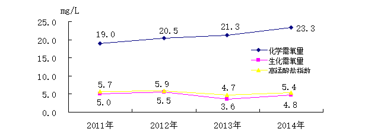

## 第一章 铁岭市自然环境和社会环境

铁岭市位于辽宁省北部，松辽平原中段，地处东经123°27′～125°06′，北纬41°59′ ～43°29′之间，南与沈阳市、抚顺市毗邻，北与吉林省四平市相连，东与抚顺市清原满族自治县、吉林省辽源市接壤，西与沈阳市法库县、康平县及内蒙古自治区科尔沁左翼后旗和通辽市为邻，全市东西最长134公里、南北端宽162公里，总面积12980平方公里。

铁岭市地貌类型是东高西低，东部低山丘陵区是长白山支脉哈达岭的延伸部分，最高海拔为870米；中部平原区是辽河冲击平原，海拔高度为50～250米。西部风沙区是内蒙古自治区科尔沁沙地南缘，海拔高度在200米以下。铁岭市区域的自然景观分布特点是“五分山水四分田，一分道路和庄园”。

辽河干流由北向南从铁岭域内流过，河东岸为平原区，河西岸为风沙区，地势为东北高西南低。

全市交通平均每百平方公里有77.72公里道路。哈大高速公路、102国道和哈大铁路穿行南北，路网东侧为低山丘陵区，路网西侧为平原区。

全市的植被覆盖类型划分为四个区域，辽东山地温带湿润的沙松、红松、阔叶混交林及次生林区，吉林哈达岭山麓宽谷丘陵榛子灌丛及辽东栎、蒙古栎人工矮林地区，是辽宁省的第二柞蚕放养区；辽东山地西麓暖温带湿润的油松栎林及其次生灌丛区，其中有50～60年生的天然油松林，已被定为油松种源林，是我国天然油松林分布的北界；辽河平原水稻、玉米、高粱种植群落地区，平原区北部是全国第四大商品粮基地，主产玉米，耕地资源丰富，有机质含量中等，并以缺磷、少氮、富钾为特点；科尔泌南缘沙地小叶杨、小青杨及羊草草甸草原地区。

全市有辽河、东辽河、招苏台河、二道河、清河、寇河、柴河、凡河等三级以上河流39条，小Ⅰ型以上水库82座，蓄水量2亿立方米以上的大型水库4座，总库容量为22.2亿立方米。

铁岭市县级以上集中式饮用水水源地12个。其中水库型地表水水源地5个，即柴河水库、南城子水库、诚信水库、清河水库和榛子岭水库，地下水饮用水水源地7个。其中清河水库和榛子岭水库为备用饮用水水源地。

铁岭市矿产资源储备丰富。全市已发现各类有益矿产31种，产地300余处。已开发的有18种，主要有煤、石灰石、铁、金、铅、锌、铜、大理石、硅石、粘土矿等。其中煤储量约为13.30亿吨，石灰石储量约为3.1亿吨。

铁岭市属于中温带大陆性季风气候区。一年之中四季分明，年平均气温为7.6℃。全年日照时数为2479.4小时。春夏季主导风向西南风，冬季主导风向西北风。年平均降水量为696毫米。

铁岭市现辖调兵山、开原二个县级市，铁岭、西丰、两个县，银州、清河、凡河新区三个区，经济开发区、高新技术产业开发区两个省级开发区。域内县级以上重点城镇5座，有3座分布在102国道沿线的中部平原区，全市有43个镇，11个乡，148个社区，750个村。

铁岭市属于东北老工业基地，全市重点调查工业企业229个，其中辽宁华电铁岭发电有限公司、铁煤集团和中电国际清河发电有限公司是铁岭工业的支柱企业，三家企业的废水排放量占全市污染负荷的50%以上。

铁岭市以国道102线为交通枢纽建立了沈铁工业走廊，现已形成了十大产业集群，辽宁专用车生产基地、辽宁换热设备产业基地、开原起重机制造产业集群、高新区的环保设备制造、铁岭县工业园区的汽车零部件加工制造和有色金属加工、银州工业园区的阀门制造、铁岭经济开发区的橡塑制品、调兵山工业园区的矿山机械、西丰工业园区的精密设备铸造等产业集群。

到2014年末，全市总人口达199.2万人，农业人口126.9万人，占63.7%；非农业人口72.3万人，占36.3%。2014年全市出生率为7.76‰。

到2014年末，主要经济指标完成情况如下：

全市就业人员为24.6万人。

全市生产总值(GDP)实现867.5亿元，其中第一产业207.4亿元；第二产业361.6亿元；第三产业298.5亿元。

全市农林牧渔业总产值实现464.1亿元。

全社会固定资产投资646.3亿元。

社会消费品零售额391.4亿元。

全市外贸出口总额完成69261万美元。

实际利用外资55894万美元。

公共财政预算收入93.4亿元。

城镇常住居民人均可支配收入19276元；农村常住居民人均可支配收入10888元。

## 第二章 “十二五”环境保护规划完成情况

2.1“十二五”环境保护规划完成情况

“十二五”期间，我局在市委、市政府的正确领导下，在上级主管部门的业务指导下，在各有关单位的全力配合下，以真抓实干的工作作风全力推进“十二五”环保规划各项工作有序实施，有力保障了“十二五”环保规划重点任务和重点工程项目的实施。

2.1.1“十二五”污染物减排目标完成情况

2014年，铁岭市化学需氧量、氨氮、二氧化硫和氮氧化物四项主要污染物排放量分别为121909吨、6396吨、16599吨和23555吨。与2010年相比，削减比例分别为10.9%、13.6%、8.8%和11.1%。2015年，预计全市化学需氧量、氨氮、二氧化硫、氮氧化物排放量分别控制在11.8万吨、0.62万吨、1.67万吨和2.34万吨以内，分别比2010年累计下降14.5%、16.2%、8.2%、11.7%。氨氮、二氧化硫、氮氧化物排放总量均提前1年（2014年）完成目标，化学需氧量排放总量在2015年完成目标。

表2-1  铁岭市减排目标任务及进度完成情况统计表

| 指标名称  （万吨） | 2010 | 2011年 | 2012年 | 2013年 | 2014年 | 2015年 |
|---|---|---|---|---|---|---|
| 绝对值 | 实际排放量 | 上升 | 实际排放量 | 下降 | 实际排放量 | 下降 | 实际排放量 | 下降 | 原计划排放量 | 下降 |
| 化学需氧量 | 13.68 |  |  | 13.29 | 2.8% | 13.05 | 5.4% | 12.2 | 10.9% | 11.8 | 13.7% |
| 氨氮 | 0.74 |  |  | 0.7 | 4.9% | 0.7 | 5.4% | 0.64 | 13.6% | 0.62 | 16.2% |
| 二氧化硫 | 1.82 | 1.94 | 6.59% | 1.78 | 2.1% | 1.77 | 2.7% | 1.66 | 8.8% | 1.67 | 8.2% |
| 氮氧化物 | 2.65 | 3.26 | 23.02% | 2.57 | 3.1% | 2.85 | -7.5% | 2.36 | 11.1% | 2.34 | 11.7% |

2.1.2“十二五”主要环境质量指标完成情况

水：截止到2014年，“十二五”规划21项质量指标大多完成。铁岭市地下水饮用水源地双安水厂和新区净水厂水质达标率100%；地表水饮用水源地柴河水厂水质达标率100%；地表水环境质量有所好转，辽河干流福德店、三合屯、朱尔山断面水质达标率分别为91.7%、83.3%和100%；辽河主要支流招苏台河、清河、柴河、凡河、长沟河、万泉河、马仲河、亮子河、寇河水质达标率分别为66.7%、100%、100%、91.7%、75%、41.7%、33.3%、66.7%和91.7%；城镇污水处理率达到95%，污水处理厂负荷率提高到86.7%；城市中水回用率达到30.8%；城市污水处理厂污泥安全处置率达到100%。

空气：2011~2014年，铁岭市环境空气质量达标天数分别为349天、362天、357天和240天，达标率分别为95.9%、98.9%、97.8%和66.1%。2014年由于执行新的环境空气质量标准，标准更严格，导致达标率有所下降。

噪声：2011~2014年，铁岭市1类噪声功能区、2类噪声功能区和3类噪声功能区达标率均为100%，4类功能区达标率在80.7%~91.1%区间。

固体废物：2014年，铁岭市危险废物处置率为100%；工业固体废物综合利用率达到69.4%。

自然保护区：2013年开原黄旗寨白鹭自然保护区评为省级自然保护区，保护区面积为2535.5公顷。目前铁岭全市自然保护区、风景名胜区、水源地保护区等保护地面积共计3169.33平方公里，保护地占国土面积比例为24.4%。

环境满意率：2011~2014年，铁岭市环保系统共接待上访群众951余人次，共受理信访件2428个，处理率为100%，结案率为99%以上。公众对环境满意率逐年提高，2011~2014年公众对环境满意率分别为88%、90%、90%和91%。

2.1.3“十二五”环境规划重点任务完成情况

（1）以环境优化促进经济发展方式转变

2011～2014年，全市各级环保部门共审批建设项目1528项，总投资7595242.7万元，其中环保投资194879.8万元。全市完成建设项目“三同时”验收557个，环保投资1464462.2万元。铁岭市实施强制清洁生产企业共32家，验收比例100%。“十二五”期间，全市各园区配套设施逐步完善，高新区污水处理厂和调兵山南工业园区污水厂投入运行。

（2）深化节能减排

根据“十二五”国家重大水专项辽河项目的总体安排，铁岭市作为首个实施基于容量总量的水污染物排污许可证的示范城市。在2013年，铁岭市环保局印发了《铁岭市水污染物排放许可证管理办法》（铁市环发〔2013〕69号），并首先在清河流域试行发放，为辽河流域水污染物排放许可证的全面实施奠定基础。

（3）水环境保护

对柴河水库、南城子水库、诚信水库、清河水库、榛子岭水库地表型饮用水水源地按照省级批准的保护区范围保护，对水源地上游及周边的农村环境进行综合整治，并进行了一级保护区围栏建设。

“十二五”期间，铁岭市共建设20座乡镇污水处理设施，目前西丰县振兴、安民镇、郜家店镇、调兵山市晓南镇、大明镇、铁岭县新台子镇、清河区张相镇的乡镇污水处理设施已基本建设完成。

（4）大气环境保护

2011~2014年，铁岭市积极整治建成区10吨及以下燃煤小锅炉，将中心城区划定为高污染燃料禁燃区，禁止燃烧各类高污染燃料。

2014年开展了整治大气违法行动暨“治理雾霾、亮剑行动”，推进建成区10吨及以下工业、浴池、取暖等燃煤锅炉及设施拆除或改用清洁能源。

铁岭电厂、清河电厂、调兵山煤矸石电厂完成除尘、脱硫、脱硝提标改造，铁煤集团热电厂完成脱硫提标改造，开原宏达热电有限公司脱硫脱硝提标改造。

银州区7台大灶全部使用清洁燃料。全市共完成384台燃煤锅炉整治工作。完成后八里、原一高南、光荣东路北、北窑四个地块共2582户棚户区改造工作。通过实施高效一体化供热，铁岭市基本实现一县一热源。天信银南热源厂、东源热源厂、开原崇宏热源厂管网已断开，并入集中供热。

截至2014年末，全市共完成128个加油站、23辆油罐车、1座储油库油气回收治理工程。

机动车尾气： 2011年～2014年累计淘汰各类型老旧车和黄标车39909辆，截至2015年3月，铁岭市共建成机动车环保检测站6个。截至2014年末，铁岭市已建成2个绿标区，合计48.78平方公里；4条绿标路，合计9.6 公里。实现了对在用车环保监管的全覆盖。

（5）自然生态和城市生态

“十二五”期间，生态市创建稳步推进，各县（市）区生态规划均编制完成并由同级人大审批。截止2014年底，我市共有9个乡镇82个村被省环保厅命名为省级生态乡镇、村。

（6）农村环境保护

“十二五”期间，全市农村环境综合整治累计投入资金约7000万元。其中，开原市投入资金3675万元建设80个项目，5个乡镇、49个村共建设垃圾池414个、中转站12座、垃圾处理点2座、垃圾转运系统5套、堆粪房12个。铁岭县投资756万元建垃圾池216处。银州区投资860万元建垃圾池12处、垃圾中转站2座、贮粪池5座。调兵山市投入资金383.8万元建设垃圾池160处、购买垃圾车12台、修排水沟17100延长米。

农业源减排占全市减排任务的70%以上，铁岭市作为节能减排示范市，2014年与环保部华南所共同编写了《铁岭市畜禽养殖污染防治技术指南》，并联合铁岭市畜牧局开展畜禽养殖污染治理示范项目建设，对7家大型猪场养殖废水进行治理，推进8个有机肥建设项目，有机肥生产能力达22万吨。

2.2“十二五”环保规划重点工程项目及投资完成情况

铁岭市环境保护“十二五”发展规划重点项目共109项，项目规划总投资为956108.02万元。截止2014年，109项重点项目顺利开展78项，已完成投资309165.2万元，因资金和政策调整等问题未开展31项。开展的78项重点项目中，已建成57项（完成投资283345.7万元），在建或停产21项。

2.3“十二五”环境保护规划存在的主要问题

（1）规划跨部门统筹问题：环保规划牵涉到多部门、跨地区、跨行业、综合性较强，编制规划及统一实施的难度较大。

（2）规划实施力度问题：环境保护规划以指导性、政策性为主，约束性不强，法律效应不足，规划项目投资难以落实。

（3）规划实施效果问题：环保规划实施效果和目标实现程度在很大程度上受经济发展速度、产业结构调整等的影响，经济发展过快产生的负面影响甚至可能抵消环境保护规划多年努力的成果。

2.4“十三五”期间环境保护面临的新形势

（1）党的“十八大”及“两会”将“生态文明建设，保护绿水青山”提高到前所未有的战略高度。群众环境意识越来越强，对环境保护和生态文明建设提出的要求越来越高。环境保护与经济建设协调发展的问题越来越重要，环境保护与建设小康社会要求要相适应。

（2）环境形势严峻，雾霾频发，水污染、大气污染和土壤污染等问题突出；主要污染物排放强度和总量增大，新增污染物不断挑战环境容量和生态红线，生态服务功能持续下降，生态灾害加重，生态问题复杂化。

## 第三章 铁岭市环境质量现状

3.1空气环境质量现状及评价

3.1.1工业废气排放状况

1、工业废气排放状况

2014年铁岭市重点调查239家工业企业，其煤炭消耗总量为1429.64万吨，共排放工业废气990.78亿立方米。全市工业废气中主要污染物为二氧化硫、氮氧化物、烟（粉）尘，其中二氧化硫排放量为25274.00吨；氮氧化物排放量为55737.69吨；烟（粉）尘排放量为22391.49吨。

在全市各行业中，煤炭消耗量和工业废气排放总量居首位的是火力发电业，其煤炭消耗量为1334.84万吨，占全市重点调查工业企业煤炭消耗总量的93.37%；工业废气排放量为827.61亿立方米，占全市重点调查工业企业废气排放总量的83.53%；该行业中二氧化硫、氮氧化物的排放量也是最大的，二氧化硫排放量为17500.74吨；氮氧化物排放量为47124.50吨。全市各行业污染源废气及其污染物排放量统计情况见表3-1。

2、主要污染源废气排放状况

2014年全市统计的30家主要污染源煤炭消耗量为14217833吨，占全市重点调查工业企业煤炭消耗总量的99.45%；共排放工业废气9323469万立方米，占全市重点调查工业企业废气排放总量的94.10%；全市统计的30家主要污染源共排放二氧化硫21737.36吨，占全市重点调查工业企业二氧化硫排放总量的94.32%；全市统计的30家主要污染源共排放氮氧化物51746.83吨，占全市重点调查工业企业氮氧化物排放总量的98.68%；全市统计的30家主要污染源共排放烟（粉）尘14973.24吨，占全市重点调查工业企业烟（粉）尘排放总量的78.69%。各主要污染源废气及污染物排放情况见表3-2。

由表3-2可见，辽宁华电铁岭发电有限公司煤炭消耗量居首位，为6344934吨；辽宁清河发电有限责任公司煤炭消耗量居第二位，为4090778吨。这两家企业的废气排放总量占全市重点调查工业企业废气排放总量的73.00%。

3、污染源废气监测状况

依据《2014年辽宁省环境监测方案》，铁岭市站制定了2014年污染源监督监测工作方案及监测计划。铁岭市共有11家国控废气重点源，铁岭市站对正常生产的7家国控废气重点源企业的锅（窑）炉实施了季度监测，共监测68台次。监测项目为烟（粉）尘、林格曼黑度、二氧化硫、氮氧化物、氟化物等，共获监测数据344个。开原水泥有限公司停产未监测，铁岭万顺达淀粉有限公司永久关停未监测。辽宁清河发电有限责任公司和辽宁华电铁岭发电有限公司由辽宁省环境监测实验中心负责监测。

对铁岭市7家国控废气重点源企业按季度实施的监测结果表明，7家国控废气污染源全部达标，达标率为100%。

表3-2  铁岭市主要污染源工业废气污染物排放量统计表

| 序号 | 企 业 名 称 | 煤炭消耗量（吨） | 工业废气排放量（万立方米） | 污染物排放量（吨/年） |
|---|---|---|---|---|
| 二氧化硫 | 氮氧化物 | 烟（粉）尘 |
| 1 | 辽宁华电铁岭发电有限公司 | 6344934 | 3711924 | 5898.73 | 19328.10 | 1237.86 |
| 2 | 辽宁清河发电有限责任公司 | 4090778 | 2487485 | 4130.63 | 17650.53 | 722.69 |
| 3 | 辽宁调兵山煤矸石发电有限责任公司 | 2245534 | 1314536 | 2019.20 | 5950.67 | 241.00 |
| 4 | 铁法煤业（集团）有限责任公司热电厂 | 463105 | 434075 | 4723.67 | 2042.29 | 2309.67 |
| 5 | 铁岭天信公用事业股份有限公司 | 274748 | 282728 | 1733.20 | 1027.80 | 2196.00 |
| 6 | 开原宏达热电有限公司 | 204068 | 328126 | 728.52 | 2152.92 | 1501.02 |
| 7 | 铁法煤业集团有限责任公司水暖厂 | 167407 | 280000 | 289.28 | 1790.86 | 2511.10 |
| 8 | 开原宏达热电有限公司热源分厂 | 90050 | 73548 | 468.33 | 403.30 | 717.11 |
| 9 | 昌图县铁南供热公司 | 90000 | 84740 | 202.50 | 233.00 | 966.90 |
| 10 | 西丰县凯帝实业集团供热有限公司 | 58823 | 66810 | 377.12 | 207.68 | 440.00 |
| 11 | 辽宁益海嘉里地尔乐斯淀粉科技有限公司 | 45681 | 45168 | 391.85 | 173.33 | 237.06 |
| 12 | 调兵山东泰新热源发展有限责任公司 | 24000 | 34300 | 173.00 | 164.65 | 125.00 |
| 13 | 昌图县生化科技有限公司 | 20000 | 20581 | 67.20 | 58.80 | 390.00 |
| 14 | 铁岭市清河东森热力经营有限公司 | 17000 | 18368 | 48.96 | 49.98 | 63.40 |
| 15 | 调兵山市晨安物业有限责任公司 | 9200 | 14550 | 78.20 | 61.73 | 46.51 |
| 16 | 辽宁陆平机器股份有限公司 | 8300 | 28000 | 80.00 | 91.80 | 71.90 |
| 17 | 北新集团建材股份有限公司铁岭分公司 | 7530 | 8666 | 21.13 | 24.07 | 85.96 |
| 18 | 铁岭万海热力有限公司 | 7430 | 5193 | 23.60 | 23.73 | 40.42 |
| 19 | 铁法煤业（集团）有限责任公司大兴煤矿 | 6975 | 7255 | 20.76 | 54.68 | 64.28 |
| 20 | 铁岭华晨橡塑制品有限公司 | 6100 | 5100 | 33.00 | 32.00 | 51.00 |
| 21 | 西丰县远景供热站 | 5000 | 6000 | 25.20 | 23.60 | 75.00 |
| 22 | 辽宁金正大生态工程有限公司 | 4721 | 5101 | 15.86 | 13.88 | 61.89 |
| 23 | 华润雪花啤酒（铁岭）有限公司 | 4541 | 4907 | 18.96 | 13.35 | 12.08 |
| 24 | 铁岭选矿药剂有限公司 | 4350 | 4370 | 9.11 | 12.70 | 38.02 |
| 25 | 铁法煤业（集团）有限责任公司小青煤矿 | 3343 | 4303 | 19.06 | 35.97 | 32.86 |
| 26 | 铁岭市大牛乳品有限公司 | 3010 | 3098 | 33.64 | 8.85 | 127.89 |
| 27 | 开原市庆云镇红砖厂 | 3000 | 6149 | 17.80 | 8.25 | 13.94 |
| 28 | 开原市八宝砖厂 | 3000 | 5124 | 14.83 | 6.87 | 11.62 |
| 29 | 铁岭市清河区福兴纸业有限公司 | 2850 | 3079 | 31.92 | 8.38 | 37.36 |
| 30 | 辽宁省森泉水泥有限公司 | 2355 | 30186 | 42.10 | 93.08 | 543.69 |
| 合 计 | 14217833 | 9323469 | 21737.36 | 51746.83 | 14973.24 |

4、对比分析

2013～2014年重点调查工业企业废气排放状况见表3-3。

表3-3  2014年与2013年废气排放及污染物排放量对比表

| 年  度 | 废气排放量（万立方米/年） | 污染物排放量（吨/年） |
|---|---|---|
| 二氧化硫 | 氮氧化物 | 烟（粉）尘 |
| 2014 | 9907833.09 | 23046.36 | 52438.91 | 19027.46 |
| 2013 | 11061228.27 | 30703.81 | 50123.82 | 39174.66 |
| 差  值 | -1153395.18 | -7657.45 | 2315.09 | -20147.20 |

3.1.2环境空气质量状况

2014年铁岭市环境空气监测项目为可吸入颗粒物、细颗粒物、二氧化硫、二氧化氮、一氧化碳、臭氧、降尘和降水。全年共获监测数据8856个，其中可吸入颗粒物1396个、细颗粒物1422个、二氧化硫1392个、二氧化氮1336个、一氧化碳1305个、臭氧1393个、降尘60个、降水552个（其中包括阴、阳离子分析数据414个）。

1、环境空气质量状况

按《环境空气质量标准》GB3095-2012中二级标准评价。

（一）可吸入颗粒物

可吸入颗粒物年均值为100ug/m3，超过国家二级标准0.43倍；最大日均值为723ug/m3，超标3.82倍，出现在10月31日居民区（银州路东段）；全年点日均值超标数199个，超标率为14.2％。各功能区、各季节监测结果见表3-4。

表3-4  各功能区、各季节可吸入颗粒物监测结果表

| 项 目 | 功   能   区 | 季      节 | 全年 |
|---|---|---|---|
| 工业 | 居民 | 清洁 | 冬 | 春 | 夏 | 秋 |
| 平均(ug/m3) | 106 | 96 | 104 | 114 | 103 | 75 | 109 | 100 |
| 超标倍数（倍） | 0.51 | 0.37 | 0.49 | 0.63 | 0.47 | 0.07 | 0.56 | 0.43 |
| 超标率（％） | 16.6 | 12.3 | 15.7 | 20.2 | 14.6 | 3.2 | 19.0 | 14.2 |
|  |  |  |  |  |  |  |  |  |  |  |  |

表3-4可见，各功能区中，可吸入颗粒物监测结果均超过国家二级标准，监测值由高到低为：工业区>清洁区>居民区；各季节可吸入颗粒物监测结果均超过国家二级标准，污染程度比较为：冬季>秋季>春季>夏季。各功能区、各季节监测结果变化情况见图3-1。

图3-1 各功能区、各季节可吸入颗粒物监测结果变化图

(二)细颗粒物

细颗粒物年均值为61ug/m3，超过国家二级标准0.74倍；最大日均值为957ug/m3，超标11.76倍，出现在10月31日居民区（银州路东段）；全年点日均值超标数355个，超标率为25.0％。各功能区、各季节监测结果见表3-5。

表3-5  各功能区、各季节细颗粒物监测结果表

| 项 目 | 功   能   区 | 季      节 | 全年 |
|---|---|---|---|
| 工业 | 居民 | 清洁 | 冬 | 春 | 夏 | 秋 |
| 平均(ug/m3) | 62 | 60 | 62 | 76 | 48 | 44 | 76 | 61 |
| 超标倍数（倍） | 0.77 | 0.71 | 0.77 | 1.17 | 0.37 | 0.26 | 1.17 | 0.74 |
| 超标率（％） | 25.8 | 24.6 | 22.4 | 40.5 | 13.1 | 8.8 | 38.1 | 25.0 |
|  |  |  |  |  |  |  |  |  |  |  |  |

表3-5可见，各功能区中，细颗粒物监测结果均超过国家二级标准，监测值由高到低为：工业区=清洁区>居民区；各季节细颗粒物监测结果均超过国家二级标准，污染程度比较为：冬季=秋季>春季>夏季。各功能区、各季节监测结果变化情况见图3-2。

图3-2 各功能区、各季节细颗粒物监测结果变化图

(三)二氧化硫

二氧化硫年均值为32ug/m3，符合国家二级标准；最大日均值为185ug/m3，超标0.23倍，出现在1月22日工业区（汇工街西）；全年点日均值超标数4个，超标率为0.3％。各功能区、各季节监测结果见表3-6。

表3-6  各功能区、各季节二氧化硫监测结果表

| 项 目 | 功   能   区 | 季      节 | 全年 |
|---|---|---|---|
| 工业 | 居民 | 清洁 | 冬 | 春 | 夏 | 秋 |
| 平均(ug/m3) | 36 | 25 | 42 | 57 | 27 | 15 | 30 | 32 |
| 超标倍数（倍） | - | - | - | - | - | - | - | - |
| 超标率（％） | 1.2 | 0 | 0 | 0.9 | 0 | 0 | 0.3 | 0.3 |
|  |  |  |  |  |  |  |  |  |  |  |  |

表3-6可见，各功能区中，二氧化硫监测结果均符合国家二级标准，监测值由高到低为：清洁区>工业区>居民区；各季节二氧化硫监测结果均符合国家二级标准，污染程度比较为：冬季>秋季>春季>夏季。各功能区、各季节监测结果变化情况见图3-3。

图3-3 各功能区、各季节二氧化硫监测结果变化图

(四)二氧化氮

二氧化氮年均值为33ug/m3，符合国家一级标准；最大日均值为120ug/m3，超标0.50倍，出现在2月26日居民区（银州路东段）；全年点日均值超标数5个，超标率为0.4％。各功能区、各季节监测结果见表3-7。

表3-7  各功能区、各季节二氧化氮监测结果表

| 项 目 | 功   能   区 | 季      节 | 全年 |
|---|---|---|---|
| 工业 | 居民 | 清洁 | 冬 | 春 | 夏 | 秋 |
| 平均(ug/m3) | 29 | 36 | 31 | 37 | 31 | 30 | 34 | 33 |
| 超标倍数（倍） | - | - | - | - | - | - | - | - |
| 超标率（％） | 0.4 | 0.6 | 0 | 0.6 | 0.3 | 0 | 0.6 | 0.4 |
|  |  |  |  |  |  |  |  |  |  |  |  |

表3-7可见，各功能区中，二氧化氮监测结果均符合国家一级标准，监测值由高到低为：居民区>清洁区>工业区；各季节二氧化氮监测结果均符合国家一级标准，污染程度比较为：冬季>秋季>春季>夏季。各功能区、各季节监测结果变化情况见图3-4。

图3-4 各功能区、各季节二氧化氮监测结果变化图

(五)臭氧

臭氧年均值为99ug/m3，符合国家一级标准；最大日均值为265ug/m3，超标0.66倍，出现在4月30日居民区（银州路东段）；全年点日均值超标数159个，超标率为11.4％。各功能区、各季节监测结果见表3-8。

表3-8  各功能区、各季节臭氧监测结果表

| 项 目 | 功   能   区 | 季      节 | 全年 |
|---|---|---|---|
| 工业 | 居民 | 清洁 | 冬 | 春 | 夏 | 秋 |
| 平均(ug/m3) | 103 | 105 | 85 | 58 | 120 | 133 | 82 | 99 |
| 超标倍数（倍） | - | - | - | - | - | - | - | - |
| 超标率（％） | 16.4 | 13.7 | 3.4 | 0.6 | 14.7 | 25.3 | 4.5 | 11.4 |
|  |  |  |  |  |  |  |  |  |  |  |  |

表3-8可见，各功能区中，臭氧监测结果清洁区符合国家一级标准，工业区、居民区符合国家二级标准，监测值由高到低为：居民区>工业区>清洁区；各季节臭氧监测结果冬季、秋季符合国家一级标准，春季、夏季符合国家二级标准，污染程度比较为：夏季>春季>秋季>冬季。各功能区、各季节监测结果变化情况见图3-5。

图3-5 各功能区、各季节臭氧监测结果变化图

(六)一氧化碳

一氧化碳年均值为0.7mg/m3，符合国家一级标准；最大日均值为2.9mg/m3，不超标，出现在12月29日居民区（金沙江路北）；全年点日均值均不超标。

全年自动站有效监测363天，环境空气达二级以上标准天数240天，达标率为66.1%。

2、降尘监测状况

降尘全年平均值为5.9吨/平方公里·月，不超省级标准（8吨/平方公里·月）；全年共获数据60个，一次值超标数6个，超标率为10.0%；全年一次最高值为10.7吨/平方公里·月，出现在10月份的居民区（金沙江），一次最低值为2.4吨/平方公里·月，出现在7月的工业区（铁岭钢厂）和8月份的居民区（本站）。各月、各功能区、各季节监测结果见表3-9至表3-11。

表3-9  降尘月监测结果表      单位：吨/平方公里·月

| 功能区 | 月         份 | 平均 |
|---|---|---|
| 1 | 2 | 3 | 4 | 5 | 6 | 7 | 8 | 9 | 10 | 11 | 12 |
| 工业区 | 9.3 | 7.8 | 7.2 | 7.2 | 5.9 | 4.8 | 2.4 | 3.9 | 7.3 | 6.2 | 6.3 | 5.9 | 6.2 |
| 交通区 | 4.2 | 7.0 | 6.8 | 8.9 | 6.5 | 6.4 | 5.6 | 5.7 | 6.5 | 10.5 | 8.8 | 6.2 | 6.9 |
| 居民区（本 站） | 5.3 | 5.6 | 7.9 | 6.5 | 6.5 | 5.0 | 4.1 | 2.4 | 5.8 | 7.1 | 10.6 | 5.5 | 6.0 |
| 居民区（金沙江） | 5.1 | 4.9 | 5.7 | 6.1 | 5.8 | 3.8 | 3.6 | 3.1 | 4.6 | 10.7 | 5.5 | 5.2 | 5.3 |
| 清洁区 | 4.6 | 6.2 | 7.1 | 5.6 | 5.1 | 3.4 | 4.1 | 4.7 | 4.0 | 6.5 | 5.4 | 5.5 | 5.2 |
| 月均值 | 5.7 | 6.3 | 6.9 | 6.9 | 6.0 | 4.7 | 4.0 | 4.0 | 5.6 | 8.2 | 7.3 | 5.7 | 5.9 |

表3-10  各功能区降尘监测结果统计表

| 功能区 | 工业区 | 交通区 | 居民区 | 清洁区 |
|---|---|---|---|---|
| 本站 | 金沙江 |
| 年均值（吨/平方公里·月） | 6.2 | 6.9 | 6.0 | 5.3 | 5.2 |
| 超标倍数（倍） | — | — | — | — | — |
| 一次值超标率（％） | 8.3 | 25.0 | 8.3 | 8.3 | 0 |

表3-11  各时段降尘监测结果表

| 季  节 | 冬 | 春 | 夏 | 秋 | 采期期 | 非采暖期 |
|---|---|---|---|---|---|---|
| 均值（吨/平方公里·月） | 5.9 | 6.6 | 4.2 | 7.0 | 6.4 | 5.6 |
| 超标倍数（倍） | — | — | — | — | — | — |
| 一次值超标率（％） | 6.7 | 6.7 | 0 | 26.7 | 12.0 | 8.6 |

由表3-9、表3-10、表3-11可见，各功能区监测结果均符合标准；各月监测结果中，10月份均值最高，为8.2吨/平方公里·月，超标0.02倍，11月份次之，7、8月份均值最低；各时段夏季均值最低，为4.2吨/平方公里·月，符合标准；采暖期高于非采暖期，但均不超标。

3、降水监测状况

2014年铁岭市降水共监测18次（其中降雪4次，降雨14次），出现一次酸性降水过程。全年共获降水样品49个，pH均值为6.10，pH值波动范围为5.16～8.18。全年降水量为1085.1毫米。降水监测结果统计见表3-12。

表3-12  降水监测结果统计表

| pH值范围 | 5.00~5.50 | 5.51~6.00 | 6.01~6.50 | 6.51~7.00 | 7.01~7.50 | >7.51 |
|---|---|---|---|---|---|---|
| 降水样品个数 | 1 | 8 | 12 | 25 | 2 | 1 |
| 占样品总数百分(%) | 2.0 | 16.3 | 24.5 | 51.0 | 4.1 | 2.0 |

3.1.3环境空气质量评价

1、评价标准

按照《环境空气质量标准》GB3095-2012中的二级标准评价，污染物浓度限值见表3-13。

表3-13  环境空气质量二级标准中各项污染物浓度限值  单位：ug/m3

| 污染物 | 可吸入颗粒物 | 细颗粒物 | 二氧化硫 | 二氧化氮 | 一氧化碳（mg/m3） | 臭氧 |
|---|---|---|---|---|---|---|
| 24小时平均 | 150 | 75 | 150 | 80 | 4 | 160 |
| 年平均 | 70 | 35 | 60 | 40 | - | - |

注：臭氧标准为日最大8小时平均。

2、评价方法

选用综合污染指数法，对铁岭市环境空气状况进行评价。

综合污染指数计算公式：

P=i        Pi =

式中:   P  —— 综合污染指数；

Pi  —— 第i项污染因子的污染指数；

Ci —— 第i项污染因子的年均值；

Coi —— 第i项污染因子评价标准值；

n  —— 参与评价污染因子项数。

评价参数为可吸入颗粒物、细颗粒物、二氧化硫、二氧化氮、一氧化碳和臭氧。

3、评价结果

铁岭市城区各功能区、各季节环境空气综合污染指数情况见表3-14。

表3-14  各功能区、各季节环境空气综合污染指数表

| 项 目 | 功 能 区 | 季    节 | 全  年 |
|---|---|---|---|
| 工业 | 居民 | 清洁 | 冬 | 春 | 夏 | 秋 |
| P 值 | 5.44 | 5.23 | 5.45 | 6.23 | 4.97 | 4.34 | 5.79 | 5.32 |

由表3-14可见，三个功能区污染程度由高到低为：清洁区＞工业区＞居民区；四个季节污染程度由高到低为：冬季＞秋季＞春季＞夏季。

3.1.4环境空气质量变化趋势

1、可吸入颗粒物、二氧化硫和二氧化氮、一氧化碳、臭氧变化趋势

与2013年相比，2014年可吸入颗粒物、二氧化硫、二氧化氮、一氧化碳和臭氧年均值分别上升35.1%、6.7%、50.0%、16.7%和23.8%。详情见表3-15。

表3-15  环境空气污染物监测结果对比表 单位：ug/m3(CO单位为mg/m3)

| 年度 | 可吸入颗粒物 | 二氧化硫 | 二氧化氮 | 一氧化碳 | 臭氧 | 综合污染指数 |
|---|---|---|---|---|---|---|
| 2014年均值 | 100 | 32 | 33 | 0.7 | 99 | 3.58 |
| 2013年均值 | 74 | 30 | 22 | 0.6 | 80 | 2.76 |
| 与2013年比较 | 上升35.1% | 上升6.7% | 上升50.0% | 上升16.7% | 上升23.8% | 上升29.7% |

从表3-15看出，2014年铁岭市城区环境空气质量总体比2013年有所下降。

2、降尘变化

2014年铁岭市城区自然降尘量月均值中10月份较高，为8.2吨/平方公里·月，超标0.02倍。其余月份月均值变化幅度比较小，均不超标。

2014年降尘年均值比2013年下降3.3%。

2013年和2014年降尘监测结果见表3-16、图3-6。

表3-16  铁岭市城区降尘监测结果表  单位：吨/平方公里·月

| 年度 | 1 | 2 | 3 | 4 | 5 | 6 | 7 | 8 | 9 | 10 | 11 | 12 | 全年 |
|---|---|---|---|---|---|---|---|---|---|---|---|---|---|
| 2014 | 5.7 | 6.3 | 6.9 | 6.9 | 6.0 | 4.7 | 4.0 | 4.0 | 5.6 | 8.2 | 7.3 | 5.7 | 5.9 |
| 2013 | 7.8 | 6.7 | 6.5 | 6.3 | 6.6 | 6.3 | 5.6 | 3.3 | 4.2 | 6.2 | 6.4 | 7.5 | 6.1 |

图3-6 2013年与2014年降尘月均值变化对比

3.2水环境现状及评价

3.2.1水污染源排放现状分析

2014年铁岭市工业污染源汇总（以下均为全市统计数），共排放工业废水1168.13万吨，与2013年相比有所减少。废水中主要污染物有化学需氧量、氨氮、石油类。年排放总量为1777.07吨，其中化学需氧量1642.17吨、氨氮133.05吨、石油类1.85吨。

1、主要污染源废水排放情况

2014年铁岭市主要废水污染排放企业40家，占全市工业企业总数的16.7%；废水排放总量为941.01万吨，占全市工业污染源废水排放总量的80.6%；化学需氧量排放量为1292.39吨，占全市工业污染源同类污染物排放总量的78.7%；氨氮排放量为107.54吨，占全市工业污染源同类污染物排放总量的80.8%； 40家主要工业污染源废水排放情况基本反映了铁岭市工业废水排放状况。

在40家主要工业污染源中，辽宁清河发电有限责任公司废水排放量为140.16万吨，居全市第一位。铁岭市清河区福兴纸业有限公司废水排放量为5.7万吨，居全市第三十七位，其主要污染物排放量：化学需氧量416.84吨，占全市工业污染源同类污染物排放总量的25.4%；氨氮4.85吨，占全市工业污染源同类污染物排放总量的3.6%。该企业化学需氧量排放量占全市企业同类污染物排放量的首位。详见表3-17。

表3-17  铁岭市主要工业污染源废水排放情况统计表

| 序号 | 污 染 源 名 称 | 废水排放量（吨/年） | 百分比（%） | 累计百分比（%） | 污染物排放量（吨/年） |
|---|---|---|---|---|---|
| 化学需氧量排放量 | 氨氮排放量 |
| 1 | 辽宁清河发电有限责任公司 | 1401600 | 13.72 | 13.72 | 21.00 | 0.00 |
| 2 | 辽宁益海嘉里地尔乐斯淀粉科技有限公司 | 1143025 | 11.19 | 24.92 | 44.29 | 3.50 |
| 3 | 辽宁华电铁岭发电有限公司 | 820000 | 8.03 | 32.95 | 102.62 | 3.75 |
| 4 | 铁法煤业（集团）有限责任公司晓南矿 | 799800 | 7.83 | 40.78 | 67.82 | 5.25 |
| 5 | 昌图县国美肉联有限责任公司 | 356367 | 3.49 | 44.27 | 17.82 | 2.18 |
| 6 | 辽宁唐人神曙光农牧集团有限公司 | 280100 | 2.74 | 47.01 | 12.32 | 5.73 |
| 7 | 辽宁盛德集团牧业有限公司 | 265000 | 2.59 | 49.60 | 13.25 | 1.80 |
| 8 | 铁法煤业（集团）有限责任公司大隆矿 | 254910 | 2.50 | 52.10 | 21.09 | 1.75 |
| 9 | 铁法煤业（集团）有限责任公司大明煤矿 | 250000 | 2.45 | 54.55 | 12.48 | 0.90 |
| 10 | 华润雪花啤酒（铁岭）有限公司 | 220489 | 2.16 | 56.71 | 9.92 | 0.22 |
| 11 | 铁岭润霖食品集团有限责任公司 | 207930 | 2.04 | 58.74 | 32.23 | 2.36 |
| 12 | 昌图县老城路顺生猪屠宰场 | 196850 | 1.93 | 60.67 | 98.22 | 19.80 |
| 13 | 铁岭选矿药剂有限公司 | 191500 | 1.88 | 62.55 | 9.00 | 0.59 |
| 14 | 大成农牧（铁岭）有限公司 | 180000 | 1.76 | 64.31 | 5.40 | 0.32 |
| 15 | 辽宁陆平机器股份有限公司 | 169200 | 1.66 | 65.97 | 5.08 | 0.30 |
| 16 | 铁岭天信公用事业股份有限公司 | 166223 | 1.63 | 67.59 | 4.04 | 0.00 |
| 17 | 昌图县金原粒天豆业有限公司 | 160000 | 1.57 | 69.16 | 82.82 | 18.20 |
| 18 | 铁岭县瀛大肉禽有限公司 | 159500 | 1.56 | 70.72 | 7.17 | 2.00 |
| 19 | 昌图县生化科技有限公司 | 150000 | 1.47 | 72.19 | 39.75 | 7.00 |
| 20 | 铁岭市蕴达煤矿 | 147378 | 1.44 | 73.63 | 14.38 | 0.00 |

续表3-17  铁岭市主要工业污染源废水排放情况统计表

| 序号 | 污 染 源 名 称 | 废水排放量（吨/年） | 百分比（%） | 累计百分比（%） | 污染物排放量（吨/年） |
|---|---|---|---|---|---|
| 化学需氧量排放量 | 氨氮排放量 |
| 21 | 铁法煤业（集团）有限责任公司小青煤矿 | 135298 | 1.32 | 74.96 | 4.67 | 0.27 |
| 22 | 铁岭汉夏农业发展有限公司 | 132240 | 1.29 | 76.25 | 40.85 | 6.00 |
| 23 | 昌图县两家子农场饲料站家禽屠宰场 | 132000 | 1.29 | 77.55 | 5.15 | 0.10 |
| 24 | 昌图县昌图镇光辉生猪屠宰厂 | 116000 | 1.14 | 78.68 | 28.46 | 2.49 |
| 25 | 开原胜利牧业有限公司 | 113700 | 1.11 | 79.79 | 4.98 | 0.46 |
| 26 | 开原市福润肉类食品有限公司 | 113281 | 1.11 | 80.90 | 6.01 | 1.41 |
| 27 | 铁岭圣母酒业有限责任公司 | 105000 | 1.03 | 81.93 | 26.22 | 2.40 |
| 28 | 铁岭一元酒业有限公司 | 105000 | 1.03 | 82.96 | 26.25 | 2.49 |
| 29 | 昌图县永吉酿酒厂 | 105000 | 1.03 | 83.99 | 28.20 | 2.34 |
| 30 | 铁岭龙兴源食品有限公司 | 100510 | 0.98 | 84.97 | 31.85 | 2.46 |
| 31 | 开原市嬴德肉禽有限责任公司 | 98000 | 0.96 | 85.93 | 4.03 | 0.13 |
| 32 | 昌图县老孟头酒业有限责任公司 | 95000 | 0.93 | 86.86 | 28.93 | 2.49 |
| 33 | 铁岭华晨橡塑制品有限公司 | 92431 | 0.91 | 87.77 | 2.77 | 0.07 |
| 34 | 铁法煤业集团机械制造有限责任公司 | 87882 | 0.86 | 88.63 | 2.20 | 1.35 |
| 35 | 铁法煤业（集团）有限责任公司晓明矿 | 82100 | 0.80 | 89.43 | 2.28 | 0.03 |
| 36 | 调兵山市宏大肉禽加工有限责任公司 | 60000 | 0.59 | 90.02 | 2.46 | 0.96 |
| 37 | 铁岭市清河区福兴纸业有限公司 | 57000 | 0.56 | 90.58 | 416.84 | 4.85 |
| 38 | 开原亨泰化工有限公司 | 54600 | 0.53 | 91.11 | 4.88 | 1.08 |
| 39 | 昌图县四合春翔肉业屠宰加工厂 | 53200 | 0.52 | 91.63 | 2.07 | 0.10 |
| 40 | 昌图县亮中桥镇国祥生猪屠宰厂 | 52000 | 0.51 | 92.14 | 2.60 | 0.40 |
| 合      计 | 9410114 | — | — | 1292.39 | 107.54 |

2、污染源废水监测状况

2014年，铁岭市站依据《2014年辽宁省环境监测方案》，制定了2014年铁岭市污染源监督监测工作方案及监测计划，对3家国控废水重点源企业实施了季度监测，开原恒泽牧业有限公司由于停产未监测。对9家污水处理厂实施了月监测。全年共监测废水企业115家次。主要监测项目有pH、悬浮物、化学需氧量、氨氮等27项，获监测数据2461个。

依据《辽宁省污水综合排放标准》DB21/1627-2008及部分行业标准评价，第2季度开原胜利牧业有限公司氨氮超标0.4倍，其它监测项目和国控废水污染源全部达标。

铁岭市站对9家污水处理厂正进行了月监测，铁岭泓源大禹城市污水处理有限公司全部达标；开原市污水处理厂和铁岭市清河区污水处理厂5月超标，西丰县园区污水处理厂7月超标；调兵山市城市污水处理厂6月和7月超标，西丰县污水处理厂5月和7月超标，辽宁岭南污水处理有限公司4月和5月超标；新城区污水处理厂4、5、6月超标，昌图县污水处理厂6、7、8、9、12月超标。各污水厂超标项目均为粪大肠菌群数。

3、对比分析

2014年铁岭市共排放工业废水1168.13万吨，与2013年相比有所减少。废水中主要污染物化学需氧量排放量1642.17吨；氨氮排放量133.05吨；石油类排放量1.85吨。与2013年相比，化学需氧量、氨氮、石油类排放量均有所减少。详情见表3-18。

表3-18  2014年与2013年工业废水排放状况对比表

| 年度 | 废水排放量（万吨/年） | 污染物排放量（吨/年） |
|---|---|---|
| 化学需氧量 | 氨氮 | 石油类 |
| 2014 | 1168.13 | 1642.17 | 133.05 | 1.85 |
| 2013 | 1667.35 | 1820.76 | 161.00 | 4.25 |
| 差值 | -499.22 | -178.59 | -27.95 | -2.40 |

3.2.2地表水水质现状评价

根据2011~2014年市环保监测站监测数据，我们对辽河铁岭段和四大支流清河、柴河、凡河、招苏台河，以及柴河水库、清河水库的水质状况进行分析。

1、辽河铁岭段水环境质量状况

辽河是流经铁岭市的唯一一条主要河流，它汇集了所有上游河水，并沿途接纳了各支流河水及铁岭市的全部污水，于珠尔山断面流出铁岭市。

辽河铁岭段设三个监测断面，即福德店、三合屯和珠尔山断面，监测项目共25项（包括水温、流量），辽河铁岭段水质符合Ⅳ类水质标准。

辽河铁岭段主要污染物是化学需氧量、生化需氧量、高锰酸盐指数、氨氮、总磷，其中，化学需氧量年均值为23.3mg/L，生化需氧量年均值为4.8mg/L，符合Ⅳ类水质标准；高锰酸盐指数年均值为5.4mg/L，氨氮年均值为0.526mg/L，总磷年均值为0.16mg/L，符合Ⅲ类水质标准。2014年辽河铁岭段主要污染物监测结果见表3-19。

表3-19  辽河铁岭段主要污染物监测结果统计表      单位：mg/L

| 项目 | 平均值 | Ⅳ类水质标准 | 检出范围 | 最高值出现断面 |
|---|---|---|---|---|
| 化学需氧量 | 23.3 | ≤30 | 13.3~29.6 | 三合屯 |
| 生化需氧量 | 4.8 | ≤6 | 1.9~12.2 | 三合屯 |
| 氨氮 | 0.526 | ≤1.5 | 0.051~1.35 | 珠尔山 |
| 总磷 | 0.16 | ≤0.3 | 0.02~0.34 | 三合屯 |
| 高锰酸盐指数 | 5.4 | ≤10 | 4.1~8.0 | 珠尔山 |

2011年~2014年主要污染物变化见图3～7、3～8。

图3-7 2011～2014年化学需氧量、生化需氧量、高锰酸盐指数浓度变化

图3-8 2011～2014年氨氮、总磷浓度变化

主要污染物浓度变化情况：化学需氧量浓度稳中有升，均符合Ⅳ类水质标准；生化需氧量、高锰酸盐指数浓度呈波浪形下降趋势，生化需氧量、高锰酸盐指数浓度2012年最高，分别为5.5mg/L、5.9 mg/L，2013年浓度最低，分别为3.6mg/L、4.7 mg/L，均符合Ⅳ类水质标准；氨氮浓度2012年最高，为0.96mg/L，2014年最低，为0.53 mg/L，均符合Ⅲ类水质标准；总磷浓度呈下降趋势，2011年最高，为0.24mg/L，均符合Ⅳ水质标准。

2、辽河铁岭段主要支流水质现状

2014年，辽河主要四条支流中，招苏台河、清河、柴河、凡河水质的主要污染物是化学需氧量、生化需氧量、高锰酸盐指数、氨氮、总磷。

2014年辽河支流主要污染物监测结果见表3-20。

表3-20   2014年辽河支流主要污染物监测结果     单位：mg/L

| 污染因子 | 招苏台河 | 清河 | 柴河 | 凡河 |
|---|---|---|---|---|
| 监测结果 | 水质评价 | 监测结果 | 水质评价 | 监测结果 | 水质评价 | 监测结果 | 水质评价 |
| 化学需氧量 | 26.5 | Ⅳ类 | 14.5 | Ⅰ类 | 11.1 | Ⅰ类 | 18.8 | Ⅲ类 |
| 生化需氧量 | 6.8 | Ⅴ类 | 3.4 | Ⅲ类 | 2.1 | Ⅰ类 | 4.8 | Ⅳ类 |
| 高锰酸盐指数 | 5.9 | Ⅲ类 | 3.7 | Ⅱ类 | 3.1 | Ⅱ类 | 4.4 | Ⅲ类 |
| 氨 氮 | 1.19 | Ⅳ类 | 0.50 | Ⅱ类 | 0.083 | Ⅰ类 | 0.830 | Ⅲ类 |
| 总 磷 | 0.30 | Ⅳ类 | 0.13 | Ⅲ类 | 0.03 | Ⅱ类 | 0.17 | Ⅲ类 |

3、主要水库水质现状

2014年铁岭市主要地表饮用水源地柴河水库及主要备用饮用水源地清河水库监测结果见表表3-21。

由表中看出：柴河水库、清河水库水质超标污染物为总氮。

柴河水库总氮年均值为2.21mg/L，超标3.42倍，超标率为100%。

清河水库总氮年均值为3.11mg/L，超标5.22倍，超标率为100%。

表3-21  柴河水库、清河水库水质监测结果统计表   单位：mg/L

| 项目 | 平均值 | Ⅱ类水质标准 |
|---|---|---|
| 柴河水库 | 清河水库 |
| pH值（无量纲） | 6.83～8.84 | 6.93～8.27 | 6～9 |
| 电导率(mS/m) | 28.9 | 24.4 | -- |
| 溶解氧 | 9.1 | 8.9 | ≥6 |
| 高锰酸盐指数 | 3.3 | 3.2 | ≤4 |
| 生化需氧量 | 2.0 | 1.9 | ≤3 |
| 氨　氮 | 0.078 | 0.085 | ≤0.5 |
| 总　氮 | 2.21 | 3.11 | ≤0.5 |
| 总　磷 | 0.02 | 0.02 | ≤0.025 |
| 六价铬 | 0.004 | 0.002 | ≤0.05 |
| 透明度（cm） | 173 | 144 | -- |
| 粪大肠 菌 群 (个/ 升) | 71 | 66 | ≤2000 |
| 阴离子表面活性剂 | 0.03 | 0.03 | ≤0.2 |
| 氟化物 | 0.16 | 0.30 | ≤1.0 |
| 叶绿素a（mg/m3） | 1.0 | 1.2 | -- |
| 石油类 | 0.03 | 0.03 | ≤0.05 |
| 注：铅、铜、锌、镉、汞、砷、硒、挥发酚、氰化物、硫化物共10项未检出 |

3.2.3河流环境质量评价

1、辽河铁岭段及主要支流环境质量评价

地表水环境质量定性评价分为：优、良好、轻度污染、中度污染、重度污染五个等级。按照《地表水环境质量评价有关问题的技术规定》，评价辽河铁岭段环境质量，采用河流水质评价，即评价河流（包括河段、水系）整体水质状况时，计算出各水质类别断面数占评价断面总数的百分比，以表3-22所示的方法对其评价。当同一类别水质断面比例大于等于60%是，以该类水质按照表3-23评价；比较每条支流的污染程度，采用断面水质评价。河流水质评价断面水质类别与定性评价分级的对应关系见表3-23。

表3-22  河流水质评价

| 水质类别 | 水质状况 |
|---|---|
| Ⅰ~Ⅲ类水质比例≥90% | 优 |
| 75%≤Ⅰ~Ⅲ类水质比例<90% | 良好 |
| Ⅰ~Ⅲ类水质比例<75%，且劣Ⅴ类比例<20% | 轻度污染 |
| Ⅰ~Ⅲ类水质比例<75%，且20%≤劣Ⅴ类比例<40% | 中度污染 |
| Ⅰ~Ⅲ类水质比例<75%，且劣Ⅴ类比例≥40% | 重度污染 |

表3-23  断面水质评价

| 水质类别 | 水质状况 |
|---|---|
| Ⅰ~Ⅱ类水质 | 优 |
| Ⅲ类水质 | 良好 |
| Ⅳ类水质 | 轻度污染 |
| Ⅴ类水质 | 中度污染 |
| 劣Ⅴ类水质 | 重度污染 |

对2014年辽河铁岭段及其主要支流招苏台河、清河、柴河、凡河进行环境质量评价。

（1）辽河铁岭段水环境质量评价结果

辽河铁岭段Ⅳ类水质断面比例>60%，属轻度污染。辽河铁岭段三个干流断面福德店、通江口、珠尔山水质均符合Ⅳ类水质标准，属轻度污染。

（2）主要支流水环境质量评价结果

辽河铁岭段主要支流为清河、柴河、凡河、招苏台河，清河、凡河断面水质符合Ⅳ类水质标准，属轻度污染；柴河断面水质符合Ⅱ类水质标准，水质状况为优；招苏台河水质为Ⅴ类，属中度污染。

3.2.4地表水环境质量变化分析

近几年辽河铁岭段水质持续保持良好，2012~2014年辽河铁岭段水质符合Ⅳ类水质标准。一方面是由于上游来水水质改善；另一方面是铁岭段辽河治理工作取得实质性进展，铁岭市结合自身实际情况，开展了水污染防治工作，通过整治工业废水，促进达标排放，推进流域综合整治，兴建污水处理厂等措施使铁岭水质状况持续保持良好。

3.2.5水环境目标完成情况

“十二五”期间，主要河流水质、水源地完成情况。

2015年1~8月份，辽河铁岭段水质为Ⅳ类，三个干流断面，福德店断面水质为Ⅳ类，三合屯断面水质为Ⅴ类，珠尔山断面水质为Ⅳ类。四条主要支流招苏台河通江口断面水质为劣Ⅴ类，清河清辽断面水质为Ⅳ类，柴河东大桥断面水质为Ⅱ类，凡河黄河子断面水质为Ⅴ类。除招苏台河通江口断面和凡河黄河子断面没达到环境功能区规划要求外，其余断面均完成规划目标要求。

2015年1~8月份，铁岭市水源地达标率为100%，达到了集中式饮用水水源地水质达标率≥98%的规划目标。

3.3环境噪声质量状况

3.3.1功能区环境噪声质量状况

铁岭市噪声点位示意图见附图1。

1、各季度功能区环境噪声监测情况

全年共完成了四个季度的功能区环境噪声监测。监测点位为1类标准适用区邮电新村、2类标准适用区铁南宾馆、3类标准适用区精工厂南、4类标准适用区设两个监测点位，分别为天宝商乐城和体育场东。全年各功能区昼间噪声监测值全部达标，夜间监测值除1类、4类标准适用区超标外，其它功能区监测值均达标。结果见表3－24。

2、功能区环境噪声监测全年结果统计

2014年，铁岭市功能区环境噪声全年均值为55.1分贝，其中1类区年均值为52.8分贝，2类区为50.0分贝，3类区为52.4分贝，4类区为65.2分贝。第一季度功能区环境噪声平均值为53.6分贝，其中昼间均值为51.4分贝，夜间均值为46.2分贝。第二季度噪声平均值为54.0分贝，昼间均值为52.8分贝，夜间均值为45.4分贝。第三季度噪声平均值为56.1分贝，昼间均值为53.7分贝，夜间均值为48.7分贝。第四季度噪声平均值为56.6分贝，昼间均值为54.7分贝，夜间均值为48.9分贝。2014年铁岭市功能区噪声监测年度报表见表3-25。

表3-24 功能区各监测点位噪声监测结果表   单位：分贝

| 季度 | 功能区 | 监测点位 | 昼间 | 夜间 | 昼夜 |
|---|---|---|---|---|---|
| 等效声级 | 标准值 | 超标 | 等效声级 | 标准值 | 超标 | 等效声级 |
| 一季度 | 1类区 | 邮电新村 | 50.7 | 55 |  | 46.5 | 45 | 1.5 | 53.5 |
| 2类区 | 铁南宾馆 | 42.4 | 60 |  | 38.7 | 50 |  | 45.6 |
| 3类区 | 精工厂南 | 49.3 | 65 |  | 43.4 | 55 |  | 51.1 |
| 4类区 | 天宝商乐城 | 63.8 | 70 |  | 56.5 | 55 | 1.5 | 64.9 |
| 体育场东 | 62.8 | 70 |  | 55.5 | 55 | 0.5 | 63.9 |
| 二季度 | 1类区 | 邮电新村 | 48.5 | 55 |  | 41.6 | 45 |  | 49.8 |
| 2类区 | 铁南宾馆 | 48.6 | 60 |  | 38.2 | 50 |  | 48.5 |
| 3类区 | 精工厂南 | 49.9 | 65 |  | 45.5 | 55 |  | 52.7 |
| 4类区 | 天宝商乐城 | 65.0 | 70 |  | 58.1 | 55 | 3.1 | 66.3 |
| 体育场东 | 63.2 | 70 |  | 54.7 | 55 |  | 63.7 |
| 三季度 | 1类区 | 邮电新村 | 52.4 | 55 |  | 46.6 | 45 | 1.6 | 54.3 |
| 2类区 | 铁南宾馆 | 50.3 | 60 |  | 45.8 | 50 |  | 53.0 |
| 3类区 | 精工厂南 | 48.4 | 65 |  | 44.1 | 55 |  | 51.2 |
| 4类区 | 天宝商乐城 | 64.1 | 70 |  | 56.3 | 55 | 1.3 | 65.0 |
| 体育场东 | 63.7 | 70 |  | 60.2 | 55 | 5.2 | 67.1 |
| 四季度 | 1类区 | 邮电新村 | 52.2 | 55 |  | 45.6 | 45 | 0.6 | 53.6 |
| 2类区 | 铁南宾馆 | 50.2 | 60 |  | 45.6 | 50 |  | 52.8 |
| 3类区 | 精工厂南 | 52.6 | 65 |  | 47.3 | 55 |  | 54.8 |
| 4类区 | 天宝商乐城 | 63.8 | 70 |  | 56.9 | 55 | 1.9 | 65.1 |
| 体育场东 | 63.6 | 70 |  | 57.4 | 55 | 2.4 | 65.2 |

表3-25  功能区环境噪声全年监测结果统计表   单位：分贝

| 时　间 | 1类功能区 | 2类功能区 | 3类功能区 | 4类功能区 | 均　值 |
|---|---|---|---|---|---|
| 昼 | 夜 | 昼 | 夜 | 昼 | 夜 | 昼 | 夜 | 昼 | 夜 | 昼夜 |
| 第一季度 | 50.7 | 46.5 | 42.4 | 38.7 | 49.3 | 43.4 | 63.3 | 56.0 | 51.4 | 46.2 | 53.6 |
| 第二季度 | 48.5 | 41.6 | 48.6 | 38.2 | 49.9 | 45.5 | 64.1 | 56.4 | 52.8 | 45.4 | 54.0 |
| 第三季度 | 52.4 | 46.6 | 50.3 | 45.8 | 48.4 | 44.1 | 63.9 | 58.2 | 53.7 | 48.7 | 56.1 |
| 第四季度 | 52.2 | 45.6 | 50.2 | 45.6 | 52.6 | 47.3 | 63.7 | 57.1 | 54.7 | 48.9 | 56.6 |
| 年  度 | 50.9 | 45.1 | 47.9 | 42.1 | 50.0 | 45.1 | 63.7 | 56.9 | 53.1 | 47.3 | 55.1 |
|  |  |  |  |  |  |  |  |  |  |  |  |  |

3.3.2道路交通噪声质量状况

铁岭市银州区共有18条主要交通干线，监测路段总长度为25.82千米，平均路宽为20.93米。2014年道路交通噪声加权值为65.3分贝，同比2013年持平，达到国家标准。2014年道路交通噪声监测结果统计见表3-26。

表3-26  道路交通噪声监测结果统计表

| 监 测总长度(千米) | 有  效路段数（个） | 超  标路段数（个） | 路段平均宽度（米） | 平均等效声级(分贝) | 超 过70分贝路长（千米） | 超标长度百 分 比（%） | 车流量(辆/小时) |
|---|---|---|---|---|---|---|---|
| 25.82 | 37 | 0 | 20.93 | 65.3 | 0 | 0 | 1620 |

3.3.3环境噪声普查

2014年9月铁岭市站对铁岭市建成区（包括银州区及经济开发区）进行了区域环境噪声普查。测点的选择是将建成区划分成250米×250米等距离网格，取其中心为监测点，有效测点数为229个，其中1类标准适用区设111个监测点，平均等效声级为49.8分贝，无一次值超标。2类标准适用区设12个监测点，平均等效声级为50.8分贝，无一次值超标。3类标准适用区设42个监测点，平均等效声级为51.5分贝，无一次值超标。4类标准适用区设64个监测点，平均等效声级为59.9分贝，无一次值超标。具体监测值见表3-27。

表3-27  区域环境噪声普查各类功能区情况

| 功能区类  型 | 网格总数(个) | 超标网格（个） | 平均等效声级（分贝） | 超标率(%) |
|---|---|---|---|---|
| 1类 | 111 | 0 | 49.8 | 0 |
| 2类 | 12 | 0 | 50.8 | 0 |
| 3类 | 42 | 0 | 51.5 | 0 |
| 4类 | 64 | 0 | 59.9 | 0 |
| 全市 | 229 | 0 | 53.0 | 0 |

3.3.4环境噪声质量变化趋势

1、功能区环境噪声变化趋势

2014年，功能区环境噪声平均值为55.1分贝，其中昼间均值为53.1分贝，夜间均值为47.3分贝。近五年，噪声监测值呈波动下降趋势。见表3-28，图3－9。

表3-28  2010～2014年功能区噪声监测结果　   单位：分贝

| 年　　度 | 昼  间 | 夜  间 | 昼  夜 |
|---|---|---|---|
| 2010 | 53.1 | 46.9 | 54.9 |
| 2011 | 52.2 | 46.4 | 54.2 |
| 2012 | 53.4 | 47.8 | 55.5 |
| 2013 | 52.5 | 46.1 | 54.2 |
| 2014 | 53.1 | 47.3 | 55.1 |

图3-9 2011～2014年功能区噪声变化趋势

2、道路交通噪声变化趋势

2014年道路交通噪声加权等效声级为65.3分贝，从近五年监测结果可见，交通噪声呈逐年下降趋势。监测结果见表3-29，变化趋势图3-10。

表3-29  2010～2014年道路交通噪声监测结果

| 年度 | 车流量（辆） | 监测结果（分贝） | 超过70分贝路段长度（千米） |
|---|---|---|---|
| L10 | L50 | L90 | Leq |
| 2010 | 1535 | 68.7 | 63.2 | 55.3 | 66.0 | 0 |
| 2011 | 1405 | 68.4 | 63.4 | 58.9 | 65.6 | 0 |
| 2012 | 1597 | 68.9 | 64.4 | 59.5 | 66.0 | 0 |
| 2013 | 1596 | 68.2 | 62.9 | 56.4 | 65.3 | 0 |
| 2014 | 1620 | 68.2 | 64.1 | 58.4 | 65.3 | 0 |

图3-10  2010～2014年道路交通噪声变化趋势图

3、噪声普查变化趋势

2014年铁岭市区域环境噪声普查，城区有效监测网格229个，噪声平均水平为53.0分贝。从噪声平均水平上看，噪声普查结果比去年上升了0.2分贝，近五年环境噪声普查监测结果对比见表3-30，图3-11。

表3-30  2010～2014年噪声普查监测结果

| 年份 | 有效网格（个） | 噪声平均水平（分贝） | 最大覆盖面积的声级范围（分贝） | 最大覆盖人口的声级范围（分贝） |
|---|---|---|---|---|
| 2010 | 229 | 53.6 | 50.1～55.0 | 50.1～55.0 |
| 2011 | 229 | 53.0 | ≤50.0 | ≤50.0 |
| 2012 | 229 | 53.5 | 50.1～55.0 | 50.1～55.0 |
| 2013 | 229 | 52.8 | ≤50.0 | ≤50.0 |
| 2014 | 229 | 53.0 | 50.1～55.0 | ≤50.0 |

图3-11  2010～2014年区域环境噪声普查变化趋势图

3.3.5环境噪声质量变化原因分析

2014年，铁岭市声环境质量较好，区域环境噪声质量等级为较好；道路交通噪声质量等级为好；功能区噪声监测结果呈波动上升趋势，各功能区昼间监测值全部达标，但 1类功能区和4类功能区夜间噪声超标现象较为普遍。

1、声环境质量较好原因

铁岭市声环境质量好转主要是全市加大了环保整治力度，限制夜间建筑施工噪声。禁止农用三轮车、拖拉机进入市区。市区内机动车禁鸣，道路扩宽，种植降噪绿化林带树木等等，这些措施大大降低了交通噪声污染。

2、个别点位噪声超标原因

（1）生活噪声源范围扩大

随着铁岭市城区混合区内建筑业、商业、服务业的发展，娱乐、餐饮、小商品零售等行业营业时间相应延长，再加上管理不到位，造成社会生活噪声对铁岭市声环境质量带来负面影响。

（2）机动车噪声污染加重

随着经济的发展，城市机动车拥有量迅速增加，2014年铁岭市道路平均机动车流量较2013年增加24辆/小时，而市政建设的速度相对滞后于机动车增长速度，主要是交通干线的机动车流量已经饱和或超饱和状态，机动车乱鸣现象依旧存在，道路交通噪声是困扰城市声环境质量的重要因素。

3.4固体废物质量状况

3.4.1工业固体废物产生量及分布

1、工业固体废物产生量

2014年铁岭市工业固体废物产生量为722.19万吨。其中，重点源工业固体废物产生量为698.23万吨，占全市工业固体废物产生量的96.68%；非重点源工业固体废物产生量为23.96万吨，占全市工业固体废物产生量的3.32%。工业固体废物产生量按行业分布情况见表3-31。

表3-31 铁岭市2014年工业固体废物产生量统计表

| 序号 | 行　业　名　称 | 产生量（万吨） | 百分比（%） | 累计百分比（%） |
|---|---|---|---|---|
| 1 | 火力发电 | 423.37 | 60.64 | 60.64 |
| 2 | 烟煤和无烟煤开采洗选 | 202.49 | 29.00 | 89.64 |
| 3 | 热力生产和供应 | 24.95 | 3.57 | 93.21 |
| 4 | 铁矿采选 | 19.37 | 2.77 | 95.98 |
| 5 | 有机化学原料制造 | 9.38 | 1.34 | 97.33 |
| 6 | 其他未列明非金属矿采选 | 9.21 | 1.32 | 98.65 |
| 7 | 淀粉及淀粉制品制造 | 1.98 | 0.28 | 98.93 |
| 8 | 水泥制造 | 1.93 | 0.28 | 99.21 |
| 9 | 石灰石、石膏开采 | 1.44 | 0.21 | 99.41 |
| 10 | 粘土砖瓦及建筑砌块制造 | 0.86 | 0.12 | 99.54 |
| 11 | 牲畜屠宰 | 0.48 | 0.07 | 99.61 |
| 12 | 其他非金属加工专用设备制造 | 0.35 | 0.05 | 99.66 |
| 13 | 轻质建筑材料制造 | 0.32 | 0.05 | 99.70 |
| 14 | 禽类屠宰 | 0.28 | 0.04 | 99.74 |
| 15 | 机制纸及纸板制造 | 0.24 | 0.04 | 99.78 |
| 16 | 塑料零件制造 | 0.23 | 0.03 | 99.81 |
| 17 | 复混肥料制造 | 0.17 | 0.02 | 99.83 |
| 18 | 化学试剂和助剂制造 | 0.16 | 0.02 | 99.86 |
| 19 | 煤炭开采和洗选辅助活动 | 0.16 | 0.02 | 99.88 |
| 20 | 豆制品制造 | 0.10 | 0.02 | 99.89 |
| 21 | 其它行业 | 0.76 | 0.11 | 100.00 |

2、工业固体废物分布情况

2014年铁岭市工业固体废物产生量为722.19万吨，从表2-6-2-2中工业固体废物产生量在全市行政区域分布看，铁岭市工业固体废物的主要来源地为铁岭县、清河区、调兵山市。铁岭县工业固体废物主要来源于辽宁华电铁岭发电有限公司及铁岭县红印铁矿；调兵山市工业固体废物主要来源于辽宁调兵山煤矸石发电有限责任公司、铁法煤业（集团）有限责任公司热电厂和铁法煤业（集团）各大煤矿；清河区工业固体废物主要来源于辽宁清河发电有限责任公司。

3.4.2工业固体废物的综合利用、处置与贮存

1、工业固体废物综合利用情况

2014年铁岭市工业固体废物综合利用量为501.31万吨，占产生总量的69.42%。2014年工业固体废物综合利用率比2013年降低了2.03个百分点。

2、工业固体废物的处置与贮存情况

2014年铁岭市工业固体废物处置量为265.20吨，工业固体废物贮存量为267.94万吨。

表3-32  铁岭市2013年主要企业工业固体废物产生及综合利用量

| 序号 | 企　业　名　称 | 产生量（吨） | 综合利用量（吨） |
|---|---|---|---|
| 1 | 辽宁华电铁岭发电有限公司 | 1737916.00 | 537358.00 |
| 2 | 辽宁清河发电有限责任公司 | 1225016.02 | 531847.45 |
| 3 | 铁法煤业（集团）有限责任公司大兴煤矿 | 1002874.78 | 652484.78 |
| 4 | 辽宁调兵山煤矸石发电有限责任公司 | 907848.00 | 907848.00 |
| 5 | 铁法煤业（集团）有限责任公司大隆矿 | 361537.40 | 361537.40 |
| 6 | 铁法煤业（集团）有限责任公司热电厂 | 266355.71 | 52050.51 |
| 7 | 铁法煤业（集团）有限责任公司小青煤矿 | 225875.74 | 212761.74 |
| 8 | 铁法煤业（集团）有限责任公司晓明矿 | 218595.40 | 218595.40 |
| 9 | 铁岭县红印铁矿 | 187340.00 | 131670.00 |
| 10 | 铁法煤业（集团）有限责任公司晓南矿 | 150543.24 | 102663.24 |
| 11 | 开原宏达热电有限公司 | 96567.00 | 96567.00 |
| 12 | 铁岭天信公用事业股份有限公司 | 95749.67 | 95749.67 |
| 13 | 铁法煤业集团有限责任公司水暖厂 | 66299.95 | 66299.95 |
| 14 | 铁法煤业（集团）有限责任公司大明煤矿 | 57141.00 | 57141.00 |
| 15 | 昌图县马仲河糠醛有限责任公司 | 45000.00 | 45000.00 |
| 16 | 铁岭县翰隆矿业有限公司 | 42777.00 | 42777.00 |
| 17 | 昌图县铁南供热公司 | 26946.00 | 26946.00 |
| 18 | 开原宏达热电有限公司热源分厂 | 24808.00 | 24808.00 |
| 19 | 铁岭县宝璐石料加工有限公司 | 23717.93 | 23717.93 |
| 20 | 辽宁省森泉水泥有限公司 | 19286.13 | 19286.13 |
| 21 | 昌图县糠醛厂 | 18200.00 | 18200.00 |
| 22 | 铁岭县东山碎石厂 | 16828.00 | 16828.00 |
| 23 | 昌图县昌北糠醛有限责任公司 | 15600.00 | 15600.00 |
| 24 | 西丰县凯帝实业集团供热有限公司 | 14960.00 | 14960.00 |
| 25 | 西丰县安民镇泉河采石场 | 14400.00 | 14400.00 |
| 26 | 昌图县古城化工有限公司 | 14000.00 | 14000.00 |
| 27 | 辽宁益海嘉里地尔乐斯淀粉科技有限公司 | 13675.52 | 13675.52 |
| 28 | 铁岭县康兴采石场 | 8820.00 | 8820.00 |
| 29 | 铁岭市蕴达煤矿 | 8322.00 | 8322.00 |
| 30 | 调兵山东泰新热源发展有限责任公司 | 8217.00 | 8217.00 |

3.5生态环境质量监测与评价

3.5.1生态环境质量监测

2014年铁岭市生态环境质量监测与评价工作于5月至10月完成。监测与评价范围遍及五个县（市）、区，包括市辖区、铁岭县、调兵山市、开原市和西丰县。监测与评价的主要内容包括：（1）利用2011年和2013年遥感影像对现有矢量图中的错误部分进行修改；（2）在修改后的矢量图层中提取2011年和2013年土地利用/覆被现状以及动态变化数据；（3）在任务区内进行野外核查，根据核查结果对矢量图层进行修改，并撰写《铁岭市生态评价遥感解译野外核查报告》；（4）对铁岭县凡河新区莲花湖湿地开展典型区域生态功能及生物多样性的调查；（5）对2013年遥感影像解译数据进行统计分析，结合相关环境因子、环境统计数据，进行生态环境质量评价，撰写《铁岭市生态环境质量监测与评价报告》。

生态环境质量监测与评价主要是利用卫星遥感数据提取的土地利用/覆盖信息，结合当年的相关环境变化因子，按照《生态环境状况评价技术规范（试行）》（HJ/T192-2006）相关要求，对铁岭市生态环境质量现状和动态变化情况进行分析，并结合在此期间铁岭市社会、经济、环境以及人类活动等变化因子，评价环境质量状况、追踪诱导成因，为制定环境保护对策提供重要依据。铁岭市生态环境质量监测与评价技术流程见图3-12。

在本年度的生态环境质量监测工作中，共解释遥感数据4320个；收集相关环境因子数据60个；生态环境各类型野外核查点位62个，包括典型地物核查点位50个、边界核查点位12个，共拍摄核查点位近景和远景数码照片124幅。

图3-12  2014年铁岭市生态环境质量监测与评价工作流程

3.5.2 生态环境质量评价及分析

1、生态环境质量评价方法

生态环境质量评价方法与评价标准是依据中华人民共和国环境保护部发布的《生态环境状况评价技术规范（试行）》（HJ/T192-2006）。用生态环境质量指数EI值来评价铁岭市生态环境质量；用生态环境质量指数变化幅度ΔEI值来分析铁岭市生态环境质量变化趋势。

（1）生物丰度指数

生物丰度指数，指通过单位面积上不同生态系统类型在生物物种数量上的差异，间接地反映被评价区域内生物丰度的丰贫程度。

生物丰度指数＝Abio×（0.35×林地面积＋0.21×草地面积＋0.28×水域湿地＋0.11×耕地面积＋0.04×建设用地＋0.01×未利用地）/区域面积。

其中，Abio为生物丰度指数的归一化系数，Abio=511.264213。

（2）植被覆盖指数

植被覆盖指数，指被评价区域内林地、草地、农田、建设用地和未利用土地五种类型的面积占被评价区域面积的比重，用于反映被评价区域植被覆盖的程度。

植被覆盖指数＝Aveg×（0.38×林地面积＋0.34×草地面积＋0.19×耕地面积＋0.07×建设用地＋0.02×未利用地）/区域面积。

其中，Aveg为植被覆盖指数的归一化系数，Aveg= 458.534081。

（3）水网密度指数

水网密度指数，指被评价区域内河流总长度、水域面积和水资源量占被评价区域面积的比重，用于反映被评价区域水的丰富程度。

水网密度指数=（Ariv×河流长度/区域面积＋Alak×湖库面积/区域面积＋Ares×水资源量/区域面积）/3。

其中，Ariv为河流长度的归一化系数；Alak为湖库面积的归一化系数；Ares为水资源量的归一化系数。Ariv=84.370408，Alak=591.790864，Ares =86.386955。各项指数的取值范围为0～100，计算值大于100时，按100计算。

(4)土地退化指数

土地退化指数，指被评价区域内风蚀、水蚀、重力侵蚀、冻融侵蚀和工程侵蚀的面积占被评价区域面积的比重，用于反映被评价区域内土地退化程度。

土地退化指数＝Aero×（0.05×轻度侵蚀面积＋0.25×中度侵蚀面积＋0.70×重度侵蚀面积）/区域面积。

其中，Aero为土地退化指数的归一化系数，Aero＝146.334327。

（5）环境质量指数

环境质量指数，指被评价区域内受纳污染物负荷，用于反映评价区域所承受的环境污染压力。

环境质量指数＝0.4×（100－ASO2×SO2排放量/区域面积）＋0.4×（100－ACOD×COD排放量/区域年均降雨量）＋0.2×（100－Asol×固体废物排放量/区域面积）。

其中，ASO2为SO2的归一化系数；ACOD为COD的归一化系数；Asol为固体废物的归一化系数。ASO2=0.064866，ACOD=0.33104，Asol=0.074989。

(6)生态环境质量指数

生态环境质量指数，是反映被评价区域的生态环境质量状况。

生态环境质量指数＝0.25×生物丰度指数＋0.2×植被覆盖指数＋0.2×水网密度指数＋0.2×（100－土地退化指数）＋0.15×环境质量指数。

2、评价标准与分级

(1)生态环境质量分级标准

根据生态环境质量指数EI值，将生态环境质量分为五级，即优、良、一般、较差和差，具体分级标准见表3-33。

表3-33  生态环境质量分级标准

| 级别 | 优 | 良 | 一般 | 较差 | 差 |
|---|---|---|---|---|---|
| 指数 | EI≥75 | 55≤EI<75 | 35≤EI<55 | 20≤EI<35 | EI<20 |
| 状态 | 植被覆盖度高，生物多样性丰富，生态系统稳定，最适合人类生存。 | 植被覆盖度较高，生物多样性较丰富，基本适合人类生存。 | 植被覆盖度中等，生物多样性一般水平，较适合人类生存，但有不适合人类生存的制约性因子出现。 | 植被覆盖较差，严重干旱少雨，物种较少，存在着明显限制人类生存的因素。 | 条件较恶劣，人类生存环境恶劣。 |

(2) 生态环境质量状况变化幅度分级标准

根据生态环境质量变化幅度ΔEI值，将生态环境质量变化幅度分为四级，即无明显变化、略有变化（好或差）、明显变化（好或差）、显著变化（好或差），见表3-34。

表3-34  生态环境质量变化幅度分级标准

| 级别 | 无明显变化 | 略有变化 | 明显变化 | 显著变化 |
|---|---|---|---|---|
| 变化值 | \|ΔEI\|≤2 | 2<\|ΔEI\|≤5 | 5<\|ΔEI\|≤10 | \|ΔEI\|>10 |
| 描述 | 生态环境状况无明显变化。 | 若2<ΔEI≤5，生态环境状况略微变好；若-2>ΔEI≥5，生态环境状况略微变差。 | 若5<ΔEI≤10，生态环境状况明显变好；若-5>ΔEI≥10，生态环境状况明显变差。 | 若ΔEI>10，生态环境状况显著变好；若ΔEI<-10，生态环境状况显著变差。 |

3、铁岭市生态环境质量状况评价

（1）铁岭市生态环境质量总体状况

2014年，铁岭全市生态环境质量指数为62.49，生态环境质量状况等级为“良”。其中生物丰度指数为56.44，植被覆盖指数为57.90，水网密度指数为20.88，土地退化指数为97.86，环境质量指数为86.99。具体见图3-15。

图3-15  2014年铁岭市生态环境质量总体状况图

（2）各区域生态环境质量状况评价

根据《生态环境状况评价技术规范（试行）》（HJ/T192-2006）以及《辽宁省生态环境监测与评价实施方案》对全市生态环境质量状况进行评价。2014年铁岭市各县（市）、区的EI值分布在51.41～70.11之间，生态环境质量状况评价属于“良”和“一般”等级。其中，调兵山市评价等级为“一般”，其他地区均为“良”。评价结果见表3-35。

表3-35  2014年铁岭市生态环境质量各指数评价表

| 序号 | 区域名称 | 生物丰度指数 | 植被覆盖指数 | 水网密度指数 | 土地退化指数 | 环境质量指数 | 生态环境质量指数（EI） | 生态环境质量状况评价等级 |
|---|---|---|---|---|---|---|---|---|
| 1 | 市辖区 | 56.01 | 57.66 | 22.26 | 98.66 | 97.22 | 64.30 | 良 |
| 2 | 铁岭县 | 42.62 | 43.54 | 21.93 | 97.53 | 96.76 | 57.77 | 良 |
| 3 | 西丰县 | 69.90 | 70.53 | 21.04 | 97.91 | 98.28 | 70.11 | 良 |
| 4 | 调兵山市 | 31.72 | 33.62 | 13.61 | 97.00 | 97.58 | 51.41 | 一般 |
| 5 | 开原市 | 57.65 | 60.29 | 20.17 | 97.99 | 95.31 | 64.40 | 良 |
| 6 | 全  市 | 56.44 | 57.90 | 20.88 | 97.86 | 86.99 | 62.49 | 良 |

由表3-35可见：铁岭市各县（市）、区生态环境质量指数EI值由大到小的顺序为：西丰县、开原市、市辖区、铁岭县、调兵山市。西丰县EI值70.11为最高值；调兵山市EI值51.41为最低值，见图3-16。

图3-16  2014年铁岭市生态环境质量指数（EI值）分布图

西丰县、开原市、市辖区、铁岭县生态环境质量指数EI值在55～75之间，生态环境质量状况评价等级均为“良”，分布在评价区域的东南部，占评价区域面积97％。调兵山市生态环境质量指数EI值在35～55之间，生态环境质量状况评价等级为“一般”，分布在评价区域的西北部，占评价区域面积3％。铁岭市各县（市）、区生态环境状况评价结果如图3-17。

图3-17  2014年铁岭市生态环境质量评价结果

4、铁岭市生态环境质量状况变化情况分析

2014年与上年相比，铁岭市生态环境质量指数变化值|ΔEI|为3.82，生态环境质量变化幅度属于“略有变化”等级。各县（市）、区|ΔEI|值在0.60～3.93之间，其中市辖区、调兵山市|ΔEI|值均小于2，属于“无明显变化”等级；其他各地区|ΔEI|值大于2，属“略有变化”等级。见表3-36。

表3-36  2014年铁岭市生态环境质量变化监测结果

| 序号 | 区域名称 | 生物丰度指数 | 植被覆盖指数 | 水网密度指数 | 土地退化指数 | 环境质量指数 | ΔEI | 生态环境质量状况评价等级 |
|---|---|---|---|---|---|---|---|---|
| 1 | 市辖区 | 1.21 | 3.37 | -8.56 | 0.00 | -2.47 | -1.11 | 无明显变化 |
| 2 | 铁岭县 | -4.21 | -3.92 | -6.99 | 0.20 | -3.01 | -3.65 | 略微变差 |
| 3 | 西丰县 | -6.86 | -5.91 | -3.91 | 0.00 | -1.70 | -3.93 | 略微变差 |
| 4 | 调兵山市 | 0.48 | 0.17 | -3.87 | 0.00 | 0.17 | -0.60 | 无明显变化 |
| 5 | 开原市 | -1.08 | -0.90 | -4.84 | 0.00 | -4.19 | -2.04 | 略微变差 |
| 6 | 全  市 | -2.55 | -1.96 | -4.81 | 0.00 | -12.20 | -3.82 | 略微变差 |

（1）生物丰度指数变化分析

与上年相比，铁岭市各个县（市）、区的生物丰富度指数变化幅度在-6.86～1.21之间。其中市辖区、调兵山市及开原市的生物丰度指数无明显变化；铁岭县、西丰县的生物丰度指数呈较大幅度负增长趋势，主要原因是耕地面积和草地面积的减少所致。具体变化趋势见图3－18。

图3-18  2014年铁岭市生物丰度指数变化状况

（2）植被覆盖指数变化分析

与上年相比，铁岭市各县（市）、区的植被覆盖指数变化幅度在-5.91～3.73之间。其中市辖区植被覆盖指数呈显著增长趋势，原因是林地面积、耕地面积均有大幅度的增加。铁岭县、西丰县植被覆盖指数呈明显下降趋势，呈现负增长的主要原因是耕地面积和草地面积的减少所致。开原市植被覆盖指数下降的主要原因是耕地面积的减少。具体变化趋势见图3-19。

图3-19  2014年铁岭市植被覆盖指数变化状况

（3）水网密度指数变化分析

与上年相比，铁岭市各县（市）、区水网密度指数变化幅度在-8.56～-3.87之间，总体上呈较明显的负增长趋势。主要原因是年均降水量、水资源量的减少，导致了湖、库面积的减少，水网密度指数值随之降低。变化趋势见图3-20、图3-21和图3-22。

图3-20  2011年和2013年铁岭市各县（市）、区降水量变化状况

图3-21  2011年和2013年铁岭市各县（市）、区水资源量变化状况

图3-22  2014年铁岭市水网密度指数变化状况

（4）土地退化指数变化分析

与上年相比，铁岭市各县（市）、区土地退化指数基本无变化。

（5）环境质量指数变化分析

与上年相比，铁岭市各县（市）、区环境质量指数变化幅度在-4.19～0.17之间。该指数值主要受SO2、COD、固体废弃物排放量及区域年均降水量的影响。调兵山市环境质量指数无明显变化；市辖区、铁岭县、开原市环境质量指数值明显下降，主要由于年均降水量大幅减少及SO2排放量的增加所致。具体变化趋势见图3-23。

图3-23  2014年铁岭市环境质量指数变化状况

## 第四章 “十三五”环保规划指导思想、原则和目标

4.1指导思想

生态文明理念作为“十三五”环境保护规划的纲领；深入贯彻党的十八大和十八届三中全会精神，高举中国特色社会主义伟大旗帜，以邓小平理论、“三个代表”重要思想、科学发展观为指导，适应经济文明发展新常态，全面深化生态环境保护领域改革，以改善环境质量为主线，统筹污染治理、总量减排、环境风险管控和环境治理改善，打赢大气、水体、土壤污染防治三大战役，建设生态、文明、和谐的新铁岭。

4.2总体思路

“十三五”时期，是全面建成小康社会的决胜期，经济社会发展迈向和进入新常态的第一个五年规划，环境保护面临重大转型，也是全面改善环境质量的重要机遇期，要发挥好环境保护规划的导向作用。

结合铁岭市生态环境现状和铁岭市总体规划目标，注重远近规划相结合，建立环境质量改善和污染物总量控制的双重体系，以生态环境健康和安全为出发点、着力点，以环境质量改善为核心，统筹环境保护和经济发展，统筹生态建设与环境保护，防范环境风险，保障环境安全，着力建设资源节约型，环境友好型新铁岭，推进铁岭市环境保护历史性转变。

4.3基本原则

战略响应，民生优先。落实生态文明建设、环保新道路、历史性转变、休养生息等战略思想，解决与民生相关的突出环境问题，防范环境风险，促进社会和谐。

统筹兼顾，集成创新。综合考虑经济和社会发展与环境保护，源头预防和治理修复相结合。

整体部署，重点突破。以全局性问题为主，明确重点问题、重点工程。

分类指导，分步实施。充分考虑资源承载力和水、气环境容量，合理调整产业布局。实施污染物总量控制，突出目标指标的指导性。

政府主导，综合推进。强化环境保护的政府主导，力争做到目标、任务与投入、政策的匹配。综合运用法律、经济、技术、行政等综合手段，构建政府、企业、社会相互合作和共同行动的环境保护新格局。

4.4规划目标和指标

1、规划总目标

到2020年，主要污染物排放总量显著减少，完成国家下达的约束性指标，重点流域、区域环境质量明显改善，人民群众满意度明显提高，治水、治气、治土取得新突破，生态系统稳定性增强，环境风险得到有效管控，确保核与辐射安全，环境监管、应急能力全面提升，环境保护体制机制不断完善，生态文明制度体系完整，生态文明水平与全面小康社会相适应。

2、环境目标指标

到2020年，环境目标指标达到：

（1）城市集中式地表水饮用水水源地水质达到或优于Ⅲ类比例达到96%以上；

（2）到2020年，地表水环境质量逐步改善，辽河干流铁岭段达到Ⅳ类水质标准；铁岭城市市区段丰水期干流水体达到Ⅲ类；辽河主要支流水质达到水环境功能区划要求；城市建成区黑臭水体控制在10%以内；

（3）到2017年底，城市污水处理率达到90%；到2020年底，城市污水处理率达到95%；

（4）城市污水处理厂污泥安全处置率达到100%；

（5）城市环境空气质量优良天数比例达到70%；

（6）二氧化硫、二氧化氮、一氧化碳、臭氧四项大气污染物稳定持续达到《环境空气质量标准》（GB3095-2012）二级标准；

（7）可吸入颗粒物（PM10）浓度控制在92ug/m3；

（8）细颗粒物(PM2.5)浓度控制在54ug/m3；

（9）城市噪声按功能区达标率大于85%；

（10）危险废物处置率100%；

（11） 工业固体废物综合利用率达到60%；

（12）应当实施强制清洁生产企业通过验收比例达到100%；

（13）公众对环境满意率达到80%。

3、主要污染物削减指标

完成国家和省下达的化学需氧量、氨氮、二氧化硫、氮氧化物等约束性指标减排任务。

## 第五章 “十三五”环保规划的重点任务

5.1加强大气污染防治

到2017年底，城市建成区10吨及以下燃煤锅炉共55个全部取缔。到2020年，城市建成区内取缔20吨及以下燃烧锅炉，县城基本取缔10吨及以下锅炉，实现一县一热源。在现有工业园区及产业聚集区逐步取消分散燃煤锅炉。

“十三五”期间，对供热企业实施除尘、脱硫、脱硝工程，天信公司岭东热源厂燃煤锅炉实施除尘、脱硝及提标改造，同时安装在线监控设施并与环保部门联网。

“十三五”期间，铁岭市火电企业实施超低排放改造，安装高效湿式脱硫设施，减少烟尘、二氧化硫、氮氧化物排放，总投资142000万元。开原宏达热电有限公司新建1台220t/h循环硫化床锅炉和1台240t/h循环流化床热水锅炉烟气脱硫、脱硝项目，总投资5055.75万元。华润雪花啤酒（铁岭）有限公司燃煤锅炉脱硫除尘设施改造项目，总投资170万元。辽宁清河发电有限责任公司1号、9号机组（2*600MW）供热改造，总投资19000万元。

“十三五”期间，严控工业堆场扬尘，到2017年所有大型煤场、料场全面完成抑尘改造。堆场和露天仓库堆放物料采取路面硬化、设置围挡、车辆清洗等防风抑尘措施。严格落实施工工地硬化、净化、湿化和封闭化。严控交通扬尘，加强城市及周边绿化，提高中心城区绿视率，实施城郊裸地覆盖。强化居民生活和餐饮业油烟污染排放治理。

“十三五”期间，推广脱硫、脱硝、除尘技术治理工程。深化工业二氧化硫治理，火电行业燃烧机组全部安装高效湿式脱硫设施；钢铁行业所有烧结机、球团机等生产设备配套建设脱硫设施；钢铁和水泥行业实施低氮燃烧技术改造，所有锅炉炉窑和烧结机等建设脱硝设施。火电行业重点应用电袋复合除尘、袋式除尘等技术，水泥行业所有窑及窑磨一体机除尘设施应全部改造为袋式除尘器，钢铁行业所有烧结机和球团机除尘设备全覆盖。

“十三五”期间，全面推行清洁生产。对钢铁、水泥、化工、石化、有色金属冶炼等重点行业进行清洁生产审核，针对节能减排关键领域和薄弱环节，采用先进适用的技术、工艺和装备，实施企业清洁生产技术改造。

“十三五”期间，严格实施新建耗煤项目燃煤等量替代制度，控制新增燃煤项目，制定全市煤炭消费总量控制方案。集中力量，解决雾霾问题。

“十三五”期间，加大城市热力管网与燃气管网建设力度，对分散供暖的燃煤锅炉实施并网，同时推进铁岭电厂、清河电厂供热改造工作。

“十三五”期间，开展机动车尾气污染防治。严格执行新车排放控制标准，加强对车辆生产和销售企业的环保监督检查。严格机动车定期检验和环保标志管理，开展机动车排放重点单位排污申报登记工作。“十三五”中期基本淘汰全市黄标车及老旧车辆，严格控制外埠车辆转入。建立建全重污染天气机动车污染防治应急响应机制。

“十三五”期间，加快提升燃油品质。2017年底前，全面供应符合国五标准的车用汽、柴油。加强油品质量监督检查，严厉打击非法生产、销售不合格油品行为。提高公共交通出行比例，加强步行、自行车交通系统建设。

“十三五”期间，开展秸秆焚烧综合治理。大力推广秸秆综合利用技术，逐步形成以秸秆生物质发电、秸秆作饲料、秸秆还田为主，秸秆堆沤、气化、压块和栽培食用菌等为补充的综合利用格局。加强农作物秸秆集中露天焚烧的执法检查，禁止在田间、林带随意露天焚烧农作物秸秆。

5.2水环境污染防治

“十三五”期间开展西丰县污水处理厂扩建工程，处理能力由1.5万t/d达到2.5万t/d，总投资5470万元。调兵山市城市污水处理厂提标改造，处理能力3万t/d，总投资2000万元。调兵山晓明镇污水处理厂项目投资770万元。

“十三五”期间，加强水源地保护建设，确保供水安全。实施勘界立标工程，拆除保护区违法设施，消除安全隐患。优先解决水源地超标问题，制定并落实水源地达标治理方案。到2020年底前，依法取缔、搬迁保护区内违法建设项目和活动。定期向社会公开集中式饮用水水源、供水厂出厂和自来水水质及管理状况。

“十三五”期间，开展农村集中式饮用水水源保护区划定，开展农村饮用水水源地调查评估。推进地下水污染防控。

“十三五”期间，优先保护良好湖库、河流源头等优良水体。优先对柴河水库、清河水库开展生态环境安全评估并制定实施生态环境保护方案。到2020年，水生态系统功能显著恢复。

“十三五”期间，对马仲河昌图段、亮子河开原段、万泉河铁岭县段、长沟河调兵山段等污染河流，逐条河流制定“一河一策”，全面开展流域环境综合整治，确保辽河铁岭段所有干流、支流水质达到省政府考核标准。全面发放污染物排放许可证。

到2017年底前，工业聚集区应按规定建成污水集中处理设施，并安装在线监控装置。到2017年，城市污水处理率达到90%，到2020年，城市污水处理率达到95%。

5.3强化固体废物管理

“十三五”期间，强化煤矸石、粉煤灰和炉渣资源化途径，建设调兵山红焱砖厂、锁龙沟砖厂、晓明一砖厂、腾祥砖瓦建材厂煤矸石利用项目，综合利用煤矸石132万吨，总投资1.2亿元。

到2020年，全市9个县（市）区和部分有条件的乡镇建成生活垃圾卫生填埋场。实现生活垃圾减量化，建立垃圾分类收集与回收网络体系。重视垃圾填埋场的建设及运营管理。考虑城市垃圾填埋场的建设标准，垃圾场渗滤液的防护措施，对周围大气、地下水、土壤的二次污染问题。

到2020年，全面推进污泥处置工程，使开原市、清河区、调兵山市（含城南污水厂）、高新区、新城区、西丰县污水处理厂污泥含水率低于60%。

加快实施医疗废物无害化集中处置，建立危险医疗废物收集、运输、处置的全过程环境监督管理体系；制定污水处理厂污泥处置规划，

5.4噪声污染防治

结合新修订的铁岭市城市总体规划《2014－2030》，分别对各类区域的噪声源进行监测和管理，建设项目应在规划和项目审批中确定的功能区，使其符合所在功能区适用标准要求。

加强城市道路交通规划和管理，禁止机动车在市区内鸣笛。

对影响居民正常生活休息的一些餐饮娱乐业、建筑业加强管理和监督，通过科学合理地安排作业时间，采取隔声降噪等工程措施，减轻对附近居民的影响。

根据本辖区实际，划定娱乐场所经营区，解决一批营业性娱乐场所噪声污染突出的问题。

加大宣传教育和执法力度，对扰民严重的噪声源要进行取缔或搬迁，加强民众对噪声的关注，提高市民的环保意识。

加强高考期间的噪声管理。

5.5生态文明建设

实施凡河流域生态多样性保护和辽河自然保护区生态恢复工程，到2020年，辽河保护区水生态系统功能显著恢复，湿地生态系统得到全面恢复。

开展生态保护红线划定工作，并严守生态红线。组织制定《铁岭市生态功能区划》，对全市的各生态功能区域有个全面、细致的认定，结合国家、省生态红线划定的技术依托，对铁岭市的重点生态功能区、生态环境敏感区和脆弱区等区域划定生态红线予以保护，为铁岭市经济发展提供生态基础。

加强生态多样性保护。开展物种资源调查，建立地方物种本底资源编目数据库。推进生物多样性监测工作的标准化和规范化。开展以凡河流域生物多样性恢复、西丰营厂乡松树村的生物多样性保护与减贫示范为基础，推动生物多样性保护工作。

开展生态市、生态县（区）、生态乡镇、生态村向生态文明示范区的提档升级，积极创建示范乡镇和示范村。加强生态文明制度建设，完善绿色发展的法律法规，加强环境保护政策宣传，倡导绿色生产和生活方式。

强化资源开发建设生态环境监管。严格矿产资源开发生态环境监管，监督企业对矿山和取土采石场等资源开发区开展生态恢复，加强生态恢复工程实施成效的检查与监督。强化旅游资源开发活动的生态保护，加强生态风电场建设工作。综合治理水土流失，结合青山工程，开展闭坑矿生态治理、“小开荒”还林还草、退坡地还林还草工程、封山禁牧、公路建设破损山体生态治理等生态修复工作。

5.6强加农村环境保护，改善农村人居环境

“十三五”期间划定畜禽养殖禁养区、限养区和适养区，依法关闭或搬迁禁养区内的规模养殖场和养殖专业户。开展20个大型规模养殖小区的粪便污水处理设施，实现畜禽粪便污水的妥善贮存、无害化处理和资源化利用，投资4500万元。

鼓励散养密集区统一规划建设村外规划养殖场，逐步推进分户治理与分户收集，集中处理利用。新建、改建、扩建规模化畜禽养殖场（小区）要实施雨污分流、粪便污水资源化利用。现有畜禽规模养殖场要根据污染防治需要，配套建设粪便污水贮存、处理、利用设施。鼓励散养密集区统一规划建设村外规划养殖场，逐步推进分户治理与分户收集，集中处理利用。

加快农村环境整治，深化“以奖促治”，进一步推进农村连片整治，建立农村环境综合，制定并实施农村环境整治规划，建立农村环境综合整治目标责任制，健全农村环境保护长效机制。

以凡河、柴河、清河流域集中连片的村庄环境综合整治为重点，全面开展农村环境综合整治工作，推进乡镇污水处理设施建设及运行。

控制农业面源污染。利用现有沟、塘，配置水生植物群落、格栅，建设生态沟渠、污水净化塘、地表径流积蓄池等设施，净化农田排水和地表径流。

5.7防范环境风险，维护环境安全

“十三五”期间，辽宁牧昌国际环保产业集团有限公司建设危险废物焚烧设施项目，日焚烧能力50吨，年焚烧能力可达18000吨，投资4000万元。

“十三五”期间，建设铁岭市化工行业环境风险防范和应急体系，把环境风险纳入日常环境管理中，从环评、环境工程监理、竣工验收等环节建立环境风险防范制度。全面调查重点环境风险源和环境敏感点，建立环境风险源数据库。

“十三五”期间，建立环境应急救援网络，完善环境应急预案，定期开展环境事故应急演练。建立环境污染损害鉴定评估工作机制，健全环境污染责任保险制度。

“十三五”期间，加强危险废物转移联单审批管理，同时建立危险废物转移微信平台，使转入转出地的市、县两级环保审批、监管部门能够实时掌握转移相关信息，实现全过程环境监管。

“十三五”期间，乡镇医疗废物进行规范化管理。目前，我市已完成县级以上医院及县城社区医疗服务机构的医疗废物收集、运输和处置工作，但农村地区的医疗废物环境管理工作尚未开展，“十三五”期间，在西丰县试点进行农村医疗废物规范化管理，并逐步全市推广。

“十三五”期间，建立废矿物油收集系统。全市165家产生废矿物油企业，共产生费矿物油约150吨，按照我市制定的《铁岭市加强废矿物油环境管理实施方案》，辽宁佳冠石化科技有限公司可实现年处置废矿物油50000吨。“十三五”期间在各县（市）区设置矿物油回收网点，严厉打击非法转移、处置废矿物油的环境违法行为。

“十三五”期间，建立辐射环境监管机构，完善辐射环境监测设备的基础配置。做好全市电磁辐射污染源的普查工作，在普查基础上依法进行排污申报登记工作及电磁辐射污染源动态数据库。

“十三五”期间，实现移动通信基站科学管理。目前我市移动通信基站为2800多个，计划对移动通信基站进行全方面调查，针对存在的诸多问题逐个解决，保障我市电磁辐射环境安全。

5.8强化环保能力建设，提升环境监管水平

对现有重点污染源安装在线监控系统，现有36家企业共需158套，“十二五”已安装99套，“十三五”拟安装59套，已安装的需运维费784万元；拟安装的设备需废水运维费132万元、废气运维费105万元，总计1021万元。实现省、市、县三级环保部门监控信息的联网、集成和共享。

“十三五”期间，进行市本级及县(市)区级监测仪器设备的更新换代工作；开展新监测项目新增仪器设备的购置。总投资5000万元。优化大气、水、土壤、生态等要素的国控监测点位，实现地级站各要素全指标分析。按照全面设点、全省联网、自动预警、依法追责，形成政府主导、部门协调、社会参与、公众监督的新格局。

“十三五”期间，构建动态监测体系，搭建区域大气污染事故预报、预警、应急响应平台。建设重点污染源自动监测设备运行状态动态管控系统，实现监测数据、状态、参数同时监测同时上传。

“十三五”期间，打造环境监察标准化建设，到2020年，地市级环境监察机构达到我国东部地区二级标准，县、区级环境监察机构不低于我国东部地区三级标准。

“十三五”期间，打造铁岭市环保局数据中心，构造业务门户平台，构造“大数据”应用环境，打造“大数据”容器，构建为起步业务门户平台做数据基础。实现环境监控多平台整合，发挥环境监控平台作用。加强铁岭市环境监测、环境监察、环境应急、环境监控、环境信访、环境科研、污染治理等监管能力，提高市本级环境突发事件应急能力，

“十三五”期间，完善移动应急监测网络。完善重污染天气应急预案，将重污染天气应急响应纳入地方政府突发事件应急管理体系，实施政府主要负责人负责制，根据重污染天气的预警等级，迅速启动应急预案，引导公众做好防范。

“十三五”期间，加强乡镇环境监管能力建设，完善县以下环保派出机构，实现农村环境监管全覆盖。

“十三五”期间，强化环保人才队伍建设。更新完善公务员信息管理系统和档案整理归档工作。更新机关及14家事业单位的编制管理系统。

“十三五”期间，加强软环境建设，大力弘扬“三严三实”及“孝道文化”。积极开展讲党课、颂新风、观看廉政教育片等形式多样的党风廉政建设活动。完成机关及事业单位年度考核奖金的核算、报批工作。及时更新事业单位岗位设置手册，续签到期的聘用合同，改签岗位、层级等发生变动的专业技术人员的聘用合同。按照市委组织部、党校、人社局安排，组织干部参加各类培训、学习，进一步提升干部综合素质。

5.9发挥科技支撑作用

“十三五”期间， 建立环保科技项目库，加大科研投入。推进环保重点企业与科研院所、高等学校组建产学研技术创新联盟，强化产学研协同创新。

“十三五”期间，按照国家环保部环办【2011】4号《关于开展全国城市集中式饮用水水源地环境状况评估工作的通知》文件要求，继续做好“十三五”期间地级以上城市水源地调查评估工作，完成评估系统数据采集系统和水源地评估报告，保障城市饮用水安全。

辽河流域是环保部水环境管理重要示范区之一，“十三五”期间继续做好铁岭地区水专项示范任务，充分发挥水环境管理作用，为辽河流域水环境管理作出贡献。

按照省里统一部署，“十三五”期间开展铁岭地区农村集中式饮用水源保护区划定工作和农村饮用水源地调查评估工作，保障农村饮用水源安全。

“十三五”期间，开展良好湖泊生态安全评估工作，优先对柴河水库、清河水库开展生态安全评估并制定实施生态环境保护方案。

“十三五”期间，以科研课题为核心, 以制定科研激励政策为辅助，鼓励科研人员申报和承担各类科研项目，建立科研项目库，并与国家、省、市科研院所联合，培养一批优秀的专业技术人才,增强环境科研整体实力。

“十三五”期间，大力推进第三方治理，引导环保科技企业参与环保领域重点工程建设，支持环保龙头企业做强做大。

5.10强化土壤综合治理

开展土壤污染状况详查，划分农用地土壤环境质量等级。实施建设用地污染地块分类管理。对人体健康有严重影响的污染地块，不得用于住宅、学校、医院、商业等用地开发。开展土壤污染治理与修复。采用有效、可持续的工艺和技术，尽量减少废水、废气的产生和排放，对产生的污染物进行安全处置，防止对周边水体和大气造成污染。

坚持保护优先，建立土壤污染责任追究制度，对铁岭土壤污染状况进行调查。加强对城镇垃圾填埋场的建设及运营管理，杜绝产生对周围大气、地下水、土壤的二次污染问题。

5.11全面深化改革，完善体制机制建设

“十三五”期间，严格落实新环保法赋予的按日计罚、刑事追责等执法手段，分立健全全部门联动执法机制，推进环保法庭、环保检察机构等环保司法队伍建设，实行环保案件专业化审判。

“十三五”期间，完善综合管控机制。严守生态保护红线。强化减排倒逼传导机制，完善项目准入机制，防止落后产能转移。全面实施规划和战略环境影响评价，合理优化布局，强化源头防控。

“十三五”期间，强化质量管理，以环境质量改善为核心，分区域、分阶段制定实施差别化的环境质量目标，实施一区一策的环境管理政策。探索实行河长制，跨界河流断面考核，探索编制自然资源资产负债表。

“十三五”期间，拓宽环保投融资渠道，构建市场化的交易价格机制，有效提升排污权交易活动。逐步建立第三方治理模式，推进重点污染行业和工业园区的第三方治理，在污染治理领域积极推进PPP模式，积极推进集约化、循环化的集中处理模式。积极推进环境监测市场化。探索多元化的生态补偿模式，探索流域上下游补偿试点。

“十三五”期间，完善社会治理机制。建构公众参与环境管理决策的合理机制，推进环保政务公开，对环境质量数据、污染排放数据、环境处罚信息等进行公开，加强重特大突发环境事件信息公开。

“十三五”期间，全面开展基于容量总量的排污许可管理，严格控制主要污染物新增排放量。推动排污权交易平台建设和企业IC卡排污管理试点。

“十三五”期间，建立项目库，实行三年滚动管理。最大程度发挥财政资金对社会交资本的引导和杠杆作用。

“十三五”期间，组织研究全市减排项目，合理安排减排专项资金，推进重点项目建设，尽早形成减排效益。

5.12加强环境宣传作用

强化环境宣传教育，倡导绿色的生活方式。积极协调省、市新闻媒体和《中国环境报》、《环境教育》，“十三五”期间力争在各级媒体刊发多条环保新闻。做好“六·五”世界环境日和环保世纪行系列宣传工作，在《辽沈晚报·铁岭版》开设环保世纪行专栏，对我市环保工作亮点进行集中报道。

“十三五”期间，继续增强环境友好学校、环境教育基地、绿色社区、绿色家庭创建工作的指导。把辽河博物馆打造成面向学校、面向青少年的环境保护宣传教育基地和中小学生的第二课堂。做好《铁岭环境》的编辑工作。

5.13加强环境信访

“十三五”期间，环境信访系统软件全面升级实行网上受理、网上办公、网上回复。

信访工作实行领导接待日与领导包案制，对较大案件、积案实行领导包案并带案下访。助联合执法查处环境信访难题。

加强与省环保厅、市政府、市委督查室、市农业部门、水利部门、综合执法局、公安等相关部门的沟通协调，发挥联合执法的力量。发挥监测数据在信访调处中的作用。加强网上受理与处理信访的力度。

## 第六章 “十三五” 环境保护规划保障措施

6.1行政手段

落实环保保护规划是政府履行宏观调控、经济调节、公共服务职责的一项重要工作。进一步建立健全环境保护目标责任考核体系，强化环境保护问责制度，继续推行党政干部环保工作目标责任制，改革干部考核任用体系，把落实规划，确保规划目标的实现作为考核领导干部政绩的重要内容，纳入环保责任书，形成完善的制度体系。建立重大环境事件和污染事故的问责制和责任追究制度。

6.2法制建设

进一步建立健全环境保护地方规范性文件，健全环境行政执法责任制和 “权责明确、行为规范、监督有效、保障有力”的现场执法体制。围绕制约经济发展、危害群众健康、影响社会稳定的突出环境问题，深入开展打击违法排污专项行动，严肃查处污染环境和破坏生态的环境违法行为。

6.3经济政策

首先转变经济增长方式、调整产业结构，发展高科技、高附加值的三产等行业，压缩高耗能、高污染的行业。进一步拓宽环保资金的投融资渠道，引进多种经济成分，采取灵活多样的方式建设城市污水、垃圾处理系统和运营体制。

重点加快环境污染责任保险和重污染企业退出机制建设，深化绿色信贷、绿色保险、绿色税收政策。

推动工业二氧化硫和氮氧化物排污权交易，以电力行业排污权交易作为突破，利用经济杠杆促进污染物减排工作的顺利开展。

全面开征城市生活垃圾处理费，有计划、有步骤的提高生活垃圾处置收费标准。

按照“谁开发谁保护、谁破坏谁恢复，谁受益谁补偿，谁排污谁付费”的原则，开展集中饮用水水源地、自然保护区和生态功能区的生态补偿政策落实工作，建立生态补偿机制。

6.4科技进步

建立健全环境科技支撑体系，开展全市社会经济若干重大环境瓶颈问题解析和科技攻关。以国家重大水专项为支撑，开展辽河水污染控制及水环境治理技术集成与示范研究，对辽河流域凡河和清河典型支流开展河流生境改善技术进行研究和示范。

6.5队伍建设

建立环境监管与决策服务体系，加强环境监测、监察、机动车污染防治、信息、宣教等5个方面的标准化能力建设。

加强科研基础能力建设，提高环境科研、统计、信息和档案等基础工作水平，加快培养一批技术水平高、实践能力强的环保专业技术人才。

6.6基础保障

加大环保资金投入，提高环保投资在国民经济中的比例。依据国家政策，积极争取国家环保专项资金。

积极引导银行、企业和社会资金参与环境保护基础设施的投入，扩大环保资金筹措渠道，保障重点环保工程的实施。

6.7公众参与

加强环境保护宣传和培训，保证社会公众的环境知情权、参与权和监督权。建立公众监督机制，落实环境污染公众举报制度，鼓励群众积极参与环保监督管理。积极发展生态文化，提升社会生态文化氛围。倡导绿色消费，逐步建立环境友好型消费体系和生活方式。

## 第七章 “十三五”环境保护重点项目与投资规划

“十三五” 环境保护规划项目共24项，燃煤电厂脱硫脱硝项目2项、工业污染治理项目5项、资源再生和综合利用项目4项、城市环境综合整治项目5项、生态保护和治理项目2项、危险废物处理项目3项、农村环境污染治理项目1项、环保能力建设项目2项。合计投资249213.75万元。 “十三五” 环境保护规划重点项目见附件。

（规划单位：市环境保护局）
