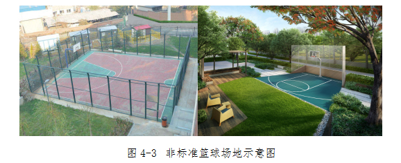

北京市体育设施专项规划（2018年—2035年）

## 第一章　总则

## 1.1　指导思想

以习近平新时代中国特色社会主义思想为指导，全面贯彻党的十九大精神，深入贯彻全民健身战略，推进体育强国建设，严格落实《北京城市总体规划(2016年—2035年)》(以下简称总体规划)要求，对接分区规划，落实总体规划指标。牢固树立新发展理念，坚持以人民为中心，围绕“七有”“五性”，将公共体育设施建设纳入国土空间规划，推进公共体育设施均衡发展。着力解决公共体育设施供给不足问题，着力构建公共体育设施功能体系，着力健全公共体育设施良性运行机制。全力推进体育设施向社会开放，鼓励各类公共设施与体育设施融合发展，进一步激发体育活力，推进体育产业发展，切实提高人民群众身体素质，助力健康中国发展。

## 1.2　政府相关要求

1.2.1　党中央、国务院有关文件精神

1.全民健身是新时代发展的国家战略

2016年8月25日，习近平总书记在会见第三十一届奥林匹克运动会中国体育代表团全体成员时表示，希望同志们充分认识体育对提高人民健康水平的积极意义，落实全民健身国家战略，普及全民健身运动，促进健康中国建设。

2017年10月18日，习近平总书记在党的第十九次全国代表大会上作了《决胜全面建成小康社会 夺取新时代中国特色社会主义伟大胜利》的报告，强调广泛开展全民健身活动，加快推进体育强国建设。

2019年8月10日，国务院办公厅印发《体育强国建设纲要》，推动体育强国建设，强调发挥体育在建设社会主义现代化强国征程中的重要作用，努力将体育事业建设成为中华民族伟大复兴的标志性事业。

2.冬奥会是展示国家形象的重要窗口

2017年2月24日，习近平总书记在北京城市规划建设和北京冬奥会筹办工作座谈会上指出，北京冬奥会是我国重要历史节点的重大标志性活动，是展现国家形象、促进国家发展、振奋民族精神的重要契机，对京津冀协同发展有着强有力的牵引作用。

3.青少年体育发展是国家后备人才培养的重要保障

2017年2月24日，习近平总书记在考察五棵松体育中心、首都体育馆时指出，少年强中国强，体育强中国强。

1.2.2　总体规划要求

总体规划提出北京的发展目标为“建设国际一流的和谐宜居之都”。为落实这一发展目标，在生活空间规划建设上要构建覆盖城乡、优质均衡的公共服务体系。其中明确公共体育设施要构建完善的全民健身公共服务体系，人均公共体育用地面积到2035年提高到0.7平方米。

1.2.3　市委市政府工作部署

1.补足公共服务设施短板，促进地区均衡发展

2018年6月15日，市委书记蔡奇同志在调研南部地区座谈会上指出，要尽快补齐基础设施和公共服务短板。要围绕幼有所育、学有所教、劳有所得、病有所医、老有所养、住有所居、弱有所扶的要求，完善公共文化体育和养老服务体系。同年9月15日，市委书记蔡奇同志在参加“回天有我”社会服务活动时提出，要多建体育文化设施，多办群众参与性强的活动。

2.推动京津冀协同发展，提升整体发展水平

2017年11月20日，市委书记蔡奇同志在《人民日报》发表《推动京津冀协同发展》。文章指出，共建京张文化体育旅游带，打造体育、休闲、旅游产业集聚区，提升区域整体发展水平。

## 1.3　规划依据

1.3.1　国家规划及政策文件

1.《体育强国建设纲要》

2.《健康中国行动(2019—2030年)》

3.《关于以2022年北京冬奥会为契机大力发展冰雪运动的意见》

4.《加大力度推动社会领域公共服务补短板强弱项提质量 促进形成强大国内市场的行动方案》

5.《关于加快发展体育竞赛表演产业的指导意见》

6.《“健康中国2030”规划纲要》

7.《体育发展“十三五”规划》

8.《全民健身计划(2016—2020年)》

9.《全国足球场地设施建设规划(2016—2020年)》

10.《国务院关于加快发展体育产业促进体育消费的若干意见》

11.《国务院办公厅关于促进全民健身和体育消费推动体育产业高质量发展的意见》

1.3.2　地方规划及政策文件

1.《北京城市总体规划(2016年—2035年)》

2.《北京市足球场地设施建设规划(2016—2020年)》

3.《北京市“十三五”时期体育发展规划》

4.《北京市足球改革发展总体方案》

5.《北京市全民健身实施计划(2016—2020年)》

6.《关于加快冰雪运动发展的意见(2016—2022年)》

7.《北京市中心城、新城公共体育用地专项规划(2007年-2020年)》

1.3.3　技术标准

1.《城市居住区规划设计标准(GB50180-2018)》

2.《全民健身活动中心分类配置要求(GB/T34281-2017)》

3.《城市公共体育场馆用地控制指标》

4.《北京市居住公共服务设施配置指标》

5.《体育训练基地建设用地指标》

6.《城市公共体育运动设施用地定额指标暂行规定》

7.《城市用地分类与规划建设用地标准(GB50137-2011)》

8.《城市公共设施规划规范(GB50442-2008)》

9.《体育建筑设计规范(JGJ31-2003)》

10.《城市社区多功能公共运动场配置要求(GB/T 34419-2017)》

## 1.4　规划范围及深度

1.4.1　规划范围

本次规划确定的规划范围为北京市行政辖区，总面积为16410平方公里。

1.4.2　规划深度

按照总体规划“一核一主一副、两轴多点一区”的空间结构，结合不同圈层实际发展建设情况，确定不同圈层规划深度要求。

本次规划为有效衔接、指导各行政辖区内的体育设施规划建设，在总体规划确定的空间结构基础上，以行政辖区为单元进行不同圈层的规划落实。

一核包括东城区、西城区，一主包括朝阳区、海淀区、丰台区、石景山区。一核、一主规划深度要明确独立占地的公共体育用地边界，确定非独立占地公共体育用地的地块位置及用地面积。

一副包括通州区(含亦庄通州部分)，多点包括顺义区、大兴区(含亦庄大兴部分)、昌平区、房山区，一区包括门头沟区、平谷区、怀柔区、密云区、延庆区。一副、多点、一区规划深度要确定各独立占地公共体育设施规划选址(街区层面)及用地面积。

## 1.5　规划期限

本次规划期限为2018年至2035年。近期2018年至2025年；远期2026年至2035年。

本次规划的期限以总体规划期限2016年至2035年为基础。

近期规划期限与“十四五”规划期限2021年至2025年相衔接，实现多规合一。

## 1.6　规划对象

1.6.1　体育设施

体育设施是城市公共服务设施的重要组成部分，是指用于开展全民健身、体育训练、竞赛、教学和其他社会体育活动的场所及附属设备。本次规划研究对象包括利用公共体育用地建设的体育设施(包括独立占地或兼容占地两种情况)、其他用地内的体育设施。

1.6.2　公共体育用地

公共体育用地是专门用于建设城市公共体育设施的土地，包括体育场馆用地和体育训练用地。学校、机关企事业单位、商业文化场所、公园内的附属体育设施用地不属于公共体育用地。

1.6.3　体育场地

体育场地是指在各类土地上建设的用于体育运动或比赛使用的场地，包括室内和室外场地。公共体育场馆、学校操场、商场健身房、户外的健身步道等都属于体育场地的范畴。单处体育设施可能包含多个体育场地，如体育中心内包含足球场、篮球场、游泳馆等多片体育场地。

## 第二章　需求分析

## 2.1　面向全民健身的群众需求

全面掌握全市市民对体育设施的使用现状，了解市民对体育设施的真正需求，是本次规划的核心工作之一，对提高本次规划的科学性、指导性和可操作性起到重要作用，为此，本次规划编制过程中同步开展了北京市体育设施专项规划公众调研问卷工作。问卷涉及受访者个人社会经济属性、运动习惯、运动需求以及其居住地体育场地设施的使用情况等问题。

2.1.1　可达性需求

调查结果显示，40%的市民选择在居住地周边进行日常体育运动，29%的市民选择在居住地范围内进行日常体育运动。居住地范围及周边的体育设施与市民日常体育运动关系密切，了解居住地范围及周边15分钟生活圈内的体育设施现状使用情况和市民需求尤为重要。

2.1.2　多样化需求

调查结果显示，接近半数市民认为日常使用的体育设施无法满足锻炼需要。进一步调查发现，体育设施类型少、老旧或损坏严重是影响现状设施使用的主要原因。因此，有效供给多类型的体育设施才能充分满足市民的日常锻炼需要。

2.1.3　差异化需求

居住用地内现状体育设施主要为室外健身器械和健身步道，一定程度上满足了日常锻炼需要，但与市民的多样化需求还存在一定差距。针对不同年龄群体开展调查的结果显示，市民最为需要的设施类型与现状设施存在不符。对于居住用地内的体育设施，青年群体更希望新增大球场馆和室内健身房，中老年群体更倾向新增小球场地；对于居住用地周边的体育设施，青年和中老年群体都希望新增小球场地和游泳场馆。因此，居住用地及周边15分钟生活圈内的体育设施需要兼顾青年和中老年群体的多样化需求，新增设施以小球场地、游泳场馆、大球场馆为主。

## 2.2　面向国际交往的赛事需求

体育与全球城市发展具有较强的耦合性。对标世界知名全球城市，体育赛事已经成为扩大国际影响力、建设国际化都市的重要手段。近年来，国家出台了一系列政策文件，旨在建设若干具有较大影响力的体育赛事和体育竞赛表演产业集聚区。发挥“双奥之城”独特优势，打造国际体育赛事集聚地，是实现北京“四个中心”城市战略定位的重要内容，积极引进和培育国际赛事将进一步助力北京国际交往中心建设。

2.2.1　品牌赛事需求

北京国际体育赛事目前已形成以中国网球公开赛、北京马拉松等一批知名的国际品牌赛事为主体，以国际单项赛事及全国赛事、市级赛事和区县级赛事为补充的赛事体系。但与世界知名全球城市相比，北京国际化、高水平的体育赛事还不够丰富，未来应积极申办、引进和培育不同类型的国际体育赛事，既要有“三大球”、乒乓球、羽毛球等群众喜闻乐见的运动项目，也要有山地户外、冰雪运动、电子竞技等新兴热门的运动项目。以市场为主导、辅以政府支持，加大对办赛主体的支持力度，建立科学规范的赛事长效组织机制。通过连续性办赛来扩大赛事影响力，并带动本土职业赛事发展及群众体育参与，构建城市系列性赛事体系。

2.2.2　体育交流需求

对外体育交流作为一种重要的跨文化交流方式，为连接北京和世界发挥着重要的媒介作用。北京以体育竞赛为平台，积极拓展政府间和民间的体育交流活动。未来北京应延续对外体育交流成果，在体育对外交往新格局下发挥首都的引领示范作用。坚持“引进来”，更要“走出去”，在“三大球”、乒乓球、羽毛球等既有交流项目基础上，增加武术、龙舟等我国传统体育项目。进一步完善对外体育交流体系，在国内外开展不同层次、不同规模、不同形式的体育交流活动。

2.2.3　赛事设施需求

近几年，北京积极推进国家速滑馆、首钢滑雪大跳台等一批冬奥场馆建设，目前已具备国际一流的赛事场馆及配套设施，但仍存在赛间赛后利用率不高、多业态融合不足，特别是符合国际性体育赛事承办能力的场馆较少等问题。未来北京应加强新建体育场馆设施的科学规划与布局，推行体育场馆设计、建设、运营、管理一体化模式，将体育经济与赛事功能需要、赛后利用有机结合。鼓励探索市场化运营新模式，提升赛事设施运营管理能力，促进场馆设施的可持续发展。

2.2.4　赛事文化需求

体育文化是体育事业可持续发展的根本动力，体育文化是体育名城的树立之本。体育赛事文化作为体育文化的重要内容，是体育软实力的重要体现。北京具有深厚的体育赛事文化内涵，大型体育赛事为城市留下了物质、产业、制度和精神等多方面的文化内容。未来北京应立足首都文化底蕴优势，策划影响广泛的大众体育赛事，鼓励开展群众喜爱的民间体育活动。围绕赛事的举办进程，开展赛前、赛中、赛后的系列文化活动，设立赛事文化要素展示空间等，推动文化与体育互融互促，扩大赛事影响力。

## 2.3　面向体育消费的新兴需求

在一系列有关发展体育产业、促进体育消费的政策驱动下，体育产业进入快速发展通道，面向大众、以服务消费为主的体育市场体系初步形成。受全民健身热潮、运动多元化、体育娱乐化等影响，体育消费进一步升级，“体育+”产业快速融合，体育服务业快速发展。因此，顺应和把握时下体育消费的新兴需求，提高体育经济指数，成为加快体育产业发展、促进体育产业转型升级的重要内容。

2.3.1　新兴体育运动消费需求

体育消费升级表现之一是从传统国民爱好体育运动到各类新兴体育运动的变化，传统的乒羽项目继续保持庞大受众的同时，出现了如滑雪、击剑、马术、帆船、赛艇、潜水、航空等中高端小众化的运动项目类型。借助2022年冬奥会举办的热潮，冰雪项目成为了小众热门运动，近几年北京出现了近百支青少年冰球队和俱乐部。未来北京需进一步丰富运动项目消费类型，加强特色健身休闲设施建设，重点建设一批山地户外营地、徒步骑行服务站、自驾车房车营地、运动船艇码头、航空飞行营地等健身休闲设施。延长小众运动项目的消费服务链条，带动健身服装用品、健身场馆器材、健身文化传媒、健身教育培训等产业发展。

2.3.2　体育休闲深度体验需求

体育消费由简单参与到深度体验，在体育旅游领域尤为明显。体育旅游是旅游产业和体育产业融合的新兴产业形态，以体育运动为核心，以现场观赛、参与体验及参观游览为主要形式，以满足健康娱乐、旅游休闲为目的，向大众提供相关产品和服务的一系列经济活动，涉及健身休闲、竞赛表演、装备制造、设施建设等业态。总体规划提出联合张家口市，建设京张体育文化旅游带。未来北京应打造“体育+旅游”的相关产品，建设一批体育旅游目的地，打造多条体育旅游精品线路。

2.3.3　体育空间功能复合化需求

发达的竞赛表演业借助竞技比赛的观赏性、戏剧性和悬念性，将竞技体育与娱乐休闲充分融合。“超级碗”就是凭借橄榄球本身的魅力和“全娱乐模式”的运作，成为了美国职业体育的一道金字招牌。体育赛事的娱乐化和竞赛的表演化要求体育空间功能要更加复合化。纽约麦迪逊广场花园不仅举办冰球、篮球等多项专业赛事，还承办了大量艺术演出、演唱会、音乐会等。未来北京需借鉴“五棵松”模式，将单一体育场馆功能向城市体育综合体转变，以体育竞演为核心功能，拓展体育零售、运动体验等相关功能，开发、改造现有体育场馆，实现文化、娱乐、餐饮、演艺、酒店、会议、配套等功能复合化。

## 第三章　规划体系

## 3.1　规划目标及原则

3.1.1　规划目标

为深入贯彻全民健身国家战略，全力推进体育强国建设，满足人民日益增长的多层次多样化的体育生活需要，推进体育事业健康发展，本次规划立足北京实际，突出大国首都特色，紧密围绕“四个中心”城市战略定位，聚焦增强人民体质，提高“七有”“五性”体育指标，真抓实干、砥砺奋进、精准发力、补齐短板，着力打造健康北京，建设国家全民健身典范城市。着力提升国际影响，建设首都国际体育名城，努力谱写好“建设国际一流的和谐宜居之都”的体育事业新篇章。

在打造健康北京、建设国家全民健身典范城市上，要坚持以人民健康为中心，打造以群众身边“15分钟健身圈”为基础的全民健身设施网络。完善全民健身公共服务体系，实现公共体育服务均等化、便利化；发展群众喜闻乐见的运动项目，完善“三大球”、冰雪运动等场地设施建设；满足不同人群体育活动需求，加强服务重点人群的全民健身设施建设；盘活存量资源，促进公共设施共建共享；与城市更新相结合，建设全民健身设施。

在着力提升国际影响、建设首都国际体育名城上，要加强科技场馆建设，进一步健全大型赛事场馆运行机制，构建满足体育交往功能的体育设施体系。以冬奥会、篮球世界杯、田径世锦赛、冰壶锦标赛等国际大型赛事、北京马拉松等专项赛事以及各类联赛为抓手，优化场馆功能布局，建设具有广泛国际影响力的大型品牌赛事地区，打造国际一流的硬件环境。提升竞技体育训练特别是青少年后备人才培养训练设施水平，建设高水平、高品质的竞技体育训练基地。顺应体育发展新趋势，培育国际性知名的体育企业和体育品牌。建设国际大众体育组织集聚与交流合作平台，发展与首都城市战略定位相匹配的体育经济，支撑建设首都国际体育名城。

3.1.2　规划原则

1.以人为本，健康生活

从人民群众的实际需求出发，贯彻“健康中国”“体育强国”国家战略，花大力气、下真功夫建设更多的人民群众喜闻乐见的体育设施，提倡城市公共体育资源向普及度高、群众基础好、技术门槛低的项目倾斜。倡导体育锻炼生活方式，塑造活力北京、健康北京，把北京建设成为全民健身的典范城市。

2.理顺机制，扩大供给

坚持问题导向，坚持融合发展，创新体制机制，打破行业壁垒，突出重点，循序渐进，探索学校、机关企事业单位、商业文化场所、公园等附属体育设施服务于全民健身，集中解决体育设施不平衡不充分、部分体育设施利用率低、赛后闲置浪费、多业态融合不足的问题。

3.设施兼容，有效保障

倡导体育设施与各类城市公园、郊野公园、风景旅游区等各类设施兼容，鼓励增补非独立占地、类型多样的体育设施，力争规划期末人均体育场地面积达到2.8平方米。

4.多规合一，有序实施

坚持统筹规划、多规合一，密切与分区规划和详细规划对接，形成科学高效的规划实施管控体系，确保规划落地。有序制定行动计划，切实有效推进规划实施。

## 3.2　功能体系

为建设国家全民健身典范城市、首都国际体育名城，规划提出“4+2”的功能体系，即全民健身设施体系、竞技训练设施体系、青少年体育服务设施体系和体育赛事设施体系，以及体育产业示范区体系和体育文化交往平台功能体系。

3.2.1　全民健身设施体系

构建完善的全民健身体育设施体系，明确“15分钟健身圈”体育设施配置要求、标准和措施。

3.2.2　竞技训练设施体系

高标准建设满足专业训练需要的竞技训练设施，探索现有专业训练场馆的创新使用方式，尽可能扩大开放程度，在保障日常训练基础上，满足群众日常健身需求。

3.2.3　青少年体育服务设施体系

全面保障青少年课内外体育活动设施，重点补齐青少年“三大球”、冰雪运动训练设施，高水平建设青少年后备人才培养训练基地。

3.2.4　体育赛事设施体系

完善高标准的国际、国内赛事体育设施体系，以提高各类联赛、赛事普及率为目标，完善赛事场馆体系建设，并提出共建共享要求。

3.2.5　体育产业示范区体系

优化要素配置和服务供给，推动健康产业转型，扩大体育产业总规模，重点发展高端体育设备研发和制造，推动体育消费升级。

3.2.6　体育文化交往平台功能体系

提高大型体育场所综合利用水平，加强开放性和共享性。建设城市体育公园和体育长廊，促进京津冀体育交流，打造国际、国内体育组织集聚地。

## 3.3　层级体系

本次规划优化完善上一版规划提出的“国家级、市级、区级、街道/乡镇级”四级配置体系，强化全民健身设施功能，合并国家级、市级两个层级，作为城市级，区级作为地区级，街道/乡镇级作为街区级，并增加社区级体育设施。鼓励发展城市特色项目，增加其他体育设施，最终确立“城市级、地区级、街区级、社区级”四级全民健身服务体系+其他体育设施。

3.3.1　城市级公共体育设施

服务于全市及更大区域范围，以竞演赛事和竞技训练为主要功能，兼顾全民健身、青少年体育服务、体育产业示范、体育文化交往等功能，主要承担高水平国际、国内综合赛事或单项赛事的公共体育设施，须独立占地。城市级公共体育设施应充分利用现状或原规划用地，临近轨道交通或城市快速路布局。

3.3.2　地区级公共体育设施

服务于各区人口稠密地区，以全民健身为主要功能，兼顾竞演赛事、竞技训练、青少年体育服务功能，部分兼顾体育产业示范、体育文化交往功能，主要承担群众体育赛事、区级专业运动队日常训练的公共体育设施，须独立占地。地区级公共体育设施应充分利用现状或原规划用地，临近轨道交通或城市主次干路布局。

3.3.3　街区级公共体育设施

服务于街道、乡镇，以全民健身为主要功能，兼顾青少年体育服务功能，主要满足专业性较高、场地需求较大的群众体育项目的公共体育设施，可独立占地或与其他公共设施合建。街区级公共体育设施临近城市主次干路，结合其他公共设施、公园绿地统筹布局。

3.3.4　社区级公共体育设施

服务于社区、行政村居民，以日常健身活动为主要功能的公共体育设施，可独立占地或与公共设施、公园绿地、居住用地等兼容布置。社区级公共体育设施宜鼓励利用存量空间，结合已有设施统筹布局。

3.3.5　其他体育设施

充分结合资源禀赋，建设特色体育项目，如水上运动、马拉松、环城自行车、户外运动等特色项目，该类项目不独立占地，与城市资源融合设置。提倡鼓励学校、机关企事业单位、商业文化场所、公园等附属体育设施根据占地规模，参考相应的街区级和社区级公共体育设施层级配置内容和标准建设。

## 3.4　层级配置内容

3.4.1　城市级公共体育设施

城市级公共体育设施以“两群”为主要配置内容，做强竞演场地场馆群和竞训场地场馆群。

六大竞演场地场馆群：结合现状大型公共体育设施，在奥体中心区、工体、五棵松、首钢、城市副中心绿心、延庆冬奥赛区打造竞演场地场馆群。

四大竞训场地场馆群：分别为龙潭湖、白石桥、老山综合竞训场馆群，并在城市南部地区或其他地区新选址建设1处“三大球”青训基地。

3.4.2　地区级公共体育设施

地区级公共体育设施包括体育中心、大型全民健身中心和大型体育公园。总用地面积可按3—20公顷配置。

体育中心：承担地区体育赛事和文化活动的综合体育中心，应独立占地，用地面积3—10公顷，各区至少设置1处，设置内容包括体育场、体育馆、游泳馆、网球场、滑冰场、综合健身馆等。

大型全民健身中心：集中提供多种全民健身服务项目，应独立占地，用地面积3公顷以上，服务人口30—50万人，包含各类室内外运动场地，群众体育项目宜不少于12项，鼓励设置特色体育项目和传统项目场地。

大型体育公园：以室外体育场地为主的公园，应独立占地，用地面积8—20公顷，可在人口稠密的地区选址，绿地率不宜高于30%。

3.4.3　街区级公共体育设施

街区级公共体育设施主要服务于3公里健身圈，包括中型全民健身中心和中型体育公园。

中型全民健身中心：主要提供占地面积较大、专业性较强的全民健身服务项目，应独立占地，用地面积1—3公顷，服务人口10—15万人，包含各类室内外运动场地，群众体育项目宜不少于6项，鼓励设置青少年运动场地等。

中型体育公园：以室外体育场地为主的公园，应独立占地，用地面积3—8公顷，可在大型居住区周边选址，绿地率不宜高于20%。

3.4.4　社区级公共体育设施

社区级公共体育设施主要服务于1公里健身圈，包括小型全民健身中心和小型体育公园。

小型全民健身中心：主要提供占地较小、普及度较高的全民健身服务项目，应独立占地，用地面积0.1—1公顷，服务人口3—5万人，鼓励设置多功能场地，设置老年人健身广场、儿童活动场地等。

小型体育公园：以室外体育场地为主的公园，应独立占地，用地面积1—3公顷，可在居住区周边选址，绿地率不宜高于20%。

3.4.5　各级公共体育设施建设标准

各级公共体育设施建设参照《体育建筑设计规范》(JGJ31-2003)、《城市公共体育场馆用地控制指标》(国土资规〔2017〕11号)、《城市社区多功能公共运动场配置要求》(GB/T 34419-2017)等现行建设标准执行。

## 3.5　层级用地标准

3.5.1　城市级、地区级公共体育设施

为着力提升国际影响、建设首都国际体育名城，城市级和地区级设施的规划人均公共体育用地面积指标为0.35—0.48平方米。该指标应在全市范围内统一核算。

城市级公共体育设施：以提供高水平国际、国内综合赛事或单项赛事场地为主要任务，重点保障冬奥会、城市副中心大型场馆设施，满足“三大球”等竞技体育青训需求。

地区级公共体育设施：以提供大型综合赛事、群众体育赛事、全民健身、区级专业运动队日常训练、特色项目场地为主要任务，重点完善各区体育中心、各区新建或现状改建大型全民健身中心、大型体育公园。

3.5.2　街区级、社区级公共体育设施

为打造健康北京、建设国家全民健身典范城市，街区级、社区级设施的规划人均公共体育用地面积指标为0.35—0.42平方米。该指标应根据街区、社区常住人口核算。

街区级公共体育设施：主要服务于3公里健身圈(骑行15分钟)，提供居民日常健身活动、专业体育项目培训等场地，新建或现状改建中型全民健身中心、中型体育公园。

社区级公共体育设施：主要服务于1公里健身圈(步行15分钟)，以提供居民日常健身活动等场地为主要任务，配建小型全民健身中心、小型体育公园。

## 第四章　空间布局

## 4.1　布局原则

4.1.1　全市均衡配置

北京市体育设施布局应以“全市均衡配置体育场地资源”为基本原则，将体育场地建设重心向南城转移，逐步增加南城体育场地供给数量，满足南城居民的场地需求。在各区层面上，体育场地配建类型差距较大，一方面应抓紧配建基础体育设施，缩小相关差距，另一方面要通过税收优惠、财政补贴、购买服务等方式，引入和应用现代企业制度，鼓励社会资本投资建设和运行管理体育设施，使群众可以公平享受体育场地资源。

4.1.2　设施布局扁平化

本次规划通过现状调研、发放问卷等多种形式，了解人民群众日常健身需求。设施布局应以群众需求为导向，从过去由政府端菜改变为由市民点菜，面向群众，面向未来，重点增补群众身边15分钟生活圈内的体育设施，以灵活适用为原则，兼顾青少年、老年人不同群体需求，促进体育设施布局扁平化。

4.1.3　兼容复合利用

城市建成区用地资源紧张，体育设施应结合学校、机关企事业单位、商业文化场所、公园等建设，加大用地兼容力度，节约集约用地，解决体育场地用地供给不足问题。此外，还应强化建筑功能复合，包括利用废弃工业厂房改造成体育运动空间，鼓励商场、写字楼等建筑物在屋顶平台或室内开辟健身房、操房、室内球场等体育运动场地等，并给予相应的优惠政策。

## 4.2　空间圈层规划策略

4.2.1　首都功能核心区

挖掘存量：结合疏解腾退的空间资源，在“四个中心”功能建设基础上，补足公共体育设施供给。

见缝插针：结合老旧小区、平房区改造，“见缝插针”增设社区级公共体育设施，改善老城体育设施不足现状。

共建共享：结合学校、机关企事业单位、商业文化场所、公园等共建体育设施，提高综合服务水平。

4.2.2　中心城区

存量利用：结合拆违、疏解腾退的空间资源，增加公共体育设施供给，推动大型体育设施提质升级。

分区策略：朝阳区加强大型场馆赛后利用，街区层面均匀布点，强化全民健身功能。海淀区加强山后地区规划公共体育用地实施，鼓励高校体育设施对外开放；丰台区加强丰台科技园区域以及人口密集地区公共体育设施建设；石景山区结合存量用地，加强全民健身体育设施建设。

4.2.3　城市副中心

与中心城区互补：大、中型体育设施功能与中心城区形成互补，促进体育设施功能全面多样化发展。

特色引领：在与中心城区体育设施互补的基础上，重点围绕足球、冰雪、乒羽、水上等运动项目及青少年等群体，开展特色体育设施规划建设，打造体育设施示范区。

4.2.4　多点地区

完善层级配置：在各区现有体育设施基础上，完善地区级、街区级、社区级公共体育设施体系。

凸显品质特色：结合未来科学城、北京经济技术开发区、沙河高教园、良乡大学城等重点功能区建设，以及新市镇、特色小镇建设，打造一批高品质体育设施。

4.2.5　生态涵养区

强化新城体育功能：全域范围内完善地区级、街区级、社区级全民健身公共服务体系，优先推进新城内公共体育设施规划建设。

发挥资源禀赋：充分发挥生态涵养区山水资源特色，推动京津冀地区体育活动协同发展，打造特色体育运动，构建生态化、网格化的体育运动场所。

## 4.3　全市体育用地规划方案示意

为保障规划公共体育用地有效落地，本规划深入对接《首都功能核心区控制性详细规划(街区层面)(2018年—2035年》《城市副中心控制性详细规划(街区层面)(2016年—2035年)》及各分区规划，规划布局公共体育用地共625处，总面积约1668公顷。

## 4.4　不同类型体育设施布局策略

4.4.1　“三大球”设施

1.新建地区按照标准建设“三大球”设施

新建地区、新建学校要按照相关标准配套建设“三大球”场地设施，可采用兼容足球、篮球、排球项目的多功能公共运动场形式配置，有条件的地区、学校可根据项目分别配置场地。新建居住区要结合15分钟生活圈，加强社区“三大球”场地建设，配建的“三大球”场地设施应与居住区同步设计、施工与使用。

2.在场地条件受现状约束不能满足规则场地的尺寸时，可以选建不规则场地

在条件允许的情况下，应优先采用规则场地。在社区用地极度紧张时，可灵活利用现有资源，在确保安全的前提下，因地制宜建设非标准“三大球”场地，如不规则足球场地、不规则篮球场、笼式足球、笼式篮球场地、排球墙等。

3.结合老旧小区改造、减量提质等工作，鼓励疏解腾退用地建设“三大球”场地设施

合理利用公园、废弃工矿用地、河滩地、荒地、闲置地等建设“三大球”设施。大型体育公园、郊野公园可建设标准场地，其他用地可根据具体条件建设标准或非标准场地。

4.4.2　冰雪运动场地

1.挖潜存量资源建设冰上运动场地设施

鼓励学校建设滑冰馆；推广室外天然冰场，鼓励在公园、校园、广场、社区等建设可拆装式冰场；支持有条件的地区和学校在冬季浇建冰场；鼓励将老旧厂房、老旧楼宇等改建为滑冰场地。

2.扩建增容滑雪场地及配套设施，鼓励建设冬季临时性嬉雪场地

在符合土地政策的条件下鼓励对部分现有滑雪场进行扩建增容、升级改造，完善配套服务设施，丰富冬季活动类型；依托各大公园、广场、体育场馆、休闲文化旅游场所等在冬季建设临时性嬉雪场地。

4.4.3　社区体育设施

1.利用边角闲置地，“见缝插针”建设社区体育设施

在老城挖潜边角闲置地用地资源，确认权属与规划用地性质后建设；老旧小区“见缝插针”建设社区体育设施；新建小区应按照有关指标要求，建设配套体育设施。

2.结合社区文化和绿化设施，建设不同类型“社区体育文化设施”

综合型：用地条件较为方正平整且面积较大，宜建设“三大球”等体育活动场地，配套部分文化康乐设施。

园林型：用地不规则或坡度较大，经整治后宜以园林绿化景观为主，建设少量的羽毛球场、篮球场、乒乓球场等运动场地，配套儿童活动、文化康乐设施。

亲水型：地缓狭长的河岸滨水用地应以生态景观为主，可建设健身步道、羽毛球和乒乓球场等设施，配套文化康乐设施。

3.打造充满活力的社区公共服务中心

打造提供各类公共管理与公共服务的新一代社区公共服务中心，将一定规模的体育设施充分融入，为社区注入活力。中心除运动场、游泳馆等体育设施外，还可以包括公共服务中心、家庭健康中心、图书馆、运动科技中心、乐龄活动中心、俱乐部、小型售卖点和零售商店等设施，为居民提供全面公共服务。

体育设施与社区公共服务中心、公园绿地融合，社区与城市慢行系统连接，形成更有活力的城市街景。社区配建露天体育场可举办社区体育赛事或引入社会赛事，承担居民集体活动，提高空间利用率。

4.4.4　公园兼容体育设施

公园与体育设施相结合，构建以体育运动锻炼为主要功能，兼有公园文化休闲功能，以绿化为本底具有一定环境品质且向居民开放的公共空间。可结合群众休闲健身需求在现状公园有条件区域增设体育设施场地，新建公园建议参照下表中兼容比例建设相应体育设施。

4.4.5　健身步道

1.打造城市“慢跑路线”，构建城市慢跑服务设施体系

结合自然公园、人文景点，依托水系绿道、生活性道路，打造若干健身步道，提升沿线街道环境品质。

鼓励结合重点功能区建设智能步道，为工作人群提供便捷的健身设施。

结合地铁站、社区服务中心等设置“跑步小站”“跑步服务中心”，提供租赁、淋浴、寄存等跑步相关服务，沿跑步路线设置自动售卖机等便利设施。

2.建设登山健身步道，构建郊野都市休闲运动目的地

依托山形地貌、生态环境，建设登山健身步道、山地自行车道、旅游景观道“三位一体”的登山健身步道系统。串联郊野旅游资源，针对不同人群需求，构建不同主题、不同时长的登山健身路线。

4.4.6　马拉松选线

结合大运河、温榆河、潮白河、永定河等河流及郊野公园、城市公园等生态空间，利用城市绿道串联，精心设计多类型马拉松线路，打造城市级或区域级知名品牌赛事。

4.4.7　旧建筑改造利用

要因地制宜建设体育设施，鼓励各主体利用工业厂房、商业楼宇等存量建筑空间更新改造建设体育设施，允许按照体育设施设计要求，依法依规调整使用功能、租赁期限、车位配比及消防等相关建设要求。合理利用公园等各类设施用地建设足球场、篮球场、排球场等体育设施，鼓励社会资本参与投资建设并依法按约定享受相应权益。

## 4.5　促进城市体育产业发展

4.5.1　多元化服务

围绕体育场馆设施植入文化和商业元素，提供多元化服务，打造城市新兴运动休闲消费热点地区。通过丰富业态，打造互动体验生活圈，让市民可以充分体验文化、体育、艺术、科技、娱乐全方位互动生活。以餐饮业和娱乐业为龙头打造城市深夜活力的聚集地和深夜生活方式的体验地。针对不同类型建筑和场地进行多元化项目开发，供给端提供丰富的产品类型，满足不同客户及消费者的需求。

4.5.2　优化产业供地

各区在编制国土空间规划时要统筹考虑体育用地布局，在安排年度土地利用计划时，加大对体育产业新增建设用地的支持力度。利用以划拨方式取得的存量房产、土地兴办体育产业，符合《划拨用地目录》的可按划拨方式办理用地手续，不符合《划拨用地目录》的可采取协议出让方式办理。鼓励各地探索利用集体建设用地、符合条件的“四荒”(荒山、荒沟、荒丘、荒滩)土地发展体育产业。

4.5.3　“体育+”行动

实施“体育+”行动，促进体育产业与医养、旅游、教育、商业融合发展。

1.推动体医融合发展

将体育产业发展核心指标纳入国家卫生城市评选体系。鼓励医院培养和引进运动康复师，开展运动促进健康指导，推动形成体医融合的疾病管理和健康服务模式。完善国民体质监测指标体系，将相关指标纳入居民健康体检推荐范围。为不同人群提供有针对性的运动健身方案或运动指导服务，推广科学健身，提升健身效果。加强针对老年群体的非医疗健康干预，普及健身知识，组织开展健身活动。

2.鼓励体旅融合发展

探索将体育旅游纳入旅游度假区等国家和行业标准。实施体育旅游精品示范工程，打造一批有影响力的体育旅游精品线路、精品赛事和示范基地。规范和引导体育旅游示范区建设。将登山、徒步、越野跑等体育运动项目作为发展森林旅游的重要方向。

3.加快体教融合发展

通过政府购买服务等方式，引进专业教练员、退役运动员、体育培训机构等为学校体育课外训练和竞赛提供指导。鼓励将体育基地、运动营地等纳入青少年研学基地。完善学校体育教学、训练和竞赛体系，支持学校与体育部门建立运动员共同培养机制。以游泳、田径等项目为试点，将教育部门主办的符合要求的赛事纳入运动员技术等级评定体系。加强普通高校高水平运动队建设，将其纳入国家竞技体育后备人才培养体系。

4.5.4　助力夜间经济

1.打造“夜京城”地标、商圈和生活圈

打造前门大栅栏、三里屯、国贸、五棵松4个“夜京城”地标，打造蓝色港湾、世贸天阶、簋街、合生汇、郎园、食宝街、荟聚、中粮·祥云小镇、奥林匹克公园9个“夜京城”商圈和生活圈。

2.大力推动拓展夜间群众体育赛事活动

在夜京城地标、商圈和生活圈基础上，进一步拓展夜间群众体育赛事活动范围，打造“点亮夜京城”系列群众体育赛事活动，举办马拉松荧光夜跑等夜间群众体育赛事活动，不断丰富夜间群众赛事活动项目和内容。

3.促进夜间体育消费

积极落实《北京市关于进一步繁荣夜间经济促进消费增长的措施》，一是举办2023年亚足联亚洲杯足球赛、中国网球公开赛等品牌赛事，更好地满足市民观赏高水平赛事活动的需要。二是按照新修订的《北京市职业体育俱乐部评估奖励管理办法》对本市职业体育俱乐部实施评估奖励，提升赛事上座率，促进市民夜间体育消费。三是持续支持体育运动项目经营单位延长营业时间，不断满足多层次市民体育健身的需求。

4.5.5　市场化手段

体育设施应坚持公益为主，服务大众，推动全民健身设施开放利用，做到亲民、便民、利民。

体育设施的投资方式，除了依靠政府投入外，更要通过税收优惠、财政补贴、购买服务等方式，引入和应用现代企业制度，鼓励社会资本投资建设和运行管理设施，动员企业、个人投资建设体育设施。要正确处理政府和市场的关系，坚持改革创新，在政府投资建设基本公共体育设施的同时，利用市场化手段，通过所有权、经营权分离设计，促进体育市场高效配置资源，适时出台新的辅助政策措施，把PPP、BOT以及私人投资建设运行等方式摆在更加突出位置。

## 第五章　实施保障

## 5.1　实施策略

5.1.1　统筹规划，多规合一，强化科学高效的规划管控体系

加强区域统筹，实现统一规划、统一政策、统一管控。以本次专项规划为指导，在详细规划、规划综合实施方案中落实体育设施，纳入城市公共设施管控平台，禁止随意挪作他用。

5.1.2　市场主导，创新驱动，实现城市功能的完善配套和品质提升

鼓励政府简政放权，创新投融资模式，给予企业更大自由度和利润空间。研究出台相关政策鼓励社会投资参与建设体育场馆设施。允许配置一定比例(建议不超过10%)的经营性配套设施，允许出让场馆冠名权、研发赛事衍生品等，改变单一盈利模式，加大规划公共体育用地的实施力度。

5.1.3　改革创新，融合发展，树立城市建设的标杆示范

坚持改革创新，开展将学校、机关企事业单位、商业文化场所、公园内附属体育设施纳入体育用地数量统计口径的相关政策研究，出台促进设施开放的措施办法，提高体育场地利用率。重点强化群众身边的体育设施建设，打破部门局限，推动各行业开放协作建设体育设施，促进各类用地和空间复合使用，鼓励设施共建共享。统筹协调全民健身、竞技体育赛事、文化娱乐休闲等事业融合发展。

5.1.4　挖掘存量，建立台账，预留体育用地增补资源

结合“疏整促”工作，梳理全市疏解腾退空间资源，结合用地面积、用地权属、空间位置等信息进行分类统计，纳入体育用地增补储备资源，为后续实施预留空间。

5.1.5　重点突破，力求实效，以重大项目和重点赛事为抓手开创健康城市新局面

以“三大球”等优势项目为引领，强化场馆科技功能，引入国际高水平赛事，加强城市形象与运动精神结合。将规划确定的街区级和社区级体育设施建设纳入财政预算，鼓励社会资本参与投资、建设、运行。

5.1.6　探索建立公共体育设施安全保障机制

建立体育设施财产安全制度和保险制度，为体育设施使用过程中的行为签订保险，探索建立专门用途的保险基金，解决意外事故赔偿问题。

## 5.2　政策机制

5.2.1　建立公共体育用地体检机制

结合城市体检工作，建立公共体育用地体检机制，针对现状公共体育用地使用运维情况、规划公共体育用地实施情况开展定期评估。

5.2.2　进一步推进学校、机关企事业单位附属体育设施对外开放

通过各部门合作，明确责任主体、政府购买服务等方式，进一步提高学校、机关企事业单位附属体育设施对外开放程度。

5.2.3　研究非体育用地和临时用地兼容公共体育设施工作

在郊野公园、城市公园、道路广场空间、公共服务设施等各类非体育用地或城市空置、闲置用地兼容建设公共体育设施。明确非体育用地和临时用地建设公共体育设施配置标准、建设指引、控制要求及管理维护责任、资金来源等。

5.2.4　研究非首都功能疏解腾退用地建设公共体育设施

结合土地权属方意愿，允许原有土地方按照划拨或协议出让的方式将存量工业、商业等其他用地转化为体育用地继续使用。利用疏解腾退的用地资源优先补足地区体育设施短板，结合周边居民意愿建设所需体育设施。鼓励疏解后保留工业厂房、商业楼宇等建筑空间更新改造再利用，优先建设全民健身设施。

5.2.5　研究公共体育用地指标核算机制

规划公共体育用地大多以独立占地的方式供应，形式较为单一。在土地混合高效利用的未来发展大趋势下，应鼓励探索更加高效融合的体育用地供地方式，鼓励用地混合利用，对各类用地中兼容的体育设施，可根据其占地面积及对外开放时间等因素折算后计入公共体育用地指标。对历史文化街区等特殊地区，应因地制宜地安排体育设施及配置指标。

5.2.6　依靠社会力量建设公共体育设施

拓宽公共体育设施建设经费来源渠道，建立以公共财政为杠杆、吸纳社会资本的多元投资机制。制定针对性政策并加大投入，公共体育服务体系建设的经费增长幅度不低于财政收入增长幅度；鼓励社会资本投资，积极引导非公资本进入体育产业领域，如场馆运营、竞赛表演、赛事策划等，发布投资指南以确立目标与方向；将公共体育场地设施投建列入经济社会发展及城市建设总体规划，在政府专项资金统领下，多渠道筹资、调配资源，大力推进体育场馆设施实施；明确政府的财政保障责任和分摊比例，以专项财政的形式确定公共体育服务支出占财政支出的比重。

5.2.7　创新公共体育服务供给模式

创新公共体育服务供给模式，根据不同群体的兴趣、习惯等提供多样需求的公共体育服务内容，如社区居民体育服务生活化，村民体育服务乡土化，青少年体育服务校园化，老年人、残疾人体育服务社会化等。大力发展体育服务业，紧紧围绕产业布局，推动体育产业与养老、旅游、教育等产业融合，打造体育培训、体育传媒等特色业态。促进体育设施与社区公共服务中心、社区商业中心融合发展，不断丰富公共体育产品和服务，促进体育消费。

## 5.3　管理运营

5.3.1　改革体育场地管理机制，坚持融合发展，推进公共体育设施市场化运营

改革体育场地管理体制，实现多种管理模式并存，逐步形成体育场地自主运营、委托运营、合作运营三足鼎立局面，提升体育场地的社会效益与经济价值。

对于自主运营的体育场地，应鼓励开展多种经营活动，形成多元化体育服务体系，开发体育场地综合功能，发展体育竞赛表演、文化娱乐等服务内容，挖掘体育场馆的市场价值。

对于非自主运营的体育场地，应避免对体育场地的行政干预，发挥企业主体作用，依托“公私合作”模式，将体育场地的经营管理权通过合同承包、特许经营等形式委托给专业的体育场地运营公司管理，由其负责体育场地对外经营、市场开发，政府给予体育场地运营公司经营收益权，政府只负责对体育场地的运营规范进行监督。

5.3.2　培育体育协会和中介组织，促进体育产业良性发展

依托体育场馆场所，积极培育多形式、多层次的体育俱乐部、体育协会和中介组织，承办各级体育赛事、日常性体育活动，促进体育产业良性发展。

5.3.3　政府引领带动，拓展投融资渠道

发挥政府资金引领带动作用，积极扩展体育产业投融资渠道，为社会资本投资场馆建设和运营营造良好环境。

5.3.4　加强大型体育场馆开发利用，主动承接重大国际赛事

采取多元化经营模式，以主题活动、大型项目为盈利点，将大型体育场馆发展成为集体育、娱乐、旅游、商业、文化于一体的综合性场地设施；增加体育赛事承办次数，通过引入职业体育比赛，使大型体育场馆作为职业体育竞技场地，成为职业俱乐部的比赛主场，将门票、转播、训练等作为稳定的收入来源，保证大型场馆使用效率；加大大型体育场馆市场开发，可通过对体育场馆或场馆内设施出售冠名权等拓展收入渠道。

5.3.5　培育自主品牌项目，融入群众生活

利用大型场馆设施特色，拓展体育零售、运动体验等相关功能，努力创办自主品牌赛事、艺术展览品牌及文化演出品牌，开展群众喜闻乐见、丰富多彩的竞赛、表演等活动，打造文化艺术交流平台。

5.3.6　促进体育设施智能化

推进全民健身智能化发展，推进智能化健身路径、健身步道和体育公园建设。可利用人工智能技术，提高设施的服务水平和利用效率。

鼓励重点功能区等地区利用开放街区实现智能步道，提供智能打卡、提升安全、运动宣导、运动指导、运动服务、运动激励、运动社交等服务功能。

5.3.7　积极推动公共体育服务信息平台的搭建

建立全市公共体育服务综合信息平台，利用移动互联等现代技术手段，提供场馆预定、信息查询、在线报名等服务；与相关媒体合作，推广竞技体育，营造顶级赛事宣传氛围，普及科学健身知识，引导群众科学健身；充分发挥国民体质监测体系作用，开展群众体质测试和运动能力评估。

5.3.8　积极培育体育服务专业人才队伍

对基层文体设施加强运营管理，由体育主管部门对其进行业务指导和监督；合理配置专、兼职公共体育服务人员，街区级设置岗位，社区级配备体育工作协调员；可联系地方高等院校和科研院所实行“政产学研”合作，对公共体育服务的政策出台、产业发展进行专项研究，努力培养专业化的人才队伍。

5.3.9　促进体育设施社会化

从面向群众、面向市场、简政放权等方面形成更加多元的公共体育服务治理格局，确保体育社会组织更好地融入社会治理进程。
