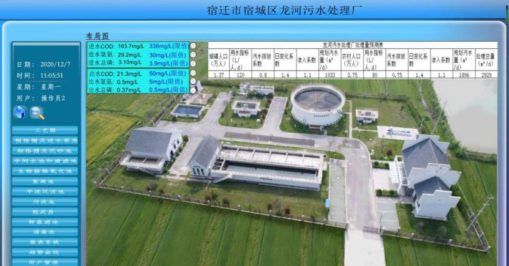

宿迁市宿城区农村生活污水治理

专项规划（2022-2035年）

## 1 总则

## 2 规划背景

## 近年来，随着农村经济的迅速发展、城市化进程的推进和乡镇企业的不断崛起，农民生活水平显著提高，自来水普及和村庄住宅卫生器具不断完善，农民人均用水量和污水量稳步增加。而农村生活污水未经处理直接排放，将严重影响农民的人居环境，威胁其身体健康，阻碍农村经济的可持续发展。加强农村生活污水收集、处理与资源化设施建设，避免因生活污水直接排放而引起水体、土壤和农产品污染，确保农村水源的安全，是新农村建设中加强基础设施建设、推进村庄整治工作、建设美丽乡村的重要内容，也是农村人居环境改善迫切需要解决的关键问题。

## “十二五”以来特别是“十三五”期间，宿城区委、区政府高度重视农村生活污水治理工作，扎实推进农村环境连片整治和美丽乡村建设等项目实施，农村生活污水治理工作初见成效，已建设集中式污水处理站65座（20立方米/日及以上处理规模），为民生改善和生态环境建设奠定了良好基础。但从全局来看，辖区内农村污水治理建设宏观布局存在不足，与城镇污水专项规划衔接不够，尚未有效实现环境效益最大化，与人民群众对排水基础设施的需求和生态环境改善的期盼仍有一定差距。

## 为深入贯彻习近平总书记关于改善农村人居环境的重要指示批示精神，全面落实党中央、国务院、农业农村部和生态环境部关于补齐农村生活污水治理短板，切实改善农村生态环境质量的相关工作要求，以及贯彻落实《农村环境整治实施方案（试行）》（土壤函〔2020〕7号）、《省政府办公厅关于印发江苏省农村生活污水治理提升行动方案的通知》（苏政办发〔2020〕38号）等文件精神，宿城区组织开展了农村生活污水专项治理规划编制工作，形成《宿迁市宿城区农村生活污水治理专项规划（2022-2035）》并通过专家评审。

## 为扎实推进农村生活污水治理，根据省政府办公厅《关于加强农业农村污染治理促进乡村生态振兴行动计划》（苏政办发〔2021〕106号）以及宿迁市《关于报送2022年农村生活污水和农村黑臭水体治理工作计划的通知》要求，结合当地实际，以“双60”（一个行政村内60%的自然村得到治理，一个自然村60%的农户得到治理）标准核算农村生活污水治理率，并提出2022年宿城区农村生活污水治理率需达到37%，“十四五”目标为50%，同时设备正常运行率达到90%。为稳步推进宿城区农村生活污水治理工作、确保完成省市考核任务，现按照新考核指标要求，对《宿迁市宿城区农村生活污水治理专项规划（2022-2035）》进行修编。

## 3 编制依据

## 1.2.1 国家相关法律法规、技术标准和政策文件

## （1）《中华人民共和国水污染防治法》（2017年修订，2018年1月1日起实施）

## （2）《中华人民共和国城乡规划法》（2019年修正，2019年4月23日起实施）

## （3）《中华人民共和国土地管理法》（2019年修订，2020年1月1日起实施）

## （4）《中共中央国务院关于实施乡村振兴战略的意见》（中发〔2018〕1号）

## （5）《农村生活污水处理设施水污染物排放控制规范编制工作指南（试行）》（环办土壤函〔2019〕403号）

## （6）《关于印发县域农村生活污水治理专项规划编制指南（试行）的通知》（环办土壤函〔2019〕756号）

## （7）《农村环境整治实施方案（试行）》（土壤函〔2020〕7号）

## （8）《关于印发〈农村环境整治成效评估工作方案（修订）〉的通知》（环办土壤函〔2021〕527号）

## （9）《地表水环境质量标准》（GB3838-2002）

## （10）《地下水质量标准》（GB/T14848-2017）

## （11）《生活饮用水卫生标准》（GB5749-2006）

## （12）《污水综合排放标准》（GB8978-1996）

（13） 《污水排入城镇下水道水质标准》

（GB/T31962-2015）

## （14）《农用污泥污染物控制标准》（GB4284-2018）

## （15）《农田灌溉水质标准》（GB5084-2021）

（16）《农村生活污水处理工程技术标准》（GB/T51347-2019）

## （17）《建筑给水排水设计规范》（GB50015-2019）

## （18）《农村户厕卫生规范》（GB19379-2012）

## （19）《农村生活污染控制技术规范》（HJ574-2010）

## （20）《镇（乡）村排水工程技术规程》（CJJ124-2008）

## （21）《村庄污水处理设施技术规程》（CJJ/T163-2011）

## 1.2.2 省市相关规划、技术标准和政策文件

## （1）《江苏省村庄生活污水治理适宜技术及建设指南（2016版）》

## （2）《江苏省农村人居环境整治三年行动实施方案》（苏办发〔2018〕23号）

## （3）《江苏省乡村振兴战略实施规划（2018-2022年）》（苏发〔2018〕23号）

## （4）《省政府办公室关于印发〈江苏省农村生活污水治理提升行动方案〉的通知》（苏政办发〔2020〕38号）

## （5）《关于加强农业农村污染治理促进乡村生态振兴行动计划》（苏政办发〔2021〕106号）

## （6）《江苏省农村生活污水处理设施运行维护管理办法（征求意见稿）》（2022年6月29日，江苏省生态环境厅）

## （7）《农村生活污水处理设施水污染物排放标准》（DB32/3462-2020）（2020年11月13日起实施）

## （8）《中共宿迁市委宿迁市人民政府关于贯彻落实实施乡村振兴战略的意见》（宿政发〔2018〕1号）

## （9）《宿迁市农村生活污水治理提升行动实施方案》（宿政办发〔2020〕54号）

## （10）《关于印发〈宿迁市镇村生活污水处理厂（站）运行环境监管办法（试行）〉的通知》（宿环发〔2019〕88号）

## （11）《2021年宿迁市农村生活污水治理提升行动工作方案》（宿污防指办〔2021〕23号）

## （12）《关于报送2022年农村生活污水和农村黑臭水体治理工作计划的通知》（宿迁市生态环境局，2022年2月17日）

## 1.2.3 宿城区相关规划、技术标准和政策文件

## （1）《宿迁市宿城区镇村布局规划（2019版）》

## （2）《宿城区城市总体规划（2014-2030）》

## （3）《宿城区区域供水规划（2012-2030）》

## 1.2.4 其它资料

## （1）宿城区各镇/街道总体规划

## （2）宿城区各镇/街道农村生活污水处理现状调研状况及相关资料

## 4 规划范围

## 本次规划范围共涉及宿城区下辖的8个建制镇、1个街道（涉农），即耿车镇、埠子镇、龙河镇、中扬镇、陈集镇、蔡集镇、王官集镇、屠园镇、洋北街道，共计122个行政村、848个自然村、100516户农户，农村常住人口约40.6万人。

## 5 规划期限

## 规划修编基准年为2021年，规划重点为“十四五”时期，近期规划时限为2022-2025年，远期规划至2035年。

## 6 规划原则

## 1.5.1科学规划，统筹安排

## 以县域总体规划为先导，结合国家级生态保护红线、江苏省生态空间管控区域规划、镇村布局规划、水环境功能区划、给排水、改厕等工作，充分考虑农村经济社会状况、生活污水产排规律、环境容量、村民意愿等因素，以污水减量化、分类就地处理、循环利用为导向，科学规划和安排农村生活污水治理工作。

## 1.5.2突出重点，梯次推进

## 坚持短期目标与长远规划相结合，既尽力而为，又量力而行。综合考虑现阶段城乡发展趋势、财政投入能力、农民接受程度等，合理确定污水治理任务目标。优先整治生态环境敏感、人口集聚、发展乡村旅游及水质需改善控制单元范围内的村庄，通过试点示范不断探索，梯次推进，全面覆盖。

## 1.5.3因地制宜，分类治理

## 综合考虑村庄自然禀赋、经济社会发展、污水产排情况、生态环境敏感程度、受纳水体环境容量等，科学确定本地区农村生活污水治理方式。靠近城镇、有条件的村庄，生活污水纳入城镇污水管网统一处理。人口集聚、利用空间不足、经济条件较好的村庄，可采取管网收集-集中处理-达标排放的治理方式。污水产生量较少、居住较为分散、地形地貌复杂的村庄，优先采用资源化利用的治理方式。

## 1.5.4建管并重，长效运行

## 坚持先建机制、后建工程，实行农村生活污水处理统一规划、统一建设、统一运行、统一管理。鼓励规模化、专业化、社会化建设和运行管理。探索建立污水处理受益农户付费制度和多元化的运行保障机制，确保治理长效。

## 1.5.5经济实用，易于推广

## 充分调查农村水环境质量、污水排放现状和治理需求，考虑当地经济发展水平、污水产生规模和农民生产生活习惯，综合评判农村生活污水治理的环境效益、经济效益和社会效益，选择技术成熟、经济实用、管理方便、运行稳定的农村生活污水治理手段和途径。

## 1.5.6政府主导，社会参与

## 强化地方政府的主体责任，加大区、镇（街道）财政资金投入力度，建设过程中探索农民以技工投劳等方式参与设施建设、运行和管理，积极采用政府和社会资本合作（PPP）等方式，引导企业和金融机构积极参与，推动农村生活污水第三方治理。

## 7 规划目标

## 根据省政府办公厅《关于加强农业农村污染治理促进乡村生态振兴行动计划》（苏政办发〔2021〕106号）以及宿迁市《关于报送2022年农村生活污水和农村黑臭水体治理工作计划的通知》要求，结合当地实际，以“双60”（一个行政村内60%的自然村得到治理，一个自然村60%的农户得到治理）标准核算农村生活污水治理率，并提出2022年宿城区农村生活污水治理率需达到37%，“十四五”目标为50%，同时设备正常运行率达到90%。具体规划指标如下表1.6-1所示。

## 截至2021年底，以“双60”标准核算农村生活污水治理率前提下，宿城区122个行政村中44个完成治理，行政村生活污水治理率达到36.1%，根据最新统计数据（截止2022年6月底），目前已有52个行政村完成治理，行政村生活污水治理率达到42.6%（“双60”统计口径），已超额完成该年度治理目标。

## 宿城区污水治理基本情况及具体规划建设情况汇总表见附表1。

## 表1.6-1 宿城区农村污水治理规现状及规划目标

| 序号 | 指标 | 单位 | 近期规划 | 远期规划 |
|---|---|---|---|---|
| 2021 | 2022 | 2023 | 2024 | 2025 | 2035 |
| 1 | “双60”农村生活污水治理率 | % | 36.1 | ≥40 | ≥43 | ≥47 | ≥50 | 100 |
| 2 | 农村生活污水治理设施正常运行率 | % | 75 | ≥75 | ≥80 | ≥85 | ≥90 | - |

## 8 区域概况

## 9 区位条件

## 宿迁市位于江苏省北部、长江三角洲 地区，是长三角城市群成员城市，也是淮海经济圈、沿海经济带、沿江经济带的交叉辐射区。

## 宿城区位于宿迁市西南部，东接宿豫区、市经济技术开发区、洋河新区，南靠泗洪县、泗阳县，西与徐州市睢宁县接壤，北邻湖滨新区。宁宿徐、徐宿淮盐、新扬三条高速穿境而过，249、250、305、324、325等省道纵横交错，京杭大运河、古黄河、民便河纵贯南北。西距徐州观音国际机场60公里，北离连云港白塔埠机场100公里。对外交通便利。

## 图2.1-1 宿迁市区域位置图

|  |
|---|
| 图2.1-2 宿城区位于宿迁市位置图 |

## 10 自然气候条件

## 2.2.1地形地貌

## 宿城区属平原地区，地貌类型属古黄河、淮河泛滥及冲积平原，中运河地区为河漫滩及河谷平原。地势自西北向东南倾斜，平均海拔高度20米，最低13米。

## 2.2.2气候条件

## 宿城区属于暖温带季风气候区，光热资源充足，四季分明，气候温和。年平均气温14.1℃，年均日照2315小时。无霜期较长，平均为211天，初霜期一般在10月下旬，降雪初日一般在12月中旬初，全年作物生长期为310.5天，年均降水量为892.3毫米。

## 2.2.3水文条件

## 宿城区北靠骆马湖，南邻洪泽湖，东至中运河，西至徐洪河，四周环水，内部河网纵横，地表水、地下水和过境水较为丰富，但水资源地区分布不均。区内包括淮河流域和沂沭泗流域两大水系，古黄河处在分水岭地带，以南属于淮河流域，以北属于沂沭泗水系，境内主要河湖可概括为“两湖五河”，其中流域性河湖为骆马湖、洪泽湖、中运河、徐洪河，区域性骨干河道为古黄河、西民便河、西沙河，共有县级河道26条，乡级河道134条。

## 与宿迁城区防洪排涝有直接关系的主要有流域性河道中运河，区域性河道废黄河、西民便河、总六塘河、古山河以及城区内部的中小河流。

## （1） 中运河

## 中运河纵贯城区，承泄沂、泗洪水，也是南水北调东线工程主要输水线路之一，同时担负两岸农田灌溉、排涝的任务。宿迁市境内长112公里，其中城区段22公里中运河是宿迁老城区的主要排水河道。

## （2） 古黄河

## 古黄河是历史上的黄河故道，我省境内自丰县的二坝起，流经徐州、宿迁、淮安、盐城至滨海县滨海闸出海。古黄河宿迁境内长114.3公里，是宿迁城市的主要防洪排涝河道之一，承担市区上游滩地来水以及城区12.6 km2的涝水排入。

## （3） 西民便河

## 西民便河是洪泽湖周边的一条区域性骨干排涝河道，流经宿豫、宿城、泗洪后入洪泽湖，河道全长约69公里，流域面积326.20 km2，其中市区段长19公里，上游至蔡支线，下游至东沙河口，市区段主要支流为东沙河。

## （4） 古山河

## 古山河位于宿城区及洋河新城境内，北起洋河东，南入洪泽湖，全长23.0公里，流域面积约101 km2。古山河是洋河、仓集、屠园、中扬等镇重要的灌排结合河道，无外来客水，汛期以排涝为主，灌溉期关闸蓄水提水灌溉。

## （5） 城区内部排涝河道

## 老城片主要排涝河道为马陵河，人工开挖排水河道，全长4.8公里，集水面积5.7 km2；自北向南于城南排涝涵洞入中运河，为使周围排水能顺利排入，其控制最高水位18.20m。河西片主要排涝河道有东沙河、清水河、老民便河、横四河、洋大沟、树仁河、九支沟、十支沟、十一支沟、东沙河等，排水入西民便河。

## 图2.2-1 宿迁市水系图

## 2.2.4自然资源

## 宿城区农业生产条件得天独厚，农作物、林木、水产、畜禽种类繁多，农产品资源十分丰富。宿城区盛产水稻、小麦、蔬菜、金针菜、花生、棉花、油料、蚕茧、木材、花卉、食用菌等。

## 宿城区是闻名中外的优质水产品基地，全区水产养殖面积3775公顷，水产品总产量3万吨。中扬镇享有“青虾养殖之乡”的美誉，是江苏省海洋渔业局和技术监督局青虾养殖标准示范基地。

## 宿城区矿产资源颇为丰富，非金属矿藏储量可观。目前已经发现、探明的矿种主要有硒土、瓷土、粘土、黄沙等。

## 11 社会经济状况

## 经济总量迈上新台阶。2021年全年实现地区生产总值463.92亿元，按可比价格计算，同比增长9.5%。其中，第一产业增加值31.36 亿元，同比增长4.6%；第二产业增加值124.87亿元，同比增长9.5%，其中工业增加值93.87亿元，同比增长14.8%；第三产业增加值307.69亿元，同比增长9.9%。按照常住人口计算，人均地区生产总值69719元，同比增长9%。

## 产业结构进一步优化。全区三次产业结构为6.8:26.9:66.3。其中，第一产业增加值比重与上年同期持平，第二产业增加值比重比去年上升1.5个百分点，第三产业增加值比重比去年下降1.5个百分点。

## 新产业新技术保持较快发展。全年规上工业高新技术产业产值87.91亿元，同比增长34.9%，占全区规上工业总产值30.9%；高新技术产业投资比上年增长65.2%，占固定资产投资的比重为8.7%；限上批发和零售业通过公共网络实现销售额59.33亿元，较上年增长20.5%，占限上贸易额比重为22%。租赁和商务服务业、科学研究和技术服务业分别增长292.2%、20%。

## 12 生态环境保护状况

## 2.4.1大气环境质量

## 截止2021年底，PM2.5浓度均值为37.4μg/m3，同比改善16.7%；空气质量优良天数达标率为80.8%，同比上升7.6%；降尘量均值为4.1吨/平方公里·月，达到考核要求。

## 2.4.2水环境质量

## 2021年1-12月份，全区9个国省考断面水质均值全部达标，优Ⅲ比例为88.9%，超省定考核目标11.12%。

| 序号 | 断面名称 | 水质工作目标 | 2021年1-12月份水质类别 |
|---|---|---|---|
| 1 | 中运河马陵翻水站 | Ⅲ | Ⅲ |
| 2 | 古山河245省道 | Ⅲ | Ⅲ |
| 3 | 中运河宿迁闸 | Ⅲ | Ⅲ |
| 4 | 古黄河发展大道 | Ⅲ | Ⅲ |
| 5 | 西民便河G343民便河桥 | Ⅲ | Ⅲ |
| 6 | 五河G343五河大桥 | Ⅲ | Ⅲ |
| 7 | 肖河G343肖河大桥 | Ⅴ | Ⅳ |
| 8 | 马化河G343马化河大桥 | Ⅲ | Ⅲ |
| 9 | 西沙河朱圩大桥 | Ⅳ | Ⅲ |

## 2.4.3土壤环境质量

## 宿城区共有国家网土壤环境质量监测点位35个，其中基础点位8个、背景点位1个、风险点位26个，根据历年监测结果显示，达标率为100%。优先保护类耕地占全区耕地总面积100%。无土壤超标点位和农产品超标点位。重点区域耿车废旧塑料加工片区污染地块土壤完成调查和修复治理，全区土壤质量得到明显改善。

## 13 污染源分析

## 14 用水及排水体制

## 3.1.1用水结构

## 宿城区农村生活用水主要来源于自来水管网等，其用水结构包含厨房用水、生活洗涤与洗浴用水、冲厕用水等。

## 3.1.2排水方式

## 宿城区终端入户管网整体情况良好，但存在部分管网标高太高、检查井设置不规范或未设置检查井、接户井设置不规范等问题导致污水管网破损、堵塞等问题，最终影响实际收水情况。排放水体即将处理后达标尾水直接排入自然水体，自然水体对达标排放的尾水有一定的稀释和净化能力。

## 3.1.3农户改厕普及情况

## 根据《市政府办公室关于印发宿迁市2020年大气、水、土壤、固废辐射与机动车尾气污染防治工作方案的通知》（宿政办发〔2020〕16号）要求，到2020年底农村无害化卫生户厕普及率达到95%。截至2020年年底，宿城区无害化卫生户厕已完成改造98%。宿城区卫生户厕类型主要以三格化粪池为主，兼有完整下水道水冲式、沼气池式及其他类型。

## 15 现有污水处理设施建设情况

## 3.2.1治理模式分析

## 治理模式现状

## 宿城区现有农村生活污水处理模式主要分为两种：

## （1） 接管纳入镇区集中污水处理系统。各行政村范围内靠近镇

## 区且满足城镇污水收集管网接入要求的村庄，均已优先采用镇区辐射集中处理的模式建设农村生活污水收集系统，将污水纳入城镇污水管网，进行统一集中处理。

## （2）相对集中收集处理模式。即对居住相对集中的村庄的生活污水集中收集后，单独建设小型污水处理站进行处理。宿城区已建规模超过20立方米/日处理设施多采用A/O生物处理工艺；未规划治理村庄多采用“三格式化粪池+资源化利用”处置农村生活污水。目前，宿城区正积极探索建设人工湿地等农村生活污水资源化利用技术。

## 存在问题及分析

## 宿城区现有污水处理站/厂多采用A/O生物处理工艺，根据实际运行结果，该生化系统对氨氮、总氮、总磷的去除能力较弱，对于出水水质需执行《农村生活污水处理设施水污染物排放标准》（DB32/3462-2020）中一级A标准的污水处理厂/站出水水质达标的难度较高。

## 3.2.2建设情况分析

## 宿城区十分重视农村生活污水治理工作，经过多年的覆盖拉网式农村环境综合整治工程、美丽乡村等农村生活污水治理工作，截至2021年底，规划区内122个行政村中，已治理行政村44个，根据最新统计数据（截止2022年6月底），目前已有52个行政村完成治理，行政村生活污水治理率达到42.6%（“双60”统计口径）。

## 宿城区农村生活污水各行政村治理现状清单见下表3.2-1，具体治理覆盖情况见下表3.2-2。

## 表3.2-1 宿城区各行政村生活污水治理现状清单

| 序号 | 镇/街道 | 行政村总数(个) | 已治理行政村名单 | 未治理行政村名单 | 行政村污水治理率(%) |
|---|---|---|---|---|---|
| 1 | 耿车镇 | 9 | 耿车居委会、五星村 | 红卫村、新华居委会、湖稍村、大众村、刘圩村、大同村、三义村 | 22.2 |
| 2 | 埠子镇 | 14 | 街南居委会、街北居委会、西门居委会、陈集村、破圩村、杨园村、古庄村 | 肖桥村、蚕桑村、官庄村、夏庄村、大西村、杜楼村、新发村 | 50 |
| 3 | 龙河镇 | 26 | 和平村、陈圩村、沈桥村、罗圩居、董王村、双蔡村 | 龙集居、靳桥村、三胡村、古西村、挑沟村、塘圩村、夹河村、朱大兴、平楼村、古路村、戚圩村、桥庄村、祠堂村、姚庄村、武圩村、秦祠村、联伍村、长庄村、郭庙村、大罗村 | 23.1 |
| 4 | 洋北街道 | 10 | 槐树居委会、张庄村、罗庄村、涧南村、下口村 | 蔡河村、老庄村、船行村、七里村、友爱村 | 50 |
| 5 | 中扬镇 | 13 | 付庙村、饭棚村、蒋刘村、中扬村、熊楼村、毛集村、岭桥村、程庄村、南张圩居委会、唐莫村、耿桥村、范集居委会 | 二里村 | 92.3 |
| 6 | 陈集镇 | 15 | 陈集村、五堡村、闸塘村、鲍河村 | 庙庄村、王庄村、河东村、陈中村、龙潭村、陆圩村、仓王村、旗杆村、徐元村、仓圩村、伏尧村 | 26.7 |
| 7 | 蔡集镇 | 13 | 蔡集社区、樊湾村、集南居委会、牛角居委会、徐洼村、杨集村、张油坊村、朱李村、刘庄村、漏河居委会、施圩村 | 田洼村、王庄村 | 84.6 |
| 8 | 王官集镇 | 13 | 程庄村 | 王集村、万林村、花园村、唐圩村、九城村、欧庙村、尹黄村、苗圩村、仝李村、牛刘圩村、王林村、朱海村 | 7.7 |
| 9 | 屠园镇 | 9 | 古山河居委会、古河社区、要道村、张稿村 | 谢庄村、盛河村、大王村、徐墩村、合兴村 | 44.4 |
| 合计 | 122 | 52 | 70 | 42.6 |

## 表3.2-2 宿城区农村生活污水已治理情况统计

| 序号 | 镇/街道 | 行政村 | 已完成污水治理的自然村/并入村镇 | 村庄类别 | 污水治理模式 | 处理工艺 | 设施规模(m3/d) | 接管污水处理厂名称 | 受益户数(户) | 受益人数(人) |
|---|---|---|---|---|---|---|---|---|---|---|
| 1 | 耿车镇 | 湖稍村 | 湖稍王 | 集聚提升类村庄 | 建站 | 一体化AO+斜板沉淀处理 | 70 | 湖稍村2#处理站 | 210 | 840 |
| 王庄 | 一般村庄 | 建站 | 一体化生化处理 | 5 | 湖稍村1#处理站 | 65 | 250 |
| 2 | 大众村 | 蔡史庄 | 特色保护类村庄 | 建站 | 一体化膜处理 | 250 | 湖稍村3#污水处理站 | 100 | 400 |
| 李群墙 | 一般村庄 | 建站 | 一体化膜处理 | 50 | 大众村污水处理站 | 165 | 660 |
| 张庄 | 搬迁撤并类村庄 | 接管 | 水解酸化+A/O | 25000 | 耿车镇污水处理厂 | 65 | 260 |
| 朱庄 | 一般村庄 | 接管 | 水解酸化+A/O | 25000 | 90 | 360 |
| 3 | 红卫村 | 王玉庄 | 特色保护类村庄 | 接管 | 一体化膜处理 | 50 | 刘圩村污水处理站 | 140 | 560 |
| 4 | 刘圩村 | 刘圩 | 特色保护类村庄 | 建站 | 一体化AO+斜板沉淀处理 | 56 | 刘圩村前王庄污水处理站 | 95 | 380 |
| 5 | 耿车居委会 | 镇东 | 一般村庄 | 接管 | 水解酸化+A/O | 25000 | 耿车污水处理厂 | 45 | 180 |
| 富民 | 一般村庄 | 接管 | 水解酸化+A/O | 25000 | 450 | 1800 |
| 文化 | 搬迁撤并类村庄 | 接管 | 水解酸化+A/O | 25000 | 110 | 500 |
| 张庄 | 搬迁撤并类村庄 | 接管 | 水解酸化+A/O | 25000 | 150 | 700 |
| 韦刘 | 搬迁撤并类村庄 | 接管 | 水解酸化+A/O | 25000 | 50 | 200 |
| 街北 | 搬迁撤并类村庄 | 接管 | 水解酸化+A/O | 25000 | 50 | 200 |
| 育才 | 搬迁撤并类村庄 | 接管 | 水解酸化+A/O | 25000 | 220 | 932 |
| 6 | 耿车镇 | 新华居委会 | 蔡庄 | 搬迁撤并类村庄 | 接管 | 水解酸化+A/O | 25000 | 耿车污水处理厂 | 25 | 80 |
| 杨庄 | 搬迁撤并类村庄 | 接管 | 水解酸化+A/O | 25000 | 25 | 100 |
| 严庄 | 搬迁撤并类村庄 | 接管 | 水解酸化+A/O | 25000 | 90 | 360 |
| 5组 | 一般村庄 | 接管 | 水解酸化+A/O | 25000 | 150 | 600 |
| 7 | 五星村 | 五星小区 | 一般村庄 | 接管 | 水解酸化+A/O | 25000 | 210 | 480 |
| 8 | 大同村 | 大同小区 | 一般村庄 | 接管 | 水解酸化+A/O | 25000 | 230 | 920 |
| 9 | 埠子镇 | 肖桥村 | 胡宅 | 集聚提升类村庄 | 建站 | CWT | 90 | 肖桥污水处理站 | 102 | 408 |
| 肖桥 | 特色保护类村庄 | 建站 | CWT | 50 | 肖桥小区污水处理站 | 89 | 356 |
| 东徐 | 一般村庄 | 接管 | CWT | 90 | 肖桥污水处理站 | 39 | 156 |
| 南徐 | 一般村庄 | 接管 | CWT | 90 | 肖桥污水处理站 | 64 | 256 |
| 叶圩 | 一般村庄 | 接管 | CWT | 90 | 肖桥污水处理站 | 56 | 224 |
| 10 | 蚕桑村 | 3组 | 搬迁撤并类村庄 | 接管 | CWT | 100 | 蚕桑污水处理站 | 75 | 300 |
| 4组 | 搬迁撤并类村庄 | 接管 | CWT | 100 | 60 | 240 |
| 5组 | 搬迁撤并类村庄 | 建站 | CWT | 100 | 90 | 360 |
| 11 | 破圩村 | 高宅 | 一般村庄 | 接管 | CWT | 100 | 破圩污水处理站 | 51 | 204 |
| 高庄 | 一般村庄 | 接管 | CWT | 100 | 破圩污水处理站 | 77 | 308 |
| 前蔡 | 搬迁撤并类村庄 | 接管 | CWT | 100 | 破圩污水处理站 | 51 | 204 |
| 后蔡 | 搬迁撤并类村庄 | 接管 | CWT | 100 | 破圩污水处理站 | 42 | 168 |
| 埠子镇 | 破圩村 | 破圩 | 特色保护类 | 建站 | CWT | 100 | 破圩污水处理站 | 53 | 212 |
| 圩南 | 特色保护类 | 接管 | CWT | 100 | 破圩污水处理站 | 30 | 120 |
| 圩西 | 特色保护类 | 接管 | CWT | 100 | 破圩污水处理站 | 39 | 156 |
| 中圩 | 特色保护类 | 接管 | CWT | 100 | 破圩污水处理站 | 53 | 212 |
| 圩东 | 特色保护类 | 接管 | CWT | 100 | 破圩污水处理站 | 45 | 180 |
| 圩北 | 特色保护类 | 接管 | CWT | 100 | 破圩污水处理站 | 35 | 140 |
| 破圩 | 特色保护类村庄 | 建站 | CWT | 100 | 破圩污水处理站 | 53 | 212 |
| 12 | 古庄村 | 古南 | 搬迁撤并类村庄 | 建站 | CWT | 50 | 古庄污水处理站 | 58 | 232 |
| 古北 | 搬迁撤并类村庄 | 接管 | CWT | 50 | 67 | 268 |
| 李圩 | 搬迁撤并类村庄 | 接管 | CWT | 50 | 114 | 456 |
| 陈庄 | 集聚提升类村庄 | 接管 | CWT | 50 | 古庄污水处理站 | 92 | 368 |
| 13 | 陈集村 | 蔡东 | 一般村庄 | 接管 | A2/O | 4500 | 埠子镇污水处理厂 | 60 | 240 |
| 蔡西 | 一般村庄 | 接管 | A2/O | 4500 | 77 | 308 |
| 陈东 | 一般村庄 | 建站 | A2/O | 4500 | 90 | 360 |
| 陈西 | 一般村庄 | 接管 | A2/O | 4500 | 92 | 368 |
| 同茂 | 一般村庄 | 接管 | A2/O | 4500 | 111 | 444 |
| 前刘 | 一般村庄 | 接管 | A2/O | 4500 | 53 | 212 |
| 前苏 | 一般村庄 | 接管 | A2/O | 4500 | 47 | 188 |
| 陈庄 | 一般村庄 | 接管 | A2/O | 4500 | 41 | 164 |
| 14 | 大西村 | 蔡庄 | 集聚提升类 | 建站 | A/O | 100 | 大西污水处理站 | 96 | 384 |
| 金山家园 | 搬迁撤并类村庄 | 接管 | A/O | 100 | 85 | 340 |
| 15 | 埠子镇 | 新发村 | 高东 | 一般村庄 | 建站 | CWT | 50 | 新发污水处理站 | 69 | 276 |
| 高西 | 一般村庄 | 接管 | CWT | 50 | 新发污水处理站 | 76 | 304 |
| 16 | 新发村 | 高嘴 | 一般村庄 | 建站 | A/O+生物膜 | 60 | / | 275 | 1168 |
| 17 | 杨园村 | 姬杨 | 搬迁撤并类村庄 | 建站 | CWT | 50 | 杨园污水处理站 | 116 | 464 |
| 18 | 陆圩 | 搬迁撤并类村庄 | 建站 | CWT | 50 | 72 | 288 |
| 19 | 3组 | 集聚提升 | 接管 | CWT | 50 | 130 | 520 |
| 20 | 4组 | 集聚提升 | 接管 | CWT | 50 | 134 | 536 |
| 21 | 罗庄 | 搬迁撤并类村庄 | 接管 | CWT | 50 | 陆圩污水处理站 | 73 | 292 |
| 22 | 街北居委会 | 向阳 | 一般村庄 | 接管 | A2/O | 4500 | 埠子镇污水处理厂 | 86 | 344 |
| 汪北 | 一般村庄 | 建站 | A/O | 400 | 东南片区污水处理站 | 79 | 316 |
| 汪南 | 一般村庄 | 建站 | A/O | 400 | 东南片区污水处理站 | 80 | 320 |
| 井南 | 一般村庄 | 接管 | A2/O | 4500 | 埠子镇污水处理厂 | 92 | 368 |
| 胜利 | 一般村庄 | 接管 | A2/O | 4500 | 埠子镇污水处理厂 | 112 | 448 |
| 山北 | 一般村庄 | 接管 | A/O | 400 | 东南片区污水处理站 | 95 | 380 |
| 山南 | 一般村庄 | 接管 | A/O | 400 | 东南片区污水处理站 | 117 | 468 |
| 23 | 埠子镇 | 街南居委会 | 1组 | 一般村庄 | 接管 | CWT | 100 | 街南秦庄污水处理 | 96 | 384 |
| 街西 | 一般村庄 | 接管 | CWT | 100 | 街南秦庄污水处理 | 108 | 432 |
| 前张庄 | 一般村庄 | 建站 | A/O | 400 | 东南片区污水处理站 | 102 | 408 |
| 街东 | 一般村庄 | 接管 | A/O | 400 | 东南片区污水处理站 | 137 | 548 |
| 秦庄 | 特色保护类村庄 | 建站 | CWT | 100 | 街南秦庄污水处理 | 60 | 240 |
| 24 | 西门居委会 | 爱国 | 一般村庄 | 接管 | A2/O | 4500 | 埠子镇污水处理厂 | 88 | 280 |
| 建国 | 一般村庄 | 接管 | A/O | 300 | 西门污水处理站 | 76 | 240 |
| 曙光 | 一般村庄 | 接管 | A2/O | 4500 | 埠子镇污水处理厂 | 83 | 320 |
| 立新 | 一般村庄 | 接管 | A/O | 300 | 西门污水处理站 | 56 | 240 |
| 油坊 | 一般村庄 | 建站 | A/O | 300 | 西门污水处理站 | 78 | 300 |
| 光明 | 一般村庄 | 接管 | A/O | 300 | 西门污水处理站 | 82 | 300 |
| 民主 | 一般村庄 | 接管 | A/O | 300 | 西门污水处理站 | 88 | 280 |
| 桥北 | 一般村庄 | 接管 | A2/O | 4500 | 埠子镇污水处理厂 | 97 | 320 |
| 桥南 | 一般村庄 | 接管 | A2/O | 4500 | 埠子镇污水处理厂 | 102 | 320 |
| 25 | 龙河镇 | 戚圩村 | 庙东 | 一般村庄 | 接管 | A/O+生物膜法 | 140 | 董王污水站 | 90 | 311 |
| 庙西 | 一般村庄 | 接管 | 7 | 21 |
| 仁东 | 一般村庄 | 接管 | 45 | 151 |
| 仁西 | 一般村庄 | 接管 | 46 | 154 |
| 沟东 | 一般村庄 | 接管 | 131 | 445 |
| 26 | 龙河镇 | 董王村 | 新跃 | 一般村庄 | 建站 | A/O+生物膜法 | 140 | 董王污水站 | 172 | 600 |
| 新徐 | 一般村庄 | 建站 | 63 | 219 |
| 徐北 | 一般村庄 | 建站 | 45 | 147 |
| 戚庄 | 一般村庄 | 建站 | 41 | 140 |
| 张庄 | 一般村庄 | 建站 | 60 | 209 |
| 圩西 | 一般村庄 | 建站 | 110 | 417 |
| 蔡庄 | 一般村庄 | 建站 | 23 | 77 |
| 李庄 | 一般村庄 | 建站 | 49 | 171 |
| 龙井 | 集聚提升类村庄 | 建站 | 107 | 372 |
| 27 | 和平村 | 一组 | 一般村庄 | 建站 | A/O+生物膜法 | 50 | / | 140 | 488 |
| 二组 | 特色保护类 | 建站 | A/O+生物膜法 | 50 | / | 88 | 301 |
| 五组 | 一般村庄 | 接管 | / | 900 | 龙河污水处理厂 | 65 | 219 |
| 六组 | 一般村庄 | 接管 | 45 | 145 |
| 七组 | 一般村庄 | 接管 | 75 | 254 |
| 八组 | 一般村庄 | 接管 | 69 | 238 |
| 十一组 | 一般村庄 | 接管 | 49 | 162 |
| 十二组 | 一般村庄 | 接管 | 30 | 76 |
| 28 | 龙集居委会 | 鲍陈组 | 一般村庄 | 接管 | / | / | 龙河污水处理厂 | 120 | 344 |
| 徐滩组 | 一般村庄 | 接管 | / | / | 135 | 403 |
| 29 | 龙河镇 | 双蔡村 | 街东 | 一般村庄 | 建站 | A/O+生物膜法 | 120 | / | 73 | 362 |
| 小街 | 一般村庄 | 建站 | A/O+生物膜法 | 120 | / | 30 | 150 |
| 西街 | 一般村庄 | 建站 | A/O+生物膜法 | 120 | / | 58 | 289 |
| 圩南 | 一般村庄 | 建站 | A/O+生物膜法 | 120 | / | 91 | 455 |
| 小桥 | 一般村庄 | 建站 | A/O+生物膜法 | 120 | / | 28 | 136 |
| 蔡南 | 集聚提升类 | 建站 | A/O+生物膜法 | 120 | / | 71 | 352 |
| 项庄 | 一般村庄 | 建站 | A/O+生物膜法 | 75 | / | 53 | 269 |
| 桥北 | 一般村庄 | 建站 | A/O+生物膜法 | 75 |  | 72 | 364 |
| 路西 | 一般村庄 | 建站 | A/O+生物膜法 | 75 | / | 63 | 315 |
| 圩北 | 一般村庄 | 接管 | / | 150 | 双蔡污水站 | 55 | 273 |
| 东庄 | 一般村庄 | 接管 | / | 28 | 138 |
| 路北 | 一般村庄 | 接管 | / | 101 | 502 |
| 路东 | 一般村庄 | 接管 | / | 88 | 441 |
| 西圩 | 一般村庄 | 接管 | / | 32 | 157 |
| 蔡西 | 一般村庄 | 接管 | / | 53 | 261 |
| 30 | 桥庄村 | 仲庄 | 一般村庄 | 建站 | A/O+生物膜法 | 200 | / | 160 | 559 |
| 刘庄 | 一般村庄 | 接管 | / | / | / | 79 | 269 |
| 蔡庄 | 一般村庄 | 接管 | / | / | / | 100 | 337 |
| 桥庄小区 | 一般村庄 | 接管 | / | 30 | 桥庄污水站 | 78 | 260 |
| 桥西 | 一般村庄 | 接管 | / | / | / | 98 | 336 |
| 桥东 | 特色保护类村庄 | 接管 | / | / | / | 114 | 372 |
| 31 | 龙河镇 | 靳桥居委会 | 靳桥组 | 集聚提升类村庄 | 建站 | A/O+生物膜 | 50 | / | 140 | 493 |
| 刘史庄 | 一般村庄 | 接管 | / | / | / | 450 | 1300 |
| 32 | 祠堂村 | 刘庄组 | 一般村庄 | 建站 | A/O+生物膜法 | 30 | / | 52 | 219 |
| 33 | 陈圩村 | 聂庄 | 一般村庄 | 接管 | / | 900 | 龙河污水处理厂 | 142 | 493 |
| 徐庄 | 一般村庄 | 接管 | / | 78 | 267 |
| 陈东 | 一般村庄 | 接管 | / | 131 | 456 |
| 陈西 | 一般村庄 | 接管 | / | 6 | 12 |
| 苏庄 | 一般村庄 | 接管 | / | 88 | 297 |
| 长庄 | 一般村庄 | 接管 | / | 68 | 221 |
| 34 | 王庄组 | 集聚提升类村庄 | 接管 | / | 88 | 297 |
| 35 | 姚庄村 | 潘庄 | 一般村庄 | 建站 | A/O+生物膜法 | 50 | / | 155 | 535 |
| 姚庄 | 一般村庄 | 建站 | A/O+生物膜法 | 40 | / | 135 | 472 |
| 梨园组 | 一般村庄 | 建站 | A/O+生物膜 | 30 | / | 119 | 414 |
| 36 | 沈桥村 | 沈东组 | 一般村庄 | 接管 | / | 900 | 龙河污水处理厂 | 83 | 384 |
| 沈西组 | 一般村庄 | 接管 | / | 72 | 334 |
| 李庄组 | 一般村庄 | 接管 | / | 73 | 338 |
| 姚场组 | 一般村庄 | 接管 | / | 79 | 365 |
| 东滩组 | 一般村庄 | 接管 | / | 68 | 317 |
| 孔庄组 | 一般村庄 | 接管 | / | 44 | 205 |
| 36 | 龙河镇 | 沈桥村 | 靳庄组 | 一般村庄 | 接管 | / | 900 | 龙河污水处理厂 | 101 | 468 |
| 苏南组 | 一般村庄 | 接管 | / | 51 | 238 |
| 苏北组 | 一般村庄 | 接管 | / | 42 | 194 |
| 朱王一组 | 一般村庄 | 接管 | / | 63 | 291 |
| 朱王二组 | 一般村庄 | 接管 | / | 69 | 321 |
| 朱王三组 | 一般村庄 | 接管 | / | 74 | 343 |
| 朱王四组 | 一般村庄 | 接管 | / | 63 | 290 |
| 姚场组 | 一般村庄 | 接管 | / | 79 | 365 |
| 37 | 朱大兴居委会 | 新街组 | 一般村庄 | 接管 | / | 900 | 龙河镇污水处理厂 | 190 | 662 |
| 新生组 | 一般村庄 | 接管 | / | 68 | 232 |
| 蔡庄 | 一般村庄 | 接管 | / | 82 | 281 |
| 新东组 | 一般村庄 | 接管 | / | 72 | 249 |
| 38 | 平楼村 | 平楼八组 | 一般村庄 | 接管 | / | 670 | 罗圩污水处理厂 | 93 | 324 |
| 平楼九组 | 一般村庄 | 接管 | / | 113 | 397 |
| 农科一组 | 特色保护类 | 接管 | / | 151 | 531 |
| 农科二组 | 一般村庄 | 接管 | / | 79 | 274 |
| 农科三组 | 一般村庄 | 接管 | / | 60 | 209 |
| 农科四组 | 一般村庄 | 接管 | / | 62 | 212 |
| 39 | 龙河镇 | 罗圩居 | 一组 | 一般村庄 | 接管 | / | 670 | 罗圩污水处理厂 | 125 | 521 |
| 二组 | 一般村庄 | 接管 | / | 120 | 465 |
| 三组 | 一般村庄 | 接管 | / | 85 | 353 |
| 四组 | 一般村庄 | 接管 | / | 109 | 473 |
| 五组 | 一般村庄 | 接管 | / | 85 | 348 |
| 六组 | 一般村庄 | 接管 | / | 98 | 383 |
| 七组 | 一般村庄 | 接管 | / | 101 | 455 |
| 八组 | 一般村庄 | 接管 | / | 88 | 350 |
| 40 | 武圩村 | 七组 | 一般村庄 | 建站 | A/O+生物膜法 | 50 | / | 130 | 438 |
| 八组 | 一般村庄 | 建站 | A/O+生物膜法 | 50 | / | 88 | 292 |
| 十一组 | 一般村庄 | 建站 | A/O+生物膜法 | 50 | / | 56 | 182 |
| 九组 | 一般村庄 | 接管 | / | 30 | 武圩污水站 | 78 | 265 |
| 41 | 秦祠村 | 秦祠小区 | 集聚提升类 | 建站 | A/O+生物膜法 | 50 | / | 60 | 200 |
| 一组 | 一般村庄 | 建站 | A/O+生物膜法 | 50 | / | 120 | 412 |
| 七组 | 一般村庄 | 建站 | A/O+生物膜法 | 50 | / | 85 | 289 |
| 十组 | 一般村庄 | 接管 | / | 670 | 罗圩污水处理厂 | 126 | 444 |
| 十一组 | 一般村庄 | 接管 | / | 670 | 罗圩污水处理厂 | 77 | 271 |
| 42 | 龙河镇 | 联伍村 | 联伍小区 | 集聚提升类村庄 | 建站 | A/O+生物膜 | 120 | / | 600 | 1900 |
| 43 | 长庄村 | 五组 | 一般村庄 | 建站 | A/O+生物膜法 | 40 | / | 50 | 176 |
| 六组 | 一般村庄 | 建站 | A/O+生物膜法 | 40 | / | 66 | 234 |
| 十一组 | 一般村庄 | 建站 | A/O+生物膜法 | 40 | / | 50 | 175 |
| 二组 | 一般村庄 | 建站 | A/O+生物膜法 | 50 | / | 116 | 409 |
| 九组 | 一般村庄 | 建站 | A/O+生物膜法 | 50 | / | 52 | 178 |
| 十二组 | 一般村庄 | 建站 | A/O+生物膜法 | 50 | / | 52 | 199 |
| 44 | 古路村 | 三组 | 一般村庄 | 接管 | / | 670 | 罗圩污水处理厂 | 120 | 412 |
| 四组 | 一般村庄 | 接管 | / | 78 | 265 |
| 五组 | 一般村庄 | 接管 | / | 79 | 276 |
| 六组 | 一般村庄 | 接管 | / | 121 | 412 |
| 七组 | 一般村庄 | 接管 | / | 89 | 311 |
| 45 | 大罗村 | 腰东组 | 一般村庄 | 接管 | / | 90 | 桥庄污水站 | 80 | 280 |
| 腰庄组 | 一般村庄 | 接管 | / | 桥庄污水站 | 65 | 215 |
| 邵店组 | 一般村庄 | 接管 | / | 桥庄污水站 | 69 | 240 |
| 顾庄组 | 一般村庄 | 接管 | / | 桥庄污水站 | 35 | 120 |
| 后陈组 | 一般村庄 | 接管 | / | 桥庄污水站 | 74 | 257 |
| 46 | 郭庙村 | 二组 | 一般村庄 | 建站 | A/O+生物膜法 | 40 | / | 79 | 306 |
| 47 | 洋北街道 | 槐树居委会 | 李庄组 | 一般村庄 | 接管 | A/O法 | 15000 | 洋北污水处理厂 | 453 | 1812 |
| 槐中组 | 一般村庄 | 接管 | A/O法 | 481 | 1733 |
| 槐树组 | 一般村庄 | 接管 | A/O法 | 439 | 1405 |
| 槐西组 | 一般村庄 | 接管 | A/O法 | 561 | 1800 |
| 48 | 罗庄村 | 土山组 | 一般村庄 | 建站 | A/O法 | 10 | / | 115 | 405 |
| 49 | 张庄村 | 何庄组 | 集聚提升类 | 接管 | A/O法 | 15000 | 洋北污水处理厂 | 576 | 1962 |
| 张庄组 | 集聚提升类村庄 | 接管 | A/O法 | 595 | 1965 |
| 50 | 涧南村 | 吴庄组 | 一般村庄 | 建站 | A/O+生物膜 | 50 | / | 400 | 1000 |
| 51 | 老庄村 | 圩里 | 集聚提升类村庄 | 建站 | A/O+生物膜 | 140 | / | 600 | 2400 |
| 53 | 涧南村 | 李庄组 | 一般村庄 | 建站 | A/O法 | 50 | / | 125 | 450 |
| 小官组 | 一般村庄 | 建站 | A/O法 | 50 | / | 95 | 364 |
| 54 | 下口村 | 学校组 | 一般村庄 | 建站 | A/O法 | 10 | / | 80 | 367 |
| 罗东组 | 一般村庄 | 建站 | A/O法 | 10 | / | 45 | 182 |
| 郑西组 | 一般村庄 | 建站 | A/O法 | 10 | / | 75 | 296 |
| 55 | 中扬镇 | 付庙村 | / | 搬迁撤并类 | 接管 | A2/O | 4000 | 中扬镇污水处理厂 | 964 | 2400 |
| 饭棚村 | / | 搬迁撤并类 | 接管 | A2/O | 990 | 2620 |
| 蒋刘村 | / | 搬迁撤并类 | 接管 | A2/O | 820 | 1680 |
| 56 | 中扬 | 中二组 | 一般村庄 | 接管 | A2/O | 500 | 900 |
| 吴一 | 集聚提升类 | 接管 | A2/O | 600 | 890 |
| 中三 | 一般村庄 | 接管 | A2/O | 450 | 900 |
| 吴二 | 一般村庄 | 接管 | A2/O | 500 | 850 |
| 57 | 中扬镇 | 熊楼村 | / | 搬迁撤并类 | 接管 | A2/O | 4000 | 中扬镇污水处理厂 | 936 | 1412 |
| 58 | 毛集村 | / | 搬迁撤并类 | 接管 | A2/O | 1044 | 2200 |
| 59 | 岭桥村 | 红砖组 | 搬迁撤并类 | 建站 | 一体化膜 | 50 | / | 1000 | 1920 |
| 60 | 程庄村 | 庄滩组 | 搬迁撤并类 | 建站 | 一体化膜 | 20 | / | 262 | 1140 |
| 61 | 南张圩居委会 | / | 搬迁撤并类 | 建站 | 一体化膜 | 50 | / | 1150 | 2140 |
| 62 | 唐莫村 | 保庄圩 | 特色保护类 | 建站 | 一体化膜 | 350 | / | 70 | 160 |
| 史场 | 一般村庄 | 建站 | 一体化膜 | 20 | / | 80 | 157 |
| 唐庄 | 一般村庄 | 建站 | 一体化膜 | 20 | / | 75 | 148 |
| 街北 | 一般村庄 | 建站 | 一体化膜 | 20 | / | 60 | 160 |
| 西庄 | 一般村庄 | 建站 | 一体化膜 | 20 | / | 75 | 158 |
| 东二 | 一般村庄 | 建站 | 一体化膜 | 20 | / | 80 | 176 |
| 界东 | 一般村庄 | 建站 | 一体化膜 | 20 | / | 60 | 157 |
| 仓庄 | 一般村庄 | 建站 | 一体化膜 | 20 | / | 68 | 168 |
| 南曹 | 一般村庄 | 建站 | 一体化膜 | 20 | / | 73 | 164 |
| 莫圩 | 一般村庄 | 建站 | 一体化膜 | 20 | / | 80 | 173 |
| 东一 | 一般村庄 | 建站 | 一体化膜 | 20 | / | 60 | 157 |
| 王庄 | 一般村庄 | 建站 | 一体化膜 | 20 | / | 73 | 150 |
| 卜庄 | 一般村庄 | 建站 | 一体化膜 | 20 | / | 75 | 158 |
| 东三 | 一般村庄 | 建站 | 一体化膜 | 20 | / | 68 | 153 |
| 63 | 中扬镇 | 耿桥村 | 高庄组 | 一般村庄 | 建站 | 一体化膜 | 50 | / | 245 | 280 |
| 耿桥组 | 一般村庄 | 建站 | 一体化膜 | 30 | / | 250 | 260 |
| 毛宅组 | 一般村庄 | 建站 | 一体化膜 | 30 | / | 245 | 275 |
| 卓庄组 | 一般村庄 | 建站 | 一体化膜 | 20 | / | 245 | 260 |
| 64 | 范集居委会 | 刘东组 | 搬迁撤并类 | 建站 | 一体化膜 | 50 | / | 40 | 200 |
| 张南组 | 一般村庄 | 建站 | 一体化膜 | 20 | / | 35 | 145 |
| 张于 | 一般村庄 | 建站 | 一体化膜 | 10 | / | 35 | 120 |
| 槽坊 | 一般村庄 | 建站 | 一体化膜 | 20 | / | 42 | 135 |
| 赵庄组 | 一般村庄 | 建站 | 一体化膜 | 20 | / | 35 | 145 |
| 庄胡组 | 一般村庄 | 建站 | 一体化膜 | 20 | / | 43 | 150 |
| 青北组 | 一般村庄 | 建站 | 一体化膜 | 20 | / | 45 | 130 |
| 青南组 | 一般村庄 | 建站 | 一体化膜 | 20 | / | 35 | 145 |
| 曹庄组 | 一般村庄 | 建站 | 一体化膜 | 20 | / | 40 | 145 |
| 65 | 陈集镇 | 陈集村 | 一组 | 一般村庄 | 接管 | / | 270 | 陈集污水处理厂 | 67 | 262 |
| 二组 | 一般村庄 | 接管 | / | 52 | 206 |
| 三组 | 一般村庄 | 接管 | / | 57 | 230 |
| 66 | 庙庄村 | 后韩 | 特色保护类 | 接管 | / | 70 | 龙潭污水处理站 | 125 | 663 |
| 67 | 河东村 | 陆庄 | 集聚提升类 | 建站 | A/O+生物膜法 | 30 | / | 66 | 283 |
| 68 | 陈中村 | 陈中圩 | 集聚提升类 | 建站 | A/O+生物膜法 | 50 | / | 100 | 479 |
| 69 | 龙潭村 | 八组 | 集聚提升类 | 接管 | / | 70 | 龙潭污水处理站 | 47 | 186 |
| 70 | 陈集镇 | 五堡村 | 靳庄 | 一般村庄 | 接管 | / | 170 | 五堡污水处理站 | 62 | 275 |
| 五西 | 一般村庄 | 接管 | / | 55 | 230 |
| 高庄 | 集聚提升类 | 接管 | / | 131 | 538 |
| 五东 | 一般村庄 | 接管 | / | 52 | 225 |
| 孝中 | 一般村庄 | 接管 | / | 178 | 797 |
| 71 | 闸塘村 | 大官庄 | 一般村庄 | 接管 | / | 270 | 闸塘污水处理站 | 117 | 658 |
| 陈高宅 | 一般村庄 | 接管 | / | 43 | 180 |
| 小官庄 | 一般村庄 | 接管 | / | 55 | 285 |
| 黄庄 | 一般村庄 | 接管 | / | 65 | 384 |
| 李圩 | 一般村庄 | 接管 | / | 113 | 538 |
| 闸塘 | 一般村庄 | 接管 | / | 220 | 1101 |
| 赵庄 | 一般村庄 | 接管 | / | 34 | 165 |
| 72 | 鲍河村 | 红旗 | 一般村庄 | 接管 | / | 270 | 陈集镇污水处理厂 | 48 | 228 |
| 团结 | 一般村庄 | 接管 | / | 47 | 225 |
| 陈庄 | 一般村庄 | 接管 | / | 57 | 264 |
| 东沙 | 一般村庄 | 接管 | / | 133 | 617 |
| 八家 | 一般村庄 | 接管 | / | 40 | 183 |
| 槐树 | 一般村庄 | 接管 | / | 30 | 120 |
| 六组 | 集聚提升类 | 接管 | / | 42 | 150 |
| 中王 | 一般村庄 | 接管 | / | 80 | 337 |
| 捐元 | 一般村庄 | 接管 | / | 77 | 283 |
| 捐南 | 一般村庄 | 接管 | / | 42 | 157 |
| 屋店 | 一般村庄 | 接管 | / | 25 | 106 |
| 73 | 陆圩村 | 兴庄 | 一般村庄 | 建站 | A/O+生物膜法 | 30 | / | 43 | 198 |
| 74 | 蔡集镇 | 蔡集社区 | 东堤组 | 一般村庄 | 接管 | / | 800 | 蔡集镇污水处理厂 | 163 | 744 |
| 胡元组 | 一般村庄 | 接管 | / | 90 | 369 |
| 街西组 | 一般村庄 | 接管 | / | 64 | 272 |
| 街北组 | 一般村庄 | 接管 | / | 110 | 489 |
| 街东组 | 一般村庄 | 接管 | / | 187 | 862 |
| 腰庄组 | 一般村庄 | 建站 | A/O | 50 | 蔡集社区污水站 | 300 | 673 |
| 75 | 樊湾村 | 1组 | 一般村庄 | 接管 | / | 800 | 蔡集镇污水处理厂 | 129 | 537 |
| 2组 | 一般村庄 | 接管 | / | 87 | 389 |
| 3组 | 一般村庄 | 接管 | / | 67 | 329 |
| 4组 | 一般村庄 | 接管 | / | 99 | 462 |
| 5组 | 一般村庄 | 接管 | / | 55 | 280 |
| 6组 | 一般村庄 | 接管 | / | 91 | 430 |
| 7组 | 一般村庄 | 接管 | / | 76 | 330 |
| 8组 | 一般村庄 | 接管 | / | 74 | 298 |
| 9组 | 一般村庄 | 接管 | / | 56 | 249 |
| 76 | 集南居委会 | 葛庄组 | 一般村庄 | 建站 | A/O | 70 | 污水站 | 370 | 739 |
| 蔡圩组 | 一般村庄 | 接管 | / | / | 污水站 | 69 | 333 |
| 高庄组 | 一般村庄 | 接管 | / | / | 污水站 | 129 | 562 |
| 路东组 | 一般村庄 | 接管 | / | / | 污水站 | 83 | 358 |
| 史庄组 | 一般村庄 | 接管 | / | / | 污水站 | 72 | 376 |
| 瓦坊组 | 一般村庄 | 接管 | / | / | 污水站 | 137 | 655 |
| 周油坊组 | 一般村庄 | 建站 | A/O | 80 | 污水站 | 386 | 831 |
| 王庄组 | 一般村庄 | 接管 | / | / | 污水站 | 67 | 274 |
| 77 | 蔡集镇 | 牛角居委会 | 3组 | 一般村庄 | 接管 | / | / | 污水站 | 73 | 336 |
| 4组 | 一般村庄 | 接管 | / | / | 污水站 | 99 | 510 |
| 牛角新型社区 | 特色保护类 | 建站 | A/O | 120 | 污水站 | 520 | 2600 |
| 78 | 徐洼村 | 4组 | 一般村庄 | 接管 | / | / | 污水站 | 75 | 289 |
| 5组 | 一般村庄 | 接管 | / | / | 污水站 | 92 | 360 |
| 6组 | 一般村庄 | 接管 | / | / | 污水站 | 58 | 200 |
| 7组 | 一般村庄 | 接管 | / | / | 污水站 | 94 | 373 |
| 8组 | 一般村庄 | 接管 | / | / | 污水站 | 95 | 396 |
| 9组 | 一般村庄 | 接管 | / | / | 污水站 | 79 | 369 |
| 10组搬迁并镇 | 一般村庄 | 建站 | A/O | 100 | 污水站 | 101 | 388 |
| 11组 | 一般村庄 | 接管 | / | / | 污水站 | 78 | 336 |
| 12组 | 一般村庄 | 接管 | / | / | 污水站 | 91 | 337 |
| 79 | 杨集村 | 街东组 | 一般村庄 | 接管 | / | / | 污水站 | 92 | 402 |
| 街西组 | 一般村庄 | 接管 | / | / | 污水站 | 68 | 292 |
| 街南组 | 一般村庄 | 接管 | / | / | 污水站 | 71 | 302 |
| 街北组 | 一般村庄 | 接管 | / | / | 污水站 | 78 | 326 |
| 董庄组（拆迁并镇） | 一般村庄 | 建站 | A/O | 70 | 污水站 | 90 | 398 |
| 许庄组（部分拆迁） | 一般村庄 | 接管 | / | / | 污水站 | 96 | 478 |
| 80 | 蔡集镇 | 张油坊村 | 2组 | 一般村庄 | 接管 | / | / | 污水站 | 73 | 343 |
| 3组 | 一般村庄 | 接管 | A/O | 70 | 污水站 | 50 | 266 |
| 4组 | 一般村庄 | 接管 | / | / | 污水站 | 83 | 349 |
| 5组 | 一般村庄 | 接管 | / | / | 污水站 | 73 | 308 |
| 6组 | 一般村庄 | 接管 | / | / | 污水站 | 150 | 539 |
| 7组 | 一般村庄 | 接管 | / | / | 污水站 | 73 | 355 |
| 8组 | 一般村庄 | 接管 | / | / | 污水站 | 127 | 354 |
| 81 | 朱李村 | 1组 | 一般村庄 | 建站 | A/O | 300 | 污水站 | 83 | 383 |
| 2组 | 一般村庄 | 接管 | / | 800 | 蔡集镇污水处理厂 | 63 | 282 |
| 3组 | 一般村庄 | 接管 | / | 52 | 226 |
| 4组 | 一般村庄 | 接管 | / | 64 | 334 |
| 5组 | 一般村庄 | 接管 | / | 52 | 207 |
| 6组 | 一般村庄 | 接管 | / | 55 | 280 |
| 7组 | 一般村庄 | 接管 | / | 63 | 302 |
| 82 | 刘庄村 | 7组 | 一般村庄 | 建站 | A/O | 10 | 污水站 | 64 | 268 |
| 8组 | 一般村庄 | 接管 | / | / | 污水站 | 50 | 272 |
| 9组 | 一般村庄 | 接管 | / | / | 污水站 | 25 | 120 |
| 10组 | 一般村庄 | 接管 | / | / | 污水站 | 72 | 325 |
| 83 | 漏河居委会 | 1组 | 一般村庄 | 接管 | / | 800 | 蔡集镇污水处理厂 | 103 | 465 |
| 2组 | 一般村庄 | 接管 | / | 95 | 454 |
| 3组 | 一般村庄 | 接管 | / | 88 | 346 |
| 蔡集镇 | 漏河居委会 | 4组 | 一般村庄 | 接管 | / | 蔡集镇污水处理厂 | 107 | 378 |
| 5组 | 一般村庄 | 接管 | / | / | 便民河污水处理站 | 98 | 412 |
| 6组 | 一般村庄 | 接管 | / | / | 便民河污水处理站 | 140 | 511 |
| 7组 | 一般村庄 | 接管 | / | / | 便民河污水处理站 | 45 | 135 |
| 8组 | 一般村庄 | 接管 | / | / | 便民河污水处理站 | 119 | 435 |
| 84 | 王官集镇 | 王集 | 镇区 | 一般村庄 | 建站 | 生物接触氧化法 | 800 | 王官集镇污水厂 | 2000 | 13000 |
| 张庄 | 一般村庄 | 接管 | / | 800 | 王官集镇污水厂 | 90 | 360 |
| 陆庄 | 一般村庄 | 接管 | / | 85 | 340 |
| 85 | 万林 | 林海庄园 | 一般村庄 | 建站 | CWT | 80 | / | 528 | 2263 |
| 86 | 花园 | 阳光花园 | 一般村庄 | 建站 | CWT | 250 | / | 360 | 1440 |
| 87 | 唐圩 | 唐圩十组 | 特色保护 | 建站 | AO+斜板沉淀 | 50 | / | 137 | 548 |
| 88 | 程庄村 | 程庄三组 | 一般村庄 | 建站 | CWT | 100 | 程庄污水处理站 | 622 | 2213 |
| 后仝庄 | 一般村庄 | 接管 | 622 | 2488 |
| 杨更圩 | 一般村庄 | 接管 |
| 阎庄 | 一般村庄 | 接管 |
| 王哑庄 | 一般村庄 | 接管 |
| 经庄 | 一般村庄 | 接管 |
| 89 | 尹黄 | 朱海人家（正在建设 | 特色保护 | 建站 | CWT | / | 朱海人家污水处理站 | 66 | 264 |
| 裘小埝 | 特色保护 | 接管 | / | 朱海人家污水处理站 | 96 | 385 |
| 90 | 屠园镇 | 古山河居委会 | 陆庄组 | 搬迁撤并类 | 接管 | / | 3000 | 屠园污水处理厂 | 626 | 2504 |
| 陈庄组 | 搬迁撤并类 | 接管 | / |
| 陈圩组 | 搬迁撤并类 | 接管 | / |
| 二组 | 搬迁撤并类 | 接管 | / |
| 三组 | 搬迁撤并类 | 接管 | / |
| 汪北组 | 搬迁撤并类 | 接管 | / |
| 汪南组 | 搬迁撤并类 | 接管 | / |
| 外街组 | 搬迁撤并类 | 接管 | / |
| 农林组 | 搬迁撤并类 | 接管 | / |
| 91 | 古河社区 | / | 一般村庄 | 接管 | 高负荷低滤池+接触氧化池工艺 |
| 92 | 谢庄村 | 八家组 | 一般村庄 | 建站 | 一体化生化处理工艺 | 10 | 谢庄村污水处理站 | 120 | 486 |
| 93 | 要道村 | 五家组 | 一般村庄 | 建站 | 一体化生化处理工艺 | 30 | 要道村污水处理站 | 750 | 3020 |
| 94 | 张稿村 | 张稿小区 | 一般村庄 | 接管 | / | 3000 | 屠园污水处理厂 | 150 | 660 |
| 合计 | 94 | 375 |  |  |  |  |  | 49821 | 177209 |

## 16 现有污水处理设施运行现状

## 宿城区目前共计建设65座20立方米/日及以上处理设施，处理规模为20立方米/日~350立方米/日，设计总处理规模7040立方米/日。农村生活污水经设施处理后外排至沟渠、河道、农田等，排放标准主要参考《城镇污水处理厂污染物排放标准》（GB18918-2002）执行。

## 已建污水处理设施均由第三方运维单位运维，通过现状摸排，整体运行良好，但部分现有设施存在以下问题：

## （1）管网建设：部分管网老化、破损，标高过高等；

## （2）设施设备：设施老化、设备损坏，原有设计处理能力无法满足现状；

## （3）污水收集：穿越农田、铺设方向不合理等，污水收集量低；

## （4）排放标准：不满足新标准要求（《农村生活污水处理设施水污染物排放标准》（DB32/3462-2020））等问题。

## 经统计计算，现有设施正常运行率为92.31%，具体统计和现存问题见表3.3-1和表3.3-2。针对现状设施及管网存在的问题，后续将提出提升改进方案，制定设施与管网提升改造计划，确保已建设施长效稳定运行。

## 表3.3-1 宿城区已建农村生活污水治理设施运行统计表

| 序号 | 镇/街道 | 污水处理设施数(个) | 总设计处理规模(m3/d) | 正常运行的设施数(个) | 污水处理设施正常运行率(%) | 运维单位 |
|---|---|---|---|---|---|---|
| 1 | 耿车镇 | 5 | 460 | 5 | 100.00 | 第三方运维 |
| 2 | 埠子镇 | 13 | 2560 | 12 | 92.31 |
| 3 | 龙河镇 | 12 | 965 | 11 | 91.67 |
| 4 | 洋北街道 | 4 | 230 | 4 | 100.00 |
| 5 | 中扬镇 | 7 | 615 | 6 | 85.71 |
| 6 | 陈集镇 | 8 | 600 | 8 | 100.00 |
| 7 | 蔡集镇 | 10 | 1080 | 8 | 80.00 |
| 8 | 王官集镇 | 4 | 330 | 4 | 100.00 |
| 9 | 屠园镇 | 2 | 200 | 2 | 100.00 |
| 合计 | 65 | 7040 | 60 | 92.31 | / |

## 表3.3-2 宿城区已建农村生活污水治理设施现有问题汇总表

| 序号 | 镇 | 行政村 | 自然村 | 现有设施/管网存在的问题 | 截止规划修编前问题解决情况反馈 |
|---|---|---|---|---|---|
| 1 | 埠子镇 | 蚕桑村 | 王庄 | 现有集中式污水处理站处理能力不足 | 已完成提标扩容改造 |
| 2 | 镇区污水处理厂 | 处理能力不足 |
| 3 | 龙河镇 | 联伍村 | 联伍小区 | 小区二期工程新增住户，现有集中式污水处理站处理能力不足 | 已完成提标改造，目前执行一级A标准 |
| 4 | 镇区污水处理厂 | 尾水排放标准提高，现有设施处理下出水无法达到排放标准要求 |
| 5 | 中扬镇 | 程庄村 | 程庄小区 | 现有集中式污水处理站处理能力不足 | 已完成提标扩容改造 |
| 6 | 镇区污水处理厂 | 现有处理工艺处理下尾水无法达到排放标准要求 |
| 7 | 蔡集镇 | 老牛角 | / | 因村庄拆迁合并，设备停用 | / |
| 8 | 牛角淹 | / | 因村庄拆迁合并，设备停用 | / |

## 17 污染负荷量预测

## 3.4.1生活污水类型

## 根据生活污水不同来源可将生活污水分为黑水和灰水两大类：黑水由粪尿及其冲洗水组成，含有生活污水中大部分的氮、磷等营养物质，有机物含量高，化学需氧量、总氮、总磷排放量分别约占每人每年化学需氧量、总氮和总磷排放总量的58%、86%和80%；灰水则指黑水以外的生活污水，包括洗涤、洗浴污水和厨房污水，其特点是水中悬浮物、有机物、营养物质（如氮、磷）浓度及微生物含量比混合生活污水低。家庭日常生活中所产生的灰水量通常占总用水量的50%~80%，黑水产生量则一般为15%~30%左右。

## 3.4.2生活污水特征

## （1）水量变化系数大

## 生活污水排放量一天之中有2~3个高峰期，分别出现在早晨、中午及夜晚，而午夜到凌晨期间污水产生量很少甚至断流。农村生活污水排放不均匀，水量变化明显，瞬时变化较大，呈现明显的季节变化规律：夏季>春季≈秋季>冬季的趋势。夏季污水排放量高于其它季节，主要原因是夏季居民洗漱次数及其它用水量的增加。

## （2）水质波动范围大

## 农村生活污水中污染物浓度随季节及居民生活方式等因素呈现较大波动性。污水中主要污染物化学需氧量、总氮、总磷的浓度随着季节的变化与污水量的变化相反：夏季气温较高，农村居民洗衣、洗浴等环节用水量相对较多，从而产生的污水量也较多，污水排放量的增加起到了稀释污水中污染物的作用，使得生活污水中的主要污染物浓度较低；冬季天气寒冷，农村居民生活用排水量相对较少，生活污水中的污染物浓度相对较高。

## 3.4.3农村居民用水指标、污水排放系数及排放量

## 村庄居民用水量受生活条件、用水习惯等因素影响。根据《江苏省村庄生活污水治理适宜技术及建设指南（2016版）》，农村生活用水量可结合调查当地居民的用水现状、给水规划、生活习惯、经济条件、发展潜力等情况，参考以下标准酌情确定。

## 表3.4-1 农村生活用水量参考表（按区域）

| 村庄所在区域 | 用水量/L・（人d）-1 |
|---|---|
| 苏南（南京、镇江、常州、无锡、苏州） | 70~100 |
| 苏中（南通、扬州、泰州） | 50~80 |
| 苏北（徐州、宿迁、连云港、淮安、盐城） | 40~60 |

## 表3.4-2 农村生活用水量参考表（按经济条件及卫生设施完善程度）

| 经济条件及卫生设施完善程度 | 用水量/L·（人·d）-1 |
|---|---|
| 经济条件很好，有独立淋浴、水冲厕所、洗衣机，旅游区 | 70~100 |
| 经济条件好，室内卫生设施较齐全，旅游区 | 60~80 |
| 经济条件较好，卫生设施较齐全 | 50~70 |
| 经济条件一般，有简单卫生设施 | 40~50 |
| 无水冲式厕所和淋浴设备，无自来水 | 10~40 |

## 参考以上标准，以及前期《宿城区镇村生活污水治理项目初步设计》（2017年8月）文件中对于宿城区各建制镇农村村庄人均生活用水量近期选取70 L/（人・d），远期选取80 L/（人・d），并结合实际调研现状，本次规划确定宿城区农村人均生活用水量近期选取80 L/（人・d），远期选取100 L/（人・d）。

## 根据《江苏省村庄生活污水治理适宜技术及建设指南（2016版）》，在自来水使用率较高的地区，生活污水量可按照生活用水量的70%~80%计算。综合考虑宿城区农村居民的用水现状，根据已建农村生活污水处理设施验收监测，结合远期村庄居民生活水平提高、卫生洁具逐渐完善、用水量会逐渐增大的情况，宿城区农村生活污水排放量近期取70 L/（人・d），远期取80 L/（人・d）。

## 3.4.4污水治理规模及主要污染物负荷量

## 根据宿城区现有污水处理站进水水质实际情况，确定本次污染负荷量核算指标参考值如下表3.4-3所示，农村生活污水日均产生量及主要污染物负荷量测算结果见表3.4-4。其中各镇/街道拟受益人数来源于规划目标范围内规划覆盖自然村受益人数总和。

## 表3.4-3 农村生活污水水质参考表（单位：mg/L）

| 主要指标 | COD | NH3-N | TN | TP |
|---|---|---|---|---|
| 取值 | 150 | 60 | 65 | 5 |

## 表3.4-4 宿城区农村生活污水日均产生量及主要污染物负荷量核算表

| 规划时限 | 镇/街道 | 受益人数(人) | 日均污水产生量(m3/d) | COD(kg/d) | NH3-N(kg/d) | TN(kg/d) | TP(kg/d) |
|---|---|---|---|---|---|---|---|
| 近期规划 | 埠子镇 | 11030 | 772.10 | 115.82 | 46.33 | 50.19 | 3.86 |
| 龙河镇 | 10480 | 733.60 | 110.04 | 44.02 | 47.68 | 3.67 |
| 中扬镇 | 2885 | 201.95 | 30.29 | 12.12 | 13.13 | 1.01 |
| 陈集镇 | 2400 | 168.00 | 25.20 | 10.08 | 10.92 | 0.84 |
| 蔡集镇 | 24209 | 1694.63 | 254.19 | 101.68 | 110.15 | 8.47 |
| 王官集镇 | 26345 | 1844.15 | 276.62 | 110.65 | 119.87 | 9.22 |
| 屠园镇 | 500 | 35.00 | 5.25 | 2.10 | 2.28 | 0.18 |
| 小计 | 77849 | 5449.43 | 817.41 | 326.97 | 354.21 | 27.25 |
| 远期规划 | 龙河镇 | 2150 | 172.00 | 25.80 | 10.32 | 11.18 | 0.86 |
| 屠园镇 | 11467 | 917.36 | 137.60 | 55.04 | 59.63 | 4.59 |
| 洋北街道 | 6270 | 501.60 | 75.24 | 30.10 | 32.60 | 2.51 |
| 埠子镇 | 1170 | 93.60 | 14.04 | 5.62 | 6.08 | 0.47 |
| 陈集镇 | 780 | 62.40 | 9.36 | 3.74 | 4.06 | 0.31 |
| 耿车镇 | 1100 | 88.00 | 13.20 | 5.28 | 5.72 | 0.44 |
| 王官集镇 | 2543 | 203.44 | 30.52 | 12.21 | 13.22 | 1.02 |
| 小计 | 25480 | 2038.40 | 305.76 | 122.30 | 132.50 | 10.19 |
| 合计 | 103329 | 7487.83 | 1123.17 | 449.27 | 486.71 | 37.44 |

## 18 污水处理设施建设规划方案

## 19 污水收集系统建设

## 4.1.1 污水收集和管网铺设的基本要求及原则

## 按照《江苏省村庄生活污水治理适宜技术及建设指南（2016版）》要求，结合宿城区农村污水特点，规划要求污水收集满足以下要求：

## （1）规划村庄排水采用雨污分流制，污水（包括粪便污水和洗涤、洗浴、厨房污水等杂用水）与雨水不得混接、错接，污水经收集处理后排放，雨水通过雨水管道或利用自然地形直接或间接排入周边水体。铺设专门污水管确保将居民生活污水排放口一个不漏接入污水管，统一汇入到污水处理设施，同时可将原有的合流管用于雨水收集，实现雨污分流。

## （2）畜禽养殖污水应遵循资源化利用优先、适当收集的原则。农村畜禽养殖的粪便等污水可优先考虑资源化利用，消化不掉的部分进行收集后集中处理。

## （3）遵循接管优先、经济合理原则。靠近城镇污水管网、人口密度大、污染负荷高、具备自流接入和转输条件的，应将污水纳入城镇污水处理系统。采取接管处理的，可取消化粪池，以拦污沉渣井代替；如农户需要保留化粪池，应对其进行完善确保无渗漏，或可新配置三格式化粪池。

## （4）对于不具备接管条件、居住相对集中且排放要求较高的规划发展村庄，宜采取相对集中处理的模式。将一定范围内的农户生活污水统一收集后，利用适宜处理设施进行处理；对居住相对分散或管网铺设难度较大的规划发展村庄，采用分散处理的模式，就地就近对单户或多户生活污水进行收集后，通过分散式的处理设施进行处理。生活污水收集处理模式可参考以下表格确定。

## （5）为避免投资浪费，对于拟搬迁撤并类的村庄，主要执行相关管控措施，暂不进行建设规划。

## 表4.1-1 农村生活污水处理模式选择表

| 推荐模式 | 附近是否存在城镇污水主管且具备接入条件 | 村庄居住形态 | 地形地貌 | 管网敷设难度 |
|---|---|---|---|---|
| 是 | 否 | 相对集中 | 分散 | 有利于敷设管道 | 不利于敷管(有大河或重要道路等) | 敷管对道路、现有设施等破坏较大 | 敷管对道路、现有设施等破坏较小 |
| 接管模式 | √ |  | √ |  | √ |  |  | √ |
| 集中模式 |  | √ | √ |  | √ |  |  | √ |
| 分散模式 |  | √ |  | √ |  | √ | √ |  |

## 管网铺设基本原则：

## （1）户外污水管网设计走向应注意与实际现有的地形相结合，科学合理规划管网系统，尽量减少拆迁数量和对于基本农田的占用，尽量减少对农民生产活动的影响；

## （2）污水管网沿已建成道路规划或规划建设的道路铺设，应充分利用自然高程从高向低收集污水，同时避免穿越河道、铁路、高等级公路等现状设施，以减少施工、动力及运行成本。

## 4.1.2 污水收集处理模式

## 本次规划的污水收集处理模式参照《江苏省村庄生活污水处理适宜技术及建设指南（2016版）》，针对宿城区不同类型的村庄，根据生活污水产生及排放特点，以镇村布局规划为基础、因地制宜确定污水治理模式。

## 农户内部污水收集

## 农户内部污水收集系统是指粪便污水进入化粪池第一格、厨房污水和其他杂用水接入化粪池第三格或接污水管，化粪池出水再进入污水主管道。

## 户外污水收集处理模式

## （1）接管处理模式

## 对于靠近镇区且满足市政管网接入要求的村庄，优先采用镇区辐射统一接管模式，将农村生活污水纳入镇区污水处理厂，进行集中处理。即村庄内所有农户污水经污水管道集中收集后，依靠重力自流或在村庄中设置污水提升井，将各户污水接入市政管网，送入城镇污水处理厂统一处理达标后排放。

## 该模式具有投资省、施工周期短、见效快、统一管理方便、无设施运行成本等特点，不仅节省农村地区污水治理设施投资，且交由城镇污水处理厂一并治理，具有良好的污水治理效果以及运行管理保障。

## （2）相对集中处理模式

## 对于本次规划范围内村庄呈现小范围内聚集程度相对较高、但暂不具备接入城镇污水主管条件的情况，拟选用“相对集中处理模式”进行收集处理。该模式适用于受较大河流、沟壑、重要道路阻隔等地形条件、或距离条件等限制的相对聚居的农户。针对农房改善—集中居住的村庄/小区，依据应收尽收的原则，根据用水特点，合理确定人均日常污水产生量，优先安排治理工作；针对空心村（大量青壮年外出打工、人口老龄化严重的村庄）和外来打工村（日常生活的外来非户籍人口较多的村庄），均按照实际居住的人口数确定污水处理规模。小型污水处理设施布置在村落中，村内实施雨污分流制，在单户收集系统基础上，将各户的污水用管道接入小型污水处理设施。

## 4.1.3 污水收集系统规划

## 农村生活污水收集系统的设计

## 入户收集管道按重力流管道设计，室外排水管道以重力流为主。

## （1）根据人口数和污水总量估算所需污水管径。住宅卫生间内的污水管的最小管径为d110mm，最小设计坡度为0.006；厨房内的污水管的最小管径为d75mm，最小设计坡度为0.007。村庄内的污水收集支管及干管最小管径为dl60mm，最小设计坡度为0.005；集镇内的污水干管的最小管径为d300mm，最小设计坡度分别为：塑料管0.002，其他管0.003，采用排水管渠时，渠底宽度不得小于300mm。当管道坡度不能满足上述要求时，可适当减少，但应有防止淤积、清淤措施；加强对排水管渠的日常清理维护，防止淤泥淤积堵塞，保证排水顺畅。

## （2）综合考虑《室外排水设计规范》规定及《江苏省村庄生活污水治理适宜技术及建设指南（2016版）》中的相关内容，污水管道应按非满流设计，且最大设计充满度需满足下表要求：

## 表4.1-2 最大设计充满度

| 管径（mm） | 最大设计充满度（h/D） |
|---|---|
| 100~300 | 0.6 |
| 300~400 | 0.7 |

## （3）管道尽量埋在非机动车道下，管道的最小覆土厚度根据外部负荷和管材强度等确定。在机动车道下，不宜小于0.70 m；在绿化带或庭院内的管道覆土厚度可根据实际情况酌情减小，但应不低于0.40 m，且不得高于土壤冰冻线以上0.15 m。当管道覆土不能满足最小覆土厚度的要求时，应考虑相关的管道保护措施，如：混凝土包封等。

## （4）提倡采用成品窖井、化粪池等设施。检查井在直线管线上的最大间距应根据疏通方法等具体情况确定，应满足《建筑给水排水设计规范》（GB50015-2019）中462~465节的规定，或参照表4.1-3设置。

## 表4.1-3 检查井最大间距

| 管径或暗渠净高（mm） | 检查井最大间距（m） |
|---|---|
| 污水管道 | 雨水管道 |
| 150~200 | 20 | 30 |
| 300~400 | 30 | 40 |

## 农村生活污水收集系统的选材

## 排水管道管材选取应遵循性能可靠、工程造价合理、便于施工和维护的原则，并充分考虑管道沿线的地质条件。

## （1）农村生活污水收集管道的管材原则上应采用塑料排水管（包括UPVC管、HDPE管、PE管等）。管径≥300 mm时，不宜采用UPVC双壁波纹管，应优先选用性价比较高的HDPE双壁波纹管或PE管，管道环刚度大于8KN/m2。

## （2）在穿过河道、重要道路等需采用拉管类非开挖施工方式，采用相关管道需满足施工要求，如拉管施工时，PE管管道环刚度不宜小于l0KN/m2。

## （3）管道系统配置的检查井宜选用优质成品检查井，以保证管道建设质量，缩短施工周期，管道与检查井宜采用柔性连接方式。

## 农村生活污水收集系统的施工

## （1）施工准备

## 管道施工前，施工单位应按照合同文件、设计文件和有关规范、标准要求，结合当地的水文地质资料，组织施工技术管理人员沿线调查，掌握实际情况，做好施工准备。

## （2）管材质量

## 管材质量需符合现行国家行业标准，管材的端面应平整，与管中心轴线垂直，轴向不得有明显的弯曲现象。管材插口外径、承口内径的尺寸及圆度必须符合塑料产品标准要求。管身不得有裂缝、凹陷及缺损；管口不得有破损、裂口变形等缺陷。

## 工程所用的管材、成品检查井、管道附件、构/配件等进入施工现场时必须进行进场验收，检查产品的订购合同、质量合格证书、性能检验报告、使用说明书等，并按照现行国家规定进行复验，验收合格后方可使用。产品及产品的合格证书、检验证书需妥善保管，待监管部门随时检查。

## （3）沟槽开挖

## 管道沟槽的开挖要求，开挖沟槽宽度、坡度、允许的偏差均需满足《给水排水管道工程施工及验收规范》（GB50268-2008）规定。沟槽支护应符合现行国家标准《建筑地基基础工程施工质量验收规范》（GB50202-2002）的相关规定。

## 成品检查井坑与管道沟槽同时开挖，开挖时检查井井座主管线应与沟槽中管线在同一轴线，不得超挖。

## （4）基础垫层

## 塑料管道应采用砂石作为基础垫层，基础垫层按设计要求铺设到标高，垫层材料需要铺设均匀，不得分段铺设垫层。管道接口部分应挖留凹槽以便接口操作，凹槽宜在铺设管道时随铺随挖，凹槽长度按管径大小采用，宜为0.4~0.6 m，凹槽深度宜为0.05~0.1 m，凹槽宽度宜为管道直径的1.1倍。接口完成后，凹槽随即用砂回填密实，表面平整，如下图4.1-1所示。

## 图4.1-1 管道接口凹槽示意图

## 塑料检查井的垫层基础采用厚150 mm、粒径5~40 mm的碎石或砾石砂，上面加铺50 mm中粗砂。垫层应按沟槽宽度铺垫，并摊平、拍实，其密实度不小于90%。

## （5）管道铺设

## 管节材料、规格、压力等级应符合设计要求，管节宜工厂预制。现场加工管表面无斑疤、裂纹、严重锈蚀等缺陷；焊缝外观质量应符合《给水排水管道工程施工及验收规范》（GB50268-2008）中表4.2.17规定，焊缝无损检验合格。交叉管道、管道连接、管道防腐需满足《给水排水管道工程施工及验收规范》（GB50268-2008）规定。管道连接时，应适当增加管件的承深度，能有效的增加其与管材的结合强度，提高管道使用的可靠性；安装前，应对管口和承口表面进行检查，清除管材管件的内外污垢和杂物。

## 成品检查井应采用非金属绳索系扣安放。可用人工缓慢溜放（或用机械起吊）的方式送至沟槽内。

## （6）管道间连接

## 管道接口应依管材类型决定，塑料管材的接口，应采用弹性密封橡胶圈连接的承插式或套筒式柔性接口，此种方式快、密封性能好。在现场能确保粘接效果的条件下，对直径DN200mm以下的直壁管亦可采用插入式粘接接口。橡胶圈接口应符合《给水排水管道工程施工及验收规范》(GB50268-2008)的要求。

## （7）管道与检查井连接

## ①检查井井座与管道以井-管-井-管顺序安装。

## ②井座接头与管道连接施工办法，应与同类型接头的管道连接的施工办法一致。

## ③管道采用可变角接头或球形接头调整坡度时，应采用专用工具，不得用链条扳手。

## （8）管道的密封性试验

## 重力流管道在回填土前应进行严密性试验，具体按照《给水排水管道工程施工及验收规范》（GB50268-2008）中10.3节的规定进行；试验管段应按井距分隔，带井试验，实测渗水量应小于等于允许的渗水量。压力管道全部回填土前应采用水压试验法进行强度及严密性试验，具体按照《给水排水管道工程施工及验收规范》（GB50268-2008）中10.2节的规定进行。压力试验应在管线各分项检验合格后进行，试验前应检查各种管材、管件、支架应符合设计和施工验收规范要求；压力试验之前，管道应固定，接头应明露。

## （9）回填

## 管道严密性试验后，对沟槽回填。回填作业前沟槽内杂物需

## 清除、无积水，不得带水回填。对有地下水影响的土方施工，根据《给水排水管道工程施工及验收规范》（GB50268-2008）进行工程降排水施工。回填密实，回填土压实度应符合设计要求，设计无要求时，应符合《给水排水管道工程施工及验收规范》（GB50268-2008）规定。

## 20 污水处理工艺选择

## 4.2.1 选择原则

## 达标排放，效果稳定。农村污水总量不大、变化系数较大，且宿城区位于暖温带地区，四季温度变化大，冬季气温较低，污水设施的处理效果多会受气温影响。为保证设施稳定达标，应选取合适且成熟稳定的污水处理工艺。

## 运行管理简便。为实现后续污水处理设施日常有序运行，农村地区的污水处理设施应具备自动化程度高、运行简便的特点，可在现有处理工艺基础上改进原有技术不足选取适宜的处理工艺，同时应配备成熟的运行管理体系。

## 基建投资少，运行费用低。目前城市污水处理工艺已相对成熟，但其污水处理设施基建费用和运行费用高，不适合在农村地区推广。污水处理的运行费用一般包括：电费、药剂费用、人员费、修理费用等，较高的运行费用最终将导致“建得起，用不起”的尴尬局面。因此，基建投资少是保证污水处理设施在农村地区推广的前提，运行费用低则是保证污水处理设施持续运行的重要条件。

## 4.2.2 处理工艺比选

## 参考《江苏省村庄生活污水治理适宜技术及建设指南（2016版）》，着重结合宿城区已建污水处理设施所用工艺处理现状，宿城区已建规模超过20立方米/日处理设施多采用A/O生物处理工艺，相关工艺技术和管理体系均较未成熟；并考虑到环境敏感程度、经济水平、可利用土地资源等方面原因，鼓励优先在原有A/O生物处理工艺基础上进行延伸升级，选择A2/O生物处理工艺，同时可结合人工湿地等尾水利用技术。

## A2/O生物处理工艺。A2/O生物处理工艺适用处理规模为1~500 m3/d，不仅适用于河网区、平原或地形较为平坦的地区，也适用于山区等地势起伏较大的地区。A2/O生物处理工艺是A/O生物接触氧化工艺的一种延伸工艺，在缺氧池前增加一厌氧池，利用厌氧菌的作用，使有机物发生水解、酸化等作用，去除废水中的有机物，并提高污水的可生化性，有利于后续的好氧处理。A2/O工艺的脱氮除磷效果优于A/O生物接触氧化工艺，其工艺流程见图4.2-1。

## 图4.2-1 A2/O生物接触氧化工艺流程图

## 人工湿地尾水净化技术。人工湿地净化技术通过人工建造模拟自然湿地的结构与功能，利用植物、基质、微生物的物理、化学、生物三者协同作用达到尾水深度净化作用。新型人工湿地技术可强化尾水中氮磷营养盐、部分难分解有机污染物、悬浮颗粒物和重金属等有毒有害污染物的深度去除，在条件允许或排放标准要求较高的村庄，可建设人工湿地以达到相应水质标准。

## 21 设施出水排放要求

## 本次规划范围内的农村生活污水处理设施处理达标后的尾水直接排入自然水体，出水标准需执行江苏省《农村生活污水处理设施水污染物排放标准》（DB32/3462-2020），即：

## （1）出水排入GB3838地表水Ⅲ类功能区水域（划定的饮用水源保护区和游泳区除外）或GB3097海水Ⅱ类功能水域，应执行一级标准。其中农村生活污水处理设施设计日处理能力≥50m3，应执行一级A标准，设计日处理能力＜50m3，应执行一级B标准。

## （2）出水排入GB3838地表水IV、V类功能水域或GB3097海水Ⅲ、IV类功能水域，应执行二级标准。

## （3）出水排入其他水环境功能未明确水域，当处理设施设计日处理能力≥50m3，应执行二级标准，当处理设施设计日处理能力＜50m3，应执行三级标准。

## 另外，资源和利用的设施尾水执行《农田灌溉水质标准》（GB5084-2021），标准值见下表4.3-1。

## 本次规划拟执行标准《农村生活污水处理设施水污染物排放标准》（DB32/3462-2020）中关于水污染物排放限值与原执行标准《城镇污水处理厂污染物排放标准》（GB18918-2002）中标准值对比情况如下表4.3-2所示。

## 表4.3-1 《农田灌溉水质标准》（GB5084-2021） 单位:mg/L

| 序号 | 基本控制项目 | 作物类型 |
|---|---|---|
| 水田作物 | 旱田作物 | 蔬菜 |
| 1 | pH（无量纲） | 5.5~8.5 |
| 2 | 水温（℃） | 35 |
| 3 | 悬浮物 | 80 | 100 | 60a，15b |
| 4 | 五日生化需氧量(BOD5) | 60 | 100 | 40a，15b |
| 5 | 化学需氧量（CODCr） | 150 | 200 | 100a，60b |
| 6 | 阴离子表面活性剂 | 5 | 8 | 5 |
| 7 | 氯化物 | 350 |
| 8 | 硫化物 | 1 |
| 9 | 全盐量 | 1000（非盐碱土地区），2000（盐碱土地区） |
| 10 | 总铅 | 0.2 |
| 11 | 总镉 | 0.01 |
| 12 | 铬（六价） | 0.1 |
| 13 | 总汞 | 0.001 |
| 14 | 总砷 | 0.05 | 0.1 | 0.05 |
| 15 | 类大肠菌群数（MPN/L） | 40000 | 40000 | 20000a，10000b |
| 16 | 蛔虫卵数（个/10L） | 20 | 20a，10b |
| a加工、烹调及去皮蔬菜。b生食类蔬菜、瓜类和草本水果。 |

## 表4.3-2 水污染物排放限值标准对比表（单位:mg/L）

| 序号 | 基本控制项目 | 一级标准 | 二级标准 | 三级标准 |
|---|---|---|---|---|
| A 标准 | B 标准 |
| GB18918 | DB32/3462 | GB18918 | DB32/3462 | GB18918 | DB32/3462 | GB18918 | DB32/3462 |
| 1 | pH（无量纲） | 6~9 |
| 2 | 化学需氧量（COD） | 50 | 60 | 60 | 100 | 120 |
| 3 | 悬浮物（SS） | 10 | 20 | 20 | 30 | 50 |
| 4 | 氨氮（以N计）a | 5(8) | 8(15) a | 8(15) a | 25(30) a | 15 | — | 25 |
| 5 | 总氮（以N计） | 15 | 20 | 20 | — | 30 b | — | — |
| 6 | 总磷（以P计） | 0.5 | 1 | 1 | 3 c | 3 | 5 | — |
| 7 | 动植物油 | 1 | 2 | 3 | 5 | 20 |
| 设计日处理能力＜5m3的农村生活污水处理设施不考虑总氮和总磷 |
| a括号外数值为水温>12℃时的控制指标，括号内数值为水温≤12℃时的排放标准。b针对排放对象为封闭、半封闭水体（含湖库、池塘、断头浜等）、或超标因子为氮的不达标水体。c针对排放对象为封闭、半封闭水体（含湖库、池塘、断头浜等）、或超标因子为磷的不达标水体。 |

## 22

## 23 设施建设方案

## 宿城区农村生活污水治理建设方案主要包括两大工程，分别为新建设施与管网建设工程、已建设施及管网修缮改造工程。

## 4.4.1 新建设施与管网建设工程

## 为切实提升农村生活污水治理率，提高农村污水配套设施健全程度，宿城区各镇/街道均有规划新建污水处理设施与管网工程；处理方式为接管、集中式设施、资源化利用等多种因地制宜的组合。

## 设施布局选址。新建农村生活污水处理设施的布局选址参照县域总体规划、镇村布局规划、国家级生态保护红线、江苏省生态空间管控区域规划等要求，合理安排农村生活污水处理设施布局，符合饮用水水源保护区、自然保护区等生态环境敏感区要求，符合国家和地方关于用地、供电、防洪、防雷、防灾等方面的要求。

## 设施建设时序按照以下原则进行：（1）规划发展村庄（集聚提升类、特色保护类、城郊融合类）优先；（2）易于开展农村污水处理设施建设的村庄优先；（3）户数、人数较多的村庄优先；（4）接入城镇污水处理厂的处理方式优先于相对集中建站处理方式。

## 规划建设情况。宿城区农村生活污水治理近期规划覆盖37个行政村（含13个已部分覆盖的行政村），新增覆盖自然村58个，新增受益户数18659户；其中拟采用单独建站处理模式的行政村为32个，占比达86.49%，拟采用接管至城镇污水处理厂集中处理的行政村为5个，占比达13.51%。远期规划目标实现122个行政村全覆盖，行政村污水治理率达到100%。规划建设指标如下表4.4-1所示，具体建设情况如下表4.4-2（近期规划）所示。

## 表4.4-1 宿城区农村生活污水治理规划实施范围表

| 规划期限 | 覆盖行政村数量(个) | 规划建设情况 |
|---|---|---|
| 处理模式 | 实施行政村数量(个) | 比例(%) |
| 近期规划 | 37 | 接管 | 5 | 13.51 |
| 单独建站 | 32 | 86.49 |
| 远期规划 | 33 | / |

## 表4.4-2 宿城区农村生活污水治理近期规划建设清单（2022-2025年）——按行政村

| 序号 | 镇 | 行政村 | 拟覆盖自然村 | 村庄类别 | 拟采取的处理模式 | 拟接管污水处理厂名称 | 处理污水量①(m3/d) | 出水执行标准② | 拟建管网长度(m) | 拟受益户数(户) | 拟受益人数(人) | 实施年限 |
|---|---|---|---|---|---|---|---|---|---|---|---|---|
| 1 | 耿车镇 | 红卫村 | 周庄 | 搬迁撤并类 | 建站 | / | 20 | 一级B | 2000 | 50 | 200 | 2025 |
| 2 | 耿车居委会 | 徐庄、张庄、镇东 | 搬迁撤并类、一般村庄 | 建站、接管 | / | 70 | 一级A | 15500 | 235 | 980 | 2023 |
| 3 | 新华居委会 | 蔡庄、杨庄、南何庄、张庄 | 搬迁撤并类 | 建站、接管 | / | 50 | 一级A | 12000 | 175 | 675 | 2024 |
| 4 | 大众村 | 吴庄、顺张庄、曹秦庄、朱庄 | 搬迁撤并类、一般村庄 | 建站 | / | 80 | 一级A | 12000 | 235 | 860 | 2025 |
| 5 | 大同村 | 徐庄、马庄、王庄、杨二庄、高庄、阎庄、李庄、黄殿、顺河、杨庄、蔡朱庄 | 搬迁撤并类、一般村庄 | 建站 | / | 430 | 一级A | 13400 | 1170 | 4690 | 2025 |
| 6 | 龙河镇 | 桥庄村 | 桥东、桥西 | 特色保护类 | 单独建站 | / | 90 | 一级A | 1000 | 238 | 1000 | 2022 |
| 7 | 靳桥村 | 刘史庄 | 一般村庄 | 单独建站 | / | 150 | 一级A | 1000 | 460 | 1600 | 2022 |
| 8 | 三胡村 | 一组、二组、三组、四组 | 一般村庄 | 单独建站 | / | 140 | 一级A | 2000 | 380 | 1500 | 2022 |
| 9 | 古西村 | 小程庄 | 一般村庄 | 单独建站 | / | 160 | 一级A | 5000 | 467 | 1745 | 2025 |
| 10 | 挑沟村 | 林场、北蔡 | 一般村庄 | 单独建站 | / | 120 | 一级A | 5000 | 300 | 1300 | 2025 |
| 11 | 塘圩村 | 胜利三组、胜利八组、胜利二组、胜利四组 | 一般村庄 | 单独建站 | / | 140 | 一级A | 2000 | 300 | 1500 | 2024 |
| 12 | 夹河村 | 冯宅组 | 一般村庄 | 单独建站 | / | 30 | 一级B | 1000 | 70 | 320 | 2025 |
| 13 | 中扬镇 | 二里村 | 一组 | 搬迁撤并类 | 单独建站 | / | 130 | 一级A | 1500 | 696 | 1392 | 2023 |
| 14 | 陈集镇 | 庙王村 | 孙圩、李庄 | 一般村庄 | 接管 | 龙潭污水处理站 | 70 | 一级A | 1400 | 100 | 535 | 2023 |
| 庙东、高庄组 | 1300 | 149 | 747 | 2024 |
| 陈庄组 | 400 | 38 | 191 | 2025 |
| 15 | 王庄村 | 小王庄 | 一般村庄 | 建站 | 王庄污水处理站 | 180 | 一级A | / | 225 | 972 | 2023 |
| 后王 | 接管 | 600 | 107 | 478 |
| 王庄 | 600 | 62 | 270 | 2024 |
| 小河崖 | 1000 | 68 | 185 | 2025 |
| 16 | 河东村 | 大坝 | 一般村庄 | 接管 | 河东污水处理站 | 30 | 一级B | 1000 | 146 | 595 | 2023 |
| 陈浦圩 | 600 | 90 | 350 | 2024 |
| 小李庄、李庄 | 1000 | 187 | 670 | 2025 |
| 17 | 陈中村 | 张王庄 | 一般村庄 | 接管 | 陈中污水处理站 | 50 | 一级A | 1500 | 70 | 329 | 2023 |
| 沟东 | 600 | 98 | 421 | 2024 |
| 罗南 | 600 | 104 | 443 | 2025 |
| 18 | 龙潭村 | 胡庄 | 一般村庄 | 接管 | 龙潭污水处理站 | 70 | 一级A | 1000 | 71 | 309 | 2023 |
| 龙潭、吴庄 | 4000 | 347 | 1518 | 2024 |
| 三堡、赵庄 | 3000 | 279 | 1231 | 2025 |
| 19 | 五堡村 | 前中 | 一般村庄 | 接管 | 五堡污水处理站 | 170 | 一级A | 2000 | 138 | 585 | 2023 |
| 前东 | 1000 | 62 | 270 | 2024 |
| 20 | 陆圩村 | 陆圩 | 一般村庄 | 接管 | 陆圩污水处理站 | 30 | 一级B | 2000 | 240 | 1095 | 2023 |
| 范庄 | 1500 | 81 | 360 | 2024 |
| 前王庄 | 1500 | 71 | 310 | 2025 |
| 21 | 陈集镇 | 仓王村 | 司刘庄 | 一般村庄 | 建站 | 司刘庄污水处理站 | 90 | 一级A | / | 202 | 772 | 2023 |
| 曹庄 | 一般村庄 | 接管 | 800 | 30 | 125 | 2024 |
| 程庄 | 一般村庄 | 建站 | 程庄污水处理站 | 160 | / | 100 | 429 | 2024 |
| 高圩、小曹庄 | 一般村庄 | 接管 | 1400 | 146 | 630 | 2024 |
| 邸庄、东夏庄、新庄 | 一般村庄 | 接管 | 3400 | 159 | 693 | 2025 |
| 夏庄 | 一般村庄 | 建站 | 夏庄污水处理站 | 110 | / | 13 | 62 | 2025 |
| 陈庄、七组、王庄、十组、仓王庄 | 一般村庄 | 接管 | 4800 | 271 | 1059 | 2025 |
| 22 | 旗杆村 | 花园 | 一般村庄 | 建站 | 花园污水处理站 | 100 | 一级A | / | 252 | 1083 | 2024 |
| 旗杆、三胡 | 接管 | 3000 | 176 | 793 | 2024 |
| 张庄、夏圩、李王 | 接管 | 4000 | 117 | 574 | 2025 |
| 23 | 陈集镇 | 徐元村 | 前汪组 | 一般村庄 | 建站 | 前汪污水处理站 | 120 | 一级A | / | 50 | 240 | 2024 |
| 后汪组、徐园 | 接管 | 1600 | 180 | 803 | 2024 |
| 西汪庄、周庄 | 1600 | 58 | 253 | 2025 |
| 何圩 | 建站 | 何圩污水处理站 | 110 | / | 123 | 485 | 2025 |
| 王圩、东刘、西刘、刘中、刘圩 | 接管 | 3200 | 176 | 693 | 2025 |
| 24 | 仓圩村 | 朱庄 | 一般村庄 | 建站 | 朱庄污水处理站 | 160 | 一级A | / | 70 | 310 | 2024 |
| 姜庄 | 接管 | 800 | 187 | 945 | 2024 |
| 河头、西仓组 | 接管 | 1600 | 109 | 510 | 2025 |
| 25 | 伏尧 | 邓庄 | 一般村庄 | 建站 | / | 20 | 一级A | / | 37 | 185 | 2025 |
| 26 | 蔡集镇 | 王庄村 | 1组、2组、3组、4组、5组（拆迁并镇）6组7组（合并） | 一般村庄 | 建污水处理厂 | / | 140 | 一级A | / | 463 | 1500 | 2022 |
| 27 | 王官集镇 | 王集 | 杨小庄、杜庄、破瓦、蔡桥口、小行 | 一般村庄 | 接管 | 王官集镇污水厂 | 800 | 一级A | 8240 | 564 | 2220 | 2023 |
| 28 | 万林 | 薛庄、蔡庄、大王庄 | 一般村庄 | 接管 | 林海庄园污水站 | 80 | 一级A | 8500 | 679 | 2716 | 2024 |
| 29 | 王官集镇 | 花园 | 小李庄、袁庄、张井沿、沈庄 | 一般村庄 | 接管 | 花园污水处理站 | 100 | 一级A | 11700 | 677 | 2708 | 2024 |
| 30 | 唐圩 | 宋庄、西园、幸福庄、王楼、汪庄 | 一般村庄 | 接管、单独建站 | / | 100 | 一级A | 11090 | 574 | 2296 | 2023 |
| 31 | 九城 | 邹庄、前九城、小杨庄、梁庄、王庄、后九城 | 一般村庄、集聚提升 | 接管、单独建站 | 后九成污水处理站 | 120 | 一级A | 8300 | 551 | 2204 | 2023 |
| 32 | 欧庙 | 欧庙、王元庄、项庄、崔王姚、赵埝 | 集聚提升、一般村庄 | 接管、单独建站 | 欧庙污水处理站 | 140 | 一级A | 8000 | 565 | 2260 | 2023 |
| 33 | 尹黄 | 朱海人家（正在建设）、裘小埝、尹黄庄、肖罗庄 | 特色保护、一般村庄 | 接管 | 朱海人家污水处理站 | 120 | 一级A | 4000 | 314 | 1256 | 2024 |
| 34 | 苗圩 | 苗圩九组（待建） | 一般村庄 | 单独建站 | / | 310 | 一级A | / | 859 | 3436 | 2022 |
| 35 | 王官集镇 | 仝李 | 刘庄、薛马路、陈庄、唐小庄、仝李、王铁、新集、李祠 | 一般村庄 | 接管、单独建站 | 李祠污水处理站 | 370 | 一级A | 13300 | 983 | 3932 | 2024 |
| 36 | 牛刘圩 | 公墩、杨庄、王庄、牛刘圩、刘庄、徐庄 | 一般村庄 | 接管、单独建站 | 牛刘圩污水处理站 | 150 | 一级A | 10500 | 547 | 2188 | 2024 |
| 37 | 王林 | 后王林、前王林、王庄、仝庄、杨楼、小王庄 | 一般村庄 | 接管 | 后王林污水处理站 | 210 | 一级A | 11400 | 775 | 3100 | 2024 |
| 合计 | 37 | 160 |  |  |  |  |  | 220330 | 16657 | 66650 |  |

## 注：①计算处理污水量时，根据《农村生活污水处理项目建设与投资指南》文件内容，集中污水处理项目的涉及处理规模估算公式为：Q = n×q×r×污水处理率（≥60%）×k，其中：Q—日处理污水量（L/d）；n—拟受益人数（人）；q—人均日生活用水量（L/d）；r—排水系数；k—生活污水量的总变化系数。根据《镇（乡）排水工程技术规程（CJJ124-2008）》、《室外排水设计规范（GB50014-2006）》等文件确定，“污水处理率”取70%，“生活污水量的总变化系数k”取1.6。

## ②出水标准执行江苏省《农村生活污水处理设施水污染物排放标准》（DB32/3462-2020），依据拟建设施日处理能力结合排放去向确定。

## 4.4.2 已建设施与管网改造工程

## 根据前期调研已建设施和管网现状（表3.3-1），宿城区已建设施及管网、镇区污水处理厂改造工程主要为现有设施提标改造、老旧管网替换等，建设工程统计表如下表4.4-4所示。

## 表4.4-4 宿城区已建设施及管网改造工程统计表

| 序号 | 镇 | 行政村 | 自然村 | 现有设施/管网存在的问题 | 改造项目建设内容 | 起止时间 |
|---|---|---|---|---|---|---|
| 1 | 埠子镇 | 蚕桑村 | 王庄 | 现有集中式污水处理站处理能力不足 | 小型污水处理站扩容提升 | 2021-2022年 |
| 2 | 镇区污水处理厂 | 处理能力不足 | 处理规模及处理工艺提升改造 | 2021-2022年 |
| 3 | 龙河镇 | 联伍村 | 联伍小区 | 小区二期工程新增住户，现有集中式污水处理站处理能力不足 | 小型污水处理站扩容提升 | 2021-2022年 |
| 4 | 镇区污水处理厂 | 尾水排放标准提高，现有设施处理下出水无法达到排放标准要求 | 处理工艺提升改造 | 2021年 |
| 5 | 中扬镇 | 程庄村 | 程庄小区 | 现有集中式污水处理站处理能力不足 | 小型污水处理站扩容提升 | 2021-2022年 |
| 6 | 镇区污水处理厂 | 现有处理工艺处理下尾水无法达到排放标准要求 | 处理工艺提升改造 | 2021-2022年 |
| 7 | 王官集镇 | 花园村 | 花园 | 管网覆盖不足 | 全村进行管网铺设 | 2021-2022年 |
| 8 | 唐圩村 | 唐圩 | 管网覆盖不足 | 全村进行管网铺设 | 2021-2022年 |
| 9 | 镇区污水处理厂 | 管网覆盖不足 | 老旧管网替换、新增管网敷设 | 2021-2023年 |
| 10 | 屠园镇 | 镇区污水处理厂 | 处理能力不足 | 处理规模及处理工艺提升改造 | 2021-2022年 |

## 24 污水资源化利用

## 污水资源化利用是对农村生活污水最理想的处理形式，既减少水资源的浪费，又避免环境污染，同时还能减少污水处理的费用。资源化利用无需完全按照有关污水处理厂的排放标准对生活污水进行处理，而是按照有关用途和避免对环境造成影响而将其处理到适宜的程度。根据用途的不同，处理的程度以及对单项污染物的控制指标也可不同。

## 4.5.1污水资源化利用的必要性

## （1）缓解黑水排放和农业灌溉压力；

## （2）节约水资源和化肥，促进可持续发展；

## （3）改善湖、河水体水质，提升农村水环境。

## 4.5.2污水资源化利用的可行性

## （1）农业蔬菜、瓜果等有机植物灌溉和费用要求，提供污水回用的需求；

## （2）污水再生利用处理技术已比较成熟，能满足各种用户要求。

## 4.5.3污水资源化利用的原则

## （1）贯彻国家关于环境保护的政策，执行国家的相关法规、规范及标准；

## （2）污水资源化利用采用因地制宜、分布实施、分质供水的原则，综合考虑资源化利用的经济效益、社会效益和环境效益，优化污水资源化利用方案；

## （3）污水资源化利用布局应集中与分散相结合、因势利导，协调土地分散经营与资源化利用集中管理的结构性矛盾；

## （4）就近原则，减少回用管（渠）成本投入。

## 4.5.4污水资源化利用的途径

## （1）人工湿地

## 通过人工构建的模拟自然生态系统，增加工程净化水的自然生态属性；依靠基质、微生物以及植物的共同作用实现进一步去除污水处理设施尾水中的有机物、氮、磷、悬浮物等污染物功能，使其出水达到相应水质标准。同时，在满足水质净化与生态修复的前提下，可以塑造自然生态的湿地景观风貌，提高环境舒适度。

## （2）农田灌溉

## 污水农田灌溉分为两个方面。第一方面，将有条件的村庄设施尾水进行处理后回用于农田灌溉，能够改善土壤境情，为农作物补充水分，此途径的用水应满足《农田灌溉水质标准》（GB5084-2021）的相关要求。另一方面，化粪池黑水中含有氮、磷、钾、锌、镁等多种植物营养成分、丰富的有机质，可为农作物提供优质肥源，还可为土壤中的有益微生物提供食物，提高活性，改善土壤结构，保持和提高土壤肥力保持能力。黑水回用可有效缓解黑水排放和农业灌溉的矛盾，节约水资源和化肥，促进可持续发展。该类用水应满足《粪便无害化卫生标准》（GB7959-2012）相关要求，遵循卫生安全、资源化利用和保护生态环境的原则。农田灌溉还应结合水量需求建设调节/均化设施和灌溉用管（渠）。

## （3）生态补水

## 对于城乡一体化的生活污水，可将农村生活污水和城镇生活污水收集集中处理，处理后的尾水通过沟塘排入水体，用于自然水体的生态补水。宿城区农村生活污水处理设施尾水最终可经过周边沟渠用于农灌。

## （4）杂用水回用

## 农村生活污水处理后，可用于城乡杂用水需求，如厕所便器用水、道路浇洒、消防、城市绿化、车辆冲洗、建筑施工杂用水等。杂用水再生利用需结合城乡公用事业管理要求、政策，做到经济、合理。

## 25 固体废物资源化利用

## 4.6.1污泥处理要求

## 结合当地的特点，污泥的处理处置途径应首先解决减量化，

## 使污泥的含水率得到一定程度的降低，便于后续阶段处理；其次进行无害化、稳定化，去除或分解污泥中的有害有毒物质并杀灭泥中的致病微生物，最终考虑资源化利用。

## 4.6.2处理方式

## 对于污水处理厂的污泥，常用的处理工艺有：污泥浓缩、污泥消化、污泥脱水和污泥烘干或污泥焚化。既可以按上述顺序组成一个完整的处理全流程，即污泥处理的四阶段流程：浓缩、消化、脱水和污泥干化或焚化，也可以采用其中的一部分进行组合。

## 对于小规模污水处理站，由于产生的污泥量较小，且部分回流至厌氧池内，通过厌氧消化进一步减少污泥产量，后期定期由运维单位人员进行清掏，清掏后的污泥与农村固体有机物协同处理或进入市政系统与市政污泥一并处理。

## 4.6.3栅渣及粪污处理方式

## 污水处理站格栅产生的栅渣应由运维人员定期清理，清理后的栅渣由相关资质单位统一进行清运处置。农户化粪池囤积的粪污，由环卫部门定期清掏处理。

## 26 验收移交

## 为保障农村生活污水处理设施建设工程质量合格以及出水水质达标，应建立农村生活污水处理设施竣工与验收移交准则。

## 工程设计。农村生活污水处理设施的建设应当根据村庄的地形、房屋分布、人口密集程度、经济发展水平等因素，因地制宜，采取经济有效、简便易行、工艺可靠且能与当地自然环境高度融合的污水处理技术，保障污水达标排放。

## 建材质量。由各镇/街道各选择一家建材供应商作为本镇/街道指定供应商，不允许施工单位自行选购。用于建设农村生活污水治理项目的建材应当统一管理，规范使用。

## 现场施工。施工时，应做好施工记录，对于隐蔽工程的施工应当保留影像资料。隐蔽工程验收合格后，方可进行下一道工序的施工。

## 监理监督。监理单位应严格履行监理职责，严把材料设备关，未经监理工程师签字，建筑材料、构配件和设备不得在工程上使用或者安装，施工单位不得进行下一道工序的施工。除一般性施工监理外，对于隐蔽工程，监理工程师应实行旁站监督，严把质量关。

## 检查验收。竣工验收应按照以下流程进行：

## （1）资料验收

## 竣工验收应提供如下主要文件资料：工程项目的立项文件、招标投标文件和工程承包合同、竣工验收申请、工程质量监督报告、工程决算报告及批复、工程竣工审计报告、工程调试运行报告、施工过程中的工程变更文件以及主管部门有关审批、修改、调整文件，竣工图纸、设备技术说明书等。

## （2）工程实体验收

## 文件资料审核通过后，建设单位应组织工程项目各参与方，进行现场实体验收。重点审查工程建设内容是否与设计文件相符、施工质量是否达到现行的质量验收标准、机电设备数量、型号、参数及技术要求等是否与设计文件相符、配电与自控系统是否达到相关防护要求，以及工程项目场地的安全防护措施。工程实体验收合格后，方可进行环保验收，验收不合格的应责成施工单位或其它相关单位进行限期整改。

## （3）环保验收

## 施工单位应提交调试和试运行报告，试运行报告中应包括至少连续7日以上的水质监测记录以及具有环境监测资质的单位出具的水质监测报告。出水水质应符合设计出水水质要求。

## （4）第三方运维单位验收及运维移交

## 相关部门根据污水治理设施的建设情况，对已通过综合验收和提交移交报告的项目进行现场查勘，并核查验收资料（竣工图、水质监测报告等建档资料），对核查过程中发现不具备移交条件的项目及时反馈区生态环境主管部门和项目建设单位，并由区生态环境主管部门督促进行整改，整改到位后再根据“五位一体”管理职责进行移交接收，做到合格一个移交一个，实施逐步逐批交接，确保每个移交项目各环节都能正常运行。

## （5）三方面资料的整理和移交

## 验收资料由各镇/街道按照“一村一档”要求建立城乡生活污水治理设施验收档案。

## 27 设施运行管理

## 28 运维管理

## 5.1.1 组织架构

## 建立“区、镇、行政村、农户、第三方”的“五位一体”农村生活污水治理设施运行维护管理体系。区人民政府落实农村生活污水治理主体责任，明确县级农村生活污水处理设施运维主管部门，建立设施建设和运维管理协调机制，保障运维经费。区有关部门按照各自职责扎实开展工作，镇/街道是运行维护管理的责任主体，各行政村是长效运维管理工作的落实主体，农户是运维管理的受益主体，第三方运维机构是农村污水治理设施日常维护的服务实施主体。

## 农村生活污水处理设施运维管理组织架构见图5.1-1。

## 图5.1-1 五位一体运维管理框架图

## 5.1.2 运维模式

## 建立健全运维组织架构，按照运维管理目标，健全完善管理架构，落实各级管理职责，建立以区级政府为责任主体、镇/街道为管理主体、村级组织为落实主体、农户为受益主体、运维机构为服务主体的“五位一体”运维管理体系。

## （1）区级政府

## ①制定运维管理评价与考核体系。从水质考核指标、设施运行参数、吨水运行成本、农户受益情况等指标评价分析运维部门、机构专业服务能力。

## ②完善建设和管护机制。明确农村生活污水处理设施产权归属和运行管护责任单位，推动建立有制度、有标准、有队伍、有经费、有监督的运行管护机制。

## （2）镇（街道）

## 对自行运行维护的污水处理设施提供运维保障，确保设施正常运行；第三方运维机构提供运行维护保障的地区，镇（街道）对第三方运行维护情况进行监督，并及时向主管部门反馈意见。

## （3）村级组织

## 配合做好农村生活污水处理设施日常保护、运维监督考核和沟通协调等工作。加强宣传教育，鼓励村（社区）委员会将农村生活污水处理设施运行管护要求及设施保护责任纳入村规民约。

## （4）农户

## 农户作为农村生活污水治理的受益主体，对污水处理效果实施监督，并对户内污水收集设施正常运行负责。

## （5）第三方运维机构

## 第三方运维机构作为农村生活污水治理的服务主体，提供运行维护的技术保障，保障污水处理设施正常运行并达标排放。定期对进、出口水质进行检测。

## 5.1.3 运维服务

## 参与农村生活污水处理设施的运维服务机构，应具备相应的专业服务能力。第三方运维机构应建立运行维护管理队伍，制定运行维护手册、操作规程和工作制度等。按要求开展处理水量和出水水质监测工作，并上报监管部门。做好污水收集系统和终端处理系统正常化运行和巡查维修、设施设备更换维修等工作，并定期上报运行维护情况。

## 行政村应在建制镇的指导下完善村规民约，把农村生活污水治理设施的运行维护管理，纳入村规民约，鼓励和引导农户积极参与农村生活污水治理设施的长效运维工作，督促农户定期开展化粪池清渣，管理房前屋后污水管网、清扫井及周边环境卫生等。

## 第三方运维机构参与的村庄设施运行维护应达到以下基本

## 标准：

## （1）泵站设施：水泵运行良好，计量、监测检测设备运行正常、读数准确；进水池等无明显淤积、垃圾堵塞；

## （2）管道、窖井、井盖等：管道（挂管）完好通畅，无脱落、开裂，无明显渗漏；无违章占压、私自接管；窖井、井盖完好，井底无明显淤积，无污水冒溢；

## （3）化粪池、调节池等：完好无渗漏、堵塞、结构缺损、无违章占压，格栅完好无堵塞，无污水漫溢；

## （4）独立式污水处理设施：结构完好，无明显沉降、开裂；无明显堵塞、漫溢；进水及过滤顺畅；无违章搭建、占压等；出水水质稳定达标。

## 运维机构应当建立运行维护管理工作台账，及时规范记录运行维护情况，台账应至少包括以下内容：

## （1）泵站设施巡查检查记录；

## （2）泵站进水水量、水质观测检测记录及流量统计；

## （3）电量监控工况统计；

## （4）泵站设施设备检修或故障排除记录；

## （5）污水收集管网、格栅、窖井、化粪池等日常巡查、检查、运维记录；

## （6）独立式污水处理设施巡查、检查、运行维护记录、出水水质检测记录。

## 5.1.4 运维机制

## 农村生活污水处理设施运维管理应坚持“政府主导、市场运作、专业运维、公众监督”的原则，建立健全农村生活污水标准化运维管理机制：

## 确定农村生活污水处理设施运维范围和责任主体。合理划分农户和第三方运维机构的运维范围，明确建制镇（街道）、村委、村民及第三方服务机构的运维管理责任，加强对村民的宣传引导。

## 对于选用第三方运维服务机构对设施进行运行管理的村庄，应加强对其监管能力，制定考核体系并定期进行评价；对自行运维的村庄，应发挥村级责任主体作用，落实管护责任人，建立政府扶持、村级自筹和社会支持的管护经费保障机制，确保污水治理设施正常运行。

## 鼓励农民主体参与，区分运维管理责任，井前端的公共管网由村集体或第三方统一管理，井后端的化粪池、接户管、户用检查井由农户自行管理，营造全民参与、共建共享的良好氛围。

## 推进农村生活污水处理设施定期维修保护措施。农村生活污水管道应定期检修排查，处理设施应定期清理且应做好运维记录，设施供电专表专用。

## 运维主管部门应当建立农村生活污水处理设施信息化运维管理平台，结合治理设施用电数据，对处理设施运行工况进行视频或数据监控。运维单位应当配合提供设施运维数据并对其准确性负责。

## 建立农村生活污水处理设施运行预警机制和应急方案。对突发集聚的超规模水量和非生活污水接入，且设施无处理生活污水以外水质能力的，应制定相应的运维管理应急方案和机制。对处理终端可能出现的运行异常情况制定应急处置方案；对台风、暴雨等突发事件建立应对预案和防范措施。

## 应定期对参与设施运维的人员开展应急方案、应急机制内容的培训，并定期开展突发事件演练工作。

## 29 环境监管

## 5.2.1 环境监管

## 落实镇（街道）生态环境保护职责，明确承担农村生活污水管理等农村生态环境保护工作的机构和人员，确保责任有人负、工作有人干。建立“重心下移、力量下沉、保障下倾”的农村生态环境监管执法工作机制，切实加强农村生活污水治理设施的日常检查和执法监管。

## 5.2.2 信息化管理技术应用

## 区生态环境主管部门逐步建立农村生活污水管理监控信息平台，运用物联网技术实现对农村生活污水治理设施运行状态、出水水质等实施监控，提高信息化监管能力，确保设施长效稳定运行。

## 信息化管理。运用信息化的技术手段，建立涵盖全区污水处理设施的信息化管理系统，远程实时监控设施的运行状态、处理效果和维护质量。对独立设施的提升泵、风机等主要部件的启闭等环节进行数据采集，通过专线网络传送信号至控制中心进行解译、分析、动作，实现监控中心平台、移动式手持终端双控联动。对于新建独立设施，可在项目实施中同期实施信息化技术内容，建设信息化管控平台。

## 图5.2-1 物联网云平台管理示意图

## 对污水处理设施安装电量工况监控系统，实现运行情况的24小时不间断监控，污水处理站进出口安装流量计，并与生态环境部门联网。

## 对污水处理设施的信息化管理系统数据采集项目分为基本控制项目和推荐控制项目两类。基本项目为设施运行状态、进水流量；推荐控制项目为进水水质、出水水质、药剂投加量、风机（泵房）电耗、污泥量等。其中，基本控制项目为必须监测项目。

## 图5.2-2 宿城区智慧水务在线监测系统

## 远程监控。污水处理站全自动化控制，采用网络化专业化运营管理，污水处理站可实现无人值守。正常情况下，污水处理站采用网络化运营管理，第三方专业服务机构的专业人员定期巡检和维护，处理站设备故障可通过网络实时推送至运管维护人员，确保污水处理站长期稳定运行，发挥效益。

## 村庄生活污水处理成本中，处理站运管人员的工资占了很大的比例，因此，通过互联网实现集约化运营管理模式，可以大大节约污水处理站的运行成本。同时，网络化运营管理可使政府主管与监管部门随时掌握属于其所监管范围内的所有农村污水处理设施的运行情况、管理情况及处理效果，实现对污水处理站的有效监管，大大节省监管成本并提高监管的有效性。另外，网络化运营管理的数据统计功能，可以方便地向监管部门提供污水处理站的历年运行记录和报告，节约监管的社会成本，确保政府投资效益得到最大程度的保障。

## 远程监控为解决农村分散污水治理设施运行与监管的难题，本次规划提出利用物联网技术对设施运行情况进行远程监视从而辅助设施运行维护与监管的思路。结合农村污水处理的特点，构建一套对村庄生活污水处理设施运行状态进行远程实时监控并对农村污水处理设施相关信息进行管理的系统，整合现场与非现场数据收集、无线远程传输、数据存储与分析、档案管理、信息传送等功能，便于运行单位与监管部门及时、全面地掌握设施运行的相关信息并辅助用于运行与监管的决策。

## 图5.2-3 污水处理站进出水水质监测示例图

## 图5.2-4 污水处理设施工艺流程图监测示例图

## 图5.2-5 污水提升泵站设备运行状态监测示例图

## 图5.2-6 污水提升泵站设备远程操控界面示例图

## 5.2.3 监测制度

## 为加强宿城区农村污水处理站运行环境监管，充分发挥农村污水处理站治污和减排作用，不断提高污水处理站运行管理的水平，逐步实现科学化、标准化、规范化、精细化管理，对生产全过程实现可管可控，结合宿城实际，制定和完善《宿城区镇村污水处理厂（站）运行管理考核办法（试行）》。考核采取百分制，按季度考核并出通报。考核内容分别是污水管理、污泥管理、生产运行管理、台帐管理等10大项，污水处理量、进水水质、污水处理质量等45小项。

## 区生态环境主管部门应针对农村生活污水处理设施组织开展现场监察、监督性监测工作。村生活污水处理站实行抽查制度，有动力村污水处理站应安装用电量工况监控系统，实现运行情况的24小时不间断监控，污水处理站进（出）口安装流量计，并与生态环境部门联网。镇/街道应建立和完善管理台账，掌握监测的生活污水处理设施分布位置及运行情况，妥善进行存档管理。

## 30 工程估算与资金筹措

## 31 工程估算

## 6.1.1 建设计划

## 本次规划涉及宿城区下辖的8个镇、1个街道，共计122个行政村。本次近期规划在4年时间（2022-2025年）内拟覆盖37个行政村（含新增覆盖行政村27个，以及为提高农户覆盖率的已治理的行政村10个），完成新增覆盖自然村58个，新增受益户数18659户；远期规划至2035年实现行政村及规划发展村庄生活污水治理设施全覆盖。具体年度建设计划见下表6.1-1（近期规划）。

## 表6.1-1 近期规划年度任务汇总表（2022-2025年）

| 序号 | 镇/街道 | 2022年 | 2023年 | 2024年 | 2025年 |
|---|---|---|---|---|---|
| 新增覆盖行政村数量(个) | 新增覆盖自然村数量(个) | 新增覆盖农户数(户) | 新增覆盖行政村数量(个) | 新增覆盖自然村数量(个) | 新增覆盖农户数(户) | 新增覆盖行政村数量(个) | 新增覆盖自然村数量(个) | 新增覆盖农户数(户) | 新增覆盖行政村数量(个) | 新增覆盖自然村数量(个) | 新增覆盖农户数(户) |
| 1 | 埠子镇 | 1 | 9 | 685 | 0 | 0 | 0 | 0 | 0 | 0 | 0 | 0 | 0 |
| 2 | 龙河镇 | 1 | 7 | 1042 | 0 | 0 | 0 | 0 | 4 | 1272 | 0 | 4 | 1460 |
| 3 | 中扬镇 | 0 | 0 | 0 | 1 | 11 | 696 | 0 | 0 | 0 | 0 | 0 | 0 |
| 4 | 陈集镇 | 0 | 0 | 0 | 0 | 10 | 1299 | 5 | 21 | 2080 | 5 | 31 | 1810 |
| 5 | 蔡集镇 | 1 | 6 | 463 | 0 | 0 | 0 | 0 | 0 | 0 | 0 | 0 | 0 |
| 6 | 王官集镇 | 1 | 1 | 859 | 4 | 21 | 3165 | 6 | 31 | 4187 | 0 | 0 | 0 |
| 7 | 屠园镇 | 0 | 0 | 0 | 0 | 0 | 0 | 0 | 0 | 0 | 0 | 0 | 0 |
| 8 | 洋北街道 | 0 | 0 | 0 | 0 | 0 | 0 | 0 | 0 | 0 | 0 | 0 | 0 |
| 9 | 耿车镇 | 0 | 0 | 0 | 0 | 0 | 0 | 0 | 0 | 0 | 2 | 15 | 1405 |
| 10 | 小计 | 4 | 23 | 3049 | 5 | 42 | 5160 | 11 | 56 | 7539 | 7 | 50 | 4675 |
| 规划指标核算 | 新建污水处理站数量(个) | 6 | 8 | 10 | 9 |
| 行政村治理率 | 55% | 60% | 71% | 78% |
| 农户覆盖率 | 54% | 59% | 67% | 71% |
| 自然村覆盖率 | 48% | 54% | 61% | 67% |

## 6.1.2 年度投资估算

## 农村生活污水治理工程费用一般包括：污水处理设施建设费用、污水管网建设费用、污水提升泵站建设费用、运行维护费用（设施运维费用、电费、污泥处置费用）等。本次农村生活污水治理工程的建设投资参照《农村生活污水处理项目建设与投资指南》等相关文件并结合实际工程造价情况，确定主要工程单价，见表6.1-3。

## 已建需提升改造的农村生活污水处理设施考虑其修缮改造费用纳入年度投资计划。

## 表6.1-3 农村生活污水治理工程单价选取表

| 序号 | 费用明细 | 单位 | 价格 |
|---|---|---|---|
| 1 | 管道费用（材料费、人工费、土建费） | DN100 | 元/米 | 200 |
| DN200 | 元/米 | 400 |
| DN300 | 元/米 | 700 |
| 2 | 农村生活污水处理站建设费用 | 处理规模≤100 m3/d | 万元/m3 | 0.8~1.2 |
| 101<处理规模<500 m3/d | 万元/ m3 | 0.5~0.8 |
| 3 | 农村生活污水泵站建设费用 | 万元/座 | 60.0 |
| 4 | 接管运行维护费用a | 元/年·户 | 200 |
| 5 | 集中式污水处理站运行维护费用b | 元/ m3 | 1.2 |
| 6 | 设施运行电费 | 元/ m3 | 0.6 |
| 7 | 污泥处置费用（含清掏、运输费用） | 元/吨 | 500 |
| 8 | 第三方检测机构检测费 | 元/年 | 运维费用的15% |
| 9 | 运行维护管理平台维护费 | 万元/年 | 30 |

## 注：a.接管运行维护费用主要包括：人工费、运维设备及耗材、日常维修及其他材料、管理人员费用、运维车辆使用费等；

## b.集中处理设施运行维护费用主要包括：人工费、运维设备及耗材、日常维修及其他材料、管理人员费用、运维车辆使用费设施大修费等。

## 经测算，本次近期规划（2022-2025年）目标总投资额约2.063亿元，其中新建农村污水处理站投资3585.5万元，泵站投资1980万，管网投资1.30亿元，管网维护费用796.64万元，污水处理站维护费用562.83万元，设施运行电费356.1万元，污泥处理费用47万元，第三方运维的污水检测费180.3万元，农村污水管控信息平台维护费120万元。

## （一）新建农村污水治理工程投资估算

## 新建农村污水治理工程设施建设所需资金估算情况见表6.1-4，管网建设所需资金估算情况见表6.1-5，泵站建设所需资金估算情况见表6.1-6，近期规划的运行维护费用汇总情况见表6.1-7~表6.1-10，第三方运维检测单年次费用见表6.1-11。

## 表6.1-4 新建农村污水处理站投资估算表（2022-2025年）（万元）

| 镇/街道 | 2022年度 | 2023年度 | 2024年度 | 2025年度 | 总计 |
|---|---|---|---|---|---|
| 埠子镇 | 162.5 | 0 | 0 | 0 | 162.5 |
| 龙河镇 | 278.5 | 0 | 91 | 212 | 581.5 |
| 中扬镇 | 0 | 84.5 | 0 | 0 | 84.5 |
| 陈集镇 | 0 | 207 | 386 | 163 | 756 |
| 蔡集镇 | 91 | 0 | 0 | 0 | 91 |
| 王官集镇 | 201.5 | 539.5 | 669.5 | 0 | 1137.5 |
| 屠园镇 | 0 | 0 | 0 | 0 | 0 |
| 洋北街道 | 0 | 0 | 0 | 0 | 0 |
| 耿车镇 | 0 | 70 | 50 | 379.5 | 499.5 |
| 总计 | 733.5 | 901 | 1196.5 | 754.5 | 3585.5 |

## 表6.1-5 新建农村污水治理工程管网投资估算表（2022-2025年）（万元）

| 乡镇 | 2022年 | 2023年 | 2024年 | 2025年 | 总计 |
|---|---|---|---|---|---|
| 埠子镇 | 522.5 | 0 | 0 | 0 | 522.5 |
| 龙河镇 | 220 | 0 | 110 | 605 | 935 |
| 中扬镇 | 0 | 82.5 | 0 | 0 | 82.5 |
| 陈集镇 | 0 | 522.5 | 946 | 1386 | 2854.5 |
| 蔡集镇 | 357.5 | 0 | 0 | 0 | 357.5 |
| 王官集镇 | 0 | 1959.7 | 3267 | 0 | 5226.7 |
| 屠园镇 | 0 | 0 | 0 | 0 | 0 |
| 洋北街道 | 0 | 0 | 0 | 0 | 0 |
| 耿车镇 | 0 | 852.5 | 660 | 1507 | 3019.5 |
| 总计 | 1100 | 3417.2 | 4983 | 3498 | 12998.2 |

表6.1-6 新建农村污水治理工程新建泵站费用统计表（2022-2025年）（万元）

| 镇/街道 | 2022年度 | 2023年度 | 2024年度 | 2025年度 | 总计 |
|---|---|---|---|---|---|
| 埠子镇 | 60 | 0 | 0 | 0 | 60 |
| 龙河镇 | 180 | 0 | 60 | 180 | 420 |
| 中扬镇 | 0 | 60 | 0 | 0 | 60 |
| 陈集镇 | 0 | 120 | 240 | 180 | 540 |
| 蔡集镇 | 60 | 0 | 0 | 0 | 60 |
| 王官集镇 | 60 | 240 | 240 | 0 | 540 |
| 屠园镇 | 0 | 0 | 0 | 0 | 0 |
| 洋北街道 | 0 | 0 | 0 | 0 | 0 |
| 耿车镇 | 0 | 60 | 60 | 180 | 300 |
| 总计 | 360 | 480 | 600 | 540 | 1980 |

## 表6.1-7新建农村污水治理工程管网维护费用统计表（2022-2025年）（万元）

| 镇/街道 | 2022年度 | 2023年度 | 2024年度 | 2025年度 | 总计 |
|---|---|---|---|---|---|
| 埠子镇 | 13.7 | 13.7 | 13.7 | 13.7 | 54.8 |
| 龙河镇 | 21.56 | 21.56 | 27.56 | 44.3 | 114.98 |
| 中扬镇 | 0 | 13.92 | 13.92 | 13.92 | 41.76 |
| 陈集镇 | 0 | 25.98 | 67.58 | 103.78 | 197.34 |
| 蔡集镇 | 9.26 | 9.26 | 9.26 | 9.26 | 37.04 |
| 王官集镇 | 0 | 51.36 | 124.58 | 124.58 | 300.52 |
| 屠园镇 | 0 | 0 | 0 | 0 | 0 |
| 洋北街道 | 0 | 0 | 0 | 0 | 0 |
| 耿车镇 | 0 | 4.7 | 8.2 | 37.3 | 50.2 |
| 总计 | 44.52 | 140.48 | 264.8 | 346.84 | 796.64 |

## 表6.1-8新建农村污水治理工程处理站维护费用统计表（2022-2025年）（万元）

| 镇/街道 | 2022年度 | 2023年度 | 2024年度 | 2025年度 | 总计 |
|---|---|---|---|---|---|
| 埠子镇 | 10.95 | 10.95 | 10.95 | 10.95 | 43.8 |
| 龙河镇 | 12.994 | 12.994 | 19.126 | 36.354 | 81.468 |
| 中扬镇 | 0 | 5.694 | 5.694 | 5.694 | 17.082 |
| 陈集镇 | 0 | 11.826 | 35.478 | 45.99 | 93.294 |
| 蔡集镇 | 6.132 | 6.132 | 6.132 | 6.132 | 24.528 |
| 王官集镇 | 13.578 | 49.932 | 101.178 | 101.178 | 265.866 |
| 屠园镇 | 0 | 0 | 0 | 0 | 0 |
| 洋北街道 | 0 | 0 | 0 | 0 | 0 |
| 耿车镇 | 0 | 3.066 | 5.256 | 28.47 | 36.792 |
| 总计 | 43.654 | 100.594 | 183.814 | 234.768 | 562.83 |

## 表6.1-9新建农村污水治理工程电费费用统计表（2022-2025年）（万元）

| 镇/街道 | 2022年度 | 2023年度 | 2024年度 | 2025年度 | 总计 |
|---|---|---|---|---|---|
| 埠子镇 | 5.4 | 5.4 | 5.4 | 5.4 | 21.6 |
| 龙河镇 | 8.0 | 8.0 | 11.0 | 17.6 | 44.6 |
| 中扬镇 | 0 | 2.7 | 2.7 | 2.7 | 8.1 |
| 陈集镇 | 0 | 11.1 | 28.7 | 44.2 | 84 |
| 蔡集镇 | 2.9 | 2.9 | 2.9 | 2.9 | 11.6 |
| 王官集镇 | 6.7 | 31.5 | 64.3 | 64.3 | 166.8 |
| 屠园镇 | 0 | 0 | 0 | 0 | 0 |
| 洋北街道 | 0 | 0 | 0 | 0 | 0 |
| 耿车镇 | 0 | 1.9 | 3.2 | 14.3 | 19.4 |
| 总计 | 23 | 63.5 | 118.2 | 151.4 | 356.1 |

## 表6.1-10新建农村污水治理工程污泥处置费用统计表（2022-2025年）（万元）

| 镇/街道 | 2022年度 | 2023年度 | 2024年度 | 2025年度 | 总计 |
|---|---|---|---|---|---|
| 埠子镇 | 0.7 | 0.7 | 0.7 | 0.7 | 2.8 |
| 龙河镇 | 1.1 | 1.1 | 1.4 | 2.3 | 5.9 |
| 中扬镇 | 0 | 0.4 | 0.4 | 0.4 | 1.2 |
| 陈集镇 | 0 | 1.5 | 3.8 | 5.8 | 11.1 |
| 蔡集镇 | 0.4 | 0.4 | 0.4 | 0.4 | 1.6 |
| 王官集镇 | 0.9 | 4.1 | 8.4 | 8.4 | 21.8 |
| 屠园镇 | 0 | 0 | 0 | 0 | 0 |
| 洋北街道 | 0 | 0 | 0 | 0 | 0 |
| 耿车镇 | 0 | 0.3 | 0.4 | 1.9 | 2.6 |
| 总计 | 3.1 | 8.5 | 15.5 | 19.9 | 47 |

## 表6.1-11新建农村污水治理工程第三方检测费用统计表（2022-2025年）（万元）

| 镇/街道 | 2022年度 | 2023年度 | 2024年度 | 2025年度 | 总计 |
|---|---|---|---|---|---|
| 埠子镇 | 3.0 | 3.0 | 3.0 | 3.0 | 12 |
| 龙河镇 | 4.6 | 4.6 | 6.0 | 9.6 | 24.8 |
| 中扬镇 | 0 | 2.6 | 2.6 | 2.6 | 7.8 |
| 陈集镇 | 0 | 5.8 | 15.0 | 23.1 | 43.9 |
| 蔡集镇 | 1.9 | 1.9 | 1.9 | 1.9 | 7.6 |
| 王官集镇 | 1.1 | 13.1 | 29.6 | 29.6 | 73.4 |
| 屠园镇 | 0 | 0 | 0 | 0 | 0 |
| 洋北街道 | 0 | 0 | 0 | 0 | 0 |
| 耿车镇 | 0 | 1.0 | 1.8 | 8.0 | 10.8 |
| 总计 | 10.6 | 32 | 59.9 | 77.8 | 180.3 |

## 32 资金筹措

## 6.2.1 资金总体情况

## 根据近期规划目标范围内年度建设计划确定各年度各项费用（具体见表6.1-4至表6.1-11），汇总情况见表6.2-1。

## 表6.2-1 近期规划目标各年度所需资金情况汇总表（单位：万元）

| 序号 | 投资费用类别 | 2022年 | 2023年 | 2024年 | 2025年 | 总投资 |
|---|---|---|---|---|---|---|
| 1 | 污水处理站建设费用 | 733.5 | 901 | 1196.5 | 754.5 | 3585.5 |
| 2 | 泵站建设费用 | 360 | 480 | 600 | 540 | 1980 |
| 3 | 管网建设费用 | 1100 | 3417.2 | 4983 | 3498 | 12998.2 |
| 4 | 运行维护费用 | 114.27 | 313.07 | 582.31 | 752.91 | 1762.57 |
| 5 | 第三方出水检测费用 | 10.6 | 32 | 59.9 | 77.8 | 180.3 |
| 6 | 平台维护费用 | 30.00 | 30.00 | 30.00 | 30.00 | 120.00 |
| 合计 | 2348.37 | 5173.27 | 7451.71 | 5653.21 | 20626.57 |

## 6.2.2 资金筹措模式

## （一）上级补助模式

## 积极申报中央和省财政补助，整合特色镇（街区）建设工程、幸福美丽新村、特色村、省级“四好村”等农村建设专项资金以支持农村生活污水治理工程建设。加强中央、省财政专项资金的管理，提高财政资金的使用效益。一方面，根据宿城区实际建设情况，调整专项资金的分配因素权重。另一方面，加快预算执行进度，切实提高专项资金使用效率。

## （二）地方自筹模式

## （1）地方财政资金常态化保障

## 区人民政府落实地方财政事权，制订农村生活污水处理设施运维资金保障计划，将运维管理所需经费纳入财政预算，保障设施长效运维。

## （2）多元化资金投入机制

## 区人民政府建立政府扶持、群众自筹、社会参与的多元化农村生活污水治理投入机制，加大绿色金融支持力度，引导社会资本以多种形式参与农村生活污水处理设施运维工作。

## （3）PPP模式

## 将新建污水处理设施、户用厕所改造及污水管网建设项目采用PPP模式统一打包，通过市场化择优选择特许经营主体统一负责运行维护。积极推行“建养一体”制度，对项目设计、施工、养护实施一体化招标，推动设计、施工、养护水平“三提升”。

## 33 效益分析

## 农村生活污水治理是一项综合性的农村基础设施建设工程，其实施可以改善农村水环境质量，美化农村景色，完善农村水体生态功能，对于创造正常的生产生活环境、保证人民身心健康，确保宿城区社会经济实现可持续发展，具有重大的现实意义和深远影响。因此，本次规划的实施具有显著的经济、社会和环境效益。

## 34 经济效益

## 规划指导实施的农村污水治理是非营利性项目，其投资所体现的经济效益具有间接、隐蔽和分散的特点。尽管污水治理工程并不直接产生经济效益，但项目的实施对宿城区水环境的保护有着广泛的影响，减少工农业及旅游业发展所受到的环境制约，处理好社会经济发展与环境保护目标协调，将给宿城区的经济带来巨大的利好，主要表现在以下几个方面：

## （1）地区投资价值提升。污水治理工程的实施将使宿城区水环境得到改善，进而使投资机会增加，村民潜在受益，地价增值。

## （2）减少疾病，增进健康。农村生活污水治理规划的实施将减少因污染而造成的城乡居民健康水平的下降，从而降低医药费开支，提高乡村卫生水平、提升生活品质。

## （3）改善生态环境。农村生活污水治理规划实施后，将大大改善生态环境，避免因水污染造成农牧渔业产量和质量的下降以及经济损失，降低水生态破坏和水污染导致的治污资金投入，保证了宿城区的社会经济可持续发展。

## （4）因地制宜发展乡村旅游。响应乡村振兴战略，加强农村空间治理，在完善农村基本公共服务、改善人居环境的基础上，进一步挖掘规划保留村庄历史文化，增强乡村特色、因地制宜发展乡村旅游，提高乡村发展水平。

## 35 社会效益

本次规划的实施，能有效地降低农村生活污水的污染物浓度，减少进入河道的水污染物量，间接提高地表水环境质量，防止水源地污染，保护宿城区居民饮用水的安全。同时，本次规划可保证经济建设、工农业生产正常运行、提高居民健康水平，减少疾病暴发或流行的潜在危险，造福子孙后代。此外，通过改善农村居民的人居环境，提高生活质量，推进美丽乡村和社会主义新农村建设，使区域社会、经济和环境和谐发展。

## 36 环境效益

## 农村生活污水收集和治理是保护农村水资源和区域生态平衡的前提。本次规划实施后，农村生活污水将进一步得到有效治理，饮用水源地水质得到有效保护，同时农村人居环境也将得到较大程度的改善，其显著的环境效益体现在：

## （1）农村生活污水的收集和处理，有利于提高水环境质量，逐步消除黑臭水体，为规划区地表水环境质量达标奠定基础。

## （2）规划实施后，宿城区农村生活污水将得到有效治理，可以改善饮用水源地的水环境质量，减少污染物排放量，保障饮用水源的水质安全。

## （3）农村生活污水通过处理并达标排放后，能够大量削减污染物排放量，具体见表7.3-1。

表7.3-1 近期规划实施后污染物削减量一览表

| 序号 | 镇/街道 | 污水量(m3/d) | COD削减量(t/a) | NH3-N削减量(t/a) | TN削减量(t/a) |
|---|---|---|---|---|---|
| 1 | 埠子镇 | 772.10 | 25.36 | 12.68 | 12.68 |
| 2 | 龙河镇 | 733.60 | 24.10 | 12.05 | 12.05 |
| 3 | 中扬镇 | 201.95 | 6.63 | 3.32 | 3.32 |
| 4 | 陈集镇 | 168.00 | 5.52 | 2.76 | 2.76 |
| 5 | 蔡集镇 | 1694.63 | 55.67 | 27.83 | 27.83 |
| 6 | 王官集镇 | 1844.15 | 60.58 | 30.29 | 30.29 |
| 7 | 屠园镇 | 35 | 1.15 | 0.57 | 0.57 |
| 总计 | 5414.43 | 177.86 | 88.93 | 88.93 |

## 37 保障措施

## 38 组织保障

## 加强组织领导，完善工作机制。落实责任主体和实施主体，宿城区人民政府作为农村生活污水治理工作的责任主体，主要领导为第一责任人，分管领导为具体责任人，要落实“主要领导亲自过问、分管领导具体负责、住建及生态环境部门牵头计划、其他部门分工落实”的领导机制，成立由区主要领导或分管领导任组长的工作领导小组，并设立办公室，办公室由住建、生态环境、财政、审计以及其他相关行政主管部门人员组成，负责工作的组织协调、规划设计、资金管理、审计监管、项目管理等具体工作。其中区住建局牵头负责管网建设和治理设施建设工作，同时委托第三方机构负责设施运行维护工作，区生态环境局做好环境监督管理，区财政局负责相关治理资金的落实，其他有关部门积极做好配合工作形成合力。

## 开展目标考核，落实工作职责。区人民政府与有关部门和镇（街道）签订治理工作目标责任书，将当年工作分解落实到位，明确污水治理工作的具体实施、监督检查、经费管理、资金审计、档案资料以及形成的固定资产责任单位，并对目标责任的完成情况进行考核。创新考核机制，引入第三方对镇村生活污水治理设施运行情况进行考核。

## 落实支持政策。区财政部门有效整合和利用现有各类农村环境整治专项资金，建立稳定的农业农村污染治理经费渠道，支持农村生活污水治理工作。区政府建立涉及项目立项、用地、规划、环评、招投标等环节的绿色联动审批通道，合理简化审批程序。落实农村生活污水治理设施用地、用电和运维经费保障支持政策，切实减少设施运行成本。

## 39 技术保障

## 加强技术筛选，出台支持政策。积极引进和示范推广农村环境保护实用技术，建立符合本地特点、高效实用、低成本的污染防治和废物综合利用技术支撑体系；组建稳定的农村环保专家队伍和技术队伍，坚持依靠专家力量，提升工作成效。

## 加强制度化运维，完善运营体制。要求专业化运行维护单位制订详细的设施运行维护规程、管网养护规程、安全操作规程、设备巡检及检修规程、水质检测规定、台账记录规定、运行维护人员培训规定、应急处理程序等。专业运行维护人员应根据相关规程及规定，进行日常巡检、安全检查、设施维护、设备保养、检修更换、运行台账记录、水质检测等工作。并通过引入第三方对镇

## 村生活污水治理设施运行情况进行考核，保障设施正常运行。

## 40 项目投资保障

## 整合资金投入，强化资金管理。建立多元化农村生活污水治理投入机制，加大绿色金融支持力度，引导社会资本以多种形式参与农村生活污水处理设施运维工作。通过政府扶持、社会参与、村级自筹、群众缴费等方式，多方筹措运维资金。尽可能将申请到的中央、省级和地方自行设立的各类涉及农村环境改善的资金集中用于农村生活污水治理工作，筹措农村环境设施建管经费。加强资金管理工作，强化经费使用监管，确保资金专款专用，制定地方资金管理细则，完善会计档案和报账手续，杜绝截留、挤占、挪用或超资金支持范围使用专项资金的现象。

## 加大政策保障，推动治理工程项目落地。区人民政府协调区发展改革委、自然资源与规划等多部门共同出台政策，在工程项目履行基本建设程序时开通绿色通道，加快相关手续办理速度，减免相关规费等；协调地税部门出台政策，减免农村环保基础设施建设有关税费等。

## 41 项目建设保障

## 加强项目规划设计监管。农村生活污水处理设施的规划设计应委托具有相应资质的专业规划设计单位进行。村庄生活污水处理设施的规划设计过程按工程项目的一般建设程序进行，项目施工图由当地县级主管部门审批后上报上级业务主管部门备案。

## 严格实行施工监管。农村生活污水处理设施的施工安装过程中，监管内容应包括原材料的质量监管、基础施工及监管、土建施工监管、管道安装监管、电气设备安装监管、污水处理成品设备质量及安装监管。监理工程师对污水处理工程进行全程跟踪监管，未经监理工程师签字，建筑材料、构配件和设备不得在工程上使用或者安装，施工单位不得进行下一道工序的施工。主管部门应在村庄污水处理设施建设的关键节点，如沟槽验收、管道严密性试验、土建及设备基础验收、设备安装等，进行监督性抽检。

## 全过程进行运维监管。区级业务主管部门、生态环境主管部门以及排水管理部门等根据职责分工，制定监管工作规程，对村庄污水处理设施的运行维护进行全过程监管。监管内容包括运行维护单位在运行维护规程的制订、运维信息化平台的建立、各岗位运维人员的配置及培训、运维交通工具的配备、水质检测条件、运维记录、资料管理等方面是否符合要求并严格执行。

## 区生态环境主管部门执行督查性水质抽检工作，基础水质监测应包括化学需氧量、氨氮、pH等指标，扩展水质监测指标包括总氮、总磷等指标，在水源地保护区等环境敏感区域，应同时检测粪大肠菌群数。进出水水质例行监测由设施运维单位或委托的第三方考核单位负责，对村庄污水处理设施的进出水水质监测每个月不少于一次，并做好相关记录。

## 42 运营监督与公众参与保障

## 严格履行程序，加强项目监督。工程建设应依法履行立项、可研、环评、规划、征地、招投标、政府采购、工程监理、竣工验收等基本建设程序；工作领导小组办公室应建立定期调度制度，每周组织现场督察，每月调度工作进度，指导镇（街道）农村基层环保工作人员加强对农村环保基础设施建设的日常管理，保证工作成效。村庄污水治理工作结束后，及时组织住建、财政、生态环境、审计、纪检监察及其他相关职能部门开展自验工作，财政部门配合审计部门开展工程决算和资金审计工作。

## 加强平台建设，推进信息化运营。建立以宿城区为单位，覆盖已建处理设施、提升泵站的远程自动化监控系统及自动报警装置，建设信息化管理平台，加强对处理设施运行维护情况的网上在线跟踪管理，及时了解污水处理设施实时运行参数及运行状况，保证处理设施的稳定运行。同时，村庄污水处理设施的规划施工资料、运行的能耗、物料消耗、处理水量、进出水水质数据、检修维护资料等应录入信息化平台。

## 突出企业运营，强化一体化推进。充分运用市场化手段，优选资

## 信好、投融资能力强且有从事城乡水环境治理专业能力的企业，实施农村生活污水治理投资建设运营，发挥企业在农村生活污水治理规模化建设和专业化运行维护等方面的关键作用。积极探索推行特许经营权制度，通过EPC、PPP合作等形式，由第三方专业服务机构负责农村生活污水治理设计、施工安装、运行维护、绩效考核等全过程的建设运行管理，强化一体化推进，保证农村生活污水应收尽收、治理后的尾水稳定达标排放。

## 强化宣传教育，鼓励公众参与。强化对村庄污水治理工作宣传，广泛发动有关部门和镇村领导以及广大农民群众，讲清工作意义，统一思想认识；充分利用广播、电视、报刊、网络等各种媒体，广泛宣传、培训、普及农村环境保护知识，积极引导广大农民群众自觉培养健康文明的生产、生活和消费方式，引导农民积极参与农村生活污水治理工作及环保基础设施的运行维护工作。地方各级政府及村委会应及时公开工作进度和专项资金使用等情况，保障当地群众的知情权、参与权和监督权。应特别关注建设工程对个别农民群众切身利益的不利影响，对工程设计与选址进行科学论证，确保工作真正成为惠及广大农民群众的民生工程和民心工程。

## 43 结论

## 宿城区规划在2022-2035年推进全区农村生活污水治理工作，近期规划拟投资2.063亿元，实现37个行政村生活污水处理设施及管网建设（含新增覆盖行政村27个，以及为提高农户覆盖率的已治理的行政村10个），新增覆盖农户数18659户，共新建农村生活污水处理设施33套。近期规划到2025年，行政村生活污水治理率（“双60”统计标准）达到78%、农户覆盖率达到71%、自然村覆盖率达到67%，规划范围内农村生活污水治理率明显提升，农村人居环境有效改善；远期至2035年，规划范围内实现行政村及规划发展村庄（集聚提升类、特色保护类、城郊融合类）生活污水处理设施全覆盖，可以有效改善宿城区范围内农村生活污水的排放对环境的影响，将收到良好的社会、经济和环境效益。

宿城区农村生活污水治理专项规划附表、附图

## 附表1 宿城区农村污水治理基本情况及规划建设情况汇总表

| 序号 | 镇/街道 | 基础资料 | 治理现状(至2022年6月) | 近期规划目标(至2025年) | 远期规划目标(至2035年) |
|---|---|---|---|---|---|
| 行政村总数(个) | 总户数(户) | 现状自然村数量(个) | 已治理自然村庄数(个) | 受益户数(户) | 行政村覆盖数(个) | 自然村覆盖(%) | 农户覆盖率(%) | 行政村治理率(%) | 治理自然村数(个) | 行政村覆盖数(个) | 自然村治理率(%) | 行政村治理率(%) | 行政村覆盖数(个) | 行政村治理率(%) |
| 1 | 耿车镇 | 9 | 7282 | 规划发展村庄 | 集聚提升类 | 1 | 1 | 2640 | 2 | 27.586 | 36.254 | 22.2 | 1 | 9 | 63.793 | 100 | 9 | 100 |
| 特色保护类 | 2 | 2 | 2 |  |
| 城郊融合类 | 1 | 1 | 1 |
| 一般村/搬迁撤并类 | 54 | 12 | 33 |
| 自然村总数 | 58 | 16 | 37 |
| 2 | 埠子镇 | 14 | 11601 | 规划发展村庄 | 集聚提升类 | 7 | 5 | 4854 | 7 | 48.387 | 41.841 | 50.0 | 5 | 11 | 48.387 | 78.571 | 14 | 100 |
| 特色保护类 | 9 | 8 | 8 |
| 城郊融合类 | / | / | / |
| 一般村/搬迁撤并类 | 109 | 47 | 47 |
| 自然村总数 | 124 | 60 | 60 |
| 3 | 龙河镇 | 26 | 22147 | 规划发展村庄 | 集聚提升类 | 6 | 6 | 11586 | 6 | 37.299 | 52.314 | 23.1 | 6 | 26 | 42.122 | 100 | 26 | 100 |
| 特色保护类 | 3 | 2 | 3 |
| 城郊融合类 | / | / | / |  |
| 一般村/搬迁撤并类 | 302 | 108 | 122 |
| 自然村总数 | 311 | 116 | 131 |
| 4 | 洋北街道 | 10 | 7519 | 规划发展村庄 | 集聚提升类 | 2 | 2 | 4790 | 5 | 29.412 | 63.71 | 50.0 | 2 | 6 | 29.412 | 0.6 | 10 | 100 |
| 特色保护类 | / | / | / |
| 城郊融合类 | / | / | / |
| 一般村/搬迁撤并类 | 49 | 13 | 13 |
| 自然村总数 | 51 | 15 | 15 |
| 5 | 中扬镇 | 13 | 13833 | 规划发展村庄 | 集聚提升类 | 1 | 1 | 12220 | 12 | 86.667 | 88.34 | 92.3 | 1 | 13 | 88.889 | 100 | 13 | 100 |
| 特色保护类 | 1 | 1 | 1 |
| 城郊融合类 | / | / | / |
| 一般村/搬迁撤并类 | 43 | 37 | 38 |
| 自然村总数 | 45 | 39 | 40 |
| 6 | 陈集镇 | 15 | 10200 | 规划发展村庄 | 集聚提升类 | 8 | 5 | 2303 | 4 | 32.979 | 22.578 | 26.7 | 8 | 15 | 98.936 | 100 | 15 | 100 |
| 特色保护类 | 1 | 1 | 1 |
| 城郊融合类 | / | / | / |
| 一般村/搬迁撤并类 | 85 | 25 | 84 |
| 自然村总数 | 94 | 31 | 93 |
| 7 | 蔡集镇 | 13 | 8112 | 规划发展村庄 | 集聚提升类 | / | / | 6978 | 11 | 79.762 | 86.021 | 84.6 | / | 11 | 86.905 | 84.615 | 13 | 100 |
| 特色保护类 | 1 | 1 | 1 |
| 城郊融合类 | / | / | / |
| 一般村/搬迁撤并类 | 83 | 66 | 72 |
| 自然村总数 | 84 | 67 | 73 |
| 8 | 王官集镇 | 13 | 12064 | 规划发展村庄 | 集聚提升类 | 3 | 1 | 3984 | 1 | 21.875 | 33.024 | 7.7 | 3 | 12 | 100% | 92.308 | 13 | 100 |
| 特色保护类 | 3 | 3 | 3 |
| 城郊融合类 | / | / | 0 |
| 一般村/搬迁撤并类 | 58 | 10 | 58 |
| 自然村总数 | 64 | 14 | 64 |
| 9 | 屠园镇 | 9 | 5848 | 规划发展村庄 | 集聚提升类 | / | / | 1020 | 4 | 76.471 | 17.442 | 44.4 | / | 5 | 76.471 | 55.556 | 9 | 100 |
| 特色保护类 | / | / | / |
| 城郊融合类 | / | / | / |
| 一般村/搬迁撤并类 | 17 | 13 | 13 |
| 自然村总数 | 17 | 13 | 13 |
| 合计 | 122 | 98606 | / | 848 | 371 | 50375 | 52 | 43.75 | 51.087 | 42.6 | 441 | 108 | 62.382 | 88.525 | 122 | 100 |

## 注：行政村总数以规划编制时期数量计（即122个），远期规划将实现行政村全覆盖。

## 附表2宿城区农村生活污水治理近期规划建设年度计划清单（2022-2025年）——按实施年限

| 序号 | 镇 | 行政村 | 拟覆盖自然村 | 村庄类别 | 拟采取的处理模式 | 拟接管污水处理厂名称 | 处理污水量①(m3/d) | 出水执行标准② | 拟建管网长度(m) | 拟受益户数(户) | 拟受益人数(人) | 实施年限 |
|---|---|---|---|---|---|---|---|---|---|---|---|---|
| 1 | 龙河镇 | 桥庄村 | 桥东、桥西 | 特色保护类 | 单独建站 | / | 90 | 一级A | 1000 | 238 | 1000 | 2022 |
| 2 | 靳桥村 | 刘史庄 | 一般村庄 | 单独建站 | / | 150 | 一级A | 1000 | 460 | 1600 |
| 3 | 三胡村 | 一组、二组、三组、四组 | 一般村庄 | 单独建站 | / | 140 | 一级A | 2000 | 380 | 1500 |
| 4 | 蔡集镇 | 王庄村 | 1组、2组、3组、4组、5组（拆迁并镇）6组7组（合并） | 一般村庄 | 建污水处理厂 | / | 140 | 一级A | / | 463 | 1500 |
| 5 | 王官集镇 | 苗圩 | 苗圩九组（待建） | 一般村庄 | 单独建站 | / | 310 | 一级A | / | 859 | 3436 |
| 6 | 耿车镇 | 耿车居委会 | 徐庄、张庄、镇东 | 搬迁撤并类、一般村庄 | 建站、接管 | / | 70 | 一级A | 15500 | 235 | 980 | 2023 |
| 7 | 中扬镇 | 二里村 | 一组 | 搬迁撤并类 | 单独建站 | / | 130 | 一级A | 1500 | 696 | 1392 |
| 8 | 陈集镇 | 庙王村 | 孙圩、李庄 | 一般村庄 | 接管 | 龙潭污水处理站 | 70 | 一级A | 1400 | 100 | 535 |
| 9 | 王庄村 | 小王庄 | 一般村庄 | 建站 | 王庄污水处理站 | 180 | 一级A | / | 225 | 972 |
| 10 | 河东村 | 大坝 | 一般村庄 | 接管 | 河东污水处理站 | 30 | 一级B | 1000 | 146 | 595 |
| 11 | 陈中村 | 张王庄 | 一般村庄 | 接管 | 陈中污水处理站 | 50 | 一级A | 1500 | 70 | 329 |
| 12 | 陈集镇 | 龙潭村 | 胡庄 | 一般村庄 | 接管 | 龙潭污水处理站 | 70 | 一级A | 1000 | 71 | 309 |
| 13 | 五堡村 | 前中 | 一般村庄 | 接管 | 五堡污水处理站 | 170 | 一级A | 2000 | 138 | 585 |
| 14 | 陆圩村 | 陆圩 | 一般村庄 | 接管 | 陆圩污水处理站 | 30 | 一级B | 2000 | 240 | 1095 |
| 15 | 仓王村 | 司刘庄 | 一般村庄 | 建站 | 司刘庄污水处理站 | 90 | 一级A | / | 202 | 772 |
| 16 | 王官集镇 | 王集 | 杨小庄、杜庄、破瓦、蔡桥口、小行 | 一般村庄 | 接管 | 王官集镇污水厂 | 800 | 一级A | 8240 | 564 | 2220 |
| 17 | 唐圩 | 宋庄、西园、幸福庄、王楼、汪庄 | 一般村庄 | 接管、单独建站 | / | 100 | 一级A | 11090 | 574 | 2296 |
| 18 | 九城 | 邹庄、前九城、小杨庄、梁庄、王庄、后九城 | 一般村庄、集聚提升 | 接管、单独建站 | 后九成污水处理站 | 120 | 一级A | 8300 | 551 | 2204 |
| 19 | 欧庙 | 欧庙、王元庄、项庄、崔王姚、赵埝 | 集聚提升、一般村庄 | 接管、单独建站 | 欧庙污水处理站 | 140 | 一级A | 8000 | 565 | 2260 |
| 20 | 耿车镇 | 新华居委会 | 蔡庄、杨庄、南何庄、张庄 | 搬迁撤并类 | 建站、接管 | / | 50 | 一级A | 12000 | 175 | 675 | 2024 |
| 21 | 龙河镇 | 塘圩村 | 胜利三组、胜利八组、胜利二组、胜利四组 | 一般村庄 | 单独建站 | / | 140 | 一级A | 2000 | 300 | 1500 |
| 22 | 陈集镇 | 庙王村 | 庙东、高庄组 | 一般村庄 | 接管 | 龙潭污水处理站 | 70 | 一级A | 1300 | 149 | 747 |
| 23 | 王庄村 | 王庄 | 一般村庄 | 接管 | 王庄污水处理站 | 180 | 一级A | 600 | 62 | 270 |
| 24 | 河东村 | 陈浦圩 | 一般村庄 | 接管 | 河东污水处理站 | 30 | 一级B | 600 | 90 | 350 |
| 25 | 陈中村 | 沟东 | 一般村庄 | 接管 | 陈中污水处理站 | 50 | 一级A | 600 | 98 | 421 |
| 26 | 龙潭村 | 龙潭、吴庄 | 一般村庄 | 接管 | 龙潭污水处理站 | 70 | 一级A | 4000 | 347 | 1518 |
| 27 | 五堡村 | 前东 | 一般村庄 | 接管 | 五堡污水处理站 | 170 | 一级A | 1000 | 62 | 270 |
| 28 | 陆圩村 | 范庄 | 一般村庄 | 接管 | 陆圩污水处理站 | 30 | 一级B | 1500 | 81 | 360 |
| 29 | 仓王村 | 曹庄 | 一般村庄 | 接管 | 司刘庄污水处理站 | 90 | 800 | 30 | 125 | 2024 |
| 30 | 程庄 | 一般村庄 | 建站 | 程庄污水处理站 | 160 | 一级A | / | 100 | 429 |
| 31 | 高圩、小曹庄 | 一般村庄 | 接管 | 1400 | 146 | 630 |
| 32 | 旗杆村 | 花园 | 一般村庄 | 建站 | 花园污水处理站 | 100 | 一级A | / | 252 | 1083 |
| 33 | 旗杆、三胡 | 一般村庄 | 接管 | 3000 | 176 | 793 |
| 34 | 徐元村 | 前汪组 | 一般村庄 | 建站 | 前汪污水处理站 | 120 | 一级A | / | 50 | 240 |
| 35 | 后汪组、徐园 | 一般村庄 | 接管 | 1600 | 180 | 803 |
| 36 | 仓圩村 | 朱庄 | 一般村庄 | 建站 | 朱庄污水处理站 | 160 | 一级A | / | 70 | 310 |
| 37 | 姜庄 | 一般村庄 | 接管 | 800 | 187 | 945 |
| 38 | 王官集镇 | 万林 | 薛庄、蔡庄、大王庄 | 一般村庄 | 接管 | 林海庄园污水站 | 80 | 一级A | 8500 | 679 | 2716 |
| 39 | 花园 | 小李庄、袁庄、张井沿、沈庄 | 一般村庄 | 接管 | 花园污水处理站 | 100 | 一级A | 11700 | 677 | 2708 |
| 40 | 王官集镇 | 尹黄 | 朱海人家（正在建设）、裘小埝、尹黄庄、肖罗庄 | 特色保护、一般村庄 | 接管 | 朱海人家污水处理站 | 120 | 一级A | 4000 | 314 | 1256 |
| 41 | 仝李 | 刘庄、薛马路、陈庄、唐小庄、仝李、王铁、新集、李祠 | 一般村庄 | 接管、单独建站 | 李祠污水处理站 | 370 | 一级A | 13300 | 983 | 3932 |
| 42 | 牛刘圩 | 公墩、杨庄、王庄、牛刘圩、刘庄、徐庄 | 一般村庄 | 接管、单独建站 | 牛刘圩污水处理站 | 150 | 一级A | 10500 | 547 | 2188 |
| 43 | 王林 | 后王林、前王林、王庄、仝44庄、杨楼、小王庄 | 一般村庄 | 接管 | 后王林污水处理站 | 210 | 一级A | 11400 | 775 | 3100 |
| 44 | 耿车镇 | 红卫村 | 周庄 | 搬迁撤并类 | 建站 | / | 20 | 一级B | 2000 | 50 | 200 | 2025 |
| 45 | 大众村 | 吴庄、顺张庄、曹秦庄、朱庄 | 搬迁撤并类、一般村庄 | 建站 | / | 80 | 一级A | 12000 | 235 | 860 |
| 46 | 大同村 | 徐庄、马庄、王庄、杨二庄、高庄、阎庄、李庄、黄殿、顺河、杨庄、蔡朱庄 | 搬迁撤并类、一般村庄 | 建站 | / | 430 | 一级A | 13400 | 1170 | 4690 |
| 47 | 龙河镇 | 古西村 | 小程庄 | 一般村庄 | 单独建站 | / | 160 | 一级A | 5000 | 467 | 1745 |
| 48 | 挑沟村 | 林场、北蔡 | 一般村庄 | 单独建站 | / | 120 | 一级A | 5000 | 300 | 1300 |
| 49 | 夹河村 | 冯宅组 | 一般村庄 | 单独建站 | / | 30 | 一级B | 1000 | 70 | 320 |
| 50 | 陈集镇 | 庙王村 | 陈庄组 | 一般村庄 | 接管 | 龙潭污水处理站 | 70 | 一级A | 400 | 38 | 191 |
| 51 | 王庄村 | 小河崖 | 一般村庄 | 接管 | 王庄污水处理站 | 180 | 一级A | 1000 | 68 | 185 |
| 52 | 河东村 | 小李庄、李庄 | 一般村庄 | 接管 | 河东污水处理站 | 30 | 一级B | 1000 | 187 | 670 |
| 53 | 陈中村 | 罗南 | 一般村庄 | 接管 | 陈中污水处理站 | 50 | 一级A | 600 | 104 | 443 |
| 54 | 龙潭村 | 三堡、赵庄 | 一般村庄 | 接管 | 龙潭污水处理站 | 70 | 一级A | 3000 | 279 | 1231 |
| 55 | 陆圩村 | 前王庄 | 一般村庄 | 接管 | 陆圩污水处理站 | 30 | 一级B | 1500 | 71 | 310 |
| 56 | 仓王村 | 邸庄、东夏庄、新庄 | 一般村庄 | 接管 | 程庄污水处理站 | 160 | 一级A | 3400 | 159 | 693 |
| 57 | 夏庄 | 一般村庄 | 建站 | 夏庄污水处理站 | 110 | 一级A | / | 13 | 62 |
| 58 | 陈庄、七组、王庄、十组、仓王庄 | 一般村庄 | 接管 | 4800 | 271 | 1059 |
| 59 | 旗杆村 | 张庄、夏圩、李王 | 一般村庄 | 接管 | 花园污水处理站 | 100 | 一级A | 4000 | 117 | 574 |
| 60 | 陈集镇 | 徐元村 | 西汪庄、周庄 | 一般村庄 | 接管 | 前汪污水处理站 | 120 | 一级A | 1600 | 58 | 253 |
| 61 | 何圩 | 一般村庄 | 建站 | 何圩污水处理站 | 110 | 一级A | / | 123 | 485 |
| 62 | 王圩、东刘、西刘、刘中、刘圩 | 一般村庄 | 接管 | 3200 | 176 | 693 |
| 63 | 仓圩村 | 河头、西仓组 | 一般村庄 | 接管 | 朱庄污水处理站 | 160 | 一级A | 1600 | 109 | 510 |
| 64 | 伏尧 | 邓庄 | 一般村庄 | 建站 |  | 20 | 一级A |  | 37 | 185 |

宿城区人民政府办公室  2023年5月11日印发
